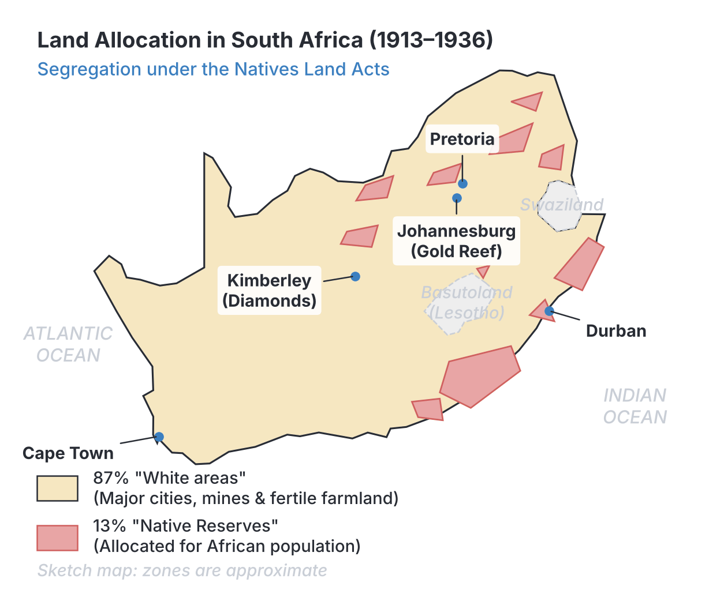
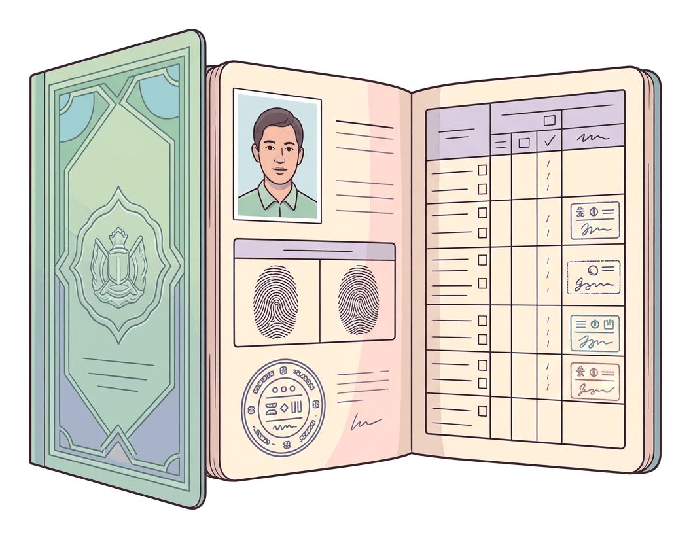
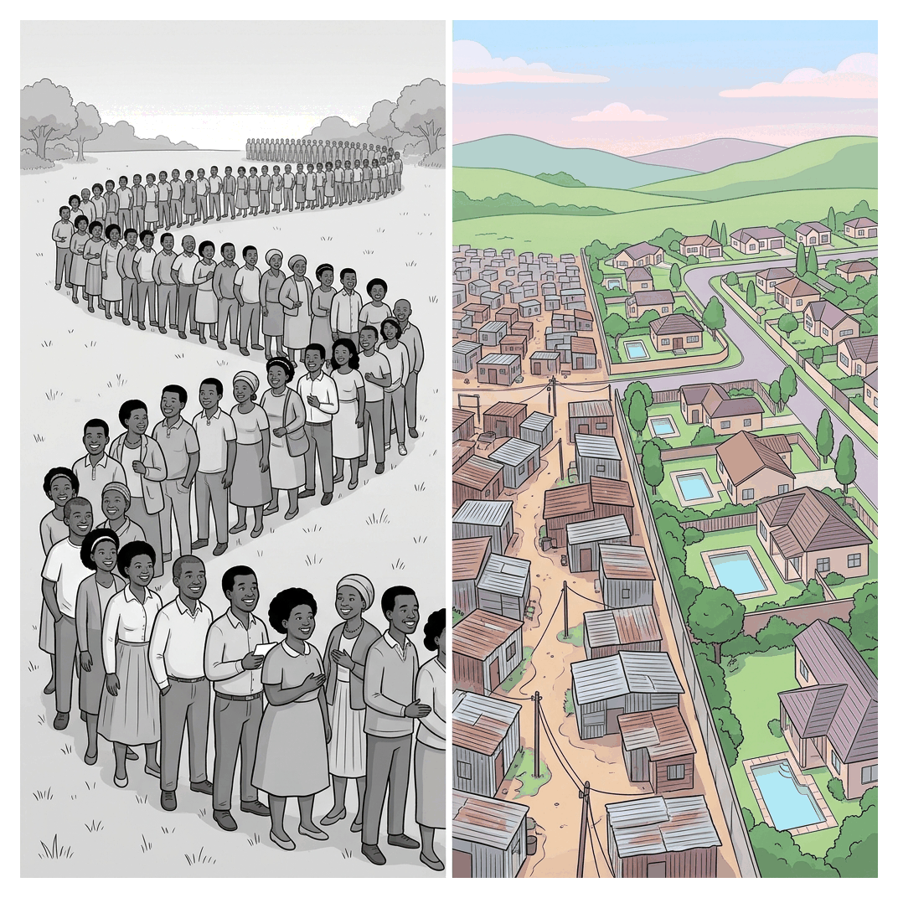

# JAMB History Notes: Apartheid in South Africa

## What JAMB expects

This topic is Section G, Topic 4 of the JAMB History syllabus: Apartheid in South Africa. It covers the following content items:

* a. The origin of Apartheid
* b. Rise of Afrikaner Nationalism
* c. Enactment of Apartheid laws
* d. Internal reactions to Apartheid and the suppression of African Nationalist movements
* e. External reactions to Apartheid, the Frontline States, the Commonwealth of Nations, OAU and the UN
* f. The dismantling of Apartheid
* g. Post-Apartheid developments

By the end of these notes, you should be able to:

1. trace the origin of Apartheid in South Africa; (Objective i)
2. give reasons for the rise of Afrikaner Nationalism; (Objective ii)
3. highlight Apartheid laws; (Objective iii)
4. relate the internal reactions to Apartheid to the African struggle for majority rule; (Objective iv)
5. relate the contributions of African states and international organizations to the fight against Apartheid; (Objective v)
6. identify the steps taken towards the dismantling of Apartheid in South Africa; (Objective vi)
7. assess the post-Apartheid developments in South Africa. (Objective vii)

**Note on the syllabus wording:** Content item 'e' mentions the OAU (Organization of African Unity). The OAU was dissolved and replaced by the African Union (AU) in 2002. Since the fight against apartheid took place before 2002, the OAU is the correct historical body, but post-apartheid South Africa interacts with the AU.

## The origin of Apartheid

**Objective i: trace the origin of Apartheid in South Africa.**

**Apartheid** is an Afrikaans word meaning "apartness" or "separateness". It was the official political and social system in South Africa from 1948 to the early 1990s, based on strict racial segregation and the total dominance of the white minority over the black, "Coloured" (mixed-race), and Indian/Asian populations.

While Apartheid officially began as a government policy in 1948, its roots go back hundreds of years to the earliest European settlements and the economic development of South Africa. 

### 1. Early European Settlement (1652 onwards)
The origins of racial division began in **1652** when the Dutch East India Company set up a supply station at the Cape of Good Hope under Jan van Riebeeck. The Dutch settlers (who later became known as **Boers**, meaning farmers, and eventually **Afrikaners**) took land from the indigenous Khoikhoi and San peoples. They also imported enslaved people from West Africa, Madagascar, and Southeast Asia. Over generations, a strict social order developed where white Europeans held land and power, while black Africans and enslaved people provided cheap labour.

### 2. British Conquest and the Great Trek
In **1806**, the British took control of the Cape Colony. They introduced English law and, in 1833, abolished slavery throughout the British Empire. Many Boers, deeply resenting British rule and the loss of their enslaved labourers, left the Cape in a mass migration known as the **Great Trek** (starting in 1836). 

The Boers moved deep into the interior, fighting bloody wars against African kingdoms (such as the Zulu and Ndebele) and setting up independent Boer Republics (the Transvaal and the Orange Free State). In these republics, their constitutions explicitly stated there would be "no equality between white and black in church or state."

### 3. The Mineral Revolution (Late 19th Century)
The discovery of **diamonds** (1867) and **gold** (1886) transformed South Africa from a farming region into an industrial powerhouse. White-owned mining companies needed massive amounts of extremely cheap labour to make profits. 
* They introduced the **compound system**, forcing black miners to live in prison-like hostels.
* They introduced early **pass laws** to control the movement of black workers and stop them from looking for better-paying jobs.

### 4. The Union of South Africa and Segregation (1910–1947)
Following the South African War (Anglo-Boer War of 1899–1902), the British and the Boers reconciled to form the **Union of South Africa in 1910**. This union was a white man's pact: the black majority was almost entirely excluded from voting or political power. 

Before 1948, the white government passed several harsh segregation laws, laying the foundation for Apartheid:
* **The Mines and Works Act (1911):** Reserved skilled, high-paying jobs in the mines for whites only.
* **The Natives Land Act (1913):** A devastating law that restricted black Africans (who made up over 70% of the population) to owning land in only 7% (later expanded to about 13%) of the country, known as "Native Reserves". This forced many Africans to seek low-wage work on white farms or in mines just to survive.
* **The Native (Urban Areas) Act (1923):** Declared that cities were for whites, and black people were only allowed in towns to serve white economic needs.

Although segregation was already harsh, it was disorganised. It was only after the **1948 election** that segregation was turned into a rigid, structured, and brutal legal system called Apartheid.

## Rise of Afrikaner Nationalism

**Objective ii: give reasons for the rise of Afrikaner Nationalism.**

Afrikaner Nationalism was a powerful political and cultural movement that believed Afrikaners (white South Africans of Dutch, German, and French Huguenot descent) were a distinct, chosen people with a God-given right to rule South Africa. This ideology was the driving force behind the creation of Apartheid. 

Several key factors caused Afrikaner Nationalism to rise and eventually capture state power in 1948:

### 1. Bitterness over the South African War (1899–1902)
During the Anglo-Boer War, the British Empire defeated the Boer Republics. To force the Boers to surrender, the British used a "scorched earth" policy (burning Boer farms) and placed Boer women and children in concentration camps, where tens of thousands died of disease and starvation. This created a deep, lasting hatred of the British and a fierce desire among Afrikaners to regain political control of their country.

### 2. Fear of British Cultural and Economic Domination
After the Union in 1910, English-speaking white South Africans dominated the economy, banking, and mining industries. English was the primary language of business. Afrikaners felt treated as second-class white citizens in their own land. Nationalist leaders pushed to elevate the **Afrikaans language** and culture to prevent their people from being absorbed into British culture.

### 3. The "Poor White" Problem
During the 1920s and the Great Depression of the 1930s, hundreds of thousands of Afrikaner farmers went bankrupt and moved to the cities. These uneducated, unskilled Afrikaners found themselves competing for factory jobs with black African workers who would work for lower wages. Afrikaner politicians stirred up fear that these "poor whites" would mix with black people and lose their racial purity. They promised that an Afrikaner government would protect white jobs and guarantee a high standard of living for all whites.

### 4. The "Swart Gevaar" (Black Peril)
Afrikaners were a minority within a country overwhelmingly populated by black Africans. Nationalist politicians campaigned on the fear of the **"Swart Gevaar"** (Black Peril)—the fear that if black South Africans were ever given equal rights, they would outvote the whites, take over the country, and destroy European civilisation. They argued that strict separation (Apartheid) was the only way white South Africans could survive.

### 5. Religious Justification (The Dutch Reformed Church)
The Afrikaner Dutch Reformed Church provided a religious backing for racism. Church leaders twisted Calvinist theology to preach that Afrikaners were God's "chosen people" (like the Israelites in the Old Testament) and that God had created different races to be kept separate. 

### 6. The Role of the Broederbond and the National Party
* **The Broederbond (Brotherhood):** Founded in 1918, this was a highly influential, secret, men-only Afrikaner society. It placed Afrikaner nationalists in key positions in schools, universities, the civil service, and the church to promote Afrikaner dominance.
* **The National Party (NP):** Originally founded in 1914, the NP became the political voice of Afrikaner nationalism. Under the leadership of **D.F. Malan**, the NP fought the 1948 whites-only election with the slogan "Apartheid". 

In **1948**, capitalizing on white fears and Afrikaner unity, Malan’s National Party won the election. Once in power, they began passing laws to make Apartheid a permanent reality.

## Enactment of Apartheid laws

**Objective iii: highlight Apartheid laws.**

Once the National Party took power in 1948, it enacted hundreds of laws to classify people by race, dictate where they could live, control their movements, and ensure white supremacy in every area of life. 

The core Apartheid laws can be grouped into four categories: 

### 1. Race Classification and Social Separation
* **The Prohibition of Mixed Marriages Act (1949):** Made it illegal for a white person to marry a person of another race.
* **The Immorality Amendment Act (1950):** Banned sexual relations between white people and people of other races. Police actively raided homes to enforce this.
* **The Population Registration Act (1950):** The foundation of Apartheid. It required every South African to be classified and registered by race from birth. The primary groups were White, Native (Black/Bantu), and Coloured (mixed race). Asian/Indian was later added. A person's racial classification determined their entire life: where they could live, work, and go to school.
* **The Reservation of Separate Amenities Act (1953):** Legalized "petty apartheid". It forced the strict segregation of all public facilities—beaches, buses, trains, toilets, parks, and even post office counters. The law explicitly stated that facilities for non-whites did not need to be equal to those for whites.

### 2. Residential and Spatial Segregation
* **The Group Areas Act (1950):** Divided urban areas into racially segregated zones. It was illegal to live or own a business in an area designated for another race. The government used this act to forcibly remove millions of black, Coloured, and Indian people from desirable areas (like Sophiatown in Johannesburg and District Six in Cape Town) and bulldoze their homes, relocating them to barren townships on the edges of cities.

### 3. Pass Laws and Influx Control
* **The Natives (Abolition of Passes and Co-ordination of Documents) Act (1952):** Despite the misleading name, this act made pass laws much harsher. It required all black South Africans over the age of 16 to carry a passbook (known as a *dompas* or "dumb pass") at all times. The passbook contained fingerprints, photo, employment record, and permission from a white official to be in a white area. If a black person was caught without their passbook, or if it lacked the right stamp, they were instantly arrested and jailed.

### 4. Education and Political Disenfranchisement
* **The Bantu Education Act (1953):** Designed by H.F. Verwoerd (the "Architect of Apartheid"), this law brought black schools under state control. It established a grossly underfunded, inferior curriculum for black children, designed solely to teach them basic skills needed for manual labour and to accept a subordinate place in society.
* **The Suppression of Communism Act (1950):** Defined "communism" so broadly that it included any action aimed at causing political, industrial, or social change in South Africa. The government used it to ban anti-apartheid organisations and silence critics without trial.
* **The Promotion of Bantu Self-Government Act (1959):** This law aimed to strip black South Africans of their citizenship entirely. It divided the black population into ten distinct ethnic groups and assigned each a rural "Homeland" or **Bantustan**. The government claimed these homelands would eventually become independent countries. In reality, they were overcrowded, impoverished rural dumping grounds where families of migrant workers were forced to live.

## Internal reactions to Apartheid and the suppression of African Nationalist movements

**Objective iv: relate the internal reactions to Apartheid to the African struggle for majority rule.**

The struggle against Apartheid was long and bloody. As the government passed harsher laws, black South Africans and their allies escalated their resistance from polite petitions to mass defiance, and eventually to armed struggle and making the country "ungovernable."

### 1. Early Resistance: Petitions and Peaceful Protest (1910s–1940s)
In 1912, the **South African Native National Congress (SANNC)**—which became the **African National Congress (ANC)** in 1923—was formed. In its early decades, the ANC was led by middle-class professionals who relied on writing letters, petitions, and sending delegations to London to ask for rights. These methods failed to stop the tightening of segregation.

### 2. The Shift to Mass Action (1940s–1950s)
In 1944, a younger, more militant generation (including **Nelson Mandela, Oliver Tambo, and Walter Sisulu**) formed the **ANC Youth League**. They pushed the ANC to adopt mass action.
* **The Defiance Campaign (1952):** The ANC and its allies launched a campaign of peaceful civil disobedience. Thousands deliberately broke apartheid laws—sitting on "whites only" benches or refusing to carry passbooks—to fill up the prisons. The government responded with harsh new laws and whippings.
* **The Freedom Charter (1955):** Thousands of delegates of all races gathered at Kliptown and adopted the Freedom Charter. It famously declared: *"South Africa belongs to all who live in it, black and white."* The government arrested 156 leaders and charged them with High Treason (the Treason Trial), though all were eventually acquitted.
* **Formation of the PAC (1959):** Some activists, led by **Robert Sobukwe**, felt the ANC was too heavily influenced by white communists and Indians. They broke away to form the **Pan Africanist Congress (PAC)**, advocating a more aggressive, "Africa for Africans" approach.

### 3. The Turning Point: Sharpeville and Armed Struggle (1960s)
* **The Sharpeville Massacre (March 21, 1960):** The PAC organized a peaceful nationwide protest against the pass laws. At the Sharpeville police station, police opened fire on the unarmed crowd, shooting most in the back as they fled. **69 people were killed** and over 180 wounded.
* **Suppression:** The massacre caused global outrage. The government reacted by declaring a State of Emergency and **banning both the ANC and the PAC**, driving them underground.
* **Armed Struggle:** Realizing peaceful protest was impossible, the liberation movements turned to violence. The ANC formed an armed wing called **Umkhonto we Sizwe (MK)**, led by Nelson Mandela, to carry out sabotage on government installations. The PAC formed an armed wing called **Poqo**. 
* **The Rivonia Trial (1963–1964):** The police discovered MK’s secret headquarters at a farm in Rivonia. Nelson Mandela, Walter Sisulu, Govan Mbeki, and others were tried for sabotage and sentenced to life imprisonment on **Robben Island**. With the leadership in jail or in exile, internal resistance was severely weakened for a decade.

### 4. The Black Consciousness Movement and Soweto (1970s)
* **Black Consciousness:** In the late 1960s and 1970s, **Steve Biko** founded the Black Consciousness Movement (BCM) among university students. He taught that black people must free their minds from feelings of inferiority before they could free themselves politically. Biko was brutally beaten to death in police custody in 1977.
* **The Soweto Uprising (June 16, 1976):** The government ordered that black schools must use Afrikaans—seen as the language of the oppressor—for teaching certain subjects. Thousands of schoolchildren in the Soweto township marched in protest. The police opened fire, killing Hector Pieterson and hundreds of others in the months of rioting that followed. Soweto reignited the struggle; thousands of youths fled the country to join MK in exile.

### 5. Making the Country Ungovernable (1980s)
In the 1980s, internal resistance peaked.
* **The United Democratic Front (UDF)** was formed in 1983 as a broad alliance of trade unions, churches, and student groups to protest against a new fake constitution. 
* Black trade unions organized massive strikes that crippled the economy.
* Townships exploded in daily violent clashes with the army. The ANC, broadcasting from exile, called on South Africans to make the country "ungovernable." 
* The government responded by declaring repeated States of Emergency, putting thousands in detention without trial, and using army hit squads.

[IMAGE: A timeline graphic titled "Internal Resistance to Apartheid". Left to right milestones: 1912 (ANC Formed), 1952 (Defiance Campaign), 1955 (Freedom Charter), 1960 (Sharpeville Massacre), 1961 (MK Armed Struggle begins), 1964 (Mandela sentenced to life), 1976 (Soweto Uprising), 1983 (UDF Formed). The timeline should have small illustrative icons for each event, such as a passbook on fire for Sharpeville, or a fist for Soweto. Clean, flat textbook style.]

## External reactions, the Frontline States, the Commonwealth, OAU and the UN

**Objective v: relate the contributions of African states and international organizations to the fight against Apartheid.**

The internal struggle was heavily supported by massive international pressure. Over time, the Apartheid regime became a global pariah (outcast).

### 1. The Frontline States
The **Frontline States (FLS)** were a coalition of independent African countries geographically close to South Africa: **Angola, Botswana, Mozambique, Tanzania, Zambia, and Zimbabwe**.
* **Support:** They provided safe havens, training bases, and operational headquarters for ANC and PAC guerrilla fighters (like MK) in exile. They also took in thousands of South African refugees.
* **Sacrifice:** Supporting the liberation struggle came at a massive cost. The Apartheid military constantly bombed these countries, launched cross-border raids to assassinate activists, and funded rebel groups (like UNITA in Angola and RENAMO in Mozambique) to destabilize their economies. 

**Note on Nigeria’s Role:** Although geographically far, **Nigeria** is widely considered by historians as an "honorary" Frontline State. Successive Nigerian governments (especially under Murtala/Obasanjo and later military regimes) contributed hundreds of millions of dollars to the ANC, gave passports to exiled leaders, funded anti-apartheid campaigns worldwide, and provided scholarships to South African students. Nigeria also fiercely boycotted companies dealing with South Africa.

### 2. The Organization of African Unity (OAU)
Formed in 1963, the OAU (which became the African Union in 2002) made the total liberation of the African continent its primary goal.
* It excluded South Africa from all its activities.
* It set up the **OAU Liberation Committee** (headquartered in Dar es Salaam, Tanzania), which provided weapons, money, and diplomatic support to the ANC, PAC, and other liberation movements across Southern Africa.

### 3. The Commonwealth of Nations
The Commonwealth (the organization of former British colonies) played a major role in isolating South Africa.
* In **1961**, facing massive criticism from newly independent African and Asian member states over its racial policies, South Africa was forced to withdraw from the Commonwealth.
* **The Gleneagles Agreement (1977):** Commonwealth leaders signed an agreement to completely isolate South Africa in international **sports** (like rugby and cricket). Because white South Africans loved sports, this boycott was a deep psychological blow.
* In the 1980s, the Commonwealth sent the **Eminent Persons Group** to try to negotiate an end to apartheid and pushed heavily for global economic sanctions.

### 4. The United Nations (UN)
The UN became the central platform for global anti-apartheid diplomacy, largely driven by the Afro-Asian bloc.
* In **1973**, the UN General Assembly declared Apartheid a **"crime against humanity"**.
* In **1974**, South Africa was suspended from participating in the UN General Assembly.
* **Arms Embargo:** After the Soweto Uprising, the UN Security Council passed **Resolution 418 in 1977**, making it illegal for any country to sell weapons to South Africa.
* The UN encouraged **academic, cultural, and economic boycotts**. By the late 1980s, under pressure from anti-apartheid movements in their own countries, many foreign banks stopped lending to South Africa, and international corporations pulled their businesses out of the country (divestment).

## The dismantling of Apartheid

**Objective vi: identify the steps taken towards the dismantling of Apartheid in South Africa.**

By the late 1980s, Apartheid was collapsing. 
1. **Economic crisis:** International sanctions, withdrawal of foreign banks, and internal strikes were ruining the economy.
2. **Ungovernability:** The state could not control the black townships despite sending in the army.
3. **End of the Cold War:** The collapse of the Soviet Union meant the South African government could no longer claim to the West that it was defending Africa against communism. 

### The Failed Reforms of P.W. Botha
In the 1980s, State President **P.W. Botha** tried to make minor reforms to reduce pressure. He introduced a **Tricameral Parliament** in 1984, which gave limited voting rights to Coloured and Indian citizens in separate chambers, but still completely excluded the black majority. The plan failed and sparked worse violence. In 1989, Botha suffered a stroke and was replaced by **F.W. de Klerk**.

### The Steps to Dismantling the System
F.W. de Klerk realised that maintaining white minority rule by force was no longer possible. He took dramatic steps:

1. **The Historic Speech (February 2, 1990):** De Klerk stunned the world by unbanning the ANC, the PAC, the South African Communist Party (SACP), and other liberation movements. He also announced the impending release of political prisoners.
2. **Release of Nelson Mandela (February 11, 1990):** After 27 years in prison, Mandela walked free. This moment signaled the point of no return for Apartheid.
3. **Repeal of Apartheid Laws (1991):** The government officially cancelled the pillars of Apartheid, including the Population Registration Act, the Group Areas Act, and the Land Acts.
4. **Negotiations (CODESA):** The government, the ANC, and other parties began official negotiations for a new constitution at the Convention for a Democratic South Africa (CODESA). 
5. **Violence and Crisis:** The negotiation period (1990–1994) was incredibly bloody. Violence erupted between ANC supporters and the Zulu-nationalist Inkatha Freedom Party (IFP), secretly funded by elements of the white security forces (the "Third Force") to derail peace. Massacres occurred at Boipatong and Bisho, and popular ANC leader Chris Hani was assassinated in 1993, almost causing a civil war. Mandela's calm leadership prevented chaos.
6. **The First Democratic Elections (April 27, 1994):** Following a compromise, South Africa held its first-ever non-racial, democratic election. Millions of black South Africans voted for the first time. The ANC won a sweeping victory, and on May 10, 1994, **Nelson Mandela was inaugurated as the first black President of South Africa**, officially ending Apartheid. 

F.W. de Klerk and Nelson Mandela were jointly awarded the **Nobel Peace Prize in 1993** for their peaceful termination of the apartheid regime.

## Post-Apartheid developments

**Objective vii: assess the post-Apartheid developments in South Africa.**

Since 1994, South Africa has functioned as a multi-racial democracy, often called the "Rainbow Nation". However, while it achieved remarkable political successes, it has struggled to undo the deep economic damage caused by Apartheid.

### Political Achievements and Nation-Building
* **Government of National Unity (1994–1999):** To ease white fears, Mandela formed a coalition government that included former oppressors (F.W. de Klerk served as one of the Deputy Presidents).
* **The 1996 Constitution:** South Africa adopted a new constitution, widely considered one of the most progressive in the world, guaranteeing equal rights, dignity, and socio-economic rights to all citizens, with a strong Constitutional Court.
* **The Truth and Reconciliation Commission (TRC):** Chaired by Archbishop Desmond Tutu, the TRC was set up to heal the nation. Victims of Apartheid violence told their stories, and perpetrators of political crimes could request amnesty (forgiveness) if they confessed fully. While controversial (some victims felt justice was denied), it helped avoid a bloody racial revenge war.
* **International Reintegration:** South Africa was welcomed back into the UN, joined the OAU/AU, the Commonwealth, and the SADC. It successfully hosted global events like the 1995 Rugby World Cup and the 2010 FIFA World Cup, and became a member of the BRICS economic group.

### Economic and Social Policies
* **RDP and GEAR:** The ANC government initially launched the **Reconstruction and Development Programme (RDP)**, which successfully built millions of homes and provided clean water and electricity to poor black areas. They later shifted to **GEAR** (Growth, Employment and Redistribution) to stabilize the national economy and attract foreign investment.
* **Black Economic Empowerment (BEE):** Policies were introduced to force companies to give ownership and high-level jobs to black South Africans to fix the economic imbalance.

### Ongoing Challenges (Neutral Assessment)
Despite political freedom, post-Apartheid South Africa faces severe, ongoing challenges:
* **High Inequality and Poverty:** South Africa remains one of the most unequal societies on earth (having one of the highest Gini coefficients). While a black middle and upper class has emerged, millions of black South Africans still live in severe poverty in townships and rural areas, while the white minority retains a large share of corporate wealth.
* **Unemployment:** The official unemployment rate is exceptionally high, often exceeding 30%, disproportionately affecting black youth.
* **Land Reform:** Reversing the 1913 Land Act has been slow. The government’s "willing-buyer, willing-seller" policy has struggled to return land to black farmers, causing political frustration.
* **Crime and Violence:** High unemployment and historical trauma have contributed to very high rates of violent crime and periodic xenophobic (anti-foreigner) attacks against other African immigrants.
* **Health and the HIV/AIDS Crisis:** In the late 1990s and early 2000s, South Africa faced a massive HIV/AIDS epidemic. The crisis was made worse by early government denial (especially under President Thabo Mbeki, who delayed providing life-saving ARV drugs). Today, South Africa has the largest HIV treatment programme in the world.
* **Corruption:** Governance has been hampered by serious corruption scandals. During the presidency of Jacob Zuma (2009–2018), a massive corruption network known as "State Capture" severely damaged state-owned enterprises and public trust.

## Key terms

| Term | Meaning |
| --- | --- |
| **Apartheid** | An Afrikaans word meaning "separateness"; the official policy of strict racial segregation and white supremacy in South Africa (1948–1990s). |
| **Afrikaner** | A white South African of Dutch, German, or French descent whose native language is Afrikaans. |
| **Boer** | An early term for Afrikaners, originally meaning "farmer" in Dutch. |
| **Bantustan / Homeland** | Ten rural territories set aside for black South Africans under Apartheid, to strip them of their citizenship. |
| **Pass Laws** | Laws requiring black people over 16 to carry a passbook (*dompas*) to control their movement in white areas. |
| **Dompas** | The identity document black South Africans were forced to carry at all times. |
| **ANC** | African National Congress; the main liberation movement fighting against Apartheid, now the ruling political party. |
| **PAC** | Pan Africanist Congress; a liberation group that broke away from the ANC in 1959. |
| **Umkhonto we Sizwe (MK)** | "Spear of the Nation"; the armed, military wing of the ANC, founded by Nelson Mandela. |
| **Frontline States** | African countries bordering or near South Africa that actively supported the liberation struggle. |
| **TRC** | Truth and Reconciliation Commission; set up after Apartheid to uncover human rights abuses and promote national healing. |

## Exam tips and common mistakes

* **Do not confuse the 1913 Land Act with 1948 Apartheid.** The Land Act (giving 13% of land to blacks) was early *segregation* passed before the National Party won power. Institutional *Apartheid* officially began in 1948.
* **Sharpeville vs. Soweto:** 
  * *Sharpeville (1960)* was a protest by adults against **pass laws**. It led to the banning of the ANC/PAC and the start of the armed struggle. 
  * *Soweto (1976)* was a protest by schoolchildren against **Afrikaans** in schools.
* **Know the difference between the ANC and MK:** The ANC is the political organization; MK (Umkhonto we Sizwe) was its armed wing.
* **Nigeria's role:** JAMB loves asking about Nigeria's role in African liberation. Remember that Nigeria gave massive financial and diplomatic support to the anti-apartheid movement and is considered a key external actor.
* **The architect of Apartheid:** H.F. Verwoerd is often called the architect of Apartheid, while F.W. de Klerk is the president who unbanned the ANC and started the dismantling process.

## Quick summary

1. Apartheid's roots lie in centuries of Dutch and British colonial rule, the demand for cheap mining labour, and early segregation laws like the 1913 Land Act.
2. Afrikaner Nationalism grew out of bitterness over the Boer War, fear of English cultural domination, the "Poor White" problem, and fear of the black majority, culminating in the 1948 National Party election victory.
3. Apartheid laws strictly segregated society by race (Population Registration, Group Areas Acts), controlled movement (Pass Laws), and provided inferior education to black citizens (Bantu Education Act).
4. Internal resistance evolved from peaceful ANC petitions to civil disobedience (Defiance Campaign), armed struggle (MK after Sharpeville in 1960), and mass student uprisings (Soweto in 1976).
5. Externally, the Frontline States and the OAU provided bases and funding; the UN and Commonwealth imposed arms embargoes and sports/economic boycotts to isolate the regime.
6. Apartheid was dismantled due to internal ungovernability and external sanctions. F.W. de Klerk unbanned the liberation movements and released Mandela in 1990, leading to democratic elections in 1994.
7. Post-Apartheid South Africa successfully built a democratic constitution and held the Truth and Reconciliation Commission, but still battles high inequality, unemployment, and land distribution issues.

## Practice questions

**1. The institutionalized system of racial segregation in South Africa officially began when the National Party won the election in**
- A. 1910
- B. 1913
- C. 1948
- D. 1960

**Answer: C.** The National Party, running on the platform of Apartheid, won the whites-only election in 1948. 1910 was the Union of South Africa, and 1913 was the Natives Land Act (segregation, but before formal Apartheid).

**2. A major reason for the rise of Afrikaner Nationalism was the**
- A. desire to integrate with British culture
- B. poverty among uneducated Afrikaners competing with black labour
- C. support from the United Nations for a white-only state
- D. success of the African National Congress

**Answer: B.** The "Poor White" problem created fear among Afrikaners that they would be out-competed by cheap black labour, pushing them to support Nationalist policies protecting white jobs. The temptation is to think of British culture (Option A), but Afrikaners feared and rejected British culture, they did not want to integrate with it.

**3. Which of the following Apartheid laws forced black South Africans to carry identity documents controlling their movement?**
- A. The Group Areas Act
- B. The Bantu Education Act
- C. The Population Registration Act
- D. The Pass Laws (Abolition of Passes Act)

**Answer: D.** The Pass Laws required black South Africans to carry a 'dompas' at all times. The Group Areas Act (Option A) dealt with where people could live, not the carrying of passbooks.

**4. The Sharpeville Massacre of 1960 was a turning point in South African history because it led directly to**
- A. the immediate release of Nelson Mandela
- B. the banning of the ANC and PAC, leading them to start an armed struggle
- C. the adoption of the Freedom Charter
- D. the end of Apartheid

**Answer: B.** After the massacre, the government banned the liberation movements, making peaceful protest impossible and forcing them to form armed wings (MK and Poqo). Option C (Freedom Charter) happened earlier in 1955.

**5. The Soweto Uprising of 1976 was primarily triggered by**
- A. the forced removal of residents from District Six
- B. the assassination of Steve Biko
- C. the requirement that black students be taught in Afrikaans
- D. the imprisonment of Nelson Mandela

**Answer: C.** Students marched in protest against the government's directive making Afrikaans a compulsory language of instruction in black schools. Steve Biko (Option B) was killed a year later in 1977.

**6. Which of the following groups of countries provided safe havens and training bases for anti-apartheid fighters?**
- A. The Economic Community of West African States
- B. The Frontline States
- C. The Maghreb Union
- D. The Allied Powers

**Answer: B.** The Frontline States (such as Angola, Zambia, and Tanzania) hosted liberation movements. You might confuse this with ECOWAS (Option A) because Nigeria was heavily involved, but the Frontline States were the Southern African base.

**7. An international measure taken by the United Nations to cripple the Apartheid regime was the**
- A. Gleneagles Agreement
- B. Truth and Reconciliation Commission
- C. mandatory arms embargo of 1977
- D. military invasion of Pretoria

**Answer: C.** The UN passed Resolution 418, placing a mandatory arms embargo on South Africa. The Gleneagles Agreement (Option A) was made by the Commonwealth, not the UN.

**8. The dismantling of Apartheid was significantly accelerated in February 1990 when**
- A. the Tricameral Parliament was created
- B. P.W. Botha declared a State of Emergency
- C. F.W. de Klerk unbanned the liberation movements and released Nelson Mandela
- D. the United Nations sent peacekeeping troops

**Answer: C.** De Klerk's speech legalizing the ANC and releasing Mandela marked the irreversible start of the dismantling process. Botha's Tricameral Parliament (Option A) was a failed reform in the 1980s.

**9. The Truth and Reconciliation Commission (TRC) was established in post-Apartheid South Africa to**
- A. try and execute former Apartheid leaders
- B. investigate human rights abuses and promote national healing
- C. redistribute land to black farmers
- D. force white South Africans to leave the country

**Answer: B.** The TRC, chaired by Desmond Tutu, aimed to uncover the truth about past abuses and grant amnesty to those who confessed, helping the nation heal without a civil war. Option A is incorrect because the TRC was not a revenge tribunal; it focused on restorative justice.

**10. A major socio-economic challenge that continues to face post-Apartheid South Africa is**
- A. fighting a war against the Frontline States
- B. widespread extreme inequality and high unemployment
- C. a lack of a democratic constitution
- D. exclusion from the African Union

**Answer: B.** Despite political liberation, South Africa struggles with massive economic inequality and unemployment. Option D is incorrect because South Africa is a prominent member of the AU.

<!-- COVERAGE
obj i | The origin of Apartheid
obj ii | Rise of Afrikaner Nationalism
obj iii | Enactment of Apartheid laws
obj iv | Internal reactions to Apartheid and the suppression of African Nationalist movements
obj v | External reactions, the Frontline States, the Commonwealth, OAU and the UN
obj vi | The dismantling of Apartheid
obj vii | Post-Apartheid developments
item a | The origin of Apartheid
item b | Rise of Afrikaner Nationalism
item c | Enactment of Apartheid laws
item d | Internal reactions to Apartheid and the suppression of African Nationalist movements
item e | External reactions, the Frontline States, the Commonwealth, OAU and the UN
item f | The dismantling of Apartheid
item g | Post-Apartheid developments
-->
