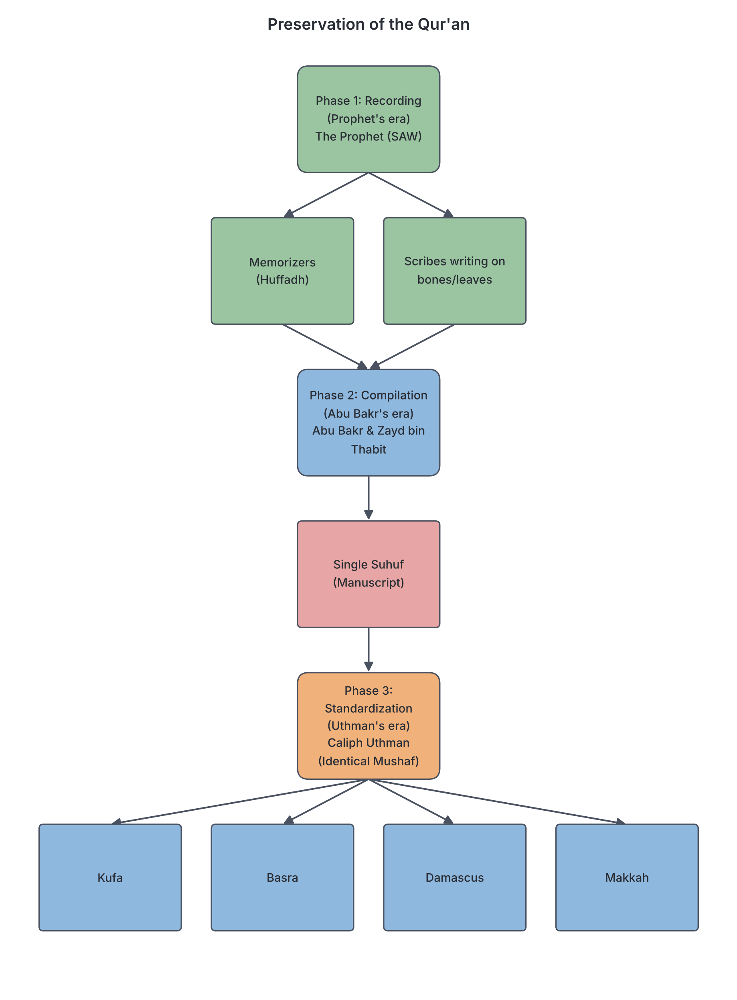

# JAMB Irk Notes: Preservation of the Glorious Qur’ān

## What JAMB expects

This topic is Part I, Section A, Topic 1b of the JAMB syllabus: Preservation of the Glorious Qur’ān. It has three main content items:

*   (i) Recording, compilation and standardization of the Qur’ān.
*   (ii) Differences between Makkah and Madinan suwar.
*   (iii) The role played by the Companions of the Prophet (SAW) on the collection and compilation of the Qur’ān.

By the end of these notes, you should be able to:
1.  Analyse how the Glorious Qur’ān was recorded, compiled and standardized.
2.  Differentiate between Makkan and Madinan suwar.
3.  Evaluate the role played by the companions of the Prophet (SAW) on the collection and compilation of the Qur’ān.

## Recording, compilation and standardization of the Qur’ān

**Objective i: analyse how the Glorious Qur’ān was recorded, compiled and standardized.**
**Content (i): Recording, compilation and standardization of the Qur’ān**

The preservation of the Qur’ān took place in three major historical stages: recording during the life of Prophet Muhammad (SAW), compilation into a single book during the time of Caliph Abu Bakr (RA), and standardization during the time of Caliph Uthman (RA). 

Islamic teaching holds that the Qur’ān has been perfectly preserved, fulfilling the promise stated in the Qur'an: *"Lo! We, even We, reveal the Reminder, and lo! We verily are its Guardian"* (Pickthall's translation, Q.15:9).

### 1. Recording during the time of Prophet Muhammad (SAW)
During the life of Prophet Muhammad (SAW), the Qur’ān was preserved in two main ways: **memorization** (in the hearts of the people) and **writing** (on various materials).

*   **Memorization (Hifdh):** The Arabs had a very strong culture of oral memory. Whenever a verse was revealed, the Prophet (SAW) would recite it to his Companions. They would memorize it and recite it in their daily prayers (*salah*).
*   **Dictation to Scribes:** The Prophet (SAW) could not read or write, so he appointed special scribes, known as the Scribes of the Revelation (*Kuttāb al-Wahy*). 
*   **Writing materials:** Paper was not readily available in Arabia. The scribes wrote the verses on flat stones, pieces of leather, shoulder blades of animals (bone), parchment, and the broad stalks of palm leaves.
*   **Verification:** Whenever a scribe wrote down a newly revealed verse, the Prophet (SAW) would ask him to read it back to ensure there were no mistakes. The Prophet (SAW) also instructed them on exactly where to place the new verses within the existing *suwar* (chapters).

By the time the Prophet (SAW) passed away, the entire Qur’ān had been written down and memorized, but it was scattered on different materials and not yet bound in a single book.

[IMAGE: A flat, textbook-style illustration showing early writing materials of the Qur'an. A wooden table with a piece of flat, bleached animal bone, a wide dried palm frond, and a scroll of leather parchment, all bearing faint Arabic calligraphy. A traditional reed pen (qalam) and a small inkwell sit beside them. Labels to add later: "Shoulder bone", "Leather parchment", "Palm stalk", "Reed pen and ink". Clean flat textbook style, white background.]

### 2. Compilation during the time of Abu Bakr (RA)
The first formal compilation of the Qur’ān into a single bound manuscript (*Suhuf*) happened shortly after the Prophet's death, during the caliphate of Abu Bakr (RA).

**Step-by-step process of Compilation:**
1.  **The Trigger Event:** In 632 CE, during the Battle of Yamāmah against Musaylimah (a false prophet), many Companions who had memorized the entire Qur’ān (*Huffādh*) were killed. 
2.  **Umar's Suggestion:** Umar bin al-Khattab (RA) grew worried that if more memorizers died, parts of the Qur’ān might be lost. He went to Caliph Abu Bakr and suggested compiling the Qur’ān into one book.
3.  **Abu Bakr's Hesitation:** At first, Abu Bakr hesitated, saying, "How can I do something that the Messenger of Allah did not do?" However, Umar convinced him that it was a good and necessary action for the preservation of Islam.
4.  **Zayd bin Thabit Appointed:** Abu Bakr appointed **Zayd bin Thābit**, one of the chief scribes of the Prophet, to lead the project. Zayd was chosen because of his youth, intelligence, excellent memory, and his experience writing down the revelation for the Prophet.
5.  **The Strict Method:** Zayd did not rely on his memory alone. For any verse to be included, he required two conditions: it had to be written down in the presence of the Prophet (SAW), and there had to be two reliable witnesses who had heard it directly from the Prophet.
6.  **The Result:** The scattered writings were gathered into one complete manuscript (the *Suhuf*). This manuscript was kept by Abu Bakr until his death, then passed to Umar, and after Umar's death, it was kept by his daughter **Hafsah** (who was also a widow of the Prophet).

### 3. Standardization during the time of Uthman (RA)
The Islamic empire expanded rapidly, reaching non-Arab lands like Persia, Syria, and Armenia. By the time of the third Caliph, Uthman bin Affan (RA), a new problem arose: differences in pronunciation.

**Step-by-step process of Standardization:**
1.  **The Trigger Event:** During a military campaign in Azerbaijan and Armenia, a Companion named **Hudhayfah bin al-Yamān** noticed soldiers from Syria and Iraq arguing bitterly over the correct pronunciation of the Qur’ān. The Arabic language had different dialects, and new non-Arab converts were making mistakes.
2.  **Hudhayfah's Warning:** Hudhayfah rushed back to Madinah and warned Caliph Uthman: "O Chief of the Believers! Save this nation before they differ about the Book as the Jews and the Christians did before them."
3.  **The Committee:** Uthman borrowed the original compiled manuscript (*Suhuf*) from Hafsah. He appointed a committee of four experts, led again by **Zayd bin Thābit**, along with Abdullah bin az-Zubayr, Sa‘id bin al-As, and Abdur-Rahman bin al-Harith.
4.  **The Rule of Dialect:** Uthman instructed them: "If you disagree with Zayd bin Thābit on any point of the Qur’ān, write it in the dialect of the Quraysh, because it was revealed in their tongue."
5.  **Distribution:** The committee produced several standard master copies (often said to be between four and seven). This standard text is known as the **Mushaf Uthmānī**.
6.  **Unifying the Ummah:** Uthman sent these master copies to the major centres of the Islamic world (such as Makkah, Kufa, Basra, and Damascus), keeping one in Madinah. To prevent any future disunity, he ordered all other variant personal copies or fragments to be burnt or destroyed.

## Differences between Makkan and Madinan suwar

**Objective ii: differentiate between Makkan and Madinan suwar.**
**Content (ii): Differences between Makkah and Madinan suwar**

The 114 *suwar* (chapters) of the Qur’ān are broadly divided into two categories based on *when* they were revealed in relation to the **Hijrah** (the Prophet's migration from Makkah to Madinah in 622 CE). 

*   **Makkan suwar (Makki):** Verses and chapters revealed **before** the Hijrah. Even if the Prophet was travelling outside Makkah, if it was before the migration, it is classified as Makkan.
*   **Madinan suwar (Madani):** Verses and chapters revealed **after** the Hijrah. Even if a verse was revealed inside Makkah (like during the Conquest of Makkah), it is classified as Madinan because it came after the Hijrah.

Knowing the difference is essential in *Tafsīr* (exegesis) because it shows the historical context and the gradual development of Islamic law.

### Comparison Table: Makkan vs. Madinan Suwar

| Feature | Makkan Suwar (Makki) | Madinan Suwar (Madani) |
| :--- | :--- | :--- |
| **Time of Revelation** | Revealed **before** the Hijrah. | Revealed **after** the Hijrah. |
| **Number** | 86 suwar (about two-thirds of the Qur’ān). | 28 suwar (about one-third of the Qur’ān). |
| **Length of Verses/Chapters** | Generally have short, rhythmic, and poetic verses (*ayat*) and shorter chapters. | Generally have long, detailed verses and longer chapters (e.g., al-Baqarah, an-Nisa). |
| **Main Themes** | Focus on basics of faith: *Tawhid* (Oneness of Allah), the Day of Judgement, Heaven and Hell, and stories of past Prophets. | Focus on laws and rules: marriage, inheritance, fasting, zakah, criminal law, and rules of war and peace. |
| **Form of Address** | Usually address humanity with: *"O mankind!"* (Yā ayyuhā an-nās). | Usually address the Muslims with: *"O you who believe!"* (Yā ayyuhā alladhīna āmanū). |
| **Key Opponents Addressed** | Idolaters (polytheists) of Makkah. | Hypocrites (*Munafiqun*) and the People of the Book (Jews and Christians). |
| **Prostration (Sajdah)** | Contains the verses that require physical prostration (*Ayat as-Sajdah*). | Does not generally contain verses of prostration. |

*Note for exams:* While the syllabus spells it "Makkah and Madinan", most textbooks use the adjectives "Makkan" and "Madinan" (or Makki and Madani).

## The Role of the Companions in Preservation

**Objective iii: evaluate the role played by the companions of the Prophet (SAW) on the collection and compilation of the Qur’ān.**
**Content (iii): The role played by the Companions of the Prophet (SAW)...**

The Companions (*Sahabah*) were instrumental in ensuring the Qur’ān reached future generations exactly as it was revealed. Their roles can be divided into individual contributions and group efforts.

### The Role of Groups of Companions
1.  **The Huffādh (The Memorizers):** Many Companions dedicated their lives to memorizing the Qur’ān perfectly. Famous memorizers included Ubayy bin Ka‘b, Mu‘adh bin Jabal, Abdullah bin Mas‘ud, and Salim *mawla* Abu Hudhayfah. Their memories were the primary reference for Zayd bin Thabit's written compilation.
2.  **The Kuttāb al-Wahy (The Scribes):** Around 40 to 65 Companions served as scribes. Whenever a verse was revealed, they immediately wrote it down under the Prophet's supervision. Key scribes included Ali bin Abi Talib, Uthman bin Affan, Mu‘awiyah bin Abi Sufyan, and Zayd bin Thabit.
3.  **The Martyrs of Yamamah:** The tragic sacrifice of 70 *Huffadh* at the Battle of Yamamah was the catalyst that proved how urgent it was to compile a written master copy.

### The Role of Individual Companions

*   **Abu Bakr as-Siddiq (RA):** He took the bold and historic decision to authorize the first official written compilation of the entire Qur’ān into one volume. He established the standard of extreme caution, insisting on both written evidence and oral testimony.
*   **Umar bin al-Khattab (RA):** He was the visionary who realized the danger of losing the Qur’ān after the Battle of Yamamah. He persistently advised Abu Bakr until the Caliph agreed to the compilation. Later, as Caliph himself, he safeguarded the manuscript.
*   **Zayd bin Thābit (RA):** The central figure in both major preservation projects. Because of his honesty, memory, and skill, he served as the chief compiler under Abu Bakr, and later as the head of the standardization committee under Uthman. His rigorous methodology ensured absolute accuracy.
*   **Hafsah bint Umar (RA):** She played a vital role in preservation by being the trusted custodian (keeper) of the original *Suhuf* (manuscript) after the death of her father, Umar. She safely kept it until Uthman needed it for his standardization project.
*   **Hudhayfah bin al-Yamān (RA):** He recognized the danger of linguistic disunity among the Muslims. His quick action in reporting the dialect disputes to Caliph Uthman triggered the final standardization of the Qur'an.
*   **Uthman bin Affan (RA):** He saved the Muslim Ummah from dividing over the Qur’ān by standardizing the text in the Qurayshi dialect (*Khatt Uthmani*), making multiple copies, and sending them across the empire, establishing the unified Arabic script used by Muslims worldwide today.

## Key terms

| Term | Meaning |
| :--- | :--- |
| **Wahy** | Divine Revelation from Allah to the Prophet (SAW). |
| **Hifdh** | Memorization (specifically of the Qur'an). |
| **Huffādh** | Plural of Hafidh; people who have memorized the entire Qur'an. |
| **Kuttāb al-Wahy** | The Scribes of the Revelation who wrote down verses for the Prophet. |
| **Suhuf** | Pages or manuscripts; used to refer to the first compilation made under Abu Bakr. |
| **Mushaf (pl. Masahif)** | A bound book or physical copy of the Qur'an. |
| **Makki (Makkan)** | Suwar revealed before the Prophet's Hijrah to Madinah. |
| **Madani (Madinan)** | Suwar revealed after the Prophet's Hijrah to Madinah. |
| **Khatt Uthmānī** | The standard Uthmanic script/writing style in which the Qur'an was compiled. |
| **Hijrah** | The migration of the Prophet (SAW) from Makkah to Madinah in 622 CE. |

## Exam tips and common mistakes

*   **Common Trap:** "Makkan" does not just mean "revealed in the city of Makkah". It means revealed **before the Hijrah**. "Madinan" means revealed **after the Hijrah**, even if the Prophet was visiting Makkah at the time.
*   **Know the Caliphs' Roles:** 
    *   **Abu Bakr** = First compilation into one volume (after Yamamah).
    *   **Uthman** = Standardization/making official copies (after pronunciation disputes).
*   **Zayd bin Thabit's Dual Role:** Do not forget that Zayd led *both* Abu Bakr's compilation committee and Uthman's standardization committee.
*   **The Battle:** The Battle of Yamamah is the direct reason Abu Bakr compiled the Qur'an. Remember that 70 memorizers died there.
*   **Identifying verses:** If a JAMB question gives a verse starting with *"O mankind!"*, it is most likely a Makkan verse. If it starts with *"O you who believe!"*, it is Madinan.
*   **Hafsah's Role:** Hafsah was the keeper of the original manuscript. Uthman borrowed it from her, not from anyone else.

## Quick summary

1.  The Qur’ān was recorded during the Prophet's (SAW) lifetime on simple materials like leaves, bones, and leather, and was heavily memorized by his Companions.
2.  After 70 memorizers died at the Battle of Yamamah, Umar advised Caliph Abu Bakr to compile the Qur’ān.
3.  Abu Bakr appointed Zayd bin Thabit to gather all written and memorized records into one single manuscript (*Suhuf*).
4.  During Caliph Uthman's time, disputes arose over different dialects and pronunciations among non-Arabs.
5.  Uthman standardized the Qur’ān into the Quraysh dialect, making copies from Hafsah's original manuscript, and sent them to major Islamic cities, burning all variant copies.
6.  Makkan *suwar* (86 chapters) were revealed before Hijrah, are generally shorter, focus on faith/Tawhid, and address "mankind".
7.  Madinan *suwar* (28 chapters) were revealed after Hijrah, are generally longer, focus on laws and rules, and address "believers".
8.  Companions like Zayd bin Thabit, Umar, Uthman, and Hafsah played irreplaceable roles in ensuring the Qur'an was perfectly preserved without alteration.

## Practice questions

**1. The primary reason Caliph Abu Bakr (RA) ordered the compilation of the Qur’ān was because**
- A. he wanted to send copies to the new provinces.
- B. of the death of many memorizers at the Battle of Yamamah.
- C. the Prophet (SAW) had instructed him to do so in his will.
- D. there were arguments over the correct pronunciation of words.

**Answer: B.** The death of many *Huffadh* (memorizers) at the Battle of Yamamah made Umar realize the urgent need to compile the Qur'an, a suggestion he passed to Abu Bakr.

**2. Which Companion was chosen by Abu Bakr (RA) to lead the first compilation of the Qur’ān?**
- A. Ali bin Abi Talib
- B. Uthman bin Affan
- C. Zayd bin Thabit
- D. Abdullah bin Mas'ud

**Answer: C.** Zayd bin Thabit was chosen because of his sharp memory, intelligence, and experience as the primary scribe for the Prophet (SAW).

**3. In the context of the Qur’ān, what makes a Surah "Makkan"?**
- A. It was revealed exclusively inside the city walls of Makkah.
- B. It was revealed before the Prophet's Hijrah to Madinah.
- C. It addresses the hypocrites and the People of the Book.
- D. It deals primarily with family laws and inheritance.

**Answer: B.** The classification of Makkan vs. Madinan is based strictly on time (before or after the Hijrah), not on geography. 

**4. The standardization of the Qur’ān into a single dialect and script was carried out during the caliphate of**
- A. Abu Bakr as-Siddiq
- B. Umar bin al-Khattab
- C. Uthman bin Affan
- D. Ali bin Abi Talib

**Answer: C.** Uthman bin Affan (RA) standardized the text (Mushaf Uthmani) to prevent disunity caused by differences in dialect among Muslims in distant lands.

**5. Which of the following is a characteristic of Madinan suwar?**
- A. They frequently use the phrase "O mankind!"
- B. They are mostly very short and poetic.
- C. They contain verses of prostration (Sajdah).
- D. They focus on Islamic laws, Jihad, and family matters.

**Answer: D.** Madinan *suwar* focus heavily on the practical laws and rules needed for the newly established Islamic society in Madinah.

**6. Who was the Companion that noticed the Muslim armies arguing over the recitation of the Qur’ān and reported it to the Caliph?**
- A. Ubayy bin Ka'b
- B. Hudhayfah bin al-Yaman
- C. Khalid bin al-Walid
- D. Abu Ubaydah bin al-Jarrah

**Answer: B.** Hudhayfah bin al-Yaman noticed the dispute during military campaigns in Azerbaijan and Armenia and immediately warned Caliph Uthman.

**7. The original manuscript (Suhuf) compiled during Abu Bakr's time was kept in trust before Uthman's standardization by**
- A. Aishah bint Abi Bakr
- B. Fatimah bint Muhammad
- C. Hafsah bint Umar
- D. Khadijah bint Khuwaylid

**Answer: C.** Hafsah (RA), the daughter of Umar and widow of the Prophet, safeguarded the original manuscript until Uthman requested it to make the standardized copies.

**8. When standardizing the Qur’ān, Caliph Uthman ordered that any disagreements in spelling should be resolved by writing it in the dialect of**
- A. the Ansar
- B. the Quraysh
- C. the Khazraj
- D. the Bedouins

**Answer: B.** Uthman instructed Zayd bin Thabit and the committee to write it in the dialect of the Quraysh, because the Qur'an was originally revealed in their tongue.

**9. How many suwar (chapters) in the Glorious Qur’ān are classified as Makkan?**
- A. 28
- B. 66
- C. 86
- D. 114

**Answer: C.** Out of the 114 *suwar* in the Qur'an, 86 are classified as Makkan, and the remaining 28 are Madinan.

**10. Which of the following was NOT used as a writing material for the Qur’ān during the lifetime of the Prophet (SAW)?**
- A. Animal bones
- B. Palm stalks
- C. Paper bound in books
- D. Flat stones

**Answer: C.** Paper bound in books was not readily available in Arabia at the time. The revelation was recorded on primitive materials like bones, palm stalks, leather, and flat stones.

<!-- COVERAGE
obj i | Recording, compilation and standardization of the Qur’ān
obj ii | Differences between Makkan and Madinan suwar
obj iii | The Role of the Companions in Preservation
item i | Recording, compilation and standardization of the Qur’ān
item ii | Differences between Makkan and Madinan suwar
item iii | The Role of the Companions in Preservation
-->
