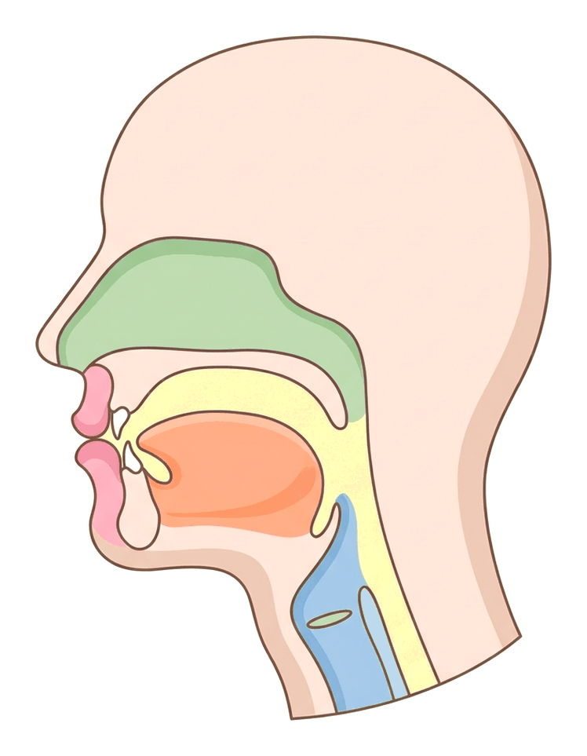

# JAMB Irk Notes: Introduction to Tajwīd

## What JAMB expects

This topic is Topic 3 of the JAMB Islamic Religious Studies syllabus: Introduction to Tajwīd (Theory and Practice). The syllabus does not list specific content items for this topic, but focuses on a single overarching objective.

By the end of these notes, you should be able to:

1.  Examine the meaning and importance of Tajwīd.

**Note on the syllabus wording:** In the official JAMB syllabus, the topic title is printed with a missing closing parenthesis as "Introduction to Tajwīd (Theory and Practice". It should properly read "Introduction to Tajwīd (Theory and Practice)". Additionally, you will commonly see spelling variations for key Islamic terms in different textbooks, such as Qur'an or Koran, Hadith or Hadeeth, and Tajwid or Tajweed. These notes use the standard spellings while keeping the syllabus's exact phrasing in headings.

## Objective i: Examine the meaning and importance of Tajwīd

To fully understand Tajwīd, we must look at its meaning (both literal and technical), the difference between its theoretical rules and practical application, and the deep historical and spiritual importance it holds for Muslims.

### The Meaning of Tajwīd

#### Literal Meaning (Lughatan)
In the Arabic language, the word **Tajwīd** comes from the root word *jawwada* (which traces back to the letters *j-w-d*), meaning "to make something good", "to beautify", "to improve", or "to attain proficiency and excellence". Therefore, literally, Tajwīd means "beautification" or "doing something well".

#### Technical Meaning (Istilāhan)
In the context of reciting the Glorious Qur'an, Tajwīd is defined as **the science of giving every letter of the Qur'an its rightful dues and characteristics during recitation**. 

According to Islamic scholars of recitation, this involves two main things:
1.  **Makhraj (Articulation Point):** Pronouncing every Arabic letter from its exact physical point of origin in the mouth, throat, or lips (plural: *Makhārij*).
2.  **Sifah (Characteristic):** Giving every letter its inherent qualities (such as being a "heavy" or "light" sound) and its conditional qualities (rules that apply when letters are combined, such as merging or hiding sounds) (plural: *Sifāt*).

In short, the technical meaning of Tajwīd is articulating every letter correctly according to the rules passed down from Prophet Muhammad (SAW).

### Theory and Practice of Tajwīd

The JAMB syllabus specifically titles this topic "Introduction to Tajwīd (Theory and Practice)". Islamic scholars divide the study of Tajwīd into two categories:

#### 1. Theoretical Tajwīd (Ilm al-Tajwīd)
This is the academic study of the rules of recitation. It involves knowing the names of the rules (such as *Izhār*, *Idghām*, *Ikhfā'*), understanding the definitions, and knowing exactly which letters belong to which rule. 
*   **Islamic Ruling:** Learning the theory of Tajwīd is considered a **Fard Kifāyah** (a communal obligation). This means that as long as a sufficient number of scholars and teachers in a community know these theoretical rules, the rest of the community is not sinful for not knowing the exact terminology.

#### 2. Practical Tajwīd (Amal al-Tajwīd)
This is the actual physical application of the rules when reciting the Qur'an, even if the reciter does not know the technical names of the rules. 
*   **Islamic Ruling:** Reciting the Qur'an with practical Tajwīd is considered a **Fard Ayn** (an individual obligation) for every Muslim who recites the Qur'an, especially during Salāh (prayers). Every Muslim is expected to recite the Qur'an correctly to avoid changing the meaning of the words.

### Core Concepts in Tajwīd (What the Rules Cover)

To understand what Tajwīd practices, students should be aware of the core areas that the rules govern:

*   **Makhārij al-Hurūf (Points of Articulation):** There are five main areas where sounds are produced: the empty space in the mouth and throat (*Al-Jawf*), the throat (*Al-Halq*), the tongue (*Al-Lisān*), the lips (*Ash-Shafatān*), and the nasal passage (*Al-Khayshūm*).
*   **Ahkām an-Nūn as-Sākinah wa at-Tanwīn:** The rules governing a stationary 'Nūn' letter or a 'Tanwīn' (the "nn" sound at the end of a word). Depending on the letter that follows, the sound might be pronounced clearly (*Izhār*), merged (*Idghām*), changed to a 'Mīm' (*Iqlāb*), or hidden (*Ikhfā'*).
*   **Al-Madd (Elongation):** The rules concerning when to stretch a vowel sound (a, i, or u) and for how many counts (beats).

### The Importance of Tajwīd

Understanding the importance of Tajwīd is crucial for JAMB. Its importance is spiritual, historical, and practical.

#### 1. Obedience to the Command of Allah
Muslims believe that reciting the Qur'an with Tajwīd is a direct command from Allah. The Qur'an was not just revealed as written text, but as spoken sound. Allah says in the Glorious Qur'an:
> "...and chant the Koran in measure..." (Q.73:4, Pickthall's translation). 

The Arabic word used in this verse for "in measure" is *Tartīl*. The fourth Caliph, Ali bin Abi Talib, explained that *Tartīl* means "articulating the letters perfectly and knowing where to stop."

#### 2. Preservation of the Qur'an's Exact Meaning
The most critical practical importance of Tajwīd is preventing **Lahn** (mistakes in recitation). The Arabic language is very sensitive; a slight mispronunciation can completely change the meaning of a word, which in the Qur'an is a very serious matter. Scholars divide mistakes into two types:

| Type of Mistake | Name in Arabic | Meaning and Impact | Example | Ruling |
| :--- | :--- | :--- | :--- | :--- |
| **Major/Obvious Mistake** | *Lahn Jalī* | A clear mistake that changes the pronunciation of a letter or the vowels (harakāt), **changing the meaning of the verse**. | Saying *ʿAṣā* (with the heavy letter ص, meaning "he disobeyed") instead of *ʿAsā* (with the light letter س, meaning "perhaps"), or changing a grammatical vowel so that the subject of a sentence becomes the object. | **Harām (Forbidden).** If done intentionally or out of negligence, it is a sin and can invalidate a person's Salāh. |
| **Minor/Hidden Mistake** | *Lahn Khafī* | A subtle mistake in the rules of beautification, such as not elongating a *Madd* long enough or missing a nasal sound (*Ghunnah*). The meaning is **not** changed. | Not stretching a word for exactly 4 counts when required, or not blending a letter properly. | **Makrūh (Disliked).** It does not change the meaning or invalidate Salāh, but it is frowned upon by scholars of recitation. |

Tajwīd ensures that *Lahn Jalī* is avoided entirely, preserving the pure Arabic text and its divine message.

#### 3. Following the Sunnah of Prophet Muhammad (SAW)
Islamic teaching holds that Angel Jibril (Gabriel) recited the Qur'an to Prophet Muhammad (SAW) with these exact rules of Tajwīd, and the Prophet (SAW) recited it to his Companions in the exact same way. The Companions passed it down generation to generation. Therefore, applying Tajwīd is preserving the authentic *Sunnah* (practice) of the Prophet's recitation. 

In Nigeria, traditional Qur'anic schools (*Madrasahs* or *Ile-Kewu*) historically focused on rote memorisation of the Qur'an. However, in recent decades, there has been a massive revival in explicitly teaching the formal rules of Tajwīd across Nigerian Muslim communities to ensure the recitation matches the Prophet's exact standard.

#### 4. Attaining Spiritual Rewards
There are immense rewards promised in Islamic tradition for those who recite the Qur'an correctly. A famous Hadith reported by Aisha (numbering varies by edition, found in Sahih al-Bukhari and Sahih Muslim) states:
> "The one who is proficient in the recitation of the Qur'an will be with the honourable and obedient scribes (angels), and he who recites the Qur'an and finds it difficult to recite, doing his best to recite it in the best way possible, will have two rewards."

This shows that both the master of Tajwīd and the struggling beginner are highly rewarded, emphasizing the importance of making the effort to learn.

#### 5. Enhancing Spiritual Reflection (Tadabbur)
When the Qur'an is recited with proper Tajwīd—with the correct rhythm, elongation, and clarity—it has a profound emotional and spiritual impact on both the reciter and the listener. It aids in *Tadabbur* (deep reflection and contemplation over the meanings of the verses), which is one of the primary purposes of the Qur'an.

## Key terms

| Term | Meaning |
| :--- | :--- |
| **Tajwīd** | (Literal) To beautify or improve. (Technical) Giving every Arabic letter its rights and characteristics during recitation. |
| **Makhraj** | The articulation point; the exact physical place in the mouth or throat where a letter's sound originates. |
| **Sifah** | The characteristic or quality of a letter (e.g., heavy, light, whistling). |
| **Lahn** | A mistake or deviation from the correct rules of recitation. |
| **Lahn Jalī** | A major, obvious mistake that alters a letter or vowel and changes the meaning of the Qur'an. |
| **Lahn Khafī** | A minor, hidden mistake that breaks a rule of beautification but does not change the meaning. |
| **Tartīl** | Reciting the Qur'an slowly, clearly, and with measured rhythm; commanded in Q.73:4. |
| **Fard 'Ayn** | An individual religious obligation required of every single Muslim. |
| **Fard Kifāyah** | A communal obligation; if enough people do it, the rest of the community is excused. |
| **Tadabbur** | Deep reflection and contemplation upon the meaning of the Qur'an. |

## Exam tips and common mistakes

*   **Literal vs. Technical:** JAMB frequently tests the difference between the literal meaning of a word and its technical meaning. Remember: Literal = beautification/doing well; Technical = giving letters their rights and characteristics.
*   **Fard 'Ayn vs. Fard Kifāyah:** Do not confuse the rulings. *Applying* Tajwīd (reading correctly so as not to change the meaning) is Fard 'Ayn. *Knowing the technical names* (like Ikhfā' or Idghām) is Fard Kifāyah.
*   **Lahn Jalī vs. Lahn Khafī:** *Jalī* (major) is a severe mistake that changes the meaning and is Harām. *Khafī* (minor) does not change the meaning.
*   **Qur'an Reference:** Memorise Q.73:4 (Surah Al-Muzzammil) as the primary scriptural proof for reciting the Qur'an with measure/Tartīl.
*   **Hadith Source:** The Hadith about the proficient reciter being with the angels is narrated by Aisha (RA).

## Quick summary

1.  The literal meaning of Tajwīd is "to beautify" or "to make something good".
2.  The technical meaning of Tajwīd is giving every letter in the Qur'an its rightful characteristics (*Sifāt*) and articulation points (*Makhārij*).
3.  Learning the theoretical rules of Tajwīd is a communal obligation (Fard Kifāyah), while practicing correct recitation is an individual obligation (Fard 'Ayn).
4.  The Qur'an commands Muslims to recite with measure (*Tartīl*) in Surah Al-Muzzammil (Q.73:4).
5.  A major mistake in recitation that changes the meaning of a word is called *Lahn Jalī* and is strictly forbidden.
6.  A minor mistake that misses a rule of beautification but keeps the meaning intact is called *Lahn Khafī*.
7.  Proper Tajwīd preserves the Qur'an from distortion, follows the exact practice (Sunnah) of Prophet Muhammad (SAW), and brings immense spiritual rewards to the reciter.

## Practice questions

**1. The literal meaning of the word Tajwīd in Arabic is:**
- A. to memorise
- B. to write clearly
- C. to beautify or make good
- D. to understand the meaning

**Answer: C.** The word Tajwīd comes from a root meaning to make something good, to improve, or to beautify.

**2. In the science of Qur'anic recitation, giving every letter its exact articulation point and characteristics is the definition of:**
- A. Tafsīr
- B. Tajwīd
- C. Tawhīd
- D. Tarbiyah

**Answer: B.** This is the technical (Istilāhan) definition of Tajwīd as established by Islamic scholars.

**3. According to Islamic scholars, knowing the theoretical names of the rules of Tajwīd (Ilm al-Tajwīd) is considered a:**
- A. Fard 'Ayn
- B. Sunnah Mu'akkadah
- C. Fard Kifāyah
- D. Makrūh

**Answer: C.** Knowing the academic theory is a Fard Kifāyah (communal obligation), while actually reciting correctly is a Fard 'Ayn (individual obligation).

**4. Which verse of the Glorious Qur'an is most commonly cited as the command to recite the Qur'an with Tartīl (measure/proper recitation)?**
- A. Q.2:255
- B. Q.112:1
- C. Q.73:4
- D. Q.1:1-7

**Answer: C.** Surah Al-Muzzammil (Q.73:4) states: "...and chant the Koran in measure."

**5. A person reciting the Qur'an mispronounces a letter, which completely changes the meaning of the verse. This type of mistake is known as:**
- A. Lahn Khafī
- B. Lahn Jalī
- C. Idghām
- D. Ikhfā'

**Answer: B.** *Lahn Jalī* is a major or obvious mistake that alters a letter or vowel, thereby changing the meaning of the Qur'an.

**6. Which of the following best describes *Lahn Khafī*?**
- A. A mistake in writing the Qur'an
- B. An intentional change of a verse's meaning
- C. A mistake that alters a vowel and changes the meaning
- D. A minor mistake in beautification that does not change the meaning

**Answer: D.** *Lahn Khafī* (hidden mistake) involves missing a subtle Tajwīd rule, like elongation, but the core meaning of the word remains the same.

**7. In Tajwīd, the exact physical place in the mouth or throat where a letter's sound originates is called its:**
- A. Sifah
- B. Makhraj
- C. Harakah
- D. Ghunnah

**Answer: B.** *Makhraj* (plural: Makhārij) refers to the precise articulation point of a letter.

**8. According to the Hadith reported by Aisha, a person who is proficient in the recitation of the Qur'an will be:**
- A. given wealth in this world
- B. with the honourable and obedient angels
- C. exempted from fasting
- D. given two separate rewards for struggling

**Answer: B.** The proficient reciter is with the noble scribes/angels, while the one who struggles and does their best gets two rewards.

**9. The primary practical importance of applying Tajwīd is to:**
- A. demonstrate vocal talent to others
- B. recite as loudly as possible
- C. prevent mistakes that could distort the meaning of the Qur'an
- D. finish reciting the Qur'an quickly

**Answer: C.** The most critical reason for Tajwīd is to avoid Lahn (mistakes), thereby preserving the exact divine message and meaning.

**10. Which of the following is NOT one of the five main areas of articulation (Makhārij) for Arabic letters?**
- A. The throat
- B. The tongue
- C. The lips
- D. The stomach

**Answer: D.** The stomach is not an articulation point. The five main areas are the throat, tongue, lips, nasal passage, and the empty space in the mouth/throat.

<!-- COVERAGE
obj i | ## Objective i: Examine the meaning and importance of Tajwīd
-->
