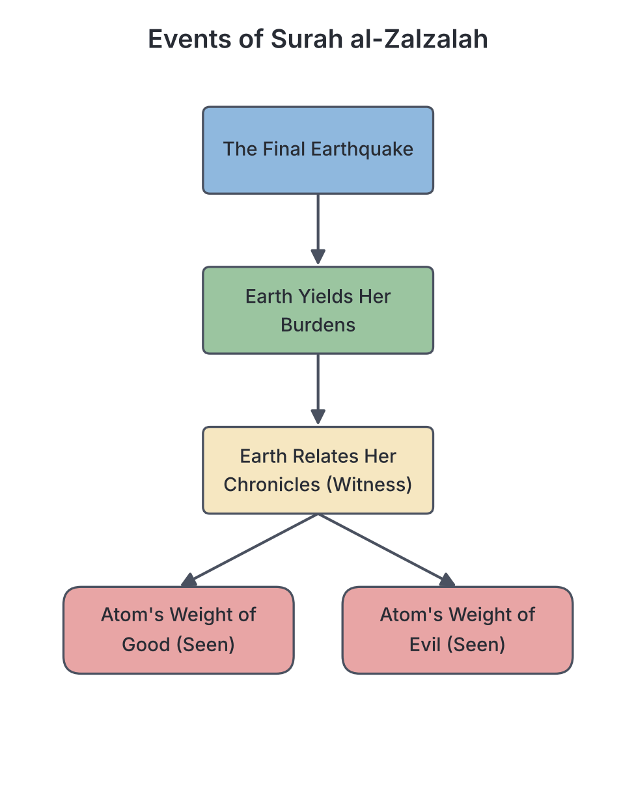

# JAMB Irk Notes: Study of Selected Suwar and Ayāt (al-Qadr to Laqad Jā'akum)

## What JAMB expects

This topic is part of Section A, Topic 5 of the JAMB IRK syllabus: Study of the Arabic text of the following suwar/ayats with tajwīd. It covers the second half of the prescribed texts.

This file covers the following content items:
- **(f) al-Qadr (Q.97)**
- **(g) al-Bayyinah (Q.98)**
- **(h) al-Zalzalah (Q.99)**
- **(i) Ayatul-Kursiyy (Q.2:255)**
- **(j) Āmanar-Rasūl (Q.2:285-6)**
- **(k) Laqad jāakum (Q.9:128-129)**

By the end of these notes, you should be able to:
1. Recite with correct tajwīd the Arabic texts of the suwar.
2. Deduce lessons from them.
3. Evaluate their teachings.

*Note on the syllabus structure:* Topic 5 contains eleven major texts (a to k). To ensure each text gets the in-depth explanation JAMB requires without becoming too long to read, this topic is split into two parts. This file (`A5b-suwar-al-qadr-to-selected-ayats.md`) covers items (f) through (k). Items (a) through (e) are covered in `A5a-suwar-al-ala-to-al-alaq.md`.

---

## Objective i: Recite with correct tajwīd the Arabic texts of the suwar

**Tajwīd** (the set of rules governing the correct pronunciation of the Qur'an) is essential when reciting these prescribed passages. While you cannot be tested on oral recitation in a written JAMB exam, questions frequently test your theoretical knowledge of tajwīd rules as they apply to these texts. 

When studying the texts below, pay close attention to the following recurring tajwīd rules:
- **Qalqalah (Echoing/Bouncing):** Letters like د (Dāl), ق (Qāf), ط (Tā'), ب (Bā'), and ج (Jīm) bounce when they have a *sukūn* (no vowel). For example, the *Dāl* in *al-Qadr* and the *Qāf* in *Laqad* require a clear bouncing sound.
- **Ghunnah (Nasalization):** A lingering nasal sound held for two beats on letters like مّ (Mīm with shaddah) and نّ (Nūn with shaddah), such as in *Innā* (Surah al-Qadr).
- **Madd (Elongation):** Lengthening short vowels into long ones. Notice the long vowels in *Ayatul-Kursiyy* (e.g., *Al-Qayyūm*).
- **Idghām (Assimilation):** Merging a Nūn Sakinah or Tanwīn into the next letter, often with nasalization (e.g., *Khayrun min* in Surah al-Qadr).

*Disclaimer:* Arabic text is provided below for reference, alongside standard transliteration and English translations by Marmaduke Pickthall (1930). Spelling of Arabic terms often varies in textbooks (e.g., Qur'an/Koran, Surah/Sura). To master the exact pronunciation, students must learn recitation directly from a qualified teacher.

## Objective ii: Deduce lessons from the selected texts

Deducing lessons means extracting practical moral, spiritual, and social guidance from the Qur'anic verses. JAMB expects you to know what each surah or ayah teaches a Muslim to do in daily life.

For example:
- From **Surah al-Qadr**, we deduce the lesson that Muslims should strive hard in worship during the last ten nights of Ramadan to seek the Night of Power.
- From **Surah al-Zalzalah**, we deduce that no good or bad deed is too small to matter; everything will be accounted for.
- From **Āmanar-Rasūl**, we deduce the lesson of placing absolute trust in Allah, knowing He will never burden us beyond our capacity.

Specific lessons are listed under each text section below.

## Objective iii: Evaluate the teachings of the selected texts

Evaluating the teachings involves understanding the broader theological and societal impact of these verses. It means looking at the core beliefs (Aqīdah) and principles they establish.

For example:
- **Ayatul-Kursiyy** establishes the absolute, flawless perfection of Allah's attributes, refuting any idea that God sleeps, tires, or shares His supreme authority.
- **Surah al-Bayyinah** evaluates the condition of humanity before and after the Prophet (SAW), proving that divine revelation was necessary to bring people out of confusion into pure faith.
- **Laqad Jā'akum** establishes the supreme character of Prophet Muhammad (SAW)—his unparalleled compassion for the believers—and the ultimate principle of relying on Allah alone (*Tawakkul*).

The detailed teachings of each passage are broken down in their respective sections below.

---

## Content f: Surah al-Qadr (Q.97)

Surah al-Qadr (The Night of Power/Destiny) is a Makkan surah consisting of 5 verses. It describes the greatness of the night on which the Qur'an was first revealed.

### Arabic Text, Transliteration, and Translation

بِسْمِ اللَّهِ الرَّحْمَٰنِ الرَّحِيمِ
إِنَّا أَنزَلْنَاهُ فِي لَيْلَةِ الْقَدْرِ (1) وَمَا أَدْرَاكَ مَا لَيْلَةُ الْقَدْرِ (2) لَيْلَةُ الْقَدْرِ خَيْرٌ مِّنْ أَلْفِ شَهْرٍ (3) تَنَزَّلُ الْمَلَائِكَةُ وَالرُّوحُ فِيهَا بِإِذْنِ رَبِّهِم مِّن كُلِّ أَمْرٍ (4) سَلَامٌ هِيَ حَتَّىٰ مَطْلَعِ الْفَجْرِ (5)

**Transliteration:**
*Bismillāhir-Rahmānir-Rahīm*
1. *Innā anzalnāhu fī laylatil-qadr.*
2. *Wa mā adrāka mā laylatul-qadr.*
3. *Laylatul-qadri khayrun min alfi shahr.*
4. *Tanazzalul-malā'ikatu war-rūhu fīhā bi'idhni rabbihim min kulli amr.*
5. *Salāmun hiya hattā matla'il-fajr.*

**Translation (Pickthall):**
1. Lo! We revealed it on the Night of Power.
2. Ah, what will convey unto thee what the Night of Power is!
3. The Night of Power is better than a thousand months.
4. The angels and the Spirit descend therein, by the permission of their Lord, with all decrees.
5. (The night is) Peace until the rising of the dawn.

### Tajwīd Focus
- **Ghunnah:** The word *Innā* (إِنَّا) requires a sustained nasal sound of two beats on the Nūn with shaddah.
- **Qalqalah:** The letter Dāl (د) in the word *al-Qadr* (الْقَدْرِ) has a sukūn, requiring an echoing/bouncing sound.

### Lessons and Teachings
- **The Revelation of the Qur'an:** The Qur'an was sent down from the Preserved Tablet (Lawh al-Mahfuz) to the lowest heaven on Laylatul-Qadr, in the month of Ramadan.
- **Immense Value of the Night:** Worship on this single night is rewarded more than worship over a thousand months (which equals about 83 years and 4 months).
- **Descent of Angels:** The earth is filled with angels bringing peace, blessings, and divine decrees for the coming year. "The Spirit" (Ar-Rūh) refers to Angel Jibrīl (Gabriel).
- **Total Peace:** The night is entirely peaceful and secure from evil until dawn breaks. Muslims are taught to seek this night in the last ten days of Ramadan through prayer, recitation, and supplication.

---

## Content g: Surah al-Bayyinah (Q.98)

Surah al-Bayyinah (The Clear Proof) contains 8 verses. It explains why the coming of Prophet Muhammad (SAW) was necessary for all humanity.

### Arabic Text, Transliteration, and Translation

بِسْمِ اللَّهِ الرَّحْمَٰنِ الرَّحِيمِ
لَمْ يَكُنِ الَّذِينَ كَفَرُوا مِنْ أَهْلِ الْكِتَابِ وَالْمُشْرِكِينَ مُنفَكِّينَ حَتَّىٰ تَأْتِيَهُمُ الْبَيِّنَةُ (1) رَسُولٌ مِّنَ اللَّهِ يَتْلُو صُحُفًا مُّطَهَّرَةً (2) فِيهَا كُتُبٌ قَيِّمَةٌ (3) وَمَا تَفَرَّقَ الَّذِينَ أُوتُوا الْكِتَابَ إِلَّا مِن بَعْدِ مَا جَاءَتْهُمُ الْبَيِّنَةُ (4) وَمَا أُمِرُوا إِلَّا لِيَعْبُدُوا اللَّهَ مُخْلِصِينَ لَهُ الدِّينَ حُنَفَاءَ وَيُقِيمُوا الصَّلَاةَ وَيُؤْتُوا الزَّكَاةَ ۚ وَذَٰلِكَ دِينُ الْقَيِّمَةِ (5) إِنَّ الَّذِينَ كَفَرُوا مِنْ أَهْلِ الْكِتَابِ وَالْمُشْرِكِينَ فِي نَارِ جَهَنَّمَ خَالِدِينَ فِيهَا ۚ أُولَٰئِكَ هُمْ شَرُّ الْبَرِيَّةِ (6) إِنَّ الَّذِينَ آمَنُوا وَعَمِلُوا الصَّالِحَاتِ أُولَٰئِكَ هُمْ خَيْرُ الْبَرِيَّةِ (7) جَزَاؤُهُمْ عِندَ رَبِّهِمْ جَنَّاتُ عَدْنٍ تَجْرِي مِن تَحْتِهَا الْأَنْهَارُ خَالِدِينَ فِيهَا أَبَدًا ۖ رَّضِيَ اللَّهُ عَنْهُمْ وَرَضُوا عَنْهُ ۚ ذَٰلِكَ لِمَنْ خَشِيَ رَبَّهُ (8)

**Transliteration:**
*Bismillāhir-Rahmānir-Rahīm*
1. *Lam yakunilladhīna kafarū min ahlil-kitābi wal-mushrikīna munfakkīna hattā ta'tiyahumul-bayyinah.*
2. *Rasūlun minallāhi yatlū suhufan mutahharah.*
3. *Fīhā kutubun qayyimah.*
4. *Wa mā tafarraqalladhīna ūtul-kitāba illā min ba'di mā jā'athumul-bayyinah.*
5. *Wa mā umirū illā liya'budullāha mukhlisīna lahud-dīna hunafā'a wa yuqīmus-salāta wa yu'tuz-zakāta wa dhālika dīnul-qayyimah.*
...*(Verses 6-8 detail the reward and punishment).*

**Translation (Pickthall):**
1. Those who disbelieve among the People of the Scripture and the idolaters could not have left off (erring) till the clear proof came unto them,
2. A messenger from Allah, reading purified pages
3. Containing correct scriptures.
4. Nor were the People of the Scripture divided until after the clear proof came unto them.
5. And they are ordered naught else than to serve Allah, keeping religion pure for Him, as men by nature upright, and to establish worship and to pay the poor-due. That is true religion.
6. Lo! those who disbelieve, among the People of the Scripture and the idolaters, will abide in fire of hell. They are the worst of created beings.
7. (And) lo! those who believe and do good works are the best of created beings.
8. Their reward is with their Lord: Gardens of Eden underneath which rivers flow, wherein they dwell for ever. Allah hath pleasure in them and they have pleasure in Him. This is (in store) for him who feareth his Lord.

### Tajwīd Focus
- **Idghām:** Notice how the Tanwīn merges into the next letter in *Rasūlun mina* (رَسُولٌ مِّنَ) producing a smooth transition with a nasal sound (*Idghām bighunnah*).

### Lessons and Teachings
- **The Clear Proof (Al-Bayyinah):** Prophet Muhammad (SAW) and the Qur'an are the "Clear Proof" sent to guide both the People of the Book (Jews and Christians) and the idolaters out of misguidance.
- **The Core of True Religion:** Verse 5 summaries the essence of Islam:
  1. Worship Allah sincerely (*Ikhlās*).
  2. Reject all false deities (*Hunafā'*).
  3. Establish regular prayer (*Salāh*).
  4. Pay the obligatory charity (*Zakāh*).
- **Best and Worst of Creatures:** 
  - *Sharrul Bariyyah* (the worst of creatures): Those who reject the clear proof.
  - *Khayrul Bariyyah* (the best of creatures): Those who believe and do righteous deeds. Their ultimate reward is the Gardens of Eden and the supreme pleasure of Allah.

---

## Content h: Surah al-Zalzalah (Q.99)

Surah al-Zalzalah (The Earthquake) is an 8-verse Madinan surah that vividly describes the events of the Day of Judgment.

### Arabic Text, Transliteration, and Translation

بِسْمِ اللَّهِ الرَّحْمَٰنِ الرَّحِيمِ
إِذَا زُلْزِلَتِ الْأَرْضُ زِلْزَالَهَا (1) وَأَخْرَجَتِ الْأَرْضُ أَثْقَالَهَا (2) وَقَالَ الْإِنسَانُ مَا لَهَا (3) يَوْمَئِذٍ تُحَدِّثُ أَخْبَارَهَا (4) بِأَنَّ رَبَّكَ أَوْحَىٰ لَهَا (5) يَوْمَئِذٍ يَصْدُرُ النَّاسُ أَشْتَاتًا لِّيُرَوْا أَعْمَالَهُمْ (6) فَمَن يَعْمَلْ مِثْقَالَ ذَرَّةٍ خَيْرًا يَرَهُ (7) وَمَن يَعْمَلْ مِثْقَالَ ذَرَّةٍ شَرًّا يَرَهُ (8)

**Transliteration:**
*Bismillāhir-Rahmānir-Rahīm*
1. *Idhā zulzilatil-ardu zilzālahā.*
2. *Wa akhrajatil-ardu athqālahā.*
3. *Wa qālal-insānu mā lahā.*
4. *Yawma'idhin tuhaddithu akhbārahā.*
5. *Bi'anna rabbaka awhā lahā.*
6. *Yawma'idhin yasdurun-nāsu ashtātan liyuraw a'mālahum.*
7. *Faman ya'mal mithqāla dharratin khayran yarah.*
8. *Wa man ya'mal mithqāla dharratin sharran yarah.*

**Translation (Pickthall):**
1. When Earth is shaken with her (final) earthquake
2. And Earth yieldeth up her burdens,
3. And man saith: What aileth her?
4. That day she will relate her chronicles,
5. Because thy Lord inspireth her.
6. That day mankind will issue forth in scattered groups to be shown their deeds.
7. And whoso doeth good an atom's weight will see it then,
8. And whoso doeth ill an atom's weight will see it then.

### Tajwīd Focus
- **Ikhfā' (Concealment):** In *dharratin khayran* (ذَرَّةٍ خَيْرًا), the Tanwīn is clearly pronounced (*Izhar*) because of the throat letter *Kha*, but in *dharratin sharran* (ذَرَّةٍ شَرًّا), the Tanwīn is concealed before the letter *Shīn*.

### Lessons and Teachings
- **The Final Earthquake:** The Day of Judgment will begin with a terrifying, unprecedented earthquake that disrupts the entire world.
- **The Earth as a Witness:** The earth will literally "speak" or bear witness, revealing all the deeds committed on its surface, having been commanded to do so by Allah.
- **Absolute Justice:** Humanity will be divided into groups to face their records. The core teaching here is divine justice: not a single action, even as small as a mustard seed or an atom (*dharratin*), is lost or ignored. A Muslim must be mindful of even the smallest good or bad deeds.

---

## Content i: Ayatul-Kursiyy (Q.2:255)

Ayatul-Kursiyy (The Verse of the Throne) is verse 255 of Surah al-Baqarah. Prophet Muhammad (SAW) described it as the greatest verse in the Glorious Qur'an.

### Arabic Text, Transliteration, and Translation

اللَّهُ لَا إِلَٰهَ إِلَّا هُوَ الْحَيُّ الْقَيُّومُ ۚ لَا تَأْخُذُهُ سِنَةٌ وَلَا نَوْمٌ ۚ لَّهُ مَا فِي السَّمَاوَاتِ وَمَا فِي الْأَرْضِ ۗ مَن ذَا الَّذِي يَشْفَعُ عِندَهُ إِلَّا بِإِذْنِهِ ۚ يَعْلَمُ مَا بَيْنَ أَيْدِيهِمْ وَمَا خَلْفَهُمْ ۖ وَلَا يُحِيطُونَ بِشَيْءٍ مِّنْ عِلْمِهِ إِلَّا بِمَا شَاءَ ۚ وَسِعَ كُرْسِيُّهُ السَّمَاوَاتِ وَالْأَرْضَ ۖ وَلَا يَئُودُهُ حِفْظُهُمَا ۚ وَهُوَ الْعَلِيُّ الْعَظِيمُ

**Transliteration:**
*Allāhu lā ilāha illā huwal-Hayyul-Qayyūm. Lā ta'khudhuhū sinatun wa lā nawm. Lahū mā fis-samāwāti wa mā fil-ard. Man dhal-ladhī yashfa'u 'indahū illā bi'idhnih. Ya'lamu mā bayna aydīhim wa mā khalfahum. Wa lā yuhītūna bishay'in min 'ilmihī illā bimā shā'. Wasi'a kursiyyuhus-samāwāti wal-ard. Wa lā ya'ūduhū hifzhumā. Wa huwal-'Aliyyul-'Azhīm.*

**Translation (Pickthall):**
Allah! There is no deity save Him, the Alive, the Eternal. Neither slumber nor sleep overtaketh Him. Unto Him belongeth whatsoever is in the heavens and whatsoever is in the earth. Who is he that intercedeth with Him save by His leave? He knoweth that which is in front of them and that which is behind them, while they encompass nothing of His knowledge save what He will. His throne includeth the heavens and the earth, and He is never weary of preserving them. He is the Sublime, the Tremendous.

### Tajwīd Focus
- **Rules of Stopping (Waqf):** Because this verse is long, applying the correct stopping points is important to preserve the meaning (e.g., stopping at *Qayyūm*, *nawm*, *ard*).

### Lessons and Teachings
- **Tawhīd (Oneness of Allah):** The verse is the ultimate declaration of Islamic monotheism, detailing Allah's exclusive right to worship.
- **Divine Attributes:** 
  - *Al-Hayy:* The Ever-Living who never dies.
  - *Al-Qayyūm:* The Self-Subsisting Sustainer of all; He depends on no one, but everything depends on Him.
  - He is entirely free of human weaknesses like fatigue, slumber, or sleep.
- **Intercession and Knowledge:** No one can intercede for another on the Day of Judgment except by Allah's permission. His knowledge is infinite, while human knowledge is strictly limited to what He allows.
- **The Kursiyy (Throne/Footstool):** Represents Allah's absolute dominion, power, and knowledge, encompassing the vast universe effortlessly. It teaches Muslims constant reliance on and reverence for Allah's majesty.

---

## Content j: Āmanar-Rasūl (Q.2:285-286)

These are the final two verses of Surah al-Baqarah. According to Islamic teaching, they were given directly to the Prophet (SAW) during the Night Journey (*al-Isrā' wal-Mi'rāj*).

### Arabic Text, Transliteration, and Translation

آمَنَ الرَّسُولُ بِمَا أُنزِلَ إِلَيْهِ مِن رَّبِّهِ وَالْمُؤْمِنُونَ ۚ كُلٌّ آمَنَ بِاللَّهِ وَمَلَائِكَتِهِ وَكُتُبِهِ وَرُسُلِهِ لَا نُفَرِّقُ بَيْنَ أَحَدٍ مِّن رُّسُلِهِ ۚ وَقَالُوا سَمِعْنَا وَأَطَعْنَا ۖ غُفْرَانَكَ رَبَّنَا وَإِلَيْكَ الْمَصِيرُ (285) لَا يُكَلِّفُ اللَّهُ نَفْسًا إِلَّا وُسْعَهَا ۚ لَهَا مَا كَسَبَتْ وَعَلَيْهَا مَا اكْتَسَبَتْ ۗ رَبَّنَا لَا تُؤَاخِذْنَا إِن نَّسِينَا أَوْ أَخْطَأْنَا ۚ رَبَّنَا وَلَا تَحْمِلْ عَلَيْنَا إِصْرًا كَمَا حَمَلْتَهُ عَلَى الَّذِينَ مِن قَبْلِنَا ۚ رَبَّنَا وَلَا تُحَمِّلْنَا مَا لَا طَاقَةَ لَنَا بِهِ ۖ وَاعْفُ عَنَّا وَاغْفِرْ لَنَا وَارْحَمْنَا ۚ أَنتَ مَوْلَانَا فَانصُرْنَا عَلَى الْقَوْمِ الْكَافِرِينَ (286)

**Transliteration:**
285. *Āmanar-rasūlu bimā unzila ilayhi min rabbihī wal-mu'minūn. Kullun āmana billāhi wa malā'ikatihī wa kutubihī wa rusulih. Lā nufarriqu bayna ahadin min rusulih. Wa qālū sami'nā wa ata'nā, ghufrānaka rabbanā wa ilaykal-masīr.*
286. *Lā yukallifullāhu nafsan illā wus'ahā. Lahā mā kasabat wa 'alayhā maktasabat. Rabbanā lā tu'ākhidhnā in nasīnā aw akhta'nā. Rabbanā wa lā tahmil 'alaynā isran kamā hamaltahū 'alalladhīna min qablinā. Rabbanā wa lā tuhammilnā mā lā tāqata lanā bih. Wa'fu 'annā, waghfir lanā, warhamnā. Anta mawlānā fansurnā 'alal-qawmil-kāfirīn.*

**Translation (Pickthall):**
285. The messenger believeth in that which hath been revealed unto him from his Lord and (so do) believers. Each one believeth in Allah and His angels and His scriptures and His messengers—We make no distinction between any of His messengers—and they say: We hear, and we obey. (Grant us) Thy forgiveness, our Lord. Unto Thee is the journeying.
286. Allah tasketh not a soul beyond its scope. For it (is only) that which it hath earned, and against it (only) that which it hath deserved. Our Lord! Condemn us not if we forget, or miss the mark! Our Lord! Lay not on us such a burden as thou didst lay on those before us! Our Lord! Impose not on us that which we have not the strength to bear! Pardon us, absolve us and have mercy on us, Thou, our Protector, and give us victory over the disbelieving folk.

### Tajwīd Focus
- **Rules of Nūn Sakinah:** In *min rabbihī* (مِن رَّبِّهِ), the Nūn merges entirely into the Rā' without a nasal sound (*Idghām bilā ghunnah*).

### Lessons and Teachings
- **The Articles of Faith:** The passage perfectly summarizes the core Islamic beliefs (Iman): belief in Allah, His angels, His books, and His messengers, explicitly stating that Muslims make no distinction among the prophets in terms of accepting their prophethood.
- **Attitude of Believers:** "We hear and we obey" characterizes the true believer's submission to divine commands, seeking only Allah's forgiveness.
- **Divine Mercy and Justice:** A profound teaching here is that Allah never burdens a person with commands or trials greater than they can handle. Humans are rewarded for the good they earn and held accountable only for the evil they purposefully acquire.
- **The Power of Supplication:** The final verse is a powerful series of prayers asking for forgiveness, protection from heavy burdens, mercy, and victory over adversaries. It is highly recommended for Muslims to recite these verses at night.

---

## Content k: Laqad Jā'akum (Q.9:128-129)

These are the concluding two verses of Surah at-Tawbah (The Repentance). They highlight the noble character of Prophet Muhammad (SAW) and the concept of placing ultimate trust in Allah.

### Arabic Text, Transliteration, and Translation

لَقَدْ جَاءَكُمْ رَسُولٌ مِّنْ أَنفُسِكُمْ عَزِيزٌ عَلَيْهِ مَا عَنِتُّمْ حَرِيصٌ عَلَيْكُم بِالْمُؤْمِنِينَ رَءُوفٌ رَّحِيمٌ (128) فَإِن تَوَلَّوْا فَقُلْ حَسْبِيَ اللَّهُ لَا إِلَٰهَ إِلَّا هُوَ ۖ عَلَيْهِ تَوَكَّلْتُ ۖ وَهُوَ رَبُّ الْعَرْشِ الْعَظِيمِ (129)

**Transliteration:**
128. *Laqad jā'akum rasūlun min anfusikum 'azīzun 'alayhi mā 'anittum harīsun 'alaykum bil-mu'minīna ra'ūfun rahīm.*
129. *Fa'in tawallaw faqul hasbiyallāhu lā ilāha illā hū. 'Alayhi tawakkaltu, wa huwa rabbul-'arshil-'azhīm.*

**Translation (Pickthall):**
128. There hath come unto you a messenger, (one) of yourselves, unto whom aught that ye are overburdened is grievous, full of concern for you, for the believers full of pity, merciful.
129. Now, if they turn away (O Muhammad) say: Allah sufficeth me. There is no deity save Him. In Him have I put my trust, and He is Lord of the Tremendous Throne.

### Tajwīd Focus
- **Idghām bighunnah:** In *rasūlun min* (رَسُولٌ مِّنْ), the Tanwīn merges into the Mīm, producing a nasal sound.
- **Qalqalah:** The Dāl in *Laqad* requires a clear bounce.

### Lessons and Teachings
- **The Prophet's Compassion:** The verse emphasizes that the Prophet (SAW) is human ("one of yourselves"). He possesses profound empathy; it pains him to see his followers suffer, and he is passionately concerned for their well-being.
- **Attributes of Mercy:** Allah describes the Prophet (SAW) using two words normally reserved for Himself: *Ra'ūf* (Full of pity/compassionate) and *Rahīm* (Merciful), demonstrating the immense mercy in the Prophet's character.
- **Tawakkul (Reliance on Allah):** In the face of rejection or hardship ("if they turn away"), the believer's response should be *Hasbiyallah* ("Allah suffices me"). The lesson is to rely solely on the Lord of the Tremendous Throne, who has ultimate control over all affairs.

---

## Key terms

| Term | Meaning |
| --- | --- |
| Tajwīd | The rules of correctly pronouncing the Qur'an during recitation. |
| Qalqalah | A bouncing or echoing sound made when certain Arabic letters (e.g., Dal, Qaf) have a sukūn. |
| Ghunnah | A nasal sound held for two beats, typical on Nūn and Mīm with a shaddah. |
| Laylatul-Qadr | The Night of Power or Decree, better than a thousand months. |
| Al-Bayyinah | The Clear Proof, referring to the Prophet (SAW) and the Qur'an. |
| Khayrul Bariyyah | "The best of created beings", referring to believers who do good deeds. |
| Al-Zalzalah | The Earthquake, describing the major event that begins the Day of Judgment. |
| Ayatul-Kursiyy | The Verse of the Throne (Q.2:255), declaring Allah's absolute power and monotheism. |
| Al-Hayy | "The Living", a divine attribute showing Allah has no beginning or end. |
| Al-Qayyūm | "The Self-Subsisting", a divine attribute showing Allah sustains all creation without relying on anyone. |
| Āmanar-Rasūl | The concluding verses of Surah al-Baqarah, summarizing the articles of faith and supplications for mercy. |
| Tawakkul | Absolute reliance and trust in Allah, as expressed in "Hasbiyallah" (Allah is sufficient for me). |

## Exam tips and common mistakes

- **Know which text covers which theme:** JAMB frequently asks which Surah/Ayah discusses a specific topic.
  - "Atom's weight of deeds" = **Surah al-Zalzalah**.
  - "Best and worst of creatures" = **Surah al-Bayyinah**.
  - "Better than a thousand months" = **Surah al-Qadr**.
  - "Allah tasketh not a soul beyond its scope" = **Āmanar-Rasūl** (Q.2:286).
  - "Allah sufficeth me" (Hasbiyallah) = **Laqad Jā'akum** (Q.9:129).
- **Understand Ayatul-Kursiyy's position:** It is verse 255 of Surah al-Baqarah and is renowned as the greatest verse in the Qur'an. Be familiar with the divine names *Al-Hayy* and *Al-Qayyūm*.
- **Distinguish between prophets:** In Āmanar-Rasūl, the believers explicitly state they make "no distinction" between any of Allah's messengers.
- **Remember the clear proof:** In Surah al-Bayyinah, the "clear proof" (*al-Bayyinah*) refers to the Messenger of Allah reciting pure scriptures, not just a physical miracle.
- **Tajwīd basics:** You won't be asked to recite, but you might be asked to identify a rule. Remember that *Qalqalah* involves a bouncing sound, and *Ghunnah* involves the nasal cavity.

## Quick summary

1. **Surah al-Qadr (Q.97)** highlights the immense spiritual value of the night the Qur'an was revealed, a night better than a thousand months, marked by the descent of angels and total peace.
2. **Surah al-Bayyinah (Q.98)** explains that Prophet Muhammad (SAW) is the "Clear Proof". It defines true religion as sincere worship, prayer, and zakah, and categorizes humanity into the best and worst of creatures based on faith.
3. **Surah al-Zalzalah (Q.99)** paints a vivid picture of the Day of Judgment when the earth will reveal its secrets, and every individual will see their deeds, down to an atom's weight.
4. **Ayatul-Kursiyy (Q.2:255)** is the greatest verse of the Qur'an, profoundly describing Allah's oneness, His eternal life (*Al-Hayy*), self-subsistence (*Al-Qayyūm*), and His all-encompassing knowledge and dominion (*Kursiyy*).
5. **Āmanar-Rasūl (Q.2:285-286)** summarizes the core articles of Islamic faith, emphasizes the believers' obedience ("We hear and we obey"), and features prayers asking Allah not to burden souls beyond their strength.
6. **Laqad Jā'akum (Q.9:128-129)** highlights the extreme compassion and mercy of Prophet Muhammad (SAW) towards his followers, and teaches believers to place absolute trust (*Tawakkul*) in Allah when facing adversity.

## Practice questions

**1. According to Surah al-Qadr, worship on the Night of Power is better than worship over a period of:**

- A. A thousand years
- B. A hundred months
- C. A thousand months
- D. A thousand nights

**Answer: C.** Surah al-Qadr states "The Night of Power is better than a thousand months" (Q.97:3).

**2. Which Surah categorizes mankind into "the best of created beings" and "the worst of created beings"?**

- A. Surah al-Qadr
- B. Surah al-Bayyinah
- C. Surah al-Zalzalah
- D. Surah al-Alaq

**Answer: B.** Surah al-Bayyinah (Q.98:6-7) states that disbelievers are the worst of creatures, while believers who do righteous deeds are the best.

**3. The concept that a person will be held accountable for even "an atom's weight" of good or evil is the central theme of:**

- A. Surah al-Zalzalah
- B. Surah al-Qadr
- C. Ayatul-Kursiyy
- D. Āmanar-Rasūl

**Answer: A.** Surah al-Zalzalah (Q.99:7-8) vividly describes how mankind will see their deeds, even if they are the weight of an atom (dharratin).

**4. In Ayatul-Kursiyy, the attributes *Al-Hayy* and *Al-Qayyūm* refer to Allah's:**

- A. Mercy and Forgiveness
- B. Eternal life and Self-subsistence
- C. Supreme power and Vengeance
- D. Generosity and Provision

**Answer: B.** *Al-Hayy* means The Alive (Eternal Life), and *Al-Qayyūm* means The Self-Subsisting Sustainer of all. 

**5. The phrase "We hear and we obey" (Sami'nā wa ata'nā) is found in which of the following passages?**

- A. Ayatul-Kursiyy
- B. Surah al-Bayyinah
- C. Āmanar-Rasūl
- D. Laqad Jā'akum

**Answer: C.** In the concluding verses of Surah al-Baqarah (Āmanar-Rasūl, Q.2:285), the believers express their absolute submission by saying, "We hear, and we obey."

**6. Which tajwīd rule refers to the echoing or bouncing sound of letters like Dāl and Qāf when they have a sukūn?**

- A. Ghunnah
- B. Madd
- C. Qalqalah
- D. Idghām

**Answer: C.** Qalqalah is the rule of echoing/bouncing specific letters (Qaf, Ta, Ba, Jim, Dal) when they carry a sukūn (no vowel).

**7. According to Surah al-Bayyinah, true religion (Dīnul-Qayyimah) comprises which core actions?**

- A. Fasting and performing Hajj only
- B. Sincere worship, establishing prayer, and paying Zakah
- C. Fighting in wars and giving charity
- D. Reading the Qur'an and remaining silent

**Answer: B.** Verse 5 states: "ordered naught else than to serve Allah, keeping religion pure for Him... to establish worship and to pay the poor-due (Zakah)."

**8. The verses "Laqad Jā'akum" (Q.9:128-129) emphasize which defining characteristic of Prophet Muhammad (SAW)?**

- A. His bravery in battle
- B. His miraculous signs
- C. His severe justice against disbelievers
- D. His deep concern, pity, and mercy for the believers

**Answer: D.** The passage describes the Prophet as being deeply grieved by their burdens, and being full of concern, pity (Ra'ūf), and mercy (Rahīm) for the believers.

**9. What does the term *Al-Bayyinah* directly translate to?**

- A. The Clear Proof
- B. The Tremendous Earthquake
- C. The Night of Power
- D. The Greatest Throne

**Answer: A.** *Al-Bayyinah* means "The Clear Proof," referring to the Messenger of Allah reciting purified pages.

**10. According to the Āmanar-Rasūl verses (Q.2:286), what limit does Allah place on the burdens He assigns to a soul?**

- A. He tasks a soul only with what is equal to others
- B. He tasketh not a soul beyond its scope
- C. He gives heavy burdens to test the strongest souls
- D. He assigns burdens based on previous sins

**Answer: B.** The verse explicitly declares, "Allah tasketh not a soul beyond its scope" (Lā yukallifullāhu nafsan illā wus'ahā), establishing divine justice and mercy.
