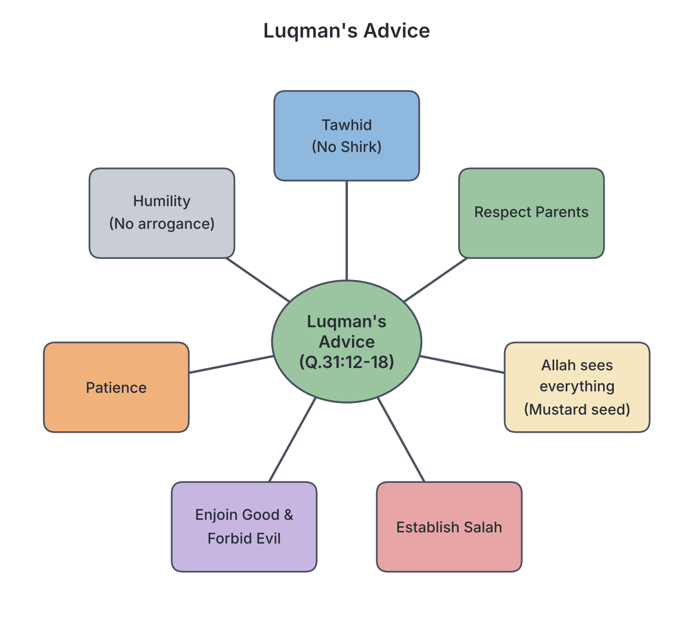

# JAMB Irk Notes: Moral Lessons in the Glorious Qur’ān and Hadīth

## What JAMB expects

This topic is Section A, Topic 7 of the JAMB IRK syllabus: Moral lessons in the Glorious Qur’ān and Hadīth. It covers the core Islamic moral directives and ethical teachings found in the Qur’an and the traditions (Ahādīth) of Prophet Muhammad (SAW). 

It has 13 content items:
- **a.** General moral lessons contained in the admonition of Sage Luqman to his son (Q.31:12-18).
- **b.** Goodness to parents (Q.17:23-24).
- **c.** Honesty (Q.2:42) (Q.61:2-3).
- **d.** Prohibition of bribery and corruption, alcohol and gambling, stealing and fraud, smoking, drug abuse and other intoxicants, arrogance, and extravagance.
- **e.** Dignity of labour.
- **f.** Behaviour and modesty in dressing.
- **g.** Adultery and fornication, homosexuality, and obscenity.
- **h.** Leadership and justice.
- **i.** Trust, obligations, and promises.
- **j.** Piety (Taqwa).
- **k.** Tolerance, perseverance, and patience.
- **l.** Unity and brotherhood.
- **m.** Enjoining what is good and forbidding what is wrong.

By the end of these notes, you should be able to:
1. Interpret the teachings of the prescribed verses and Ahādīth.
2. Apply, use, and demonstrate these moral teachings in your daily life.

**Note on the syllabus wording:** The syllabus contains a few misprints in its Qur'an references (for example, listing Q.5:41 instead of Q.5:38 for theft). These notes will point out the standard references while acknowledging what the syllabus has printed, so you are fully prepared for your exam. Where English translations of the Qur'an are used, they are taken from Marmaduke Pickthall's translation.

---

## a. General moral lessons of Sage Luqman

Sage Luqmān was a wise and pious man (not a Prophet) whose wisdom was so highly regarded that a chapter of the Qur'an (Surah Luqmān, Q.31) is named after him. In Q.31:12-18, the Qur'an records the comprehensive moral advice he gave to his son. 

The key admonitions (advices) include:
1. **Avoiding Shirk (Polytheism):** Luqmān begins by warning his son never to associate partners with Allah, calling it a "tremendous wrong" (Q.31:13).
2. **Goodness to Parents:** Allah interjects to remind mankind to be grateful to Him and to parents, especially the mother who bore the child in weakness and hardship (Q.31:14). However, if parents command a child to commit shirk, the child must disobey them, but still treat them kindly in this world (Q.31:15).
3. **Allah's Omniscience:** Luqmān warns that Allah will bring forth any action, even if it is the weight of a mustard seed hidden inside a rock or in the heavens (Q.31:16).
4. **Establishing Prayer and Social Duty:** He commands his son to establish regular prayer (*Salāh*), enjoin what is right, forbid what is wrong, and bear whatever difficulty befalls him with patience (Q.31:17).
5. **Humility:** Finally, he warns against arrogance, telling his son not to turn his cheek away from people in pride, nor walk insolently on the earth, and to lower his voice (Q.31:18-19).

### Application of Luqman's admonitions
To demonstrate these teachings in daily life, a student should:
- Maintain pure faith in Allah without relying on charms, amulets, or fortune-tellers.
- Respect their parents, even if they have differences of opinion.
- Pray regularly and encourage friends to do good deeds.
- Avoid showing off, bullying, or speaking rudely to classmates or domestic staff.

## b. Goodness to parents

Islam places kindness to parents (known as *Birr al-Wālidayn*) second only to the worship of Allah. 

In **Q.17:23-24** (Surah al-Isrā'), Allah says:  
> *"Thy Lord hath decreed, that ye worship none save Him, and (that ye show) kindness to parents. If one of them or both of them attain old age with thee, say not 'Fie' unto them nor repulse them, but speak unto them a gracious word. And lower unto them the wing of submission through mercy, and say: My Lord! Have mercy on them both as they did care for me when I was little."*

**Key lessons:**
- Goodness to parents is directly linked to Tawhīd (Monotheism).
- Muslims are forbidden from saying even the smallest word of frustration or disrespect, such as "Uff" or "Fie", especially when the parents reach old age and become dependent.
- Believers must treat them with deep humility and constantly pray for Allah's mercy upon them.

### Application of goodness to parents
In your daily life, you should:
- Speak gently to your mother and father, avoiding raising your voice.
- Assist them with household chores and errands without complaining.
- Pray for their well-being, health, and forgiveness daily.

## c. Honesty

Islam demands absolute truthfulness and hates hypocrisy. 

- **Q.2:42 (Surah al-Baqarah):** *"Confound not truth with falsehood, nor knowingly conceal the truth."* This verse warns against mixing facts with lies to confuse people, and against hiding the truth when it needs to be told.
- **Q.61:2-3 (Surah as-Saff):** *"O ye who believe! Why say ye that which ye do not? It is most hateful in the sight of Allah that ye say that which ye do not."* This condemns hypocrisy and breaking promises. A Muslim's actions must match their words.

### Application of honesty in daily life
To apply these verses, you must:
- Avoid cheating in exams or copying assignments, as this is concealing the truth of your actual ability.
- Keep the promises you make to friends, teachers, and parents.
- Avoid spreading fake news or rumors on social media (mixing truth with falsehood).

## d. Prohibition of vices

The Qur'an strongly prohibits actions that harm the individual, the economy, or the society.

### Bribery and corruption
**Q.2:188:** *"And eat not up your property among yourselves in vanity, nor seek by it to gain the hearing of the judges that ye may knowingly devour a portion of the property of others wrongfully."*
Islam condemns both the giver and the taker of a bribe (*Rishwah*). It destroys justice and allows the rich to oppress the poor.

### Alcohol and gambling
Alcohol (*Khamr*) and gambling (*Maysir*) were prohibited in stages.
- **Q.2:219** explains that while people might find some profit in them, their sin and harm are far greater than their usefulness.
- **Q.5:90-91** gives the final, total prohibition: *"O ye who believe! Strong drink and games of chance and idols and divining arrows are only an infamy of Satan's handiwork. Leave it aside in order that ye may succeed."* The Qur'an explains that Satan uses these tools to cause enmity and hatred among people and to distract them from remembering Allah and praying.

### Stealing and fraud
Islam protects private property. 
- **Stealing:** *Note on the syllabus wording:* The syllabus lists **Q.5:41** for stealing. However, it is **Q.5:38** that explicitly prescribes the punishment (amputation of the hand) for the male and female thief as a deterrent. Q.5:41 actually discusses those who hurry into disbelief and twist words. You should know the standard reference is Q.5:38, but be aware of the syllabus printing.
- **Fraud:** **Q.83:1-5** (Surah al-Mutaffifīn) says, *"Woe unto the defrauders: Those who when they take the measure from mankind demand it full, But if they measure unto them or weigh for them, they cause them loss."* This prohibits cheating in business, such as rigging scales in the market or engaging in internet fraud (commonly called "419" or "Yahoo" in Nigeria).

### Smoking, drug abuse, and other intoxicants
The Qur'an does not mention the words "cocaine" or "cigarettes" because they did not exist in 7th-century Arabia. However, Islamic scholars use several Qur'anic principles to prohibit them:
- **Q.2:172-173 and Q.5:3:** Believers are commanded to eat only what is good (*Tayyibāt*) and halal, while dead meat, blood, and swine are forbidden. Drugs and toxic smoke are not "good" things.
- **Q.2:195:** *"And spend of your substance in the cause of Allah, and make not your own hands contribute to (your) destruction..."* Smoking and drug abuse destroy health and cause death, violating this rule.
- **Q.4:43:** Forbids approaching prayer while intoxicated.
- **Q.6:118-121:** Commands eating only that over which Allah's name has been pronounced and avoiding sin. By analogy (*Qiyās*), because drugs alter the mind like alcohol, they fall under the total ban of intoxicants in Q.5:90.

### Arrogance and extravagance
- **Arrogance:** As seen in Luqmān's advice (**Q.31:18-19**), Allah does not love the boastful and proud.
- **Extravagance:** **Q.17:26-27** commands giving to relatives and the needy, but warns: *"Squander not (thy wealth) in wantonness. Lo! the squanderers were ever brothers of the devils..."* Spending money recklessly on useless things or to show off (like at lavish parties) is condemned.

### Application: Avoiding prohibited vices
To demonstrate these teachings, you should:
- Refuse to offer money for admission or grades.
- Stay entirely away from alcohol, smoking, and betting (including sports betting).
- Handle money responsibly without wasting it on unnecessary luxury items.

## e. Dignity of labour

Islam hates laziness and begging, and highly respects hard work and lawful earning (*Halāl* income), no matter how menial the job.

- **Q.62:10 (Surah al-Jumu'ah):** Instructs Muslims that once the Friday congregational prayer is finished, they should *"disperse in the land and seek of Allah's bounty"* (go back to their businesses and jobs).
- **Q.78:11:** States that Allah made the day for livelihood (seeking sustenance).
- **Hadīth (Bukhari and Ibn Majah):** Prophet Muhammad (SAW) said, *"That one of you takes his rope (and goes to the mountain) and gathers firewood and sells it, and thereby Allah saves his face, is better for him than to ask people who may give him or deny him."* He also said, *"Never has anyone of you eaten better food than what he earns from his own hands."* 

### Application of the dignity of labour
In your daily life, you should:
- Be proud of honest work, whether it is farming, carpentry, or trading, rather than looking for quick, illegal wealth.
- Study hard to secure a lawful profession.
- Never look down on cleaners, mechanics, or labourers.

## f. Behaviour and modesty in dressing

Islam teaches modesty (*Hayā'*) in both behaviour and dressing to protect society from immorality.

- **Q.24:27-31 (Surah an-Nūr):** 
  - Regulates behaviour by commanding believers not to enter houses other than their own until they have asked permission and greeted the inhabitants.
  - Commands both believing men and women to "lower their gaze" (not stare at the opposite sex) and guard their modesty.
  - Commands women not to display their beauty and ornaments except what normally appears, and to draw their veils (*Khumur*) over their bosoms.
- **Q.33:59 (Surah al-Ahzāb):** Commands the Prophet to tell his wives, daughters, and the women of the believers to draw their outer garments (*Jilbāb*) close round them when they go out. The verse explains the reason: *"that they may be recognized and not annoyed."* Modest dress commands respect and prevents harassment.

### Application of modesty in daily life
To apply these verses, you must:
- Dress decently, avoiding tight, transparent, or revealing clothes.
- Always knock and seek permission before entering a room or house.
- Control your eyes and avoid looking at inappropriate materials on the internet or television.

## g. Adultery, fornication, homosexuality and obscenity

Islam takes strict measures to protect the family structure and prevent sexual immorality.

- **Adultery and Fornication (*Zinā*):** **Q.17:32** says, *"And come not near unto adultery. Lo! it is an abomination and an evil way."* The Qur'an does not just say "do not commit it", it says do not even "come near it", meaning all steps leading to it (flirting, indecent dressing, touching) are forbidden. **Q.24:2** sets a severe legal punishment (flogging) for unmarried fornicators in an Islamic state.
- **Homosexuality:** **Q.11:77-83** recounts the story of Prophet Lūt (Lot) and his people. His people were destroyed by Allah through a terrible rain of stones because they practiced homosexuality, which the Qur'an describes as an unnatural abomination.
- **Obscenity (*Fāhishah*):** *Note on the syllabus wording:* The syllabus lists **Q.4:14-15**. Verse 15 prescribes house arrest for women proven guilty of lewdness by four witnesses (a rule later expanded upon by Surah an-Nūr). (Verse 16 deals with two men guilty of lewdness, while verse 14 talks about the punishment for disobeying Allah). 
- **Hadīth on Seclusion (*Khalwah*):** The Prophet (SAW) said, *"No man is alone with a woman but the devil is the third"* (Al-Tirmidhi/Bukhari). The syllabus quotes a variation: *"No one of you should meet a woman privately."* This prevents situations where temptation can overpower people.

### Application: Maintaining sexual purity
To demonstrate these teachings, you should:
- Avoid spending time completely alone in closed spaces with members of the opposite sex (unless they are close relatives, *Mahram*).
- Reject all forms of premarital relationships and sexual immorality.
- Keep your mind clean by avoiding obscene music, movies, or conversations.

## h. Leadership and justice

In Islam, leadership is not a privilege but a heavy burden of trust and responsibility.

- **Leadership:** **Q.2:124** tells the story of Prophet Ibrāhīm being tested by Allah and made a leader of mankind. When Ibrāhīm asked if his offspring would also be leaders, Allah replied, *"My covenant includeth not wrong-doers."* This proves that corrupt and unjust people are not fit for leadership in Islam.
- **Justice:** **Q.4:58** commands returning trusts to their owners and judging with justice when judging between people. **Q.4:135** demands that believers stand firmly for justice as witnesses to Allah, even if it is against themselves, their parents, or their relatives. 
- *Note on syllabus wording:* The syllabus lists **Q.5:9** for justice. However, **Q.5:8** is the famous verse that commands believers: *"let not the hatred of others make you swerve to wrong and depart from justice. Be just: that is next to piety."* Q.5:9 follows it, promising forgiveness to the believers.
- **Hadīth:** The Prophet (SAW) said, *"Take care, everyone of you is a governor (shepherd) and responsible for his subjects"* (Al-Bukhari). A ruler is responsible for citizens, a man for his family, and a servant for his master's property.

### Application of leadership and justice
In your daily life, you should:
- Be fair when settling disputes among friends, without taking sides based on tribal, religious, or friendly biases.
- If you are a class prefect or club leader, treat all students equally and protect their rights.
- Acknowledge when you are wrong instead of covering it up.

## i. Trust, obligations and promises

Fulfilling trusts (*Amānah*) and keeping promises (*'Ahd*) are signs of true faith.

- **Trusts and Obligations:** **Q.4:58** commands believers to render back trusts to whom they are due. **Q.5:1** opens with a powerful command: *"O ye who believe! Fulfil your undertakings (contracts/obligations)."* 
- **Promises:** **Q.16:91** says, *"Fulfil the covenant of Allah when ye have covenanted, and break not your oaths after the asseveration of them..."*
- **Hadīth:** The Prophet (SAW) said, *"He has (really) no faith who cannot keep a trust, and he has no religion who does not fulfill his promise"* (Baihaqi). Breaking trusts and promises is a sign of a hypocrite (*Munāfiq*).

### Application of trust and promises
To demonstrate this, you must:
- Return borrowed items (like textbooks or money) exactly when you promised to.
- Keep secrets entrusted to you by your friends.
- Perform the duties assigned to you by your parents or teachers faithfully, even when they are not watching.

## j. Piety (Taqwa)

*Taqwa* means God-consciousness, piety, or fearing Allah. It is the core of Islamic morality.

- **Q.2:177:** This famous verse defines true piety (*Al-Birr*). It says piety is not merely turning one's face to the East or West in prayer. True piety is believing in Allah, the Last Day, the Angels, the Book, and the Prophets; giving wealth out of love for Him to relatives, orphans, the needy, and travelers; establishing prayer and paying Zakah; fulfilling contracts; and being patient in extreme poverty, disease, and times of panic.
- **Q.3:102:** *"O ye who believe! Observe your duty to Allah (fear Allah) with right observance, and die not save as those who have surrendered (unto Him)."*
- **Q.49:13:** Explains that Allah created mankind from a male and female into nations and tribes so they may know one another, and declares: *"Lo! the noblest of you, in the sight of Allah, is the best in conduct (the most righteous/muttaqi)."* Racism and tribalism have no place in Islam.
- **An-Nawawī Hadīth 18:** The Prophet (SAW) advised: *"Fear Allah wherever you are, follow up a bad deed with a good one and it will wipe it out, and behave well towards people."*
- **An-Nawawī Hadīth 35:** Commands Muslims not to envy, hate, or turn their backs on one another, but to be brothers and servants of Allah. 

### Application of Taqwa in daily life
To apply Taqwa, you should:
- Remember that Allah sees you in private just as He does in public, stopping you from committing sins in secret.
- Treat people from other ethnic groups (e.g., Hausa, Igbo, Yoruba) with equal respect, as piety is the only true measure of superiority.
- Follow up any mistake or sin immediately with repentance and good deeds (like giving charity).

## k. Tolerance, perseverance and patience

Life is filled with trials, and Islam teaches *Sabr* (patience, perseverance, and endurance).

- **Q.2:153-157:** Allah commands believers to seek help in patience and prayer. He warns that He will surely test believers with fear, hunger, and loss of wealth, lives, and crops. He gives glad tidings to the patient, who say when tragedy strikes: *"Inna lillahi wa inna ilayhi raji'un"* (Lo! we are Allah's and lo! unto Him we are returning).
- **Q.3:200:** *"O ye who believe! Endure, outdo all others in endurance, be ready, and observe your duty to Allah, in order that ye may succeed."*
- **Q.103:3 (Surah al-'Asr):** Declares that all mankind is at a loss except those who believe, do good works, and exhort one another to truth and patience.
- **An-Nawawī Hadīth 16:** A man asked the Prophet (SAW) for advice. The Prophet said, *"Do not become angry."* The man repeated his request several times, and the Prophet gave the same reply each time. Controlling anger is a practical form of patience and tolerance.

### Application of patience and tolerance
To demonstrate these teachings:
- Do not react violently or shout when you are provoked or insulted by peers.
- Remain steadfast in your studies and prayers, even when they feel difficult or exhausting.
- Accept losses, illnesses, or the death of loved ones with faith, without questioning Allah's wisdom.

## l. Unity and brotherhood

Islam unites Muslims globally into one Ummah (community).

- **Q.3:103:** *"And hold fast, all of you together, to the cable (rope) of Allah, and do not separate..."* This commands unity based on the religion of Allah and forbids dividing into hostile sects.
- **Q.8:46:** Warns believers not to dispute with one another, lest they lose courage and their strength departs.
- **Q.49:10:** *"The believers are naught else than brothers. Therefore make peace between your brethren..."*
- **An-Nawawī Hadīth 35:** Emphasizes that a Muslim is the brother of another Muslim; he does not oppress him, fail him, lie to him, or hold him in contempt.

### Application of unity and brotherhood
To use these verses in your life:
- Promote peace and mediate when two friends or groups are quarreling.
- Avoid tribalism and sectionalism in school politics or community affairs.
- Support fellow Muslims and citizens in times of need, viewing their pain as your own.

## m. Enjoining what is good and forbidding what is wrong

This concept, known as *Amr bil-Ma'rūf wa Nahy 'an al-Munkar*, is a communal obligation (*Fard Kifāyah*) that keeps society morally upright.

- **Q.3:104:** Commands that there must be a group among the Muslims who invite to goodness, enjoin what is right, and forbid what is wrong.
- **Q.3:110:** Declares the Islamic Ummah as the best nation raised for mankind specifically because they perform this duty.
- **Q.16:90:** *"Lo! Allah enjoineth justice and kindness, and giving to kinsfolk, and forbiddeth lewdness and abomination and wickedness..."*
- **An-Nawawī Hadīth 25:** Shows that doing good is not just about money. The Prophet (SAW) explained that every glorification of Allah (Subhanallah) is a charity, and enjoining good and forbidding evil is a charity.
- **An-Nawawī Hadīth 34:** Outlines the three levels of stopping evil. The Prophet (SAW) said:
  1. Whoever sees an evil, let him **change it with his hand** (action, for those in authority).
  2. If he cannot, then with his **tongue** (speaking out/advising).
  3. If he cannot, then with his **heart** (hating the evil), and that is the weakest of faith.

| Level | Method | Who usually does this? | Example |
| :--- | :--- | :--- | :--- |
| **First** | Hand (Action) | Parents, leaders, government, police | A father taking a cigarette away from his son |
| **Second** | Tongue (Speech) | Scholars, teachers, friends, peers | A student advising his friend to stop cheating |
| **Third** | Heart (Feeling) | Ordinary people with no power/influence | Hating a corrupt act in a market and walking away |

### Application: Enjoining good and forbidding wrong
To apply these teachings:
- If you see a younger student being bullied, step in and physically stop it (Hand - if you are a prefect or senior).
- Speak out politely if you hear someone backbiting or lying (Tongue).
- If you see powerful people doing wrong and you are afraid for your safety, you must at least hate the action in your heart and leave the area (Heart).

---

## Key terms

| Term | Meaning |
| :--- | :--- |
| *Birr al-Wālidayn* | Goodness, kindness, and obedience to parents. |
| *Khamr* | Intoxicants (alcohol, and by extension, mind-altering drugs). |
| *Maysir* | Gambling or games of chance. |
| *Rishwah* | Bribery. |
| *Al-Birr* | True piety, righteousness (defined in Q.2:177). |
| *Taqwa* | Piety, God-consciousness, fearing Allah. |
| *Sabr* | Patience, perseverance, and endurance. |
| *Khalwah* | Unlawful private seclusion of a man and a woman who are not close relatives. |
| *Amānah* | Trust, reliability, or fulfilling one's obligations. |
| *Amr bil-Ma'rūf wa Nahy 'an al-Munkar* | Enjoining what is good and forbidding what is evil. |

## Exam tips and common mistakes

- **Identify speakers in verses:** Remember that the advice against shirk, arrogance, and walking proudly on earth (Q.31:12-18) was given by **Luqmān** to his son.
- **Understand the stages of prohibition:** Alcohol was not banned all at once. Q.2:219 acknowledges some use but says the sin is greater; Q.5:90-91 is the final total prohibition, calling it Satan's handiwork.
- **Differentiate between Taqwa and Al-Birr:** While closely related, Q.2:177 specifically defines *Al-Birr* (true piety) using a list of practical actions, while Q.49:13 uses *Taqwa* to explain who is noblest before Allah regardless of tribe.
- **Know the three levels of changing evil:** Hadith 34 of an-Nawawī ranks them as: hand (strongest), tongue, and heart (weakest of faith). 
- **Recognise deduced prohibitions:** The Qur'an does not explicitly say "do not smoke cocaine." Exam questions often ask which verses scholars use to ban drugs; look for verses banning self-destruction (Q.2:195) and intoxicants (Q.5:90).
- **Beware of syllabus typos:** If an exam asks for the Qur'anic verse on the punishment for stealing, the correct answer is Q.5:38, even though the syllabus mistakenly typed Q.5:41. 

## Quick summary

1. Luqmān advised his son to establish prayer, avoid shirk, respect parents, and shun arrogance.
2. Goodness to parents is highly commanded; one must not even say "Uff" in frustration to them in their old age.
3. Islam demands strict honesty, fulfilling of trusts and promises, and condemns saying what one does not do (hypocrisy).
4. Vices such as bribery, fraud (cheating in weights), alcohol, gambling, and adultery are strictly forbidden because they destroy the individual and society. Drugs and smoking are forbidden as they cause harm and intoxicate.
5. Islam respects the dignity of labour. Earning a halal living by gathering firewood is far better than begging.
6. Leadership is a trust that requires absolute justice, even if it is against oneself or one's family. True superiority is based only on Taqwa (piety), not race or wealth.
7. Enjoining good and forbidding wrong is a communal duty, to be carried out with the hand, tongue, or at least hated in the heart.

## Practice questions

**1. Sage Luqmān's very first admonition to his son in Surah Luqmān was to**
- A. establish regular prayer
- B. avoid associating partners with Allah (Shirk)
- C. respect his parents
- D. lower his voice when speaking

**Answer: B.** Luqmān warned his son first against Shirk, calling it a tremendous wrong (Q.31:13).

**2. According to Q.17:23, when parents attain old age, a child is forbidden from**
- A. leaving them alone in the house
- B. taking their money
- C. saying the word "Fie" or "Uff" to them
- D. correcting their mistakes

**Answer: C.** The verse explicitly commands not to say "Fie" (or "Uff") to them nor repulse them, but to speak graciously.

**3. The Qur'anic chapter that strongly condemns those who cheat in weights and measures (defrauders) is**
- A. Surah al-Mutaffifīn
- B. Surah al-Jumu'ah
- C. Surah al-Baqarah
- D. Surah an-Nūr

**Answer: A.** Surah al-Mutaffifīn (Q.83:1-5) begins with "Woe unto the defrauders" who demand full measure but give less.

**4. The dignity of labour is highlighted in a Hadith where the Prophet (SAW) stated that it is better to gather and sell firewood than to**
- A. work for a non-Muslim
- B. steal from the rich
- C. beg from people
- D. trade in the market

**Answer: C.** The Prophet (SAW) said gathering firewood and selling it is better than asking (begging) people who may give or deny.

**5. According to Q.49:13, the noblest person in the sight of Allah is the one who is**
- A. from the family of the Prophet
- B. the wealthiest in the community
- C. the most righteous or pious
- D. the most knowledgeable in science

**Answer: C.** The verse states that the most honored/noblest in the sight of Allah is the most righteous (Muttaqi).

**6. Which verse is famously known for defining true piety (Al-Birr) as consisting of belief, charity, prayer, and patience in adversity?**
- A. Q.2:177
- B. Q.3:102
- C. Q.2:219
- D. Q.4:58

**Answer: A.** Q.2:177 is the comprehensive verse that defines what true piety (*Al-Birr*) really is.

**7. In Hadith 34 of an-Nawawī, what is described as the weakest level of faith when confronting an evil act?**
- A. Changing it with the hand
- B. Speaking against it with the tongue
- C. Hating it in the heart
- D. Ignoring it completely

**Answer: C.** The Prophet (SAW) said that if one cannot change evil with their hand or tongue, they must do so with their heart, and that is the weakest of faith.

**8. To prevent adultery and fornication, Q.24:31 and Q.33:59 command believing women to**
- A. stay permanently indoors
- B. observe modesty and draw their outer garments over themselves
- C. speak only to other women
- D. cover their faces at all times

**Answer: B.** The verses command guarding modesty, lowering the gaze, and drawing veils/outer garments over themselves to be recognized and not annoyed.

**9. "The believers are naught else than brothers. Therefore make peace between your brethren." This verse (Q.49:10) teaches the moral lesson of**
- A. Sabr (Patience)
- B. Unity and brotherhood
- C. Dignity of labour
- D. Enjoining good

**Answer: B.** This verse is the primary Qur'anic reference establishing universal Islamic brotherhood and the need to maintain peace.

**10. A Muslim who intentionally mixes truth with falsehood to confuse a judge is violating the Qur'anic prohibition against**
- A. gambling
- B. dishonesty and concealment of truth
- C. extravagance
- D. arrogance

**Answer: B.** Q.2:42 strictly forbids confounding truth with falsehood or knowingly concealing the truth.

<!-- COVERAGE
obj i | Application of Luqman's admonitions
obj i | Application of goodness to parents
obj i | Application of honesty in daily life
obj i | Application: Avoiding prohibited vices
obj i | Application of the dignity of labour
obj i | Application of modesty in daily life
obj i | Application: Maintaining sexual purity
obj i | Application of leadership and justice
obj i | Application of trust and promises
obj i | Application of Taqwa in daily life
obj i | Application of patience and tolerance
obj i | Application of unity and brotherhood
obj i | Application: Enjoining good and forbidding wrong
item a | a. General moral lessons of Sage Luqman
item b | b. Goodness to parents
item c | c. Honesty
item d | d. Prohibition of vices
item e | e. Dignity of labour
item f | f. Behaviour and modesty in dressing
item g | g. Adultery, fornication, homosexuality and obscenity
item h | h. Leadership and justice
item i | i. Trust, obligations and promises
item j | j. Piety (Taqwa)
item k | k. Tolerance, perseverance and patience
item l | l. Unity and brotherhood
item m | m. Enjoining what is good and forbidding what is wrong
-->
