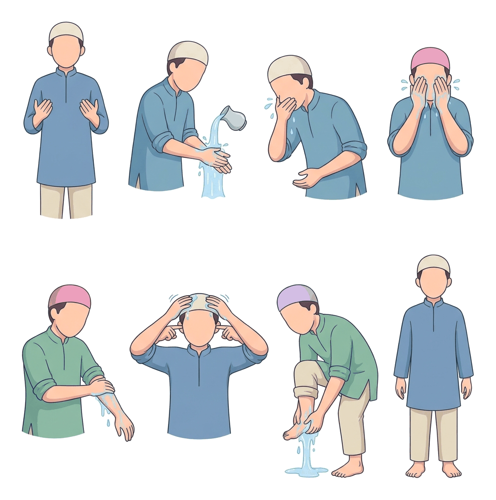
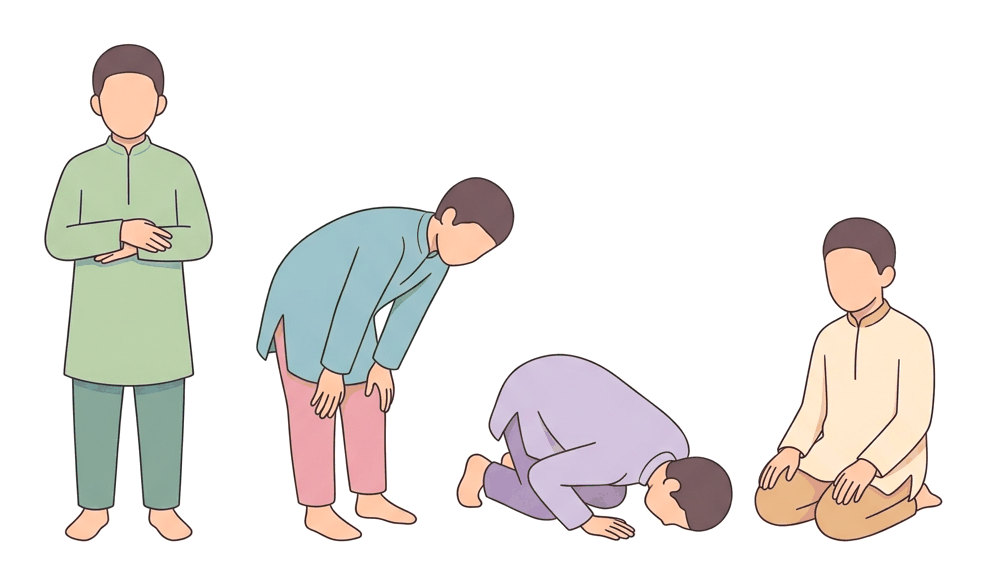

# JAMB Irk Notes: Ibādāt: Good Deeds, Tahārah, and Salāh

## What JAMB expects

This file covers Section B, Topic 10 (parts a, b, and c) of the JAMB IRK syllabus: Ibādāt and their types. It focuses on the general concept of worship, purification, and the Islamic daily prayers. 

This file covers the following content items:
* **(a)** Good deeds (Q.3:134) (Q.6:160) (Q.2:177) (Q.31:8) (Q.103:1-3) 26th Hadīth of an-Nawāwī
* **(b)** Tahārah, its types and importance (al-istinja’/istijmar, alwudu’, at-tayammum and al-ghusl) (Q.2:222) (Q.5:7) Hadīth 10 and 23 of an-Nawāwī.
* **(c)** Salāh
  * (i) Importance: (Q.2:45) (Q.20:132) (Q.29:45) and Hadīth 23rd of an-Nawāwī
  * (ii) Description and types of salāh
  * (iii) Things that vitiate salāh

By the end of these notes, you should be able to:
1. identify what constitutes acts of ibadah;
2. distinguish between the different types of taharah;
3. assess the importance of salah to a Muslim’s life;
4. analyse different types of salah;
5. identify things that vitiate salah.

**Note on the syllabus wording:** Topic 10 is very large, covering all the practical pillars of Islam. We have split it into two files. This file covers Good Deeds, Tahārah, and Salāh. The remaining topics (Zakāh, Sawm, Hajj, and Jihād) are covered in `B10b-zakah-sawm-hajj-and-jihad.md`. Also, the syllabus lists "Q.5:7" for Tahārah; however, the famous Qur'anic verse detailing the exact rules of Wudū', Ghusl, and Tayammum is actually Q.5:6. We will explain both below. Spelling variations are common in Islamic textbooks (e.g., Salāh/Salat, Wudū'/Wudu, Tahārah/Taharah); we use the syllabus spellings.

## Good deeds in Islam

**Content item (a): Good deeds (Q.3:134) (Q.6:160) (Q.2:177) (Q.31:8) (Q.103:1-3) 26th Hadīth of an-Nawāwī.**

### What constitutes acts of Ibādah

**Objective i: identify what constitutes acts of ibadah.**

**Ibādah** (worship) in Islam is a very broad concept. In its narrow sense, it refers to the formal rituals commanded by Allah, such as Salāh (prayer), Sawm (fasting), Zakāh (alms), and Hajj (pilgrimage). However, in its broader sense, Ibādah includes **every good deed** (*al-Amal as-Sālih*) done with a pure intention to please Allah. 

A Muslim's whole life can become an act of Ibādah if their actions are good, lawful, and done seeking Allah's reward. Earning an honest living, helping a neighbour, seeking useful knowledge, and even removing a stone from the road are all considered acts of Ibādah.

### Qur'anic teachings on Good Deeds

The syllabus highlights five specific Qur'anic references that explain the nature and reward of good deeds:

1. **Q.3:134 (Spending and Forgiving):** This verse describes the qualities of the righteous. It states that they are those *"Those who spend (of that which Allah hath given them) in ease and in adversity, those who control their wrath and are forgiving toward mankind..."* (Pickthall's translation). Charity, anger management, and forgiveness are core good deeds.
2. **Q.6:160 (The Tenfold Reward):** Allah's mercy is shown in how He rewards good deeds. The verse states: *"Whoso bringeth a good deed will receive tenfold the like thereof, while whoso bringeth an ill-deed will be awarded but the like thereof..."* (Pickthall's translation). 
3. **Q.2:177 (The Verse of Al-Birr / Righteousness):** This is one of the most comprehensive verses on good deeds. It explains that true righteousness (*Al-Birr*) is not just turning your face to the East or West in prayer. True righteousness involves:
   * **Belief:** In Allah, the Last Day, the angels, the Scripture, and the prophets.
   * **Charity:** Giving wealth to family, orphans, the needy, travellers, and for freeing slaves.
   * **Worship:** Establishing Salāh and paying Zakāh.
   * **Character:** Keeping promises and being patient in poverty, disease, and during conflict.
4. **Q.31:8 (Reward of Good Works):** *"Lo! those who believe and do good works, for them are the gardens of delight"* (Pickthall's translation). This confirms that entry into Paradise is tied to combining faith (Imān) with practical good deeds.
5. **Q.103:1-3 (Sūrah al-'Asr):** This short chapter declares that all human beings are in a state of loss, except those who possess four qualities: having faith, doing righteous good deeds, advising one another to the truth, and advising one another to patience. 

### The 26th Hadīth of an-Nawāwī

This Hadīth perfectly illustrates how broad the concept of good deeds is. Prophet Muhammad (SAW) explained that every joint in a person's body owes a charity (Sadaqah) to Allah every single day the sun rises. He then listed simple, everyday actions that count as this charity:
* Acting justly between two people.
* Helping a person mount their animal or load their luggage onto it (in modern times, helping someone board a vehicle or carry a heavy bag).
* Saying a good word.
* Every step taken towards the mosque for prayer.
* Removing a harmful object (like a thorn, glass, or stone) from the road.

## Tahārah: Types and importance

**Content item (b): Taharah, its types and importance (al-istinja’/istijmar, alwudu’, at-tayammum and al-ghusl (Q.2:222) (Q.5:7) Hadīth 10 and 23 of an-Nawāwī.**

**Tahārah** means purification or cleanliness. In Islamic law, it refers to removing physical impurities (like urine or blood) from the body, clothes, and place of worship, and achieving a state of ritual purity required for performing acts of worship like Salāh and touching the Qur'an.

### The Importance of Tahārah

Islam places extraordinary emphasis on cleanliness, considering it an essential part of faith.
* **Q.2:222:** *"Allah loveth those who turn unto Him, and loveth those who have a care for cleanness"* (Pickthall's translation).
* **Q.5:6 and Q.5:7:** *Note on the syllabus:* The syllabus lists Q.5:7. In standard numbering, Q.5:7 reminds believers to remember Allah's favour and covenant. However, **Q.5:6** is the famous "Verse of Purification" which outlines the exact rules for Wudū' (washing face, hands, wiping head, washing feet), Ghusl (bathing for major impurity), and Tayammum (dry ablution). 
* **Hadīth 10 of an-Nawāwī:** Prophet Muhammad (SAW) said, *"Allah the Almighty is Good and accepts only that which is good."* This extends to both the purity of physical wealth (halal earnings) and bodily purity.
* **Hadīth 23 of an-Nawāwī:** This Hadīth begins with the famous statement: *"Purity is half of faith..."* (At-tuhūru shatru al-īmān). It highlights that keeping oneself clean is fifty percent of a believer's faith.

### Distinguishing between the different types of Tahārah

**Objective ii: distinguish between the different types of taharah.**

There are different methods of purification in Islam, depending on the type of impurity and the availability of water.

#### 1. Al-Istinjā' and Istijmār (Cleaning the private parts)
After using the toilet (urinating or defecating), a Muslim must clean their private parts before they can perform Wudū' or Salāh.
* **Al-Istinjā':** The act of washing the private parts with clean **water** to remove traces of urine or faeces.
* **Al-Istijmār:** The act of wiping the private parts using dry, pure, solid objects (like clean stones, pebbles, or modern tissue paper) when water is not available. Usually, an odd number of wipes (at least three) is required until the area is clean.

#### 2. Al-Wudū' (Minor Ablution)
Wudū' is the ritual washing of specific parts of the body with pure water. It removes minor ritual impurity (*Hadath Asghar*), which is caused by things like sleeping, passing wind, urinating, or defecating. 
**Steps of Wudū':**
1. Having the intention (Niyyah) in the heart.
2. Saying *Bismillah* (In the name of Allah).
3. Washing the hands up to the wrists three times.
4. Rinsing the mouth and sniffing water into the nose three times.
5. Washing the entire face three times.
6. Washing the arms up to and including the elbows three times (right arm first).
7. Wiping the head and the ears with wet hands once.
8. Washing the feet up to and including the ankles three times (right foot first).

#### 3. Al-Ghusl (Major Ritual Bath)
Ghusl is a full-body bath using pure water. It is required to remove major ritual impurity (*Hadath Akbar*). A person cannot pray, circumambulate the Ka'bah, or recite the Qur'an while in a state of major impurity.
**When Ghusl is required:**
* After sexual intercourse or discharge of semen (nocturnal emission/wet dream).
* After a woman's menstrual period (Hayd) ends.
* After postpartum bleeding (Nifās) following childbirth ends.
* When a non-Muslim embraces Islam.
* Washing the body of a deceased Muslim (except a martyr).
**Essentials of Ghusl:** Having the intention and ensuring water reaches every single part of the skin and hair.

#### 4. At-Tayammum (Dry Ablution)
Tayammum is the substitute for both Wudū' and Ghusl when water is totally unavailable, or when using water would cause severe harm (like worsening an illness).
**How to perform Tayammum:**
1. Have the intention.
2. Strike both hands on clean earth, sand, or stone.
3. Blow off excess dust.
4. Wipe the entire face once.
5. Wipe the back of the right hand with the left hand, and the back of the left hand with the right hand.

#### Comparison Table of Tahārah Types

| Feature | Al-Wudū' (Minor Ablution) | Al-Ghusl (Major Bath) | At-Tayammum (Dry Ablution) |
| :--- | :--- | :--- | :--- |
| **Material used** | Pure water | Pure water | Clean earth / dust / sand |
| **When required** | After passing wind, sleeping, using the toilet (minor impurity) | After menstruation, postpartum bleeding, sexual discharge (major impurity) | When water is unavailable or harmful to use |
| **Body parts involved** | Face, arms, head, feet | Entire body, from head to toe | Face and hands only |
| **Replaces** | N/A (Standard for minor impurity) | N/A (Standard for major impurity) | Replaces both Wudū' and Ghusl |

## Salāh: Importance, description, and things that vitiate it

**Content item (c): Salah (i) Importance, (ii) Description and types, (iii) Things that vitiate salah.**

Salāh (prayer) is the second pillar of Islam and the most important practical duty for a Muslim. It is a structured physical and spiritual act of worship performed five times a day.

### Importance of Salāh to a Muslim's life

**Objective i: assess the importance of salah to a Muslim’s life.**

Salāh forms a direct link between the worshipper and Allah. There are no priests acting as intermediaries in daily Islamic prayers.
1. **Source of Help and Patience:** The Qur'an instructs Muslims to face life's difficulties by turning to prayer. **Q.2:45:** *"Seek help in patience and prayer..."* (Pickthall's translation). 
2. **Family Responsibility:** A Muslim must not only pray but ensure their family prays too. **Q.20:132:** *"And enjoin upon thy people worship, and be constant therein..."* (Pickthall's translation).
3. **Prevention of Evil:** Salāh prevents a person from committing sins, because standing before Allah five times a day keeps the conscience alive. **Q.29:45:** *"Lo! worship preserveth from lewdness and iniquity..."* (Pickthall's translation).
4. **Spiritual Light:** In the **23rd Hadīth of an-Nawāwī**, the Prophet (SAW) declared: *"Prayer is a light."* It guides a Muslim in this world and will be a physical light on the Day of Judgement.
5. **The First Question on Judgement Day:** According to Islamic teaching, Salāh is the first action a person will be questioned about on the Day of Resurrection. If it is sound, the rest of their deeds will be sound.

### Description of Salāh

Every Salāh is made up of units called **Rak'ah** (plural: Raka'āt). Each Rak'ah involves specific postures:
1. **Qiyām (Standing):** Facing the Qiblah (the Ka'bah in Makkah), standing straight, and reciting Sūrah al-Fātihah along with another portion of the Qur'an.
2. **Rukū' (Bowing):** Bending at the waist with hands on the knees, praising Allah.
3. **Sujūd (Prostration):** Placing the forehead, nose, both palms, both knees, and the toes of both feet on the ground in submission to Allah. (Every Rak'ah has two prostrations).
4. **Julūs / Tashahhud (Sitting):** Sitting on the legs between prostrations and at the end of the prayer to recite testimonies of faith and send blessings upon the Prophet.

### Different types of Salāh

**Objective ii: analyse different types of salah.**

Salāh is categorized by its legal ruling: Obligatory (Fard) and Voluntary/Recommended (Sunnah and Nafl).

#### 1. Obligatory Prayers (Fard)
These are mandatory. Neglecting them intentionally is a major sin. They are divided into two sub-types:
* **Fard 'Ayn (Individual Obligation):** Required of every sane, adult Muslim. This includes:
  * **The Five Daily Prayers:** Fajr (2 rak'ah, dawn), Dhuhr (4 rak'ah, midday), 'Asr (4 rak'ah, late afternoon), Maghrib (3 rak'ah, just after sunset), and 'Ishā' (4 rak'ah, night).
  * **Salātul Jumu'ah (Friday Prayer):** A 2-rak'ah congregational prayer replacing Dhuhr on Fridays. It is preceded by a sermon (Khutbah). It is obligatory for resident, healthy, adult men. In Nigeria, massive congregations gather in central mosques every Friday for this.
* **Fard Kifāyah (Communal Obligation):** Required on the community as a whole. If some perform it, the rest are absolved; if no one performs it, the entire community sins.
  * **Salātul Janāzah (Funeral Prayer):** A standing-only prayer performed for a deceased Muslim before burial.

#### 2. Recommended / Voluntary Prayers (Sunnah and Nafl)
These bring extra reward and make up for shortcomings in obligatory prayers.
* **Sunnah Mu'akkadah (Highly Recommended):** Prayers the Prophet (SAW) rarely missed.
  * **Witr:** An odd-numbered prayer (usually 1 or 3 rak'ah) performed after 'Ishā' to close the night prayers.
  * **Salātul 'Īd (Eid Prayers):** The two festival prayers (Eid al-Fitr and Eid al-Adha). *Note: The four Sunni schools of law differ slightly here; Hanafis consider Eid Wajib (necessary), while Malikis and Shafi'is consider it Sunnah Mu'akkadah. In practice, entire communities attend the praying ground (Yidi) for it.*
  * **Tarāwīh:** The special night prayers performed during the month of Ramadan.
* **Nafl (General Voluntary):**
  * **Tahajjud:** Voluntary night prayer performed after waking up from sleep, before Fajr.
  * **Duhā:** The mid-morning prayer.

| Type of Salāh | Ruling | Examples |
| :--- | :--- | :--- |
| **Fard 'Ayn** | Obligatory on every individual | Fajr, Dhuhr, 'Asr, Maghrib, 'Ishā', Jumu'ah (for men) |
| **Fard Kifāyah** | Communal obligation | Janāzah (Funeral prayer) |
| **Sunnah / Wājib** | Highly recommended / Necessary | Witr, Eid Prayers, Tarāwīh |
| **Nafl** | Voluntary for extra reward | Tahajjud, Duhā, Greeting the Mosque (Tahiyatul Masjid) |

### Things that vitiate Salāh

**Objective iii: identify things that vitiate salah.**

To "vitiate" means to spoil, break, or invalidate. If a person does any of these things during prayer, their Salāh becomes void and must be restarted. The things that vitiate Salāh include:

1. **Losing Wudū' (Hadath):** Passing wind, urinating, bleeding excessively, or anything else that breaks Wudū' immediately breaks the prayer.
2. **Speaking intentionally:** Saying any words that are not part of the Qur'an or prescribed prayers, directed at another human being.
3. **Eating or drinking:** Swallowing food or taking a drink during the prayer.
4. **Laughing out loud:** A silent smile does not break the prayer, but an audible laugh invalidates both the Salāh (and according to the Hanafi school, it also breaks the Wudū').
5. **Excessive movement:** Taking many continuous steps or performing actions (like adjusting clothes repeatedly) that would make an onlooker think the person is not in prayer.
6. **Turning away from the Qiblah:** Intentionally turning the chest away from the direction of the Ka'bah.
7. **Exposing the 'Awrah:** If a man exposes the area between his navel and knees, or a woman exposes her hair or body (except face and hands) intentionally, the prayer is void.
8. **Leaving out a fundamental pillar (Rukun):** Intentionally skipping a required posture (like missing a prostration) or the recitation of Sūrah al-Fātihah.

## Key terms

| Term | Meaning |
| :--- | :--- |
| Ibādah | Worship; encompassing both formal rituals and all good deeds done for Allah. |
| Tahārah | Ritual purification and cleanliness. |
| Istinjā' | Washing the private parts with water after urination or defecation. |
| Istijmār | Cleaning the private parts with dry objects (like stones or tissue) when water is absent. |
| Wudū' | Minor ablution; washing specific parts of the body with water. |
| Ghusl | Major ritual bath; washing the entire body with water. |
| Tayammum | Dry ablution using clean earth/sand; replaces Wudū' and Ghusl. |
| Qiyām | The standing posture in Salāh. |
| Rukū' | The bowing posture in Salāh. |
| Sujūd | The prostration posture in Salāh, with forehead touching the ground. |
| Fard 'Ayn | An obligatory duty required of every individual Muslim (e.g., the 5 daily prayers). |
| Fard Kifāyah | A communal obligation; if some do it, others are excused (e.g., Janāzah prayer). |
| Vitiate | To spoil, invalidate, or break (e.g., passing wind vitiates Salāh). |

## Exam tips and common mistakes

* **Understand the scope of Ibādah:** In exams, remember that Ibādah is not just praying and fasting. Removing a harmful object from the road is Ibādah (an-Nawawi Hadith 26).
* **Wudū' vs. Ghusl triggers:** Remember that passing wind or sleeping requires Wudū', while menstruation, postpartum bleeding, or sexual discharge requires Ghusl. Tayammum can replace *both* if there is no water.
* **Qur'an reference alert:** The syllabus lists Q.5:7 for Tahārah, but Q.5:6 is the actual verse detailing Wudū' and Tayammum. Be prepared for JAMB to use either reference depending on how closely they follow the syllabus typo.
* **Fard 'Ayn vs Fard Kifāyah:** This is a very common exam question. Jumu'ah is Fard 'Ayn (for men). Janāzah (Funeral prayer) is Fard Kifāyah. 
* **Meaning of "Vitiate":** Many students get confused by the word "vitiate". It simply means "spoil" or "break". Laughing out loud vitiates Salāh, but smiling silently does not.
* **The Verse of Righteousness:** Q.2:177 is heavily tested. It emphasizes that true piety is belief combined with charity, prayer, and patience, not just facing a certain direction.

## Quick summary

1. Ibādah in Islam includes both formal rituals and every righteous good deed done to please Allah, such as charity, justice, and helping others.
2. Tahārah (purification) is highly important and half of faith; it is required before acts of worship like Salāh.
3. The four main types of physical purification are Istinjā'/Istijmār (cleaning after toilet), Wudū' (minor ablution), Ghusl (major full-body bath), and Tayammum (dry ablution with earth).
4. Salāh protects a Muslim from evil, acts as a guiding light, and is the first deed questioned on the Day of Judgement.
5. Salāh is divided into Fard (Obligatory) like the five daily prayers, and Sunnah/Nafl (Voluntary) like Tahajjud, Witr, and Tarāwīh.
6. A communal obligation (Fard Kifāyah) like the Janāzah prayer differs from an individual obligation (Fard 'Ayn).
7. Salāh is vitiated (broken) by actions like speaking, laughing out loud, eating, excessive movement, or losing Wudū'.

## Practice questions

**1. According to the 26th Hadīth of an-Nawāwī, which of the following is considered an act of charity (Sadaqah)?**
- A. Traveling to Makkah for business
- B. Removing a harmful object from the road
- C. Seeking knowledge in a foreign country
- D. Eating only Halal food

**Answer: B.** The Prophet (SAW) listed removing a harmful object from the road as an act of charity for one's joints, illustrating that simple good deeds are acts of Ibādah.

**2. Which type of Tahārah is required to remove major impurity caused by menstruation or postpartum bleeding?**
- A. Al-Wudū'
- B. Al-Istinjā'
- C. Al-Ghusl
- D. At-Tayammum

**Answer: C.** Al-Ghusl (the major ritual bath) is required to remove major impurity (Hadath Akbar) such as menstruation. Wudū' is only for minor impurities.

**3. When water is completely unavailable, a Muslim is permitted to purify themselves for Salāh using clean earth. This process is called:**
- A. Istijmār
- B. Tayammum
- C. Ghusl
- D. Tahajjud

**Answer: B.** At-Tayammum is the dry ablution using clean earth or dust, which serves as a substitute for Wudū' or Ghusl when water is absent or harmful to use.

**4. The Islamic funeral prayer (Salātul Janāzah) is classified legally as:**
- A. Fard 'Ayn
- B. Sunnah Mu'akkadah
- C. Fard Kifāyah
- D. Nafl

**Answer: C.** It is a Fard Kifāyah (communal obligation). If a group in the community performs it, the rest are freed from the obligation.

**5. Which of the following actions will vitiate (invalidate) a Muslim's Salāh?**
- A. Reciting a short Sūrah instead of a long one
- B. Smiling silently
- C. Laughing out loud
- D. Closing the eyes briefly

**Answer: C.** Laughing audibly breaks the prayer completely. Smiling silently, closing eyes briefly, or reciting a short Sūrah do not invalidate Salāh.

**6. The Qur'anic verse "Lo! worship preserveth from lewdness and iniquity" (Q.29:45) highlights the importance of:**
- A. Zakāh
- B. Sawm
- C. Salāh
- D. Hajj

**Answer: C.** This verse explains that establishing Salāh (worship/prayer) prevents a person from committing sins and immoral acts.

**7. Which of the following prayers is considered Sunnah Mu'akkadah (highly recommended) and is performed after the 'Ishā' prayer?**
- A. Duhā
- B. Witr
- C. Maghrib
- D. Jumu'ah

**Answer: B.** Witr is the odd-numbered night prayer performed after 'Ishā', and is a highly emphasized Sunnah.

**8. In Q.2:177, known as the Verse of Al-Birr, true righteousness is described as:**
- A. Only facing the East or West during prayer
- B. Fasting for the entire year
- C. A combination of correct belief, giving charity, establishing prayer, and patience
- D. Memorizing the entire Qur'an

**Answer: C.** The verse explicitly rejects the idea that righteousness is just a physical direction, and defines it broadly as true faith, spending on the needy, keeping promises, and patience in hardship.

**9. A man goes to the toilet to urinate and washes his private parts with water. This specific act of purification is called:**
- A. Al-Istinjā'
- B. At-Tayammum
- C. Al-Wudū'
- D. Al-Ghusl

**Answer: A.** Al-Istinjā' is the washing of the private parts with water after relieving oneself.

**10. What is the fundamental difference between Fard 'Ayn and Fard Kifāyah?**
- A. Fard 'Ayn is for men, Fard Kifāyah is for women.
- B. Fard 'Ayn is a mandatory duty on every individual, while Fard Kifāyah is a communal duty.
- C. Fard 'Ayn is voluntary, while Fard Kifāyah is obligatory.
- D. Fard 'Ayn requires Wudū', while Fard Kifāyah does not.

**Answer: B.** Fard 'Ayn is an individual obligation (like the 5 daily prayers) required of every capable Muslim. Fard Kifāyah is a communal obligation (like Janāzah).

<!-- COVERAGE
obj i | What constitutes acts of Ibādah
obj ii | Distinguishing between the different types of Tahārah
obj i | Importance of Salāh to a Muslim's life
obj ii | Different types of Salāh
obj iii | Things that vitiate Salāh
item a | Good deeds in Islam
item b | Tahārah: Types and importance
item c | Salāh: Importance, description, and things that vitiate it
-->
