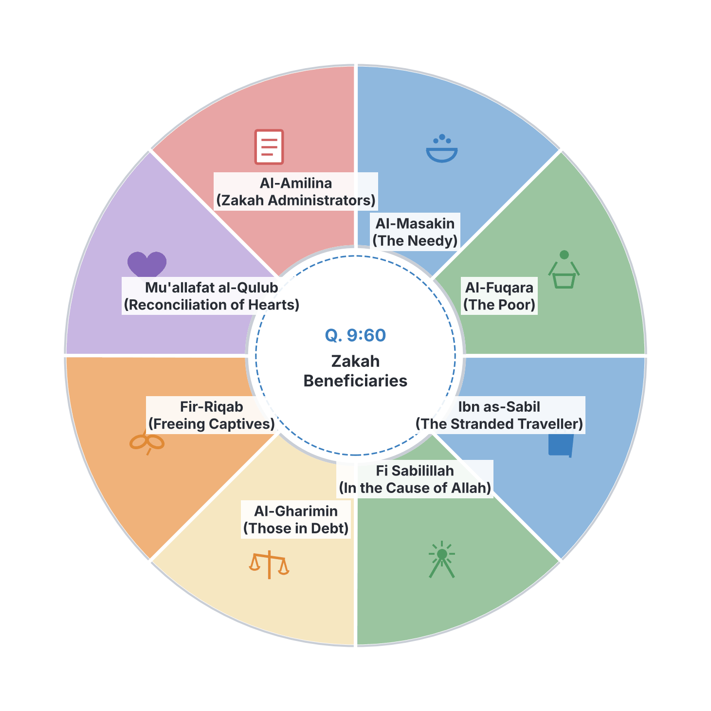
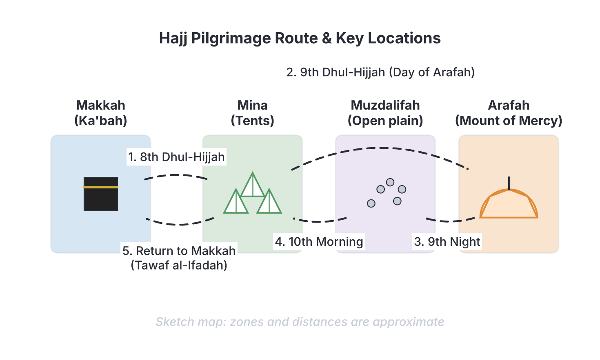

# JAMB Irk Notes: Ibādāt: Zakāh, Sawm, Hajj, and Jihād

## What JAMB expects

This topic is Section B, Topic 10 of the JAMB Islamic Religious Knowledge syllabus: Ibadat and their types. This file covers the final four major institutions of Islamic worship and religious duty.

This file covers the following content items:
- **d. Zakah**: (i) Its types and importance (zakatul-fitr, zakatul mal, al-an-am and al-harth (Q.2:267) (Q.9:103) 3rd Hadīth of an-Nawāwī; (ii) Collection and disbursement (Q.9:60); (iii) Difference between Zakah and sadaqah.
- **e. Sawm**: (i) Its types and importance (fard, sunnah, qada and kaffarah) (Q.2:183-185) 3rd Hadīth of an-Nawāwī; (ii) People exempted from sawm; (iii) Things that vitiate sawm.
- **f. Hajj**: (i) Its importance (Q.2:158 and 197) (Q.3:97) (Q.22:27-28); (ii) Type (Ifrad, Qirān and Tamattu$^c$); (iii) Essentials of Hajj (Arkan al Hajj); (v) Conditions for the performance of Hajj; (iv) Differences between Hajj and Umrah.
- **g. Jihad**: Concept, kinds, manner and Lessons (Q.2:190-193) (Q.22:39-40).

By the end of these notes, you should be able to:
1. differentiate between the various types of zakkah and the time of giving them out;
2. explain how to collect and distribute zakah;
3. distinguish between zakah and sadaqah.
4. compare the various types of sawm;
5. list the people who are exempted from fasting;
6. explain things that vitiate fasting.
7. examine the importance of Hajj;
8. differentiate between the types of Hajj;
9. explain the essentials of Hajj;
10. evaluate the conditions for performance of Hajj;
11. differentiate between Hajj and Umrah.
12. examine the concepts of jihad and its type;
13. evaluate the manner of carrying out jihad and its lessons.

**Note on the syllabus wording:** The syllabus spells "Zakāh" as "zakkah" in one of the objectives. The standard spelling "Zakāh" (or Zakat) is used throughout these notes. In the Hajj section, the syllabus lists the content items out of order (jumping from iii to v, then iv); these notes group the concepts logically while covering everything. This file is the second part of a split topic; good deeds, purification (Tahārah), and prayer (Salāh) are covered in `B10a-ibadah-taharah-and-salah.md`. 

## Content item d: Zakāh

Zakāh (poor-due or almsgiving) is the third pillar of Islam. The word literally means "purification" and "growth." By giving a fixed portion of one's wealth to the needy, a Muslim purifies their remaining wealth and soul from greed, while promoting social growth.

Its fundamental importance is established in the Qur'ān and Sunnah:
* **Q.2:267**: *"O ye who believe! Spend of the good things which ye have earned, and of that which We bring forth from the earth for you..."* (Pickthall's translation). This establishes the obligation to give from both earned wealth and agricultural produce.
* **Q.9:103**: *"Take alms of their wealth, wherewith thou mayst purify them and mayst make them grow..."* (Pickthall).
* **3rd Hadīth of an-Nawawī**: Prophet Muhammad (SAW) said, *"Islam is built on five (pillars): testifying that there is no god but Allah and that Muhammad is the Messenger of Allah, establishing the prayer, paying the Zakah, making the pilgrimage to the House, and fasting in Ramadan."* (Numbering follows an-Nawawī's collection).

### Objective d(i): Differentiate between the types of Zakāh and the time of giving them out

Islamic law divides Zakāh into two main categories: Zakāh al-Fitr (given at the end of fasting) and Zakāh al-Māl (the annual tax on wealth), which itself includes specific categories for livestock and crops. 

| Type of Zakāh | Meaning and Source | Time of Giving Out | Rate / Amount |
| --- | --- | --- | --- |
| **Zakāh al-Fitr** | Charity given to break the fast of Ramadan. It purifies the fasting person from idle talk or misbehaviour during the month and feeds the poor. | Given during the month of Ramadan, specifically in the final days, and **must be paid before the Eid prayer**. If paid after, it is counted merely as ordinary charity (Sadaqah). | Typically one *Sa'* (about 2.5 to 3 kg) of the staple food of the community (e.g., rice, millet, or maize in Nigeria) per person in a household. |
| **Zakāh al-Māl** | Zakāh on accumulated wealth (cash, gold, silver, business goods) that reaches the minimum threshold (*Nisāb*). | Given annually, once the wealth has been held continuously for one complete Islamic lunar year (*Hawl*). | Usually **2.5%** (or 1/40th) of the total qualifying wealth. |
| **al-An'ām** (Livestock) | A sub-category of Zakāh al-Māl applied to grazing livestock (camels, cattle, sheep, and goats). | Annually, after a full lunar year of possession. | Depends on the animal. For example, 1 sheep/goat is given for every 40 to 120 sheep owned; 1 year-old calf is given for every 30 cows. |
| **al-Harth** (Crops) | Zakāh on agricultural produce and fruits yielded from the earth (e.g., grains, dates, yams, cassava). | Given **at the time of harvest**, directly after the crops are gathered. (Q.6:141 states: *"pay the due thereof upon the harvest day"*). | **10%** for crops watered naturally by rain or rivers; **5%** for crops watered artificially (irrigation/machinery). |

### Objective d(ii): Explain how to collect and distribute Zakāh

**Collection:**
Historically, Zakāh was collected by the Islamic state. The ruler or community leader would appoint official collectors (*'Āmilīn*) to assess wealth and gather the Zakāh. In modern times, especially in non-Islamic states or mixed societies like Nigeria, Zakāh is often collected by registered Zakāh and Waqf boards, Islamic organizations, or given directly by the individual to the needy.

**Distribution (Disbursement):**
The Qur'ān strictly defines who is eligible to receive Zakāh. It cannot be given to just anyone (for example, it cannot be given to a wealthy person, or to one's own dependents like parents or children, whom one is already obliged to maintain).

The **eight categories of recipients** are explicitly listed in **Q.9:60**:
*"The alms are only for the poor and the needy, and those who collect them, and those whose hearts are to be reconciled, and to free the captives and the debtors, and for the cause of Allah, and (for) the wayfarer; a duty imposed by Allah..."* (Pickthall).

1. **Al-Fuqarā' (The Poor):** Those who have very little or nothing, not enough to meet basic needs.
2. **Al-Masākīn (The Needy):** Those who struggle to make ends meet, though they might have slightly more than the extremely poor.
3. **Al-'Āmilīna 'alayhā (The Collectors):** Administrators and workers employed to collect and distribute Zakāh; they are paid for their time from the funds.
4. **Al-Mu'allafati Qulūbuhum (Those whose hearts are to be reconciled):** New converts to Islam who need financial or social support, or those leaning towards Islam.
5. **Fir-Riqāb (To free captives/slaves):** Used to purchase the freedom of enslaved people or to ransom prisoners of war. 
6. **Al-Ghārimīn (The Debtors):** Those overwhelmed by lawful, necessary debts they cannot repay (e.g., medical bills).
7. **Fī Sabīlillāh (For the cause of Allah):** Generally applied to those striving to defend Islam or spread its message, or working for public welfare.
8. **Ibn as-Sabīl (The Wayfarer):** A stranded traveller who has run out of money, even if they are wealthy back in their home country.

### Objective d(iii): Distinguish between Zakāh and Sadaqah

While both refer to acts of charity, they have major legal differences in Islamic jurisprudence (Fiqh).

| Feature | Zakāh | Sadaqah |
| --- | --- | --- |
| **Status** | Compulsory (*Fard*), one of the Five Pillars of Islam. | Voluntary (*Sunnah* / *Nafl*), highly recommended but not strictly required. |
| **Amount** | Fixed by Islamic law (e.g., 2.5% of wealth, 10% of rain-fed crops). | Any amount a person chooses to give; even a smile is considered Sadaqah. |
| **Timing** | Must be given at specific times (e.g., annually for wealth, at harvest for crops, before Eid for Fitr). | Can be given at absolutely any time of the year, day or night. |
| **Recipients** | Restricted to the 8 specific categories mentioned in Qur'ān 9:60. | Can be given to anyone (rich, poor, family members, non-Muslims, or even animals). |
| **Punishment** | Deliberately refusing to pay Zakāh is a major sin and can take one out of the fold of Islam. | There is no sin or punishment for not giving voluntary Sadaqah. |

## Content item e: Sawm

Sawm (fasting) is the fourth pillar of Islam. In Islamic terminology, it means abstaining from food, drink, and sexual relations from dawn (Fajr) until sunset (Maghrib), with the explicit intention (*Niyyah*) of worshipping Allah.

The importance of fasting is detailed in **Q.2:183-185**:
*"O ye who believe! Fasting is prescribed for you, even as it was prescribed for those before you, that ye may ward off (evil) [attain Taqwa]... The month of Ramadan in which was revealed the Qur'an... therefor whosoever of you is present, let him fast the month..."* (Pickthall). 
The **3rd Hadīth of an-Nawawī** also confirms fasting in Ramadan as a foundational pillar.

### Objective e(i): Compare the various types of Sawm

Fasting is classified into different categories based on the ruling attached to them. 

| Type of Sawm | Meaning | Examples |
| --- | --- | --- |
| **Fard (Obligatory)** | Fasts that every eligible Muslim is commanded to observe. Leaving them without a valid excuse is a major sin. | The annual fasting during the entire month of **Ramadan**. |
| **Sunnah / Nafl (Voluntary)** | Fasts recommended by the Prophet (SAW) for extra spiritual reward, but not mandatory. | Mondays and Thursdays; the Day of 'Arafah (9th of Dhul-Hijjah); the Day of 'Ashura (10th of Muharram); six days in the month of Shawwal; three days in the middle of every lunar month (Ayyam al-Bid). |
| **Qadā' (Make-up)** | Fasting observed to replace obligatory fasts (like Ramadan days) that were missed due to a valid excuse (e.g., illness, travel, menstruation). | If a person misses 5 days of Ramadan because they were travelling from Kano to Lagos, they must fast 5 days of Qadā' later in the year before the next Ramadan. |
| **Kaffārah (Expiation/Penalty)** | Fasts required as a penalty for breaking certain Islamic laws. | Fasting for 60 consecutive days for intentionally breaking a Ramadan fast by having sexual intercourse; or fasting for 3 days for breaking a solemn oath; or fasting 60 days for accidental manslaughter if one cannot free a slave. |

### Objective e(ii): List the people who are exempted from fasting

Islam is a practical religion; it provides exemptions for those who would face severe hardship if they fasted.

1. **The Sick:** Anyone suffering from a severe illness that fasting would worsen. They must make up the days later (*Qadā'*). If the illness is chronic or incurable, they do not make it up but instead pay *Fidyah* (feeding one poor person for each missed day).
2. **The Traveller:** A person on a significant journey can break the fast to avoid hardship, but must make up the days later.
3. **Women during Menstruation (Hayd) and Post-natal bleeding (Nifās):** It is forbidden (*Harām*) for them to fast during these periods. They must break the fast and make up the exact number of days later.
4. **Pregnant and Breastfeeding Women:** If they fear for their own health or the health of their baby, they are exempted. According to different schools of thought, they must either make up the days later, pay *Fidyah*, or both.
5. **The Elderly and Frail:** Very old people who do not have the physical strength to fast. They pay *Fidyah* instead of making up the days.
6. **Children and the Insane:** Fasting is only obligatory on a mature (*Bāligh*) and sane (*'Āqil*) Muslim. Children are encouraged to practice, but they are technically exempt.

### Objective e(iii): Explain things that vitiate fasting

Vitiators (*Mufsidāt al-Sawm*) are actions that break or invalidate a fast. If a fast is vitiated, the person usually must make it up (*Qadā'*), and in some severe cases, pay a penalty (*Kaffārah*).

1. **Deliberate Eating or Drinking:** Intentionally swallowing food, water, or medicine during daylight hours. (Note: If someone eats out of genuine forgetfulness, the fast is *not* broken; they should stop eating immediately and continue the fast).
2. **Intentional Sexual Intercourse:** Having sexual relations during the daylight hours of a fast completely breaks it and requires a severe *Kaffārah* (fasting 60 continuous days, or if unable, feeding 60 poor people).
3. **Deliberate Vomiting:** Forcing oneself to vomit breaks the fast. (If one is overcome by sickness and vomits accidentally, the fast remains valid).
4. **Menstruation or Post-natal bleeding:** If a woman starts bleeding even five minutes before sunset, that day's fast is immediately vitiated and must be made up.
5. **Apostasy (Riddah):** Renouncing Islam automatically invalidates any acts of worship, including fasting.

## Content item f: Hajj

Hajj is the annual major pilgrimage to Makkah. It is the fifth pillar of Islam and is compulsory once in a lifetime for those who are physically and financially able. 

### Objective f(i): Examine the importance of Hajj

The Qur'ān heavily emphasizes the importance of Hajj:
* **Q.3:97:** *"...And pilgrimage to the House is a duty unto Allah for mankind, for him who can find a way thither..."* (Pickthall).
* **Q.22:27-28:** *"And proclaim unto mankind the pilgrimage. They will come unto thee on foot and on every lean camel... That they may witness things that are of benefit to them..."* (Pickthall).
* **Q.2:158:** Mentions the rites of Safa and Marwah as symbols of Allah.
* **Q.2:197:** Mentions that Hajj takes place in well-known months, and one must abstain from lewdness, wickedness, and arguing during the pilgrimage.

**Spiritual and Social Importance:**
1. **Purification from Sins:** The Prophet (SAW) stated that whoever performs Hajj purely for Allah and avoids bad behaviour returns free from sin "as the day his mother bore him."
2. **Universal Brotherhood:** Millions of Muslims from different races, tribes, and classes gather in Makkah wearing the same simple white garments (*Ihram*), stripping away all worldly status and demonstrating true equality. Nigerian pilgrims joining Asians, Arabs, and Europeans highlights this unity.
3. **Submission and Sacrifice:** It tests a Muslim's willingness to spend their wealth and endure physical hardship for the sake of Allah, following the example of Prophet Ibrahim (Abraham).

### Objective f(iv): Evaluate the conditions for performance of Hajj

A person is only obliged to perform Hajj if they meet the following conditions (*Shurūt*):

1. **Islam:** The person must be a Muslim. Non-Muslims are not permitted to perform Hajj or enter Makkah.
2. **Maturity (Bāligh):** The person must have reached puberty. If a child performs Hajj, they get the spiritual reward, but they must still perform the obligatory Hajj once they reach adulthood.
3. **Sanity ('Āqil):** A person must be of sound mind.
4. **Capability / Ability (Istitā'ah):** This is the most crucial condition and encompasses:
   * **Financial capability:** Having enough halal money to cover travel, accommodation, fees (e.g., visas via NAHCON in Nigeria), and enough to maintain their family back home while they are away.
   * **Physical capability:** Being healthy and strong enough to endure the rigors of travel and the physical rituals.
   * **Safe route:** The journey must be secure from war or severe danger.
5. **Mahram (For Women):** Traditionally, Islamic law requires a female pilgrim to be accompanied by her husband or a male relative she cannot legally marry (like a father or brother). In modern times, some schools of law and governments (including Saudi visa rules) permit women to travel in safe, supervised groups without a male relative.

### Objective f(iii): Explain the essentials of Hajj

The essentials (*Arkān*) of Hajj are the core pillars of the pilgrimage. **If any of these are missed, the Hajj is entirely invalid** and cannot simply be compensated for by sacrificing an animal (unlike lesser rules, called *Wājibāt*, which can be compensated). The four main Arkān agreed upon by majority scholars are:

1. **Ihrām (The state of consecration):** 
   Making the clear intention for Hajj at a designated boundary (*Mīqāt*). Men wear two seamless white sheets; women wear regular modest clothing that does not cover the face or hands. In this state, hunting, cutting hair, using perfume, and sexual relations are strictly forbidden.
2. **Wuqūf bi 'Arafah (Standing at Mount Arafah):** 
   This is the most critical element. Pilgrims must be present on the plain of Arafah on the 9th day of Dhul-Hijjah from noon until sunset, praying and seeking forgiveness. The Prophet (SAW) said: *"Hajj is Arafah."*
3. **Tawāf al-Ifādah (Circumambulation):** 
   Walking around the Ka'bah seven times in a counter-clockwise direction. This specific Tawāf is done on or after the 10th of Dhul-Hijjah (the Day of Eid).
4. **Sa'y (Walking between Safa and Marwah):** 
   Walking briskly seven times back and forth between the two small hills of Safa and Marwah, re-enacting the desperate search for water by Hajar (the wife of Ibrahim) for her infant son Ismail.

*(Note: Some schools of thought, like the Shafi'i, also include Halq/Taqsīr—shaving or trimming the hair—as an absolute essential, while others class it as highly obligatory [Wajib]).*

### Objective f(ii): Differentiate between the types of Hajj

A pilgrim can choose to perform Hajj in one of three ways, depending on how they combine it with 'Umrah.

| Type of Hajj | Meaning | Process | Sacrifice required? |
| --- | --- | --- | --- |
| **Ifrād** (Single) | Performing **Hajj only**, without 'Umrah. | The pilgrim enters Ihram specifically for Hajj, performs the rites of Hajj, and exits Ihram on the 10th of Dhul-Hijjah. | No animal sacrifice is compulsory. |
| **Qirān** (Combined) | Performing Hajj and 'Umrah **together** in one continuous state of Ihram. | The pilgrim declares intention for both. They perform 'Umrah upon arrival but **do not break their Ihram**. They remain in Ihram until the Hajj is completed on the 10th. | Yes, a sacrifice is mandatory to show gratitude for doing both. |
| **Tamattu'** (Enjoyment) | Performing 'Umrah first, breaking Ihram, and then performing Hajj later. | The pilgrim performs 'Umrah, cuts their hair, and completely exits Ihram (enjoying regular clothes/life). On the 8th of Dhul-Hijjah, they re-enter Ihram from Makkah for Hajj. | Yes, a sacrifice is mandatory. This is the most common type performed today. |

### Objective f(v): Differentiate between Hajj and Umrah

'Umrah is often called the "lesser pilgrimage." While it shares some rituals with Hajj, they are very different in scope and timing.

| Feature | Hajj (Major Pilgrimage) | 'Umrah (Lesser Pilgrimage) |
| --- | --- | --- |
| **Status** | A compulsory pillar of Islam (*Fard*) once in a lifetime. | *Sunnah* (highly recommended) according to most scholars; though some consider it obligatory once. |
| **Time/Date** | Must be performed during specific days in the specific month of **Dhul-Hijjah** (8th to 13th). | Can be performed at **any time of the year**. |
| **Locations / Rituals** | Involves rituals in Makkah, Mina, Arafah, and Muzdalifah. | Only involves rituals inside Makkah (at the Ka'bah and Safa/Marwah). |
| **Wuqūf at Arafah** | Standing at Arafah is the core essential. | No visit to Arafah, Mina, or Muzdalifah is required. |
| **Duration** | Takes about 5 to 6 days to complete. | Can easily be completed in a few hours. |

## Content item g: Jihād

### Objective g(i): Examine the concepts of Jihād and its types

**Concept of Jihād:**
The word *Jihād* comes from the Arabic root *'jahada'*, which means "to strive, struggle, or exert effort." In popular media, it is often mistranslated simply as "holy war," but in Islamic teaching, Jihād encompasses any sincere, exhausting struggle to please Allah, establish truth, or resist evil. 

The Qur'ān outlines the concept of fighting in defense of the community, but lays down strict conditions:
* **Q.22:39-40:** *"Sanction is given unto those who fight because they have been wronged; and Allah is indeed Able to give them victory; Those who have been driven from their homes unjustly only because they said: Our Lord is Allah..."* (Pickthall). This was the very first verse allowing Muslims to fight back against the Makkans who had violently persecuted them for years.
* **Q.2:190-193:** *"Fight in the way of Allah against those who fight against you, but begin not hostilities. Lo! Allah loveth not aggressors..."* (Pickthall). This establishes that military combat is strictly defensive and proportionate.

**Types of Jihād:**
Islamic scholars classify Jihād into several categories:
1. **Jihād an-Nafs (Striving against the self):** This is the internal struggle against one's own base desires, anger, greed, and ego, striving to remain obedient to Allah. The Prophet (SAW) referred to this as the "Greater Jihad" (*Jihad al-Akbar*).
2. **Jihād ash-Shaytān (Striving against Satan):** Resisting the whispers and temptations of the devil.
3. **Jihād bil-Qalam/Lisān (Striving with the pen/tongue):** Spreading the truth of Islam through preaching (*Da'wah*), writing, education, and speaking out against oppression or injustice.
4. **Jihād bil-Māl (Striving with wealth):** Using one's financial resources generously to build schools, hospitals, support the poor, and fund community defense.
5. **Jihād bis-Sayf (Striving with the sword / Military Jihād):** Armed struggle. This is the "Lesser Jihad." It is permissible only to defend life, property, and religious freedom against armed aggression, or to fight tyranny under the banner of a legitimate state authority.

### Objective g(ii): Evaluate the manner of carrying out Jihād and its lessons

**Manner (Rules of Engagement):**
Islam laid down strict laws of warfare centuries before modern Geneva Conventions. If military Jihād is required, it must follow severe ethical restraints:
* **No Aggression:** Muslims must not start hostilities (Q.2:190).
* **Protection of Non-Combatants:** It is strictly forbidden to kill women, children, the elderly, the sick, or monks in their places of worship.
* **No Destruction of Infrastructure:** Fighters are forbidden from destroying homes, cutting down fruit-bearing trees, slaughtering livestock (except for necessary food), or poisoning water sources.
* **Legitimate Authority:** Armed Jihād cannot be declared by vigilantes or radical splinter groups. It must be organized by the legitimate ruler of the Islamic state.
* **Peace is the Goal:** If the enemy offers peace, Muslims must accept it. *"And if they incline to peace, incline thou also to it, and trust in Allah."* (Q.8:61).

**Lessons of Jihād:**
* **Defense of Human Rights:** Jihād ensures that oppression and tyranny are resisted.
* **Self-Discipline:** The greater Jihād teaches Muslims to control their anger and desires, creating morally upright citizens.
* **Sacrifice:** It teaches selflessness, showing that principles of faith, justice, and the community are more important than personal comfort.
* **Respect for Life:** The strict rules of engagement teach that human life and the environment are sacred, even during the chaos of war.

## Key terms

| Term | Meaning |
| --- | --- |
| Zakāh | Compulsory annual alms/charity (3rd pillar of Islam). |
| Nisāb | The minimum threshold of wealth one must own before Zakāh becomes due. |
| Sadaqah | Voluntary charity, not fixed by amount or time. |
| Sawm | Fasting from dawn to sunset (4th pillar of Islam). |
| Qadā' | Making up missed obligatory fasts or prayers. |
| Kaffārah | An expiation or penalty for breaking certain laws (e.g., intentionally ruining a fast). |
| Hajj | The compulsory major pilgrimage to Makkah (5th pillar of Islam). |
| 'Umrah | The lesser, voluntary pilgrimage to Makkah. |
| Arkān | The absolute essential pillars of a ritual; if missed, the ritual is invalid. |
| Ihrām | The state of ritual consecration and the white garments worn during Hajj/Umrah. |
| Tawāf | Walking around the Ka'bah seven times. |
| Sa'y | Walking seven times between the hills of Safa and Marwah. |
| Jihād | Striving or struggling in the path of Allah (includes internal, intellectual, and military struggles). |

## Exam tips and common mistakes

* **Zakāh Rates:** Remember 2.5% for general wealth. For crops (al-Harth), it's 10% if naturally watered (rain), but 5% if mechanically irrigated.
* **Zakāh vs Sadaqah:** Exam questions often try to trick you by mixing them up. Remember Zakāh has exactly 8 specific categories of recipients (Q.9:60) and is obligatory; Sadaqah is general and voluntary.
* **Types of Fasting:** Pay attention to *Qadā'* (replacing a missed fast due to a valid excuse like sickness) versus *Kaffārah* (a severe penalty for deliberately breaking the rules, like having sex while fasting).
* **Hajj Terminology:** Do not confuse *Tawāf* (going around the Ka'bah) with *Sa'y* (walking between Safa and Marwah), or with *Wuqūf* (standing at Arafah). 
* **Types of Hajj:** 
  * Ifrād = Hajj only. 
  * Qirān = Hajj + Umrah together (no break). 
  * Tamattu' = Umrah first, break Ihram, then Hajj.
* **Jihād Mistranslation:** Always remember Jihād primarily means "striving/struggling", not purely "holy war." The highest form is striving against one's own self (*Nafs*).

## Quick summary

1. **Zakāh** is obligatory charity on wealth and crops, distributed only to 8 specific categories (like the poor, needy, debtors) to purify wealth and aid society.
2. **Sawm** (fasting) is obligatory during Ramadan but can be voluntary (Sunnah), make-up (Qadā'), or penalty (Kaffārah). 
3. Fasting is vitiated by intentional eating, drinking, or sexual intercourse, and by the onset of menstruation. The sick and travellers are exempted but make it up later.
4. **Hajj** is compulsory once in a lifetime for those physically and financially able. It promotes global equality and forgiveness of sins.
5. The absolute essentials (*Arkān*) of Hajj are Ihrām, standing at Arafah, Tawāf, and Sa'y. Missing any makes the Hajj invalid.
6. Hajj can be performed as Ifrād, Qirān, or Tamattu', and is vastly different from 'Umrah, which is voluntary, shorter, and has no specific date.
7. **Jihād** means to strive. It ranges from the internal struggle against bad desires (the greatest Jihād) to defensive armed combat.
8. Armed Jihād has strict humanitarian rules: it forbids initiating aggression and outlaws the killing of non-combatants or the destruction of property.

## Practice questions

**1. Which of the following is NOT one of the eight categories of Zakāh recipients mentioned in Q.9:60?**
- A. The debtor (Al-Gharim)
- B. The wayfarer (Ibn as-Sabil)
- C. The builder of mosques
- D. Those whose hearts are to be reconciled

**Answer: C.** Building mosques is a noble act of continuous charity (Sadaqah Jariyah), but Zakāh funds are strictly for the 8 categories of people listed in Q.9:60. 

**2. The Zakāh on agricultural crops watered by natural rainfall is calculated at**
- A. 2.5%
- B. 5%
- C. 10%
- D. 20%

**Answer: C.** Crops naturally watered by rain require a 10% Zakāh upon harvest. If they are irrigated by machinery/effort, it drops to 5%.

**3. A Muslim who intentionally breaks their Ramadan fast by engaging in sexual intercourse must perform**
- A. Qadā'
- B. Kaffārah
- C. Fidyah
- D. Sadaqah

**Answer: B.** Kaffārah (expiation) is required for this major violation, which entails fasting 60 continuous days, or feeding 60 poor people if unable.

**4. The most essential pillar (Rukun) of Hajj, without which the pilgrimage is entirely invalid, is**
- A. Visiting the Prophet's mosque in Madinah
- B. Throwing pebbles at the Jamarat
- C. Standing at Mount Arafah
- D. Sacrificing an animal

**Answer: C.** Wuqūf bi 'Arafah (standing at Arafah) is the core essential. The Prophet (SAW) explicitly stated, "Hajj is Arafah."

**5. Which type of Hajj involves performing 'Umrah, breaking the state of Ihram completely, and then re-entering Ihram later for Hajj?**
- A. Qirān
- B. Ifrād
- C. Tamattu'
- D. Nafl

**Answer: C.** Tamattu' literally means "enjoyment," referring to the pilgrim enjoying regular clothing and life between the 'Umrah and the Hajj.

**6. The term "Jihād al-Akbar" (the Greater Jihād) refers to**
- A. Fighting defensively on the battlefield
- B. Striving against one's own desires and ego (an-Nafs)
- C. Spreading Islam through the pen
- D. Donating all one's wealth to charity

**Answer: B.** The Prophet (SAW) described the internal, continuous struggle to discipline one's self and obey Allah as the greater struggle.

**7. Which of the following groups is required to pay Fidyah (feeding a poor person) instead of making up missed fasts?**
- A. A traveller
- B. A temporarily sick person
- C. A menstruating woman
- D. The very elderly and chronically ill

**Answer: D.** Travellers, temporarily sick people, and menstruating women must perform Qadā' (make up the days later). Only those who permanently cannot fast pay Fidyah.

**8. Which of the following differentiates Sadaqah from Zakāh?**
- A. Sadaqah is obligatory while Zakāh is voluntary
- B. Sadaqah can be given at any time to anyone, while Zakāh has fixed times and recipients
- C. Sadaqah requires a 2.5% rate while Zakāh does not
- D. Sadaqah must be given before Eid prayer

**Answer: B.** Sadaqah is general, voluntary charity given anywhere to anyone, whereas Zakāh has strict legal rules regarding rate, time, and recipients.

**9. The Islamic rules of engagement during military Jihād strictly forbid**
- A. Accepting peace treaties
- B. Killing combatants on the battlefield
- C. Killing women, children, and monks
- D. Fighting back against oppressors

**Answer: C.** It is strictly prohibited to harm non-combatants, destroy property unnecessarily, or harm religious figures in their places of worship during combat.

**10. What differentiates 'Umrah from Hajj?**
- A. 'Umrah requires standing at Arafah, while Hajj does not
- B. 'Umrah can be performed at any time of the year, while Hajj has specific days in Dhul-Hijjah
- C. 'Umrah is compulsory on every Muslim, while Hajj is Sunnah
- D. 'Umrah involves throwing stones at Jamarat

**Answer: B.** 'Umrah can be done anytime and involves fewer rituals (only Ihram, Tawaf, and Sa'y). Hajj happens only in Dhul-Hijjah and includes Arafah, Mina, and Muzdalifah. 

<!-- COVERAGE
obj i | Objective d(i): Differentiate between the types of Zakāh and the time of giving them out
obj ii | Objective d(ii): Explain how to collect and distribute Zakāh
obj iii | Objective d(iii): Distinguish between Zakāh and Sadaqah
obj i | Objective e(i): Compare the various types of Sawm
obj ii | Objective e(ii): List the people who are exempted from fasting
obj iii | Objective e(iii): Explain things that vitiate fasting
obj i | Objective f(i): Examine the importance of Hajj
obj ii | Objective f(ii): Differentiate between the types of Hajj
obj iii | Objective f(iii): Explain the essentials of Hajj
obj iv | Objective f(iv): Evaluate the conditions for performance of Hajj
obj v | Objective f(v): Differentiate between Hajj and Umrah
obj i | Objective g(i): Examine the concepts of Jihād and its types
obj ii | Objective g(ii): Evaluate the manner of carrying out Jihād and its lessons
item d | Content item d: Zakāh
item e | Content item e: Sawm
item f | Content item f: Hajj
item g | Content item g: Jihād
-->
