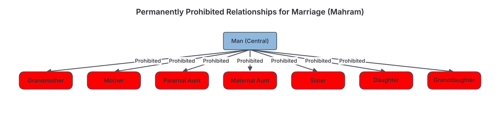
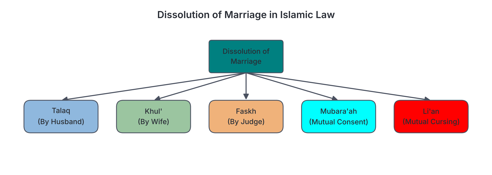
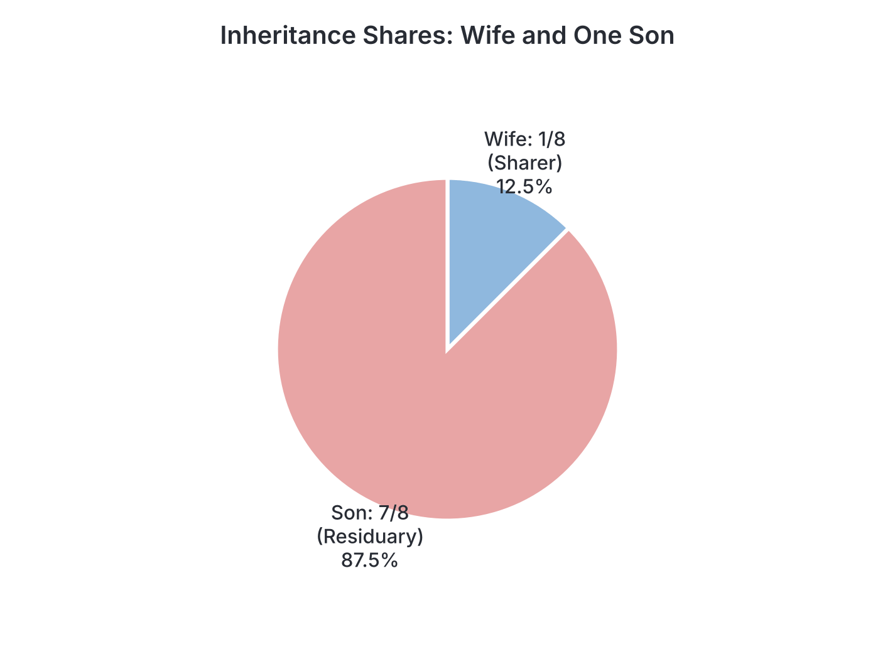

# JAMB Irk Notes: Family Matters in Islam

## What JAMB expects

This topic covers Section B, Topic 11 of the JAMB syllabus: Family Matters. It explores Islamic family jurisprudence (Fiqh) from the formation of a marriage to its dissolution, and finally how a family's wealth is distributed after death. 

It has four main content items:
* **(a) Marriage:** importance, prohibited categories, conditions for validity, spousal rights and duties, and polygamy.
* **(b) Idrar:** ill-treatment of a wife.
* **(c) Divorce:** Islam's attitude to divorce, kinds of divorce (Talaq, Khul', Faskh, Mubara'ah, Li'an), Iddah (waiting period), prohibited forms of dissolution (Ila, Zihar), and child custody (Hadanah).
* **(d) Inheritance:** its importance, categories of Qur'anic heirs, and their specific shares.

By the end of these notes, you should be able to:
1. Analyse the importance of marriage;
2. List the category of women prohibited to a man to marry;
3. Examine the conditions for validity of marriage;
4. Explain the rights and duties of the spouse;
5. Evaluate polygamy and its significance;
6. Examine the ill-treatment of wife in marriage;
7. Analyse the attitude of Islam to divorce;
8. Examine the different kinds of divorce;
9. Differentiate between the various kinds of iddah;
10. Analyse its duration and significance;
11. Explain the prohibited forms of ending marriage;
12. Examine who has the right to custody of children;
13. Evaluate the significance of inheritance;
14. Identify the categories of the Qur'ānic heirs;
15. Explain the share of each heir.

**Note on the syllabus wording:**
- The syllabus objectives for marriage jump from (iv) to (vi) "evaluate polygamy...". This correctly matches content item (a)(v).
- Under content (b), the syllabus writes "Idrar ill-treatment of wife (Q. 65:1-3)". The term for harm or ill-treatment in Arabic is *Dirar* or *Idrar*. Surat at-Talaq (Q.65:1-3) primarily discusses the rules of divorce and the waiting period, but it implies not harming the wife by expelling her. Later in the same surah (Q.65:6), Allah explicitly commands men not to harass or straiten their wives. The notes explain this context.
- The hadith on divorce is referenced in the syllabus as "(Abu Daud 15:3)". Hadith numbering varies widely depending on the edition used. The notes quote the hadith as requested but be aware that you may see it under a different number in other textbooks.

## Marriage in Islam (Nikah)

### Importance of marriage

**Objective i: analyse the importance of marriage.**

In Islam, marriage (*Nikah*) is a highly recommended practice (Sunnah) of Prophet Muhammad (SAW) and a sacred social contract between a man and a woman. Monasticism or lifelong celibacy is discouraged in Islam. 

Marriage is important for the following reasons:
1. **Companionship and peace:** Marriage provides emotional support and tranquility. Surat ar-Rum (Q.30:21) states: *"And of His signs is this: He created for you helpmeets from yourselves that ye might find rest in them, and He ordained between you love and mercy."* (Pickthall's translation).
2. **Lawful fulfillment of desires:** It is the only legally and morally permitted way to fulfill human sexual desires, thereby preventing immorality (Zina) in society. Surat an-Nur (Q.24:32) urges Muslims to arrange marriages for the single among them.
3. **Procreation and family building:** It forms the legal foundation for raising children and continuing the human race. Surat an-Nahl (Q.16:72) states: *"And Allah hath given you wives of your own kind, and hath given you, from your wives, sons and grandsons, and hath made provision of good things for you..."*
4. **Social stability:** It connects families and tribes, creating a cohesive and supportive community.

### Prohibited categories of women in marriage

**Objective ii: list the category of women prohibited to a man to marry.**

Islamic law strictly defines which women a man is not allowed to marry. These prohibitions fall into two types: **permanent** and **temporary**.

| Type of Prohibition | Category | Specific Relatives Prohibited |
| --- | --- | --- |
| **Permanent** | **1. Consanguinity (Blood relations)** | Mother, grandmother, daughter, granddaughter, sister (full or half), paternal aunt, maternal aunt, niece (brother's or sister's daughter). |
| | **2. Affinity (Marriage ties)** | Mother-in-law, step-daughter (if the marriage with her mother has been consummated), daughter-in-law, step-mother. |
| | **3. Fosterage (Rada'ah)** | A woman who breastfed him (foster-mother) and her daughters (foster-sisters). Prophet Muhammad (SAW) stated that whatever is prohibited by blood is also prohibited by fosterage. |
| **Temporary** | **Religion (Shirk)** | Surat al-Baqarah (Q.2:221) forbids marrying an idolatress (polytheist) until she believes in Islam. |
| | **Conjunction** | Marrying two sisters at the same time, or a woman and her aunt simultaneously. (If one dies or is divorced, he may marry the other). |
| | **Existing marriage** | Any woman who is currently married to another man (Q.4:24). |

These categories are detailed in Surat an-Nisa' (Q.4:22-24).

### Conditions for the validity of marriage

**Objective iii: examine the conditions for validity of marriage.**

For an Islamic marriage contract to be valid and binding, certain essential elements (*Arkan*) and conditions (*Shurut*) must be met. Without these, the marriage is null and void.

1. **Proposal and Acceptance (Ijab and Qabul):** A clear offer of marriage and an explicit acceptance must take place in the same sitting.
2. **Consent of both parties:** Both the bride and the groom must willingly agree. Forced marriages are invalid in Islam.
3. **The Guardian (Wali):** The bride must be represented by her legal male guardian (such as her father, grandfather, or brother).
4. **Witnesses (Shuhud):** At least two sane, adult Muslim male witnesses must be present to hear the proposal and acceptance, ensuring the marriage is a public, legal fact, not a secret affair.
5. **Payment of Dowry (Mahr/Sadaq):** The groom must give a mandatory gift to the bride. It belongs entirely to her, not her parents. Surat an-Nisa' (Q.4:4) commands: *"And give unto the women (whom ye marry) free gift of their marriage portions..."* Q.4:24-25 also emphasizes paying women their rightful dowries.

*(Note: The wedding feast, known as Walimah, is a highly recommended Sunnah, but it is not a strict condition for the validity of the contract itself).*

### Rights and duties of the spouses

**Objective iv: explain the rights and duties of the spouse.**

Marriage in Islam involves mutual rights and responsibilities to ensure a harmonious home.

**The Husband's duties (The Wife's rights):**
1. **Maintenance (Nafaqah):** The husband is entirely responsible for the financial upkeep of the family, including food, clothing, housing, and medical care, according to his means. Surat at-Talaq (Q.65:6-7) instructs: *"Lodge them where ye dwell, according to your wealth... Let him who hath abundance spend of his abundance..."*
2. **Kind treatment and protection:** He must treat his wife with respect, gentleness, and protect her. Surat an-Nisa' (Q.4:34) states: *"Men are in charge of women..."* which implies an obligation of care and leadership, not tyranny.
3. **Payment of Mahr:** As discussed above, providing the agreed dowry is her absolute right.

**The Wife's duties (The Husband's rights):**
1. **Obedience in lawful matters:** She is expected to obey her husband in matters that do not contradict Islamic teachings.
2. **Guarding his property and honour:** She must protect his wealth, his secrets, and her own chastity, especially in his absence. 
3. **Managing the household:** She plays the primary role in nurturing the children and managing the internal affairs of the home.

**Mutual duties:**
Both spouses are required to foster a religious and peaceful environment. Surat Ta-Ha (Q.20:132) states: *"And enjoin upon thy people worship, and be constant therein..."* They must show each other love, mercy, and mutual consultation.

### Polygamy and its significance

**Objective vi: evaluate polygamy and its significance.**

Islam permits polygyny (a man having more than one wife), but restricts it strictly to a maximum of four wives at any one time. It is a permission, not a mandatory command.

**The Qur'anic standard:**
- Surat an-Nisa' (Q.4:3) limits the number and lays down a strict condition of justice: *"...marry of the women, who seem good to you, two or three or four; and if ye fear that ye cannot do justice (to so many) then one (only)..."*
- Absolute emotional equality is recognized as impossible. Surat an-Nisa' (Q.4:129) states: *"Ye will not be able to deal equally between (your) wives, however much ye wish (to do so). But turn not altogether away (from one), leaving her as in suspense..."* A husband must provide equal maintenance, housing, and time.

**Significance of polygamy in Islam:**
1. **Social welfare:** It provides a mechanism to care for widows and orphans, particularly after wars where many men are killed (the context in which Q.4:3 was revealed after the Battle of Uhud).
2. **Preventing immorality:** In societies where women outnumber men, it allows all women the opportunity for lawful marriage and motherhood, preventing prostitution and corruption.
3. **Practical solutions:** It offers a lawful alternative to divorce if a wife is chronically ill or unable to bear children, allowing the family unit to remain intact.

## Idrar (ill-treatment of wife in marriage)

**Objective i: examine the ill-treatment of wife in marriage.**

In Islamic jurisprudence, causing harm or injury to anyone is forbidden. The legal term for this is ***Dirar*** or ***Idrar***. The Prophet (SAW) established the foundational legal maxim: *"There should be neither harming nor reciprocating harm"* (*La darar wa la dirar*).

When applied to marriage, *Idrar* refers to the ill-treatment of a wife. This includes physical abuse, verbal and emotional cruelty, failing to provide financial maintenance, or intentionally keeping a woman in a "suspended" state (where she is neither treated as a proper wife nor granted a divorce to move on with her life). 

The syllabus references Surat at-Talaq (Q.65:1-3), which outlines the rules for the waiting period (Iddah) and explicitly states: *"Expel them not from their houses nor let them go forth unless they commit open immorality..."* By verse 6 of the same surah, Allah clearly forbids *Idrar* during this vulnerable time: *"...and harass them not so as to straiten life for them."*

If a husband commits *Idrar* against his wife and refuses to amend his ways, she has the legal right to approach an Islamic judge (Qadi) to seek a dissolution of the marriage (*Faskh*) to protect herself from further harm.

## Divorce in Islam

### The attitude of Islam to divorce

**Objective i: analyse the attitude of Islam to divorce.**

Islam recognises that marriages can fail, and therefore permits divorce as a last resort. However, its attitude towards divorce is one of extreme discouragement. 

1. **A hateful permission:** The Prophet (SAW) said, *"Of all things lawful ... most hateful to Allah is divorce"* (recorded in Abu Dawud, numbering varies). 
2. **Exhausting all remedies:** Islam requires spouses to attempt reconciliation before divorce is finalized. Surat an-Nisa' (Q.4:34-35) outlines a step-by-step process to save the marriage:
   - Admonition and gentle advice.
   - Separation of beds (a temporary physical withdrawal to cool tempers).
   - Light disciplinary action.
   - Appointing arbiters: *"And if ye fear a breach between them twain, appoint an arbiter from his folk and an arbiter from her folk..."* (Q.4:35).
3. **A measured process:** If divorce must happen, Islam mandates a waiting period (Q.2:228) to allow tempers to cool and to verify if the woman is pregnant, leaving the door open for taking the wife back.

### Different kinds of divorce

**Objective i: examine the different kinds of divorce.**

Islamic law outlines several ways a marriage can be dissolved.

| Kind of Divorce | Description |
| --- | --- |
| **Talaq** | Divorce initiated by the **husband**. He pronounces it unilaterally. It can be *Raj'i* (revocable, meaning he can take her back during her waiting period) or *Ba'in* (irrevocable, requiring a new contract, or forbidden entirely if it is the third pronouncement, as detailed in Q.2:229-230). |
| **Khul'** | Divorce initiated by the **wife**. If she cannot bear living with him, she requests a divorce by returning her Mahr (dowry) or offering financial compensation to the husband to release her. |
| **Faskh** | Annulment of the marriage by an **Islamic judge** (Qadi). A wife can seek Faskh if the husband fails to provide maintenance, Abandons her, suffers from a dangerous disease, or commits severe ill-treatment (*Idrar*). |
| **Mubara'ah** | Dissolution by **mutual consent**. Both the husband and wife agree to end the marriage and mutually forgive each other of any financial rights or obligations. |
| **Li'an** | **Mutual cursing**. If a husband accuses his wife of adultery but has no witnesses, they both swear solemn oaths invoking Allah's curse if they are lying (Q.24:6-9). The marriage is permanently and irrevocably dissolved immediately. |

### Kinds of Iddah

**Objective i: differentiate between the various kinds of iddah.**

**Iddah** is the mandatory waiting period a woman must observe after the dissolution of her marriage (either by divorce or the death of her husband) before she is permitted to marry another man. The type of Iddah depends entirely on the woman's biological state and the cause of separation.

1. **A menstruating divorced woman:** Her Iddah is calculated in menstrual cycles (*Qur'u*).
2. **A divorced woman who does not menstruate:** (Either because of old age/menopause or she has not yet reached puberty). Her Iddah is calculated in lunar months.
3. **A widow:** A woman whose husband has died has a specific Iddah regardless of her age.
4. **A pregnant woman:** If she is pregnant, her Iddah (whether divorced or widowed) overrides all other timeframes.

### Duration and significance of Iddah

**Objective ii: analyse its duration and significance.**

**Duration of Iddah:**
*   **Divorced (menstruating):** Three complete menstrual cycles (Q.2:228).
*   **Divorced (non-menstruating):** Three lunar months (Q.65:4).
*   **Widow:** Four lunar months and ten days (Q.2:234).
*   **Pregnant woman:** Until she delivers her baby (Q.65:4).
*   *Note: A woman divorced before the marriage has been consummated has no Iddah.*

**Significance of Iddah:**
1. **Ascertaining paternity:** It ensures that the woman's womb is empty and she is not carrying the child of her former husband. This prevents disputes over the child's lineage and inheritance.
2. **Opportunity for reconciliation:** In a revocable divorce (*Talaq Raj'i*), the three-month period gives the couple time to regret their hasty decision and reunite without needing a new marriage contract.
3. **Mourning and respect:** For a widow, the four months and ten days serve as a respectful mourning period for her deceased husband before she moves on.

### Prohibited forms of ending marriage (Ila and Zihar)

**Objective i: explain the prohibited forms of ending marriage.**

In pre-Islamic Arabia (Jahiliyyah), men used oppressive vows to suspend their wives, neither treating them as wives nor divorcing them so they could remarry. Islam prohibited and reformed these practices:

1. **Ila (Vow of Abstinence):**
   *   **What it was:** A husband would swear an oath not to have sexual relations with his wife, leaving her in prolonged distress.
   *   **Islamic ruling:** Surat al-Baqarah (Q.2:226-227) states that a man who makes such an oath has a maximum of **four months**. If he resumes marital relations before the four months end, he must pay an expiation for breaking his oath, and the marriage continues. If he refuses and the four months pass, the marriage is automatically dissolved (a divorce occurs). 
2. **Zihar (Injurious Assimilation):**
   *   **What it was:** A husband would tell his wife, "You are to me as the back of my mother." In Jahiliyyah, this meant the wife was permanently forbidden to him (like his mother), but she was not legally divorced.
   *   **Islamic ruling:** Surat al-Mujadilah (Q.58:2-4) condemns this as an evil and false statement. The marriage is **not** dissolved, but it is strictly forbidden for the husband to touch his wife again until he pays a heavy penalty (freeing a slave, fasting two consecutive months, or feeding sixty poor people). 

### Custody of children (Hadanah)

**Objective i: examine who has the right to custody of children.**

*Hadanah* refers to the right and duty of nursing, raising, and caring for a young child after the parents' marriage has ended.

*   **The Mother's Right:** In Islamic law, the mother has the primary and strongest right to the custody of young children. She is naturally more compassionate and better suited for early childcare. She loses this right only if she is deemed unfit or if she remarries a man who is a stranger (not closely related) to the child.
*   **The Father's Responsibility:** Even while the child is in the mother's custody, the father remains entirely responsible for the child's financial maintenance, including food, clothing, housing, and education.
*   **Transfer of Custody:** When the child reaches an age of relative independence (often cited as around 7 years old, though schools of law differ slightly), the child may be transferred to the father's custody for moral training, education, and protection, or the child may be given the choice of which parent to live with.

## Inheritance in Islam (Mirath)

### Significance of inheritance

**Objective i: evaluate the significance of inheritance.**

Inheritance (*Mirath* or *Fara'id*) is the legal transfer of a deceased person's wealth to their rightful heirs. The rules are laid out explicitly by Allah in the Qur'an.

**Significance of Mirath:**
1. **Ensures equitable distribution:** It prevents wealth from being concentrated in the hands of a single person (such as the eldest son) and ensures that all close relatives receive a portion.
2. **Protects vulnerable family members:** Before Islam, women and children were often denied inheritance. The Qur'an guaranteed their rights: *"Men shall have a portion of what the parents and the near relatives leave, and women shall have a portion..."* (Q.4:7).
3. **Strengthens family ties:** Knowing that financial rights and duties are divinely ordained prevents bitter family disputes over property.
4. **Religious obedience:** Because the specific fractions are dictated by Allah, distributing wealth correctly is an act of worship (*Ibadah*).

### Categories of Qur'anic heirs

**Objective i: identify the categories of the Qur’ānic heirs.**

The Islamic inheritance system categorises heirs based on their relationship to the deceased.

1. **Dhawul-Furoodh (The Fixed Sharers / Qur'anic Heirs):** These are relatives whose exact fractional shares (e.g., 1/2, 1/4, 1/8, 2/3, 1/3, 1/6) are explicitly mentioned in the Qur'an. They are always given their shares first. Examples include the husband, wife, father, mother, and daughter.
2. **Al-Asabah (The Residuaries / Agnates):** These are male relatives (and sometimes females when co-existing with a male of the same rank) who take whatever wealth is left over *after* the Fixed Sharers have taken their portions. The son is the strongest residuary. If there are no Fixed Sharers, the Residuaries take the entire estate.
3. **Dhawul-Arham (Distant Kindred):** These are blood relatives who do not fall into the first two categories (e.g., maternal uncles, aunts). They only inherit if there are no Sharers or Residuaries (excluding spouses).

### The share of each heir

**Objective ii: explain the share of each heir.**

The exact shares are detailed in Surat an-Nisa' (Q.4:11-12, 176). A person's share often changes depending on who else is alive (e.g., the presence of a child alters the shares of the spouse and parents).

Below is a table of the primary Qur'anic heirs and their shares:

| Heir | Condition | Share |
| --- | --- | --- |
| **Husband** | If the deceased wife leaves **no** children | **1/2** |
| | If the deceased wife leaves children | **1/4** |
| **Wife** | If the deceased husband leaves **no** children | **1/4** |
| | If the deceased husband leaves children | **1/8** |
| **Daughter** | If she is an only child (and no son exists) | **1/2** |
| | If there are two or more daughters (and no son exists) | **2/3** (shared equally among them) |
| | If there is a **son** | She becomes a **Residuary**. She gets half of what the son gets (ratio of 2:1 for male:female). |
| **Son** | Always | **Residuary**. Takes the remainder. (If with sisters, he takes a share twice the size of a sister's). |
| **Father** | If the deceased leaves children | **1/6** |
| **Mother** | If the deceased leaves children or multiple siblings | **1/6** |
| | If the deceased leaves no children and at most one sibling | **1/3** |
| **Kalalah** (Siblings) | If a person dies leaving neither parents nor children (Kalalah, Q.4:176), a single full sister gets **1/2**; two or more get **2/3**. A full brother takes all as a residuary. |

## Key terms

| Term | Meaning |
| --- | --- |
| Nikah | The Islamic marriage contract |
| Mahr / Sadaq | The mandatory dowry given by the groom to the bride |
| Wali | The legal male guardian of the bride |
| Idrar / Dirar | Causing harm, injury, or ill-treatment to someone (e.g., a wife) |
| Talaq | Divorce initiated by the husband |
| Khul' | Divorce initiated by the wife, usually by returning the Mahr |
| Faskh | Annulment of a marriage by an Islamic judge |
| Li'an | Mutual cursing and swearing of oaths in cases of unproven adultery accusations, resulting in permanent divorce |
| Iddah | The mandatory waiting period for a woman after divorce or widowhood |
| Ila | A prohibited pre-Islamic oath where a husband vows not to have sexual relations with his wife |
| Zihar | A prohibited pre-Islamic practice of a husband likening his wife to his mother's back to avoid marital relations |
| Hadanah | The right to custody and care of young children |
| Mirath | The Islamic law of inheritance |
| Dhawul-Furoodh | Qur'anic heirs who receive fixed fractional shares of an inheritance |
| Al-Asabah | Residuaries who take whatever remains of an inheritance after the fixed shares are distributed |
| Kalalah | A deceased person who leaves behind neither parents nor children |

## Exam tips and common mistakes

*   **Dowry vs Mahr:** In many Nigerian cultures, the groom's family brings items to the bride's parents. Do not confuse this with *Mahr*, which is an essential condition of Nikah and belongs exclusively to the bride.
*   **Categories of divorce:** Learn who initiates each. *Talaq* = husband. *Khul'* = wife. *Faskh* = judge.
*   **Iddah durations:** You must memorize these exactly. 3 menstrual cycles (regular divorce), 3 lunar months (non-menstruating divorce), 4 months and 10 days (widow), until delivery (pregnant).
*   **Zihar vs Ila:** *Ila* is a vow of abstinence (lasts max 4 months). *Zihar* is comparing the wife to the mother (requires heavy expiation/penalty before relations resume).
*   **Polygamy rules:** The maximum number is four, and the primary condition is absolute justice in treatment and maintenance.
*   **Inheritance fractions:** Be careful with the spouse's shares. A husband gets 1/2 or 1/4. A wife gets 1/4 or 1/8. A son is **never** a fixed sharer; he is always a residuary.

## Quick summary

1. Marriage (*Nikah*) is a highly encouraged contract that requires mutual consent, a Wali, witnesses, and Mahr. It provides companionship and a lawful foundation for society.
2. A man is prohibited from marrying certain women permanently (due to blood, marriage ties, or fosterage) or temporarily (e.g., polytheists).
3. Spouses have mutual rights and duties. Husbands must provide maintenance and avoid ill-treatment (*Idrar*), while Islam permits polygamy (up to four wives) strictly if justice is maintained.
4. Divorce is highly discouraged. Kinds include Talaq (by husband), Khul' (by wife), Faskh (by judge), Mubara'ah (mutual), and Li'an (cursing).
5. *Iddah* is the waiting period after separation (e.g., 4 months and 10 days for widows, 3 cycles for divorced women). Oppressive practices like *Ila* and *Zihar* are prohibited.
6. Mothers have the primary right to child custody (*Hadanah*), while fathers provide financial support.
7. Inheritance (*Mirath*) ensures equitable wealth distribution. *Dhawul-Furoodh* (Sharers) get fixed Qur'anic fractions, while *Al-Asabah* (Residuaries) take the remainder. 

## Practice questions

**1. Which of the following is an essential condition (Rukn/Shart) for the validity of an Islamic marriage?**
- A. The presence of a large wedding feast (Walimah)
- B. The payment of the dowry (Mahr)
- C. The bride and groom must be of the same tribe
- D. The husband must have at least one other wife

**Answer: B.** The payment of Mahr is a mandatory condition for the validity of Nikah, alongside consent, the Wali, and witnesses.

**2. According to Surat an-Nisa', which of the following women is a man permanently prohibited from marrying due to fosterage (Rada'ah)?**
- A. His step-daughter
- B. His wife's sister
- C. His foster-sister
- D. An idolatress

**Answer: C.** Fosterage creates permanent prohibitions similar to blood relations, meaning a man cannot marry the woman who breastfed him or her daughters (foster-sisters).

**3. The Qur'anic verse (Q.4:3) permits a Muslim man to marry up to four wives on the strict condition that he:**
- A. Can deal justly and fairly with all of them
- B. Is wealthy enough to pay a large Mahr to each
- C. Divorces his first wife eventually
- D. Marries only widows and orphans

**Answer: A.** The verse states that if a man fears he cannot do justice to multiple wives, he must marry only one.

**4. In Islamic jurisprudence, the ill-treatment or causing of harm to a wife, which is strictly forbidden, is known as:**
- A. Li'an
- B. Idrar
- C. Zihar
- D. Khul'

**Answer: B.** *Idrar* (or *Dirar*) refers to causing harm or injury. The Qur'an commands husbands not to harass or straiten the lives of their wives.

**5. Which type of divorce is initiated by the wife, usually by returning her Mahr (dowry) to the husband?**
- A. Talaq
- B. Faskh
- C. Mubara'ah
- D. Khul'

**Answer: D.** Khul' is a divorce requested by the wife in exchange for returning the dowry or providing financial compensation to the husband.

**6. The Iddah (waiting period) of a widow whose husband has died is:**
- A. Three menstrual cycles
- B. Three lunar months
- C. Four lunar months and ten days
- D. Until she delivers her baby

**Answer: C.** According to Surat al-Baqarah (Q.2:234), a widow must wait four lunar months and ten days before she can remarry.

**7. A pre-Islamic practice where a husband takes an oath to abstain from sexual relations with his wife for an extended period is called:**
- A. Zihar
- B. Ila
- C. Li'an
- D. Faskh

**Answer: B.** *Ila* is the vow of abstinence. Islam restricted this to a maximum of four months, after which it automatically becomes a divorce if relations are not resumed.

**8. The primary right to the custody of a young child (Hadanah) after a divorce belongs to the:**
- A. Father
- B. Paternal grandfather
- C. State
- D. Mother

**Answer: D.** The mother has the strongest right to custody (Hadanah) for a young child, provided she is fit and does not remarry a stranger to the child.

**9. In the Islamic law of inheritance, an heir whose share is a specific, fixed fraction stated in the Qur'an is known as a:**
- A. Guardian (Wali)
- B. Distant Kindred (Dhawul-Arham)
- C. Residuary (Asabah)
- D. Sharer (Dhawul-Furoodh)

**Answer: D.** Sharers (*Dhawul-Furoodh*) have fixed fractions (like 1/2, 1/4, 1/8) explicitly stated in the Qur'an and receive their portions first.

**10. If a man dies leaving a wife and one son, what is the exact Qur'anic share of the wife?**
- A. 1/2
- B. 1/8
- C. 1/4
- D. 1/6

**Answer: B.** Because the deceased husband left a child (the son), the wife's share is reduced from 1/4 to 1/8 (Q.4:12).

<!-- COVERAGE
obj i | Importance of marriage
obj ii | Prohibited categories of women in marriage
obj iii | Conditions for the validity of marriage
obj iv | Rights and duties of the spouses
obj vi | Polygamy and its significance
obj i | Idrar (ill-treatment of wife in marriage)
obj i | The attitude of Islam to divorce
obj i | Different kinds of divorce
obj i | Kinds of Iddah
obj ii | Duration and significance of Iddah
obj i | Prohibited forms of ending marriage (Ila and Zihar)
obj i | Custody of children (Hadanah)
obj i | Significance of inheritance
obj i | Categories of Qur'anic heirs
obj ii | The share of each heir
item a | Marriage in Islam (Nikah)
item b | Idrar (ill-treatment of wife in marriage)
item c | Divorce in Islam
item d | Inheritance in Islam (Mirath)
-->
