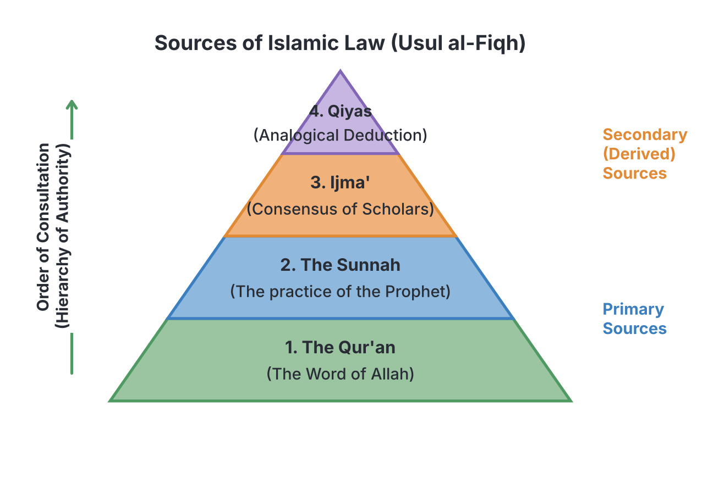
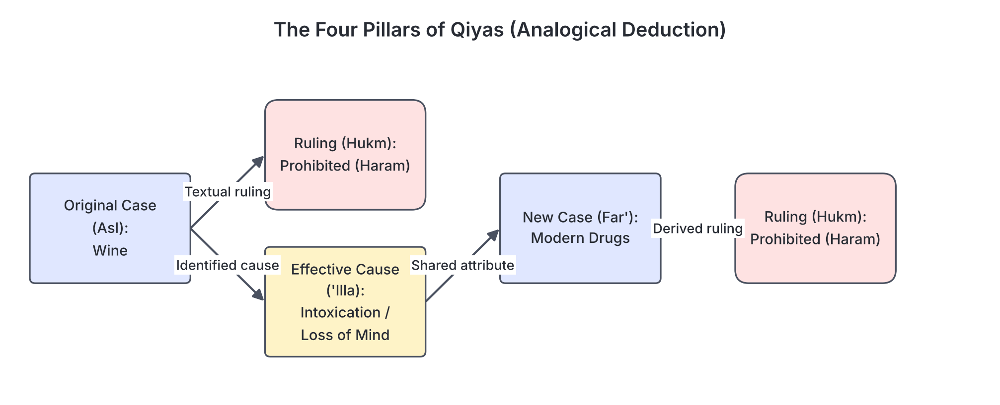

# JAMB Irk Notes: Sources and Schools of Islamic Law

## What JAMB expects

This topic is Section B, Topic 12 of the JAMB Islamic Religious Knowledge syllabus: Sources and Schools of Law. It covers the foundation of Islamic jurisprudence (Fiqh) and how Islamic laws are derived.

It has two content items:
* (i) The four major sources (the Qur’ān, Sunnah, Ijma$^c$ and Qiyās)
* (ii) The four Sunni Schools of law and their founders.

By the end of these notes, you should be able to:
1. analyse the four major sources of Islamic law;
2. examine the biography of the founders of sunni schools of law;
3. examine contributions of the founders of the sunni school of law.

**Note on the syllabus wording:** The syllabus spells *Ijma'* (Consensus) as "Ijma$^c$", using a mathematical symbol to represent the Arabic letter *'ayn*. In these notes, we will use the standard English transliteration: **Ijma'**. We will also use standard spellings for **Qiyas** (analogical deduction) and **Shari'ah** (Islamic law). 

## Introduction to Shari'ah and Fiqh

Before analysing the sources of law, it is important to understand two key terms:
* **Shari'ah:** This literally means "a path to water". In Islam, it refers to the complete divine law and way of life ordained by Allah for mankind. It covers beliefs, morals, and practical legal rules.
* **Fiqh:** This literally means "deep understanding". It is the human science of Islamic jurisprudence—the process by which Muslim scholars (*fuqaha*) understand, interpret, and extract specific legal rulings from the sources of Shari'ah. 

The science that studies the rules of how to extract these laws is called **Usul al-Fiqh** (Principles of Islamic Jurisprudence). 

## Analyse the four major sources of Islamic law

**Objective i: analyse the four major sources of Islamic law.**
**Content i: The four major sources (the Qur’ān, Sunnah, Ijma$^c$ and Qiyās)**

According to the majority of Sunni scholars, there are four primary sources used to derive Islamic law. They are strictly hierarchical. This means a scholar must first look in the Qur'an. If the answer is not there, they look in the Sunnah. If it is still not explicitly addressed, they look to Ijma', and finally to Qiyas.

### 1. The Qur'an (The First and Primary Source)

The **Qur'an** is the literal, uncreated word of Allah, revealed to Prophet Muhammad (SAW) through the Angel Jibril. It is the absolute foundation of all Islamic law. 

* **Characteristics as a source of law:** The Qur'an is authentic beyond any doubt. However, the Qur'an is not a typical law book. Out of its 6,236 verses (ayat), only about 500 deal with specific legal rulings (known as *Ayat al-Ahkam*). 
* **Types of laws in the Qur'an:** 
  * Some laws are detailed and explicit, such as the laws of inheritance, prohibitions of certain foods (like pork), punishments for specific major crimes (like theft), and the categories of people eligible to receive Zakah. 
  * Most laws in the Qur'an are broad, general principles, such as the command to establish justice, consult one another, and establish regular prayer (Salah). The details are left to the Sunnah.

### 2. The Sunnah (The Second Source)

The **Sunnah** refers to the sayings (*Qawl*), actions (*Fi'l*), and silent approvals (*Taqrir*) of Prophet Muhammad (SAW). It is recorded in written reports called Ahādīth (singular: Hadith).

* **Relationship with the Qur'an:** The Sunnah is the second source of law, and it never contradicts the Qur'an. Its main legal functions are:
  1. **To explain and detail the Qur'an:** The Qur'an commands Muslims to perform Salah (Q.2:43), but the Sunnah explains how to pray, how many units (raka'at) to perform, and what to say. 
  2. **To confirm the Qur'an:** The Sunnah often repeats and reinforces laws already mentioned in the Qur'an, such as the prohibition of lying or associating partners with Allah (Shirk).
  3. **To establish new laws:** The Sunnah introduces laws not explicitly mentioned in the Qur'an. For example, the prohibition of eating beasts of prey with fangs (like lions) or birds with talons (like eagles), or the right of a grandmother to inherit.

### 3. Ijma' (Consensus)

**Ijma'** is the third source of Islamic law. It is defined as the unanimous agreement of the qualified legal scholars (*Mujtahidun*) of the Muslim Ummah (community) in a particular generation after the death of the Prophet (SAW) on a specific legal issue.

* **Basis for Ijma':** Scholars base the authority of Ijma' on the Prophetic Hadith where the Prophet (SAW) said that his Ummah would never agree upon an error. 
* **Conditions:** It must occur after the Prophet's death (since during his life, he was the sole authority), and the agreement must be among the highly qualified scholars, not the general, uneducated public.
* **Examples of Ijma':**
  * The decision during the caliphate of Abu Bakr to compile the Qur'an into a single written volume (Mushaf).
  * The agreement that a grandmother receives a one-sixth share of inheritance when the mother is deceased.

### 4. Qiyas (Analogical Deduction)

**Qiyas** is the fourth source of Islamic law. It is the process of applying a known ruling from the Qur'an or Sunnah to a new situation, because both situations share the same underlying effective cause (*'Illa*). 

Because human societies constantly change and face new problems not directly mentioned in the Qur'an and Sunnah (like internet fraud, modern banking, or synthetic drugs), scholars use Qiyas to find the Islamic ruling for these modern issues.

#### The Four Pillars (Elements) of Qiyas
For a ruling by Qiyas to be valid, four elements must be present:
1. **Al-Asl (The Original Case):** The case that already has a clear ruling in the Qur'an or Sunnah.
2. **Al-Far' (The New Case):** The new issue or problem that needs a ruling.
3. **Al-Hukm (The Original Ruling):** The law regarding the original case (e.g., compulsory, prohibited, permitted).
4. **Al-'Illa (The Effective Cause):** The specific reason or attribute that caused the original ruling. This cause must be exactly the same in both the original case and the new case.

#### The Classic Example of Qiyas
* **The New Case (Far'):** What is the Islamic ruling on smoking crack cocaine or consuming modern synthetic drugs? The Qur'an and Sunnah do not explicitly mention these modern drugs.
* **The Original Case (Asl):** Wine / alcoholic drinks (*Khamr*).
* **The Original Ruling (Hukm):** It is completely prohibited (Haram) based on the Qur'an (Q.5:90).
* **The Effective Cause ('Illa):** Why did Allah prohibit wine? Because it causes intoxication and loss of the mind.
* **The Conclusion:** Since crack cocaine also causes intoxication and loss of the mind, it shares the exact same *'Illa*. Therefore, the ruling of prohibition (*Haram*) is transferred from wine to the new drug. 

## The four Sunni Schools of law and their founders

**Content ii: The four Sunni Schools of law and their founders.**

As Islam spread across the world, different scholars developed systematic methods for interpreting the Qur'an and Sunnah and applying Qiyas. These different methodologies formed schools of jurisprudence known as **Madhahib** (singular: *Madhhab*). 

The differences between these schools are not in the core beliefs of Islam (like Tawhid or the obligation of Salah), but in minor details of practice (like where to place the hands during prayer) and how to handle new legal cases. Four major Sunni schools survived and are followed by the vast majority of Muslims today: the Hanafi, Maliki, Shafi'i, and Hanbali schools.

## Biography of the founders of the Sunni schools of law

**Objective ii: examine the biography of the founders of sunni schools of law.**

To understand the schools of law, one must study the lives of the four great Imams who founded them. They were all highly pious scholars who faced significant trials during their lifetimes.

### 1. Biography of Imam Abu Hanifah
* **Full Name:** Nu'man bin Thabit. He is respectfully known as *Imam al-A'zam* (The Greatest Imam).
* **Birth and Early Life:** He was born in 80 AH (699 CE) in Kufa, Iraq, into a family of Persian origin. 
* **Career:** Unlike many other scholars who relied on teaching stipends, Abu Hanifah was a successful and wealthy silk merchant. He financed his own students and refused to take a salary from the government, which gave him great independence. He studied under the great scholar Hammad bin Abi Sulayman.
* **Trials and Death:** The Abbasid Caliph Al-Mansur ordered Abu Hanifah to become the Chief Judge (*Qadi*) of Baghdad. Abu Hanifah refused, fearing that the ruler would force him to pass unjust verdicts to serve the state. Because of his refusal, he was imprisoned, beaten, and eventually died in prison in 150 AH (767 CE).

### 2. Biography of Imam Malik bin Anas
* **Full Name:** Malik bin Anas. He is known as the *Imam of Dar al-Hijrah* (The Imam of Madinah).
* **Birth and Early Life:** He was born in 93 AH (711 CE) in Madinah. He spent his entire life in Madinah, leaving only to perform Hajj in Makkah. He had immense love for the Prophet's city and reportedly never rode an animal inside Madinah out of respect for the soil where the Prophet (SAW) was buried.
* **Trials and Death:** Imam Malik was beaten and tortured by the governor of Madinah because he issued a legal ruling (*fatwa*) stating that a divorce pronounced under forced coercion is invalid. The rulers felt this threatened their authority, as people had sworn oaths of allegiance to the rulers under coercion. He remained steadfast and died in Madinah in 179 AH (795 CE).

### 3. Biography of Imam al-Shafi'i
* **Full Name:** Muhammad bin Idris al-Shafi'i.
* **Birth and Early Life:** He was born in 150 AH (767 CE) in Gaza, Palestine. He belonged to the Quraysh tribe and was distantly related to the Prophet (SAW). He was orphaned early and raised in poverty in Makkah. A brilliant child, he memorised the Qur'an by age 7 and Imam Malik's primary text by age 10.
* **Education and Travels:** He travelled to Madinah to study directly under Imam Malik. Later, he travelled to Iraq and studied the Hanafi methodology under Muhammad al-Shaybani (Abu Hanifah's top student). Finally, he moved to Egypt, where he revised many of his earlier rulings based on the new environment. He died in Egypt in 204 AH (820 CE).

### 4. Biography of Imam Ahmad bin Hanbal
* **Full Name:** Ahmad bin Muhammad bin Hanbal.
* **Birth and Early Life:** Born in 164 AH (780 CE) in Baghdad, Iraq. He was a highly devoted student of Hadith, travelling extensively through Iraq, Syria, and the Hijaz to collect narrations. He was one of Imam al-Shafi'i's greatest students.
* **The Trial (Al-Mihna):** Imam Ahmad is most famous for his immense courage during the *Mihna* (the Inquisition) initiated by the Abbasid Caliph Al-Ma'mun. The Caliph tried to force all scholars to accept the Mu'tazilite philosophical doctrine that the Qur'an was "created" rather than being the eternal, uncreated word of Allah. While others gave in out of fear, Imam Ahmad refused. He was imprisoned, heavily chained, and severely flogged for years, but he never changed his stance.
* **Death:** The inquisition was finally ended by Caliph Al-Mutawakkil. Imam Ahmad died in Baghdad in 241 AH (855 CE). Hundreds of thousands of people attended his funeral, marking him as a champion of Sunni orthodoxy.

## Contributions of the founders of the Sunni schools of law

**Objective iii: examine contributions of the founders of the sunni school of law.**

Each Imam contributed uniquely to the science of Islamic jurisprudence, leaving behind methodologies and texts that shape the Muslim world today.

### 1. Contributions of Imam Abu Hanifah (The Hanafi School)
* **Extensive Use of Reason (*Ra'y*) and *Qiyas*:** Because Kufa (Iraq) was a complex, multicultural urban centre far from Madinah (where most companions of the Prophet lived), new problems frequently arose. Also, Hadith forgery was common in Iraq at the time. Therefore, Abu Hanifah set very strict conditions for accepting a Hadith and relied heavily on logical reasoning and Qiyas to solve new problems.
* **Council of Jurists:** Abu Hanifah did not write a definitive book of Fiqh himself. Instead, he taught by forming a council of his top students (such as Abu Yusuf and Muhammad al-Shaybani). He would present a legal problem, and they would debate it until they reached a conclusion. His students then recorded these rulings, which formed the basis of the school.
* **Geographic Spread:** The Hanafi school is the most widely followed school in the world today. It is dominant in Turkey, the Balkans, Central Asia, the Indian subcontinent (Pakistan, India, Bangladesh), and parts of the Middle East.

### 2. Contributions of Imam Malik bin Anas (The Maliki School)
* **Compilation of *Al-Muwatta*:** Imam Malik wrote *Al-Muwatta* (The Approved/Well-Trodden Path). It is one of the earliest surviving books of Islamic law and Hadith. When the Caliph Harun al-Rashid offered to make *Al-Muwatta* the official, mandatory law book of the entire Islamic empire, Imam Malik humbly refused, stating that other regions had valid knowledge from other companions of the Prophet.
* **Concept of *'Amal Ahl al-Madinah*:** Imam Malik's unique legal contribution was relying on the "Practice of the People of Madinah". He argued that since Madinah was where the Prophet (SAW) lived and where thousands of his companions settled, the continuous, unified practice of its residents was practically a living, mass-transmitted Sunnah, which he sometimes preferred over a single isolated Hadith.
* **Geographic Spread:** The Maliki school is the dominant school in North Africa, West Africa (including **Nigeria**, Mali, and Senegal), and historically in Muslim Spain (Al-Andalus).

### 3. Contributions of Imam al-Shafi'i (The Shafi'i School)
* **Architect of *Usul al-Fiqh*:** Al-Shafi'i's greatest contribution was creating a systematic, written science for deriving laws. He authored **Al-Risalah** (The Message), the very first book on the principles of Islamic jurisprudence (*Usul al-Fiqh*). In it, he clearly defined the four sources of law (Qur'an, Sunnah, Ijma', Qiyas) and the strict rules for using them.
* **Synthesising Reason and Tradition:** Because he studied under both the Maliki school of tradition in the Hijaz and the Hanafi school of reason in Iraq, he created a middle path. He structured how and when to accept Hadith and heavily restricted the use of personal opinion (*Ra'y*), demanding strict reliance on texts. He also compiled a major encyclopaedia of Fiqh called *Al-Umm*.
* **Geographic Spread:** The Shafi'i school is dominant in Egypt, East Africa, Somalia, Yemen, Southeast Asia (Indonesia, Malaysia), and parts of southern India.

### 4. Contributions of Imam Ahmad bin Hanbal (The Hanbali School)
* **Compilation of *Al-Musnad*:** His greatest literary contribution is *Musnad Ahmad ibn Hanbal*, one of the largest collections of Hadith in Islamic history, containing around 30,000 narrations.
* **Strict Reliance on Text:** Imam Ahmad's methodology was the most conservative of the four. He relied almost entirely on the Qur'an and Hadith. He was extremely reluctant to use Qiyas (analogy) or personal opinion, using them only as an absolute last resort if no text could be found.
* **Geographic Spread:** The Hanbali school is the smallest of the four in terms of followers. It is the dominant school in Saudi Arabia and Qatar, and has followers in other parts of the Arabian Peninsula and Syria.

### Summary Table: The Four Sunni Schools of Law

| School | Founder | Key Text / Masterpiece | Core Methodology | Dominant Regions |
| :--- | :--- | :--- | :--- | :--- |
| **Hanafi** | Abu Hanifah (Nu'man bin Thabit) | Rulings recorded by his students (Abu Yusuf, Al-Shaybani) | Extensive use of logical reasoning (*Ra'y*) and Qiyas. | Turkey, Indian Subcontinent, Central Asia |
| **Maliki** | Malik bin Anas | *Al-Muwatta* | Relied heavily on the Practice of the People of Madinah (*'Amal Ahl al-Madinah*). | North Africa, **West Africa (Nigeria)** |
| **Shafi'i** | Muhammad bin Idris al-Shafi'i | *Al-Risalah* (Principles) and *Al-Umm* (Fiqh) | The architect of *Usul al-Fiqh*. Balanced tradition and reason. | Egypt, East Africa, Southeast Asia |
| **Hanbali** | Ahmad bin Hanbal | *Al-Musnad* | Strict reliance on Hadith; minimal use of Qiyas and opinion. | Saudi Arabia, Qatar |

## Key terms

| Term | Meaning |
| :--- | :--- |
| Shari'ah | The complete divine law and way of life in Islam. |
| Fiqh | Islamic jurisprudence; human understanding and extraction of laws from the sources. |
| Usul al-Fiqh | The Principles of Islamic Jurisprudence (the rules on how to derive laws). |
| Ijma' | The unanimous consensus of qualified Islamic scholars on a legal issue. |
| Qiyas | Analogical deduction; applying a known ruling to a new case due to a shared effective cause. |
| Asl | The original case in Qiyas (e.g., wine). |
| Far' | The new case in Qiyas (e.g., modern drugs). |
| 'Illa | The effective cause connecting the original and new case (e.g., intoxication). |
| Hukm | The actual ruling (e.g., permitted, prohibited, compulsory). |
| Madhhab (pl. Madhahib) | A school of thought/jurisprudence in Islam. |
| Mujtahid | A highly qualified scholar capable of deriving independent legal rulings. |
| Al-Muwatta | Imam Malik's famous compilation of Hadith and Fiqh. |
| Al-Risalah | Imam al-Shafi'i's pioneering book on the principles of jurisprudence. |
| Al-Musnad | Imam Ahmad bin Hanbal's massive collection of Hadith. |

## Exam tips and common mistakes

* **Know the order of the sources:** A common JAMB question asks for the correct chronological order of the primary sources. It is **always**: 1. Qur'an, 2. Sunnah, 3. Ijma', 4. Qiyas.
* **Identify the founders by their actual names:** Be aware that Imam Abu Hanifah's real name is Nu'man bin Thabit.
* **Match the book to the author:** You must know that Imam Malik wrote *Al-Muwatta*, Imam al-Shafi'i wrote *Al-Risalah* and *Al-Umm*, and Imam Ahmad compiled *Al-Musnad*.
* **Match the methodology to the Imam:** If a question mentions "The Practice of the People of Madinah" (*'Amal Ahl al-Madinah*), the answer is always Imam Malik. If it mentions the pioneer/architect of *Usul al-Fiqh*, it is Imam al-Shafi'i.
* **Know the Nigerian context:** JAMB frequently tests if you know that the **Maliki** school is the predominantly followed school of law in Nigeria and West Africa.
* **Don't confuse the pillars of Qiyas:** Remember that *Asl* is the original case, *Far'* is the new case, and *'Illa* is the reason.
* **The Mihna (Inquisition):** Remember that Imam Ahmad bin Hanbal is the scholar famous for surviving the torture of the Mihna over the issue of whether the Qur'an was created.

## Quick summary

1. The Shari'ah is the divine law of Islam, and Fiqh is the human effort to derive these laws using a system called Usul al-Fiqh.
2. There are four major sources of Islamic law in order of hierarchy: the Qur'an, the Sunnah, Ijma' (consensus of scholars), and Qiyas (analogical deduction).
3. Qiyas requires four pillars to work: the original case (*Asl*), the original ruling (*Hukm*), the new case (*Far'*), and the shared effective cause (*'Illa*).
4. As Islam expanded, differences in interpreting these sources led to the formation of four major Sunni schools of jurisprudence (Madhahib).
5. The Hanafi school (founded by Abu Hanifah) is known for its strong reliance on reason and Qiyas.
6. The Maliki school (founded by Imam Malik) relies heavily on the practice of the people of Madinah and is the dominant school in Nigeria.
7. The Shafi'i school (founded by Imam al-Shafi'i) systematised the principles of jurisprudence by writing *Al-Risalah*.
8. The Hanbali school (founded by Imam Ahmad bin Hanbal) is the most strict, relying heavily on Hadith (*Al-Musnad*) and avoiding logical deduction wherever possible.

## Practice questions

**1. Which of the following is the correct hierarchical order of the sources of Islamic Law?**
- A. Qur'an, Ijma', Sunnah, Qiyas
- B. Qur'an, Sunnah, Ijma', Qiyas
- C. Sunnah, Qur'an, Qiyas, Ijma'
- D. Qur'an, Sunnah, Qiyas, Ijma'

**Answer: B.** The correct order used by scholars is always the Qur'an first, followed by the Sunnah. If the answer is not found there, they turn to the Consensus of scholars (Ijma'), and finally Analogical Deduction (Qiyas).

**2. In the process of Qiyas (analogical deduction), the effective cause that links the original case to the new case is called:**
- A. Asl
- B. Far'
- C. Hukm
- D. 'Illa

**Answer: D.** The *'Illa* is the effective cause or reason behind a ruling (e.g., intoxication being the reason wine is forbidden). *Asl* is the original case, *Far'* is the new case, and *Hukm* is the ruling.

**3. Which of the four Sunni schools of jurisprudence is predominantly followed by Muslims in Nigeria and West Africa?**
- A. Shafi'i
- B. Hanbali
- C. Maliki
- D. Hanafi

**Answer: C.** The Maliki school, founded by Imam Malik bin Anas, spread largely through North and West Africa and is the dominant school in Nigeria today.

**4. The pioneering book on the principles of Islamic jurisprudence (*Usul al-Fiqh*) titled *Al-Risalah* was written by:**
- A. Imam Abu Hanifah
- B. Imam al-Shafi'i
- C. Imam Malik
- D. Imam Ahmad bin Hanbal

**Answer: B.** Imam Muhammad bin Idris al-Shafi'i is considered the architect of Usul al-Fiqh for authoring *Al-Risalah*, which formally defined how the sources of law should be used.

**5. Which of the following scholars is famous for relying heavily on the "Practice of the People of Madinah" (*'Amal Ahl al-Madinah*) as a source of law?**
- A. Imam Malik bin Anas
- B. Nu'man bin Thabit
- C. Imam Ahmad bin Hanbal
- D. Muhammad al-Shaybani

**Answer: A.** Imam Malik lived his entire life in Madinah and considered the continuous, collective practice of its people to be a living representation of the Prophet's Sunnah.

**6. Imam Ahmad bin Hanbal is best remembered in Islamic history for:**
- A. Refusing the position of Chief Judge under Caliph Al-Mansur.
- B. Standing firm and enduring torture during the Inquisition (*Mihna*) regarding the nature of the Qur'an.
- C. Writing the first book on Qiyas.
- D. Introducing the concept of Ijma' to Islamic law.

**Answer: B.** Imam Ahmad famously endured imprisonment and flogging during the *Mihna* when he refused to accept the state-imposed Mu'tazilite doctrine that the Qur'an was created.

**7. The real name of the founder of the Hanafi school of law, who is often called Imam al-A'zam, is:**
- A. Muhammad bin Idris
- B. Ahmad bin Hanbal
- C. Malik bin Anas
- D. Nu'man bin Thabit

**Answer: D.** Imam Abu Hanifah's actual name was Nu'man bin Thabit. 

**8. Which source of Islamic law is defined as the unanimous agreement of qualified Muslim scholars in a specific era after the death of the Prophet (SAW)?**
- A. Qiyas
- B. Sunnah
- C. Ijma'
- D. Shari'ah

**Answer: C.** *Ijma'* translates to consensus. It is a secondary source of law based on the agreement of the *Mujtahidun* (qualified scholars) of the Ummah.

**9. The compilation of Hadith containing approximately 30,000 narrations, known as *Al-Musnad*, was authored by:**
- A. Imam al-Shafi'i
- B. Imam Abu Hanifah
- C. Imam Malik
- D. Imam Ahmad bin Hanbal

**Answer: D.** Imam Ahmad bin Hanbal compiled *Al-Musnad*, one of the largest collections of Hadith, reflecting his school's strict reliance on textual narrations over logical deduction.

**10. When a new ruling is derived prohibiting modern recreational drugs based on the Qur'anic prohibition of wine, the modern recreational drug serves as the:**
- A. 'Illa
- B. Far'
- C. Asl
- D. Hukm

**Answer: B.** In the elements of Qiyas, the *Far'* is the new case or problem being judged (the modern drug). The *Asl* is the original case found in the texts (wine).

<!-- COVERAGE
obj i | Analyse the four major sources of Islamic law
obj ii | Biography of the founders of the Sunni schools of law
obj iii | Contributions of the founders of the Sunni schools of law
item i | Analyse the four major sources of Islamic law
item ii | The four Sunni Schools of law and their founders
-->
