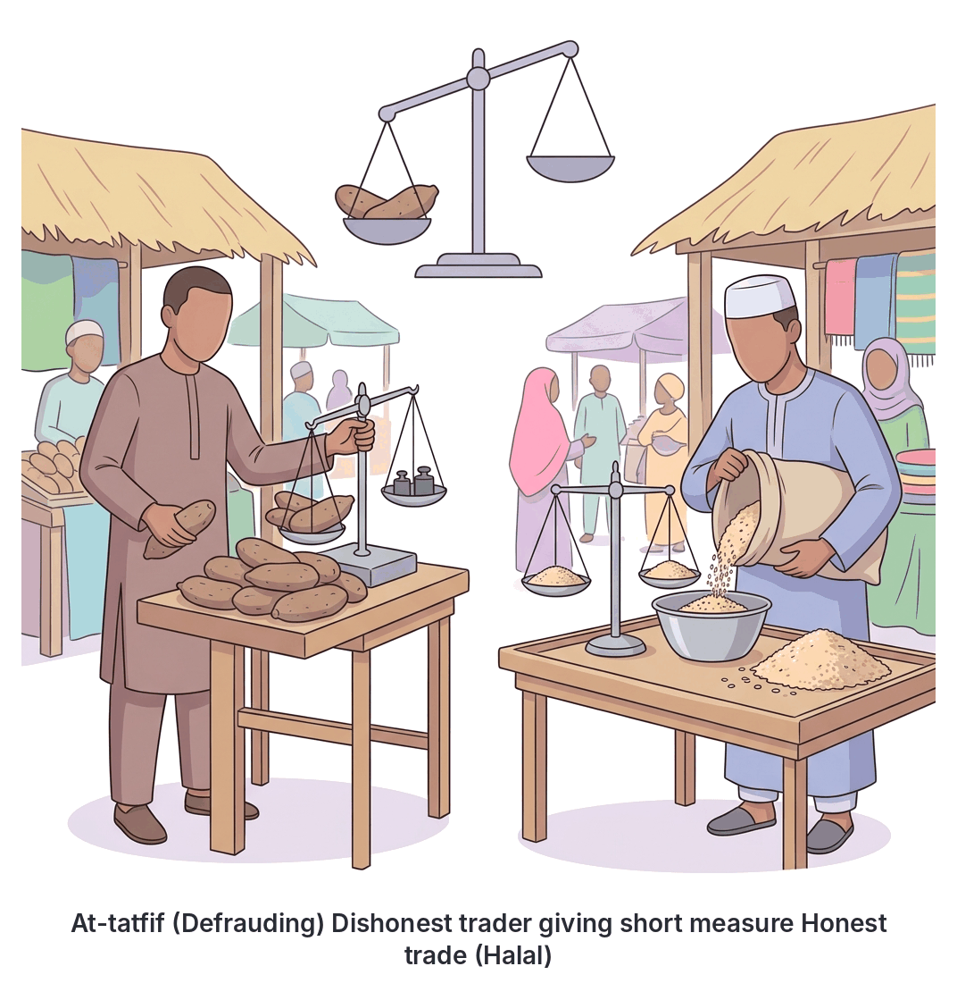
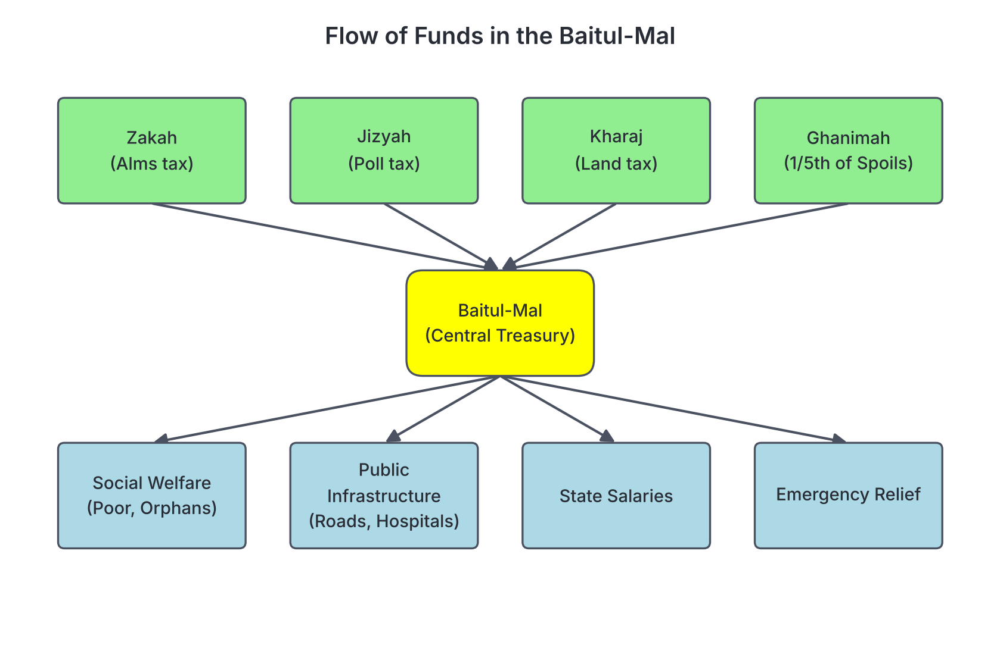

# JAMB Irk Notes: Islamic Economic System

## What JAMB expects

This topic is Section B, Topic 13 of the JAMB Islamic Religious Knowledge syllabus: Islamic Economic System. It covers the following content items:
- (i) Islamic attitude to Riba (Q.2:275-280) (Q.3:130) (Q.4:161) Hadīth 6th of an-Nawāwī
- (ii) At-tatfif (Q.83:1-6)
- (iii) Hoarding (ihtikar) (Q.9:34)
- (iv) Islamic sources of revenue: Zakah, Jizyah, Kharaj and Ghanimah
- (v) Baitul-mal as an institution of socio-economic welfare
- (vi) Difference between the Islamic economic system and the Western economic system

By the end of these notes, you should be able to:
1. analyse Islamic attitude to Riba;
2. relate at-tatfif and its negative consequences;
3. examine ihtikar and its implications on society;
4. identify the sources of revenue in Islam;
5. evaluate the disbursement of the revenue;
6. explain the uses of baitul-mal in the Ummah;
7. differentiate between the Islamic and Western economic systems.

*Note on the syllabus wording:* The syllabus numbering for objectives in this section repeats "(i)" multiple times due to a printing error. Each objective is fully covered in its own clearly headed section below.

## Islamic attitude to Riba (Usury and Interest)

**Objective 1: analyse Islamic attitude to Riba**

**Content item (i): Islamic attitude to Riba (Q.2:275-280) (Q.3:130) (Q.4:161) Hadīth 6th of an-Nawāwī**

The Islamic economic system is built on fairness, justice, and the welfare of the society. One of its most important principles is the total prohibition of **Riba**. 

**Riba** literally means "increase," "addition," or "growth." In Islamic law (Shari'ah), it refers to **usury or interest**—any guaranteed, fixed, or predetermined increase on a loan or debt, regardless of whether the loan is for consumption or investment. The Islamic attitude to Riba is one of absolute prohibition (haram). Islam considers it an exploitative practice that makes the rich richer and the poor poorer without any productive effort from the lender.

### Qur'anic injunctions on Riba

The Qur'an strongly condemns Riba in several chapters:

**1. Surah al-Baqarah (Q.2:275-280):**
This is the most detailed passage on Riba. It contrasts Riba with lawful trade.
- **Q.2:275** states: *"Those who swallow usury cannot rise up save as he ariseth whom the devil hath prostrated by his (magic) touch. That is because they say: Trade is just like usury; whereas Allah permitteth trading and forbiddeth usury..."* (Pickthall's translation). 
- **Q.2:278-279** commands believers to give up remaining Riba and warns that continuing to deal in it is equivalent to declaring war against Allah and His Messenger. 
- **Q.2:280** advises that if a debtor is in difficulty, the creditor should grant them time to pay, or better still, forgive the debt as charity (*sadaqah*).

**2. Surah Al Imran (Q.3:130):**
This ayah forbids the compounding of interest, which was common in pre-Islamic Arabia (Jahiliyyah) where debts would double if not paid on time.
- *"O ye who believe! Devour not usury, doubling and quadrupling (the sum lent). Observe your duty to Allah, that ye may be successful."* (Pickthall's translation).

**3. Surah an-Nisa (Q.4:161):**
This verse mentions Riba as one of the sins committed by some previous nations, for which they were punished, even though they had been forbidden from taking it.
- *"And of their taking usury when they were forbidden it, and of their devouring people's wealth by false pretences..."* (Pickthall's translation).

### Hadith 6 of an-Nawawi and Riba

The syllabus connects Riba to **Hadith 6 of an-Nawawi's collection** (narrated by an-Nu'man bin Bashir). This famous Hadith states: 
*"That which is lawful (halal) is clear and that which is unlawful (haram) is clear, and between the two of them are doubtful matters about which many people do not know. Thus he who avoids doubtful matters clears himself in regard to his religion and his honour..."*

**Analysis:** Islamic scholars use this Hadith to teach that while basic trade is clearly halal and basic interest is clearly haram, modern financial transactions can sometimes fall into the "doubtful" category. A true Muslim must avoid any financial contract that has a suspicion of Riba to protect their faith. This principle has led to the establishment of **Islamic Banking** in Nigeria (such as Jaiz Bank) and worldwide, which uses profit-and-loss sharing instead of fixed interest rates to ensure transactions are completely free of Riba.

## At-tatfif (Defrauding and Short-measuring)

**Objective 2: relate at-tatfif and its negative consequences**

**Content item (ii): At-tatfif (Q.83:1-6)**

**At-tatfif** refers to defrauding, cheating, or giving short measure and weight in business transactions. It happens when a seller manipulates scales or measures to give the buyer less than what they paid for, while demanding full measure when buying for themselves.

### Qur'anic injunction on At-tatfif (Q.83:1-6)

Surah al-Mutaffifin (The Defrauders, Surah 83) opens with a severe warning against those who cheat in trade. 

In Pickthall's translation, Q.83:1-6 reads:
1. *"Woe unto the defrauders:"*
2. *"Those who when they take the measure from mankind demand it full,"*
3. *"But if they measure unto them or weigh for them, they cause them loss."*
4. *"Do such (men) not consider that they will be raised again"*
5. *"Unto an Awful Day,"*
6. *"The day when (all) mankind stand before the Lord of the Worlds?"*

### Negative consequences of At-tatfif

1. **Loss of trust:** It destroys mutual trust between buyers and sellers, which is the foundation of any healthy market.
2. **Economic instability:** Widespread cheating leads to disputes, inflation, and a collapse of honest trade. Historically, market inspectors (the *Hisbah* institution, seen in places like Kano) were appointed to check scales and prevent At-tatfif.
3. **Divine punishment:** As stated in Surah al-Mutaffifin, those who engage in this fraud will face severe judgment on the Day of Resurrection.
4. **Social injustice:** It is a form of stealing that often hurts the poor and vulnerable who rely on getting exact value for their hard-earned money.

## Hoarding (Ihtikar)

**Objective 3: examine ihtikar and its implications on society**

**Content item (iii): Hoarding (ihtikar) (Q.9:34)**

**Ihtikar** is the deliberate hoarding of wealth, essential goods, or foodstuff in order to create artificial scarcity, drive prices up, and make excessive profits at the expense of the public. 

### Qur'anic injunction on Ihtikar (Q.9:34)

The syllabus specifically highlights Surah at-Tawbah (Q.9:34), which focuses on the hoarding of wealth (gold and silver).

- *"O ye who believe! Lo! many of the (Jewish) rabbis and the (Christian) monks devour the wealth of mankind in falsehood, and debar (men) from the way of Allah. They who hoard up gold and silver and spend it not in the way of Allah, unto them give tidings (O Muhammad) of a painful doom."* (Pickthall's translation).

While this ayah directly condemns hoarding money without paying Zakah or spending for the public good, Islamic law extends the prohibition of hoarding (Ihtikar) to essential commodities, especially food. Prophet Muhammad (SAW) heavily condemned hoarding goods to inflate prices, stating that whoever hoards food for forty days is free from Allah, and Allah is free from him.

### Implications of Ihtikar on society

1. **Artificial Scarcity:** It creates a false shortage of goods in the market, causing panic among the populace.
2. **Inflation and Hardship:** Prices skyrocket, making basic necessities unaffordable for the common people and the poor.
3. **Breeds Greed and Selfishness:** It promotes a capitalist mindset where profit is valued over human life and welfare.
4. **Social Unrest:** Widespread hunger caused by hoarding can lead to riots, theft, and social instability.

## Islamic Sources of Revenue

**Objective 4: identify the sources of revenue in Islam**

**Content item (iv): Islamic sources of revenue: Zakah, Jizyah, Kharaj and Ghanimah**

To fund its administrative, military, and social welfare duties, an Islamic state collects revenue from specific, lawful sources. The four major sources identified in the syllabus are:

### 1. Zakah (Alms Tax)
Zakah is the third pillar of Islam. It is a compulsory annual levy on the surplus wealth of every sane, adult Muslim whose wealth has reached a minimum threshold (*Nisab*) for a full lunar year. It applies to cash, gold, silver, livestock, and agricultural produce. It is not merely a tax, but an act of worship (*Ibadah*) meant to purify wealth. (Zakah as an act of worship is covered in detail in `B10b-zakah-sawm-hajj-and-jihad.md`).

### 2. Jizyah (Poll Tax)
Jizyah is a poll tax or exemption tax paid by non-Muslim citizens (known as *Dhimmis*) living under the protection of an Islamic state.
- **Rationale:** In an Islamic state, every able-bodied Muslim man is required to perform military service to defend the state. Non-Muslims are exempt from this military duty. In return for this exemption, and for the protection of their lives, property, and freedom of religion, they pay Jizyah.
- **Exemptions:** It is not paid by women, children, the elderly, the sick, monks, or the extremely poor. If a non-Muslim joins the military, they are exempt from paying it.

### 3. Kharaj (Land Tax)
Kharaj is a tax imposed on agricultural land. It originated when early Muslims conquered new territories (like Iraq under Caliph Umar). Instead of distributing the land as spoils of war, the land was left in the hands of its original non-Muslim owners to cultivate, in exchange for a portion of its produce or a fixed monetary tax.
- **Rationale:** It serves as a continuous source of revenue for the state and ensures agricultural lands remain productive. 

### 4. Ghanimah (Spoils of War)
Ghanimah refers to the movable wealth, weapons, and property captured from the enemy during a lawful war (Jihad) fought for the defence of Islam. 

## Disbursement of Islamic Revenue

**Objective 5: evaluate the disbursement of the revenue**

The Islamic state is not allowed to spend its revenue randomly; the disbursement of these funds is guided by the Qur'an and the Sunnah.

### Disbursement of Zakah
According to Surah at-Tawbah (Q.9:60), Zakah must **only** be distributed to eight categories of people:
1. **Al-Fuqara:** The extremely poor who have nothing.
2. **Al-Masakin:** The needy who have something, but not enough to meet their basic needs.
3. **Al-Amilina 'alayha:** The officials appointed by the state to collect and distribute Zakah.
4. **Al-Mu'allafat al-Qulub:** Those whose hearts are to be won over (new converts to Islam who need financial support).
5. **Ar-Riqab:** For freeing captives or slaves.
6. **Al-Gharimin:** Those who are heavily in debt for lawful reasons and cannot pay it off.
7. **Fi Sabilillah:** Those striving in the cause of Allah (including defending the faith).
8. **Ibn al-Sabil:** The wayfarer or stranded traveler.

### Disbursement of Jizyah and Kharaj
Unlike Zakah, which is strictly for the eight categories above, revenues from Jizyah and Kharaj go into the general treasury (Baitul-Mal). They are disbursed for:
- Salaries of state officials, judges, and soldiers.
- Building and maintaining public infrastructure (roads, bridges, schools, mosques).
- Public welfare, including pensions for the elderly (both Muslims and non-Muslims) and support for the sick.

### Disbursement of Ghanimah
The Qur'an (Q.8:41) sets a strict mathematical formula for sharing the spoils of war:
- **Four-fifths (80%):** Distributed among the soldiers who participated in the battle.
- **One-fifth (20%) - known as Khumus:** Belongs to the state treasury. This fifth is further divided to benefit:
    1. Allah and His Messenger (state administrative uses).
    2. The kindred of the Prophet (who are forbidden from receiving Zakah).
    3. Orphans.
    4. The needy.
    5. The wayfarer.

## Baitul-Mal (The Public Treasury)

**Objective 6: explain the uses of baitul-mal in the Ummah**

**Content item (v): Baitul-mal as an institution of socio-economic welfare**

**Baitul-Mal** literally means "The House of Wealth." It is the central treasury or the financial institution of an Islamic state, responsible for the administration of taxes, public revenues, and state expenditures. 

Historically, the institution of Baitul-Mal was formally structured and expanded during the reign of the second Caliph, **Umar ibn al-Khattab**, as the Islamic empire grew and massive revenues began flowing in from conquered territories.

### Uses of Baitul-Mal as a socio-economic institution

Baitul-Mal is not the personal bank account of the ruler; it is a trust belonging to the *Ummah* (the Muslim community). Its uses include:

1. **Social Welfare System:** It acts as the ultimate social security net. It provides stipends for the poor, orphans, widows, and the disabled. Historically, Caliph Umar introduced child benefits paid from the Baitul-Mal for every newborn in the state.
2. **Public Infrastructure:** Funds are used to build public utilities such as roads, bridges, wells, canals, hospitals, and schools, which benefit all citizens.
3. **Salaries and Pensions:** Paying the wages of civil servants, governors, judges, teachers, and the military. It also provides pensions for retired workers and the elderly.
4. **Emergency Relief:** Providing food and aid during times of famine, natural disasters, or economic crises.
5. **Debt Relief:** Paying off the debts of individuals who died leaving behind unpaid lawful debts and no assets to cover them.
6. **Support for Non-Muslims:** The welfare aspect of the Baitul-Mal covers needy non-Muslim citizens (Dhimmis) as well, as they paid Jizyah when they were able-bodied.

## Comparing Islamic and Western Economic Systems

**Objective 7: differentiate between the Islamic and Western economic systems**

**Content item (vi): Difference between the Islamic economic system and the Western economic system**

The Western economic system broadly comprises two main ideologies: **Capitalism** (driven by the free market, absolute private ownership, and profit maximization) and **Socialism** (driven by state ownership of resources and central planning). 

The Islamic economic system represents a "middle path." It encourages private enterprise and trade like Capitalism, but subjects it to strict moral and religious regulations to prevent exploitation and ensure social justice, similar to the goals of Socialism but without eliminating private property.

### Table of Differences

| Feature | Western Economic System (Capitalism) | Islamic Economic System |
| --- | --- | --- |
| **Foundation** | Based on secular, material principles. Focus is purely on profit and economic growth. | Based on Divine revelation (Qur'an and Sunnah). Economic activity is seen as a moral and religious duty. |
| **Ownership of Wealth** | Absolute private ownership. A person can do whatever they want with their wealth. | Absolute ownership belongs to Allah. Humans are merely trustees (*Khalifah*) of the wealth. |
| **Interest (Riba)** | Interest is the backbone of the banking and financial system. | Riba (interest) is strictly prohibited (Haram). Based on profit-and-loss sharing instead. |
| **Market Mechanisms** | Free market with minimal moral interference; hoarding and monopolies often occur to maximize profits. | Free market but regulated by moral laws; hoarding (*Ihtikar*), fraud (*At-tatfif*), and monopolies are totally forbidden. |
| **Wealth Distribution** | Wealth tends to concentrate in the hands of a few wealthy individuals and corporations. | Wealth must circulate in the society. Zakah is compulsory to transfer wealth from the rich to the poor. |
| **Halal vs Haram Goods** | Any goods or services that generate profit are permitted (e.g., alcohol, gambling, pork). | Only Halal (lawful) goods and services can be traded. Harmful trades (alcohol, gambling) are strictly forbidden. |
| **Concept of Welfare** | Social welfare is often a secondary political policy, funded by various general taxes. | Social welfare is a primary religious obligation, institutionalized through the Baitul-Mal and Zakah. |

## Key terms

| Term | Meaning |
| --- | --- |
| **Riba** | Usury or fixed interest on a loan, which is strictly prohibited in Islam. |
| **At-tatfif** | Defrauding, cheating, or giving short measure and weight in business transactions. |
| **Ihtikar** | Hoarding wealth or essential goods to create artificial scarcity and drive up prices. |
| **Zakah** | Compulsory alms tax paid by wealthy Muslims on their surplus wealth. |
| **Jizyah** | Poll tax paid by non-Muslim citizens (Dhimmis) in an Islamic state for protection and military exemption. |
| **Kharaj** | Land tax levied on agricultural land within an Islamic state. |
| **Ghanimah** | Spoils of war captured during a lawful military campaign. |
| **Khumus** | One-fifth (20%) of Ghanimah that is assigned to the state treasury. |
| **Baitul-Mal** | The central public treasury of an Islamic state. |
| **Ummah** | The global community of Muslims. |
| **Dhimmi** | A non-Muslim citizen living under the protection of an Islamic state. |

## Exam tips and common mistakes

- **Know your exact Arabic terms:** JAMB often asks for definitions. Know the difference between *Jizyah* (poll tax on people) and *Kharaj* (tax on land). 
- **Memorize the Qur'anic references:** The syllabus lists specific ayat. Know that **Q.2:275** is about Riba (comparing it to a devil's touch), **Q.83:1-6** is about At-tatfif (defrauders), and **Q.9:34** is about hoarding gold and silver.
- **Riba is absolute:** In Islam, there is no difference between "usury" (excessive interest) and "interest" (normal banking interest)—both are Riba and both are forbidden.
- **Ghanimah division:** Remember the ratio! 1/5th (Khumus) goes to the state/Allah and 4/5ths goes to the soldiers. A common mistake is flipping these numbers.
- **Baitul-Mal uses:** It is not just for Muslims; Jizyah goes into it, and welfare can be paid out of it to needy non-Muslims. However, Zakah has strictly 8 categories and cannot be spent on building roads.

## Quick summary

1. The Islamic economic system is built on justice, morality, and the belief that all wealth ultimately belongs to Allah.
2. **Riba (interest/usury)** is strictly forbidden as it exploits the needy and concentrates wealth among the rich. Believers must avoid even doubtful financial transactions (as per Hadith 6 of an-Nawawi).
3. **At-tatfif (giving short measure)** is a major sin condemned in Surah 83 because it destroys trust and cheats people of their rights.
4. **Ihtikar (hoarding)** creates artificial scarcity and inflation, causing severe hardship in society.
5. The state collects revenue through **Zakah** (wealth tax on Muslims), **Jizyah** (tax on non-Muslim citizens), **Kharaj** (agricultural land tax), and **Ghanimah** (spoils of war).
6. The **Baitul-Mal** is the central treasury that manages state funds, using them for social welfare, infrastructure, and salaries.
7. Unlike Western capitalism, which is purely profit-driven and relies on interest, the Islamic economic system strictly regulates trade based on halal/haram, bans monopolies, and mandates wealth redistribution through Zakah.

## Practice questions

**1. According to Surah al-Baqarah (Q.2:275), those who consume Riba are compared to people who are**

- A. hoarding wealth against the command of Allah.
- B. prostrated by the magic touch of the devil.
- C. giving short measure on the scales.
- D. fighting a war against the Prophet.

**Answer: B.** The Qur'an states: *"Those who swallow usury cannot rise up save as he ariseth whom the devil hath prostrated by his touch..."*

**2. Which of the following Arabic terms refers to the act of giving short weight and measure in business transactions?**

- A. Ihtikar
- B. Riba
- C. At-tatfif
- D. Kharaj

**Answer: C.** At-tatfif means defrauding or short-measuring, condemned in Surah al-Mutaffifin (Q.83).

**3. Jizyah is a source of revenue in an Islamic state paid by**

- A. wealthy Muslims whose wealth reaches the Nisab.
- B. farmers who cultivate agricultural land.
- C. non-Muslim citizens in return for state protection and military exemption.
- D. soldiers who capture spoils of war.

**Answer: C.** Jizyah is the poll tax paid by non-Muslims (Dhimmis) living under the protection of an Islamic state.

**4. Based on the Islamic rules of Ghanimah, what fraction of the spoils of war goes to the Baitul-Mal?**

- A. One-half (1/2)
- B. One-third (1/3)
- C. One-fourth (1/4)
- D. One-fifth (1/5)

**Answer: D.** According to Q.8:41, one-fifth (known as Khumus) belongs to the state, while the remaining four-fifths are distributed among the soldiers.

**5. The deliberate hoarding of goods to create artificial scarcity and increase prices is known as**

- A. Ihtikar
- B. Tatfif
- C. Nisab
- D. Gharim

**Answer: A.** Ihtikar is hoarding, which causes inflation and social hardship, and is strongly forbidden in Islam.

**6. Which of the following is a major difference between the Islamic economic system and the Western capitalist system?**

- A. The Islamic system forbids private ownership of property, while Capitalism allows it.
- B. The Islamic system prohibits the charging of interest, while Capitalism is built on it.
- C. The Islamic system only allows bartering, while Capitalism uses money.
- D. The Islamic system relies entirely on state ownership, while Capitalism relies on the free market.

**Answer: B.** Islam strictly prohibits Riba (interest), whereas the capitalist banking and financial system relies heavily on it. (Islam does allow private ownership and free markets, unlike Socialism).

**7. According to Hadith 6 of an-Nawawi, between the clearly lawful and the clearly unlawful, there are**

- A. minor sins that are forgiven easily.
- B. doubtful matters which a Muslim should avoid.
- C. permissible actions if done with good intentions.
- D. obligatory duties.

**Answer: B.** The Hadith states that between the clear halal and clear haram are doubtful matters, and he who avoids them protects his religion and honor.

**8. The institution established in an Islamic state to handle public revenue, welfare, and state expenditure is the**

- A. Hisbah
- B. Majlis ash-Shura
- C. Baitul-Mal
- D. Waqf

**Answer: C.** Baitul-Mal (The House of Wealth) is the central public treasury.

**9. Zakah collected by the Baitul-Mal can lawfully be distributed to how many specific categories of people?**

- A. Four
- B. Six
- C. Eight
- D. Ten

**Answer: C.** Surah at-Tawbah (Q.9:60) specifies exactly eight categories of people eligible to receive Zakah (the poor, the needy, Zakah administrators, etc.).

**10. Surah Q.83:1-6, which begins with "Woe unto the defrauders," condemns traders who**

- A. hoard gold and silver without paying Zakah.
- B. demand full measure for themselves but give less when measuring for others.
- C. lend money at high interest rates.
- D. refuse to pay their land tax to the Islamic state.

**Answer: B.** The verses describe At-tatfif: demanding full measure when buying, but causing loss to others when selling to them.

<!-- COVERAGE
obj i | Islamic attitude to Riba (Usury and Interest)
obj i | At-tatfif (Defrauding and Short-measuring)
obj i | Hoarding (Ihtikar)
obj i | Islamic Sources of Revenue
obj ii | Disbursement of Islamic Revenue
obj i | Baitul-Mal (The Public Treasury)
obj i | Comparing Islamic and Western Economic Systems
item i | Islamic attitude to Riba (Usury and Interest)
item ii | At-tatfif (Defrauding and Short-measuring)
item iii | Hoarding (Ihtikar)
item iv | Islamic Sources of Revenue
item v | Baitul-Mal (The Public Treasury)
item vi | Comparing Islamic and Western Economic Systems
-->
