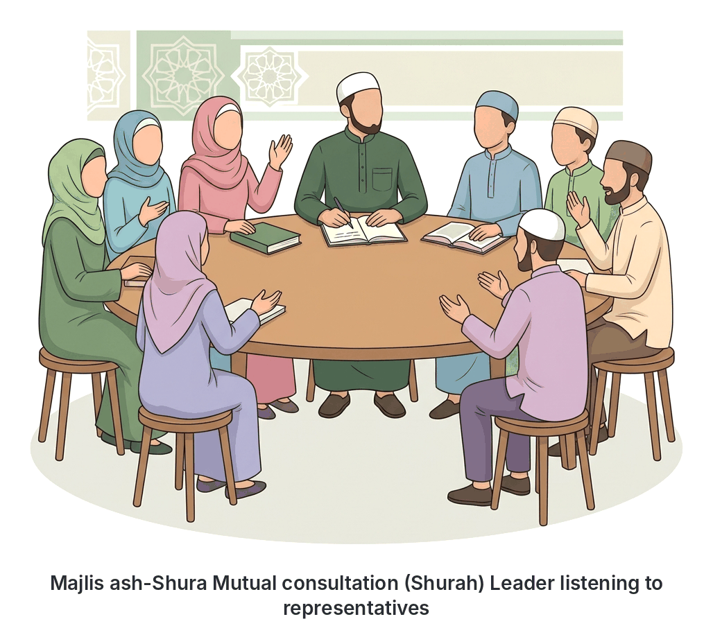
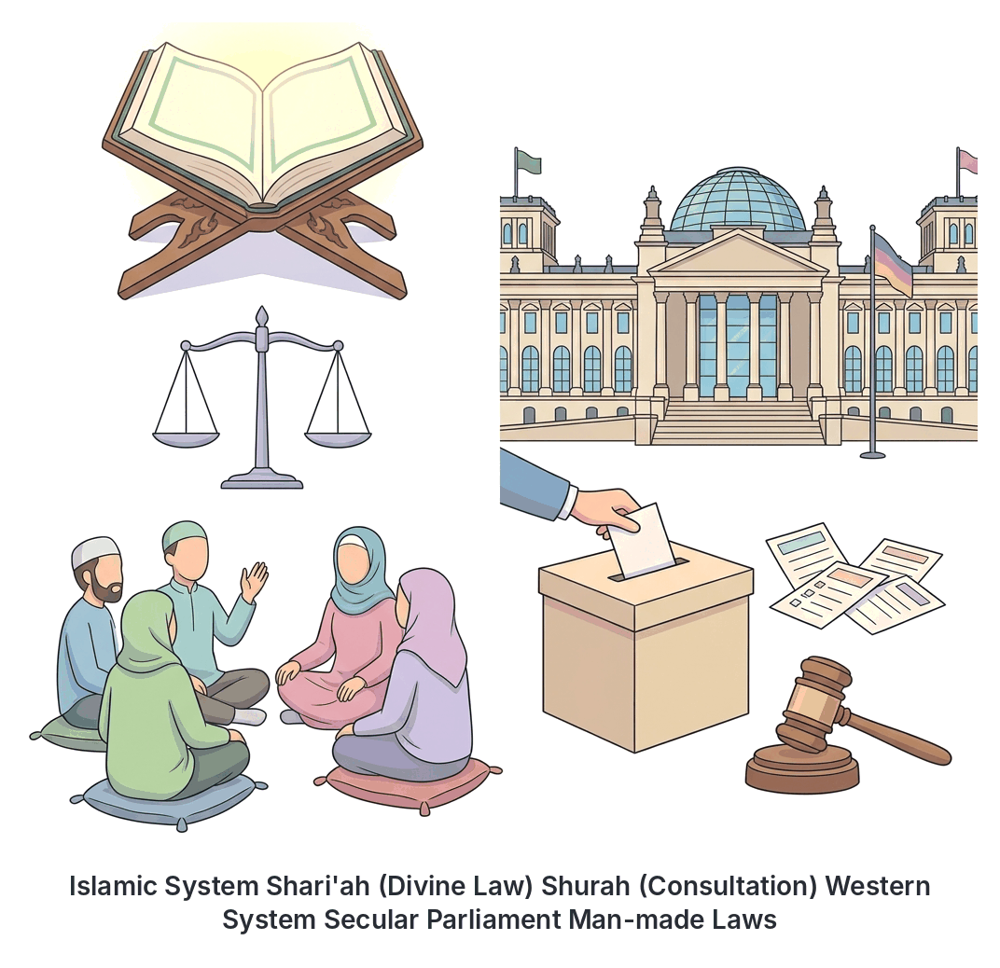

# JAMB Irk Notes: Islamic Political System

## What JAMB expects

This topic is Section B, Topic 14 of the JAMB Irk syllabus: Islamic Political System. 

It covers the following content items:
* (i) Allah as the Sovereign (Q.3:26-27)
* (ii) The concept of Shurah (consultation) (Q.3:159) (Q.42:38)
* (iii) The concept of Adalah (justice) (Q.5.9) (Q.4:58 and 135) and Mas’uliyah (accountability)(Q.17:36) (Q..102:8)
* (iv) The rights of non-Muslims in an Islamic state (Q.2:256) (Q.6:108)
* (v) Differences between the Islamic political system and the Western political system.

By the end of these notes, you should be able to:
1. analyse the concept of Allah’s sovereignity;
2. examine the concept of shurah in Islam;
3. evaluate the concept of justice and accountability;
4. examine the rights of non-Muslims in an Islamic state;
5. differentiate between the Islamic and Western political systems.

**Note on the syllabus wording:** 
- The syllabus spells sovereignty as "sovereignity" in the first objective. 
- Under the concept of justice, the syllabus lists Q.5.9 (which means Q.5:9). While Q.5:9 is about Allah's promise of forgiveness and reward, the verse immediately before it (Q.5:8) is one of the most famous verses on justice in the Qur'an. Also, the reference for accountability is printed with an extra dot as "Q..102:8". These notes provide the exact references printed by JAMB, but you should be aware of the context. 

## Allah as the Sovereign

**Objective i: analyse the concept of Allah’s sovereignity;**
**Content (i): Allah as the Sovereign (Q.3:26-27)**

In the Islamic political system, the most fundamental principle is **Hakimiyyah**—the absolute sovereignty and supreme authority of Allah. Unlike secular systems where the state or the people are seen as the ultimate source of power, Islam teaches that true power belongs to Allah alone. 

Human beings, including rulers and presidents, are merely **vicegerents (Khalifah)** or trustees on earth. A human ruler does not possess absolute power; he is only given authority as a trust to execute the laws of Allah (the **Shari'ah**).

The Qur'an explicitly states that Allah gives power to whomever He wills and takes it away from whomever He wills. This is beautifully captured in Surah Al-Imran:

> "Say: O Allah! Owner of Sovereignty! Thou givest sovereignty unto whom Thou wilt, and Thou withdrawest sovereignty from whom Thou wilt..."
> *(Q.3:26, Pickthall's translation; Q.3:27 continues the thought and is summarised below)*

**Key lessons from this concept:**
1. Rulers must remain humble, knowing that their power is temporary and given by Allah.
2. Citizens must obey the ruler, but only as long as the ruler obeys Allah. If a ruler commands something against Islamic law, there is no obedience to the creation in disobedience to the Creator.
3. Legislation (making laws) must not contradict the Qur'an and the Sunnah.

## The concept of Shurah (consultation)

**Objective ii: examine the concept of shurah in Islam;**
**Content (ii): The concept of Shurah (consultation) (Q.3:159) (Q.42:38)**

**Shurah** means mutual consultation. It is a mandatory pillar of the Islamic political system. In Islam, there is no room for dictatorship or absolute monarchy where one person rules by their own personal desires.

The ruler is required to consult the people, usually through their knowledgeable and trusted representatives (historically called *Ahl al-Hall wal-'Aqd* or the *Majlis ash-Shura*), before making major decisions. 

Even though Prophet Muhammad (SAW) received direct revelation from Allah, he was commanded to consult his companions in worldly matters. For example, before the Battle of Khandaq, he consulted his companions and accepted the advice of Salman al-Farsi to dig a trench around Madinah.

The Qur'an commands Shurah in the following verses:

> "...So pardon them and ask forgiveness for them and consult with them upon the conduct of affairs. And when thou art resolved, then put thy trust in Allah..."  
> *(Q.3:159)*

The importance of this concept is so great that an entire Surah of the Qur'an is named *Ash-Shura* (The Consultation). In it, Allah praises the believers who conduct their affairs through mutual advice:

> "And those who answer the call of their Lord and establish worship, and whose affairs are a matter of counsel, and who spend of what We have bestowed on them,"  
> *(Q.42:38)*

## The concepts of Adalah (justice) and Mas'uliyah (accountability)

**Objective iii: evaluate the concept of justice and accountability;**
**Content (iii): The concept of Adalah (justice) (Q.5.9) (Q.4:58 and 135) and Mas’uliyah (accountability)(Q.17:36) (Q..102:8)**

An Islamic state rests on the twin pillars of justice for all and the accountability of the leadership. In historical Nigeria, great Islamic scholars like Shaykh Uthman Dan Fodio emphasized these principles when establishing the Sokoto Caliphate, famously stating that a society can endure with unbelief, but it cannot endure with injustice.

### Adalah (Justice)

**Adalah** means justice, fairness, and equity. In an Islamic state, no one is above the law. The ruler and the ordinary citizen are treated equally in a Shari'ah court. A judge must rule based on facts and divine law, without favouring the rich, the powerful, or even his own relatives.

The Qur'an commands absolute justice in several places:

> "Lo! Allah commandeth you that ye restore deposits to their owners, and, if ye judge between mankind, that ye judge justly..."  
> *(Q.4:58)*

> "O ye who believe! Be ye staunch in justice, witnesses for Allah, even though it be against yourselves or (your) parents or (your) kindred, whether (the case be of) a rich man or a poor man..."  
> *(Q.4:135)*

The syllabus also refers to **Q.5:9** (printed as Q.5.9). This verse speaks of the reward for believers who act righteously (which includes being just):
> "Allah hath promised those who believe and do good works: Theirs will be forgiveness and immense reward." *(Q.5:9)*
*(Note: The preceding verse, Q.5:8, explicitly commands Muslims not to let hatred of a people prevent them from being just).*

### Mas'uliyah (Accountability)

**Mas'uliyah** means accountability or responsibility. In Islam, leadership is not a privilege to enjoy wealth and power; it is a heavy burden. Every leader is a "shepherd" and will be questioned about his "flock" (the citizens).

The Islamic system features **dual accountability**:
1. **Accountability to the people:** The ruler can be questioned, criticized, and corrected by the citizens if he violates the law. 
2. **Accountability to Allah:** Even if a leader escapes human justice, he will face ultimate questioning by Allah on the Day of Judgement.

The Qur'an reminds humanity of this strict accountability:

> "...Lo! the hearing and the sight and the heart - of each of these it will be asked."  
> *(Q.17:36)*

Surah At-Takathur also warns about being questioned regarding the blessings, power, and comforts we enjoyed:
> "Then, on that day, ye will be asked concerning pleasure."  
> *(Q.102:8, printed in the syllabus as Q..102:8)*

## The rights of non-Muslims in an Islamic state

**Objective iv: examine the rights of non-Muslims in an Islamic state;**
**Content (iv): The rights of non-Muslims in an Islamic state (Q.2:256) (Q.6:108)**

Although an Islamic state is governed by Islamic law, it does not force its beliefs on everyone. Non-Muslim citizens living legally in an Islamic state are historically known as **Ahl al-Dhimmah** (people of the covenant) or **Dhimmis**. The state is religiously and legally bound to protect their lives, property, and freedom.

**1. Freedom of Religion**
Islam strictly forbids forced conversion. Non-Muslims are free to practice their faith. 
> "There is no compulsion in religion. The right direction is henceforth distinct from error..."  
> *(Q.2:256)*

**2. Respect for their Beliefs**
Muslims are forbidden from insulting or mocking the deities, idols, or religious symbols of non-Muslims. 
> "Revile not those unto whom they pray beside Allah, lest they wrongfully revile Allah through ignorance..."  
> *(Q.6:108)*

**3. Protection of Life, Property, and Honour**
The blood and wealth of a non-Muslim citizen are as sacred as those of a Muslim. Historically, non-Muslim citizens paid a specific tax called **Jizyah**. In return, they were exempted from military service, exempted from paying Zakah (which is mandatory for Muslims), and the state was fully responsible for defending them from internal and external threats.

**4. Judicial Autonomy**
Non-Muslims have the right to be judged according to their own religious laws in civil matters, such as marriage, divorce, and inheritance, rather than being forced to use the Islamic Shari'ah for these private issues.

## Differences between the Islamic and Western political systems

**Objective v: differentiate between the Islamic and Western political systems.**
**Content (v): Differences between the Islamic political system and the Western political system.**

While the Islamic political system shares some similarities with modern Western democracy (such as consultation/Shurah and the rule of law), they have fundamentally different foundations.

| Feature | Islamic Political System | Western Political System (Secular Democracy) |
| :--- | :--- | :--- |
| **Sovereignty** | Belongs absolutely to Allah (**Hakimiyyah**). Power is held by humans only as a trust. | Belongs to the people (popular sovereignty). The people or parliament hold ultimate power. |
| **Source of Law** | Divine Law (**Shari'ah**), based on the Qur'an and Sunnah. Humans can make administrative laws, but they must not contradict the Shari'ah. | Man-made laws. The constitution and laws are created by human legislators and can be changed by majority vote. |
| **Accountability** | **Dual accountability:** The ruler is accountable to the people in this life, and to Allah in the Hereafter. | **Single accountability:** The ruler is accountable primarily to the electorate, parliament, and the constitution. |
| **Leadership Criteria** | Focuses heavily on **piety (Taqwa)**, moral uprightness, justice, and knowledge of the Shari'ah. | Focuses on citizenship, age, electability, and charisma. Personal religious morality is not a constitutional requirement. |
| **State and Religion** | Religion and politics are united. Islam is a complete way of life encompassing both statecraft and spiritual worship. | Separation of church/religion and state (**Secularism**). Religion is considered a private matter. |
| **Purpose of the State** | To ensure success and justice in this world, and to facilitate the worship of Allah for success in the Hereafter (*Falah*). | To ensure material well-being, economic prosperity, and social order in this world only. |

## Key terms

| Term | Meaning |
| :--- | :--- |
| **Hakimiyyah** | The absolute sovereignty and supreme authority of Allah over the universe. |
| **Khalifah** | Vicegerent or trustee; humanity's role on earth, managing it according to Allah's laws. |
| **Shari'ah** | The Divine Islamic law derived from the Qur'an and Sunnah. |
| **Shurah** | Mutual consultation; a core principle where rulers must consult representatives before making decisions. |
| **Majlis ash-Shura** | The consultative council or body of representatives advising the ruler. |
| **Adalah** | Justice, fairness, and equality before the law. |
| **Mas'uliyah** | Accountability; the responsibility of leaders to answer for their actions to the people and to Allah. |
| **Dhimmi (Ahl al-Dhimmah)** | Non-Muslim citizens living in an Islamic state, whose rights and protection are guaranteed. |
| **Jizyah** | A historical tax paid by non-Muslims in an Islamic state in exchange for protection and exemption from military service. |

## Exam tips and common mistakes

* **Sovereignty belongs to Allah:** If an exam question asks who holds ultimate sovereignty in Islam, the answer is always Allah, never the Caliph, the King, or the people.
* **Shurah prevents dictatorship:** Understand that Shurah (consultation) is the Islamic alternative to absolute monarchy and dictatorship. 
* **Dual accountability:** Remember the term *Mas'uliyah*. A unique feature of Islamic politics is that a leader fears Allah's judgement in the Hereafter, even if they can hide their crimes from the public.
* **No compulsion in religion:** Q.2:256 is the standard proof that Islam protects the religious freedom of non-Muslims. Be ready to match this verse to the concept of religious freedom.
* **Differences in laws:** The most critical difference between Islamic and Western politics is the source of law—Divine (Shari'ah) vs. Man-made (Secular).
* **Watch the exact references:** Memorise that Q.3:26-27 is about sovereignty, Q.3:159 and 42:38 are about Shurah, Q.4:58 and 135 are about justice, and Q.17:36 is about accountability. 

## Quick summary

1. In the Islamic political system, true sovereignty (*Hakimiyyah*) belongs solely to Allah. Rulers govern as trustees (*Khalifah*) using His laws.
2. The concept of *Shurah* (mutual consultation) is mandatory, preventing dictatorship and ensuring that decisions are made collectively.
3. *Adalah* (justice) ensures that everyone, including the ruler, is strictly equal before the law, with no favouritism.
4. *Mas'uliyah* (accountability) means that leaders will answer to the citizens in this world and face Allah's absolute judgement in the Hereafter.
5. Non-Muslims (*Dhimmis*) in an Islamic state enjoy the right to life, property, religious freedom (no compulsion), and protection from abuse.
6. Unlike Western secular systems which rely on man-made laws and separate religion from politics, the Islamic system unites religion and state, relying on Divine Law (Shari'ah) and requiring piety from its leaders.

## Practice questions

**1. According to the Islamic political system, absolute sovereignty belongs to**
- A. The Caliph
- B. The Majlis ash-Shura
- C. The people
- D. Allah

**Answer: D.** In Islam, ultimate sovereignty (*Hakimiyyah*) belongs solely to Allah, as stated in Q.3:26. Humans are only trustees.

**2. The concept of Shurah in Islamic governance refers to**
- A. Accountability
- B. Mutual consultation
- C. Divine justice
- D. Monarchial rule

**Answer: B.** *Shurah* means mutual consultation, a fundamental principle commanded by Allah in Q.3:159 and Q.42:38 to prevent dictatorship.

**3. The Qur'anic verse "There is no compulsion in religion" (Q.2:256) guarantees non-Muslims in an Islamic state the right to**
- A. Evade all civil taxes
- B. Freedom of worship
- C. Overthrow the government
- D. Form separate armies

**Answer: B.** Q.2:256 establishes the freedom of religion, meaning non-Muslims cannot be forced to convert to Islam and are free to worship.

**4. Which of the following best describes the concept of Mas'uliyah?**
- A. The ruler is immune from prosecution in civil courts
- B. Leaders are accountable to both the people and Allah
- C. Justice must be served only to Muslims
- D. The state must separate religion from politics

**Answer: B.** *Mas'uliyah* means accountability. A ruler is responsible for his subjects and will answer to the people in this life and to Allah in the Hereafter (Q.17:36).

**5. A fundamental difference between the Islamic and Western political systems is that in the Islamic system,**
- A. Sovereignty rests with the electorate
- B. Laws are primarily based on the Qur'an and Sunnah
- C. The ruler cannot be questioned by the citizens
- D. Consultation is forbidden

**Answer: B.** In the Islamic system, the primary source of law is Divine (*Shari'ah*), whereas in the Western system, laws are secular and man-made by parliaments.

**6. Which of the following Qur'anic references is explicitly associated with the concept of Shurah?**
- A. Q.2:256
- B. Q.42:38
- C. Q.17:36
- D. Q.6:108

**Answer: B.** Q.42:38 (found in Surah *Ash-Shura*) praises believers "whose affairs are a matter of counsel."

**7. The historical term for non-Muslim citizens living under the protection of an Islamic state is**
- A. Khawarij
- B. Ansar
- C. Ahl al-Dhimmah (Dhimmis)
- D. Muhajirun

**Answer: C.** *Ahl al-Dhimmah* (protected people) refers to non-Muslims in an Islamic state whose lives, property, and religious freedom are guaranteed by the state.

**8. In an Islamic political system, Adalah requires that a judge or ruler must**
- A. Favour the rich to maintain economic stability
- B. Rule justly, even if it goes against himself or his relatives
- C. Only judge cases involving Muslims
- D. Make decisions without consulting anyone

**Answer: B.** *Adalah* (justice) requires absolute fairness. Q.4:135 commands believers to be staunch in justice even if it is against themselves, their parents, or their relatives.

**9. Why does Islam forbid Muslims from insulting the deities of non-Muslims (Q.6:108)?**
- A. Because it might provoke them to wrongfully insult Allah out of ignorance
- B. Because all religions are exactly the same in an Islamic state
- C. So that non-Muslims will pay their taxes willingly
- D. Because non-Muslims will win the argument in court

**Answer: A.** Q.6:108 explicitly commands Muslims not to revile the deities of others, "lest they wrongfully revile Allah through ignorance."

**10. According to Q.3:26, who gives and takes away power?**
- A. The Majlis ash-Shura
- B. The Prophets
- C. Allah
- D. The electorate

**Answer: C.** Q.3:26 states: "Say: O Allah! Owner of Sovereignty! Thou givest sovereignty unto whom Thou wilt, and Thou withdrawest sovereignty from whom Thou wilt." Power is entirely in Allah's hands.

<!-- COVERAGE
obj i | Allah as the Sovereign
obj ii | The concept of Shurah (consultation)
obj iii | The concepts of Adalah (justice) and Mas'uliyah (accountability)
obj iv | The rights of non-Muslims in an Islamic state
obj v | Differences between the Islamic and Western political systems
item i | Allah as the Sovereign
item ii | The concept of Shurah (consultation)
item iii | The concepts of Adalah (justice) and Mas'uliyah (accountability)
item iv | The rights of non-Muslims in an Islamic state
item v | Differences between the Islamic and Western political systems
-->
