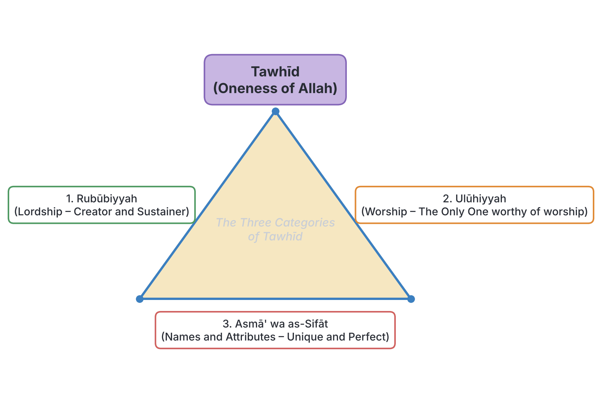
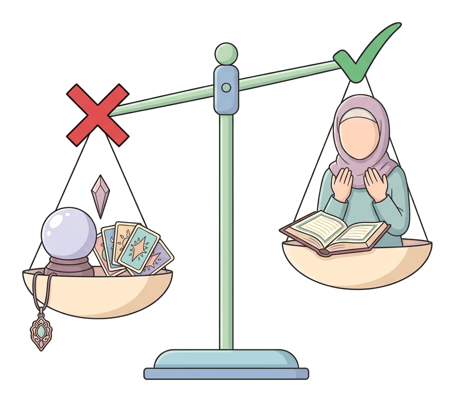

# JAMB Irk Notes: Tawhīd, Kalimatush-Shahādah, and Shirk

## What JAMB expects

This topic covers Part II (Tawhīd and Fiqh) of the JAMB Islamic Religious Knowledge syllabus, specifically Topic 8. It focuses on the core Islamic belief in the Oneness of Allah and the rejection of all forms of polytheism and innovation. It covers the following content items:

- **(a) Faith:** (i) Tawhīd (Its importance and lessons).
- **(b) Kalimatush-Shahadah:** (i) Its meaning and importance; (ii) The Oneness of Allah in specific Qur'anic verses; (iii) The servanthood and messengership of Prophet Muhammad (SAW); (iv) Universality of his message; (v) Finality of his Prophethood.
- **(c) Shirk (Beliefs incompatible with Tawhīd):** (i) Worship of Idols, Ancestral worship, Trinity, and Atheism, with specific verses.
- **(d) General practices incompatible with Tawhīd:** Superstition, Fortune-telling, Magic and witchcraft, Cult worship, and Innovation (Bid’ah), with specific verses and ahādīth.

By the end of these notes, you should be able to:
1. Analyse the concepts of Tawhīd.
2. Evaluate the significance of kalimatush-shahadah.
3. Identify the verses dealing with the Oneness of Allah.
4. Explain the significance of the servanthood of the Prophet Muhammad (SAW).
5. Evaluate the significance of the universality of Prophet Muhammad’s message.
6. Examine the significance of the finality of the Prophethood of Muhammad (SAW).
7. Identify what actions and beliefs constitute shirk.
8. Explain the implications of beliefs and actions of shirk.
9. Appreciate why you should avoid actions of shirk.
10. Identify those practices that are incompatible with the Islamic principles of Tawhīd.
11. Examine those practices that are incompatible with Tawhīd.
12. Shun those actions.
13. Demonstrate the teachings of the verses and the ahadīth in your daily life.

**Note on the syllabus wording:** The syllabus contains multiple objectives labelled "(i)". These notes address each objective under clearly marked headings. For objective 8(d)(iii), the syllabus says "shun off those actions"; this is a grammatical error for "shun those actions", which is how it is treated here. The syllabus also lists Q.5:76 for Trinity; while Q.5:73 is the more standard verse explicitly mentioning the Trinity, Q.5:76 condemns worshipping powerless entities alongside Allah, and is treated exactly as prescribed. 

## Faith and Tawhīd

**Content a: Faith (Tawhīd - Its importance and lessons).**

### Objective: Analyse the concepts of Tawhīd

In Islam, **Tawhīd** means the "Oneness" or "Unification" of Allah. It is the absolute, uncompromising belief that Allah is One, unique, without partners, parents, or children, and is the sole Creator and Sustainer of the universe. Tawhīd is the foundation of the Islamic faith; without it, a person's belief is invalid.

Islamic scholars traditionally analyse the concept of Tawhīd by dividing it into three interlinking categories:

1. **Tawhīd ar-Rubūbiyyah (Oneness of Lordship):** The belief that Allah alone is the Creator, Sustainer, Provider, and Master of the universe. No one else shares in His power to create or control nature.
2. **Tawhīd al-Ulūhiyyah (Oneness of Worship):** The belief that Allah alone deserves to be worshipped. All acts of worship—such as prayer (salāh), fasting (sawm), charity (zakāh), and supplication (du'ā)—must be directed exclusively to Him. 
3. **Tawhīd al-Asmā' wa as-Sifāt (Oneness of Names and Attributes):** The belief that Allah has perfect, unique names and attributes (such as The All-Knowing, The Most Merciful). These attributes belong solely to Him and cannot be compared to the attributes of human beings or creation.

#### Importance and Lessons of Tawhīd
- **Freedom and Dignity:** Tawhīd frees human beings from worshipping false deities, nature, objects, or other humans. A believer relies only on Allah, removing the fear of humans or evil spirits.
- **Unity of Mankind:** Since all humans are created by the One God, Tawhīd teaches that all people are fundamentally equal, breaking down racism and tribalism.
- **Purpose of Life:** Tawhīd gives life clear meaning—to worship and obey the Creator.
- **Humility:** Realising that Allah is the source of all blessings removes arrogance.
- **Salvation:** Muslims believe that holding firmly to Tawhīd and dying upon it is the ultimate key to entering Paradise.

## Kalimatush-Shahādah

**Content b: Kalimatush-Shahadah.**

### Objective: Evaluate the significance of Kalimatush-Shahadah

The **Kalimatush-Shahādah** (The Word of Testimony) is the fundamental declaration of Islamic faith and the first of the Five Pillars of Islam. 

**The Declaration:**
*Ash-hadu an lā ilāha illallāh, wa ash-hadu anna Muhammadan rasūlullāh.*
"I bear witness that there is no deity worthy of worship except Allah, and I bear witness that Muhammad is the Messenger of Allah."

**Significance and Importance:**
1. **Gateway to Islam:** A person officially becomes a Muslim by sincerely uttering this testimony. It marks the transition from disbelief to faith.
2. **Summary of the Faith:** The first part affirms Tawhīd (monotheism) and rejects Shirk (polytheism). The second part affirms the channel through which Allah’s guidance is received—Prophet Muhammad (SAW).
3. **Condition for Acceptance of Deeds:** For any good deed (like charity or fasting) to be spiritually rewarded by Allah in the Hereafter, the doer must believe in the Shahādah.
4. **Legal Protection:** In an Islamic state, uttering the Shahādah grants a person the full rights, protection, and brotherhood of the Muslim community (Ummah).

### Objective: Identify the verses dealing with the Oneness of Allah

The syllabus highlights three specific Qur'anic references that forcefully declare the Oneness of Allah:

1. **Q.3:18 (Surah Āl 'Imrān):**
   > "Allah (Himself) is Witness that there is no God save Him. And the angels and the men of learning (too are witness). Maintaining His creation in justice, there is no God save Him, the Almighty, the Wise." (Pickthall's translation)
   *Significance:* This verse states that Allah Himself, along with the angels and people of knowledge, testifies to His absolute Oneness and His administration of the universe with perfect justice.

2. **Q.2:255 (Ayatul Kursī - The Verse of the Throne in Surah al-Baqarah):**
   > "Allah! There is no deity save Him, the Alive, the Eternal. Neither slumber nor sleep overtaketh Him..." 
   *Significance:* This is one of the most famous verses in the Qur'an. It identifies Allah as self-sustaining, eternal, and perfectly aware of everything. It proves His Oneness by showing that no other being possesses such unlimited power and wakefulness.

3. **Q.112:1-4 (Surah al-Ikhlās):**
   > "Say: He is Allah, the One! Allah, the eternally Besought of all! He begetteth not nor was begotten. And there is none comparable unto Him."
   *Significance:* This short Surah is considered the pure, concentrated essence of Tawhīd. It completely rejects the ideas of God having children, parents, or equals.

### Objective: Explain the significance of the servanthood of the Prophet Muhammad (SAW)

In Islam, while Prophet Muhammad (SAW) is highly revered as the greatest of all prophets, he is strictly a **human being** and a **servant (abd)** of Allah. Elevating him to a divine or semi-divine status is completely forbidden, as this would violate Tawhīd. The Qur'an frequently reminds Muslims of his human nature.

**Verses identifying his servanthood and messengership:**
- **Q.3:144:** "Muhammad is but a messenger, messengers (the like of whom) have passed away before him..." This was revealed when rumors spread during the Battle of Uhud that the Prophet had been killed. It reminded the Muslims that they worship the immortal Allah, not the mortal messenger.
- **Q.18:110 (Surah al-Kahf):** "Say: I am only a mortal like you. My Lord inspireth in me that your God is only One God..." This explicitly confirms his humanity and his role as a recipient of revelation.
- **Q.48:29 (Surah al-Fath):** "Muhammad is the messenger of Allah..." This affirms his official title and function.
- **Q.34:28 (Surah Saba):** "And We have not sent thee (O Muhammad) save as a bringer of good tidings and a warner..." His role is to warn and deliver the message, not to act as a god.

**Significance:** Acknowledging his servanthood protects Muslims from the error of worshipping prophets, ensuring that all worship is directed to Allah alone. It also makes him an excellent, relatable role model for humanity, because he experienced human struggles, hunger, and emotions.

### Objective: Evaluate the significance of the universality of Prophet Muhammad’s message

Unlike earlier prophets (such as Prophet Mūsā or Prophet 'Īsā) who Muslims believe were sent specifically to their own nations (the Children of Israel), Prophet Muhammad (SAW) was sent to **all of mankind**. 

**Verses demonstrating universality:**
- **Q.7:158 (Surah al-A'rāf):** "Say (O Muhammad): O mankind! Lo! I am the messenger of Allah to you all..." 
- **Q.34:28 (Surah Saba):** "And We have not sent thee (O Muhammad) save as a bringer of good tidings and a warner unto all mankind; but most of mankind know not."

**Significance:** 
Because his message is universal, Islam is not a regional or tribal religion. It addresses people of all races, languages, and eras. This universality is the basis for the Islamic practice of *Da'wah* (inviting people to Islam) globally, and it unifies diverse cultures—from Nigeria to Indonesia—under one faith.

### Objective: Examine the significance of the finality of the Prophethood of Muhammad (SAW)

Muslims believe that Prophet Muhammad (SAW) is the **Seal of the Prophets (Khātam an-Nabiyyīn)**. There will be no prophet or messenger after him, and the Qur'an is the final revelation to humanity.

**The specific verse:**
- **Q.33:40 (Surah al-Ahzāb):** "Muhammad is not the father of any man among you, but he is the messenger of Allah and the Seal of the Prophets; and Allah is ever Aware of all things."

**Significance:**
1. **Completeness of Religion:** Because he is the final prophet, the religion of Islam is considered complete. No new laws or divine messages are needed.
2. **Protection against false claims:** Any person claiming to be a prophet after Muhammad (SAW) is considered an impostor. This doctrine protects the Muslim Ummah from being misled by false leaders.
3. **Preservation of the Qur'an:** Since no other prophet will come to correct corrupted texts, Allah promised to preserve the Qur'an until the Day of Judgement.

## Shirk: Beliefs Incompatible with Tawhīd

**Content c: Shirk.**

### Objective: Identify what actions and beliefs constitute shirk

**Shirk** is the exact opposite of Tawhīd. It means associating partners with Allah in His Lordship, Worship, or Attributes. In Islamic theology, Shirk is the gravest of all sins. If a person dies in a state of unrepented major Shirk, Muslims believe they will not be forgiven. 

The syllabus identifies four major beliefs that constitute Shirk:

#### 1. Worship of Idols
Worshipping carved images, statues, or nature (such as trees or rivers) is direct Shirk because it directs worship to creation instead of the Creator.
- **Q.4:48:** "Lo! Allah forgiveth not that a partner should be ascribed unto Him. He forgiveth (all) save that to whom He will..." (This verse establishes the unforgivable nature of Shirk).
- **Q.22:31:** "...and whoever ascribeth partners unto Allah, it is as if he had fallen from the sky and the birds had snatched him or the wind had blown him to a far-off place."

#### 2. Ancestral Worship
In many traditional societies, including aspects of African Traditional Religion in Nigeria, people pray to deceased ancestors or offer them sacrifices, believing the ancestors can intercede for them or harm them. Islam rejects this entirely; the dead cannot hear prayers or alter the world.
- **Q.4:116:** A reiteration that Allah does not forgive setting up partners with Him.
- **Q.21:66-67:** These verses relate the story of Prophet Ibrāhīm (Abraham) confronting his people's ancestral idol worship. He tells them: "Fie on you and all that ye worship instead of Allah! Have ye then no sense?"

#### 3. Trinity
The Christian belief in the Trinity (God as the Father, the Son, and the Holy Spirit) is incompatible with Tawhīd, which insists on strict, indivisible Monotheism.
- **Q.4:171:** "...and say not 'Three' - Cease! (it is) better for you! - Allah is only One God..."
- **Q.5:76:** "Say: Serve ye in place of Allah that which possesseth for you neither hurt nor use? Allah it is Who is the Hearer, the Knower." (This condemns worshipping powerless entities alongside or instead of Allah).
- **Q.112:1-4:** As mentioned earlier, Surah al-Ikhlās clearly states Allah does not beget, nor was He begotten.

#### 4. Atheism
Atheism is the complete denial of the existence of God. While polytheists have many gods, atheists reject the concept of the Creator entirely, attributing life and the universe to random chance or nature.
- **Q.45:24:** "And they say: There is naught but our life of the world; we die and we live, and naught destroyeth us save time..." (This describes the ancient materialists and atheists).
- **Q.72:6:** Refers to men who sought refuge in the Jinn instead of Allah, leading to further error.
- **Q.79:17-22:** Refers to the story of Pharaoh (Fir'awn), who arrogantly denied Allah and claimed to be the highest lord, representing an extreme form of godlessness and self-deification.

### Objective: Explain the implications of beliefs and actions of shirk

| Implication | Explanation |
| --- | --- |
| **Nullification of Good Deeds** | Even if a person does excellent charitable work, engaging in major Shirk invalidates those deeds in the sight of Allah, meaning they will receive no spiritual reward in the Hereafter. |
| **Unforgivable Sin** | Allah explicitly states in the Qur'an (Q.4:48) that He will forgive any sin except Shirk, provided the person does not repent before death. |
| **Spiritual Degradation** | Worshipping objects or humans degrades the dignity of a person. Instead of submitting only to the Creator, the individual becomes a slave to their own creations, superstitions, or other humans. |
| **Societal Division** | Polytheism often leads to divided societies, with different groups fighting over the supremacy of their respective gods, whereas Tawhīd unites people under one Creator. |

### Objective: Appreciate why they should avoid actions of shirk

Muslims must avoid Shirk to protect their eternal soul, maintain the purity of their faith, and uphold human dignity. By avoiding Shirk, a Muslim lives a life of clarity, trusting solely in Allah for protection and provision. They do not live in fear of statues, ancestors, or mythical forces, knowing that only Allah has true power over destiny.

## General Practices Incompatible with Tawhīd

**Content d: General practices which are incompatible with Islamic principles of Tawhīd.**

### Objective: Identify those practices that are incompatible with the Islamic principles of Tawhīd

Apart from formal religious beliefs like the Trinity or idolatry, certain everyday cultural practices and actions contradict the Oneness of Allah because they involve seeking supernatural help or knowledge from sources other than Allah. The syllabus identifies five main practices:

1. **Superstition**
2. **Fortune-telling**
3. **Magic and witchcraft**
4. **Cult worship**
5. **Innovation (Bid’ah)**

### Objective: Examine those practices that are incompatible with Tawhīd

#### 1. Superstition
Superstition involves believing that certain objects, animals, or events bring good or bad luck (e.g., fearing a black cat, believing a certain day is cursed, or wearing a charm/amulet for protection). Islam teaches that benefit and harm come only from Allah.
- **Q.25:43:** "Hast thou seen him who chooseth for his god his own lust?..." Following baseless superstitions is likened to making one's own desires and fears a false god.
- **Q.72:6:** "And indeed (O Muhammad) individuals of humankind used to invoke the protection of individuals of the jinn..." Seeking protection from unseen creatures (jinn) instead of Allah is a major superstitious error that only increases humans in folly.

#### 2. Fortune-telling (Divination / Kahana)
Fortune-tellers, astrologers, palm readers, and diviners (such as traditional *babalawo* or seers in Nigeria) claim to know the future or the unseen (*Al-Ghayb*). In Islam, knowledge of the unseen belongs exclusively to Allah. Consulting them is strictly prohibited.
- **Q.15:16-18 & Q.37:6-10:** These verses explain that devils (shayātīn) attempt to eavesdrop on the angels in the heavens to steal snippets of information about the future. They are chased away by shooting stars (flaming fire). The devils mix one truth with a hundred lies and pass it to fortune-tellers.

#### 3. Magic and Witchcraft (Sihr)
Magic involves dealing with the jinn, casting spells, or performing rituals to cause harm, manipulate minds, or gain power. Learning, teaching, or practicing magic is a direct act of disbelief.
- **Q.2:102 (Surah al-Baqarah):** Explains that magic was taught to the people of Babylon by the two angels, Hārūt and Mārūt, as a severe test. The verse states: "...they taught it not (to anyone) till they had said: We are only a temptation, therefore disbelieve not (in the guidance of Allah)..." Thus, practicing magic is equated with disbelief.
- **Q.20:69 & 73 / Q.26:46:** These verses recount the story of Prophet Mūsā (Moses) and the magicians of Pharaoh. Allah instructed Mūsā to throw his staff, which swallowed the illusions of the magicians. Realising they were facing true divine power and not magic, the magicians fell prostrate in submission to Allah.

#### 4. Cult Worship
This refers to secret societies or cults that require blood oaths, animal (or human) sacrifices, or secret rituals for power or wealth (e.g., the Ogboni fraternity or campus cults in Nigeria). These practices are deeply rooted in Shirk, as they pledge ultimate allegiance and worship to forces other than Allah.
- **Q.17:23:** "Thy Lord hath decreed that ye worship none save Him..." Cult practices violate this decree by demanding worship of the cult's patron spirits.
- **Q.4:48:** As noted, Allah does not forgive setting up partners with Him, which is the core of cult rituals.

#### 5. Innovation (Bid’ah)
**Bid’ah** means introducing new, unwarranted religious rituals or beliefs into Islam that Prophet Muhammad (SAW) and his companions did not practice. While inventing a new technology (like using a microphone for Adhan) is a good, worldly innovation, introducing a new way to pray or a new religious festival is forbidden in Islamic law. It implies that the religion was incomplete.
- **Q.4:116:** This verse warns against straying from the path of the believers and following Shaytan, which includes altering the religion.
- **Hadīth 5 of an-Nawawī:** 'Ā'ishah reported the Prophet (SAW) said: *"He who innovates something in this matter of ours [i.e., Islam] that is not of it will have it rejected."* (Agreed upon: Bukhari and Muslim).
- **Hadīth 28 of an-Nawawī:** Al-'Irbad bin Sariyah reported the Prophet (SAW) gave a moving sermon and said: *"...beware of newly invented matters [in the religion], for every invented matter is an innovation and every innovation is a going astray."* (Abu Dawud and Tirmidhi).

### Objective: Shun those actions

Because these practices corrupt faith, destroy society, and lead to eternal punishment, Muslims must actively **shun** (avoid and reject) them. A Muslim relies entirely on Allah for health, wealth, and security. Instead of visiting a fortune-teller, a Muslim performs *Salāt al-Istikhārah* (the prayer for seeking guidance). Instead of using magic for protection, a Muslim recites protective verses from the Qur'an (like Ayatul Kursī and the last two Suwar of the Qur'an).

### Objective: Demonstrate the teachings of the verses and the ahadīth in their daily lives

A Muslim demonstrates these teachings daily by:
1. Reciting the Kalimatush-Shahādah with understanding in every daily prayer.
2. Refusing to participate in cultural festivals that involve idols, ancestral worship, or cult rituals.
3. Avoiding horoscopes, zodiac signs, and superstitious statements like "touch wood."
4. Following the Sunnah (the way of the Prophet) strictly, without adding new religious ceremonies (Bid'ah).
5. Treating Prophet Muhammad (SAW) with the utmost respect and love, while recognizing he is a human messenger, not a deity.

## Key terms

| Term | Meaning |
| --- | --- |
| Tawhīd | The absolute Oneness of Allah; the core of Islamic monotheism. |
| Kalimatush-Shahādah | The Islamic declaration of faith: "There is no deity worthy of worship except Allah, and Muhammad is His Messenger." |
| Shirk | The unforgivable sin of associating partners or equals with Allah. |
| Khātam an-Nabiyyīn | "Seal of the Prophets", the title indicating Prophet Muhammad (SAW) is the final prophet. |
| Al-Ghayb | The unseen or the unknown future, knowledge of which belongs only to Allah. |
| Jinn | Unseen creatures created from smokeless fire; some are believers, others are devils (Shayātīn). |
| Bid'ah | Religious innovation; introducing new forms of worship or belief into Islam. |
| Sihr | Magic or witchcraft, which is strictly forbidden in Islam and equated with disbelief. |
| Kahana | Fortune-telling or divination. |
| Abd | Servant or slave (of Allah); emphasizing the human nature of the Prophet (SAW). |

## Exam tips and common mistakes

- **Tawhīd vs. Shirk:** Always remember they are opposites. Any question asking for the opposite of Tawhīd is Shirk.
- **Understand the verses by topic:** JAMB often quotes a verse and asks what topic it relates to. 
  - *Surah al-Ikhlās (Q.112)* and *Ayatul Kursī (Q.2:255)* = Oneness of Allah.
  - *Q.33:40 (Seal of the Prophets)* = Finality of Prophethood.
  - *Q.7:158 (O mankind!)* = Universality of the Prophet's message.
- **The Unforgivable Sin:** Remember Q.4:48; Shirk is the only sin Allah will not forgive if a person dies without repenting.
- **Bid'ah:** Do not confuse worldly innovation (like building modern cars) with Bid'ah. Bid'ah specifically refers to innovating *matters of religion/worship*.
- **Servanthood:** A common mistake is thinking it is disrespectful to call the Prophet (SAW) a servant. In Islam, being the 'Abd (servant) of Allah is the highest, most honorable title for a human.
- **Magic (Sihr):** Remember the story of Hārūt and Mārūt in Babylon (Q.2:102); they taught magic as a test, warning people that it was an act of disbelief.

## Quick summary

1. Tawhīd is the belief in the absolute Oneness of Allah in His Lordship, Worship, and Attributes. It frees humanity from false worship and guarantees salvation.
2. The Kalimatush-Shahādah is the entry point to Islam, declaring monotheism and the messengership of Muhammad (SAW).
3. Prophet Muhammad (SAW) is highly respected but is strictly a human servant and messenger, not divine.
4. Unlike previous prophets, Muhammad's (SAW) message is universal (for all mankind) and final (he is the Seal of the Prophets).
5. Shirk (polytheism) is the gravest sin. Beliefs incompatible with Islam include idol worship, ancestral worship, the Trinity, and atheism.
6. Practices such as superstition, fortune-telling, magic, and cult worship are forbidden because they seek power or knowledge from sources other than Allah.
7. Bid'ah (religious innovation) is strongly condemned in Hadīth because it alters the completed religion of Islam.

## Practice questions

**1. The Islamic concept of Tawhīd primarily focuses on the:**

- A. history of the Prophets
- B. rules of the Islamic economic system
- C. absolute Oneness of Allah
- D. method of performing the daily prayers

**Answer: C.** Tawhīd is the theological concept of the absolute Oneness and uniqueness of Allah.

**2. Which of the following Surahs is considered the purest declaration of the Oneness of Allah, stating that He neither begets nor is begotten?**

- A. Surah al-Fātihah
- B. Surah al-Ikhlās
- C. Surah al-Baqarah
- D. Surah al-Kahf

**Answer: B.** Surah al-Ikhlās (Q.112:1-4) specifically addresses this, stating "He begetteth not nor was begotten."

**3. In Islam, the belief that Prophet Muhammad (SAW) is the Seal of the Prophets (Khātam an-Nabiyyīn) means that:**

- A. he was the first prophet created by Allah
- B. he is a divine being
- C. no prophet or messenger will come after him
- D. his message was only for the Arabs

**Answer: C.** As stated in Q.33:40, he is the Seal of the Prophets, meaning the final prophet sent by Allah.

**4. According to Q.4:48, which sin will Allah never forgive if a person dies without repenting?**

- A. Theft
- B. Murder
- C. Shirk
- D. Disrespecting parents

**Answer: C.** Shirk (associating partners with Allah) is stated in the Qur'an as the one unforivable sin if left unrepented.

**5. The practice of introducing new religious rituals into Islam that were not practiced by the Prophet (SAW) is known as:**

- A. Sunnah
- B. Kahana
- C. Sihr
- D. Bid’ah

**Answer: D.** Bid'ah refers to religious innovations, which are strictly condemned in the Hadīth of an-Nawawī.

**6. Which of the following verses establishes the universality of Prophet Muhammad’s (SAW) message?**

- A. Q.112:1 (Say: He is Allah, the One!)
- B. Q.7:158 (Say: O mankind! Lo! I am the messenger of Allah to you all...)
- C. Q.2:102 (And they followed what the devils used to read...)
- D. Q.18:110 (Say: I am only a mortal like you...)

**Answer: B.** Q.7:158 explicitly addresses "mankind" and states he is a messenger to "all," highlighting the universality of his mission.

**7. A Muslim should reject fortune-tellers and palm readers because:**

- A. they usually charge too much money
- B. knowledge of the unseen (Al-Ghayb) belongs exclusively to Allah
- C. they rely on modern technology
- D. it is an act of Bid'ah

**Answer: B.** Fortune-telling claims knowledge of the future/unseen, which violates Tawhīd as only Allah possesses this knowledge.

**8. In Q.18:110, the Prophet (SAW) is commanded to say: "I am only a mortal like you." This verse specifically emphasizes his:**

- A. finality
- B. servanthood and humanity
- C. universality
- D. wealth

**Answer: B.** By affirming he is a mortal (human), it highlights his servanthood and rejects any divine attributes.

**9. Seeking protection from unseen spirits or wearing amulets to bring good luck are examples of:**

- A. Superstition and Shirk
- B. Accepted cultural practices in Islam
- C. Valid Islamic medicine
- D. Trust in Allah (Tawakkul)

**Answer: A.** Trusting objects or spirits for protection rather than Allah is a form of superstition and Shirk.

**10. According to Hadīth 5 of an-Nawawī, what happens to an action that is innovated into the religion of Islam?**

- A. It is accepted if the intention is good
- B. It is rewarded partially
- C. It is completely rejected
- D. It becomes a compulsory Sunnah

**Answer: C.** The Prophet (SAW) said: "He who innovates something in this matter of ours that is not of it will have it rejected."

<!-- COVERAGE
obj i | Objective: Analyse the concepts of Tawhīd
obj i | Objective: Evaluate the significance of Kalimatush-Shahadah
obj ii | Objective: Identify the verses dealing with the Oneness of Allah
obj i | Objective: Explain the significance of the servanthood of the Prophet Muhammad (SAW)
obj i | Objective: Evaluate the significance of the universality of Prophet Muhammad’s message
obj i | Objective: Examine the significance of the finality of the Prophethood of Muhammad (SAW)
obj i | Objective: Identify what actions and beliefs constitute shirk
obj ii | Objective: Explain the implications of beliefs and actions of shirk
obj iii | Objective: Appreciate why they should avoid actions of shirk
obj i | Objective: Identify those practices that are incompatible with the Islamic principles of Tawhīd
obj ii | Objective: Examine those practices that are incompatible with Tawhīd
obj iii | Objective: Shun those actions
obj iv | Objective: Demonstrate the teachings of the verses and the ahadīth in their daily lives
item a | Faith and Tawhīd
item b | Kalimatush-Shahādah
item c | Shirk: Beliefs Incompatible with Tawhīd
item d | General Practices Incompatible with Tawhīd
-->
