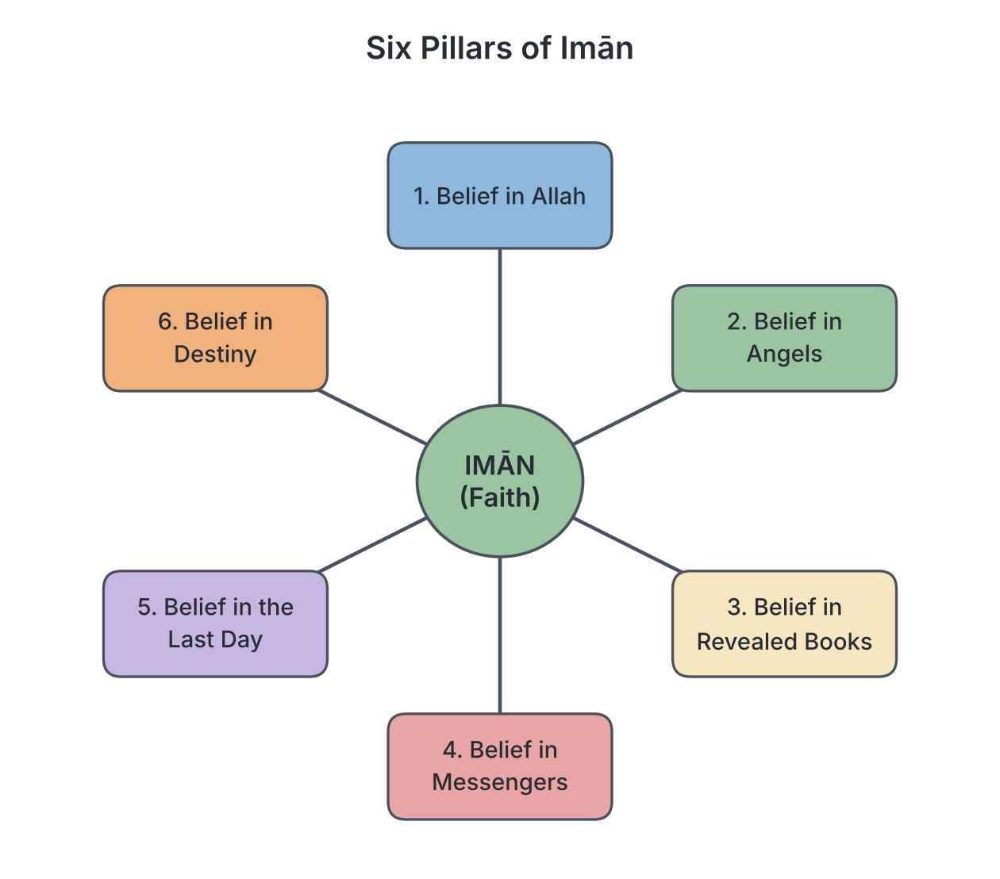

# JAMB Irk Notes: Articles of Faith

## What JAMB expects

This topic covers Section B, Topic 9 of the JAMB IRK syllabus: Articles of Faith. It is part of the Tawhīd (Islamic Theology) section. 

The syllabus covers six content areas:
* (a) Belief in Allah: (i) Existence, (ii) Attributes, and (iii) Works.
* (b) Belief in Allah’s angels.
* (c) His books.
* (d) His Prophets: Ulul-azmi.
* (e) The Last Day: Yawm-al-Ba'th.
* (f) Destiny: distinction between Qada and Qadar.

By the end of these notes, you should be able to:
1. Examine the significance of the articles of faith.
2. List the attributes of Allah.
3. Examine the works of Allah.
4. Explain the belief in Allah’s books.
5. Identify the verses on Allah’s books.
6. Explain the belief in the Prophets of Allah and its significance.
7. Analyse the belief in the Last Day and its significance.
8. Evaluate the belief in destiny and its significance.

**Note on the syllabus wording:** 
* The syllabus transcribes the Arabic letter *'ayn* as a raised `c`, printing *Yawm-al-Ba$^c$th*. In these notes, it is written in the standard way as *Yawm al-Ba'th*.
* In content item (a)(iii), the syllabus prints the Qur'an reference as `(Q.27: 59:64)`. This is a typing error; it means **Q.27:59–64**, a passage of six verses.
* In content item (c), the syllabus prints `(Q.2:253) and 285)`. This is a typing error; it means **Q.2:253** and **Q.2:285**.

## The Articles of Faith

In Islam, faith is known as **Imān**. According to the famous Hadīth of Jibrīl (where the Angel Jibrīl came to teach the Prophet his religion), Imān consists of six fundamental pillars or articles. A person must firmly believe in all six to be considered a true believer (Mu'min).

The six articles are:
1. Belief in Allah.
2. Belief in His Angels.
3. Belief in His Revealed Books.
4. Belief in His Messengers (Prophets).
5. Belief in the Last Day (Day of Resurrection).
6. Belief in Divine Destiny (Qada and Qadar).

### Significance of the articles of faith

**Objective i: examine the significance of the articles of faith.**

The articles of faith are not just abstract ideas; they shape how a Muslim lives. 
* **Provides purpose:** Belief in Allah and the Last Day gives human life a clear purpose—to worship the Creator and prepare for the hereafter.
* **Establishes morality:** Knowing that angels record our deeds and that Allah sees everything encourages Muslims to act justly, avoid sins, and be honest in their daily affairs.
* **Creates inner peace:** Trusting in Destiny (Qada and Qadar) helps a Muslim handle life's hardships, poverty, or sickness without falling into despair.
* **Unifies humanity:** Belief in all Prophets and Revealed Books connects Muslims to the entire history of human guidance, fostering respect for the previous messages sent by Allah.

## Belief in Allah

**Content a: Belief in Allah.**

Tawhīd (the oneness of Allah) is the core of Islam. Belief in Allah means having absolute certainty that He is the sole Creator, Sustainer, and Ruler of the universe, and that He alone deserves to be worshipped.

### Existence of Allah

The Qur'an does not try to prove Allah's existence through complex philosophy; instead, it points to the perfection of the universe and basic logic. 

**1. Ayatul Kursi (The Verse of the Throne) - Q.2:255:**
This is the greatest verse in the Qur'an. It forcefully declares Allah's existence, His absolute authority, and His perfect nature:
> "Allah! There is no deity save Him, the Alive, the Eternal. Neither slumber nor sleep overtaketh Him. Unto Him belongeth whatsoever is in the heavens and whatsoever is in the earth..." (Pickthall's translation)
*Significance:* It shows that Allah exists independently. Unlike creation, He never tires, sleeps, or dies. 

**2. The Logical Challenge - Q.52:35-36:**
The Qur'an challenges atheism (believing there is no God) and polytheism (believing in many gods) by asking human beings to reflect on their own origins:
> "Or were they created out of naught? Or are they the creators? Or did they create the heavens and the earth? Nay, but they are sure of nothing!" (Pickthall's translation)
*Significance:* This verse poses a logical question: did the universe come from nothing, or did humans create themselves? Since both are impossible, a Supreme Creator—Allah—must exist.

### Attributes of Allah

**Objective ii: list the attributes of Allah.**

Allah is described by His "Most Beautiful Names" (Asmā'ul Husnā), which reflect His attributes. Traditionally, Muslims recognise 99 names. The syllabus specifically points to **Surah al-Hashr (Q.59:22-24)**, a passage famous for clustering many attributes of Allah together.

According to Q.59:22-24, Allah's attributes include:
* **'Alimul-Ghaybi wash-Shahadah:** The Knower of the Invisible (unseen) and the Visible.
* **Ar-Rahman:** The Beneficent / The Entirely Merciful.
* **Ar-Rahim:** The Merciful / The Especially Merciful.
* **Al-Malik:** The Sovereign Lord / The King.
* **Al-Quddus:** The Holy / The Pure.
* **As-Salam:** The Source of Peace.
* **Al-Mu'min:** The Keeper of Faith / The Granter of Security.
* **Al-Muhaymin:** The Guardian / The Overseer.
* **Al-Aziz:** The Majestic / The Almighty.
* **Al-Jabbar:** The Compeller.
* **Al-Mutakabbir:** The Superb / The Supreme in Greatness.
* **Al-Khaliq:** The Creator.
* **Al-Bari':** The Maker / The Evolver.
* **Al-Musawwir:** The Fashioner / The Bestower of Forms.

*Significance of listing these:* By learning these attributes, Muslims know who they are worshipping. For example, knowing He is *Al-Aziz* brings fear of His power, while knowing He is *Ar-Rahman* brings hope in His mercy.

### The works of Allah

**Objective iii: examine the works of Allah.**

The works of Allah are the visible actions and creations He manifests in the universe. Surah an-Naml (Q.27:59-64) highlights a series of His physical and spiritual works, ending each verse by challenging polytheists: "Is there any God beside Allah?"

The key works of Allah mentioned in this passage include:
1. **Creation of the Heavens and the Earth:** He built the vast universe.
2. **Sending down rain:** He sends water from the sky, which causes beautiful gardens and crops to grow.
3. **Stabilising the Earth:** He made the earth a firm, resting place, placed rivers in its valleys, and set firm mountains upon it.
4. **Creating a barrier between waters:** He created a barrier between sweet (fresh) water and salty sea water so they do not completely mix.
5. **Answering the distressed:** He answers the prayers of the desperate when they call upon Him, and He removes their suffering.
6. **Appointing humans as vicegerents:** He made mankind the inheritors/successors (Khulafā') on the earth.
7. **Providing guidance:** He guides humans through the darkness of the land and sea (both literally via stars, and spiritually via revelation).
8. **Sending the winds:** He sends the winds as glad tidings before His mercy (rain).
9. **Originating and repeating creation:** He begins creation, and He will repeat it (resurrect the dead on the Last Day).
10. **Providing sustenance:** He provides for living things from the sky and the earth.

## Belief in Allah's angels

**Content b: Belief in Allah’s angels.**

Angels (Malā'ikah) are spiritual beings created by Allah from light (Nūr). Unlike humans or Jinn, angels do not have free will to disobey Allah; they are in constant obedience and worship, carrying out His commands. They are neither male nor female, do not eat or drink, and are generally unseen by humans.

**Key verses on angels required by the syllabus:**
* **Q.2:177:** Defines true righteousness (Al-Birr). It states that righteousness is not just turning your face to the East or West in prayer, but it is to believe in Allah, the Last Day, **the Angels**, the Books, and the Prophets.
* **Q.2:285:** Affirms that the Messenger (Muhammad) and the believers all believe in Allah, **His angels**, His books, and His messengers.
* **Q.8:50:** Describes the works of angels at the time of death for the disbelievers: "If thou couldst see how the angels receive those who disbelieve, smiting their faces and their backs..." (Pickthall's translation).
* **Q.16:2:** Highlights the angels' role in bringing revelation: "He sendeth down the angels with the Spirit of His command unto whom He will of His bondmen..." (Pickthall's translation). 

**Well-known Angels and their duties:**
* **Jibrīl (Gabriel):** The chief of angels, responsible for bringing revelation (Wahy) to the Prophets.
* **Mīkā'īl (Michael):** Responsible for directing rain, winds, and the provision (Rizq) of living things.
* **Izrā'īl (The Angel of Death):** Responsible for taking the souls of creatures at their appointed time of death. (Note: The Qur'an calls him *Malak al-Mawt*, though Izrā'īl is the traditional name).
* **Isrāfīl:** Responsible for blowing the Trumpet to signal the Day of Resurrection.
* **Raqīb and 'Atīd (Kiramun Katibun):** The noble recording angels stationed on the right and left shoulders of every person, recording good and bad deeds.
* **Munkar and Nakīr:** The angels who question the soul in the grave.

## Belief in Allah's Books

**Content c: Belief in Allah's Books.**

Muslims must believe that Allah revealed divine books to various Prophets to guide humanity. These books contained the exact words of Allah and brought the same core message: Tawhīd (the oneness of Allah).

### Explanation of the belief in Allah's books

**Objective iv: explain the belief in Allah’s books.**

A Muslim believes in all original scriptures sent by Allah. However, Islamic teaching holds that over time, the earlier books were lost, altered, or mixed with human words by their followers. Therefore, the Glorious Qur'an was revealed as the final, complete, and uncorrupted book, which serves as a corrector and guardian (Muhaymin) over the previous scriptures.

The major revealed books are:
| Book | Prophet it was given to | Traditional equivalent |
| :--- | :--- | :--- |
| **Tawrah** | Mūsā (Moses) | Torah |
| **Zabūr** | Dāwūd (David) | Psalms |
| **Injīl** | 'Īsā (Jesus) | Gospel |
| **Qur'ān** | Muhammad (SAW) | The Final Revelation |
*(Note: The Qur'an also mentions the Suhuf—Scrolls—given to Ibrāhīm and Mūsā).*

[IMAGE: Four ancient, closed books lined up on a shelf, with glowing Arabic text floating above them. From left to right, the books are labelled: "Tawrah (given to Musa)", "Zabur (given to Dawud)", "Injil (given to 'Isa)", and slightly larger and brighter on the right, "Al-Qur'an (given to Muhammad)". Clean flat textbook illustration, white background.]

### Verses on Allah's books

**Objective v: identify the verses on Allah’s books.**

The syllabus specifies three verses relating to the books:
* **Q.2:253:** This verse explains that Allah preferred some Messengers over others. He spoke directly to some, and "We gave Jesus, son of Mary, clear proofs and strengthened him with the holy Spirit." It shows the process of divine support and revelation.
* **Q.2:285:** Mentioned earlier under angels, this verse explicitly states that a true believer must believe in "His books" (*Kutubihi*), alongside Allah, the angels, and the messengers.
* **Q.3:3:** This verse explicitly names three of the books. It addresses the Prophet: "He hath revealed unto thee (Muhammad) the Scripture with truth, confirming that which was (revealed) before it, even as He revealed the **Torah** and the **Gospel**." (Pickthall's translation). 

## Belief in His Prophets (Ulul-Azm)

**Content d: Belief in His Prophets (Ulul-Azm).**

Allah chose specific human beings as Prophets (Nabiyy) and Messengers (Rasūl) to deliver His message. A Muslim must believe in all Prophets without rejecting any of them. The Qur'an mentions 25 Prophets by name, starting with Ādam and ending with Muhammad (SAW), the Seal of the Prophets.

### Explanation and significance of believing in the Prophets

**Objective vi: explain the belief in the Prophets of Allah and its significance.**

Among the Prophets, five are given a special, elevated status due to their extraordinary patience, strong will, and endurance in the face of massive persecution. They are known as **Ulul-Azm** (The Possessors of Constancy or Firm Resolve). 

The five Ulul-Azm Prophets are:
1. **Nūh (Noah):** Preached to his people for 950 years with great patience, despite facing constant mockery before the great flood.
2. **Ibrāhīm (Abraham):** Faced the fire of King Nimrod, broke the idols of his community, and was tested with the command to sacrifice his son.
3. **Mūsā (Moses):** Faced the tyranny of the Pharaoh (Fir'awn), the hardship of leading the Israelites out of Egypt, and the stubbornness of his own people.
4. **'Īsā (Jesus):** Faced severe opposition and plots against his life from the authorities of his time while preaching pure monotheism.
5. **Muhammad (SAW):** Faced intense persecution in Makkah, fought defensive battles in Madinah, and bore the heavy burden of the final universal message.

**The Syllabus Verse - Q.4:163-164:**
This passage explicitly establishes the chain of prophethood:
> "Lo! We inspire thee as We inspired Noah and the prophets after him, as We inspired Abraham and Ishmael and Isaac and Jacob and the tribes, and Jesus and Job and Jonah and Aaron and Solomon, and as We imparted unto David the Psalms... And messengers We have mentioned unto thee before and messengers We have not mentioned unto thee; and Allah spake directly unto Moses." (Pickthall's translation).

*Significance of believing in the Prophets:* 
* It reassures believers that Allah did not leave humanity to wander in darkness without a guide. 
* It provides human beings with practical role models; Prophets were human and showed how to live according to Allah's laws.
* It confirms that Prophet Muhammad's revelation is part of a long historical chain, not an isolated invention.

## Belief in the Last Day (Yawm al-Ba'th)

**Content e: Belief in the Last Day (Yawm al-Ba'th).**

The Last Day is known by many names in the Qur'an, such as Yawm al-Qiyāmah (Day of Standing) and **Yawm al-Ba'th** (Day of Resurrection/Awakening). Belief in it means having absolute certainty that this physical world will come to an end, all the dead will be physically resurrected, and everyone will stand before Allah to be judged. Those who did good will enter Jannah (Paradise), and those who did evil will face Jahannam (Hellfire).

### Analysis and significance of believing in the Last Day

**Objective vii: analyse the belief in the Last Day and its significance.**

The Qur'an guarantees the reality of physical resurrection, showing it is just as easy for Allah to recreate life as it was to create it the first time. 

**Key verses to analyse:**
* **Q.23:15-16:** "Then lo! after that ye surely die. Then lo! on the Day of Resurrection ye are raised (again)." (Pickthall's translation). This proves the absolute certainty of death followed by physical resurrection (*Ba'th*).
* **Q.70:4:** "The angels and the Spirit ascend unto Him in a Day whereof the span is fifty thousand years." (Pickthall's translation). This describes the terrifying and immense nature of the Day of Judgement; a single day will feel incredibly long due to the severity of the reckoning.

**Significance of believing in the Last Day:**
1. **Ensures justice:** In this world, many oppressors escape punishment, and many good people suffer. The Last Day guarantees that ultimate justice will be served.
2. **Promotes accountability:** A Muslim who believes that every atom's weight of good or evil is recorded will strive to be honest, kind, and obedient to Allah.
3. **Gives hope and patience:** Believers facing hardship in this life know they will be rewarded eternally in the hereafter, which gives them the strength to endure.

## Belief in Destiny (Qada and Qadar)

**Content f: Belief in Destiny (Qada and Qadar).**

The final article of faith is belief in Divine Decree and Predestination. A Muslim believes that Allah knows everything that will happen, has decreed it, and that nothing occurs in the universe except by His will. 

### Evaluation and significance of the belief in destiny

**Objective viii: evaluate the belief in destiny and its significance.**

While "Destiny" is often used to translate both terms, Islamic scholars distinguish between them, though they are closely intertwined.

*Textbook variation:* The definitions of Qada and Qadar are sometimes swapped by different schools of theology (such as Maturidi vs. Ash'ari). However, in standard Islamic studies taught in Nigerian schools, the distinction is usually drawn as follows:

| Term | Meaning | Explanation |
| :--- | :--- | :--- |
| **Qada** (Divine Decree) | The eternal, universal decree of Allah. | It is Allah's perfect knowledge and decision from eternity past about how everything will be. It is written in the Preserved Tablet (*Al-Lawh Al-Mahfuz*). |
| **Qadar** (Divine Measurement) | The manifestation or execution of the decree. | It is the actual occurrence of the decreed events in physical time and space, exactly according to Allah's measure and timing. |

*Example:* Allah decreed eternally that a specific person will be born in Nigeria in a specific year (Qada). When that year arrives and the child is physically born exactly as planned, that is Qadar. 

**Key verses:**
The syllabus highlights three verses that prove Allah's absolute power to execute His will simply by commanding it:
* **Q.2:117:** "The Originator of the heavens and the earth! When He decreeth a thing, He saith unto it only: Be! and it is." 
* **Q.16:40:** "And Our word unto a thing, when We intend it, is only that We say unto it: Be! and it is."
* **Q.36:82 (Surah Yasin):** "His command, when He intendeth a thing, is only that He saith unto it: Be! and it is" *(Kun fa-yakūn)*.

**Significance of believing in Destiny:**
1. **Reliance on Allah (Tawakkul):** Believers do their best but leave the final outcome to Allah, knowing whatever happens is His will. (This is why Nigerian Muslims frequently say *Insha Allah*—If Allah wills).
2. **Prevents arrogance:** When a person succeeds, they know it is by Allah's Qadar, not just their own cleverness.
3. **Console during tragedies:** When faced with loss, a Muslim says "Qaddarallahu wa masha'a fa'al" (Allah decreed it, and what He willed He has done). This prevents depression and anger against Allah.
4. **It does not negate free will:** Islam teaches that humans have free will to choose between right and wrong, and they are judged on those choices. Allah's foreknowledge of our choices does not mean He forced us to make them.

## Key terms

| Term | Meaning |
| :--- | :--- |
| **Imān** | Faith or belief in Islam. |
| **Tawhīd** | The absolute oneness of Allah. |
| **Asmā'ul Husnā** | The beautiful attributes/names of Allah (usually 99). |
| **Malā'ikah** | Angels, created from light, completely obedient to Allah. |
| **Ulul-Azm** | The "Possessors of Constancy/Firm Resolve"—the five greatest Prophets who endured severe trials. |
| **Yawm al-Ba'th** | The Day of Resurrection (The Last Day). |
| **Qada** | Divine Decree; Allah's eternal knowledge and decision of all things. |
| **Qadar** | Divine Measurement; the execution of Allah's decree in space and time. |
| **Kun fa-yakūn** | "Be, and it is"—Allah's command to bring something into existence instantly. |

## Exam tips and common mistakes

* **Syllabus typos to watch out for:** If you see `Q.27: 59:64` in a past question, know it refers to the verses discussing the *works of Allah*.
* **Confusing the books:** Remember the correct pairing: Tawrah (Mūsā), Zabūr (Dāwūd), Injīl ('Īsā), Qur'ān (Muhammad). JAMB loves testing this pairing.
* **Knowing the Ulul-Azm Prophets:** Memorise the five (Nūh, Ibrāhīm, Mūsā, 'Īsā, Muhammad). Do not let options like Yūsuf or Sulaymān trick you—they are Prophets, but not Ulul-Azm.
* **Qada vs Qadar:** Remember that Qada is the *decree/plan* and Qadar is the *measurement/execution*. 
* **Ayatul Kursi:** Know that Q.2:255 is Ayatul Kursi and its main theme is the absolute *existence and power* of Allah.
* **Do not confuse Angels and Prophets:** Angels have no free will and are made of light. Prophets are human beings chosen by Allah. 

## Quick summary

1. The six articles of faith (Imān) are belief in Allah, His Angels, His Books, His Prophets, the Last Day, and Destiny. These beliefs give a Muslim purpose and accountability.
2. Belief in Allah involves accepting His existence (proven by logic and His creation, Q.2:255, Q.52), His many attributes (like the Creator, the Merciful, Q.59), and His works (like creating heavens and earth, sending rain, Q.27).
3. Angels are obedient beings created from light. Key angels include Jibrīl (revelation) and Mīkā'īl (rain/provision).
4. Allah sent Books to guide mankind, notably the Tawrah, Zabūr, Injīl, and the final uncorrupted scripture, the Qur'ān (Q.3:3).
5. Prophets were human role models. The five who endured the hardest trials are the Ulul-Azm: Nūh, Ibrāhīm, Mūsā, 'Īsā, and Muhammad.
6. The Last Day (Yawm al-Ba'th) is the time of physical resurrection and absolute justice, where a day feels like fifty thousand years.
7. Destiny consists of Qada (the eternal decree) and Qadar (its execution in time). When Allah intends something, He simply says "Be! and it is" (Q.36:82).

## Practice questions

**1. The belief in Yawm al-Ba'th refers specifically to the belief in the:**
- A. existence of Angels
- B. Day of Resurrection
- C. revelation of the Qur'an
- D. Divine Decree

**Answer: B.** *Yawm al-Ba'th* translates to the Day of Resurrection, which is the Last Day when all dead will be raised for judgement.

**2. Which of the following Prophets is NOT among the Ulul-Azm?**
- A. Ibrāhīm
- B. Nūh
- C. Yūsuf
- D. 'Īsā

**Answer: C.** The five Ulul-Azm Prophets are Nūh, Ibrāhīm, Mūsā, 'Īsā, and Muhammad. Prophet Yūsuf is a noble prophet but not classified among the Ulul-Azm.

**3. According to Surah al-Hashr (Q.59:22-24), which of the following is an attribute of Allah meaning "The Source of Peace"?**
- A. Al-Muhaymin
- B. Al-Quddus
- C. As-Salam
- D. Al-Aziz

**Answer: C.** *As-Salam* means The Source of Peace. *Al-Muhaymin* is the Guardian, *Al-Quddus* is the Holy, and *Al-Aziz* is the Almighty.

**4. The Islamic concept of Qada and Qadar is best described as:**
- A. the belief that human beings have no free will at all
- B. the belief in the Day of Judgement and its severe punishment
- C. the eternal decree of Allah and its execution in time
- D. the physical recording of deeds by two angels

**Answer: C.** Qada refers to Allah's eternal divine decree, while Qadar is the manifestation or execution of that decree at the appointed time.

**5. In Q.4:163-164, Allah explicitly states that He spoke directly to which Prophet?**
- A. Muhammad
- B. Mūsā
- C. Ibrāhīm
- D. 'Īsā

**Answer: B.** The verse states: "...and Allah spake directly unto Moses (Mūsā)."

**6. Which of the following works of Allah is specifically highlighted in Q.27:59-64?**
- A. Making the earth a firm resting place and sending down rain
- B. Creating angels out of light
- C. Revealing the Qur'an in the month of Ramadan
- D. Giving Prophet Dawud the Zabur

**Answer: A.** Q.27:59-64 focuses on physical works like creating the heavens and earth, sending rain, stabilising the earth with mountains, and answering the distressed.

**7. The scripture given to Prophet Dāwūd by Allah is known as the:**
- A. Tawrah
- B. Injīl
- C. Suhuf
- D. Zabūr

**Answer: D.** Prophet Dāwūd (David) was given the Zabūr (Psalms). Mūsā received the Tawrah, and 'Īsā received the Injīl.

**8. Which Qur'anic verse challenges atheism by asking humans if they were created out of nothing, or if they created themselves?**
- A. Q.2:255 (Ayatul Kursi)
- B. Q.52:35-36 (Surah At-Tur)
- C. Q.36:82 (Surah Yasin)
- D. Q.23:15-16 (Surah Al-Mu'minun)

**Answer: B.** Q.52:35-36 asks: "Or were they created out of naught? Or are they the creators?" to prove Allah's existence logically.

**9. When Allah decrees a matter, He says "Kun fa-yakūn". This phrase means:**
- A. Peace be upon him
- B. Be! and it is
- C. Allah is the Greatest
- D. There is no deity but Allah

**Answer: B.** "Kun fa-yakūn" translates to "Be! and it is," demonstrating Allah's absolute power to execute His will (Destiny/Qadar) instantly, as mentioned in Q.2:117, Q.16:40, and Q.36:82.

**10. What is the primary significance of a Muslim believing in the Last Day?**
- A. It forces them to pray five times a day
- B. It makes them wealthy in this life
- C. It establishes a sense of accountability and hope for ultimate justice
- D. It allows them to know the unseen future

**Answer: C.** Belief in the Last Day ensures Muslims live morally, knowing they are accountable for their deeds, and provides hope that ultimate justice will be served by Allah.

<!-- COVERAGE
obj i | Significance of the articles of faith
obj ii | Attributes of Allah
obj iii | The works of Allah
obj iv | Explanation of the belief in Allah's books
obj v | Verses on Allah's books
obj vi | Explanation and significance of believing in the Prophets
obj vii | Analysis and significance of believing in the Last Day
obj viii | Evaluation and significance of the belief in destiny
item a | Belief in Allah
item b | Belief in Allah's angels
item c | Belief in Allah's Books
item d | Belief in His Prophets (Ulul-Azm)
item e | Belief in the Last Day (Yawm al-Ba'th)
item f | Belief in Destiny (Qada and Qadar)
-->
