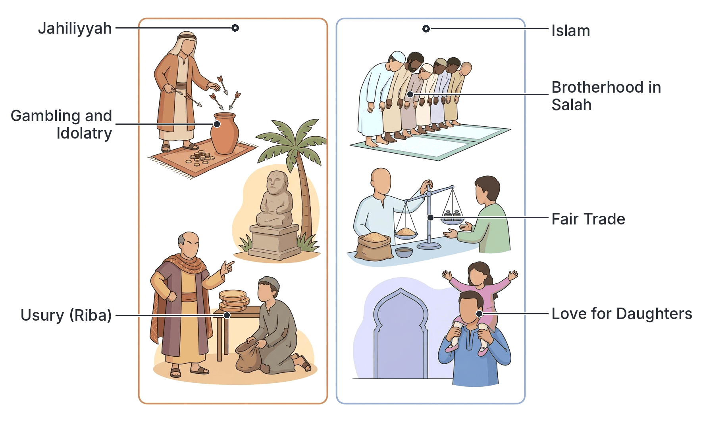

# JAMB Irk Notes: Pre-Islamic Arabia (Jahiliyyah)

## What JAMB expects

This topic is Section C, Topic 15 of the JAMB IRK syllabus: Pre-Islamic Arabia (Jahiliyyah). It covers the period of Arabian history before the mission of Prophet Muhammad (SAW). It has two main content items:

- (i) Jahiliyyah practices: idol worship, infanticide, polyandry, gambling, usury, etc.
- (ii) Islamic reforms

By the end of these notes, you should be able to:

1. distinguish the different types of practices common to the Arabs of al-Jahiliyyah;
2. trace the reforms brought about by Islam to the Jahiliyyah practices.

**Note on the syllabus wording:** The syllabus misspells "infanticide" as "infancticide" in the contents section. These notes use the correct spelling. (Also note that spelling of Arabic terms varies between textbooks, for example: *Zakah* or *Zakat*, *Salah* or *Salat*, *Qur'an* or *Koran*).

## The Age of Jahiliyyah

The word ***Jahiliyyah*** comes from the Arabic root *jahl*, which means "ignorance". In Islamic history, it refers to the **Age of Ignorance**—the period in Arabia before the revelation of the Glorious Qur'an to Prophet Muhammad (SAW) in 610 CE. 

It is important to understand that "ignorance" here does not mean the Arabs were stupid or lacked civilization. In fact, they were highly skilled traders, brave warriors, and master poets whose language was incredibly rich. Rather, *Jahiliyyah* means they were ignorant of divine guidance, the true morality of Prophets, and the pure monotheism (Tawhid) taught by Prophet Ibrahim (Abraham). 

While the Arabs of Jahiliyyah had many noble qualities—such as extreme generosity, courage, and hospitality—their society was dominated by superstitions, injustice, and cruel customs.

## Distinguishing the types of Jahiliyyah practices

**Objective i: distinguish the different types of practices common to the Arabs of al-Jahiliyyah.**

To understand pre-Islamic Arabia, historians distinguish the practices of the time into four main types: **Religious**, **Social**, **Economic**, and **Political**. Understanding these categories helps to see exactly how degraded the society had become and why a comprehensive reform was needed.

| Type of Practice | Characteristics in Jahiliyyah | Specific Examples |
| --- | --- | --- |
| **Religious** | Ignorance of absolute monotheism; assigning partners to Allah (*Shirk*); belief in superstitions, omens, and fortune-tellers. | **Idol worship**, star worship, animism (worshipping trees and stones), consulting divining arrows. |
| **Social** | Moral degradation, severe mistreatment of the weak (especially women and orphans), and a rigid class system favoring the elite. | **Female infanticide**, **polyandry**, inheriting stepmothers, drinking alcohol (*Khamr*), prostitution. |
| **Economic** | Wealth accumulation through exploitation, lack of charity, and cheating the vulnerable. | **Usury (*Riba*)**, **gambling (*Maysir*)**, cheating in weights and measures in the marketplace. |
| **Political** | No central government, no unified law or police force; "might was right". | Extreme and blind tribal loyalty (**Asabiyyah**), endless blood feuds, revenge killings. |

## Specific Jahiliyyah practices

**Content i: Jahiliyyah practices: idol worship, infanticide, polyandry, gambling, usury, etc.**

The syllabus requires you to know the details of the specific practices that plagued pre-Islamic Arabia. 

### 1. Idol worship (Religious)
The Ka'bah in Makkah was originally built by Prophet Ibrahim (Abraham) and his son Isma'il (Ishmael) dedicated to the worship of the One True God. However, over the centuries, the Arabs strayed from this path. It is historically recorded that a chief named Amr bin Luhayy travelled to Syria, saw people worshipping idols, and brought an idol named **Hubal** back to Makkah. 

By the time of the Prophet's (SAW) birth, the Ka'bah was filled with **360 idols**. Every tribe and almost every household had its own idol. The most prominent idols included:
- **Hubal:** The chief idol, made of red agate in the shape of a human, placed inside the Ka'bah.
- **Al-Lat, Al-Uzza, and Manat:** Three highly venerated idols that the pagans wrongly claimed were the "daughters of Allah".

The Arabs actually believed that Allah was the Supreme Creator who provided rain and life, but they worshipped the idols as **intercessors**—believing the idols would carry their prayers to Allah. This practice of associating partners with God is called ***Shirk***.

### 2. Infanticide (Social)
One of the most horrific social practices of Jahiliyyah was female infanticide—the killing of newborn baby girls. This practice was known in Arabic as ***wa'd*** (meaning to bury alive). While not every Arab tribe did this, it was common among certain tribes like the Banu Tamim and Banu Asad. 

There were two main reasons for this cruel practice:
1. **Fear of poverty:** The harsh desert environment meant food was scarce. Many men viewed girls as a financial burden who could not fight or bring in wealth, so they buried them to save resources.
2. **Fear of shame (false pride):** Tribal wars were constant. If a tribe was defeated, their women would be captured and enslaved by the enemy. Fathers buried their daughters alive to avoid the future possibility of this "disgrace" falling upon their family.

### 3. Polyandry and degraded marriage practices (Social)
The status of women in Jahiliyyah was incredibly low; they were generally treated as property rather than human beings. The syllabus specifically names **polyandry**, but it was only one of several degrading marriage customs:
- **Polyandry:** A system where one woman was married to several men at the same time (often between three and ten men). If she gave birth to a child, she would summon all her husbands, point to one of them, and declare him the father. He could not refuse the child.
- **Unlimited Polygyny:** A man could marry an unlimited number of wives. There was no cap, and no requirement to treat them fairly.
- **Inheriting Stepmothers:** When a man died, his eldest son from another wife had the right to inherit his father's widows. The son would throw his cloak over his stepmother, claiming her as his property to either marry without a dowry, or forbid her from marrying anyone else unless she paid him a ransom.
- **Shighar:** An exchange marriage where two men would swap their daughters or sisters in marriage to avoid paying the mandatory bridal gift (*mahr*).

### 4. Gambling and drinking (Economic and Social)
Gambling (known as ***Maysir***) was deeply rooted in the culture and was considered a sign of generosity and pride. The most common form involved slaughtering a camel, dividing its meat into portions, and drawing unfeathered arrows from a bag to decide who won a large share of meat and who lost and had to pay the cost of the entire camel. While the winners often gave the meat away, the practice led to bitter rivalries, bankruptcies, and hatred between families.

Alongside gambling, the drinking of intoxicants (wine, known as ***Khamr***) was widespread. Poetry from the era is filled with praises of wine, and it was a staple of all social gatherings, leading to drunkenness, loss of wealth, and violent fights.

### 5. Usury (Economic)
The economy of Makkah was driven by trade. The wealthy elite who controlled the trade caravans exploited the poor through the practice of usury, known as ***Riba***. 

When a person borrowed money, they were charged an exorbitant interest rate. If the debtor could not pay on the agreed date, the lender would say, "Will you pay, or will you increase the debt?" The principal amount would double, and then triple, growing so large that the borrower could never repay it. Frequently, debtors were forced to sell their property, their children, or even themselves into slavery to settle their *Riba* debts.

### 6. Extreme Tribalism (Political)
While not named in the syllabus list, the "etc." includes the political reality of Jahiliyyah: ***Asabiyyah*** (blind tribal loyalty). There was no central government. A man's only protection was his tribe. The rule was, "Help your brother whether he is the oppressor or the oppressed," meaning you had to fight for your tribe even if you knew your tribe was wrong. This led to endless, bloody revenge cycles. For example, the famous Basus War started over the killing of a camel and lasted for 40 years.

## The Islamic reforms

**Content ii: Islamic reforms**

Islam did not merely modify the Jahiliyyah society; it completely revolutionized it. Over a period of 23 years (first in Makkah, then in Madinah), Prophet Muhammad (SAW) brought moral, legal, and spiritual reforms that replaced darkness with light.

### Tracing the reforms brought about by Islam

**Objective ii: trace the reforms brought about by Islam to the Jahiliyyah practices.**

Islam eradicated the ignorant practices through divine revelation (the Qur'an) and the teachings of the Prophet (the Sunnah). Below is a step-by-step tracing of how each Jahiliyyah practice was reformed.

#### 1. Reforming Idol Worship: The Establishment of Tawhid
Islam aggressively rejected idolatry. The core message of Islam is **Tawhid** (the absolute oneness of Allah). The Qur'an declared that idols have no power to create, harm, or benefit anyone. 

* **The trace of reform:** For 13 years in Makkah, the Prophet (SAW) peacefully preached Tawhid, enduring persecution. Later, in the 8th year of Hijrah, when the Prophet returned to Makkah victorious, he went directly to the Ka'bah. He physically struck down the 360 idols with his staff, reciting: 
  > *"Truth hath come and falsehood hath vanished away. Lo! falsehood is ever bound to vanish."* (Pickthall's translation, Q.17:81)
  The Ka'bah was permanently cleansed of *Shirk*, and pure monotheism was restored.

#### 2. Reforming Infanticide: The Protection of Life and Women's Honor
Islam strictly outlawed the killing of children and elevated the status of daughters from a source of shame to a path to Paradise. 

* **The trace of reform:** The Qur'an directly addressed and condemned both reasons for infanticide (poverty and shame). Regarding poverty, Allah revealed:
  > *"Slay not your children, fearing a fall to poverty, We shall provide for them and for you. Lo! the slaying of them is great sin."* (Pickthall's translation, Q.17:31)
  Regarding the Day of Judgement, the Qur'an paints a terrifying picture for the perpetrators:
  > *"And when the girl-child that was buried alive is asked, For what sin she was slain,"* (Pickthall's translation, Q.81:8-9)
  The Prophet (SAW) reformed the social mindset by stating that anyone who raises daughters with love and education will be as close to him in Paradise as his two fingers.

#### 3. Reforming Polyandry and Marriage: Establishing Family Sanctity
Islam systematically dismantled all the degrading marriage customs and established the legal and spiritual rights of women.

* **The trace of reform:** 
  - **Polyandry abolished:** Islam strictly forbade polyandry. A woman can only be married to one man at a time, ensuring clear paternity and family stability.
  - **Polygyny restricted:** Unlimited wives were banned. Islam restricted a man to a maximum of four wives, and placed a severe condition on it: strict justice and equal treatment. 
    > *"... marry of the women, who seem good to you, two or three or four; and if ye fear that ye cannot do justice (to so many) then one (only)..."* (Pickthall's translation, Q.4:3)
  - **Inheriting women banned:** The Qur'an explicitly outlawed the Jahiliyyah practice of inheriting stepmothers: *"O ye who believe! It is not lawful for you forcibly to inherit the women..."* (Q.4:19) and *"And marry not those women whom your fathers married..."* (Q.4:22).
  - Women were granted the right to accept or reject proposals, the right to keep their own *mahr* (dowry), and the right to inherit property.

#### 4. Reforming Gambling and Drinking: Purifying Morals
Because gambling and alcohol were so deeply loved by the Arabs, Islam reformed them gradually, eventually banning them entirely.

* **The trace of reform:** The final prohibition came in Madinah, where both gambling (*Maysir*) and intoxicants (*Khamr*) were declared completely Haram (forbidden). The Qur'an identified them as tools used by Satan to destroy society:
  > *"O ye who believe! Strong drink and games of chance and idols and divining arrows are only an infamy of Satan's handiwork. Leave it aside in order that ye may succeed."* (Pickthall's translation, Q.5:90)

#### 5. Reforming Usury (Riba): Creating Economic Justice
Islam viewed the exploitation of the poor by the rich as a severe crime.

* **The trace of reform:** The Qur'an totally forbade *Riba*. 
  > *"... Allah permitteth trading and forbiddeth usury..."* (Pickthall's translation, Q.2:275)
  To replace the exploitative system, Islam instituted **Zakah** (obligatory charity to the poor), encouraged **Sadaqah** (voluntary charity), and promoted fair, honest trade and interest-free loans (*Qard Hasan*).

#### 6. Reforming Tribalism: The Universal Ummah
Islam destroyed the concept of blind tribal loyalty (*Asabiyyah*).

* **The trace of reform:** The Prophet (SAW) declared that whoever fights or dies for *Asabiyyah* is not of the Muslims. Islam replaced the tribe with the **Ummah** (the universal brotherhood of believers). The new rule of justice was established: all humans are equal like the teeth of a comb. During his Farewell Pilgrimage, the Prophet famously declared that an Arab has no superiority over a non-Arab, nor a white person over a black person, except by piety (*Taqwa*).

### Summary Table: Tracing the Islamic Reforms

| Pre-Islamic Jahiliyyah Practice | The Islamic Reform |
| --- | --- |
| **Idol Worship (*Shirk*)**: 360 idols in the Ka'bah; Hubal as chief idol. | **Tawhid**: Absolute monotheism; idols physically destroyed during the Conquest of Makkah. |
| **Infanticide (*Wa'd*)**: Burying daughters alive due to fear of poverty or shame. | **Protected Life**: Banned entirely as a grave sin; daughters elevated as a blessing and a path to Paradise. |
| **Polyandry**: One woman sharing multiple husbands; ambiguous paternity. | **Abolished**: Monogamy encouraged; polyandry strictly forbidden; paternity secured. |
| **Unlimited Polygyny**: Marrying endless wives with no responsibility. | **Restricted**: Limited to a maximum of four wives, under the strict condition of justice and equal treatment. |
| **Usury (*Riba*)**: Exploitative loans that doubled and enslaved debtors. | **Outlawed**: Completely forbidden; replaced with fair trade, Zakah, and interest-free charity loans. |
| **Gambling (*Maysir*)**: Using arrows for stakes; caused hatred and ruin. | **Prohibited**: Banned as an abomination and "Satan's handiwork" alongside intoxicants. |
| **Tribalism (*Asabiyyah*)**: Blind loyalty; endless blood feuds. | **Brotherhood (*Ummah*)**: Universal equality based on piety (*Taqwa*); establishment of legal justice and rule of law. |

## Key terms

| Term | Meaning |
| --- | --- |
| **Jahiliyyah** | The "Age of Ignorance"; the period in Arabia before the revelation of the Qur'an. |
| **Tawhid** | The Islamic concept of the absolute Oneness of Allah. |
| **Shirk** | Associating partners with Allah; polytheism or idol worship. |
| **Wa'd** | The pre-Islamic practice of female infanticide (burying baby girls alive). |
| **Maysir** | Gambling, which was heavily practiced in Jahiliyyah and forbidden by Islam. |
| **Khamr** | Intoxicants/wine, consumed heavily before Islam, later prohibited. |
| **Riba** | Usury or exploitative interest on loans, strictly forbidden in Islam. |
| **Asabiyyah** | Blind tribal loyalty; supporting your tribe right or wrong. |
| **Ummah** | The global community or brotherhood of Muslims. |
| **Hubal** | The name of the chief idol worshipped by the Makkans inside the Ka'bah. |

## Exam tips and common mistakes

- **Understand the definition:** *Jahiliyyah* does not mean the Arabs were intellectually stupid; it means they were ignorant of divine law and true morality.
- **Categorize correctly:** Be able to identify which practice is social (e.g., infanticide, polyandry), which is economic (usury, gambling), and which is political (tribalism).
- **Know the vocabulary:** JAMB frequently tests Arabic terms. Memorize *Wa'd* (infanticide), *Riba* (usury), *Maysir* (gambling), and *Asabiyyah* (tribalism).
- **Polyandry vs Polygyny:** Do not confuse them. *Polyandry* (one woman, multiple husbands) was a Jahiliyyah practice totally abolished by Islam. *Polygyny* (one man, multiple wives) was restricted to four by Islam.
- **Remember the motives:** Infanticide was driven by fear of poverty and fear of tribal disgrace.
- **Trace the reform:** Understand that Islam provided alternatives, not just bans. Usury was banned, but fair trade and Zakah were encouraged. Tribalism was banned, but universal brotherhood (Ummah) replaced it.

## Quick summary

1. *Jahiliyyah* refers to the pre-Islamic period of ignorance in Arabia, characterized by moral, social, and spiritual darkness.
2. The religious practices of the time centered around *Shirk* (polytheism), with 360 idols housed in the Ka'bah, the chief of which was Hubal.
3. Socially, the society was deeply unjust. Women had no rights, and female infanticide (*wa'd*) was practiced out of fear of poverty and shame. 
4. Degrading marriage systems like polyandry and inheriting stepmothers were common.
5. Economically, the rich exploited the poor through *Riba* (usury), and society suffered from the ills of *Maysir* (gambling) and drinking.
6. Politically, Arabia was divided by *Asabiyyah* (blind tribal loyalty), leading to endless violent blood feuds.
7. Islam comprehensively reformed these practices: it replaced idolatry with pure Tawhid, abolished infanticide, protected women's rights, outlawed gambling and usury, and united the warring tribes into a single brotherhood (Ummah).

## Practice questions

**1. The term *Jahiliyyah* in pre-Islamic Arabian history refers to the period of:**

- A. great scientific and cultural discoveries in Makkah
- B. ignorance of divine guidance before the advent of Islam
- C. the early Islamic conquests in the Middle East
- D. the revelation of the Glorious Qur'an in Madinah

**Answer: B.** *Jahiliyyah* means the "Age of Ignorance". It refers to the time before Prophet Muhammad (SAW), characterized by ignorance of true monotheism and divine morality.

**2. Historians distinguish Jahiliyyah practices into different types. Which of the following was a strictly social practice?**

- A. Worshipping the idol Hubal
- B. Charging exorbitant interest on loans
- C. Female infanticide
- D. Engaging in international trade

**Answer: C.** Female infanticide is classified as a social practice, as it deals with family, morality, and the treatment of human beings in society.

**3. In pre-Islamic Arabia, the practice of burying newborn daughters alive was primarily driven by:**

- A. religious rituals demanded by the priests of the Ka'bah
- B. fear of poverty and the shame of female captives in war
- C. massive overpopulation in the city of Makkah
- D. a widespread disease that affected only female infants

**Answer: B.** The Qur'an specifically identifies the fear of poverty as a reason, and historically, tribes feared the disgrace of their women being captured by enemies.

**4. Which of the following best describes the pre-Islamic practice of polyandry?**

- A. A man marrying an unlimited number of wives
- B. A woman being married to several men at the same time
- C. The inheriting of a stepmother by her stepson
- D. Exchanging daughters in marriage without a dowry

**Answer: B.** Polyandry is the practice where one woman has multiple husbands simultaneously. Islam completely abolished this practice.

**5. The pre-Islamic economic system where a lender doubled the debt if the borrower could not pay on time is known as:**

- A. Zakah
- B. Sadaqah
- C. Riba
- D. Qard Hasan

**Answer: C.** *Riba* (usury) was an exploitative economic practice in Jahiliyyah that enslaved many debtors. It was strictly forbidden by Islam.

**6. The chief idol worshipped by the Makkans and placed inside the Ka'bah during the Jahiliyyah period was named:**

- A. Al-Lat
- B. Al-Uzza
- C. Manat
- D. Hubal

**Answer: D.** While all four were major idols, Hubal was considered the chief idol and was placed prominently inside the Ka'bah.

**7. How did Islam reform the political practice of blind tribal loyalty (*Asabiyyah*)?**

- A. By establishing a royal family to rule all of Arabia
- B. By replacing it with the concept of the *Ummah* (universal brotherhood)
- C. By forcing all Arabs to speak the same dialect
- D. By limiting tribal warfare to certain months only

**Answer: B.** Islam abolished tribalism and stated that all believers are brothers forming one *Ummah*, and that superiority is based only on piety (*Taqwa*).

**8. In reforming Jahiliyyah marriage customs, Islam restricted the practice of polygyny to a maximum of:**

- A. two wives
- B. three wives
- C. four wives, provided strict justice is maintained
- D. an unlimited number, provided the man is wealthy

**Answer: C.** The Qur'an (Q.4:3) limits a man to a maximum of four wives, with the strict condition that he must treat them equally and justly.

**9. Gambling (*Maysir*) and the drinking of alcohol (*Khamr*) were banned by Islam because:**

- A. they were seen as an infamy of Satan's handiwork that causes enmity
- B. the Arabs were losing too much wealth to foreign traders
- C. they were only permitted during the month of Ramadan
- D. the early Muslims were too poor to afford them

**Answer: A.** The Qur'an (Q.5:90) describes them as the handiwork of Satan, meant to sow hatred and turn people away from the remembrance of Allah.

**10. Which of the following summarizes the Islamic reform regarding the Jahiliyyah practice of inheriting stepmothers?**

- A. Islam allowed it only if the stepmother agreed
- B. Islam strictly forbade it and gave women their own legal rights
- C. Islam required the stepson to pay a double dowry
- D. Islam permitted it only for the tribal chiefs

**Answer: B.** Islam completely outlawed the practice of forcibly inheriting women (Q.4:19 and 4:22), restoring dignity and independent legal status to them.

<!-- COVERAGE
obj i | Distinguishing the types of Jahiliyyah practices
obj ii | Tracing the Islamic reforms
item i | Specific Jahiliyyah practices
item ii | The Islamic reforms
-->
