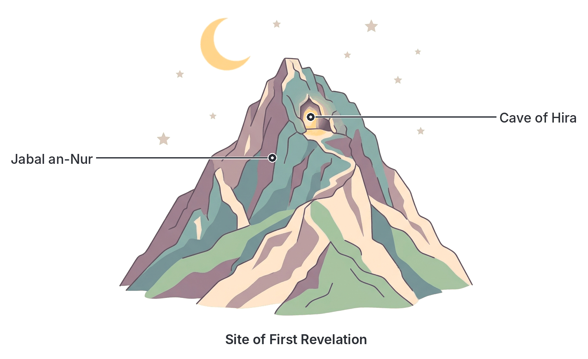
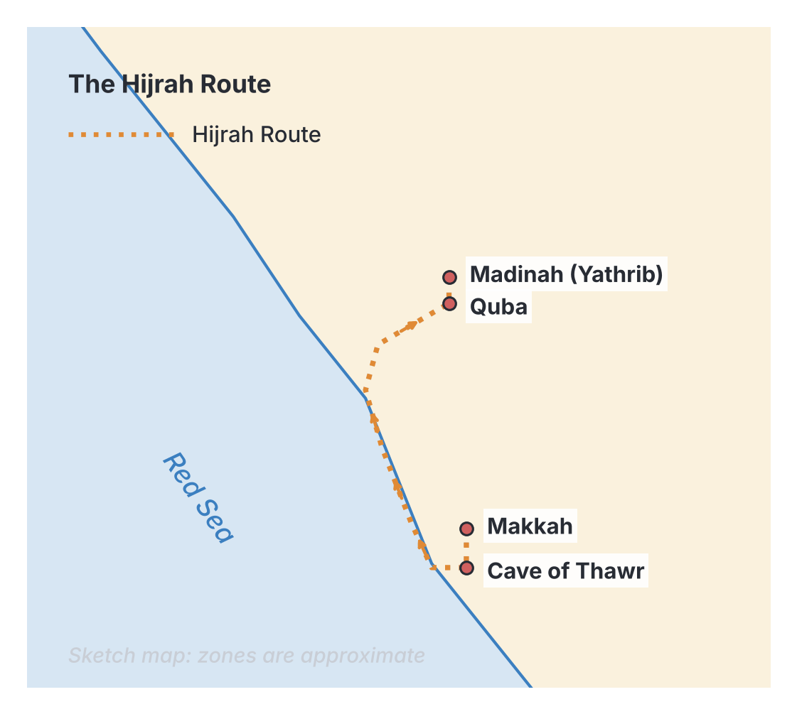

# JAMB Irk Notes: The Life of Prophet Muhammad (SAW)

## What JAMB expects

This topic covers Section C, Topic 16 of the JAMB syllabus: The Life of Prophet Muhammad (SAW). It includes the following content items:

* (i) His birth and early life
* (ii) His call to Prophethood
* (iii) His Da'wah in Makkah and Madinah
* (iv) The Hjrah
* (v) His administration of the Ummah in Madinah
* (vi) The battles of Badr, Uhud and Khandaq: causes and effects
* (vii) The Treaty of al-Hudaibiyyah and the conquest of Makkah
* (viii) Hijjatul-wada (the farewell pilgrimage) sermon, and lessons.
* (ix) Qualities of Muhammad (SAW) and lessons learnt from them

By the end of these notes, you should be able to:

1. Account for the birth and early life of the Prophet Muhammad (SAW).
2. Provide evidence for the call of Muhammad (SAW) to Prophethood.
3. Analyse the Da'wah activities of the Prophet Muhammad (SAW) in Makkah and Madinah.
4. Account for the Hijrah of the Prophet Muhammad (SAW).
5. Analyse the administration of the Muslim Ummah in Madinah.
6. Account for the causes and effects of the battles of Badr, Uhud and Khandaq.
7. Trace the circumstances leading to the formulation of the Treaty of Hudaibiyyah.
8. Account for the Conquest of Makkah.
9. Examine the farewell pilgrimage of the Prophet and its lessons.
10. Analyse the qualities of Muhammad (SAW) and their relevance to the life of a Muslim.

**Note on the syllabus wording:** The syllabus contains a few typing errors. It spells Hijrah as "Hjrah", and the Farewell Pilgrimage as "Hijjatul-wada" (usually written as Hajjat al-Wada'). In objective 3, it asks you to analyse Da'wah activities "to Madinah", while the content item correctly lists "in Makkah and Madinah"; these notes cover both phases thoroughly. Finally, the numbering of the objectives in the syllabus restarts at (i) multiple times; the list above standardises the numbering from 1 to 10 for clarity.

## His birth and early life

Prophet Muhammad (SAW) was born in Makkah (Mecca) into the noble Banu Hashim clan of the Quraysh tribe. 

**Birth:** He was born on Monday, the 12th of Rabi' al-Awwal. This year is known as the **Year of the Elephant** ('Am al-Fil), which corresponds to approximately 570 CE. It was named the Year of the Elephant because it was the year Abraha, a Christian ruler from Yemen, marched on Makkah with an army of elephants to destroy the Ka'bah, but his army was miraculously destroyed.

**Family:**
* **Father:** 'Abdullah, who died on a trading journey before Muhammad (SAW) was born.
* **Mother:** Aminah bint Wahb.
* **Grandfather:** 'Abdul Muttalib, the respected leader of the Quraysh, who named him **Muhammad** (meaning "The Praised One").

**Childhood:**
Following Arab custom, the infant was sent to the desert to be nursed by a Bedouin foster mother, **Halimah as-Sa'diyyah**. He stayed with her tribe (Banu Sa'd) for about four years, growing up strong and speaking pure Arabic. During this time, Islamic tradition records the event of his chest being opened and his heart purified by angels.
At age six, his mother Aminah died at a place called Abwa while returning from a visit to Madinah. His grandfather 'Abdul Muttalib took custody of him but died two years later. The eight-year-old Muhammad (SAW) was then taken in by his loving uncle, **Abu Talib**, who protected him for decades.

**Youth:**
* **Journey to Syria:** At age 12, he accompanied Abu Talib on a trade journey to Syria. A Christian monk named **Bahira** noticed signs of prophethood on him (such as a cloud shading him and the physical "Seal of Prophethood" between his shoulders) and advised Abu Talib to protect him from enemies.
* **Harb al-Fijar (The Sacrilegious War):** In his teens, he witnessed this war, helping his uncles by gathering stray arrows.
* **Hilf al-Fudul (Alliance of Virtue):** He participated in this noble pact among the Makkans to protect the oppressed, ensure justice, and defend the rights of strangers in Makkah. He was very proud of this pact later in life.

**Adulthood and Marriage:**
Muhammad (SAW) never worshipped idols and avoided the immoral practices of the Jahiliyyah (pre-Islamic) society. He worked as a shepherd and later as a merchant, earning the titles **Al-Amin** (The Trustworthy) and **As-Sadiq** (The Truthful).
A wealthy widow named **Khadijah bint Khuwaylid** hired him to lead her trade caravan to Syria. Impressed by his massive success and his honest character (reported by her servant Maysarah), she proposed marriage. They married when he was 25 and she was 40.

At age 35, he prevented a tribal war in Makkah during the rebuilding of the Ka'bah. The clan chiefs argued over who would place the sacred Black Stone (Hajar al-Aswad) back in its corner. Muhammad (SAW) placed the stone on a cloak, asked each chief to hold a corner and lift it together, and then he personally pushed the stone into place.

## His call to Prophethood

As Muhammad (SAW) approached the age of 40, he began to retreat to the **Cave of Hira** (Ghar Hira) in Jabal an-Nur (The Mountain of Light) near Makkah. He would spend days there in deep meditation, seeking truth and avoiding the idol worship of his people.

**The First Revelation:**
In the month of Ramadan, when he was 40 years old (around 610 CE), the **Angel Jibril** (Gabriel) appeared to him in the cave and commanded him: "Iqra!" (Read!).
Muhammad (SAW), who was unlettered (Ummi) and could not read or write, replied, "I cannot read." The angel squeezed him tightly and repeated the command. On the third time, the angel revealed the first five verses of the Qur'an:

> "Read: In the name of thy Lord Who createth,
> Createth man from a clot.
> Read: And thy Lord is the Most Bounteous,
> Who teacheth by the pen,
> Teacheth man that which he knew not."
> *(Surah al-'Alaq, Q.96:1-5, Pickthall's translation)*

**Evidence of the Call to Prophethood:**
Several pieces of evidence confirmed his prophethood:
1. **The inability to read:** Muhammad (SAW) could not read or write, yet he suddenly began reciting the Qur'an, a text of unmatched linguistic brilliance and deep knowledge.
2. **Khadijah's absolute belief:** Terrified and shaking, he rushed home to Khadijah, asking her to cover him. She immediately comforted him and believed in him, saying Allah would never disgrace a man who was so kind to family, truthful, and helpful to the poor.
3. **Confirmation by Waraqah bin Nawfal:** Khadijah took him to her cousin, Waraqah bin Nawfal, an old, blind Christian scholar who knew the Torah and Gospel. Waraqah confirmed that the being who visited Muhammad (SAW) was the same Angel (the Namus) that Allah had sent to Prophet Musa (Moses), confirming his status as a Prophet. 

## His Da'wah in Makkah and Madinah

Da'wah means inviting people to Islam. The Prophet's Da'wah spanned 23 years and is divided into two distinct phases.

### The Makkan Phase (13 Years)
This phase focused on Tawhid (the Oneness of Allah), rejecting idol worship, and the Day of Judgement.
* **Secret Da'wah (3 years):** The Prophet (SAW) first preached privately to his family and close friends. The first to accept Islam were Khadijah (his wife), 'Ali bin Abi Talib (his young cousin), Zayd bin Harithah (his freed slave), and Abu Bakr (his close friend).
* **Open Da'wah:** After the revelation of Q.26:214, *"And warn thy tribe of near kindred"*, he stood on Mount Safa and publicly called the Quraysh to Islam. His uncle Abu Lahab fiercely rejected and cursed him.
* **Persecution:** The Quraysh responded with violence. While they could not kill the Prophet due to Abu Talib's protection, they tortured vulnerable Muslims. Bilal bin Rabah was pinned under a heavy rock in the desert sun; the family of Yasir was tortured, and Sumayyah became the first martyr in Islam.
* **Migration to Abyssinia:** To escape torture, the Prophet advised a group of Muslims to migrate to Abyssinia (modern Ethiopia), ruled by a just Christian king, the Negus (Najashi), who gave them protection.
* **The Boycott:** The Quraysh forced the Prophet's clan (Banu Hashim) into a harsh economic and social boycott in a valley (Shi'b Abi Talib) for three years. They starved, eating leaves to survive.
* **The Year of Sorrow ('Am al-Huzn):** In the 10th year of Prophethood, both his beloved wife Khadijah and his protective uncle Abu Talib died. 
* **Journey to Ta'if:** Seeking a new base, he went to the nearby city of Ta'if. The leaders rejected him and had children pelt him with stones until he bled. Despite this, he refused to ask angels to destroy the city, praying instead for their guidance.
* **Al-Isra wal-Mi'raj:** He experienced the miraculous Night Journey from Makkah to Jerusalem, and ascension through the heavens, during which the five daily prayers (Salah) were enjoined.
* **Da'wah to Madinah (Pledges of 'Aqabah):** During the Hajj season, he preached to pilgrims from Yathrib (later called Madinah). Impressed, they accepted Islam. In the First and Second Pledges of 'Aqabah, they swore allegiance to him and promised to protect him if he moved to their city. 

### The Madinan Phase (10 Years)
After the Hijrah, the Da'wah entered a new phase, focusing on laws, community building, and defending the faith. 
* **A Base for Islam:** Islam could now be preached openly and safely. The mosque became the centre of learning.
* **Sending Envoys:** In 6 AH, the Prophet (SAW) sent letters to neighboring kings and emperors (such as Heraclius of Rome, Chosroes of Persia, and the Muqawqis of Egypt) inviting them to Islam.
* **Delegations:** In the later years, especially the "Year of Delegations" (9 AH), tribes from all over Arabia travelled to Madinah to accept Islam and learn from the Prophet.

## The Hijrah

The **Hijrah** is the historic migration of Prophet Muhammad (SAW) and the early Muslims from Makkah to Yathrib (which was renamed Madinat an-Nabi, the City of the Prophet, or simply Madinah). It took place in 622 CE.

**Causes of the Hijrah:**
1. **Severe Persecution:** The Quraysh made life unbearable for Muslims in Makkah.
2. **The Invitation from Yathrib:** The tribes of Yathrib (Aws and Khazraj) had accepted Islam at the Pledges of 'Aqabah and invited the Prophet to be their leader and settle their disputes.
3. **The Assassination Plot (Dar an-Nadwah):** The Quraysh, panicked that the Prophet was gaining a stronghold outside Makkah, plotted to assassinate him. They selected one youth from every clan to strike him simultaneously so that his clan could not seek revenge against a single tribe.

**The Journey:**
Allah informed the Prophet (SAW) of the plot. He asked his cousin 'Ali to sleep in his bed to return items the Makkans had given him in trust (proving he was still the Al-Amin even to his enemies).
The Prophet and Abu Bakr left secretly and hid in the **Cave of Thawr** for three days. A Quraysh search party reached the very mouth of the cave, but Allah protected them (tradition states a spider spun a web and a dove laid eggs over the entrance, convincing the trackers the cave was empty). 
They took a coastal, less-travelled route. They stopped at Quba, just outside Madinah, where they built the first mosque in Islam (Masjid Quba). They finally entered Madinah to a joyous welcome by the Muslims.

**Effects and Significance of the Hijrah:**
1. It marked the creation of the first independent Islamic state.
2. Muslims transitioned from a persecuted minority to a free, organised community.
3. It was so significant that the second Caliph, 'Umar, made it the starting point of the Islamic calendar (the Hijri calendar).

## His administration of the Ummah in Madinah

Upon arriving in Madinah, the Prophet (SAW) proved to be a brilliant statesman, establishing a peaceful, structured society (the Ummah).

1. **Building the Mosque:** The first act in Madinah was building Masjid an-Nabawi. It was a place of worship, a school, a parliament, and a welfare center.
2. **The Brotherhood (Mu'akhah):** He paired every Muslim emigrant from Makkah (the **Muhajirun**) with a Muslim native of Madinah (the **Ansar**). The Ansar shared their homes, land, and wealth equally with their new brothers, creating unprecedented social unity and solving the refugee crisis instantly.
3. **The Constitution of Madinah (Sahifat al-Madinah):** The Prophet drafted a written charter bringing together the Muslims, the local Jewish tribes, and the remaining polytheists. 
   - It declared them all as one political community (Ummah).
   - It guaranteed freedom of religion for all groups.
   - It required all parties to defend Madinah jointly against outside attacks.
   - It established the Prophet Muhammad (SAW) as the ultimate judge for disputes, replacing the old tribal system of blood revenge with the rule of law.
4. **Social and Economic Reforms:** Over time in Madinah, the rules of Zakah (charity) were formalised to care for the poor. Harmful economic practices, especially Riba (usury/interest), were banned to stop the exploitation of the weak. 
5. **Defence:** The Prophet (SAW) organised a disciplined military structure to defend the newly formed state from Quraysh attacks.

## The battles of Badr, Uhud and Khandaq

The Quraysh in Makkah did not leave the Muslims in peace; they sought to destroy Madinah. The Muslims had to fight several defensive battles.

| Battle & Year | Causes | Forces | Key Events | Effects |
| --- | --- | --- | --- | --- |
| **Badr**   (2 AH / 624 CE) | Muslims moved to intercept a Quraysh trade caravan led by Abu Sufyan. In response, a Quraysh army led by Abu Jahl marched to crush the Muslims completely. | **Muslims:** ~313   **Quraysh:** 1,000 | The Muslims won the opening individual duels. The Qur'an states angels assisted the Muslims. Abu Jahl, the fiercest enemy of Islam, was killed. | A decisive and miraculous Muslim victory. It severely weakened the Quraysh, boosted Muslim morale, and established Madinah as a major power. Prisoners were treated kindly, and some were freed for teaching Muslims to read. |
| **Uhud**   (3 AH / 625 CE) | The Quraysh, heavily armed and seeking revenge for their humiliating defeat at Badr, marched on Madinah. | **Muslims:** 700   **Quraysh:** 3,000 | The Muslims were initially winning. However, 50 archers placed on Mount 'Aynayn disobeyed the Prophet's strict orders and left their posts to collect war booty. The Quraysh cavalry, led by Khalid bin Walid, attacked from the exposed rear. The Prophet's uncle Hamzah was killed, and the Prophet himself was injured. | A military defeat for the Muslims. It taught a harsh but vital lesson: disobedience to the Prophet's command and greed for worldly wealth lead to disaster. |
| **Khandaq (The Trench)**   (5 AH / 627 CE) | Also called the Battle of Ahzab (Confederates). Exiled Jewish tribes incited the Quraysh and other Arab tribes to form a massive alliance to wipe out Islam entirely. | **Muslims:** 3,000   **Enemies:** 10,000 | A Persian companion, Salman al-Farsi, suggested a new tactic: digging a deep defensive trench (Khandaq) around the exposed northern side of Madinah. The enemy could not cross it and laid siege for nearly a month. Eventually, freezing winds and internal distrust broke the enemy alliance. | A massive psychological and strategic victory for the Muslims with very little actual fighting. The Quraysh lost their prestige and never attacked Madinah again. The Banu Qurayzah, a Jewish tribe inside Madinah that committed treason by aiding the enemy during the siege, was punished. |

## The Treaty of al-Hudaibiyyah and the conquest of Makkah

### Circumstances of the Treaty of Hudaibiyyah
In 6 AH (628 CE), the Prophet (SAW) saw a dream that he was performing 'Umrah (the lesser pilgrimage) in Makkah. He set out with about 1,400 Muslims. They wore pilgrim clothes (Ihram) and carried only sheathed swords for travel, showing they came in peace. 

The Quraysh blocked them from entering Makkah at a place called Hudaibiyyah. The Prophet sent 'Uthman bin 'Affan to Makkah to negotiate, but a rumour spread that 'Uthman had been murdered. The Prophet took a solemn oath from the Muslims under a tree (known as the Pledge of the Tree, or Bay'at ar-Ridwan) to fight to the death if the rumour was true. 
When it turned out 'Uthman was safe, the Quraysh sent an envoy, Suhayl bin 'Amr, to sign a peace treaty with the Prophet.

**The terms of the Treaty of Hudaibiyyah:**
1. A 10-year truce between the Muslims and the Quraysh.
2. The Muslims must return to Madinah that year without performing 'Umrah, but could return the next year for three days.
3. Any Makkan who fled to Madinah without permission must be returned to Makkah, but any Muslim who fled to Makkah would not be returned.
4. Arab tribes were free to ally themselves with either the Muslims or the Quraysh.

Many Muslims, including 'Umar, were initially upset, thinking the terms were humiliating. However, Allah revealed Surah al-Fath (Q.48:1), calling it a "manifest victory". The peace allowed Islam to spread rapidly across Arabia without the threat of war, and it forced the Quraysh to recognise the Islamic state as an equal political entity.

### Account of the Conquest of Makkah
In 8 AH (630 CE), an ally tribe of the Quraysh (Banu Bakr) attacked an ally tribe of the Muslims (Banu Khuza'ah), thereby breaking the 10-year treaty of Hudaibiyyah.

In response, the Prophet (SAW) gathered an army of 10,000 men and marched on Makkah in secret. The Quraysh leader, Abu Sufyan, was captured while scouting the Muslim camp. Witnessing the massive power of the Muslims, he accepted Islam, and the Prophet granted him protection.

The Muslim army entered Makkah peacefully, with almost no bloodshed. After 20 years of severe hostility and warfare from the Makkans, the Prophet (SAW) had absolute power over them. The Makkans gathered at the Ka'bah, expecting execution or slavery. Instead, the Prophet declared a **General Amnesty**, saying:
*"No blame is on you today. Go, you are free."*

He then entered the Ka'bah and destroyed the 360 idols inside and around it, reciting:
> "Truth has come and falsehood has vanished away. Lo! falsehood is ever bound to vanish." *(Surah al-Isra', Q.17:81)*

The Conquest of Makkah is the crowning achievement of the Prophet's mission, establishing Islam as the dominant religion in the Arabian Peninsula.

## The farewell pilgrimage and its lessons

In 10 AH (632 CE), the Prophet (SAW) performed his first and only Hajj, known as the Farewell Pilgrimage (Hajjat al-Wada'). Over 100,000 Muslims joined him. 

On the 9th of Dhul-Hijjah, he delivered his historic Farewell Sermon (Khutbat al-Wada') on Mount 'Arafat (Jabal ar-Rahmah). It serves as a universal charter of human rights. 

**Key points and lessons from the sermon:**
1. **Sanctity of life and property:** He declared that the lives and property of Muslims are sacred and forbidden to be violated.
2. **End of Jahiliyyah practices:** He abolished all pagan traditions, specifically blood revenge (forgiving the blood of his own cousin) and all Riba (usury/interest), starting with the interest owed to his uncle 'Abbas.
3. **Women's Rights:** He urged men to treat women well: *"Fear Allah concerning women... You have rights over your women and your women have rights over you."*
4. **Racial Equality:** He destroyed racism by declaring: *"An Arab has no superiority over a non-Arab, nor a non-Arab over an Arab, and a white has no superiority over a black, nor a black over a white, except by piety and good action (Taqwa)."*
5. **Islamic Brotherhood:** He reminded them that every Muslim is a brother to every other Muslim.
6. **The Legacy:** He told the people he was leaving behind two things that would keep them from going astray: the Book of Allah (the Qur'an) and his Sunnah.

During this Hajj, Allah revealed the verse completing the religion:
> "This day have I perfected your religion for you and completed My favour unto you, and have chosen for you as religion al-Islam." *(Surah al-Ma'idah, Q.5:3)*
A few months after returning to Madinah, the Prophet (SAW) passed away at the age of 63.

## Qualities of Muhammad (SAW) and their relevance

The Qur'an states that the Prophet is an "excellent role model" (Uswah Hasanah). His qualities are meant to be copied by all Muslims.

1. **Honesty and Trustworthiness (Al-Amin) and Truthfulness (As-Sadiq):** 
   Even his worst enemies trusted him with their valuables. **Relevance:** A Muslim must not cheat in exams, business, or politics. Nigerian Muslims are expected to be transparent leaders and reliable workers, avoiding corruption.
2. **Forgiveness and Mercy:** 
   He forgave the people of Ta'if who stoned him, and the Makkans who tortured him for years. **Relevance:** Muslims should not hold grudges. It teaches peaceful coexistence and conflict resolution in society.
3. **Justice and Fairness:** 
   He ruled the Ummah fairly, regardless of tribe or religion (as seen in the Constitution of Madinah). **Relevance:** In a diverse country like Nigeria, justice means treating all ethnic and religious groups fairly, without tribalism or favouritism.
4. **Patience and Perseverance (Sabr):** 
   He endured the boycott, the loss of his loved ones, and constant abuse in Makkah without giving up. **Relevance:** Muslims must remain steadfast and keep working hard during personal trials or national economic hardships.
5. **Humility and Simple Living:** 
   Despite being the ruler of Arabia, he slept on a rough mat, mended his own shoes, and helped his wives with house chores. **Relevance:** Leaders and wealthy individuals should avoid arrogance, extravagance, and showing off.

## Key terms

| Term | Meaning |
| --- | --- |
| **Year of the Elephant** | The year Prophet Muhammad (SAW) was born, named after Abraha's failed attack on Makkah with elephants |
| **Al-Amin & As-Sadiq** | "The Trustworthy" and "The Truthful" – titles given to the Prophet before Islam |
| **Ummi** | Unlettered (unable to read or write) |
| **Da'wah** | Inviting or calling people to Islam |
| **Hijrah** | The migration of the Prophet and his followers from Makkah to Madinah in 622 CE |
| **Muhajirun** | The Emigrants (Muslims who migrated from Makkah) |
| **Ansar** | The Helpers (Muslim natives of Madinah who sheltered the Muhajirun) |
| **Constitution of Madinah** | The treaty that united Muslims, Jews, and pagans in Madinah into one political Ummah |
| **Ummah** | The community of believers / the Islamic state |
| **Hajjat al-Wada'** | The Farewell Pilgrimage (the Prophet's final Hajj in 10 AH) |

## Exam tips and common mistakes

* **Dates are important:** Know that the first revelation was at age 40. Badr was 2 AH, Uhud was 3 AH, Khandaq was 5 AH, Hudaibiyyah was 6 AH, Conquest of Makkah was 8 AH, and the Farewell Hajj was 10 AH.
* **Do not confuse the Pledges of 'Aqabah with the Treaty of Hudaibiyyah:** 'Aqabah involved the people of Yathrib before the Hijrah; Hudaibiyyah was a peace treaty with the Quraysh of Makkah in 6 AH.
* **Do not confuse the battles:**
  * **Badr:** The first major battle, a great victory against the odds. Abu Jahl died.
  * **Uhud:** The archers disobeyed, resulting in a painful defeat. Hamzah died.
  * **Khandaq:** A trench was dug (suggested by Salman al-Farsi); it was a siege, not an open field battle.
* **The Constitution of Madinah vs. The Treaty of Hudaibiyyah:** The Constitution was an internal agreement for governing Madinah. Hudaibiyyah was an external peace treaty with an enemy state (Makkah).
* **Treaty Terms:** Remember that the Treaty of Hudaibiyyah looked bad for Muslims at first (returning fugitives to Makkah), but it brought a crucial 10-year peace.

## Quick summary

1. Prophet Muhammad (SAW) was born an orphan in Makkah around 570 CE. He was known for his upright character, earning the titles Al-Amin and As-Sadiq.
2. He received his first revelation from Angel Jibril in the Cave of Hira at age 40, marking his call to Prophethood.
3. His Da'wah in Makkah lasted 13 years and was met with severe persecution, leading to the Hijrah (migration) to Madinah in 622 CE.
4. In Madinah, he proved to be an excellent administrator, uniting the Muhajirun and Ansar in brotherhood and drafting the Constitution of Madinah to govern all tribes fairly.
5. The Muslims defended themselves in key battles: a miraculous victory at Badr (2 AH), a defeat due to disobedience at Uhud (3 AH), and a strategic victory using a trench at Khandaq (5 AH).
6. The Treaty of Hudaibiyyah (6 AH) brought peace with the Quraysh. When the Quraysh broke it, the Prophet led 10,000 men to the peaceful Conquest of Makkah (8 AH) and forgave his former enemies.
7. During the Farewell Pilgrimage (10 AH), he delivered a sermon that established human rights, racial equality, and women's rights in Islam.
8. The Prophet's qualities—honesty, forgiveness, justice, patience, and humility—serve as a perfect model for Muslims in all aspects of life today.

## Practice questions

**1. The Prophet Muhammad (SAW) was born in Makkah in the year known as the**

- A. Year of Sorrow
- B. Year of the Elephant
- C. Year of the Camel
- D. Year of Hijrah

**Answer: B.** He was born in the Year of the Elephant (approx. 570 CE), named after Abraha's failed attack on Makkah using elephants.

**2. During his youth, the Prophet Muhammad (SAW) participated in a pact to protect the oppressed and ensure justice in Makkah known as**

- A. Hilf al-Fudul
- B. Harb al-Fijar
- C. Dar an-Nadwah
- D. Bay'at ar-Ridwan

**Answer: A.** The Hilf al-Fudul (Alliance of Virtue) was an agreement among Makkans to defend the weak and oppressed, which the Prophet proudly supported.

**3. The Christian scholar who confirmed the prophethood of Muhammad (SAW) after his first revelation was**

- A. Bahira
- B. Waraqah bin Nawfal
- C. Negus
- D. Salman al-Farsi

**Answer: B.** Waraqah bin Nawfal, Khadijah's cousin, confirmed that the angel who appeared to Muhammad (SAW) was the same one sent to Prophet Musa.

**4. Which of the following events was a direct cause of the Hijrah of the Prophet (SAW) to Madinah?**

- A. The boycott of Banu Hashim
- B. The Battle of Badr
- C. The plot to assassinate him in Dar an-Nadwah
- D. The Treaty of Hudaibiyyah

**Answer: C.** The Quraysh's plot at Dar an-Nadwah to have youths from all clans murder him simultaneously prompted his immediate migration.

**5. The Constitution of Madinah (Sahifat al-Madinah) was primarily established to**

- A. declare war on the Quraysh
- B. unite the Muslims, Jews, and other tribes of Madinah under one administration
- C. establish the rules of Zakah and Hajj
- D. appoint Abu Bakr as the first Caliph

**Answer: B.** The Constitution of Madinah brought together all residents of Madinah into a single political community (Ummah) with shared rights and defensive duties.

**6. In which battle did the Muslims suffer a setback due to the disobedience of the archers?**

- A. Battle of Badr
- B. Battle of Khandaq
- C. Battle of Hunayn
- D. Battle of Uhud

**Answer: D.** At the Battle of Uhud, archers left their posts on the mountain to collect spoils, allowing Khalid bin Walid to attack the Muslims from behind.

**7. The Treaty of Hudaibiyyah was signed in the year**

- A. 2 AH
- B. 6 AH
- C. 8 AH
- D. 10 AH

**Answer: B.** The Prophet (SAW) and the Quraysh signed the 10-year peace treaty of Hudaibiyyah in 6 AH.

**8. The general amnesty declared by the Prophet (SAW) with the words "No blame is on you today" occurred during the**

- A. Farewell Pilgrimage
- B. Battle of Badr
- C. Conquest of Makkah
- D. Hijrah

**Answer: C.** During the Conquest of Makkah (8 AH), the Prophet (SAW) chose to forgive the Quraysh completely despite their years of hostility.

**9. In his Farewell Sermon at Mount 'Arafat, the Prophet (SAW) emphasised**

- A. the superiority of Arabs over non-Arabs
- B. the sanctity of life, property, and the equality of all Muslims
- C. the requirement to perform Hijrah
- D. the immediate invasion of the Roman and Persian empires

**Answer: B.** He declared human life and property sacred, banned interest and blood revenge, and stated that an Arab is not superior to a non-Arab except in piety.

**10. The Prophet's title "Al-Amin" translates to**

- A. The Truthful
- B. The Trustworthy
- C. The Praised One
- D. The Messenger

**Answer: B.** Al-Amin means The Trustworthy, a title the Makkans gave him before his prophethood. (As-Sadiq means The Truthful).

<!-- COVERAGE
obj i | His birth and early life
obj ii | His call to Prophethood
obj iii | His Da'wah in Makkah and Madinah
obj i | The Hijrah
obj i | His administration of the Ummah in Madinah
obj i | The battles of Badr, Uhud and Khandaq
obj i | Circumstances of the Treaty of Hudaibiyyah
obj ii | Account of the Conquest of Makkah
obj i | The farewell pilgrimage and its lessons
obj i | Qualities of Muhammad (SAW) and their relevance
item i | His birth and early life
item ii | His call to Prophethood
item iii | His Da'wah in Makkah and Madinah
item iv | The Hijrah
item v | His administration of the Ummah in Madinah
item vi | The battles of Badr, Uhud and Khandaq
item vii | The Treaty of al-Hudaibiyyah and the conquest of Makkah
item viii | The farewell pilgrimage and its lessons
item ix | Qualities of Muhammad (SAW) and their relevance
-->
