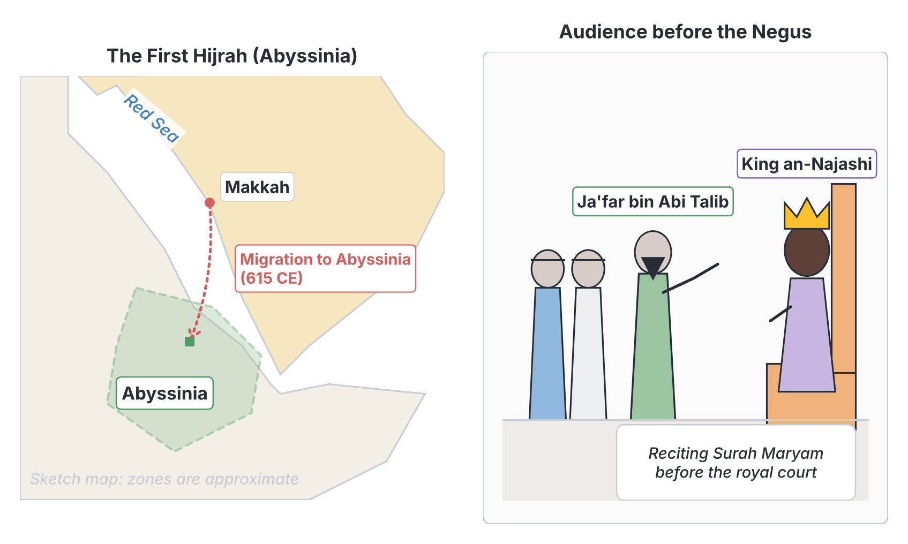
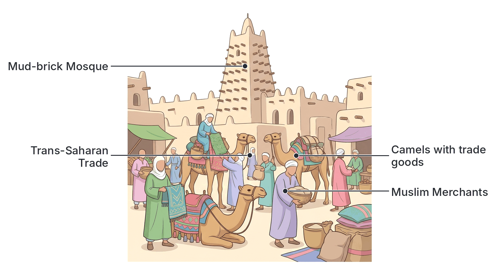

# JAMB Irk Notes: Early Contact of Islam with Africa

## What JAMB expects

This topic is part of Section C (History of Islam) of the JAMB syllabus. It covers the early geographical expansion of Islam, from the first migration of early Muslims out of Makkah to the later spread of the religion across North and West Africa. 

THIS FILE COVERS:
- **(i)** Hijrah to Abyssinia
- **(ii)** The spread of Islam to Egypt
- **(iii)** The role of traders, teachers, preachers, Murabitun, Sufi orders and Mujaddidun to the spread of Islam in West Africa.

By the end of these notes, you should be able to:
1. Evaluate the circumstances leading to the Hijrah to Abyssinia.
2. Give reasons for the spread of Islam to Egypt.
3. Account for the roles of traders, teachers, preachers, Murabitun, Sufi orders and Mujaddidun in the spread of Islam in West Africa.

**Note on the syllabus wording:** The syllabus contains a typing error in the second objective, asking you to "give reasons for the spread of Islamic in Egypt". This means "Islam in Egypt". Additionally, the syllabus numbers all three objectives as "(i)". They are treated as three separate, sequential objectives in these notes.

---

## Hijrah to Abyssinia

**Content i: Hijrah to Abyssinia.**

The term **Hijrah** means migration. Before the famous Hijrah to Madinah in 622 CE, the early Muslims made an earlier migration to **Abyssinia** (modern-day Ethiopia and Eritrea) across the Red Sea. This was the first major contact of Islam with the African continent, occurring around **615 CE**, which was the fifth year of Prophet Muhammad's (SAW) prophethood.

### Evaluate the circumstances leading to the Hijrah to Abyssinia

The primary cause of the migration to Abyssinia was the severe **persecution** and physical torture of the early Muslims by the Quraysh in Makkah. 

**1. Severe Persecution in Makkah**
When Prophet Muhammad (SAW) began preaching Islam publicly, the Makkan elites (the Quraysh) saw it as a threat to their economy (which relied on idol worship at the Ka'bah) and their ancestral traditions. They responded with intense hostility. They boycotted, mocked, and physically tortured the Muslims.
*   The most vulnerable Muslims—such as slaves, the poor, and those without powerful tribal protection—suffered the worst. For example, **Bilal ibn Rabah** was pinned to the burning desert sand under a heavy rock, and the family of **Yasir** (including his wife Sumayyah, the first martyr in Islam) were tortured to death.

**2. The Prophet's Advice to Seek Refuge**
Seeing the suffering of his followers and unable to protect all of them, Prophet Muhammad (SAW) advised a group of them to migrate to Abyssinia. He chose Abyssinia because it was ruled by a Christian king known by the title **an-Najashi (the Negus)**, whose real name was Ashamah. The Prophet (SAW) described him as a just king under whom no one was wronged.

**3. The First and Second Waves of Migration**
*   **The First Hijrah (615 CE):** A small group of about 11 men and 4 women, including Uthman bin Affan and his wife Ruqayyah (the Prophet’s daughter), slipped out of Makkah secretly at night and sailed across the Red Sea to Abyssinia.
*   **The Second Hijrah:** Shortly after, a larger group of about 83 men and 18 women migrated. 

**4. The Quraysh Pursuit and the Muslims' Defense**
The Quraysh were furious that the Muslims had found a safe haven. They sent two envoys, including the shrewd **Amr ibn al-Aas** (who later became a Muslim), bearing expensive gifts for an-Najashi. They demanded that the Muslims be extradited, claiming they were rebellious fugitives who had invented a new religion that insulted both Makkan traditions and Christianity.
*   An-Najashi refused to hand them over without a hearing. He summoned the Muslims, and **Ja'far bin Abi Talib** (the Prophet's cousin) spoke on their behalf. 
*   Ja'far eloquently explained how Islam had lifted them from ignorance, commanded good morals, and taught the worship of One God. He then recited the opening verses of **Surah Maryam (Q.19)**, which describes the miraculous birth of Prophet Isa (Jesus) and honors his mother, Maryam (Mary).
*   Upon hearing this, an-Najashi wept, recognizing the shared truth between Islam and Christianity. He returned the gifts to the Quraysh and granted the Muslims permanent protection.

---

## The spread of Islam to Egypt

**Content ii: The spread of Islam to Egypt.**

Egypt was brought under Islamic rule during the caliphate of the second Rightly Guided Caliph, **Umar ibn al-Khattab**, around **639 to 642 CE**. The Muslim army was commanded by **Amr ibn al-Aas**. Egypt was previously a province of the Byzantine (Roman) Empire. 

### Give reasons for the spread of Islam to Egypt

The rapid success of the Muslim conquest and the subsequent spread of the Islamic faith among the local Egyptian population (the Copts) were due to several historical and social reasons:

**1. Oppressive Byzantine Rule and Religious Persecution**
The native Egyptians (the Copts) were Christians, but they followed the Monophysite doctrine, which conflicted with the official Melkite doctrine of their Byzantine rulers. The Byzantines heavily persecuted the Copts, torturing their religious leaders (like Patriarch Benjamin, who had to flee into hiding) and forcing them to accept Byzantine beliefs. Consequently, the Copts hated their Roman rulers and largely refused to fight for them when the Muslims arrived.

**2. Crushing Economic Taxation**
The Byzantines treated Egypt as a "cash cow" and the "breadbasket of the empire," imposing unbearably high taxes on the local farmers. The Muslim system of taxation—specifically the **Jizyah** (a poll tax for non-Muslim citizens)—was significantly lower, more predictable, and exempted women, children, the elderly, and the poor.

**3. Muslim Guarantee of Religious Freedom and Protection**
When Amr ibn al-Aas conquered Egypt, he signed the **Treaty of Alexandria**. He guaranteed the Copts full religious freedom, protected their churches, and recalled Patriarch Benjamin from exile to resume his position safely. Because Muslims treated them with justice and tolerance, many Copts welcomed the Islamic administration, and over the centuries, many voluntarily converted to Islam.

**4. Strategic and Military Necessity**
From the Muslim perspective, securing Egypt was necessary to protect the newly conquered territories in Palestine and Syria. The Byzantines frequently used their naval base in Alexandria to launch counter-attacks. Bringing Egypt under Muslim control removed this threat.

**5. The Establishment of Fustat**
After the conquest, Amr ibn al-Aas founded a new garrison city called **Fustat** (which later grew into modern Cairo). Fustat became a major center of Islamic learning, culture, and trade. The presence of Muslim scholars and the Arabic language slowly integrated with the local culture, leading to the gradual and widespread acceptance of Islam across Egypt.

---

## The spread of Islam in West Africa

**Content iii: The role of traders, teachers, preachers, Murabitun, Sufi orders and Mujaddidun to the spread of Islam in West Africa.**

Unlike North Africa, where Islam arrived partly alongside military expansion, Islam first entered West Africa peacefully across the Sahara Desert. It was a gradual process that took centuries, heavily influenced by economics, scholarship, and later, reform movements. 

### Account for the roles of traders, teachers, preachers, Murabitun, Sufi orders and Mujaddidun

JAMB requires you to understand the specific contributions of six distinct groups in planting and strengthening Islam in West Africa.

#### 1. Traders
*   **How they spread Islam:** Islam first reached West Africa (the Western Sudan) between the 8th and 9th centuries through the **Trans-Saharan trade**. Arab and Berber Muslim merchants from North Africa traveled across the desert on camels, bringing salt, cloth, and horses to exchange for West African gold, ivory, and kola nuts. 
*   **Impact:** As they established trade networks in cities like Timbuktu, Gao, Kano, and Kumbi Saleh, they built mosques in their trading quarters. Their honesty, fair dealings (governed by Islamic law), and organized lifestyle deeply impressed the local populations and rulers, many of whom embraced Islam to strengthen trade relations.

#### 2. Teachers (Ulama / Scholars)
*   **How they spread Islam:** Alongside the merchants came Muslim scholars and teachers. They established Qur'anic schools (**Madrasahs**) wherever they settled. 
*   **Impact:** They introduced the Arabic language and literacy to West Africa. Because they could read and write, local non-Muslim kings frequently employed them as scribes, secretaries, judges, and advisors in their royal courts. This gave Islam a prestigious status. A famous example is the scholar **Al-Maghili**, who taught and advised the rulers of Kano and Katsina in the 15th century.

#### 3. Preachers (Du'at)
*   **How they spread Islam:** Preachers dedicated their lives to active missionary work (Da'wah). They traveled from village to village, preaching the oneness of Allah (Tawhid) and demonstrating Islamic morality. 
*   **Impact:** While traders and teachers primarily influenced the ruling elites and urban centers, the traveling preachers took Islam directly to the grassroots—the rural farmers and commoners.

#### 4. The Murabitun (Almoravids)
*   **Who they were:** The Murabitun were an 11th-century strict, militant Islamic reformist movement that originated among the Sanhaja Berbers in the Sahara, founded by Abdallah ibn Yasin.
*   **Role in West Africa:** They sought to enforce a strict adherence to Sunni Islam (specifically the Maliki school of law). In **1076 CE**, the Murabitun attacked and captured Kumbi Saleh, the capital of the **Ghana Empire**. 
*   **Impact:** Though their direct rule in Ghana was short-lived, their conquest permanently weakened the traditional religion of the empire and rapidly accelerated the spread of Islam among the Soninke people and further south.

#### 5. Sufi Orders (Tariqahs)
*   **Who they were:** Sufism is the mystical and spiritual dimension of Islam. A Sufi order (Tariqah) is a brotherhood of Muslims focused on spiritual purification, chanting (Dhikr), and following a spiritual guide (Sheikh).
*   **Role in West Africa:** The two most dominant Sufi orders in West Africa are the **Qadiriyyah** and the **Tijaniyyah**.
*   **Impact:** They played a massive role in mass conversions. Sufi orders were highly organized, creating strong social bonds among members. Their emphasis on inner spirituality and their tolerance for integrating certain local African customs made Islam highly appealing and accessible to ordinary West Africans.

#### 6. Mujaddidun (Reformers / Revivalists)
*   **Who they were:** A Mujaddid is an Islamic reformer. Over centuries, Islam in West Africa had become mixed with traditional African idol worship and superstitions—a practice known as **syncretism**. 
*   **Role in West Africa:** By the 18th and 19th centuries, learned scholars rose up as Mujaddidun to purify Islam. They launched intellectual campaigns and, eventually, military campaigns (Jihads) to wipe out pagan practices and establish states governed strictly by **Shari'ah** (Islamic law). 
*   **Impact:** The most prominent example in Nigeria is **Sheikh Uthman Dan Fodio**, who launched his Jihad in 1804, resulting in the creation of the Sokoto Caliphate. Other notable reformers include Seku Amadu (Macina Empire) and Al-Hajj Umar Tall (who also spread the Tijaniyyah order). Their efforts firmly entrenched pure Islamic practices and scholarship in the region.

### Summary of the Agents of Islamic Spread in West Africa

| Agent / Group | Primary Method of Spreading Islam | Main Area of Impact |
| :--- | :--- | :--- |
| **Traders** | Economic interaction, trans-Saharan trade | Urban centers, local kings, trade routes |
| **Teachers** | Setting up schools, providing literacy (Arabic) | Royal courts (as scribes), education system |
| **Preachers** | Traveling missionary work (Da'wah) | Grassroots, rural communities |
| **Murabitun** | Military conquest and religious reform (11th Century) | The Ghana Empire and its surrounding areas |
| **Sufi Orders** | Spiritual brotherhoods, Dhikr, mass social appeal | Broad population, providing social cohesion |
| **Mujaddidun** | Jihads and reform to stop syncretism (18th-19th Century) | Establishment of pure Islamic states (e.g., Sokoto Caliphate) |

---

## Key terms

| Term | Meaning |
| :--- | :--- |
| **Hijrah** | Migration for the sake of Allah; specifically the early Muslim flights to Abyssinia and Madinah. |
| **Abyssinia** | An ancient Christian kingdom in the Horn of Africa, corresponding mostly to modern Ethiopia. |
| **an-Najashi** | The title (Negus) of the Christian ruler of Abyssinia who protected the early Muslims. |
| **Copts** | The native Christian population of Egypt. |
| **Jizyah** | A tax levied on non-Muslim citizens living in an Islamic state, guaranteeing them protection and exempting them from military service. |
| **Trans-Saharan Trade** | Trade networks connecting North Africa and West Africa across the Sahara Desert. |
| **Murabitun** | The Almoravids; an 11th-century Berber Islamic reform movement that conquered the Ghana Empire. |
| **Sufi Order (Tariqah)** | A mystical Islamic brotherhood focused on spiritual purification (e.g., Qadiriyyah, Tijaniyyah). |
| **Mujaddid** | A reformer or revivalist who purifies the religion from innovations and cultural corruptions. |
| **Syncretism** | The blending of Islamic practices with traditional African pagan beliefs. |

---

## Exam tips and common mistakes

*   **Do not confuse the two Hijrahs:** The *first* migration in Islamic history was to **Abyssinia** (around 615 CE). The more famous Hijrah that started the Islamic calendar was to **Madinah** (622 CE). If JAMB asks where Muslims *first* migrated for safety, the answer is Abyssinia.
*   **Know the Caliph for Egypt:** Egypt was conquered under Caliph **Umar ibn al-Khattab**, *not* during the life of the Prophet (SAW). The commander was **Amr ibn al-Aas**.
*   **Why Egypt accepted Islam:** The primary socio-political reason the Egyptians (Copts) did not fight the Muslims was their hatred for the oppressive taxes and religious persecution of their Byzantine (Roman) overlords.
*   **The entry of Islam into West Africa:** Always remember that Islam arrived in West Africa initially by **peaceful trade**, not by Arab military conquest. 
*   **Murabitun vs. Mujaddidun:** Do not confuse these two "M" words. The **Murabitun (Almoravids)** were the 11th-century Berbers who struck the Ghana Empire. The **Mujaddidun** were the 18th/19th-century reformers like Uthman Dan Fodio who fought against syncretism in places like Hausaland.
*   **Ja'far bin Abi Talib:** He was the brilliant spokesperson who debated the Quraysh envoys in front of King Najashi, reciting Surah Maryam.

---

## Quick summary

1. The first major contact of Islam with Africa was the **Hijrah to Abyssinia** (around 615 CE), where early Muslims fled Makkan persecution to seek refuge under the just Christian king, an-Najashi, and were eloquently defended by Ja'far bin Abi Talib.
2. Islam spread to **Egypt** (639–642 CE) under the command of Amr ibn al-Aas. The native Coptic Christians welcomed Islamic rule because it offered religious freedom and lower taxes (Jizyah), freeing them from oppressive Byzantine persecution.
3. In **West Africa**, Islam was first introduced peacefully through the **Trans-Saharan trade** by Arab and Berber merchants.
4. **Teachers (Ulama)** brought Arabic literacy and served in royal courts, while **preachers (Du'at)** took the religion directly to the rural grassroots.
5. The **Murabitun** (Almoravids) militarily pushed Islam into the Ghana Empire in the 11th century, while **Sufi orders** (like the Qadiriyyah and Tijaniyyah) later fostered mass conversions through spiritual brotherhoods.
6. **Mujaddidun** (Reformers) like Sheikh Uthman Dan Fodio led Jihads in the 18th and 19th centuries to wipe out syncretism and establish pure Islamic states governed strictly by Shari'ah.

---

## Practice questions

**1. The primary cause of the early Muslims' Hijrah to Abyssinia was:**
- A. a severe famine in Makkah
- B. the command to spread Islam through military conquest
- C. severe persecution and torture by the Quraysh
- D. an invitation from the Byzantine Emperor

**Answer: C.** The Quraysh heavily persecuted the early, vulnerable Muslims, prompting the Prophet (SAW) to advise them to seek refuge in Abyssinia.

**2. Which companion of the Prophet (SAW) acted as the spokesperson for the Muslims before King an-Najashi?**
- A. Abu Bakr as-Siddiq
- B. Ja'far bin Abi Talib
- C. Umar ibn al-Khattab
- D. Ali bin Abi Talib

**Answer: B.** Ja'far bin Abi Talib eloquently defended the Muslims against the claims of the Quraysh envoys and recited Surah Maryam to the king.

**3. Egypt was opened to Islam under the leadership of which Muslim commander?**
- A. Khalid bin Walid
- B. Uthman bin Affan
- C. Tariq bin Ziyad
- D. Amr ibn al-Aas

**Answer: D.** Amr ibn al-Aas led the Muslim army into Egypt during the caliphate of Umar ibn al-Khattab.

**4. A major reason the Coptic Christians of Egypt did not resist the Muslim conquest was because they:**
- A. desired to learn the Arabic language
- B. were fleeing from a plague in Alexandria
- C. were suffering from heavy taxation and religious persecution by the Byzantines
- D. wanted to join the Muslim army to fight the Persians

**Answer: C.** The Copts hated the oppressive Byzantine rule, and they welcomed the Muslims who promised them religious freedom and fair taxation.

**5. How was Islam initially introduced to West Africa?**
- A. Through European colonization
- B. By direct military conquest from Makkah
- C. Through maritime trade along the Atlantic coast
- D. By Arab and Berber merchants via the Trans-Saharan trade

**Answer: D.** Islam first arrived in West Africa peacefully through the Trans-Saharan trade routes between the 8th and 9th centuries.

**6. Which 11th-century movement played a major role in spreading Islam into the Ghana Empire?**
- A. The Murabitun (Almoravids)
- B. The Fatimids
- C. The Abbasids
- D. The Umayyads

**Answer: A.** The Murabitun were a militant Berber reform movement that conquered Kumbi Saleh, the capital of Ghana, in 1076 CE, accelerating the spread of Islam there.

**7. In early West African empires, Muslim Ulama (teachers/scholars) were often employed by non-Muslim kings to serve as:**
- A. agricultural laborers
- B. scribes, advisors, and judges
- C. naval commanders
- D. court musicians

**Answer: B.** Because Muslim scholars were literate in Arabic, kings highly valued them for administrative tasks like correspondence, record-keeping, and legal advice.

**8. The Qadiriyyah and Tijaniyyah are examples of which group that aided the mass spread of Islam in West Africa?**
- A. Mujaddidun
- B. Murabitun
- C. Sufi orders
- D. Christian missionaries

**Answer: C.** They are Sufi orders (Tariqahs) that provided spiritual brotherhood, social cohesion, and grassroots appeal, leading to mass conversions.

**9. What was the main objective of Mujaddidun like Sheikh Uthman Dan Fodio in West Africa?**
- A. To establish the Trans-Saharan trade routes
- B. To purify Islamic practices from syncretism and establish Shari'ah
- C. To introduce Islam to the continent for the very first time
- D. To translate the Glorious Qur'an into English

**Answer: B.** As a reformer (Mujaddid), Uthman Dan Fodio launched a Jihad to wipe out the mixing of Islam with pagan traditions (syncretism) and set up a pure Islamic government.

**10. The tax established by Muslims in Egypt, which guaranteed protection and religious freedom to non-Muslims, was known as:**
- A. Zakah
- B. Sadaqah
- C. Jizyah
- D. Riba

**Answer: C.** Jizyah was the poll tax paid by non-Muslims in an Islamic state, which was generally much lower and fairer than the previous Byzantine taxes.

<!-- COVERAGE
obj i | Evaluate the circumstances leading to the Hijrah to Abyssinia
obj i | Give reasons for the spread of Islam to Egypt
obj i | Account for the roles of traders, teachers, preachers, Murabitun, Sufi orders and Mujaddidun
item i | Hijrah to Abyssinia
item ii | The spread of Islam to Egypt
item iii | The spread of Islam in West Africa
-->
