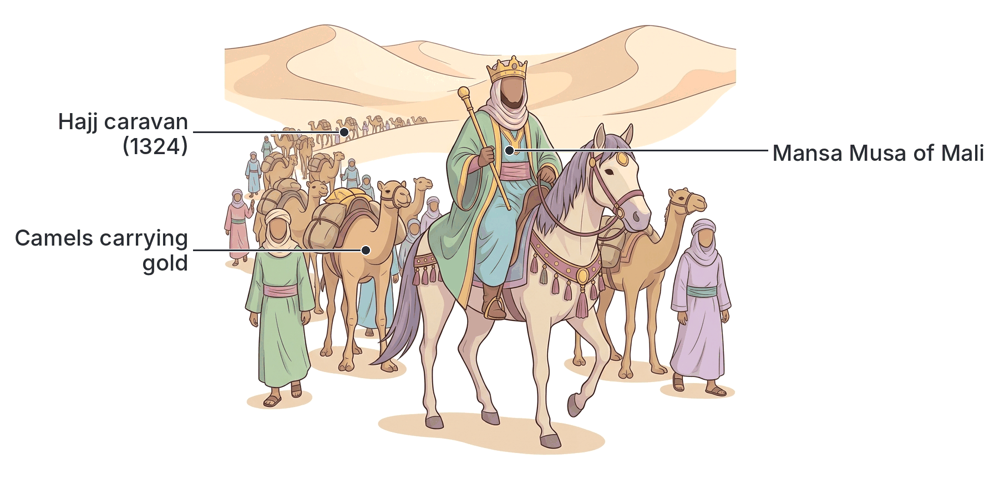
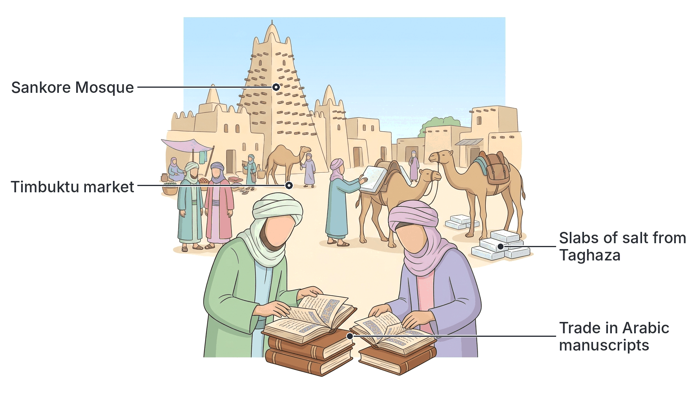

# JAMB Irk Notes: The Impact of Islam in West Africa

## What JAMB expects

This topic is Part III, Topic 19 of the JAMB Islamic Religious Knowledge syllabus: The Impact of Islam in West Africa. It covers two main areas:

- **Content (i):** The influence of Islam on the socio-political life of some West African Empires: Ghana, Mali, Songhai and Borno.
- **Content (ii):** The impact of Islam on the economic life of some West African states: Timbuktu, Kano and Borno.

By the end of these notes, you should be able to:

1. Analyse the influence of Islam on the socio-political system of some West African States.
2. Evaluate the impact of Islam on the economic life of Timbuktu, Kano and Borno.

**Note on the syllabus wording:** In the JAMB syllabus, the second objective is mistakenly printed as `(i)` instead of `(ii)`. These notes cover both objectives fully in their respective sections.

## The influence of Islam on the socio-political life of West African Empires

Islam did not just bring a new set of religious beliefs to West Africa; it brought a complete system of life that deeply changed how empires were governed, how laws were made, and how society was structured. The religion spread largely through peaceful means—such as the Trans-Saharan trade and the migration of Muslim scholars—before later periods of Jihad.

Below is an analysis of how Islam influenced the socio-political systems of four major West African empires.

### Analysing the socio-political system of West African States

When we analyse the socio-political influence of Islam on West African states, we look at several key areas:
1. **Administration:** Muslim scholars who could read and write Arabic were employed as secretaries, treasurers, and interpreters.
2. **Law and Justice:** Traditional customary laws were gradually replaced or mixed with Islamic law (Sharī‘ah), and Muslim judges (Qādīs) were appointed.
3. **Diplomacy:** Islamic states in West Africa established international relations with other Muslim nations in North Africa and the Middle East.
4. **Architecture and Lifestyle:** The building of mosques, the use of brick architecture, and the adoption of Islamic dressing and titles (like *Amīr* or *Caliph*).

### 1. Ghana Empire

The ancient Ghana Empire (which was located in present-day Mali and Mauritania, not modern Ghana) was one of the earliest West African empires to come into contact with Islam, mainly through North African Berber traders.

- **Muslims in Government:** Although the kings of ancient Ghana did not convert to Islam (they maintained their traditional African religion to keep the loyalty of their subjects), they highly respected Muslims. Because Muslim traders and scholars were literate in Arabic, the King of Ghana employed them as his treasurers, interpreters, and ministers of state. This helped the empire keep accurate records of taxes and trade.
- **Separate Settlements:** The capital city, Kumbi Saleh, was divided into two distinct towns. One town was for the king and his traditional subjects, and the other twin town was exclusively for Muslims. The Muslim town had twelve mosques, complete with Imams and scholars, showing a high level of religious tolerance and social organization.
- **Almoravid Influence:** In the 11th century (around 1076 AD), the Almoravids (a strict Muslim movement from North Africa) attacked Ghana. This accelerated the spread of Islam among the local population, even though the empire eventually collapsed.

### 2. Mali Empire

The Mali Empire replaced Ghana as the dominant power in the region. Unlike Ghana, the rulers of Mali fully embraced Islam, making it the state religion.

- **Adoption as State Religion:** The founder, Sundiata Keita, was nominally a Muslim, but it was under later rulers, especially **Mansa Musa** (1312–1337), that Islam became deeply rooted in the political system.
- **International Diplomacy (The Hajj):** Mansa Musa’s famous pilgrimage (Hajj) to Makkah in 1324 put Mali on the world map. He travelled with thousands of followers and distributed so much gold in Egypt that its value dropped for years. This Hajj established strong political and diplomatic ties between Mali, Egypt, and the wider Islamic world.
- **Islamic Law and Education:** Mansa Musa introduced Maliki law (a school of Islamic jurisprudence) into the state's administration. He also returned from Hajj with Muslim scholars, poets, and architects, which transformed the socio-political landscape.
- **Architecture:** The Andalusian (Spanish-Arab) architect **Abu Ishaq al-Sahili**, who returned with Mansa Musa, introduced the use of burnt bricks and flat roofs in West Africa. He built the famous Djingareyber Mosque in Timbuktu and a royal palace for the emperor.

### 3. Songhai Empire

The Songhai Empire reached its peak in the 15th and 16th centuries. Its relationship with Islam was defined by a struggle between syncretism (mixing Islam with traditional beliefs) and orthodox Islam.

- **From Syncretism to Strict Islam:** The early great ruler, **Sonni Ali**, was a syncretist who observed Islamic prayers but also practised traditional religion and persecuted Muslim scholars. After his death, **Askia Muhammad (Askia the Great)** overthrew his son in a Jihad (holy war) to establish a pure Islamic government.
- **Use of Islamic Scholars (Ulamā'):** Askia Muhammad relied heavily on Muslim scholars for political advice. He famously consulted the North African scholar **Muhammad al-Maghīlī**, who wrote a book for him titled *The Obligations of Princes*, which served as a constitutional guide on how to rule a Muslim state, collect taxes, and maintain justice.
- **Justice System:** Askia Muhammad set up a structured legal system by appointing Qādīs (Muslim judges) in all major towns to ensure that the Sharī‘ah was applied in settling disputes.
- **Political Titles:** During his Hajj in 1495, Askia Muhammad was given the title of *Caliph of the Western Sudan* by the Sharif of Makkah. This gave him immense spiritual and political authority over his Muslim subjects.

### 4. Borno Empire (Kanem-Borno)

The Kanem-Borno Empire, located around the Lake Chad basin (including modern-day north-eastern Nigeria), is one of the oldest Islamic states in West Africa. Islam was introduced as early as the 11th century by Mai Umme Jilmi.

- **Total Islamic State:** The rulers (known by the title *Mai*) made Islam the foundation of their politics. In the 13th century, Mai Dunama II ordered the destruction of the *Mune* (a traditional sacred object), publicly breaking away from traditional religion and asserting Islamic political dominance.
- **Peak under Mai Idris Alooma:** In the 16th century (1571–1603), Mai Idris Alooma transformed Borno into a powerful Islamic state. He replaced customary law with pure Sharī‘ah law, built brick mosques, and set up a system of Qādī courts to handle all legal matters. 
- **Military and Diplomatic Alliances:** Because of their shared Islamic faith, Mai Idris Alooma established strong diplomatic and military relations with the Ottoman Empire (Turkey). He acquired Turkish muskets (guns) and hired Turkish military instructors, which made the Borno army invincible in the region.
- **Welfare for Pilgrims:** To support the socio-religious life of his people, Idris Alooma built a hostel in Makkah specifically for Borno pilgrims performing the Hajj.

### Comparison of Socio-Political Influence

| Feature | Ghana Empire | Mali Empire | Songhai Empire | Borno Empire |
| --- | --- | --- | --- | --- |
| **Ruler's Religion** | Traditional (but employed Muslims) | Islam (State religion) | Islam (Mixed under Sonni Ali, strict under Askia Muhammad) | Islam (State religion) |
| **Notable Ruler** | Tunka Manin | Mansa Musa | Askia Muhammad | Mai Idris Alooma |
| **Legal System** | Customary law | Maliki Islamic law introduced | Qādī courts established widely | Strict Sharī‘ah, replaced traditional law |
| **Key Diplomatic Action** | Trade ties with Berbers | Mansa Musa's Hajj (ties with Egypt) | Askia named "Caliph of Western Sudan" | Alooma's alliance with the Ottoman Empire (Turkey) |
| **Administrative Role of Muslims** | Treasurers, interpreters, ministers | Rulers, scholars, architects | Governors, Qādīs, constitutional advisors (Al-Maghīlī) | Rulers, Qādīs, military leaders |

## The impact of Islam on the economic life of West African states

Islam brought new ethical guidelines, commercial techniques, and international networks that transformed the economies of West African states. 

**General Economic Impacts of Islam:**
1. **Literacy and Record Keeping:** Arabic became the language of business. Traders could now write contracts, keep ledgers, and issue letters of credit, which made large-scale business much easier and safer.
2. **Islamic Ethics:** The Sharī‘ah forbade *Riba* (usury/interest) and fraud. It introduced strict rules for honest weighing and measuring, which built trust in the markets.
3. **Islamic Taxation:** The introduction of taxes such as *Zakāh* (alms for the poor), *Jizyah* (poll tax on non-Muslims for state protection), and *Kharāj* (land tax) provided the state with organized revenue to build infrastructure.
4. **Safe Trade Routes:** Powerful Islamic governments provided security for the Trans-Saharan trade routes, encouraging North African merchants to bring their wealth into West Africa.

### Evaluating the economic impact on Timbuktu, Kano and Borno

#### 1. Timbuktu

Timbuktu began as a seasonal camp for Tuareg nomads but grew into the most famous commercial and intellectual hub of the Mali and Songhai empires.

- **The Trans-Saharan Trade Hub:** Timbuktu was strategically located at the edge of the Sahara Desert and the Niger River. It became the meeting point where merchants from North Africa (bringing salt from Taghaza, cloth, and horses) met with merchants from the forest regions (bringing gold, ivory, and slaves).
- **The Book Trade:** Because Islam places a huge emphasis on knowledge, Timbuktu became a center of learning (home to the Sankore University). The most profitable items traded in Timbuktu were not just gold and salt, but **books and handwritten Arabic manuscripts**. Scholars acted as merchants, and a massive "student economy" developed around housing, feeding, and supplying paper to thousands of students and scholars.
- **Standardization of Currency:** Islamic economic influence saw the formalization of currencies, such as cowrie shells and gold mithqals, making trade smoother than simple barter.

#### 2. Kano

Kano, one of the original Hausa Bakwai (seven legitimate Hausa states) in present-day Nigeria, was transformed economically by Islam. Islam was first brought to Kano in the 14th century (during the reign of Sarki Yaji) by the **Wangarawa**—a group of Muslim Dyula merchants from the Mali empire.

- **The Kurmi Market:** In the 15th century, the great Muslim ruler **Muhammad Rumfa** modernized the economy. He built the famous **Kurmi Market**, which became an international center for the Trans-Saharan trade.
- **Industrial Production (Textiles and Leather):** Islam encouraged decent dressing to cover the *Awrah* (nakedness), which caused a massive boom in the textile industry. Kano became famous across Africa for its indigo-dyed cloth. Kano also produced high-quality dyed leather. This leather was exported across the Sahara to North Africa and then to Europe, where it was mistakenly called "Morocco leather", even though it was originally made in Kano.
- **Islamic Taxation and Administration:** Muhammad Rumfa introduced Islamic taxes like *Jizyah* and *Kharāj* to fund the expansion of the city walls and the state council. He also set up standard weights and measures in the markets, supervised by market officials (like the *Sarkin Kasuwa*), in line with Islamic commercial ethics.

#### 3. Borno

Borno’s economy was heavily tied to its location near Lake Chad and its control of the central Trans-Saharan trade route leading up to Fezzan and Tripoli (modern-day Libya).

- **International Trade Monopoly:** The Islamic government of Borno guaranteed the safety of trade caravans. Borno exported natron (potash used for medicine and feeding animals), ostrich feathers, hides, and captives. In return, they imported horses, firearms, and fine textiles from the Islamic world.
- **State Revenue:** The state strictly applied the collection of *Zakāh*, which was used to support the poor, scholars, and the construction of mosques. War booty (Ghanaimah) from Jihads was divided strictly according to Islamic law, heavily enriching the state treasury.
- **Advanced Currency Systems:** Under Islamic influence, the Borno economy moved from barter to advanced currencies. While cowries were common, Borno's long-standing ties with the Middle East and Ottoman Empire later facilitated the use of imported silver coins (such as the Maria Theresa thalers) as a standard medium of exchange.

## Key terms

| Term | Meaning |
| --- | --- |
| **Sharī‘ah** | Islamic law derived from the Qur'an and Sunnah, covering all aspects of life. |
| **Qādī** | An Islamic judge who makes rulings based on the Sharī‘ah. |
| **Ulamā'** | Muslim scholars who are knowledgeable in Islamic law and theology. |
| **Trans-Saharan Trade** | The historic network of trade routes across the Sahara Desert, connecting West Africa to North Africa and the Middle East. |
| **Zakāh** | Obligatory Islamic alms-giving; a tax on wealth to support the poor. |
| **Jizyah** | A tax paid by non-Muslims living in an Islamic state in exchange for protection and exemption from military service. |
| **Kharāj** | An Islamic agricultural land tax. |
| **Wangarawa** | Muslim Dyula merchants from the Mali region who spread Islam and trade into Hausaland (Kano). |
| **Mai** | The traditional title for the rulers of the Kanem-Borno Empire. |
| **Mansa** | The title for the emperor of the Mali Empire. |

## Exam tips and common mistakes

- **Match the Ruler to the Empire:** A very common JAMB question format. Remember: 
  - **Mali:** Mansa Musa (famous for his Hajj and wealth).
  - **Songhai:** Askia Muhammad (advised by Al-Maghīlī, appointed Qādīs).
  - **Borno:** Mai Idris Alooma (Turkish muskets, brick mosques).
  - **Kano:** Muhammad Rumfa (Kurmi market, Kano walls).
- **Sonni Ali vs. Askia Muhammad:** Remember that Sonni Ali of Songhai was a syncretist who mixed traditional religion with Islam, whereas Askia Muhammad established strict Islamic governance.
- **The Book Trade:** If asked about the most uniquely profitable or famous intellectual commodity in **Timbuktu**, the answer is books/manuscripts.
- **Morocco Leather:** Note that the famous "Morocco leather" of the Trans-Saharan trade actually originated in **Kano**.
- **Al-Maghīlī:** Know that Muhammad al-Maghīlī was a North African scholar who wrote *The Obligations of Princes* for Askia Muhammad of Songhai (and also visited Kano). 
- **Wangarawa:** If JAMB asks who introduced Islam to Kano, it is the Wangarawa traders.

## Quick summary

1. Islam influenced the socio-political life of West African empires by introducing Arabic literacy for administration, the Sharī‘ah legal system, and Qādī courts to replace customary laws.
2. In Ghana, kings maintained traditional religion but employed Muslims as ministers and treasurers due to their literacy.
3. In Mali, Mansa Musa made Islam the state religion, introduced Maliki law, and used his 1324 Hajj to establish international diplomatic ties.
4. In Songhai, Askia Muhammad overthrew a syncretist ruler, made Islam the state religion, and used scholars like Al-Maghīlī to guide his constitution.
5. In Borno, Mai Idris Alooma established a total Islamic state, formed military alliances with the Ottoman Empire, and built hostels in Makkah for pilgrims.
6. Economically, Islam introduced Arabic for business contracts, forbade usury (interest), and brought standardized weights and taxes (Zakāh, Jizyah, Kharāj).
7. Timbuktu became a massive commercial and intellectual center where the trade in books and manuscripts was as important as gold and salt.
8. Kano's economy boomed under Muhammad Rumfa, who built the Kurmi market; the city became famous for its dyed textiles and leather.

## Practice questions

**1. The architect Abu Ishaq al-Sahili introduced burnt bricks and flat roofs to which West African empire?**

- A. Ghana
- B. Borno
- C. Mali
- D. Hausa states

**Answer: C.** Abu Ishaq al-Sahili was a Spanish-Arab architect who returned with Mansa Musa from his Hajj and built the Djingareyber Mosque and royal palaces in the Mali Empire.

**2. Which ruler of the Songhai Empire relied on the scholar Muhammad al-Maghīlī for advice on ruling an Islamic state?**

- A. Sonni Ali
- B. Mansa Musa
- C. Askia Muhammad
- D. Tunka Manin

**Answer: C.** Askia Muhammad relied heavily on Muslim scholars, and Al-Maghīlī wrote *The Obligations of Princes* for him to serve as a constitutional guide.

**3. In the ancient Ghana Empire, the rulers mainly employed Muslims in the government because the Muslims**

- A. were the best warriors in the region
- B. could read and write Arabic for record keeping
- C. forced the king to accept Islam
- D. controlled all the gold mines

**Answer: B.** Muslim scholars were literate in Arabic, making them highly valuable as treasurers, interpreters, and administrators in a predominantly oral society.

**4. The ruler of Borno who established strong military and diplomatic ties with the Ottoman Empire was**

- A. Mai Dunama II
- B. Mai Umme Jilmi
- C. Muhammad Rumfa
- D. Mai Idris Alooma

**Answer: D.** Mai Idris Alooma is famous for his strict adherence to Islam, establishing ties with the Ottoman Empire (Turkey), and acquiring Turkish musketeers.

**5. Which famous market was built in Kano by Sarki Muhammad Rumfa to boost the Trans-Saharan trade?**

- A. Sankore Market
- B. Kumbi Saleh Market
- C. Kurmi Market
- D. Taghaza Market

**Answer: C.** Muhammad Rumfa built the famous Kurmi Market in Kano, which became a major international hub for the Trans-Saharan trade.

**6. In Timbuktu, alongside gold and salt, a highly profitable commodity that reflected its status as a center of Islamic learning was**

- A. Turkish muskets
- B. Natron
- C. Arabic books and manuscripts
- D. Indigo cloth

**Answer: C.** Because Timbuktu was a major intellectual hub with institutions like the Sankore University, the trade in handwritten Arabic books and manuscripts was highly profitable.

**7. Islam impacted the economic life of West African states positively by introducing**

- A. the barter system
- B. the caste system
- C. Arabic literacy for business contracts and record keeping
- D. the worship of multiple deities

**Answer: C.** Arabic literacy allowed traders to write contracts, keep ledgers, and issue letters of credit, which revolutionized commerce in West Africa.

**8. The group of Muslim traders from the Mali region who introduced Islam and commerce into Kano were the**

- A. Almoravids
- B. Tuaregs
- C. Fulani
- D. Wangarawa

**Answer: D.** The Wangarawa (Dyula merchants) migrated into Hausaland and brought Islam and trade to Kano during the reign of Sarki Yaji in the 14th century.

**9. The Islamic tax imposed on non-Muslims living in a Muslim state in return for state protection is known as**

- A. Zakāh
- B. Kharāj
- C. Jizyah
- D. Riba

**Answer: C.** *Jizyah* is the poll tax paid by non-Muslims in an Islamic state, while *Zakāh* is alms paid by Muslims, *Kharāj* is land tax, and *Riba* (usury) is forbidden.

**10. To ensure justice in the socio-political administration of West African Islamic states, rulers appointed Muslim judges known as**

- A. Ulamā'
- B. Qādīs
- C. Imams
- D. Mansa

**Answer: B.** Qādīs are judges in the Islamic legal system who settle disputes based on the Sharī‘ah. Ulamā' are scholars, Imams lead prayers, and Mansa is a royal title.

<!-- COVERAGE
obj i | Analysing the socio-political system of West African States
obj i | Evaluating the economic impact on Timbuktu, Kano and Borno
item i | The influence of Islam on the socio-political life of West African Empires
item ii | The impact of Islam on the economic life of West African states
-->
