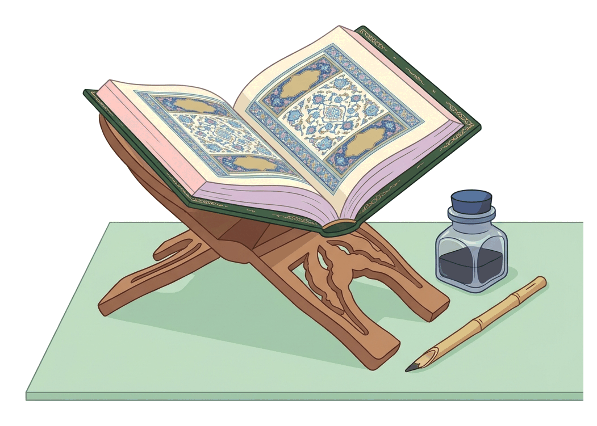
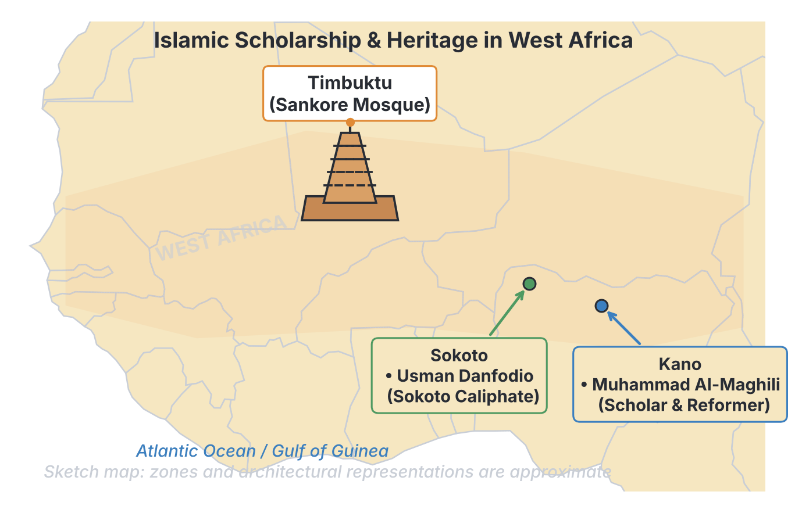
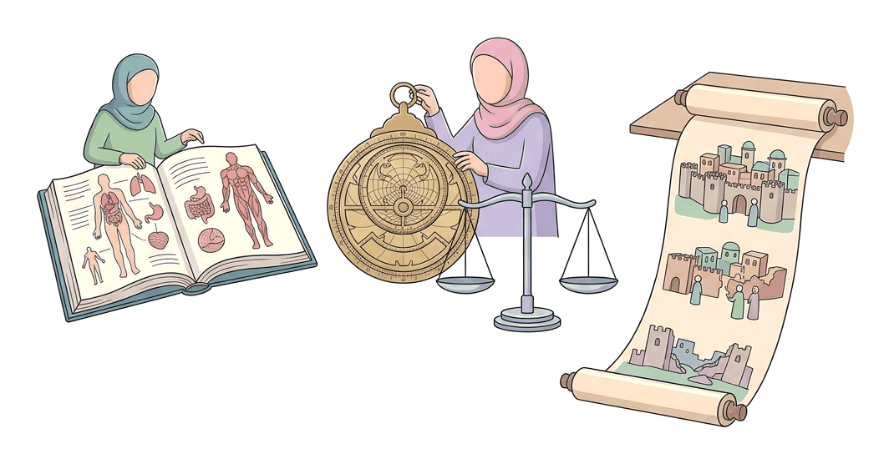

# JAMB Irk Notes: Contributions of Islam to Education

## What JAMB expects

This topic is part of Section C (Islamic History and Civilization) of the JAMB IRK syllabus. It covers the profound impact Islamic teachings have had on education, intellectual development, and institution-building both globally and in West Africa.

The JAMB syllabus lists the following content items for this topic:
- (i) The aims and objectives of Islamic Education
- (ii) The Glorious Qur’ān and Hadīth on Education (Q.96:1-5) (Q.39:9) and selected Ahādīth.
- (iii) Intellectual activities of Islam in West Africa (development of written history in Arabic and the establishment of Sankore University)
- (iv) Intellectual activities of Ahmad Baba of Timbuktu, Sheikh al-Maghili, Sheikh Usman Danfodio, Sultan Muhammad Bello and Ibn Battuta
- (vi) Islamic Education Institutions: House of Wisdom in Baghdad, al-Azhar University in Cairo and Nizamiyyah University in Baghdad.
- (vi) The lives and contributions of Ibn Sina, Al-Ghazali, Ibn Rushd, ar-Razi and Ibn Khaldun to education.

By the end of these notes, you should be able to:
1. explain the aims and objectives of Islamic Education;
2. assess the position of the Glorious Qur’ān and Hadīth in education;
3. examine the importance of seeking knowledge in Islam;
4. analyse the intellectual activities of Islam in West Africa;
5. assess the contributions of Sheikh al-Maghili, Sheikh Uthman Dan Fodio, Sultan Muhammad Bello and Ibn Battuta to education;
6. account for the development of intellectual centres in Baghdad and Cairo;
7. examine the contributions of Ibn Sina to the development of Medicine;
8. assess al-Ghazali’s contribution to Islamic education;
9. analyse Ibn Rushd’s contribution to philosophy and fiqh;
10. assess ar-Razi’s contribution to philosophy;
11. analyse Ibn Khaldun’s contribution to modern sociology and method of writing history.

**Note on the syllabus wording:** You might notice numbering errors in the syllabus for this topic (for example, there are multiple objectives labelled "(i)", it skips item "(v)", and lists "(vi)" twice). We have covered every single item exactly as printed in the syllabus, using the specific names and references provided. The syllabus asks to assess the contributions of specific West African scholars in the objectives, but omits Ahmad Baba there; however, because he is listed in the contents, he is fully explained in these notes.

---

## The aims and objectives of Islamic Education

### Explaining the aims and objectives of Islamic Education

Islamic education is not just about passing exams or getting a high-paying job. It is a comprehensive system designed to develop the whole human being. The ultimate goal is to produce a balanced individual who submits to the will of Allah and serves humanity.

The main aims and objectives include:
1. **Recognising Allah (Tawhīd):** The primary aim of learning in Islam is to know Allah, understand His creation, and worship Him correctly.
2. **Character Building (Tarbiyah and Ta'dīb):** Islamic education places heavy emphasis on morals, ethics, and discipline. Knowledge without good character is considered dangerous. 
3. **Holistic Development:** It aims to develop the student spiritually, intellectually, physically, and socially.
4. **Success in Both Worlds (Falāh):** While Western secular education often focuses strictly on worldly success, Islamic education prepares a person for a successful life in this world (*Dunyā*) and salvation in the Hereafter (*Ākhirah*).
5. **Fulfilling Communal Duties:** Education aims to produce professionals (doctors, teachers, engineers) because society needs them. In Islam, acquiring skills that benefit the community is a religious duty known as *Fard Kifāyah* (a collective obligation).

---

## The Glorious Qur’ān and Hadīth on Education

### The position of the Glorious Qur’ān and Hadīth in education

Islam places education at the very centre of its belief system. Unlike some traditions that historically kept religious knowledge away from ordinary people, the Qur'an and the Sunnah of Prophet Muhammad (SAW) make learning a mandatory duty for everyone.

**The Glorious Qur’ān on Education:**
*   **Surah Al-'Alaq (Q.96:1-5):** The very first revelation given to Prophet Muhammad (SAW) was a command to read and learn. 
    > "Read: In the name of thy Lord Who createth, Createth man from a clot. Read: And thy Lord is the Most Bounteous, Who teacheth by the pen, Teacheth man that which he knew not." (Pickthall's translation).
    This shows that reading, writing (the pen), and intellectual curiosity are the foundation of Islam.
*   **Surah Az-Zumar (Q.39:9):** The Qur'an clearly elevates the status of the educated over the ignorant.
    > "...Say (unto them, O Muhammad): Are those who know equal with those who know not? But only men of understanding will pay heed." (Pickthall's translation).

**The Hadīth on Education:**
The Prophet (SAW) repeatedly urged his followers to seek knowledge. The syllabus highlights three specific references:
1. *"The search for knowledge is obligatory on every Muslim"* (Collected by Ibn Majah). This means education is not optional; it is a fundamental duty for both males and females.
2. *"Seek knowledge from the cradle to the grave."* (Though often classified by Hadith scholars as a traditional maxim or proverb rather than a strictly authenticated chain to the Prophet, it is widely accepted in Islamic culture as a summary of the Islamic view on lifelong learning).
3. *"The words of wisdom are a lost property of the believer... he has a better right to it."* (Collected by Tirmidhi). This teaches Muslims to be open-minded. If a Muslim finds useful knowledge or a scientific truth, even from a non-Muslim source, they should claim it and use it, because all true knowledge comes from Allah.

### The importance of seeking knowledge in Islam

Based on the Qur'an and Hadith, seeking knowledge is crucial because:
*   **It eradicates ignorance:** Ignorance (Jāhiliyyah) is seen as a spiritual darkness. Knowledge is the light that guides a person to truth.
*   **It is the path to Paradise:** The Prophet (SAW) said that whoever travels a path in search of knowledge, Allah will make their path to Paradise easy.
*   **Scholars are highly respected:** Islamic tradition holds that "scholars are the inheritors of the prophets." Since prophets leave behind knowledge rather than wealth, scholars are the guardians of society.
*   **It benefits society:** Scientific and worldly knowledge improves health, infrastructure, and justice in the community.

---

## Intellectual activities of Islam in West Africa

### Analysis of intellectual activities of Islam in West Africa

When Islam spread to West Africa (through trade routes across the Sahara Desert), it brought along a rich intellectual tradition. This fundamentally changed how societies in the region operated.

1. **Introduction of Literacy and Arabic:** Before Islam, most West African societies relied on oral traditions (griots) to remember their history. Islam introduced the Arabic language and the Arabic script. 
2. **Development of Written History (*Ta'rīkh*):** Because of Arabic, West African scholars began writing down their own histories, laws, and administrative records. Famous examples include the *Tarikh al-Sudan* (History of the Sudan) and *Tarikh al-Fattash*, which documented the history of the great West African empires (Ghana, Mali, Songhai).
3. **Establishment of Sankore University:** 
   Located in **Timbuktu** (in present-day Mali), the Sankore Mosque was developed into a massive university under the Mali and Songhai Empires. During its peak in the 14th to 16th centuries (especially under Mansa Musa and Askia the Great), it housed up to 25,000 students and had one of the largest libraries in the world, filled with hundreds of thousands of manuscripts. Students studied the Qur'an, Islamic law (Fiqh), astronomy, mathematics, medicine, and history.

---

## Intellectual activities of Ahmad Baba and other West African Scholars

### Contributions of al-Maghili, Dan Fodio, Bello and Ibn Battuta to education

West Africa produced and hosted brilliant minds whose writings shaped the region. 

| Scholar | Origin | Key Contributions to Education and Intellectual Life |
| :--- | :--- | :--- |
| **Ahmad Baba of Timbuktu** (1556–1627) | Timbuktu (Songhai Empire) | He was the last chancellor of Sankore University and a brilliant polymath. He wrote over 40 books on grammar, law, and theology. He possessed a personal library of over 1,600 books. When the Moroccans invaded Timbuktu in 1591, he was taken into exile in Morocco, where scholars were amazed by his vast knowledge. |
| **Sheikh al-Maghili** (Died c. 1504) | Tlemcen (North Africa) | An influential North African scholar who travelled to Kano and Katsina in modern-day Nigeria. He wrote a famous guidebook for Emir Muhammad Rumfa of Kano called *Taj al-Din fi Ma Yajib 'ala al-Muluk* (**The Obligation of Princes**). He introduced strict Islamic administrative practices and shaped the application of Shari'ah in Northern Nigeria. |
| **Sheikh Usman Danfodio** (1754–1817) | Gobir (Northern Nigeria) | The founder of the Sokoto Caliphate. He was a prolific writer (over 100 books, including *Ihya al-Sunnah*). **Crucially, he championed mass education, especially for women.** He strongly criticised men who treated women purely as household items without educating them. His daughter, **Nana Asma’u**, became a famous scholar and educator of women. |
| **Sultan Muhammad Bello** (1781–1837) | Sokoto (Nigeria) | The son of Usman Danfodio and the second Sultan of Sokoto. He was an outstanding scholar who wrote extensively on history, medicine, geography, and theology. His most famous book is ***Infaq al-Maysur***, a detailed history of the Fulani Jihad and the establishment of the Sokoto Caliphate. |
| **Ibn Battuta** (1304–1369) | Morocco | One of history's greatest travellers. While not a teacher in West Africa, his intellectual contribution was his travelogue (*Rihla*). He visited the Mali Empire in 1352 and wrote down detailed observations of their society. He praised the Malian Muslims for their immense dedication to educating their children in the Qur'an, noting that parents would put their children in chains until they memorised it perfectly! |

---

## Islamic Education Institutions

### Development of intellectual centres in Baghdad and Cairo

During the European "Dark Ages", the Islamic world was experiencing a Golden Age of learning. Rulers sponsored massive educational institutions that became the intellectual capitals of the world.

**1. The House of Wisdom (Bayt al-Hikmah) in Baghdad:**
*   **Origin:** Established in Baghdad (Iraq) by the Abbasid Caliphs, most notably Harun al-Rashid, and expanded by his son Al-Ma'mun in the 8th and 9th centuries.
*   **Role:** It was an academy, library, and translation bureau. 
*   **Impact:** Scholars from all over the world (Muslims, Christians, and Jews) gathered here to translate Persian, Indian, and Greek scientific and philosophical works into Arabic. This massive translation movement preserved the knowledge of ancient Greece (like Aristotle and Plato) which would have otherwise been lost to history.

**2. Al-Azhar University in Cairo:**
*   **Origin:** Founded in 970 CE in Cairo (Egypt) by the Fatimid dynasty (specifically by the commander Jawhar al-Siqilli). 
*   **Role:** Originally built as a mosque and a centre to spread Ismaili Shi'a theology, it later became a Sunni institution under Salah al-Din (Saladin).
*   **Impact:** It is one of the oldest degree-granting universities in the world still operating today. It remains the most prestigious centre for Islamic and Arabic learning in the Sunni Muslim world.

**3. Nizamiyyah University in Baghdad:**
*   **Origin:** Founded in 1065 CE by Nizam al-Mulk, the powerful vizier (prime minister) of the Seljuk Empire.
*   **Role:** It was the most famous of the *Madrasa* network (state-sponsored colleges). 
*   **Impact:** It standardised higher education in the Islamic world. It provided free education, board, and lodging for students. It was heavily focused on Ash'ari theology and Shafi'i Islamic law. The great scholar Al-Ghazali was a professor here.

---

## The lives and contributions of Muslim Polymaths

A **polymath** is a person whose knowledge spans a wide number of subjects. Islamic history is filled with polymaths who made groundbreaking contributions to science, medicine, philosophy, and sociology.

### Ibn Sina's contribution to the development of Medicine
**Ibn Sina** (known in the West as **Avicenna**, 980–1037 CE) was a Persian polymath. While he wrote on astronomy and philosophy, his greatest contribution was to **Medicine**.
*   **Major Work:** He wrote *Al-Qānūn fī al-Tibb* (**The Canon of Medicine**). This massive medical encyclopaedia was so accurate and comprehensive that it was used as the standard medical textbook in European universities for over 600 years.
*   **Key Discoveries:** He was one of the first to describe how diseases can be contagious and spread through water and soil. He also introduced the practice of clinical trials and quarantine.

### Al-Ghazali’s contribution to Islamic education
**Abu Hamid al-Ghazali** (known as **Algazel**, 1058–1111 CE) is one of the most prominent theologians and educators in Islamic history.
*   **Major Work:** *Ihyā' 'Ulūm al-Dīn* (The Revival of the Religious Sciences).
*   **Educational Philosophy:** Al-Ghazali categorised knowledge into two types: *Fard 'Ayn* (obligatory on every individual, such as knowing how to pray) and *Fard Kifāyah* (communal obligations, such as medicine and mathematics). 
*   **Reconciliation:** He successfully reconciled orthodox Islamic theology with Sufism (Islamic mysticism). As a teacher at the Nizamiyyah University, he left his prestigious post to find spiritual truth, teaching that knowledge must be combined with a pure heart and sincere intention, not just used to gain worldly status.

### Ibn Rushd’s contribution to philosophy and fiqh
**Ibn Rushd** (known in the West as **Averroes**, 1126–1198 CE) was born in Cordoba (Islamic Spain). He was a brilliant philosopher, judge (Qadi), and physician.
*   **Contribution to Fiqh (Islamic Law):** He wrote *Bidāyat al-Mujtahid*, an essential textbook in comparative Islamic jurisprudence. It explains the reasoning behind the differing opinions of the major schools of law (Hanafi, Maliki, Shafi'i, Hanbali) in a highly analytical way.
*   **Contribution to Philosophy:** He is famous for writing comprehensive commentaries on the Greek philosopher Aristotle. He argued that there is no conflict between religion and philosophy (reason). He wrote *Tahāfut al-Tahāfut* (The Incoherence of the Incoherence) to defend philosophy against earlier attacks by Al-Ghazali. His works deeply influenced later European Renaissance thinkers.

### Ar-Razi’s contribution to philosophy
**Abu Bakr al-Razi** (known as **Rhazes**, 854–925 CE) was a Persian polymath. Although highly famous in medicine (he was the first to differentiate between smallpox and measles), the JAMB syllabus specifically highlights his **philosophy**.
*   **Philosophical Stance:** Ar-Razi was known for his highly rational and free-thinking approach. He championed the absolute power of human reason and logic. 
*   **Contribution:** He believed that reason alone, given by Allah, was sufficient for humans to distinguish between right and wrong, and to understand the universe. He wrote extensively on ethics, advocating for a balanced, rational life free from extreme passions. (Note: Some of his philosophical views on prophecy were highly controversial among orthodox scholars).

### Ibn Khaldun’s contribution to modern sociology and history
**Ibn Khaldun** (1332–1406 CE) was a North African scholar, widely regarded today as the founding father of modern sociology, historiography, and demography.
*   **Major Work:** He wrote a massive universal history book, but its introduction, the ***Muqaddimah*** (Prolegomena), became his masterpiece.
*   **Sociology:** He introduced the concept of ***'Asabiyyah*** (social cohesion or group solidarity). He explained how societies rise, peak, and inevitably fall when their social cohesion decays, often corrupted by luxury.
*   **Writing History:** Before Ibn Khaldun, history was mostly just a list of kings and dates. Ibn Khaldun changed this by insisting that a historian must analyse the *causes* of events, understand the geography and economics of the society, and critically check sources for bias or exaggeration.

---

## Key terms

| Term | Meaning |
| :--- | :--- |
| **Tawhīd** | The oneness of Allah; the core of Islamic belief and education. |
| **Tarbiyah** | Character development, moral training, and upbringing. |
| **Fard 'Ayn** | An individual obligation (e.g., praying, basic Islamic knowledge). |
| **Fard Kifāyah** | A communal obligation (e.g., studying medicine or engineering). |
| **Ta'rīkh** | History / written historical records. |
| **Bayt al-Hikmah** | The "House of Wisdom", an Abbasid translation and research centre in Baghdad. |
| **Madrasa** | An Islamic educational institution or college. |
| **Polymath** | A scholar who is an expert in many different subjects. |
| **Muqaddimah** | "Introduction" – the famous book by Ibn Khaldun on sociology and history. |
| **'Asabiyyah** | Social cohesion or group solidarity, a concept coined by Ibn Khaldun. |

---

## Exam tips and common mistakes

*   **Match the polymath to the book/field:** This is a very common exam question. 
    *   Ibn Sina = Medicine (*Canon of Medicine*)
    *   Ibn Khaldun = Sociology/History (*Muqaddimah*)
    *   Al-Ghazali = Education/Theology (*Ihya 'Ulum al-Din*)
    *   Ibn Rushd = Philosophy/Fiqh (*Bidayat al-Mujtahid*)
*   **Know the West African scholars' locations and focus:** Usman Danfodio championed women's education; Al-Maghili wrote for the ruler of Kano; Ibn Battuta was the traveller who documented the Mali empire's devotion to learning.
*   **Remember the institutions and their locations:** House of Wisdom (Baghdad), Al-Azhar (Cairo, Egypt), Nizamiyyah (Baghdad). 
*   **Don't confuse the Qur'anic references:** Q.96:1-5 is about the command to "Read" (the first revelation); Q.39:9 asks if those who know are equal to those who do not.
*   **Translation caution:** Some sources say "seek knowledge even unto China"; while famous, the JAMB syllabus explicitly references the "cradle to the grave" Hadith and the Ibn Majah/Tirmidhi traditions instead. Stick to the syllabus references.

---

## Quick summary

1. Islamic education aims to develop the whole person (spiritually, morally, and intellectually) for success in both this world and the Hereafter.
2. The Qur'an (Q.96:1-5) and Hadith make the pursuit of knowledge an absolute, lifelong obligation for every Muslim.
3. Islam brought Arabic literacy to West Africa, leading to written history and massive educational centres like Sankore University in Timbuktu.
4. Local scholars like Usman Danfodio (who advocated for women's education) and Sultan Bello, along with visitors like Al-Maghili and Ibn Battuta, profoundly shaped West African intellectual life.
5. In the Middle East, the House of Wisdom in Baghdad and Al-Azhar in Cairo served as the world's leading intellectual centres during the Middle Ages.
6. Muslim polymaths laid the foundations for modern sciences: Ibn Sina (Medicine), Al-Ghazali (Education and Theology), Ibn Rushd (Philosophy and Fiqh), Ar-Razi (Philosophy/Reason), and Ibn Khaldun (Sociology and History).

---

## Practice questions

**1. The primary aim of Islamic education is to**
- A. acquire wealth and high social status in society
- B. train soldiers for the defence of the Islamic state
- C. produce a balanced individual who recognises Allah and serves humanity
- D. encourage Muslims to abandon the world and live in monasteries

**Answer: C.** Islamic education focuses on Tawhid (recognising Allah), good character (Tarbiyah), and balancing spiritual and worldly duties.

**2. Which of the following Qur'anic chapters contains the first revelation commanding Prophet Muhammad (SAW) to read?**
- A. Surah Al-Fatihah
- B. Surah Al-'Alaq
- C. Surah Az-Zumar
- D. Surah Al-Baqarah

**Answer: B.** Surah Al-'Alaq (Q.96:1-5) begins with "Read: In the name of thy Lord...", making it the foundational text for Islamic education.

**3. According to the Hadith collected by Ibn Majah, seeking knowledge is**
- A. recommended for scholars only
- B. obligatory on every Muslim
- C. restricted to religious matters only
- D. obligatory on men but optional for women

**Answer: B.** The Prophet (SAW) stated: "The search for knowledge is obligatory on every Muslim," meaning it applies to all individuals regardless of gender.

**4. The famous intellectual centre established in Timbuktu during the era of the West African empires is known as**
- A. Al-Azhar University
- B. Nizamiyyah University
- C. House of Wisdom
- D. Sankore University

**Answer: D.** Sankore University in Timbuktu was the major educational centre in West Africa, especially under the Mali and Songhai empires.

**5. Which West African Islamic scholar strongly advocated for the education of women and criticised men who left their wives in ignorance?**
- A. Sultan Muhammad Bello
- B. Ahmad Baba of Timbuktu
- C. Sheikh Usman Danfodio
- D. Sheikh al-Maghili

**Answer: C.** Sheikh Usman Danfodio, founder of the Sokoto Caliphate, championed mass education, notably writing against the cultural practice of keeping women uneducated.

**6. The House of Wisdom (Bayt al-Hikmah), famous for its massive translation movement, was located in**
- A. Cairo
- B. Cordoba
- C. Baghdad
- D. Timbuktu

**Answer: C.** The House of Wisdom was established by the Abbasid Caliphs in Baghdad, Iraq.

**7. Ibn Sina is most famous in history for his groundbreaking contributions to**
- A. Sociology
- B. Medicine
- C. Arabic grammar
- D. Tafsir

**Answer: B.** Ibn Sina (Avicenna) wrote *Al-Qanun fi al-Tibb* (The Canon of Medicine), which was a standard medical textbook for centuries.

**8. The concept of *'Asabiyyah* (social cohesion) and the scientific method of writing history were introduced by**
- A. Ibn Khaldun
- B. Ibn Rushd
- C. Al-Ghazali
- D. Ar-Razi

**Answer: A.** Ibn Khaldun is considered the father of sociology and modern historiography, heavily exploring *'Asabiyyah* in his famous *Muqaddimah*.

**9. Al-Ghazali categorised knowledge into *Fard 'Ayn* and *Fard Kifayah* in his famous book titled**
- A. Bidayat al-Mujtahid
- B. Ihya 'Ulum al-Din
- C. Infaq al-Maysur
- D. Tahafut al-Tahafut

**Answer: B.** Al-Ghazali wrote *Ihya 'Ulum al-Din* (The Revival of the Religious Sciences), greatly impacting Islamic educational theory and theology.

**10. Which scholar wrote a treatise known as *The Obligation of Princes* to guide the Emir of Kano on Islamic governance?**
- A. Ibn Battuta
- B. Ibn Sina
- C. Ahmad Baba
- D. Sheikh al-Maghili

**Answer: D.** Sheikh al-Maghili, a North African scholar, visited Kano and Katsina and wrote *Taj al-Din fi Ma Yajib 'ala al-Muluk* (The Obligation of Princes) for Emir Muhammad Rumfa.

<!-- COVERAGE
obj i | Explaining the aims and objectives of Islamic Education
obj i | The position of the Glorious Qur’ān and Hadīth in education
obj ii | The importance of seeking knowledge in Islam
obj i | Analysis of intellectual activities of Islam in West Africa
obj i | Contributions of al-Maghili, Dan Fodio, Bello and Ibn Battuta to education
obj i | Development of intellectual centres in Baghdad and Cairo
obj i | Ibn Sina's contribution to the development of Medicine
obj ii | Al-Ghazali’s contribution to Islamic education
obj iii | Ibn Rushd’s contribution to philosophy and fiqh
obj iv | Ar-Razi’s contribution to philosophy
obj v | Ibn Khaldun’s contribution to modern sociology and history
item i | The aims and objectives of Islamic Education
item ii | The Glorious Qur’ān and Hadīth on Education
item iii | Intellectual activities of Islam in West Africa
item iv | Intellectual activities of Ahmad Baba and other West African Scholars
item vi | Islamic Education Institutions
item vi | The lives and contributions of Muslim Polymaths
-->
