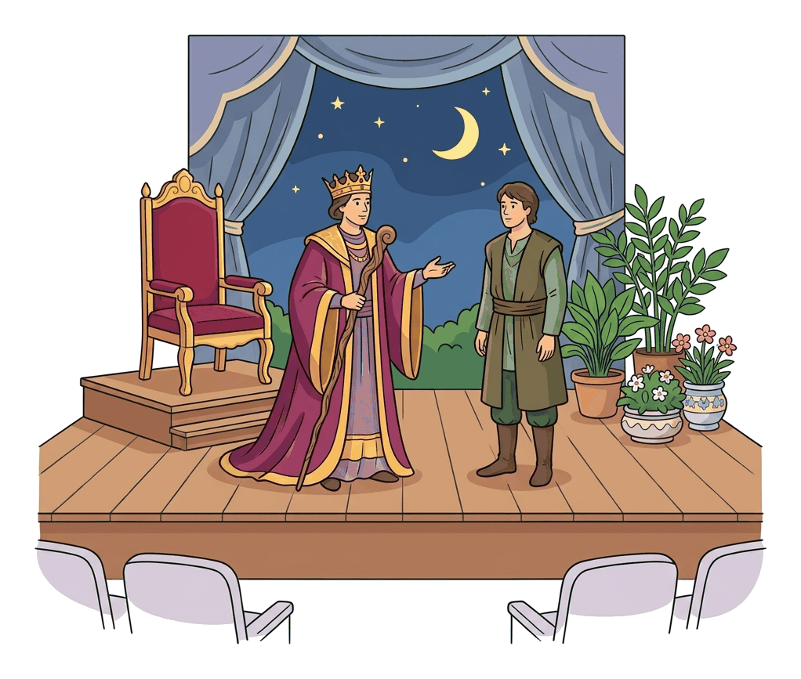

# JAMB Literature In English Notes: Dramatic Techniques and Stagecraft

## What JAMB expects

This topic is Section A, Topic 1b of the JAMB Literature in English syllabus: Drama – Dramatic Techniques. 

It covers the following content items:
- **b. Dramatic Techniques**
  - i. Characterisation
  - ii. Dialogue
  - iii. Flashback
  - iv. Mime
  - v. Costume
  - vi. Music/Dance
  - vii. Décor/scenery
  - viii. Acts/Scenes
  - ix. Soliloquy/aside
  - x. Figures of Speech.

By the end of these notes, you should be able to:
1. Demonstrate adequate knowledge of dramatic techniques and stage directions used in each prescribed text (Objective b.i).
2. Differentiate between styles of selected playwrights (Objective b.ii).

*Note on the split topic: Drama is split into three files. `A1a-types-of-drama.md` covers the different genres (tragedy, comedy, etc.), this file covers how plays are built and staged, and `A1c-interpretation-of-drama.md` covers how to analyse a play's theme, plot, setting, and context. The set texts themselves are covered in `B1` and `B2`.*

## Dramatic techniques and stage directions (Objective b.i)

A play is not just a story written on a page; it is a blueprint for a live performance. **Dramatic techniques** are the various tools and devices a playwright uses to tell a story, reveal characters, and create an emotional response in the audience. 

Because a play usually has no narrator to tell us what is happening or what characters are thinking, the playwright must rely on two main elements:
1. **The dialogue:** what the characters say aloud.
2. **Stage directions:** instructions written into the script (usually in italics and brackets) that tell the actors what to do, how to move, what emotions to show, and how the stage should look. 

To succeed in JAMB, you must understand how to identify these techniques in any prescribed text and explain why the playwright used them.

## The Elements of Stagecraft and Technique

### Characterisation (Content b.i)

**Characterisation** is the method a playwright uses to create, develop, and reveal a character's personality. In prose (like a novel), an author can simply describe a character's thoughts or past. In drama, characterisation is achieved through:

- **What the character says:** The language, tone, and vocabulary they use in dialogue. (A king speaks differently from a street beggar).
- **What the character does:** Their actions and reactions on stage.
- **What other characters say about them:** The gossip or opinions shared by others before the character even walks on stage.
- **Stage directions:** The playwright's notes on the character's physical appearance, posture, and expressions.

### Dialogue (Content b.ii)

**Dialogue** is the conversation between two or more characters on stage. It is the most important dramatic technique because it carries the weight of the play. 
- It **advances the plot** (moving the story forward by revealing information).
- It **reveals character** (showing us who is angry, who is clever, who is deceptive).
- It **creates conflict** (showing the clash between opposing characters).

In Shakespeare's *Antony and Cleopatra*, the grand, poetic dialogue reveals the high status and intense emotions of the rulers.

### Flashback (Content b.iii)

A **flashback** is a scene that interrupts the present action of the play to show an event that happened in the past. 
Playwrights use flashbacks to provide background information, explain a character's current motives, or reveal a hidden secret. Because a stage cannot easily "time travel," flashbacks in drama are often signaled by a change in lighting, a specific sound effect (like a chime or echo), or characters narrating a past event while acting it out.

### Mime (Content b.iv)

**Mime** is the technique of acting without words, using only gestures, body movements, and facial expressions to convey meaning. 
A sequence where actors perform actions silently is called a **pantomime** or dumb show. Mime is highly effective for drawing the audience's attention to a physical action, creating comedy, or building tension. It is heavily used in traditional African dramatic styles, where storytellers use their bodies to imitate animals or act out events while the audience watches.

### Costume (Content b.v)

**Costume** refers to the clothes, accessories, and makeup worn by the actors. Costumes are a vital part of stagecraft because they instantly communicate information to the audience without a single word being spoken.
Costumes reveal:
- **Historical period:** (e.g., Roman armor in *Antony and Cleopatra* vs. traditional Ghanaian Kente cloth in *Marriage of Anansewa*).
- **Social class and wealth:** Rich fabrics versus torn, dirty rags.
- **Occupation:** A police uniform, a doctor's coat, or a priest's robe.
- **State of mind:** A character whose clothes become increasingly messy may be losing their mind or facing ruin.

### Music and Dance (Content b.vi)

**Music and dance** are crucial techniques, especially in African drama, where oral traditions heavily influence the stage. 
- **Music** (songs, drumming, background scoring) sets the mood, builds tension, or provides a transition between scenes. 
- **Dance** expresses joy, sorrow, cultural identity, or ritual.
In Efua Sutherland's *Marriage of Anansewa*, music and dance are central to the storytelling. Sutherland uses the *Mboguo* (musical interludes) to comment on the action, entertain the audience, and transition between moments, copying the traditional Akan *Anansesem* (spider tales) style.

### Décor and Scenery (Content b.vii)

**Décor and scenery** (often called the "set") make up the physical, visual environment of the stage. 
- **Scenery** refers to the painted backdrops, built walls, platforms, and large structures that show the audience *where* the play is happening (e.g., a royal palace, a dark forest, a modern living room).
- **Décor and Props (Properties):** The furniture, rugs, and smaller objects (a sword, a letter, a calabash) that actors interact with.
Together, they establish the setting, time of day, and mood before the actors even speak.

### Acts and Scenes (Content b.viii)

Plays are divided into structural units called **Acts and Scenes**, just as novels are divided into chapters.
- **Act:** The major division of a play. A change in Act often means a major leap in time or a massive shift in the story. Classical plays (like those by Shakespeare) were strictly divided into five Acts (following the structure of exposition, rising action, climax, falling action, and resolution). Modern plays often have one, two, or three Acts.
- **Scene:** A smaller subdivision within an Act. A new scene usually begins when there is a change in the location, a change in time, or when a major character enters or leaves the stage.

### Soliloquy and Aside (Content b.ix)

Playwrights use soliloquies and asides to let the audience know what a character is secretly thinking. Because these two terms are very common in JAMB exams, you must know how to contrast them.

| Feature | Soliloquy | Aside |
| :--- | :--- | :--- |
| **Definition** | A speech made by a character when they are **alone on stage**, revealing their inner thoughts aloud to the audience. | A short remark made by a character directly to the audience or to one other character. |
| **Presence of others** | The character is completely **alone** (or believes they are alone). | Other characters **are present on stage** but pretend they cannot hear the remark. |
| **Length** | Usually long. A deep exploration of the character's feelings, doubts, or plans. | Usually very short. A quick comment, joke, or secret thought. |
| **Purpose** | To reveal deep psychological motives or internal conflict. | To share a secret, create dramatic irony, or make a joke at another character's expense. |

**Textbook variation:** Do not confuse a *soliloquy* with a *monologue*. A monologue is simply a long speech by one character. If other characters are on stage listening to the speech, it is a monologue, **not** a soliloquy. A soliloquy requires the character to be alone.

### Figures of Speech (Content b.x)

To make dialogue powerful, playwrights use **figures of speech** (literary devices). Instead of speaking in plain, boring sentences, characters use imagery to show their emotions.
Common figures of speech in drama include:
- **Metaphor and Simile:** Comparing things to show intense emotion. (e.g., comparing a battle to a storm).
- **Personification:** Giving human qualities to non-human things.
- **Hyperbole:** Extreme exaggeration used for comic or dramatic effect.
- **Pun:** A play on words, very common in Shakespearean comedies and tragedies to create humor or double meanings.
- **Irony (especially Dramatic Irony):** When the audience knows a secret that the characters on stage do not know.

## Differentiating playwrights' styles (Objective b.ii)

**Style** is the unique way a playwright uses language, structure, and dramatic techniques. No two playwrights write the same way, and JAMB expects you to recognize how African and non-African playwrights differ in their stylistic choices.

To differentiate the styles of selected playwrights, look at these elements:

1. **Language and Diction:**
   - Does the playwright use formal, poetic verse (like Shakespeare's use of iambic pentameter and rich metaphors)?
   - Do they use everyday, modern prose, or mix English with local proverbs, Pidgin, or indigenous languages (like many modern West African playwrights)?

2. **Structure:**
   - Does the play follow the strict 5-Act structure of classical European drama?
   - Or does it use a more fluid structure without acts, mimicking a continuous village storytelling session?

3. **Use of Cultural Traditions:**
   - African playwrights (like Efua Sutherland or Wole Soyinka) often weave traditional oral literature into their stagecraft. Sutherland's style is famously modeled on the *Anansesem* (spider storytelling) tradition, utilizing a narrator, audience participation, mime, and musical interludes (*Mboguo*).
   - European classical playwrights might rely more heavily on soliloquies, fixed indoor sceneries, and strict dialogues.

4. **Realism vs. Symbolism:**
   - Some playwrights aim for strict realism, where the set looks exactly like a real room and characters speak normally.
   - Others use symbolism, where masks, ritual dances, or surreal lighting are used to represent spiritual or psychological themes.

By comparing how two playwrights handle dialogue, acts, and music, you can easily differentiate their unique dramatic styles.

## Needs checking against the text
*The prescribed texts for this syllabus are Efua Sutherland's "Marriage of Anansewa" and William Shakespeare's "Antony and Cleopatra". Because this file teaches general techniques, exact quotations and specific scene numbers from these plays have been omitted to prevent errors.* 
- Teachers and students should locate the exact *Mboguo* (musical interludes) in *Marriage of Anansewa* to see Music/Dance in practice.
- Students should identify specific soliloquies or asides spoken by Cleopatra, Antony, or Enobarbus in *Antony and Cleopatra*.
- Students should look at the stage directions in both texts to see how costume and scenery are described by the authors.

## Key terms

| Term | Meaning |
| :--- | :--- |
| **Stage directions** | Written instructions in a script indicating actors' movements, tone, costumes, or lighting. |
| **Dialogue** | The spoken words and conversation between characters on stage. |
| **Soliloquy** | A long speech by a character who is alone on stage, revealing their inner thoughts. |
| **Aside** | A brief comment made by a character to the audience, unheard by other characters on stage. |
| **Monologue** | A long speech made by one character, usually with other characters on stage listening. |
| **Mime** | Acting out a story or emotion using body movements and gestures without words. |
| **Act** | A major structural division of a play. |
| **Scene** | A smaller subdivision of an Act, usually marking a change in time, place, or characters. |
| **Décor** | The furnishing and decoration of the stage to create a realistic or symbolic setting. |
| **Props (Properties)** | Small objects used by actors on stage (e.g., a cup, a letter, a weapon). |

## Exam tips and common mistakes

- **Soliloquy vs. Aside vs. Monologue:** This is heavily tested! 
  - Alone on stage revealing thoughts = **Soliloquy**. 
  - Quick secret comment with others on stage = **Aside**. 
  - Long speech with others listening = **Monologue**.
- **Stage directions are not spoken:** Remember that stage directions guide the physical action, lighting, and mood. They are read by the actors and director, but the audience only *sees* the result, they do not hear them spoken.
- **Décor vs. Costume:** Décor dresses the *stage* (furniture, backgrounds). Costume dresses the *actor* (clothes, masks).
- **Acts vs. Scenes:** An Act is the big division; a Scene is the small division inside the Act.

## Quick summary

1. Dramatic techniques are the tools (like dialogue, action, and scenery) a playwright uses to bring a story to life on stage.
2. Characterisation in drama relies heavily on what characters say (dialogue), what they do (action), and stage directions, since there is no narrator.
3. Flashbacks take the audience back in time to reveal background information, while mime uses silent physical gestures to convey meaning.
4. Costumes, décor, and scenery visually establish the setting, social class, and historical period before any words are spoken.
5. Plays are divided structurally into major sections called Acts, and smaller sections called Scenes.
6. A soliloquy is spoken by a character alone on stage to reveal inner thoughts; an aside is a brief secret comment made while others are on stage.
7. Playwrights have different styles; for example, an African playwright might heavily use traditional music, dance, and storytelling techniques, while a classical European playwright might use strict 5-act structures and poetic verse.

## Practice questions

**1. A dramatic technique where a character speaks their innermost thoughts aloud while alone on stage is called a/an:**
- A. aside
- B. soliloquy
- C. dialogue
- D. prologue

**Answer: B.** A soliloquy occurs when a character is alone on stage and reveals their private thoughts to the audience.

**2. Which of the following is primarily used to divide a play into its major structural parts?**
- A. Acts
- B. Scenes
- C. Flashbacks
- D. Soliloquies

**Answer: A.** Acts are the major structural divisions of a play, which are further broken down into smaller scenes.

**3. In drama, stage directions are intended to provide information about all the following EXCEPT:**
- A. the actors' movements
- B. the tone of voice to be used
- C. the audience's reactions
- D. the setting and décor

**Answer: C.** Stage directions instruct the director, designers, and actors on movements, tone, and setting. They cannot dictate or instruct how the live audience will actually react.

**4. A brief remark made by a character on stage that is meant to be heard by the audience but not by the other characters is known as:**
- A. a soliloquy
- B. an aside
- C. a monologue
- D. a mime

**Answer: B.** An aside is a quick, secret remark made directly to the audience while other characters are present but pretend not to hear.

**5. The use of gestures, body language, and facial expressions to tell a story without speaking is called:**
- A. décor
- B. monologue
- C. flashback
- D. mime

**Answer: D.** Mime (or pantomime) is acting without words, relying entirely on physical movement.

**6. Which dramatic element visually informs the audience about a character's profession, wealth, and historical period?**
- A. Dialogue
- B. Soliloquy
- C. Costume
- D. Aside

**Answer: C.** Costume refers to the clothing and accessories worn by the actor, which instantly reveals their social status, job, and time period.

**7. A scene that interrupts the present action of a play to show an event that happened in the past is a:**
- A. foreshadowing
- B. flashback
- C. prologue
- D. pantomime

**Answer: B.** A flashback takes the narrative back in time to show a past event that is important to the current story.

**8. If you were analyzing the unique style of an African playwright compared to a classical European one, which of the following features would most likely highlight the African style?**
- A. The strict use of five acts
- B. The heavy integration of traditional music, dance, and oral storytelling
- C. The exclusive use of soliloquies
- D. The use of highly realistic European décor

**Answer: B.** Many African playwrights (like Efua Sutherland) style their plays after traditional oral performances, incorporating song, dance, and active audience participation.

**9. In stagecraft, the furniture, painted backdrops, and physical objects placed on stage to create the setting are referred to as:**
- A. costume and makeup
- B. acts and scenes
- C. décor and scenery
- D. figures of speech

**Answer: C.** Décor and scenery make up the physical, visual environment of the stage.

**10. What is the main difference between a monologue and a soliloquy?**
- A. A monologue is spoken by the narrator, while a soliloquy is spoken by a character.
- B. A monologue is always funny, while a soliloquy is tragic.
- C. A monologue is spoken with other characters present on stage, while a soliloquy is spoken when the character is alone.
- D. A monologue is short, while a soliloquy is very long.

**Answer: C.** The defining feature of a soliloquy is that the character is completely alone on stage, whereas a monologue is just a long speech that can be delivered to other characters.
