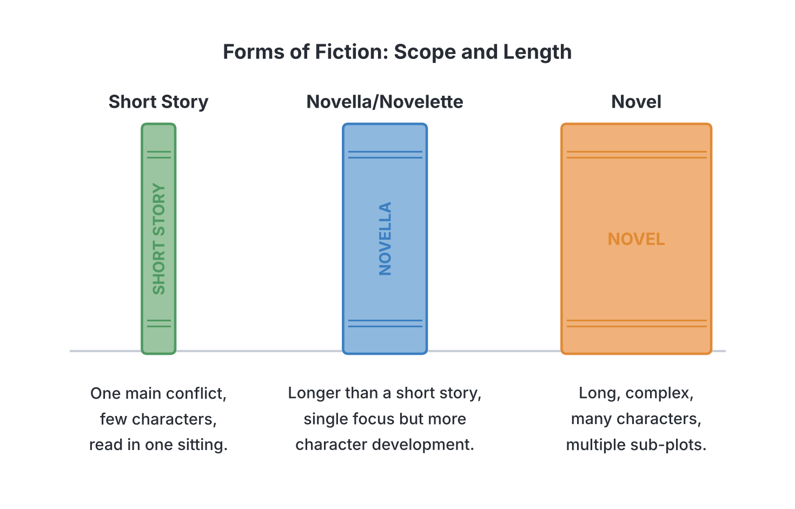

# JAMB Literature In English Notes: Types of Prose: Fiction, Non-Fiction, and Faction

## What JAMB expects

This topic is part of Section A (General Literary Principles), Topic 2 of the JAMB Literature in English syllabus: Prose. It covers the different types and categories of prose writing. 

This file covers:
- **a. Types:**
  - i. Fiction (Novel, Novella/Novelette, Short story)
  - ii. Non-fiction (Biography, Autobiography, Memoir)
  - iii. Faction (combination of fact and fiction)

By the end of these notes, you should be able to:
1. Differentiate between types of novel (Objective a.i).
2. Identify the category that each prescribed text belongs to (Objective a.ii).
3. Analyse the components of each type of prose (Objective a.iii).
4. Identify the balance of facts and fiction in literary faction (Objective a.iv).

**Note on the syllabus wording:** The syllabus heading for this section is printed as "Types: Prose fiction", but it goes on to list "Non-fiction" and "Faction" underneath it. This is a slight grouping error in the syllabus text. Prose is broadly divided into fiction and non-fiction, with faction sitting between the two. These notes explain all three categories clearly. 
*(Note: Narrative techniques, characterisation, and textual analysis are covered in detail in `A2b-narrative-techniques-and-devices.md` and `A2c-textual-analysis-of-prose.md`.)*

## Analyse the components of each type of prose

**Objective a.iii: analyse the components of each type of prose.**

**Prose** is ordinary written language that follows regular grammatical rules. Unlike poetry, it does not use metrical patterns, rhyming lines, or stanzas. Unlike drama, it is not written primarily as dialogue for actors to perform. Prose is written in **sentences** which are grouped into **paragraphs**, and often further divided into **chapters**.

Whether a piece of prose is fiction, non-fiction, or faction, it is built from several key structural components:

1. **Plot:** The sequence of events. In fiction and faction, the plot is usually arranged to build tension (a beginning, rising action, climax, and resolution). In non-fiction (like biographies), the "plot" is the chronological timeline of the person's life.
2. **Characters:** The people, animals, or beings in the story. In fiction, they are invented. In non-fiction, they are real historical or living people. In faction, they are a mix of both.
3. **Setting:** The time (temporal) and place (spatial) where the events occur. Fiction can have imaginary settings (like a magical kingdom) or real-world settings. Non-fiction and faction must use real-world settings.
4. **Theme:** The central idea or underlying message (e.g., love, corruption, survival). Every type of prose has a theme.
5. **Narrative voice/Point of view:** The perspective from which the story is told (e.g., first-person "I" or third-person "he/she"). Autobiographies are always written in the first person. Novels can use any point of view.

## Fiction (Novel, Novella, Short story)

**Content a.i: Fiction (Novel, Novella/Novelette, Short story).**

**Fiction** refers to prose narratives that are drawn from the writer's imagination. The characters, events, and sometimes the settings are not real, even though they might imitate real life (this imitation of reality is called **verisimilitude**).

Fiction is mainly classified by its **length** and **complexity** into three types:

### 1. The Short Story
A short story is a brief work of prose fiction.
- **Length:** Usually short enough to be read in a single sitting.
- **Components:** It focuses on a **single major event or conflict**. It has very few characters, a limited setting, and a simple plot without sub-plots.
- **Example:** *The Girl with a Magic Ear* (made up for teaching) or classic short stories like Chinua Achebe's *The Madman*.

### 2. The Novella (or Novelette)
A novella is a work of fiction that is longer than a short story but shorter than a standard novel.
- **Length:** Usually between 10,000 and 40,000 words. (The term "novelette" is sometimes used for a shorter novella, though some textbooks use the terms interchangeably).
- **Components:** It is more complex than a short story, allowing for more character development and a slightly broader setting, but it still maintains a tight, single focus without the multiple sub-plots of a novel.
- **Example:** George Orwell's *Animal Farm* or Ernest Hemingway's *The Old Man and the Sea*.

### 3. The Novel
A novel is a long, complex work of prose fiction.
- **Length:** Book-length (usually over 40,000 words).
- **Components:** It features a large cast of characters (both major and minor), multiple settings, and a complex plot that often includes several **sub-plots** (smaller secondary stories running alongside the main story). It explores themes in great depth and often takes place over a long period.
- **Example:** Chimamanda Ngozi Adichie's *Half of a Yellow Sun*.

## Differentiate between types of novel

**Objective a.i: differentiate between types of novel.**

Because the novel is such a large category, literary critics divide novels into different types based on their subject matter, style, and structure. JAMB expects you to know the differences between the major types:

| Type of Novel | Meaning and Characteristics | Example (Made up or real) |
| --- | --- | --- |
| **Epistolary Novel** | A novel written entirely as a series of **letters**, diary entries, or documents. The story unfolds through the characters writing to each other. | Mariama Bâ's *So Long a Letter* (written as a letter to a friend). |
| **Picaresque Novel** | A novel about the adventures of a rough, dishonest, but appealing hero (a "picaro" or rogue) who travels from place to place, surviving by their wits. It is usually told in the first person and structured as a series of loose episodes. | A story about a clever street boy who tricks his way across different towns in Nigeria. |
| **Bildungsroman (Coming-of-age Novel)** | A novel that traces the moral, psychological, and intellectual **growth of the main character** from childhood to adulthood. | A novel following a young girl from her troubled primary school days to her maturity as a wise university graduate. |
| **Historical Novel** | A novel set in a specific **past historical period**. It blends accurate historical details, settings, and sometimes real historical figures with fictional characters and events. | A fictional story about a warrior fighting in the real 19th-century Oyo Empire. |
| **Gothic Novel** | A novel characterised by mystery, horror, the supernatural, dark castles or mansions, and a general atmosphere of terror and gloom. | Mary Shelley's *Frankenstein*. |
| **Allegorical Novel** | A novel where characters, events, and settings represent abstract ideas, moral qualities, or political concepts. The story has a surface meaning and a hidden, deeper meaning. | George Orwell's *Animal Farm* (animals on a farm represent the Russian Revolution). |
| **Sociological / Protest Novel** | A novel that highlights social issues, injustices, or political corruption to provoke social change or awareness. | Richard Wright's *Native Son*. |

## Non-fiction (Biography, Autobiography, Memoir)

**Content a.ii: Non-fiction (Biography, Autobiography, Memoir).**

**Non-fiction** is prose writing that deals entirely with real people, real events, and factual information. While fiction relies on imagination, non-fiction relies on research, facts, and memory. The major literary forms of non-fiction focus on people's lives:

### 1. Biography
A biography is a detailed account of **a person's life written by someone else**.
- The writer (the biographer) must do extensive research, read historical documents, and interview people to ensure the facts are accurate.
- It is written in the **third-person** point of view ("he", "she").
- **Example:** A book about the life of Nnamdi Azikiwe, written by a modern historian.

### 2. Autobiography
An autobiography is a detailed account of **a person's life written by that person themselves**.
- The author tells the story of their own life, usually from birth up to the time of writing.
- It is highly subjective, as it relies on the writer's own memories and personal feelings.
- It is written in the **first-person** point of view ("I", "me").
- **Example:** Nelson Mandela's *Long Walk to Freedom*.

### 3. Memoir
A memoir is similar to an autobiography because it is also written by the subject themselves, but it is **narrower in scope**.
- Instead of covering the person's entire life from birth to present, a memoir focuses on a **specific period, event, or theme** in their life (for example, their time fighting in a war, or their career as a teacher).
- It places more emphasis on emotional truth and reflection than on a strict timeline of dates and facts.
- **Example:** Wole Soyinka's *The Man Died* (which focuses specifically on his time in prison).

**Summary Table of Non-fiction Types:**
| Feature | Biography | Autobiography | Memoir |
| --- | --- | --- | --- |
| **Author** | Written by someone else | Written by the subject | Written by the subject |
| **Scope** | Usually the person's entire life | The person's entire life | A specific period or theme in the person's life |
| **Point of View** | Third-person ("He/She") | First-person ("I") | First-person ("I") |

## Faction: combination of fact and fiction

**Content a.iii: Faction; Objective a.iv: identify the balance of facts and fiction in literary faction.**

**Faction** is a literary genre that blends **fact** (real historical events or real people) with **fiction** (invented characters, imagined dialogue, or made-up events). The word itself is a blend of "fact" and "fiction".

### Identifying the balance
In faction, the author uses real historical realities as a foundation, but fills in the missing gaps using their imagination to make the story more entertaining and dramatic. 

To identify the balance of fact and fiction in a piece of faction, look for:
1. **Fact (The anchor):** The major historical events, the time period, the geographical locations, and sometimes the major public figures are completely real and accurate.
2. **Fiction (The dramatic element):** The exact conversations that took place behind closed doors (which nobody recorded) are invented by the author. The inner thoughts and feelings of the historical figures are imagined. Sometimes, a fictional main character is inserted into a real historical event.

**Why use faction?**
Writers use faction to bring history to life. Dry historical facts can be boring, but by adding fictional dialogue and emotional depth, the author allows the reader to experience the history as if they were actually there. 

**Example of Faction:** Truman Capote's *In Cold Blood* is based entirely on a real multiple murder that happened in America. The author spent years researching the facts. However, he wrote the book using the techniques of a novel, imagining the exact thoughts, conversations, and moods of the victims and the killers, blending journalistic facts with fictional storytelling.

*(Note: Some textbooks group "Historical Novels" directly under Faction, while others treat them as Fiction. The key distinction is that Faction often claims to be a true story told using fictional techniques, whereas a Historical Novel is clearly a made-up story that just happens to be set in the past.)*

## Category of the prescribed texts

**Objective a.ii: identify the category that each prescribed text belongs to.**

JAMB requires you to know exactly which category of prose the syllabus's prescribed texts fall into. Based on the current syllabus texts:

1. **So the Path Does not Die** by Pede Hollist
   - **Category:** Prose Fiction (Novel)
   - It is a contemporary African novel featuring fictional characters and an imagined plot, even though it reflects real-world social issues.

2. **Redemption Road** by Elma Shaw
   - **Category:** Prose Fiction (Novel)
   - It is a novel set against the very real backdrop of the Liberian civil war and its aftermath. While the historical setting is factual, the main characters and their specific story arcs are fictional.

3. **Path of Lucas: The Journey He Endured** by Susanne Bellefeuille
   - **Category:** Prose Fiction / Faction **[TO BE COMPLETED: Verify whether JAMB exam questions strictly classify this as Fiction, Faction, or Biographical Novel]**
   - *General note based on the book:* Susanne Bellefeuille wrote this book based on the true life story of her own father (Lucas). Because it tells a real person's life story but is written using the narrative techniques, dialogue, and pacing of a novel, it sits closely on the border of a biographical novel and **faction**.

## Needs checking against the text
- **[TO BE COMPLETED: Verify whether JAMB exam questions strictly classify this as Fiction, Faction, or Biographical Novel]**: The specific classification of *Path of Lucas* by JAMB. Since it is based heavily on a true story, some examiners might consider it faction or biography, though it is marketed as fiction.

## Key terms

| Term | Meaning |
| --- | --- |
| Prose | Ordinary written language arranged in sentences and paragraphs, without metrical structure. |
| Fiction | Prose writing drawn from the imagination; not true. |
| Non-fiction | Prose writing based entirely on facts, real events, and real people. |
| Novel | A long, complex work of prose fiction with multiple characters and sub-plots. |
| Novella | A work of fiction longer than a short story but shorter and less complex than a novel. |
| Short story | A brief work of fiction focusing on a single event or conflict. |
| Biography | The story of a person's life written by someone else. |
| Autobiography | The story of a person's life written by themselves. |
| Memoir | A type of autobiography that focuses only on a specific period or theme of the writer's life. |
| Faction | A literary genre that blends factual historical events with fictional narrative techniques. |
| Epistolary novel | A novel written as a series of letters or documents. |
| Picaresque novel | A novel about the adventures of a rogue hero surviving by their wits. |
| Bildungsroman | A novel dealing with the psychological and moral growth of the main character from youth to adulthood. |
| Verisimilitude | The appearance of being true or real in a work of fiction. |

## Exam tips and common mistakes

- **Do not confuse Autobiography and Biography:** Auto- means "self". An autobiography is written by the self; a biography is written by someone else.
- **Do not confuse Autobiography and Memoir:** An autobiography covers the whole life; a memoir covers only a specific part or theme of the life.
- **Novella vs Novel:** If a JAMB question asks for a prose form longer than a short story but shorter than a novel, the answer is always **novella** (or novelette).
- **Epistolary is about letters:** Always associate the word "epistolary" with epistles (letters) or diary entries.
- **Understand Faction:** Faction is not 100% true and not 100% fake. It uses a factual backbone (real events/settings) but fleshes it out with fictional elements (imagined dialogue, altered timelines, composite characters).
- **Bildungsroman:** A common exam term. Remember it as the "growing up" or "coming-of-age" novel.

## Quick summary

1. Prose is ordinary writing structured in sentences and paragraphs, lacking the meter of poetry or the pure dialogue format of drama.
2. The components of prose include plot, character, setting, theme, and point of view.
3. Fiction is imaginative prose. Its types are categorized by length and complexity: the short story (brief, single focus), the novella (medium length, single focus), and the novel (long, complex, multiple sub-plots).
4. Novels are further divided by subject and style, such as epistolary (letters), picaresque (rogue adventures), and bildungsroman (coming-of-age).
5. Non-fiction is factual prose. Its major forms are biography (written by someone else), autobiography (written by the subject, whole life), and memoir (written by the subject, specific period).
6. Faction is a blend of fact and fiction, where real historical events are dramatised using invented dialogue and fictional storytelling techniques.
7. The prescribed prose texts for the JAMB syllabus (such as *So the Path Does not Die* and *Redemption Road*) belong to the broader category of prose fiction (novels).

## Practice questions

**1. A long, complex work of prose fiction that contains multiple sub-plots and a large cast of characters is called a**
- A. novella
- B. memoir
- C. novel
- D. short story

**Answer: C.** A novel is distinguished from short stories and novellas by its extended length, complex plot, sub-plots, and depth of characterisation.

**2. Which of the following best defines a memoir?**
- A. The story of a person's entire life written by someone else.
- B. A fictional story told through a series of letters.
- C. An autobiographical account that focuses only on a specific period or theme in the writer's life.
- D. A chronological account of a person's life from birth to death, written by themselves.

**Answer: C.** Unlike a full autobiography (Option D), a memoir zeroes in on a specific era, event, or aspect of the author's life.

**3. An epistolary novel is a novel that**
- A. traces the moral growth of the protagonist.
- B. is written in the form of letters or diary entries.
- C. features a dishonest but charming rogue.
- D. deals with supernatural events in a dark, gloomy setting.

**Answer: B.** The word "epistolary" relates to epistles, which are letters. Thus, an epistolary novel is composed of letters or documents.

**4. A literary work that blends actual historical facts with invented dialogue and imagined events is best described as**
- A. faction
- B. pure fiction
- C. a biography
- D. an allegory

**Answer: A.** Faction combines factual historical reality with the imaginative elements of fiction.

**5. Which of the following is NOT a fundamental component of prose fiction?**
- A. Plot
- B. Stanzas
- C. Setting
- D. Characters

**Answer: B.** Stanzas are a structural component of poetry, not prose. Prose uses sentences and paragraphs.

**6. The type of novel that follows the adventures of a rough, wandering rogue who survives by his wits is known as a**
- A. gothic novel
- B. picaresque novel
- C. bildungsroman
- D. historical novel

**Answer: B.** A picaresque novel details the episodic adventures of a "picaro" (a rogue or scoundrel).

**7. How does a short story primarily differ from a novella?**
- A. A short story is based on facts, while a novella is based on fiction.
- B. A short story has multiple sub-plots, while a novella has none.
- C. A short story focuses on a single incident and is very brief, while a novella is longer and allows for more character development.
- D. A short story uses poetic meter, while a novella uses ordinary prose.

**Answer: C.** A short story is briefer and more tightly focused than a novella, which sits midway in length between a short story and a novel.

**8. If a historian conducts extensive research and interviews to write a book about the life of a famous Nigerian politician, the resulting book is a**
- A. memoir
- B. biography
- C. autobiography
- D. picaresque novel

**Answer: B.** A biography is an account of someone's life written by another person.

**9. The prescribed text *Redemption Road* by Elma Shaw belongs to which broad category of prose?**
- A. Autobiography
- B. Memoir
- C. Prose Fiction (Novel)
- D. Biography

**Answer: C.** *Redemption Road* is a novel (prose fiction) that deals with the aftermath of the Liberian civil war using fictional characters.

**10. A "coming-of-age" novel that focuses on the psychological and moral development of the protagonist from childhood to adulthood is called a**
- A. sociological novel
- B. gothic novel
- C. bildungsroman
- D. faction

**Answer: C.** A bildungsroman specifically traces the formative years and spiritual or moral education of the main character.

<!-- COVERAGE
obj a.i | Differentiate between types of novel
obj a.ii | Category of the prescribed texts
obj a.iii | Analyse the components of each type of prose
obj a.iv | Faction: combination of fact and fiction
item a | Fiction (Novel, Novella, Short story)
-->
