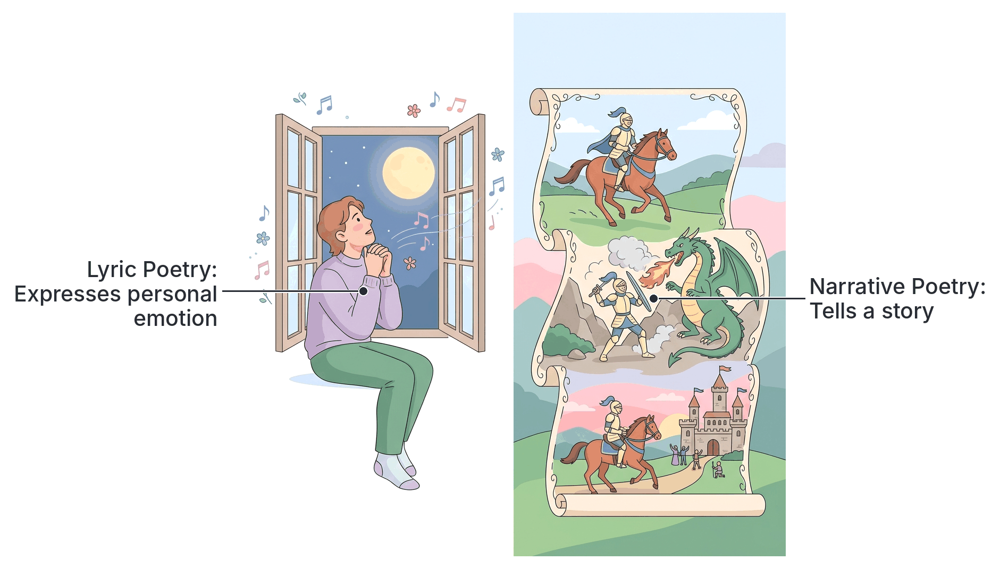
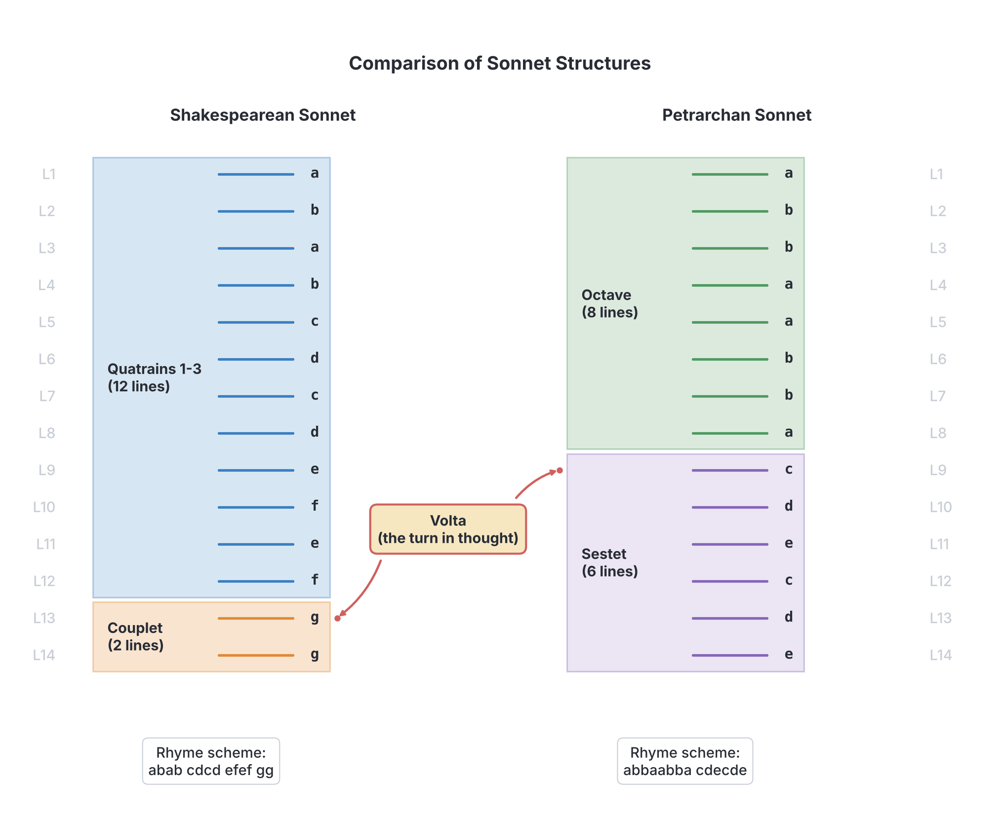

# JAMB Literature In English Notes: Types of Poetry

## What JAMB expects

This topic is Part 3a of the JAMB Literature in English syllabus: Poetry – Types. 

This file covers:
- **a. Types:**
  - (i) Sonnet
  - (ii) Ode
  - (iii) Lyrics
  - (iv) Elegy
  - (v) Ballad
  - (vi) Panegyric
  - (vii) Epic
  - (viii) Blank Verse, etc.

By the end of these notes, you should be able to:
1. Identify different types of poetry (Objective a.i).
2. Identify the distinctive features of the poetic types (Objective a.ii).

**Note on the syllabus wording:** 
- The syllabus lists "Lyrics" as a type. In everyday language, "lyrics" refers to the words of a modern song. In literature, however, the correct term is a **lyric poem** or simply a **lyric**.
- The syllabus includes "Blank Verse" under types of poetry. Textbooks vary on this: most classify blank verse as a **metrical form** (a way of structuring lines) rather than a thematic "type" of poem like an epic or an elegy. A poem of any type can be written in blank verse. However, because JAMB lists it here, we will study its features as a distinct poetic category. 
- This is the first of three files on poetry. Poetic devices are covered in `A3b-poetic-devices.md`, and how to appreciate a poem is covered in `A3c-poetic-appreciation.md`.

## Identifying different types of poetry

Before looking at the specific types of poems JAMB requires, it is helpful to know that all poetry is generally grouped into three broad categories. Being able to identify which of these three categories a poem falls into makes it much easier to classify its specific type.

1. **Lyric Poetry:** This is poetry that focuses on expressing the **personal feelings, thoughts, and emotions** of a single speaker. It is highly subjective and does not tell a full story. Examples include the sonnet, ode, elegy, and general lyric.
2. **Narrative Poetry:** This is poetry that **tells a story**. It has characters, a setting, and a plot (a beginning, middle, and end), just like a prose novel, but it is written in verse. Examples include the epic and the ballad.
3. **Dramatic Poetry:** This is poetry written in the voice of one or more characters, often meant to be spoken or acted on stage. The poet's own voice is hidden. An example is a dramatic monologue or the verse dialogues found in William Shakespeare's plays.

## Types of poetry

The JAMB syllabus requires you to be familiar with eight specific poetic forms or structural types. Some of these belong to the lyric category (because they express feelings), some belong to the narrative category (because they tell stories), and some are structural formats. 

The types are:
1. **Sonnet** (Lyric)
2. **Ode** (Lyric)
3. **Lyrics / Lyric poem** (Lyric)
4. **Elegy** (Lyric)
5. **Ballad** (Narrative)
6. **Panegyric** (Praise poetry)
7. **Epic** (Narrative)
8. **Blank Verse** (A structural verse form)

## Distinctive features of poetic types

### 1. Sonnet

A **sonnet** is a strict poetic form consisting of exactly **14 lines**, usually written in **iambic pentameter** (a rhythm of ten syllables per line, alternating unstressed and stressed beats). Sonnets traditionally explore a single theme, most commonly romantic love, and feature a "turn" in thought called a **volta**.

There are two major types of sonnets, which differ in how the 14 lines are grouped and rhymed.

#### The Petrarchan (Italian) Sonnet
Named after the 14th-century Italian poet Francesco Petrarch, this sonnet divides the 14 lines into two parts:
- An **Octave** (the first 8 lines). The octave usually presents a problem, a question, or a situation. It has a strict rhyme scheme of **abbaabba**.
- A **Sestet** (the final 6 lines). The sestet resolves the problem, answers the question, or provides a new perspective. It has a rhyme scheme of **cdecde** or **cdcdcd**.
- The **Volta** (turn) occurs at the beginning of the 9th line (the start of the sestet), marking the shift from the problem to the solution.

#### The Shakespearean (English) Sonnet
Developed in England and made famous by William Shakespeare, this sonnet divides the 14 lines into four parts:
- **Three Quatrains** (groups of 4 lines each). These develop the problem or main idea, exploring different aspects of it. 
- **One Couplet** (a final 2 rhyming lines). This provides a quick, often surprising conclusion or summary.
- The rhyme scheme is **abab cdcd efef gg**.
- The **Volta** usually occurs right before the final couplet (at line 13).

**Comparison of Sonnet Types**

| Feature | Petrarchan (Italian) Sonnet | Shakespearean (English) Sonnet |
| --- | --- | --- |
| **Structure** | 1 Octave (8 lines) + 1 Sestet (6 lines) | 3 Quatrains (12 lines) + 1 Couplet (2 lines) |
| **Rhyme Scheme** | abbaabba cdecde (or cdcdcd) | abab cdcd efef gg |
| **Development** | Problem in the octave, solution in the sestet | Idea explored in quatrains, concluded in couplet |
| **Where the Volta is** | Usually at Line 9 | Usually at Line 13 |

### 2. Ode

An **ode** is a formal, often ceremonious lyric poem that directly addresses and celebrates a person, a place, a thing, or an abstract idea. 

**Distinctive features of an ode:**
- **Elevated tone:** It is serious, grand, and highly respectful.
- **Direct address:** Odes frequently use **apostrophe** (speaking directly to a subject that cannot answer back, e.g., "O Autumn!").
- **Elaborate structure:** They are often long and complex in their stanza forms.
- **Examples:** John Keats's *Ode to a Nightingale* or *Ode on a Grecian Urn*.

There are different historical forms of the ode. **Pindaric odes** (named after the ancient Greek poet Pindar) were meant to be sung by a chorus and had a very strict three-part structure (strophe, antistrophe, and epode) to celebrate athletic victories. **Horatian odes** (after the Roman poet Horace) are calmer, more personal, and use regular stanzas. **Irregular odes** have no fixed pattern.

### 3. Lyrics (Lyric poetry)

As explained earlier, **lyric poetry** is a broad category, but a specific poem can also be described simply as "a lyric". A lyric is a short poem in which a single speaker expresses deep personal feelings and thoughts.

**Distinctive features of a lyric:**
- **Emotional focus:** It is about how the poet feels (e.g., love, grief, joy, anger) rather than telling a story.
- **First-person voice:** It usually uses the pronoun "I".
- **Musicality:** The word "lyric" comes from the "lyre," a stringed musical instrument used in ancient Greece. Lyric poems have a strong sense of rhythm, melody, and musical sound.
- **Brevity:** They are usually short.
- **Example:** Lord Byron's *She Walks in Beauty* (one of the prescribed non-African poems).

### 4. Elegy

An **elegy** is a mournful, melancholy poem written to lament (cry over) the dead. It is a poem of sorrow and reflection on mortality.

**Distinctive features of an elegy:**
- **Tone:** It is sad, serious, and reflective.
- **Thematic stages:** A traditional elegy often goes through three stages:
  1. **Lament:** The speaker expresses grief and sorrow for the dead.
  2. **Praise:** The speaker praises the dead person's virtues and achievements.
  3. **Consolation:** The speaker finds some comfort (e.g., the person is in heaven, or their memory will live on) and accepts the reality of death.
- **Example:** Thomas Gray's *Elegy Written in a Country Churchyard*.

**Exam Tip:** Do not confuse an elegy with a **dirge**. A dirge is also a song of mourning for the dead, but it is much shorter, less formal, and is usually meant to be sung aloud at a funeral. An elegy is a longer, more philosophical written poem.

### 5. Ballad

A **ballad** is a narrative poem (it tells a story) that was originally meant to be sung. Ballads often deal with folklore, tragic love, historical events, or heroic adventures.

**Distinctive features of a ballad:**
- **Narrative:** It tells a complete story.
- **Ballad stanza:** It is usually written in four-line stanzas (quatrains). The lines alternate in length: lines 1 and 3 have eight syllables, while lines 2 and 4 have six syllables.
- **Rhyme scheme:** The second and fourth lines usually rhyme (**abcb**).
- **Repetition and Refrains:** Certain lines or whole stanzas are repeated at intervals (like the chorus of a song) to help oral storytellers remember the poem.
- **Simple language:** Because they were originally for ordinary people, they use direct, simple language and dialogue.

### 6. Panegyric

A **panegyric** (pronounced *pan-uh-JIR-ik*) is a poem of elaborate and public praise. While an ode can praise an object or idea, a panegyric is specifically designed to shower massive praise on a human being, such as a king, a hero, or a patron.

**Distinctive features of a panegyric:**
- **Hyperbole (exaggeration):** The subject's strength, beauty, or wealth is exaggerated to make them seem almost god-like.
- **Historical and ancestral links:** It often praises the person's ancestors and lineage.
- **African context:** Panegyrics are extremely important in African oral literature. They are known as **praise poetry**. Griots or court poets recite them to honor rulers. Examples include the **Oriki** in Yoruba culture or the **Izibongo** in Zulu culture.

### 7. Epic

An **epic** is a massive, long narrative poem that tells the story of a hero of great historical or legendary importance, upon whose actions the fate of a nation or a people depends.

**Distinctive features of an epic:**
- **Vast setting:** The story covers multiple nations, the whole world, or even the universe (heaven and hell).
- **Heroic figures:** The main character is a figure of immense strength, bravery, and national significance.
- **Supernatural machinery:** Gods, angels, demons, or spirits actively intervene in human affairs and help or hinder the hero.
- **Elevated style:** The language is formal, grand, and majestic. 
- **Epic conventions:** Epics traditionally share specific habits:
  - **Invocation to the muse:** The poet begins by praying to a god or spirit of poetry for inspiration to tell the massive story.
  - ***In medias res*:** A Latin phrase meaning "in the middle of things." Epics often start in the middle of the action, using flashbacks to explain what happened earlier.
- **Examples:** Homer's *Iliad* and *Odyssey*, John Milton's *Paradise Lost*, and African oral epics like the Malian epic of *Sundiata* or the Ijaw *Ozidi Saga*.

**Comparing the two Narrative Poems: Epic vs. Ballad**

| Feature | Epic | Ballad |
| --- | --- | --- |
| **Length** | Extremely long (often book-length) | Short or medium length |
| **Subject** | Fate of a nation; superhuman heroes | Ordinary people, tragic love, local folklore |
| **Language** | Grand, elevated, highly formal | Simple, direct, conversational |
| **Scale** | Gods and supernatural forces involved | Usually focused on human drama |

### 8. Blank Verse, and other forms (etc.)

As noted earlier, **blank verse** is not a thematic genre (like an elegy), but a strict structural way of writing poetry. 

**Blank verse** is poetry written in **unrhymed iambic pentameter**. 
- **"Blank"** means the lines do not rhyme at the ends.
- **"Iambic pentameter"** means every line has exactly 10 syllables, arranged in a rhythm of five alternating unstressed and stressed beats (da-DUM da-DUM da-DUM da-DUM da-DUM).

Many of William Shakespeare's plays, and John Milton's epic *Paradise Lost*, are written in blank verse. It is popular because its rhythm is very close to natural, dignified English speech.

**Exam Tip: Blank Verse vs. Free Verse**
Students frequently confuse these two. 
- **Blank Verse** has NO rhyme, but it HAS a strict meter (10 syllables, iambic rhythm).
- **Free Verse** has NO rhyme AND NO strict meter. The poet decides the length of every line freely.

#### Other minor types of poetry ("etc.")
The syllabus adds "etc." at the end of the types. Here are a few other common poetic forms you may encounter in JAMB:
- **Dirge:** A short, simple song of mourning sung at a funeral.
- **Lullaby:** A soothing, rhythmic song or poem intended to put a child to sleep.
- **Epigram:** A very short, clever, and often witty or humorous poem, usually ending with a surprising twist.
- **Pastoral:** A poem that presents an idealized, peaceful view of rural life, often featuring shepherds and beautiful landscapes.
- **Limerick:** A humorous, five-line poem with an *aabba* rhyme scheme and a bouncy rhythm.

## Needs checking against the text
All general literary facts in this file have been verified against standard literary theory. No set-text plot details are required in this general types file.

## Key terms

| Term | Meaning |
| --- | --- |
| Lyric poetry | Poetry that expresses the personal emotions and thoughts of the speaker. |
| Narrative poetry | Poetry that tells a story with characters and a plot. |
| Sonnet | A 14-line poem, usually in iambic pentameter, with a specific rhyme scheme. |
| Volta | The "turn" or shift in thought or argument in a sonnet. |
| Octave / Sestet | An 8-line stanza / a 6-line stanza (the two parts of a Petrarchan sonnet). |
| Quatrain | A stanza of exactly 4 lines. |
| Couplet | Two consecutive lines of poetry that rhyme. |
| Ode | A formal, elevated lyric poem that directly addresses and celebrates a subject. |
| Elegy | A mournful poem reflecting on death and lamenting someone who has died. |
| Ballad | A narrative poem, originally sung, using simple stanzas and often a refrain. |
| Panegyric | A poem of massive, exaggerated praise (common as oral praise poetry in Africa). |
| Epic | A long narrative poem about a national hero, featuring grand style and supernatural forces. |
| *In medias res* | Latin for "in the middle of things"; the epic tradition of starting a story in the middle of the action. |
| Blank verse | Poetry written in unrhymed iambic pentameter. |
| Free verse | Poetry that has no regular meter and no rhyme scheme. |
| Dirge | A short, simple song of mourning meant for a funeral. |

## Exam tips and common mistakes

*   **14 Lines = Sonnet:** If a JAMB question mentions a 14-line poem, the answer is almost always a sonnet.
*   **Know the Volta locations:** In a Petrarchan sonnet, the turn (volta) is at line 9. In a Shakespearean sonnet, it is usually at line 13.
*   **Ode vs. Elegy:** An **ode** is for celebration and direct address; an **elegy** is for mourning the dead. 
*   **Blank verse is NOT free verse:** This is the most common student mistake. Blank verse is highly structured by rhythm (10 syllables, iambic), it just doesn't rhyme. Free verse ignores both rhyme and rhythm rules.
*   **Panegyric:** Whenever a question describes a poem used in African traditions to shower exaggerated praise on a king or ancestors, look for "panegyric" or "praise poem" in the options.
*   **Epic features:** Look out for keywords like "long narrative," "national hero," "supernatural," or "starts *in medias res*" when identifying an epic.

## Quick summary

1. Poetry has three main categories: Lyric (personal emotion), Narrative (tells a story), and Dramatic (character voices).
2. A sonnet is a 14-line poem with a volta (turn); the Petrarchan type has an octave and sestet, while the Shakespearean type has three quatrains and a couplet.
3. An ode formally celebrates a subject, while a lyric is a short, musical poem expressing deep personal emotions.
4. An elegy reflects on death and mourns the deceased, whereas a dirge is simply a short funeral song.
5. Narrative poems include the ballad (simple, meant to be sung, uses refrains) and the epic (massive, elevated style, about a national hero).
6. A panegyric is a poem of exaggerated praise, widely used in African oral traditions to honor rulers and ancestors.
7. Blank verse is poetry in unrhymed iambic pentameter, which has a strict rhythm but no end rhymes, unlike free verse.

## Practice questions

**1. A poem that consists of exactly fourteen lines is known as a/an**
- A. ode
- B. sonnet
- C. ballad
- D. elegy

**Answer: B.** A sonnet is defined by its strict 14-line structure. 

**2. The turn of thought or argument in a sonnet is referred to as the**
- A. octave
- B. refrain
- C. volta
- D. meter

**Answer: C.** The volta (Italian for "turn") is the point in a sonnet where the argument or mood shifts, moving from a problem to a resolution.

**3. A mournful poem written to lament the dead is called a/an**
- A. ode
- B. panegyric
- C. epic
- D. elegy

**Answer: D.** An elegy is a serious, reflective poem of mourning for someone who has died.

**4. Which of the following poetic types is primarily characterized by exaggerated praise?**
- A. Panegyric
- B. Lyric
- C. Ballad
- D. Blank verse

**Answer: A.** A panegyric is a poem of elaborate praise, common in African oral traditions (praise poetry).

**5. Poetry written in unrhymed iambic pentameter is formally known as**
- A. free verse
- B. blank verse
- C. heroic couplet
- D. ballad stanza

**Answer: B.** Blank verse has a strict meter (iambic pentameter) but no rhyme at the ends of the lines. Free verse lacks both rhyme and meter.

**6. A long narrative poem that details the heroic deeds of a person of great historical or legendary importance is an**
- A. epic
- B. elegy
- C. ode
- D. epigram

**Answer: A.** Epics are massive narrative poems focusing on national heroes, vast settings, and grand styles.

**7. In a Shakespearean sonnet, the final two rhyming lines are called a**
- A. quatrain
- B. sestet
- C. couplet
- D. stanza

**Answer: C.** A Shakespearean sonnet ends with a rhyming couplet (two lines) that usually summarizes or resolves the poem's theme.

**8. Which type of poem was originally meant to be sung and tells a story using simple stanzas and a refrain?**
- A. Epic
- B. Ballad
- C. Sonnet
- D. Ode

**Answer: B.** Ballads are traditional narrative poems with simple rhythms, meant to be sung, often heavily featuring repetition.

**9. A lyric poem is best described as one that**
- A. tells a long story about a hero
- B. is written purely in blank verse
- C. mourns the death of a king
- D. expresses the deep personal feelings of the poet

**Answer: D.** The defining feature of lyric poetry is the expression of subjective, personal emotion rather than storytelling.

**10. An ode is a poetic form primarily designed to**
- A. narrate a local folktale
- B. celebrate or directly address a subject
- C. teach a moral lesson to children
- D. mourn a tragic and sudden loss

**Answer: B.** Odes are formal, elevated poems that praise, celebrate, and directly address a specific person, place, or concept.

<!-- COVERAGE
obj a.i | Identifying different types of poetry
item a | Types of poetry
obj a.ii | Distinctive features of poetic types
-->
