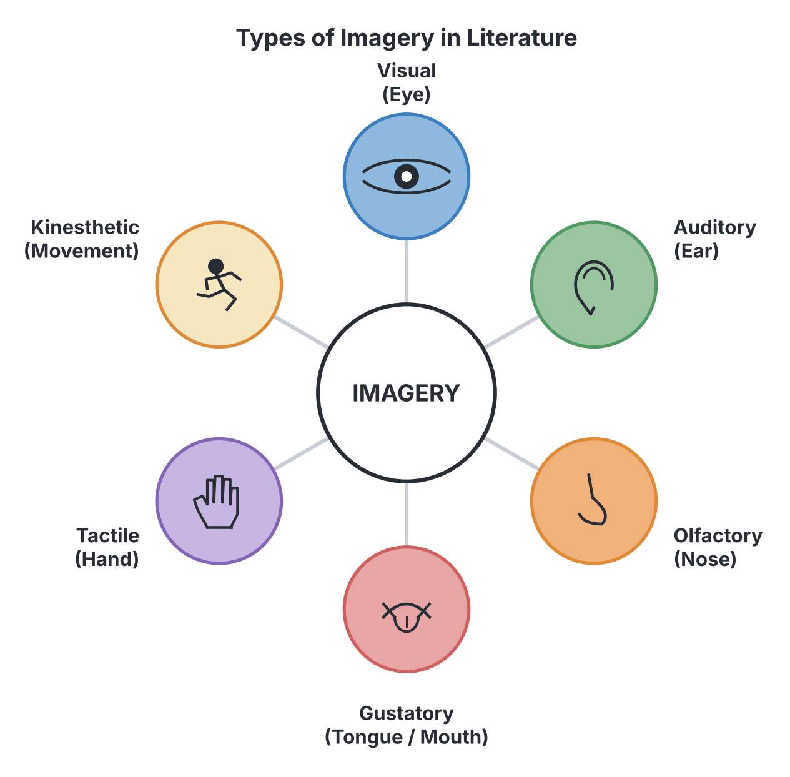

# JAMB Literature In English Notes: Poetic Devices and Mechanics

## What JAMB expects

This file covers Section A, Topic 3 of the JAMB Literature in English syllabus: Poetry. Specifically, it covers the topics and objectives related to **Poetic Devices** (how a poem is built). 

**Content items covered:**
- **b. Poetic devices:**
  - (i) Imagery
  - (ii) Sound (Rhyme/Rhythm, repetition, pun, onomatopoeia, etc.)
  - (iii) Diction
  - (iv) Persona

By the end of these notes, you should be able to:
1. Determine the devices used by various poets (**Objective b.i**).
2. Show how poetic devices are used for aesthetic effect in each poem (**Objective b.ii**).
3. Identify the figure of speech in the texts (**Objective b.iii**).
4. Show how poetic devices convey message and meaning (**Objective b.iv**).

*Note: The study of poetry is split across three files. `A3a-types-of-poetry.md` covers the types of poetry. This file (`A3b`) covers the mechanics and devices. `A3c-poetic-appreciation.md` covers how to appreciate a poem's themes and relevance. The prescribed set-text poems are analyzed in `B6`, `B7a`, and `B7b`.*

## Poetic Devices

Poetic devices are the special tools, techniques, and structures a poet uses to create rhythm, enhance a poem's meaning, or intensify a mood or feeling. Unlike everyday prose, poetry relies heavily on these devices to compress large ideas into a few lines. The main categories of poetic devices you need to know are **imagery**, **sound**, **diction**, and **persona**.

## Imagery

**Content b.i: Imagery.**

**Imagery** is the use of descriptive and figurative language to create mental pictures and appeal to the reader's five physical senses. In poetry, imagery is not just visual (what you can see); it extends to sound, smell, taste, and touch. 

Good imagery makes the abstract themes of a poem feel real and relatable. For example, instead of saying "It was a hot day," a poet using imagery might say, "The merciless sun baked the cracked earth."

### Types of Imagery
1. **Visual Imagery (Sight):** Describes what can be seen. *Example (made up for teaching):* "The crimson petals fluttered in the golden light."
2. **Auditory Imagery (Sound):** Describes what can be heard. *Example:* "The thunderous roar of the ocean crashing against the rocks."
3. **Olfactory Imagery (Smell):** Describes scents or odors. *Example:* "The sweet aroma of freshly baked bread filled the room."
4. **Gustatory Imagery (Taste):** Describes flavors. *Example:* "The bitter, stinging tang of salt on his lips."
5. **Tactile Imagery (Touch):** Describes physical textures or temperature. *Example:* "Her rough, calloused hands felt like sandpaper."
6. **Kinesthetic Imagery (Movement):** Describes a sense of motion or physical tension. *Example:* "The trees whipped back and forth in the violent wind."

## Sound Devices

**Content b.ii: Sound (Rhyme/Rhythm, repetition, pun, onomatopoeia, etc.)**

Poetry originated as an oral tradition meant to be spoken or sung. Therefore, sound devices are crucial for giving a poem its musical quality and regulating its pace.

### 1. Rhyme
**Rhyme** is the matching of final vowel or consonant sounds in two or more words, usually at the end of lines. 
*   **End Rhyme:** Rhyme that occurs at the end of lines.
*   **Internal Rhyme:** Rhyme that occurs within a single line (e.g., "Once upon a midnight **dreary**, while I pondered, weak and **weary**").
*   **Rhyme Scheme:** The pattern of end rhymes in a stanza. We use letters of the alphabet (A, B, C) to map this pattern. Lines that rhyme with each other get the same letter.

*Example of Rhyme Scheme mapping:*
The sun is shining bright (**A**)
Upon the grassy hill (**B**)
It is a beautiful sight (**A**)
Where everything is still (**B**)
*(The rhyme scheme here is **ABAB**).*

### 2. Rhythm and Meter
**Rhythm** is the beat or flow of a poem. It is created by the pattern of stressed (emphasized) and unstressed (softer) syllables in a line. 
*   **Meter** is the formal, measurable organization of rhythm. For example, *Iambic Pentameter* is a specific meter with five "beats" per line, where each beat is an unstressed syllable followed by a stressed syllable (da-DUM da-DUM da-DUM da-DUM da-DUM). 
*   When a poem does not follow any strict rhyme or rhythm pattern, it is called **Free Verse**.

### 3. Repetition
**Repetition** is the deliberate use of the same word, phrase, or line multiple times in a poem. Poets use it to emphasize a key idea, create rhythm, or build emotional intensity.
*   **Refrain:** A specific type of repetition where a whole line or stanza is repeated at regular intervals, often at the end of stanzas (similar to the chorus in a song).

### 4. Pun
A **pun** is a play on words. It involves using a word that has two different meanings, or two words that sound exactly the same but have different meanings (homophones), usually for humorous or clever effect.
*   *Example (made up for teaching):* "The poet was so poor he couldn't afford to pay attention." (Play on the word "pay").
*   *Example:* "I used to be a baker, but I lost my dough." ("Dough" means both bread mixture and money).

### 5. Onomatopoeia
**Onomatopoeia** is the use of words whose sound imitates or suggests their meaning. It makes auditory imagery more vivid.
*   *Examples:* Buzz, hiss, crash, sizzle, bang, splash, murmur.

### 6. Other Common Sound Devices ("etc.")
Because the syllabus includes "etc.", you must also know these highly tested sound devices:
*   **Alliteration:** The repetition of initial consonant sounds in closely positioned words. *Example:* "**B**illy **b**ought a **b**ig **b**alloon."
*   **Assonance:** The repetition of vowel sounds within closely positioned words. *Example:* "The gr**ee**n tr**ee** sh**ee**t."
*   **Consonance:** The repetition of consonant sounds anywhere in the words (not just at the beginning). *Example:* "The blac**k** sac**k** is in the bac**k**."

## Diction

**Content b.iii: Diction.**

**Diction** refers to the poet's choice of words and phrasing. In poetry, every word is carefully selected for its sound, its rhythm, and its exact shade of meaning. Diction determines the **tone** (the poet's attitude) and the **mood** (the feeling the reader gets) of the poem.

When analyzing diction, we look at two aspects of a word's meaning:
1.  **Denotation:** The literal, dictionary definition of a word.
2.  **Connotation:** The emotional, cultural, or hidden meaning associated with a word. 
    *   *Example:* The words "house" and "home" have the same denotation (a place to live). However, "home" has a warm, emotional connotation (comfort, family), while "house" has a cold, neutral connotation (a building).

Types of diction include:
*   **Formal Diction:** Elevated, serious, and complex language without slang.
*   **Informal / Colloquial Diction:** Casual, everyday language, which may include slang or Pidgin English (often used in modern African poetry to reflect social reality).
*   **Archaic Diction:** Old-fashioned words that are no longer in common use, such as *thou*, *thee*, *art*, and *thine*. This is very common in older prescribed texts like Lord Byron's or Shakespeare's works.

## Persona

**Content b.iv: Persona.**

The **persona** (plural: *personae*) is the "voice" or "speaker" of the poem. It is the identity the poet adopts to tell the poem. 

**Important Exam Rule:** The persona is **not** necessarily the poet. Just as a novelist creates a narrator, a poet creates a persona. A female poet might write a poem from the perspective of a male soldier; an old poet might write from the perspective of a small child; a poet could even write from the perspective of a non-human object, like a cloud or a tree.
*   *Textbook variation:* Some textbooks use the terms "speaker" or "poetic voice" interchangeably with persona. In JAMB questions, if you are asked "Who is speaking in the poem?", the answer refers to the persona.

## Identifying Figures of Speech

**Objective b.iii: Identify the figure of speech in the texts.**

Figures of speech are expressions where words are used out of their literal meaning to create a stronger, more striking effect. While imagery paints pictures, figures of speech often create those images by comparing unlike things. Below are the core figures of speech heavily tested in JAMB poetry questions:

### Comparisons
| Figure of Speech | Meaning | Example (made up for teaching) |
| :--- | :--- | :--- |
| **Simile** | A direct comparison of two unlike things using the words "like" or "as". | "He fought **like** a wounded lion." |
| **Metaphor** | An indirect or hidden comparison asserting that one thing *is* another thing, without using "like" or "as". | "The world **is** a stage." |
| **Personification** | Giving human qualities, emotions, or actions to animals, inanimate objects, or abstract ideas. | "The wind **whispered** its secrets to the trees." |

### Substitutions and Exaggerations
| Figure of Speech | Meaning | Example (made up for teaching) |
| :--- | :--- | :--- |
| **Synecdoche** | Using a part of something to represent the whole, or the whole to represent a part. | "Nigeria won the match." (Meaning the Nigerian football team). Or "All **hands** on deck" (Hands = sailors). |
| **Metonymy** | Substituting the name of an object with something closely associated with it. | "The **crown** has passed a new law." (Crown = the King/Queen). |
| **Hyperbole** | A deliberate and extreme exaggeration used for emphasis or humor. It is not meant to be taken literally. | "I have told you a **million times** to wash your plates." |

### Contradictions
| Figure of Speech | Meaning | Example (made up for teaching) |
| :--- | :--- | :--- |
| **Oxymoron** | Placing two directly contradictory words side by side for a striking effect. | "It was a **bittersweet** memory." Or "A **deafening silence**." |
| **Paradox** | A statement that seems logically contradictory or absurd on the surface, but upon closer thought, reveals a hidden truth. | "The child is father of the man." |
| **Irony** | Saying the exact opposite of what is meant (Verbal Irony), or a situation where the opposite of what is expected happens (Situational Irony). | Looking at a terrible rainstorm and saying, "What a beautiful day!" |

### Others
*   **Apostrophe:** Addressing an absent person, a dead person, or an inanimate object as if they were present and could reply. *Example:* "O Death, where is thy sting?"
*   **Euphemism:** Using a mild or gentle phrase to replace a harsh, blunt, or offensive one. *Example:* Saying "He passed away" instead of "He died."

## Determining Poetic Devices

**Objective b.i: Determine the devices used by various poets.**

In a JAMB exam, you will often be given an extract of a poem and asked to identify the device used. To do this accurately:
1.  **Look for comparisons:** If two things are compared, check for "like" or "as" (Simile). If there is no "like/as", it is a Metaphor. If a non-human thing is doing something human, it is Personification.
2.  **Listen to the sounds:** Read the line in your head. Are consonant sounds repeating at the start of words? That is Alliteration. Are words mimicking real-life sounds? That is Onomatopoeia.
3.  **Check for repetition:** Are whole words or phrases repeated? That is Repetition (or a Refrain if it's a whole line).
4.  **Identify the sensory appeal:** If a line makes you strongly see, hear, taste, touch, or smell something, the poet is using Imagery.

## Aesthetic Effect in Poetry

**Objective b.ii: Show how poetic devices are used for aesthetic effect in each poem.**

"Aesthetic" refers to beauty, art, and taste. In poetry, the **aesthetic effect** is how beautiful, musical, or emotionally moving the poem feels to the reader. Poets do not just want to pass information; they want to pass it beautifully.

How devices create aesthetic effect:
*   **Sound devices (Rhyme, Rhythm, Alliteration)** create a musical aesthetic. They make the poem flow smoothly (called *euphony*) or intentionally make it sound harsh and abrasive (called *cacophony*) to match an angry or violent topic.
*   **Imagery** creates a visual and sensory aesthetic. It transforms a boring statement like "The farm was beautiful" into a rich experience: "Golden corn stalks danced beneath a crystal blue sky."
*   **Figures of speech** create an intellectual aesthetic. They force the reader's brain to make clever connections (like figuring out a paradox or enjoying a pun).

## How Devices Convey Message and Meaning

**Objective b.iv: Show how poetic devices convey message and meaning.**

A poem's message is its core theme or lesson. Poetic devices act as the vehicle that delivers this message to the reader. They ensure the meaning is felt, not just understood.

*   **Diction conveys meaning:** If a poet wants to convey a message about the cruelty of war, they will not use words with pleasant connotations. They will use harsh diction (e.g., *slaughter, bloody, shriek, devastation*).
*   **Persona conveys meaning:** A poet might choose the persona of an oppressed citizen to give a first-hand, emotional account of bad governance, making the socio-political message much stronger than if it were told by a detached observer.
*   **Imagery and Figures of Speech convey meaning:** A poet conveying a message about the passage of time and aging might use a metaphor comparing youth to "spring" and old age to "winter," or use visual imagery of fading light and falling leaves to symbolize death. 

By analyzing *how* a poet says something (the devices), you unlock *why* they said it (the meaning).

## Needs checking against the text

*   *All concepts in this file are general literary principles based on standard literary theory. No specific set-text plot points or quotations require verification.*

## Key terms

| Term | Meaning |
| --- | --- |
| Imagery | Language that appeals to the five senses (sight, sound, smell, taste, touch). |
| Rhyme | The repetition of similar sounding words, usually at the end of lines. |
| Rhythm | The beat, pace, or flow of a poem. |
| Repetition | The deliberate reuse of words, phrases, or lines for emphasis. |
| Pun | A humorous play on words that have multiple meanings or sound alike. |
| Onomatopoeia | Words that imitate or sound like their meaning (e.g., buzz, hiss). |
| Diction | The poet's choice of words, which affects the poem's tone and mood. |
| Persona | The voice or speaker of the poem (not always the poet). |
| Simile | A direct comparison using "like" or "as". |
| Metaphor | A direct comparison without using "like" or "as", stating one thing is another. |
| Personification | Giving human characteristics to non-human objects or ideas. |
| Oxymoron | Two opposite words placed side by side (e.g., "living dead"). |
| Paradox | A statement that seems contradictory but reveals a hidden truth. |
| Synecdoche | Using a part to represent the whole (e.g., "hands" for workers). |
| Metonymy | Using an associated word to represent a concept (e.g., "crown" for the monarchy). |
| Alliteration | Repetition of initial consonant sounds in nearby words. |
| Assonance | Repetition of vowel sounds in nearby words. |

## Exam tips and common mistakes

*   **Poet vs. Persona:** Never assume the word "I" in a poem means the poet themselves. Always refer to the speaker as the "persona" unless the context explicitly makes it the poet.
*   **Simile vs. Metaphor:** This is the most common trap. "He eats like a pig" is a simile. "He is a pig" is a metaphor. If you see "like" or "as" making a comparison, it is a simile.
*   **Alliteration vs. Assonance vs. Consonance:** Alliteration is for *starting consonants*. Assonance is for *vowels* (usually inside the word). Consonance is for *consonants* anywhere in the word. 
*   **Synecdoche vs. Metonymy:** Synecdoche is an actual physical part of the thing (wheels representing a car). Metonymy is just something closely associated with the thing (the White House representing the US President).
*   **Oxymoron vs. Paradox:** An oxymoron is a short phrase of conflicting words (two words). A paradox is a full sentence or idea that contradicts itself.

## Quick summary

1.  Poetic devices are tools poets use to create aesthetic beauty, rhythm, and deep meaning in a compressed space.
2.  Imagery uses vivid language to appeal to the reader's visual, auditory, olfactory, gustatory, tactile, and kinesthetic senses.
3.  Sound devices, including rhyme, rhythm, repetition, puns, alliteration, and onomatopoeia, give poetry its musical quality and control its pacing.
4.  Diction is the specific choice of words by the poet, encompassing both literal definitions (denotation) and emotional weight (connotation) to create tone.
5.  The persona is the voice speaking the poem, which is an adopted identity and not necessarily the author.
6.  Figures of speech like similes, metaphors, personification, and oxymorons create aesthetic effect by making imaginative comparisons and connections.
7.  By analyzing the chosen devices, a reader can deduce the underlying socio-political or moral message the poet is conveying.

## Practice questions

**1. The "voice" that speaks the words of a poem to the reader is known as the:**
- A. poet
- B. persona
- C. protagonist
- D. narrator
**Answer: B.** The persona is the speaker or adopted voice in a poem, distinct from the actual author.

**2. Which of the following best defines a pun?**
- A. A play on words for a humorous or clever effect.
- B. A direct comparison using like or as.
- C. The repetition of consonant sounds at the beginning of words.
- D. The exact opposite of what is expected.
**Answer: A.** A pun is a play on words, utilizing words with multiple meanings or words that sound identical but mean different things.

**3. "The rushing river roared and rumbled." Which two devices are most prominent in this line?**
- A. Simile and Metaphor
- B. Personification and Alliteration
- C. Oxymoron and Paradox
- D. Synecdoche and Metonymy
**Answer: B.** The river is given the human/animal action of "roaring" (Personification), and the initial "r" sound is repeated in rushing, river, roared, rumbled (Alliteration).

**4. The use of words like "hiss", "buzz", and "bang" in a poem is an example of:**
- A. Assonance
- B. Consonance
- C. Onomatopoeia
- D. Hyperbole
**Answer: C.** Onomatopoeia is the use of words that imitate the natural sound of a thing.

**5. Read the following lines (made up for teaching):**
*The stars are diamonds in the sky,*
*Watching the tired world go by.*
**The comparison of stars to diamonds is an example of:**
- A. Simile
- B. Metaphor
- C. Paradox
- D. Euphemism
**Answer: B.** It is a metaphor because it directly states the stars *are* diamonds, without using "like" or "as".

**6. Which type of imagery appeals to the sense of smell?**
- A. Tactile
- B. Visual
- C. Auditory
- D. Olfactory
**Answer: D.** Olfactory imagery uses words that appeal to our sense of smell.

**7. "Parting is such sweet sorrow" contains an example of:**
- A. Irony
- B. Pun
- C. Oxymoron
- D. Metonymy
**Answer: C.** "Sweet sorrow" places two contradictory words side by side, making it an oxymoron.

**8. If a poet uses the phrase "all hands on deck" to mean they need all sailors to help, the poet is using:**
- A. Synecdoche
- B. Metaphor
- C. Simile
- D. Personification
**Answer: A.** Synecdoche is a figure of speech where a part of something (hands) represents the whole (sailors).

**9. The primary reason a poet uses poetic devices is to:**
- A. confuse the reader and hide the meaning
- B. show off their vocabulary
- C. create aesthetic effect and convey deeper meaning
- D. make the poem longer
**Answer: C.** Poetic devices enhance the beauty (aesthetic effect) and help to communicate the theme and message powerfully.

**10. When a poem contains words that have strong emotional associations beyond their dictionary definitions, this relates to the words':**
- A. Denotation
- B. Connotation
- C. Rhyme scheme
- D. Meter
**Answer: B.** Connotation refers to the emotional or cultural meanings associated with a word, as opposed to its literal dictionary definition (denotation).

<!-- COVERAGE
obj b.i | Determining Poetic Devices
obj b.ii | Aesthetic Effect in Poetry
obj b.iii | Identifying Figures of Speech
obj b.iv | How Devices Convey Message and Meaning
item b | Poetic Devices
item b.i | Imagery
item b.ii | Sound Devices
item b.iii | Diction
item b.iv | Persona
-->
