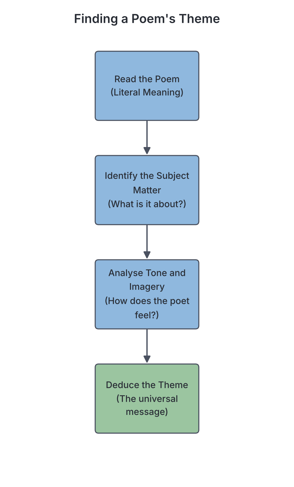

# JAMB Literature In English Notes: Poetic Appreciation: Theme, Relevance and Style (method)

## What JAMB expects

This topic covers Section A, Topic 3c of the JAMB Literature in English syllabus: Poetry – Appreciation. 

This file focuses on the **methodology** of how to appreciate and analyse a poem. (The actual ten prescribed poems you must study for the exam are analysed in `B6-african-prescribed-poems.md`, `B7a-byron-and-chaucer.md`, and `B7b-adcock-and-gibson.md`). 

It covers the following content items:
- c. Appreciation
  - i. Thematic preoccupation
  - ii. Socio-political relevance
  - iii. Style

By the end of these notes, you should be able to:
1. Deduce the poet’s thematic preoccupation from the poem (Objective c.i).
2. Appraise poetry as an art with moral values (Objective c.ii).
3. Apply the lessons from the poem to social reality (Objective c.iii).

*Note: Poetry is a very broad topic, so it is split into three parts in these notes. For the different forms of poetry (like sonnets and epics), see `A3a-types-of-poetry.md`. For poetic devices (like imagery, rhythm, and metaphors), see `A3b-poetic-devices.md`.*

## Thematic preoccupation

**Content c.i: Thematic preoccupation and Objective c.i: Deduce the poet’s thematic preoccupation from the poem.**

To fully appreciate a poem, you must first understand what the poet is trying to say. This central message is known as the **thematic preoccupation**. 

### Subject matter versus theme
Textbooks often draw a strict line between **subject matter** and **theme**. You must know the difference to deduce the thematic preoccupation correctly:

*   **Subject matter:** This is the literal topic of the poem. It is what the poem is about on the surface. For example, the subject matter might be "a dying flower", "a corrupt politician", or "a mother breastfeeding her child".
*   **Theme (Thematic preoccupation):** This is the deeper, underlying message or central idea the poet wants to pass across about the subject matter. It is a universal truth. For example, if the subject matter is "a dying flower", the theme might be "the inevitability of death" or "the fading nature of physical beauty".

### How to deduce the thematic preoccupation
When faced with an unseen poem or when revising your prescribed texts, follow these steps to deduce the theme:

1.  **Read for literal meaning first:** Read the poem line by line to understand the plain situation. Who is the speaker (the persona)? What is happening? 
2.  **Identify the tone:** Is the speaker angry, sad, joyful, or sarcastic? The tone gives a massive clue to the poet's attitude towards the subject. (For example, an angry tone in a poem about a leader usually points to a theme of political corruption or oppression).
3.  **Look for recurring motifs and imagery:** Poets rarely state the theme directly. Instead, they repeat certain types of words or images. If a poem is filled with words like "chains", "cages", and "walls", the thematic preoccupation is likely related to **imprisonment or lack of freedom**.
4.  **Ask the "So what?" question:** Once you know the subject matter, ask yourself: "So what is the poet trying to teach us about this subject?" The answer is the theme.

*Example (made up for teaching):*
If a short poem describes a greedy chief who hoards yams while his villagers starve, and then the chief’s barn catches fire, destroying everything. 
*   **Subject matter:** A greedy chief losing his yams to a fire.
*   **Thematic preoccupation:** The destructive nature of greed; the certainty of natural justice.

## Appraising poetry as an art with moral values

**Objective c.ii: Appraise poetry as an art with moral values.**

Poetry is an **art**. It uses language beautifully, with rhythm, rhyme, and striking figures of speech (aesthetics). However, in literary appreciation, we do not just praise a poem for sounding nice; we also evaluate its **moral values**.

### The didactic function of poetry
When we say poetry has moral values, we mean it can be **didactic** (designed to teach a moral lesson). Throughout history—and especially in African oral traditions and modern literature—poetry is used to teach society what is right and wrong.

When you appraise a poem's moral values, you examine how the poet uses their art to:
*   **Condemn vices:** Poetry often criticises human flaws like greed, pride, cruelty, selfishness, and corruption.
*   **Promote virtues:** Poems may praise honesty, hard work, patriotism, love, and endurance. 
*   **Create empathy:** A well-written poem puts the reader in the shoes of someone else (perhaps a poor beggar, an oppressed citizen, or a grieving mother). This artistic creation of empathy is a deep moral value.

For example, a poem that beautifully describes a thief being caught and disgraced uses its artistic form (imagery, rhythm) to deliver a clear moral lesson: stealing brings shame.

## Socio-political relevance and applying lessons to social reality

**Content c.ii: Socio-political relevance and Objective c.iii: Apply the lessons from the poem to social reality.**

### What is socio-political relevance?
No poet writes in a vacuum. Poets are members of a society, and their work reflects the social, economic, and political issues of their time. 
*   **Social relevance:** How the poem deals with everyday human relationships, culture, poverty, class struggles, religion, and family.
*   **Political relevance:** How the poem addresses leadership, governance, laws, warfare, colonialism, or human rights.

A poem has **socio-political relevance** if it speaks to the conditions of the society. In African literature, much of the poetry written from the 1960s to the present day is highly socio-political, dealing with themes of colonial exploitation, the disappointment of independence, military dictatorships, and corruption.

### Applying the lessons to social reality
JAMB expects you to do more than just understand the poem; you must connect its message to the real world (social reality).

To apply a poem's lesson to social reality:
1.  **Identify the specific historical context:** What was happening when the poet wrote it? (e.g., Apartheid in South Africa, or the Nigerian Civil War).
2.  **Extract the universal lesson:** Even if the poem was written 50 years ago, what is the core lesson? (e.g., oppression breeds rebellion).
3.  **Draw parallels to today:** Match that lesson to current events. If a poem from the 1970s warns about the arrogance of military rulers, applying it to social reality means recognising how modern democratic leaders can also become arrogant and neglect the masses. 

*Example (made up for teaching):*
Imagine a poem titled *The Lion’s Empty Stomach*, where a powerful lion forces the smaller animals to build him a grand den, but he refuses to share any meat with them. Eventually, the animals leave the jungle, leaving the lion to starve.
*   **Socio-political relevance:** It is a political allegory about dictatorship and the exploitation of the working class.
*   **Applying it to reality:** We can apply this lesson to modern society by noting that if a government heavily taxes its citizens to fund lavish lifestyles for politicians, the citizens will eventually revolt, strike, or emigrate (the "brain drain"), leaving the country impoverished.

## Style

**Content c.iii: Style.**

**Style** is the unique way a poet uses language to convey their thematic preoccupation and message. It is the poet's "fingerprint." If theme is *what* the poet says, style is *how* the poet says it.

When appreciating the style of a poem, you must look at several key elements:

### 1. Diction (Word choice)
Diction is the poet’s choice of words. 
*   Is the language simple and everyday, or complex and archaic (old-fashioned)?
*   Are the words harsh and violent (e.g., *slash*, *crush*, *blood*), or soft and soothing (e.g., *whisper*, *breeze*, *lull*)?
*   A poet writing about the brutality of war will deliberately choose harsh diction to make the reader feel the violence.

### 2. Imagery and Figures of Speech
How does the poet paint pictures in the reader's mind? 
*   Does the poet use a lot of **similes** and **metaphors**? 
*   Do they use **personification** to bring non-living things to life?
*   A rich, descriptive style often relies heavily on sensory imagery (words that appeal to sight, sound, smell, touch, and taste). *(Note: These devices are fully explained in `A3b-poetic-devices.md`)*.

### 3. Form and Structure
How the poem is arranged on the page is a crucial part of its style.
*   **Stanzas:** Is it divided into neat, equal stanzas, or is it one long, breathless block of text? 
*   **Line length:** Are the lines short and punchy (often creating a fast pace), or long and flowing?
*   **Punctuation:** Does the poet use **enjambment** (letting a sentence run over from one line to the next without a pause), or is every line end-stopped with a full stop?

### 4. Tone and Mood
*   **Tone:** The persona's attitude towards the subject matter (e.g., sarcastic, mournful, joyful, angry, objective).
*   **Mood:** The feeling or atmosphere the poem creates in the reader (e.g., tense, gloomy, peaceful).
Style creates the tone. For example, short, fragmented sentences might create a panicked tone.

### 5. Sound Devices
The musicality of the poem is part of its style. Does the poet use **rhyme**, **rhythm (metre)**, **alliteration**, or **onomatopoeia**? Some poets have a highly musical, rhythmic style, while others write in **free verse** (no regular rhyme or rhythm) to sound more like natural, everyday speech.

When a JAMB question asks you about a poet's style, you are evaluating how these elements—diction, form, devices, tone, and sound—work together to deliver the poem's theme.

## Needs checking against the text
*   All general literary definitions and methods in this file have been verified against standard West African examination benchmarks. There are no placeholders, as this file covers general methodology and appreciation skills, not the specific plots or contents of the set texts. 

## Key terms

| Term | Meaning |
| --- | --- |
| **Appreciation** | The critical evaluation and understanding of a poem's meaning, style, and relevance. |
| **Subject matter** | The literal topic or surface-level story of a poem. |
| **Thematic preoccupation** | The deep, central underlying message or universal truth the poet is trying to communicate. |
| **Socio-political relevance** | How well a poem connects to, reflects, or comments on the social conditions and political systems of the real world. |
| **Didactic** | Intended to teach, particularly in having moral instruction as an ulterior motive. |
| **Style** | The distinct way a poet uses language, including diction, form, and devices, to express their theme. |
| **Diction** | The poet's specific choice of words. |
| **Tone** | The speaker's attitude toward the subject matter or audience (e.g., angry, sad, mocking). |

## Exam tips and common mistakes

*   **Do not confuse subject matter with theme.** If a question asks for the theme, do not pick the option that describes the literal plot. The theme is usually an abstract noun phrase (e.g., "the futility of war", "the pain of betrayal").
*   **Link style to meaning.** JAMB will not just ask you to identify a style; they might ask *why* it was used. Remember that style (like harsh diction or fast rhythm) is always used to reinforce the theme.
*   **Socio-political context matters.** When reading African poetry in your prescribed texts, always consider the era. Was it written during colonial rule? Post-independence? A military regime? The socio-political relevance heavily depends on this timing.
*   **Tone vs. Mood:** A very common mistake. Tone belongs to the *speaker/persona* (how they feel about the topic). Mood belongs to the *reader* (the atmosphere created for you).
*   **Look for the lesson:** If a question asks about moral values, look for options related to teaching, advising, warning, or praising specific human behaviours.

## Quick summary

1. Literary appreciation in poetry involves analysing what a poem means, how it relates to society, and how it is written.
2. The subject matter is the literal topic, while the thematic preoccupation is the deep, universal message the poet wants to share.
3. You can deduce the theme by analysing the poem's literal meaning, tone, recurring imagery, and the poet's attitude.
4. Poetry is an art with moral values; it frequently serves a didactic function by condemning vices and praising virtues.
5. Socio-political relevance refers to how accurately a poem reflects the societal and governmental issues of human existence.
6. Applying a poem's lesson to social reality means taking its central message and showing how it relates to our current world or personal lives.
7. Style is the "how" of poetry. It is the poet's unique combination of diction, imagery, form, tone, and sound devices to pass across their theme.

## Practice questions

**1. The literal issue, event, or object that a poem describes on the surface is known as its:**

- A. thematic preoccupation
- B. subject matter
- C. socio-political relevance
- D. aesthetic style

**Answer: B.** The subject matter is the literal topic of the poem, while the theme is the underlying message.

**2. Which of the following best describes the "thematic preoccupation" of a poem?**

- A. The stanza structure the poet uses
- B. The era in which the poet lived
- C. The central, universal message or idea the poet explores
- D. The specific vocabulary used by the poet

**Answer: C.** Thematic preoccupation refers to the underlying, universal truth or central idea the poet wants to communicate.

**3. If a poem beautifully describes the tragic consequences of telling lies, the poem can best be appraised as having a:**

- A. didactic function with moral values
- B. purely aesthetic and meaningless style
- C. lack of socio-political relevance
- D. comic thematic preoccupation

**Answer: A.** A poem that teaches a lesson about right and wrong (like the consequences of lying) is fulfilling a didactic function and projecting moral values.

**4. To "apply the lesson of a poem to social reality" means to:**

- A. rewrite the poem using modern slang
- B. memorise the poem for a public recitation
- C. connect the poem's central message to real-world issues in society today
- D. identify all the figures of speech in the text

**Answer: C.** Applying the lesson to social reality involves taking the poem's theme and seeing how it applies to actual human conditions, politics, or daily life.

**5. A poet's unique choice of words, which forms a major part of their style, is referred to as:**

- A. diction
- B. enjambment
- C. metre
- D. rhyme

**Answer: A.** Diction specifically refers to the author's choice and arrangement of words.

**6. Which of the following is the BEST way to deduce the thematic preoccupation of an unseen poem?**

- A. By counting the number of syllables in each line
- B. By looking at the poet's biography only
- C. By reading for the literal meaning and then analysing the tone and recurring imagery
- D. By assuming it is about love, as most poems are

**Answer: C.** Theme is deduced by understanding the surface meaning, then analysing how the tone and imagery point to a deeper universal idea.

**7. A poem written in 1965 criticises a corrupt local chief who exploits his people. A student analyses the poem and states that it perfectly describes the behaviour of modern politicians embezzling public funds today. The student is demonstrating an understanding of the poem's:**

- A. sound devices
- B. socio-political relevance
- C. poetic rhythm
- D. stanza structure

**Answer: B.** By linking the poem's critique of leadership to modern political issues, the student is exploring its socio-political relevance.

**8. If a poet deliberately uses harsh, violent words and broken, irregular stanzas to describe a battle, these choices are primarily elements of the poet's:**

- A. socio-political relevance
- B. moral values
- C. style
- D. subject matter

**Answer: C.** Style includes diction (word choice) and form (stanzas), which the poet uses to effectively convey the feeling of the subject.

**9. The attitude of the persona towards the subject matter of the poem is known as the:**

- A. mood
- B. tone
- C. diction
- D. theme

**Answer: B.** The tone reflects the speaker's attitude (e.g., angry, sarcastic, joyful), whereas the mood is the feeling created in the reader.

**10. Why is it important to distinguish between subject matter and theme when appreciating a poem?**

- A. Because subject matter is found in prose, while theme is found only in poetry.
- B. Because JAMB does not test subject matter.
- C. Because a poem can have a very simple subject matter but a very deep and complex theme.
- D. Because the subject matter is always the title, and the theme is the last line.

**Answer: C.** Distinguishing them is crucial because a simple surface topic (like a dying flower) often hides a profound universal message (like the fleeting nature of life).
