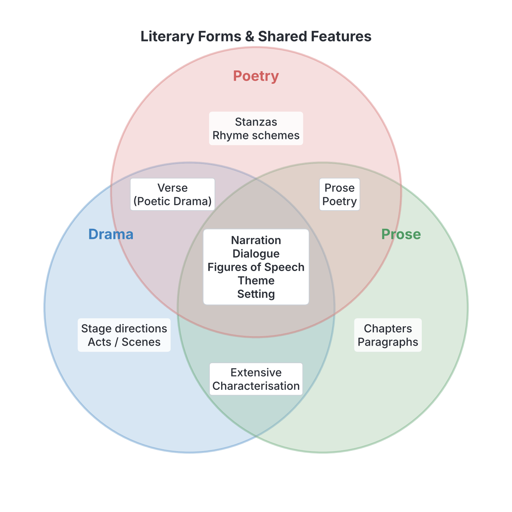

# JAMB Literature In English Notes: General Literary Terms and Principles

## What JAMB expects

This topic is Section 4 of the JAMB Literature in English syllabus: General Literary Terms and Principles. It builds on the specific terms you have learned for drama, prose, and poetry.

This file covers the following content item:
- **a. Literary terms:** foreshadowing, suspense, theatre, monologue, dialogue, soliloquy, symbolism, protagonist, antagonist, figures of speech, satire, stream of consciousness, synecdoche, metonymy, etc., in addition to those listed above under the different genres.

By the end of these notes, you should be able to:
1. **Objective a.i:** identify literary terms that are specific to drama, prose and poetry.
2. **Objective a.ii:** identify areas of overlap in all the genres e.g. verse in drama and poetry, narration in all the genres.

*Note: For a detailed breakdown of terms that belong exclusively to specific genres (like "stanza" in poetry, "chapter" in prose, or "stage directions" in drama), please see `A1a-types-of-drama.md`, `A2b-narrative-techniques-and-devices.md`, and `A3b-poetic-devices.md`.*

## Identifying Literary Terms (Objective a.i)

**Objective a.i: identify literary terms that are specific to drama, prose and poetry.**

While literature is divided into three main genres (drama, prose, and poetry), many tools and techniques are shared among them, while others are closely associated with just one or two. The JAMB syllabus specifically lists the following important terms which you must be able to identify.

### Terms relating to Characters and Plot

**Protagonist**
The protagonist is the main character or "hero" of a story, play, or narrative poem. The plot revolves around this character's actions, challenges, and goals. 
*Example (made up for teaching):* In a story about a brave village hunter who saves his community from a terrible beast, the hunter is the protagonist. 

**Antagonist**
The antagonist is the character, force, or institution that directly opposes the protagonist. The clash between the protagonist and the antagonist creates the central conflict. 
*Example (made up for teaching):* If the protagonist is a hardworking student, the antagonist might be a corrupt principal trying to expel him.

**Suspense**
Suspense is a feeling of intense anticipation, excitement, or tension created in the reader or audience about what will happen next. Writers create suspense by putting characters in dangerous situations or by holding back important information. It is what makes a reader unable to drop a book.

**Foreshadowing**
Foreshadowing is a technique where the writer gives hints, clues, or warnings about events that will happen later in the story. It prepares the reader for the outcome without giving it away immediately.
*Example (made up for teaching):* A story begins with dark clouds gathering and an old woman saying, "Blood will water the earth today." This foreshadows a tragic or violent event later in the plot.

### Terms relating to Drama and Performance

**Theatre**
In literature, "theatre" refers to the physical building or space where plays are performed. It can also refer to the entire profession, art, and production of staging dramatic works. Unlike prose or poetry which are meant to be read, theatre is meant to be experienced live.

**Dialogue**
Dialogue is a conversation between two or more characters. In drama, it is the primary way the story is told. In prose and poetry, it is used to develop character and advance the plot. In a script, dialogue is written without quotation marks, usually with the character's name followed by a colon.

**Monologue and Soliloquy**
These two dramatic terms both involve a single character speaking at length, but they are different. JAMB frequently tests your ability to tell them apart.

* **Textbook variation:** Some modern critics use these words interchangeably, but in exams, they have a strict difference based on who is listening.

| Feature | Monologue | Soliloquy |
| :--- | :--- | :--- |
| **Who is speaking?** | One character | One character |
| **Are others on stage?** | Usually yes | No (the character is alone on stage) |
| **Who is listening?** | Other characters on stage, and the audience | Only the audience (and the character themselves) |
| **Purpose** | To explain a point of view, tell a story, or command others | To reveal the character's secret, unfiltered inner thoughts and motives |

### Terms relating to Prose Narrative

**Stream of consciousness**
Stream of consciousness is a narrative technique used mainly in prose. It attempts to capture the unfiltered, chaotic, and continuous flow of a character's thoughts and feelings exactly as they pass through the mind. Unlike normal narration, it often ignores standard punctuation, logical transitions, and chronological order, jumping from memory to memory. 

### Terms relating to Meaning and Style

**Symbolism**
Symbolism is the use of objects, characters, colours, or settings to represent deeper, abstract ideas. A symbol has its own literal meaning in the story but also stands for something else.
*Example (made up for teaching):* A writer might use a setting sun to symbolise the end of a character's life, or a white dove to symbolise peace.

**Satire**
Satire is a literary work that uses humour, irony, mockery, or exaggeration to expose and criticise human foolishness, corruption, or societal flaws. The goal of a satire is not just to make the audience laugh, but to force society to improve by showing it how ridiculous it looks.

### Figures of Speech (General and Poetic)

A **figure of speech** is a word or phrase used in a non-literal sense to add beauty, emphasis, or clarity to writing. The syllabus highlights two specific figures of speech that students often confuse: **synecdoche** and **metonymy**. 

**Synecdoche**
Synecdoche (pronounced *sin-EK-duh-kee*) is a figure of speech in which a **literal part of something** is used to represent the whole thing (or sometimes the whole is used to represent a part). 
* Examples:
  * "We need more **hands** on the farm." (Hands = literal parts of the workers used to mean the whole workers).
  * "He just bought some new **wheels**." (Wheels = literal parts of a car used to mean the whole car).
  * "The farmer lost fifty **head** of cattle." (Head = a literal part of the cow used to mean the whole animal).

**Metonymy**
Metonymy (pronounced *meh-TON-uh-mee*) is a figure of speech where the name of one object is replaced with a word closely **associated** with it. The replacement word is not a physical part of the object, just something conceptually linked to it.
* Examples:
  * "The **crown** issued a decree." (Crown = closely associated with a king/queen, representing the monarch).
  * "**Aso Rock** has released a statement." (Aso Rock = the physical building associated with the Nigerian presidency, used to represent the government).
  * "The **pen** is mightier than the **sword**." (Pen = associated with writing/diplomacy; Sword = associated with violence/military force).

**How to tell them apart:**
If the word used is physically attached to or a bodily part of the thing it represents, it is **synecdoche**. If it is just a symbol or item associated with it, it is **metonymy**.

| Example | Figure of Speech | Why? |
| :--- | :--- | :--- |
| "I have four **mouths** to feed." | Synecdoche | A mouth is a literal, physical part of a person. |
| "The **bench** ruled against the lawyer." | Metonymy | A bench is where a judge sits; it is associated with the judge, not a physical part of the judge. |

*(Note: Other common figures of speech like metaphor, simile, personification, and hyperbole are covered in `A3b-poetic-devices.md`.)*

## Areas of Overlap Across Genres (Objective a.ii)

**Objective a.ii: identify areas of overlap in all the genres e.g. verse in drama and poetry, narration in all the genres.**

Although drama, prose, and poetry have their own unique characteristics (e.g., drama has stage directions, prose has paragraphs, poetry has stanzas), they frequently borrow techniques from one another. This sharing of characteristics is called an **overlap**.

### 1. Verse in Drama and Poetry
Usually, poetry is written in verse (lines arranged with a specific rhythm or metre) while drama is written in prose (ordinary conversational language). However, there is a massive overlap known as **poetic drama** or **verse drama**.
* **Shakespearean Plays:** William Shakespeare (author of *Antony and Cleopatra*) wrote most of his plays using **blank verse** (unrhymed iambic pentameter). The characters speak in rhythmic, poetic lines rather than normal sentences. 
* **African Verse Drama:** Many African playwrights, such as Wole Soyinka or J.P. Clark, frequently use poetic language, chants, and praise poetry inside their stage plays, blending the boundaries of poetry and drama.

### 2. Narration in All Genres
Narration means telling a story. While prose is the natural home of narration (novels and short stories are purely narrative), narration heavily overlaps into poetry and drama.
* **Narration in Prose:** A narrator (first-person or third-person) tells the story directly to the reader.
* **Narration in Poetry:** A **narrative poem** is a poem that tells a story. It has characters, a plot, and a setting, just like a novel, but is written in stanzas. Examples include epics, ballads, and Chaucer's *The Nun's Priest's Tale*.
* **Narration in Drama:** While drama usually relies on characters acting out the story on stage, playwrights often use a **narrator** or a **chorus** to speak directly to the audience. They narrate background events, summarize time jumps, or explain off-stage action (such as a battle that cannot be shown on stage).

### 3. Dialogue in All Genres
Dialogue (conversation) is the backbone of drama, but it overlaps into both prose and poetry.
* **Dialogue in Drama:** Drives the entire plot.
* **Dialogue in Prose:** Used inside quotation marks to break up long blocks of narration, reveal character traits, and make scenes feel alive.
* **Dialogue in Poetry:** Poems can feature conversations. A poem written entirely as a conversation between two people is sometimes called a dialogic poem (e.g., some traditional ballads).

### 4. Figures of Speech in All Genres
While figures of speech (metaphors, similes, personification) are mostly studied as "poetic devices," they are heavily used in prose to make descriptions more vivid, and in drama to make characters' speeches more powerful and emotional.

## Needs checking against the text
Everything in this file was verified as it covers general literary concepts rather than specific set-text facts.

## Key terms

| Term | Meaning |
| :--- | :--- |
| Protagonist | The main character or hero of a literary work. |
| Antagonist | The character or force opposing the protagonist. |
| Suspense | A feeling of tension or anticipation created by the writer regarding what will happen next. |
| Foreshadowing | Hints or clues given early in a work about events that will happen later. |
| Monologue | A long speech by one character in a play, spoken in the presence of other characters. |
| Soliloquy | A speech made by a character who is alone on stage, revealing their inner thoughts to the audience. |
| Stream of consciousness | A prose narrative technique that captures the unfiltered, continuous flow of a character's thoughts. |
| Symbolism | The use of an object, character, or colour to represent a deeper abstract idea. |
| Satire | A literary work that uses humour, irony, or exaggeration to mock and criticise human or societal flaws. |
| Synecdoche | A figure of speech where a literal physical part of something represents the whole (e.g., "wheels" for car). |
| Metonymy | A figure of speech where an associated concept or object replaces the name of the thing itself (e.g., "the crown" for the king). |
| Poetic drama | A play whose dialogue is written in verse (poetry) rather than ordinary prose. |
| Narrative poem | A poem that tells a story, complete with plot, setting, and characters. |

## Exam tips and common mistakes

* **JAMB heavily tests the difference between Monologue and Soliloquy.** Always remember: Soliloquy = Solo (alone on stage). Monologue = others can hear.
* **Synecdoche vs. Metonymy:** This is a favourite exam trap. If the exam asks about "hands" for workers, look for synecdoche. If it asks about "the bench" for judges, look for metonymy. If synecdoche is not an option for a "part to whole" question, metonymy is the next best answer, as some broad definitions group them together—but usually, JAMB separates them.
* **Stream of consciousness** is almost exclusively a prose technique. Do not confuse it with "free verse," which is a poetry technique.
* Remember that **verse** is not strictly limited to poetry; many classic plays (like Shakespeare's) are written in verse, which is a major area of genre overlap.
* Do not assume that an **antagonist** is always a villain or an evil person; they are simply the force opposing the main character. 

## Quick summary

1. The protagonist is the main character; the antagonist is the force opposing them.
2. Foreshadowing gives hints about the future, while suspense keeps the reader anxious about what will happen next.
3. A monologue is a long speech heard by others; a soliloquy is an inner thought spoken aloud when a character is alone on stage.
4. Stream of consciousness is a prose technique showing a character's jumping, unfiltered thoughts.
5. Synecdoche uses a physical part to represent a whole (hands for workers); metonymy uses an associated item to represent a whole (crown for king).
6. Genres overlap significantly: for example, plays can be written in poetic verse (poetic drama).
7. Narration is shared across genres: prose uses narrators, poetry has narrative poems (like epics), and drama uses choruses or narrators to tell parts of the story.

## Practice questions

**1. A speech made by a character alone on stage to reveal his inner thoughts is called a**
- A. prologue
- B. monologue
- C. soliloquy
- D. aside

**Answer: C.** A soliloquy is specifically delivered when a character is alone on stage, allowing the audience to hear their secret thoughts.

**2. Which of the following figures of speech is used in the sentence "The pen is mightier than the sword"?**
- A. Synecdoche
- B. Metaphor
- C. Personification
- D. Metonymy

**Answer: D.** Metonymy. The "pen" represents diplomacy or writing, and the "sword" represents warfare. They are associated concepts, not physical parts of the things they represent.

**3. The literary technique in which a writer hints at events that will occur later in the story is known as**
- A. flashback
- B. foreshadowing
- C. suspense
- D. symbolism

**Answer: B.** Foreshadowing is the use of clues or hints to prepare the reader for future events in the plot.

**4. An example of genre overlap where a play is written using poetic rhythms and lines is called**
- A. a narrative poem
- B. prose poetry
- C. verse drama
- D. stream of consciousness

**Answer: C.** Verse drama (or poetic drama) is a play written in verse rather than ordinary conversational prose.

**5. The main character in a literary work around whom the plot revolves is the**
- A. antagonist
- B. narrator
- C. foil
- D. protagonist

**Answer: D.** The protagonist is the central character or "hero" of a story.

**6. "The farm manager ordered all hands to the field." The use of "hands" to represent workers is an example of**
- A. synecdoche
- B. metonymy
- C. hyperbole
- D. metaphor

**Answer: A.** Synecdoche, because a "hand" is a literal, physical part of the worker being used to represent the whole person. 

**7. A narrative technique that presents the chaotic, unfiltered flow of a character's inner thoughts and feelings is called**
- A. point of view
- B. stream of consciousness
- C. dramatic irony
- D. omniscient narration

**Answer: B.** Stream of consciousness attempts to replicate exactly how the human mind jumps from thought to thought without traditional logical structure.

**8. Which of the following best explains how narration overlaps into the dramatic genre?**
- A. Playwrights write the entire play in paragraphs instead of scenes.
- B. Actors speak in rhymes on stage.
- C. The playwright includes a chorus or narrator to explain off-stage events to the audience.
- D. The stage directions are read aloud by the protagonist.

**Answer: C.** While drama is mostly dialogue, playwrights borrow narration by using a narrator or chorus to tell parts of the story directly to the audience.

**9. A literary work intended to mock human weaknesses or societal corruption in order to bring about reform is a**
- A. tragedy
- B. romance
- C. satire
- D. fable

**Answer: C.** Satire uses humour, irony, or mockery to expose flaws, usually with the underlying aim of encouraging societal improvement.

**10. When an author places a character in a highly dangerous situation and delays the resolution, the author is creating**
- A. a soliloquy
- B. suspense
- C. a climax
- D. satire

**Answer: B.** Suspense is the intense feeling of anxiety or anticipation about what will happen next, often created by delaying the outcome of a tense situation.

<!-- COVERAGE
obj a.i | Identifying Literary Terms (Objective a.i)
obj a.ii | Areas of Overlap Across Genres (Objective a.ii)
item a | Identifying Literary Terms (Objective a.i)
-->
