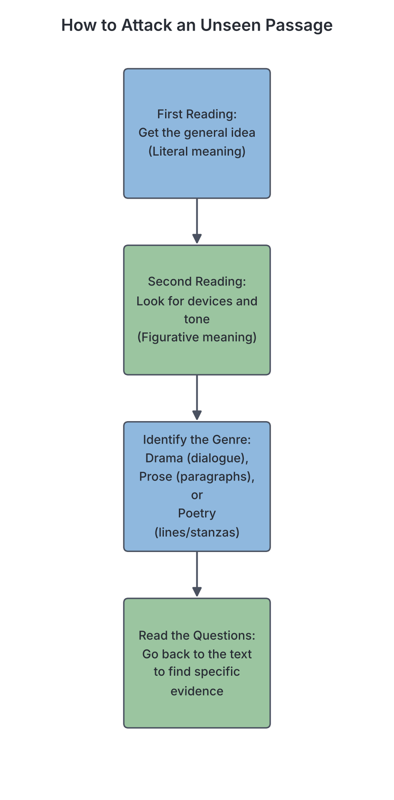

# JAMB Literature In English Notes: Literary Appreciation and Unseen Analysis

## What JAMB expects

This file covers Section 5 of the JAMB Literature in English syllabus: Literary Appreciation. It focuses on the skills required to analyze literary texts you have not studied before.

This file covers the following content item:
* Unseen passages/extracts from Drama, Prose and Poetry.

By the end of these notes, you should be able to:
1. identify literary devices used in a given passage/extract;
2. provide an interpretation of the given passage/extract;
3. relate the extract to true life experiences.

*Note: The specific types of drama, prose, poetry, and the definitions of literary terms (like metaphor, simile, irony) are fully explained in the earlier notes (`A1`, `A2`, `A3`, and `A4` files). This file focuses strictly on the **methodology**—how to apply that knowledge to unseen passages in an exam.*

## Unseen passages/extracts from Drama, Prose and Poetry

In the JAMB examination, not all questions are based on the prescribed set texts. The exam will include **unseen passages or extracts**. An unseen passage is a short piece of writing—a few lines of a poem, a paragraph from a novel, or a short dialogue from a play—that you have likely never read before. 

JAMB uses these extracts to test your **literary appreciation** skills. They want to see if you can understand, interpret, and analyze a piece of literature on the spot, without having a teacher explain it to you beforehand.

### How to approach unseen extracts by genre

Different genres require you to look for different clues when reading an unseen passage.

| Genre | What it looks like in the exam | Key things to look for immediately |
| :--- | :--- | :--- |
| **Drama** | Character names on the left, followed by their spoken words (dialogue). It may include words in brackets `[like this]` which are stage directions. | **Who is speaking?** Who are they speaking to? What is the relationship between the characters? Are they arguing, agreeing, or hiding something? Look at stage directions for physical actions or emotions. |
| **Prose** | A standard paragraph or block of text written in continuous sentences. It may contain description, narration, or dialogue. | **Who is telling the story?** (Point of view). What is the setting (time and place)? Is the author describing a character, an event, or an environment? Look closely at the adjectives used. |
| **Poetry** | Lines grouped into stanzas, often with a rhythmic structure or a rhyme scheme. It usually contains very concentrated language and deep imagery. | **What is the literal subject?** (e.g., a tree, a storm, a crying child). What is the deeper meaning? Pay attention to figures of speech, rhythm, and the speaker's tone (is the poet sad, angry, or joyful?). |

---

## Objective i: Identify literary devices used in a given passage/extract

**Objective i: identify literary devices used in a given passage/extract.**

Literary devices (or figures of speech) are the tools writers use to make their writing more interesting, emotional, and vivid. When given an unseen passage, you must be able to spot these devices and understand why the writer used them.

### Step-by-step guide to identifying literary devices

1. **Read for comparisons:** Look for words like "as" or "like" (Simile). If a direct comparison is made without "as" or "like", it is a Metaphor.
2. **Look for human traits:** If an animal, object, or idea is doing something only a human can do (crying, dancing, smiling), it is Personification.
3. **Check for exaggerations:** Is the writer blowing things out of proportion for effect? (Hyperbole).
4. **Listen to the sounds:** Read the extract quietly in your head. Do many words start with the same consonant sound? (Alliteration). Are there hissing sounds? (Sibilance).
5. **Look for opposites:** Are there contrasting ideas placed side by side? (Oxymoron, Paradox, Antithesis).
6. **Watch out for Irony:** Is the character saying the exact opposite of what they mean? (Sarcasm/Verbal Irony).

### Example (Made up for teaching): Poetry Extract

Read the following short poem and identify the devices:

> *The sun smiled down on the weary hawker,*
> *But the tarred road was a frying pan beneath his feet.*
> *He dragged a mountain of goods on his head,*
> *Singing a silent song of sorrow.*

**Analysis of devices in the extract:**
*   *"The sun smiled down..."* -> **Personification**. The sun is given the human ability to smile.
*   *"...the tarred road was a frying pan..."* -> **Metaphor**. The hot road is directly compared to a frying pan without using "like" or "as".
*   *"He dragged a mountain of goods..."* -> **Hyperbole**. The hawker is not literally carrying a mountain; it is an exaggeration to show that the goods are very heavy.
*   *"Singing a silent song of sorrow."* -> **Alliteration** (repetition of the 's' sound) and **Oxymoron** (a song is meant to be heard, so a "silent song" puts two contradictory words together).

In the exam, JAMB might ask: *The expression "the tarred road was a frying pan" is an example of...* and you would select Metaphor.

---

## Objective ii: Provide an interpretation of the given passage/extract

**Objective ii: provide an interpretation of the given passage/extract.**

To "interpret" an extract means to explain its deeper meaning. You must go beyond the **literal meaning** (what is actually happening) and find the **figurative meaning** (what the author is trying to say about life, society, or human nature).

### Key elements of interpretation

When interpreting an unseen passage, you need to figure out four main things:
1.  **Subject Matter (Literal Meaning):** What is the passage openly talking about? (e.g., A boy being punished by his father).
2.  **Theme (Deeper Meaning):** What is the underlying message? (e.g., The strictness of traditional parenting, or the loss of childhood innocence).
3.  **Tone:** What is the writer's or speaker's attitude towards the subject? Is the tone angry, humorous, sarcastic, sympathetic, or melancholic (sad)?
4.  **Mood/Atmosphere:** How does the passage make the reader feel? Is the atmosphere tense, gloomy, peaceful, or chaotic?

### Example (Made up for teaching): Prose Extract

Read the following extract:

> *Chief Balogun stepped out of his tinted SUV, adjusting his heavily embroidered agbada. He did not look at the ragged children rushing to wipe his pristine windscreen. He casually tossed a single crumpled naira note onto the dusty road and walked into the grand banquet hall, his belly leading the way.*

**Interpreting the extract:**
*   **Subject Matter:** A rich man arriving at a party and ignoring poor children.
*   **Theme:** The gap between the rich and the poor; arrogance; social inequality.
*   **Tone:** The narrator's tone is **critical** or **mocking**. We can tell because of words like "pristine windscreen", "crumpled naira note", and the slightly mocking phrase "his belly leading the way."
*   **Characterisation:** Chief Balogun is portrayed as wealthy (tinted SUV, agbada), arrogant, and unsympathetic (did not look at the children, tossed crumpled money on the floor).

If JAMB asks: *The writer's attitude towards Chief Balogun can best be described as...* the answer would be **critical** or **disdainful**.

---

## Objective iii: Relate the extract to true life experiences

**Objective iii: relate the extract to true life experiences.**

Literature does not exist in a vacuum; it is a mirror reflecting society (a concept known as **mimesis**). JAMB expects you to read an unseen passage and connect it to real-life situations, social issues, or universal human experiences.

### How JAMB tests this

Questions covering this objective often look like this:
*   *The passage reflects the reality of...*
*   *The situation described above is a commentary on...*
*   *The extract captures the universal theme of...*

To answer these questions, you must ask yourself: **"Where do I see this happening in real life?"**

### Common Real-Life Connections in Nigerian/African Literature

Unseen passages in JAMB frequently touch on recognizable social and political realities, especially in African literature. Be on the lookout for extracts that relate to:

1.  **Political Corruption and Bad Governance:** Extracts showing leaders eating public funds, ignoring the masses, or rigging elections.
2.  **Poverty and Survival:** Passages describing struggling workers, hawkers, or dilapidated environments, reflecting the economic hardships in society.
3.  **Cultural Conflict (Tradition vs. Modernity):** Extracts showing a clash between old village customs and new Western education or city lifestyles.
4.  **Oppression and Injustice:** Passages about police brutality, domestic violence, or the rich exploiting the poor.
5.  **Universal Human Experiences:** Passages dealing with death, the joy of birth, the pain of heartbreak, or the beauty of nature.

### Example (Made up for teaching): Drama Extract

Read the following extract:

> **Okon:** (Wiping sweat from his brow) How much is a mudu of garri today?
> **Mama Nkechi:** It is two thousand naira, my brother. Take it or leave it. 
> **Okon:** Two thousand! Ah! Last week it was one thousand five hundred. Are you people using a different sun to grow your cassava?
> **Mama Nkechi:** Go and ask the people in Abuja! Is it my fault that petrol is now gold? If you cannot buy, move away for my customers.

**Relating the extract to true life:**
*   **Interpretation:** The dialogue shows a disagreement between a buyer and a seller over a sudden price increase.
*   **Real-life connection:** This extract perfectly reflects the **harsh economic reality of inflation** and the **high cost of living** in contemporary society. It also shows how national issues (fuel prices determined by government/"people in Abuja") directly affect ordinary citizens in the local market. 

If JAMB asks: *The interaction between Okon and Mama Nkechi reflects...*, the correct answer would be something like **the economic hardship and inflation in the society.**

---

## Needs checking against the text
*All information in this section relies on general literary appreciation principles and short, original examples designed for teaching purposes. No specific set-text facts are used, so nothing requires verification against the prescribed books.*

---

## Key terms

| Term | Meaning |
| :--- | :--- |
| **Unseen passage/extract** | A portion of a literary text (poem, prose, or drama) that a student has not studied before, used to test their analytical skills. |
| **Literal meaning** | The exact, surface-level meaning of the words; what is actually happening in the text. |
| **Figurative meaning** | The deeper, symbolic, or hidden meaning of the text, often conveyed through literary devices. |
| **Literary device** | A technique used by a writer to produce a specific effect (e.g., metaphor, irony, personification). |
| **Theme** | The central idea or underlying message of a literary work. |
| **Tone** | The attitude of the writer, speaker, or narrator toward the subject matter or the audience (e.g., sarcastic, joyful, bitter). |
| **Mood** | The atmosphere or emotional feeling created in the reader by the text. |
| **Mimesis** | The idea that literature imitates or reflects real life and human experiences. |

---

## Exam tips and common mistakes

*   **Read the passage twice:** Read it the first time to get the general story (literal meaning). Read it the second time to look for devices, tone, and deeper meaning.
*   **Do not use outside knowledge blindly:** If an unseen passage is from a book you happen to have read, base your answers **only** on the extract provided. Do not answer based on what happens in chapter 10 if the extract is from chapter 2.
*   **Pay attention to punctuation:** In poetry, do not stop at the end of a line unless there is a full stop or comma (this is called *enjambment*). Read to the punctuation mark to understand the sentence.
*   **Distinguish between Mood and Tone:** Tone belongs to the *writer/speaker* (how they speak). Mood belongs to the *reader/environment* (how it feels). For example, a writer can use a *mocking tone* to describe a tragedy, which creates an *uncomfortable mood*.
*   **Look out for "NOT" questions:** JAMB often asks, "Which of the following literary devices is NOT used in the passage?" You must carefully check the passage to eliminate the three devices that *are* present.
*   **Context is everything:** A word can mean one thing in a dictionary but something completely different in a passage. Always deduce the meaning of a word based on how it is used in the specific sentence (contextual meaning).

---

## Quick summary

1. Literary appreciation in the exam tests your ability to read, analyze, and interpret unseen passages from drama, prose, and poetry.
2. For drama extracts, pay close attention to dialogue and stage directions to understand character relationships.
3. For prose extracts, focus on the narrator's point of view, descriptive language, and the setting.
4. For poetry extracts, look beyond the literal words to identify figures of speech, imagery, and the speaker's emotions.
5. Identifying literary devices requires spotting comparisons (metaphors/similes), sound patterns (alliteration), and exaggerations (hyperbole).
6. Interpreting a passage involves discovering its theme, the writer's tone, and the overall mood or atmosphere.
7. Literature reflects society (mimesis). You must be able to link the events in an unseen passage to real-life experiences like political corruption, poverty, culture clash, or universal human emotions.

---

## Practice questions

**Read the following short poem extract and answer questions 1 to 3:**
*(Made up for teaching)*
*The angry wind howled through the village,*
*Snatching the roofs of the poor without pity.*
*While the concrete mansions of the kings stood still,*
*Laughing at the mud houses crumbling to dust.*

**1. Which of the following literary devices is heavily used in the extract above?**
- A. Simile
- B. Personification
- C. Oxymoron
- D. Pun

**Answer: B.** explanation: The wind is described as "angry", "howling", and "snatching... without pity", while the mansions are "laughing". Giving human emotions and actions to inanimate objects is personification.

**2. The tone of the speaker in the poem can best be described as:**
- A. Joyful
- B. Indifferent
- C. Sympathetic to the poor
- D. Sarcastic

**Answer: C.** explanation: The speaker notes that the wind snatched the roofs of the poor "without pity" and highlights the destruction of the "mud houses", showing empathy and sympathy for the suffering of the poor compared to the untouched kings.

**3. In relation to real-life experiences, the extract primarily highlights:**
- A. The beauty of nature
- B. The gap between the rich and the poor during natural disasters
- C. The importance of building houses with mud
- D. The unity of a village in times of crisis

**Answer: B.** explanation: The poem contrasts the "concrete mansions of the kings" that survive the storm with the "mud houses" of the poor that crumble, reflecting the real-life reality of social inequality and how disasters affect the poor more severely.

**Read the following prose extract and answer questions 4 to 6:**
*(Made up for teaching)*
*Mr. Alabi stood before the classroom, his cane resting gently on his shoulder like a soldier's rifle. He did not need to speak; the deep crease on his forehead and his fiery red eyes communicated his verdict. Every student held their breath, wishing they could melt into the wooden desks. The silence in the room was so thick you could cut it with a knife.*

**4. The expression "his cane resting gently on his shoulder like a soldier's rifle" is an example of:**
- A. Metaphor
- B. Hyperbole
- C. Simile
- D. Paradox

**Answer: C.** explanation: The writer compares the way the cane rests on his shoulder to a soldier's rifle using the word "like". This is a direct comparison, which defines a simile.

**5. The mood of the classroom in this extract is:**
- A. Relaxed and peaceful
- B. Tense and fearful
- C. Sad and melancholic
- D. Excited and joyful

**Answer: B.** explanation: The students are holding their breath, wishing they could melt into the desks, and there is a "thick" silence because of Mr. Alabi's angry appearance. This creates an atmosphere (mood) of intense fear and tension.

**6. The phrase "The silence in the room was so thick you could cut it with a knife" is used by the writer to:**
- A. show that the students brought knives to school.
- B. emphasize the absolute and heavy quietness in the room.
- C. explain how Mr. Alabi cuts the air with his cane.
- D. describe the physical thickness of the wooden desks.

**Answer: B.** explanation: This is a metaphorical hyperbole used to exaggerate the intensity of the silence, indicating that it felt almost like a physical, heavy presence in the room.

**Read the following drama extract and answer questions 7 to 9:**
*(Made up for teaching)*
**Honourable:** *(Pacing the lavishly furnished living room)* Have you distributed the bags of rice to the youth leaders?
**Assistant:** Yes, sir. But they are complaining that the bags are too small. They want cash.
**Honourable:** *(Laughs loudly)* Cash? Let them eat the rice first. When it is one day to the election, we will show them the money. For now, let hunger keep them loyal. 

**7. The character of the Honourable can best be described as:**
- A. Generous and caring
- B. Manipulative and corrupt
- C. Foolish and naive
- D. Hardworking and honest

**Answer: B.** explanation: He uses food and hunger as tools to control the youths and plans to use money to buy votes at the last minute, which shows he is highly manipulative and corrupt.

**8. The dialogue between the Honourable and his Assistant is a reflection of:**
- A. The efficiency of food distribution in Africa
- B. The cordial relationship between politicians and youths
- C. Electoral malpractice and political exploitation in society
- D. The importance of agriculture in the economy

**Answer: C.** explanation: The extract mirrors the real-life political reality where politicians exploit the poverty of the masses (using rice and cash) to buy loyalty and rig elections.

**9. The stage direction *(Laughs loudly)* indicates that the Honourable:**
- A. is terrified of the youths.
- B. does not take the youths' demands seriously and feels in control.
- C. is going mad due to election stress.
- D. is happy that the youths are well fed.

**Answer: B.** explanation: His loud laughter in response to their demand for cash shows arrogance. He is amused by them and feels totally in control of the situation.

**10. When answering questions on an unseen passage in an examination, a student should PRIMARILY base their interpretation on:**
- A. the title of the book the passage was taken from.
- B. their own personal beliefs about the topic.
- C. the exact words, context, and evidence provided within the extract itself.
- D. the biography of the author who wrote the passage.

**Answer: C.** explanation: In unseen passage analysis, the text provided is the only reliable source of information. All interpretations, tone analysis, and device identification must be proven by evidence directly found in the given extract.

<!-- COVERAGE
obj i | Objective i: Identify literary devices used in a given passage/extract
obj ii | Objective ii: Provide an interpretation of the given passage/extract
obj iii | Objective iii: Relate the extract to true life experiences
item a | Unseen passages/extracts from Drama, Prose and Poetry
-->
