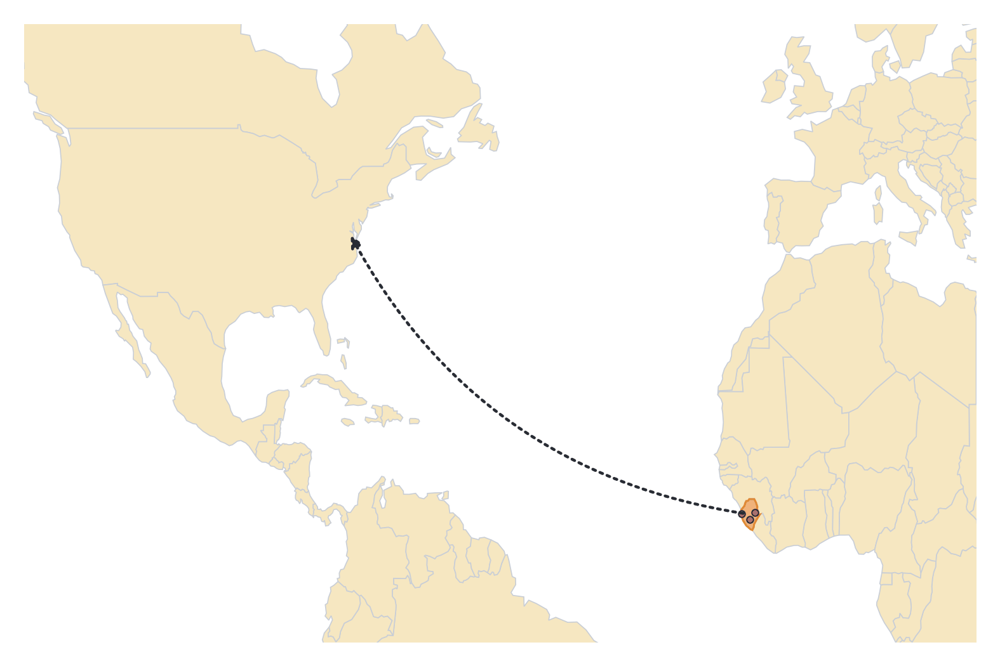
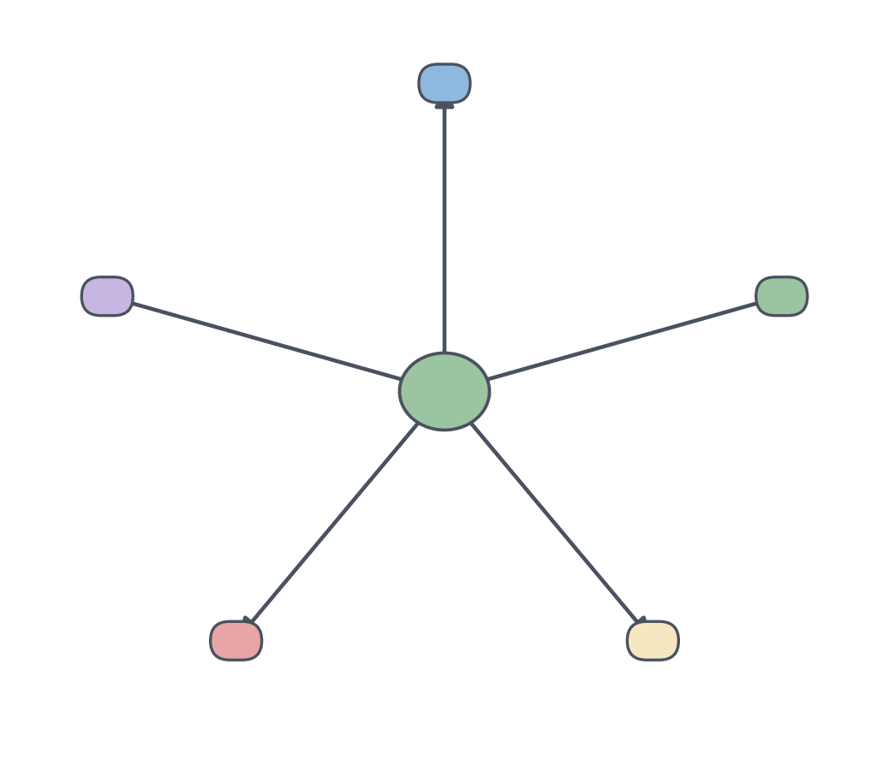

# JAMB Literature In English Notes: Set Text: So the Path Does not Die (Pede Hollist)

## What JAMB expects

This file is a study guide to the prescribed African prose text, *So the Path Does not Die* by Pede Hollist. It applies the general principles of prose analysis to this specific novel.

By the end of these notes, you should be able to understand the novel in terms of the JAMB prose objectives that apply to the prescribed texts:
- **a.ii:** Types of prose (identifying the category of this novel).
- **b.i to b.iii:** Narrative techniques, characterisation, and language.
- **c.i to c.iv:** Theme, plot, setting and period, and socio-political context.

To learn *how* to analyse these elements in general, see `A2a-types-of-prose.md`, `A2b-narrative-techniques-and-devices.md` and `A2c-textual-analysis-of-prose.md`.

Important: these notes contain only facts that were confirmed by at least two independent sources, mostly Nigerian study guides and reviews. Anything not confirmed is marked **[TO BE COMPLETED: ...]**. Read the novel itself, because exam questions test details from the text.

## Background of the Author and Text

**Pede Hollist** is a Sierra Leonean writer and academic. He is an associate professor of English at the University of Tampa in Florida, USA. His short story "Foreign Aid" was shortlisted for the 2013 Caine Prize for African Writing.

*So the Path Does not Die* is his first (debut) novel. It follows Finaba "Fina" Marah from a village in Sierra Leone to the capital, Freetown, and then to the United States. Its central concern is female genital mutilation (FGM) as a rite of passage, together with questions of belonging and identity. The novel is on the West African Examinations Council (WAEC) list of African prose texts for 2026 to 2030.

Note on dates: sources disagree about the first publication. One study guide says the book appeared in the US in 2008 and was distributed more widely in Africa by 2012; others cite a 2012 edition from Langaa Research and Publishing (Cameroon) and a 2014 edition from Jacaranda Books (London). Sources also disagree on whether it won an African Literature Association book award (2013 or 2014). Do not state a year or an award in an exam answer unless your teacher confirms it.

**[TO BE COMPLETED: the confirmed year of first publication and whether the novel won an award.]**

## Types of Prose (Objective a.ii)

*So the Path Does not Die* is **African prose fiction**, a novel. Study guides and reviews describe it as:

1. **A coming-of-age novel (a *Bildungsroman*):** it follows Fina's growth from childhood into adulthood as she searches for identity and belonging.
2. **A novel of migration (diaspora literature):** part of the story takes place in the United States, so it deals with Africans living abroad and with the pull of home.

## Plot (Objective c.ii)

The novel follows the life of **Finaba "Fina" Marah**.

**Verified outline (in broad order):**
1. The story opens with a female initiation (circumcision) ritual in **Talaba village** that is stopped, or interrupted, by Fina's father. This is described as her central trauma. It leads to trouble for her family and a lasting feeling of not belonging.
2. Her **grandmother, Baramusu**, insists that Fina must remain faithful to the people's path (the tradition), while her father urges an easier path. The family later moves to **Freetown**, the capital. One plot summary links this move to a conflict over a curse, and says her father, **Amadu**, later dies. Treat these two details with care.
3. Fina's life continues in Sierra Leone (the settings include **Koidu**) and then in **America**, where she builds a life. She has relationships there; **Cammy** appears as her partner, and the study guides also name **Aman** (an African-American friend) and **Bayo** (a Nigerian fiancé).
4. Later, Fina returns to Sierra Leone, which has been damaged by the civil war. She finds her home village destroyed and cannot find her grandmother. She meets **Mama Yegbe** and **Mawaf**, a teenager traumatised by the war, and they become her family. She treats Mawaf with the same care she would give her own child.
5. The ending is hopeful. Fina, Mawaf and Mama Yegbe form a close family in Sierra Leone. Study guides disagree about what happens to Cammy.

**[TO BE COMPLETED: detailed chapter-by-chapter plot summary. The Nigerian site myschool.ng divides the book into Prologue to Chapter 4, Chapters 5 to 9, Chapters 10 to 14, Chapters 15 to 19 and Chapter 20 with the Epilogue, but the summaries could not be read.]**
**[TO BE COMPLETED: the exact reasons the family leaves Talaba and what happens to Fina's mother and father.]**
**[TO BE COMPLETED: the reasons and timeline of Fina's move to the United States, and the exact roles of Cammy and Bayo in her life.]**
**[TO BE COMPLETED: the final outcome for Cammy and for Fina's relationship with him.]**

## Setting and Period (Objective c.iii)

**Physical Setting (Place):**
Study guides list these places, which show Fina's journey from tradition to a wider world:
1. **Talaba village, Sierra Leone:** where the initiation ritual takes place and where tradition is strongest.
2. **Freetown, Sierra Leone:** the capital city.
3. **Koidu, Sierra Leone.**
4. **The United States:** where Fina lives for part of the story.
5. A short episode in **Nigeria**, at a wedding, is mentioned in one study guide.

**Time Period:**
The war in Sierra Leone (a civil war that study guides date to about 1991 to 2002) forms part of the background, and Fina returns to a country affected by it. So the story reaches into the period of and after that war.

**[TO BE COMPLETED: the exact years or time span covered by the story.]**

## Socio-Political Context (Objective c.iv)

1. **Female initiation and FGM:** In Sierra Leone, girls' initiation into womanhood has traditionally been linked to secret women's societies (commonly called Bondo or Sande), and the rite often includes FGM. This is widely criticised for the physical and psychological harm it causes, yet it is defended by many as a cultural duty. In the novel, a character insists the ritual must continue so that "the path does not die". **[TO BE COMPLETED: the name the novel itself uses for the initiating society.]**
2. **The Sierra Leone civil war:** The war damaged villages and families and left young people traumatised. Mawaf is an example in the story.
3. **Migration and belonging:** Fina moves between Sierra Leone and America, so the novel looks at identity, discrimination and what it means to belong.

## Theme (Objective c.i)

Study guides list these themes: **female genital mutilation (FGM), marriage and love, discrimination, death and sexual harassment.** Reviews also mention identity, gender, sexuality and exile.

**1. Female genital mutilation and tradition:**
The initiation at the start of the novel is the central conflict. The title refers to keeping the traditional path alive, and the novel asks what the cost of that is for girls and women.

**2. Identity and belonging:**
Fina searches for where she belongs as she moves between a village, a city and a foreign country.

**3. Marriage and love:**
Fina's relationships, including those with Cammy and Bayo, show love and marriage across different backgrounds.

**4. Discrimination and sexual harassment:**
Women face unfair treatment and harassment. **[TO BE COMPLETED: the scenes where these appear.]**

**5. Death and loss:**
Death and war-time suffering are part of the story, for example in the destruction of Fina's home area. **[TO BE COMPLETED: which deaths are important.]**

## Characterisation (Objective b.ii)

**1. Finaba "Fina" Marah:**
*   **Role:** The protagonist.
*   **Development:** She grows from a girl whose initiation was interrupted, and who feels she does not belong, into a woman who returns to Sierra Leone and cares for others, including Mawaf.

**2. Baramusu (Fina's grandmother):**
*   **Role:** She insists that Fina remain faithful to her people's path, which means she stands for tradition.
*   **[TO BE COMPLETED: her fate.]**

**3. Amadu (Fina's father):**
*   **Role:** He stops the initiation and urges an easier path for Fina. One summary says he later dies.
*   **[TO BE COMPLETED: exact details of his stance and death.]**

**4. Mama Yegbe and Mawaf:**
*   **Role:** Fina meets them when she returns to Sierra Leone. Mawaf is a teenager traumatised by the war, and Fina cares for her like her own child. Mama Yegbe lives with Fina.

**5. Cammy, Bayo and Aman:**
*   **Role:** Cammy is Fina's partner. Bayo is described as her Nigerian fiancé, and Aman as her African-American friend.
*   **[TO BE COMPLETED: Cammy's background and exact role, and how his story relates to Bayo.]**

**6. Edna and Kizzy:**
*   Study guides name Edna as Fina's foster sister and Kizzy as Edna's husband. **[TO BE COMPLETED: their roles in the plot.]**

**7. [TO BE COMPLETED: Fina's mother (the name given in some sources was not confirmed) and other characters.]**

## Narrative Techniques (Objective b.i)

Reviews describe the novel as an intricately interwoven narrative that moves between places and times, from the village to the city and abroad. The study guides read these shifts as tracking Fina's inner journey.

**[TO BE COMPLETED: the point of view (first or third person) used in the novel.]**
**[TO BE COMPLETED: use of flashbacks, symbolism or other techniques, and their examples.]**

To practise, see how to identify narrative techniques in `A2b-narrative-techniques-and-devices.md`.

## Language (Objective b.iii)

Reviewers note that the book uses Krio dialogue and West African sayings and fresh figures of speech, which bring its hybrid world to life. **[TO BE COMPLETED: specific words, sayings or images from the text.]**

---

## Needs checking against the text

Because literary exams test precise facts from the prescribed book, the following details must be verified by your teacher or by checking the book directly:

*   **[TO BE COMPLETED: the confirmed year of first publication and whether the novel won an award.]**
*   **[TO BE COMPLETED: detailed chapter-by-chapter plot summary.]**
*   **[TO BE COMPLETED: the exact reasons the family leaves Talaba and what happens to Fina's mother and father.]**
*   **[TO BE COMPLETED: the reasons and timeline of Fina's move to the United States, and the exact roles of Cammy and Bayo in her life.]**
*   **[TO BE COMPLETED: the final outcome for Cammy and for Fina's relationship with him.]**
*   **[TO BE COMPLETED: the exact years or time span covered by the story.]**
*   **[TO BE COMPLETED: the name the novel itself uses for the initiating society.]**
*   **[TO BE COMPLETED: the scenes of discrimination and sexual harassment, and which deaths are important.]**
*   **[TO BE COMPLETED: Baramusu's fate, and the details of Amadu's stance and death.]**
*   **[TO BE COMPLETED: Cammy's background, and the roles of Edna and Kizzy.]**
*   **[TO BE COMPLETED: Fina's mother and other characters.]**
*   **[TO BE COMPLETED: the point of view, flashbacks, symbolism and other techniques.]**
*   **[TO BE COMPLETED: specific words, sayings or images from the text.]**

---

## Key terms

| Term | Meaning |
| --- | --- |
| Bildungsroman | A novel that follows a character's growth from youth to adulthood. |
| Diaspora | People living away from their original homeland; here, Africans living abroad. |
| FGM | Female genital mutilation, the cutting of female genitals in some initiation traditions. |
| Initiation | A ritual that marks a person's passage into a new stage of life. |
| Protagonist | The main character of a story. |
| Theme | The central idea or message explored in a work. |
| Krio | An English-based creole language widely spoken in Sierra Leone. |

## Exam tips and common mistakes

*   **Know the basics:** the author is Pede Hollist, the protagonist is Finaba "Fina" Marah, and the places include Talaba village, Freetown, Koidu and the United States.
*   **Know the main conflict:** the novel opens with an initiation that is stopped by Fina's father, and her grandmother Baramusu wants the tradition kept.
*   **Quote the themes carefully:** FGM, marriage and love, discrimination, death, sexual harassment and belonging.
*   **Do not invent details:** if you are unsure of a name or date, describe the event in general terms rather than guessing.
*   **Do not mix up texts:** other African prose texts on the list have different authors, characters and settings.

## Quick summary

1. *So the Path Does not Die* is the first novel of the Sierra Leonean writer Pede Hollist.
2. The protagonist is Finaba "Fina" Marah.
3. The story opens with an initiation (circumcision) that is stopped by Fina's father, and her grandmother Baramusu wants the tradition kept.
4. The settings include Talaba village, Freetown, Koidu and the United States.
5. Fina's later life includes relationships with characters such as Cammy, Bayo and Aman.
6. Fina returns to a Sierra Leone affected by war and forms a family with Mama Yegbe and Mawaf.
7. Themes include FGM, marriage and love, discrimination, death, sexual harassment and belonging.

## Practice questions

**1. Who wrote *So the Path Does not Die*?**

- A. Elma Shaw
- B. Wole Soyinka
- C. Pede Hollist
- D. Gabriel Okara

**Answer: C.** Pede Hollist, a Sierra Leonean writer, wrote the novel.

**2. The main settings of the novel include Sierra Leone and**

- A. the United Kingdom
- B. the United States
- C. Canada
- D. Liberia

**Answer: B.** Fina's story moves from Sierra Leone to the United States and back.

**3. Which of these is a theme of the novel?**

- A. Space exploration
- B. Female genital mutilation
- C. Stock market trading
- D. Pirate adventure

**Answer: B.** FGM, linked to the initiation rite, is the dominant theme.

**4. The protagonist of the novel is**

- A. Cammy
- B. Mawaf
- C. Finaba Marah
- D. Aman

**Answer: C.** Finaba "Fina" Marah is the central character.

**5. In the opening of the novel, the initiation ritual is**

- A. stopped by Fina's father
- B. completed without trouble
- C. banned by the government
- D. moved to Freetown

**Answer: A.** The ritual is interrupted by Fina's father, and this is her central trauma.

**6. Who insists that Fina remain faithful to her people's path?**

- A. Mawaf
- B. Baramusu
- C. Aman
- D. Bayo

**Answer: B.** Her grandmother, Baramusu, stands for tradition.

**7. *Read this short made-up passage: "Ada left her village for a big city abroad. In the cold, unfamiliar streets she missed the market and the voices of home, and no one seemed to know her name."* What theme does the passage highlight?**

- A. Political corruption
- B. Loneliness and the struggle to belong
- C. The joy of harvest
- D. Betrayal by friends

**Answer: B.** The contrast between home and the unfamiliar place shows loneliness and the search for belonging, an idea that also runs through Fina's story.

**8. Which place is a village in the novel?**

- A. Freetown
- B. Koidu
- C. Talaba
- D. Washington

**Answer: C.** Talaba is the village where the story begins; Freetown is the capital.

**9. Mawaf, whom Fina meets when she returns to Sierra Leone, is described as**

- A. a war-traumatised teenager
- B. Fina's grandmother
- C. a Nigerian fiancé
- D. a government minister

**Answer: A.** Mawaf is a teenager traumatised by the war, and Fina cares for her like her own child.

**10. *Read this made-up passage: "The old man told the boy, 'The river remembers every stone, so do not forget the path your fathers walked.'"* The title phrase of the novel, "so the path does not die," is most similar in idea to**

- A. keeping traditions alive
- B. building a new road
- C. winning an election
- D. forgetting the past

**Answer: A.** In the novel, "the path" refers to the tradition being kept alive, an idea close to the old man's advice in the made-up passage.

<!-- COVERAGE
-->
