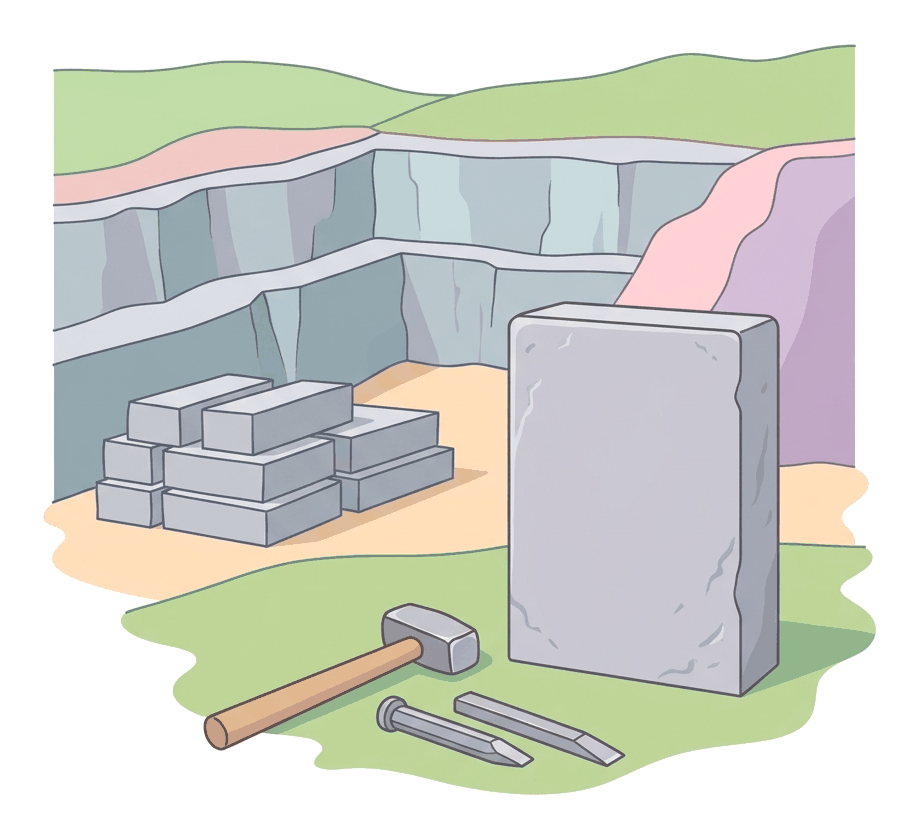

# JAMB Literature In English Notes: Set Texts: The Telephone Call (Fleur Adcock) and The Stone (Wilfred Wilson Gibson)

## What JAMB expects

This file is a study guide to the two remaining Non-African prescribed poems in the JAMB Literature in English syllabus. It covers:

*   **Fleur Adcock:** *The Telephone Call*
*   **Wilfred Wilson Gibson:** *The Stone*

**Note on the syllabus wording:** The syllabus misspells Wilfred Wilson Gibson's surname as "Gipson". These notes use the correct spelling. 

For these set texts, JAMB expects you to be able to identify and explain the objectives for Poetry:
1. Recognise the forms and types of poetry.
2. Identify the themes, subject matter, and the persona.
3. Analyse the setting and socio-political context.
4. Identify and explain the poetic devices, techniques, and style used by the poets.

Because the poems are not reproduced here, this guide gives only points confirmed by more than one source, in the notes' own words. **Wherever a detail could not be confirmed, a clearly marked placeholder is used so that your teacher can check it against the prescribed text.**

---

## Part 1: The Telephone Call by Fleur Adcock

### Background and Context

**Fleur Adcock** was born in 1934 in New Zealand and has spent most of her adult life in Britain. She is a modern poet, and her work is often described as witty and conversational.

*The Telephone Call* is reported by several study guides to come from her collection *The Incident Book* (1986). It is also widely anthologised, for example in the Cambridge IGCSE anthology *Songs of Ourselves*. The 1986 date rests on study-guide sources, so treat it as probable and not certain.

**Context:** The poem deals with a modern lottery scam by telephone. It belongs to a world of telecommunications and advertising, where people are tempted by promises of an easy prize.

### Subject Matter

A speaker receives a telephone call from a firm called "Universal Lotteries". The caller says the speaker has won the top prize in a lucky draw. The call turns out to be a hoax: the "prize" is an "experience" and not money. The poem therefore ends in disappointment, and the speaker's hope is deflated.

**[TO BE COMPLETED: The exact name of the draw, the exact prize and the exact wording of the final stanza, to be taken from the prescribed text.]**
**[TO BE COMPLETED: Whether the speaker is a woman or a man, and whether the speaker should be read as the poet or as a created persona. Sources disagree.]**
**[TO BE COMPLETED: How the speaker reacts, stanza by stanza, and whether both sides of the conversation are heard.]**

### Themes

1. **Deception and false hope:** A promise of sudden wealth is used to raise hopes that are then dashed.
2. **Lottery scams and gullibility:** The poem criticises fraudulent schemes and the empty excitement and emotional manipulation behind them.
3. **Fantasy versus reality:** Sources read it as saying that we seldom really win; at most we enjoy the fantasy for a while.
4. **The market and emotion:** One reading says the poem mocks a market that sells emotional experiences.

### The Persona and Tone

*   **The Persona:** The speaker is the person who receives the call. Sources do not agree on whether this is Adcock herself or a created voice.
*   **The Tone:** Study guides describe the poem as witty, sarcastic and ironic, written in a simple, conversational style.

### Structure, Techniques, and Style

1. **Structure:** Two sources state that the poem has six stanzas of eight lines each (48 lines in all). Check this against your printed text.
2. **Rhyme and metre:** Study guides describe the poem as having no regular metre or rhyme scheme, that is, free verse. **[TO BE COMPLETED: Confirm from the printed text whether any rhyme or half-rhyme is used.]**
3. **Irony and sarcasm:** The grand promise of a prize is undercut when the "prize" turns out to be worthless.
4. **Conversational language:** The language is everyday speech, which matches the subject of a phone call.
5. **Enjambment:** One study guide notes that lines run on into each other. **[TO BE COMPLETED: Examples from the text.]**

---

## Part 2: The Stone by Wilfrid Wilson Gibson

### Background and Context

**Wilfrid Wilson Gibson** (1878-1962) was an English poet associated with the Georgian poets. The syllabus spells his name "Wilfred" and "Gipson", and the correct spelling of the surname is Gibson. He is described as writing about the poverty and hard lives of industrial workers and village labourers.

*The Stone* is the title poem of his collection *Fires, Book I: The Stone, and Other Tales* (1912), and it is a narrative poem. The full text of the 1912 collection is on Project Gutenberg.

### Subject Matter

A young woman's lover is killed in a quarry accident when a rock falls on him. She goes to a stonemason, who is the narrator, and asks him to cut a headstone for the dead man. The poem begins with her question to the mason, and that question is repeated. She is silent and numb with grief while he works, and the mason carves the stone through the night.

**[TO BE COMPLETED: The exact ending of the poem, including whose name is finally carved on the stone and what the narrator says about it. Study guides give conflicting summaries.]**
**[TO BE COMPLETED: The names of the man and the woman, if the text gives any.]**
**[TO BE COMPLETED: Exactly how the accident is described.]**

### Themes

1. **Grief and loss:** Sudden death and the numbness of shock.
2. **Silence:** The woman's silence is read by guides as the soundless paralysis of grief.
3. **Death and the hardship of labouring life:** The quarry is a dangerous workplace.
4. **Carving as mourning:** Cutting the stone becomes a way of grieving. Study guides also describe the woman as becoming "like stone" in her grief.

### The Persona and Tone

*   **The Persona:** The narrator is a stonemason, to whom the young woman comes. He tells the story. He is not the dead man and not the woman.
*   **The Tone:** Sorrowful and restrained. **[TO BE COMPLETED: Confirm tone shifts from the text.]**

### Structure, Techniques, and Style

1. **Narrative form:** The poem tells a short story in verse, like a ballad-style narrative with a repeated question.
2. **Repetition:** The opening question about cutting a stone is repeated and gives the poem a ritual feeling.
3. **Symbol of stone:** Stone links the quarry that killed the man with the headstone that remembers him, and with the woman's numbness.
4. **Length and rhyme:** One guide says the poem is about 97 lines. **[TO BE COMPLETED: Confirm the exact line count, stanza form and rhyme scheme from the printed text.]**

---

## Needs checking against the text

*   **For *The Telephone Call*:**
    *   [TO BE COMPLETED: The exact name of the draw, the exact prize and the wording of the final stanza.]
    *   [TO BE COMPLETED: Whether the speaker is a woman or a man, and whether the speaker is the poet or a persona.]
    *   [TO BE COMPLETED: How the speaker reacts, stanza by stanza, and whether both sides of the conversation are heard.]
    *   [TO BE COMPLETED: Whether any rhyme or half-rhyme is used, and examples of enjambment.]
    *   Also confirm: six stanzas of eight lines, and the 1986 date in *The Incident Book*.
*   **For *The Stone*:**
    *   [TO BE COMPLETED: The exact ending of the poem and whose name is carved.]
    *   [TO BE COMPLETED: The names of the man and the woman, if given.]
    *   [TO BE COMPLETED: How the accident is described.]
    *   [TO BE COMPLETED: Tone shifts from the text.]
    *   [TO BE COMPLETED: Exact line count, stanza form and rhyme scheme.]

---

## Key terms

| Term | Meaning |
| --- | --- |
| **Persona** | The voice or character speaking in a poem (the stonemason in *The Stone*). |
| **Anti-climax** | A disappointing end to something that raised high expectations (as in *The Telephone Call*). |
| **Irony** | A gap between what is expected or said and what really happens or is meant. |
| **Satire** | The use of humour, irony or exaggeration to criticise foolish or wrong behaviour. |
| **Free Verse** | Poetry without a regular metre or rhyme scheme. |
| **Narrative Poem** | A poem that tells a story. |
| **Enjambment** | A sentence running on from one line to the next without a pause. |
| **Colloquial Diction** | Everyday spoken language. |

## Exam tips and common mistakes

*   **Do not confuse the poets:** Adcock is a modern poet writing about a telephone lottery scam. Gibson published *The Stone* in 1912 and writes about a quarry death.
*   **Identify the persona in *The Stone*:** The speaker is the stonemason, not the dead man and not the grieving woman.
*   **Name the firm and trick in Adcock:** The call is from a firm called Universal Lotteries, and the prize is a hoax.
*   **Use your printed text for details:** Study-guide summaries of both poems disagree on small points. Quote and cite from your own edition.
*   **Spell the poet's name correctly:** Gibson, not "Gipson".

## Quick summary

1. *The Telephone Call* by Fleur Adcock is a witty modern poem about a speaker who is told she or he has won a lottery prize.
2. The caller is from "Universal Lotteries", and the prize turns out to be an "experience" and not money.
3. Its themes are deception, false hope and the gap between fantasy and reality.
4. It is reported to have six stanzas of eight lines, written in free verse in a conversational style.
5. *The Stone* by Wilfrid Wilson Gibson (in *Fires*, 1912) is a narrative poem about a young woman whose lover is killed in a quarry.
6. The narrator is a stonemason whom she asks to cut a headstone, and she is numb and silent in her grief.
7. Themes include grief, silence, death and carving as a form of mourning.

## Practice questions

**1. In Fleur Adcock's *The Telephone Call*, the caller claims to be from:**

- A. National Lottery Board
- B. Universal Lotteries
- C. Global Telecom
- D. Lucky Star Bank

**Answer: B.** Study guides agree that the caller names a firm called Universal Lotteries.

**2. The "prize" in *The Telephone Call* turns out to be:**

- A. A large sum of money
- B. A new house
- C. An "experience" and not money, so the call is a hoax
- D. A free telephone

**Answer: C.** Study guides say the poem reveals the prize as a hoax that offers an "experience" instead of money.

**3. Which tone best describes *The Telephone Call*?**

- A. Witty and sarcastic
- B. Solemn and prayerful
- C. Violently angry
- D. Romantic

**Answer: A.** Study guides describe it as witty, sarcastic and ironic.

**4. In Wilfrid Wilson Gibson's *The Stone*, who narrates the poem?**

- A. The dead man
- B. The grieving young woman
- C. A stonemason
- D. A quarry owner

**Answer: C.** The narrator is a mason whom the young woman asks to cut a headstone.

**5. In *The Stone*, how does the young woman's lover die?**

- A. In a fire
- B. At sea
- C. Through illness
- D. In a quarry accident, struck by a falling rock

**Answer: D.** Sources agree that he is killed in a quarry when a rock falls on him.

**6. *The Stone* was published in the collection:**

- A. *The Incident Book*
- B. *Fires, Book I: The Stone, and Other Tales* (1912)
- C. *Songs of Ourselves*
- D. *The Mermaid's Purse*

**Answer: B.** The poem is the title poem of Gibson's 1912 collection. *The Incident Book* is Adcock's.

**7. A poem tells a short story in verse with characters and events. It is called a:**

- A. Narrative poem
- B. Sonnet
- C. Elegy only
- D. Haiku

**Answer: A.** *The Stone* is an example of a narrative poem.

**8. *Read this made-up passage:* "The prize is yours, the voice declared; / I laughed, and then I stopped, and stared." What device ends both lines?**

- A. Alliteration
- B. End rhyme
- C. Free verse
- D. Anti-climax

**Answer: B.** "Declared" and "stared" rhyme at the line ends, so this is end rhyme.

**9. A poem with no regular rhyme scheme or metre is written in:**

- A. Free verse
- B. Heroic couplets
- C. Terza rima
- D. A villanelle

**Answer: A.** Free verse has no fixed rhyme or metre. Study guides describe *The Telephone Call* this way.

**10. Which poet's surname is misspelt "Gipson" in the JAMB syllabus?**

- A. Adcock
- B. Gibson
- C. Both
- D. Neither

**Answer: B.** The correct name is Wilfrid Wilson Gibson, and the syllabus misprints the surname as "Gipson".

<!-- COVERAGE
-->
