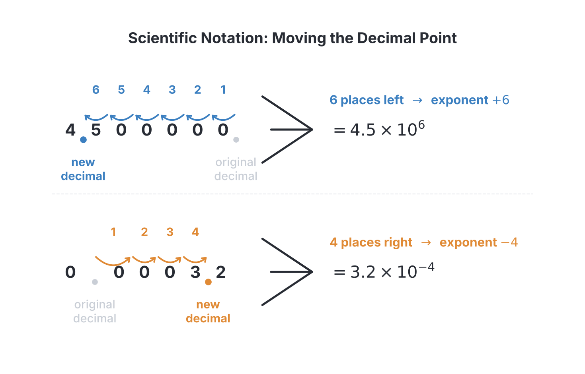

# JAMB Mathematics Notes: Indices, Logarithms and Surds

## What JAMB expects

This topic is Section I, Topic 3 of the JAMB Mathematics syllabus. It covers the essential rules for handling powers (indices), standard form, logarithms and irrational roots (surds). These concepts are fundamental building blocks for many other areas in mathematics, including algebra, calculus and geometry.

The syllabus covers the following content items:
- (a) laws of indices;
- (b) equations involving indices;
- (c) standard form;
- (d) laws of logarithm;
- (e) logarithm of any positive number to a given base;
- (f) change of bases in logarithm and application;
- (g) relationship between indices and logarithm;
- (h) Surds.

By the end of these notes, you should be able to:
1. apply the laws of indices in calculation;
2. establish the relationship between indices and logarithms in solving problems;
3. solve equations involving indices;
4. solve problems in different bases in logarithms;
5. simplify and rationalize surds;
6. perform basic operations on surds.

## Laws of indices

Indices (singular: index) provide a shorthand way to write a number multiplied by itself several times. In the expression $a^n$, the number $a$ is called the **base**, and $n$ is called the **index**, **power** or **exponent**. For example, $2^5$ means $2 \times 2 \times 2 \times 2 \times 2$. 

To apply indices in calculations, you must master the fundamental **laws of indices**. These rules only work when the expressions have the **same base**.

1. **Multiplication law:** $a^m \times a^n = a^{m+n}$
   When multiplying expressions with the same base, you add their powers. 
   *(Example: $2^3 \times 2^4 = 2^7$)*
2. **Division law:** $a^m \div a^n = a^{m-n}$
   When dividing expressions with the same base, you subtract the power of the divisor from the power of the dividend.
3. **Zero index law:** $a^0 = 1$ (where $a \neq 0$)
   Any non-zero number raised to the power of zero is $1$. Why? Because $a^3 \div a^3 = a^{3-3} = a^0$. Also, any number divided by itself is $1$. Therefore, $a^0 = 1$.
4. **Negative index law:** $a^{-n} = \frac{1}{a^n}$
   A negative index means the reciprocal of the positive index. It does **not** make the number itself negative.
5. **Power of a power law:** $(a^m)^n = a^{mn}$
   When a power is raised to another power, you multiply the indices.
6. **Fractional index law (Roots):** $a^{\frac{1}{n}} = \sqrt[n]{a}$
   A fractional power with $1$ in the numerator represents a root. For example, $a^{\frac{1}{2}}$ is the square root $\sqrt{a}$, and $a^{\frac{1}{3}}$ is the cube root $\sqrt[3]{a}$.
7. **Fractional index law (Combined):** $a^{\frac{m}{n}} = (\sqrt[n]{a})^m = \sqrt[n]{a^m}$
   The denominator of the fraction is the root, and the numerator is the power. It is usually easier to find the root first before applying the power.

> **Common mistake:** Multiplying the bases instead of keeping the base and adding the powers. For example, writing $3^2 \times 3^4 = 9^6$ is completely wrong. The correct step is $3^2 \times 3^4 = 3^{2+4} = 3^6$.

**Worked Example 1**
Simplify $2^3 \times 2^4 \div 2^5$.

**Solution:**
1. Apply the multiplication law to the first part: $2^3 \times 2^4 = 2^{3+4} = 2^7$.
2. Substitute this back into the expression: $2^7 \div 2^5$.
3. Apply the division law: $2^{7-5} = 2^2$.
4. Evaluate the result: $2^2 = 4$.

**Worked Example 2**
Evaluate $(27)^{\frac{2}{3}} \times (81)^{-\frac{1}{4}}$.

**Solution:**
1. Break down the first term using the combined fractional index law: $(27)^{\frac{2}{3}} = (\sqrt[3]{27})^2$.
2. The cube root of $27$ is $3$, so $(\sqrt[3]{27})^2 = (3)^2 = 9$.
3. Look at the second term: $(81)^{-\frac{1}{4}}$. First, apply the negative index law: $\frac{1}{(81)^{\frac{1}{4}}}$.
4. Find the fourth root of $81$: $\sqrt[4]{81} = 3$ (since $3 \times 3 \times 3 \times 3 = 81$).
5. So, $(81)^{-\frac{1}{4}} = \frac{1}{3}$.
6. Multiply the two results together: $9 \times \frac{1}{3} = 3$.

**Worked Example 3**
Evaluate $\left(\frac{16}{81}\right)^{-\frac{3}{4}}$.

**Solution:**
1. A negative power on a fraction flips (inverts) the fraction and changes the negative power to a positive power: $\left(\frac{81}{16}\right)^{\frac{3}{4}}$.
2. Apply the fractional power to both the numerator and the denominator: $\frac{(\sqrt[4]{81})^3}{(\sqrt[4]{16})^3}$.
3. Find the fourth roots: $\sqrt[4]{81} = 3$ and $\sqrt[4]{16} = 2$.
4. Apply the power of $3$: $\frac{3^3}{2^3} = \frac{27}{8}$.

## Standard form

In science, economics and everyday life, we often deal with extremely large numbers (like the national budget of Nigeria, e.g., ₦28,000,000,000,000) or extremely small numbers (like the size of a red blood cell, e.g., $0.000007$ metres). To write these without making mistakes, we use **standard form**.

A number is written in standard form when it is expressed as:
$$A \times 10^n$$
where $A$ is a number between $1$ and $10$ (that is, $1 \le A < 10$), and $n$ is an integer (a positive or negative whole number).

- For **large numbers** (greater than $10$), the decimal point is moved to the left, and the power $n$ is positive.
- For **small numbers** (less than $1$), the decimal point is moved to the right, and the power $n$ is negative.

**Worked Example 1**
Express $4,500,000$ in standard form.

**Solution:**
1. The original decimal point is at the very end: $4500000.0$.
2. Move the decimal point to the left until it is between the $4$ and the $5$ (creating a number between $1$ and $10$). It moves $6$ places.
3. Because we moved to the left, the power is positive $6$.
4. The result is $4.5 \times 10^6$.

**Worked Example 2**
Express $0.0000732$ in standard form.

**Solution:**
1. Move the decimal point to the right until it is between the $7$ and the $3$. It moves $5$ places.
2. Because the original number is less than $1$ (we moved to the right), the power is negative $5$.
3. The result is $7.32 \times 10^{-5}$.

**Worked Example 3**
Evaluate $\frac{0.0084}{0.04}$ and leave your answer in standard form.

**Solution:**
1. Convert both numbers to standard form first: $0.0084 = 8.4 \times 10^{-3}$ and $0.04 = 4 \times 10^{-2}$.
2. Write as a fraction: $\frac{8.4 \times 10^{-3}}{4 \times 10^{-2}}$.
3. Divide the numbers ($A$ parts): $\frac{8.4}{4} = 2.1$.
4. Apply the laws of indices to the powers of $10$: $10^{-3 - (-2)} = 10^{-3 + 2} = 10^{-1}$.
5. Combine them: $2.1 \times 10^{-1}$.

## Equations involving indices

Equations involving indices (exponential equations) usually have the unknown variable as the power, though sometimes it is the base. There are three main types you will encounter in JAMB.

### Type 1: Unknown as the power
The general strategy is to express both sides of the equation using the **same base**. Once the bases match, you can equate their powers and solve for the unknown.

**Worked Example 1**
Solve for $x$ if $2^{x+2} = 64$.

**Solution:**
1. Express both sides to the same base. The base on the left is $2$. We know that $64 = 2^6$.
2. Rewrite the equation: $2^{x+2} = 2^6$.
3. Since the bases are equal, the powers must be equal: $x + 2 = 6$.
4. Solve for $x$: $x = 6 - 2 = 4$.

**Worked Example 2**
Solve for $x$ if $32^x = 0.25$.

**Solution:**
1. Convert the decimal to a fraction first: $0.25 = \frac{25}{100} = \frac{1}{4}$.
2. The left side base is $32$, which is $2^5$. So, $32^x = (2^5)^x = 2^{5x}$.
3. The right side is $\frac{1}{4}$, which is $\frac{1}{2^2}$. Using the negative index law, this is $2^{-2}$.
4. Equate the bases: $2^{5x} = 2^{-2}$.
5. Equate the powers: $5x = -2$.
6. Solve for $x$: $x = -\frac{2}{5}$.

### Type 2: Quadratic index equations
Some equations look like quadratics in disguise. They often take the form $a^{2x} - b(a^x) + c = 0$. The trick is to use substitution.

> **Common mistake:** Stopping after finding the value of the substituted letter, forgetting that the question asked for $x$. Always substitute back at the end!

**Worked Example 3**
Solve the equation $3^{2x} - 4(3^x) + 3 = 0$.

**Solution:**
1. Recognize that $3^{2x}$ is the same as $(3^x)^2$. The equation is $(3^x)^2 - 4(3^x) + 3 = 0$.
2. Let $y = 3^x$. The equation becomes a normal quadratic: $y^2 - 4y + 3 = 0$.
3. Factorise the quadratic equation: find two numbers that multiply to $3$ and add to $-4$. These are $-1$ and $-3$.
4. $(y - 1)(y - 3) = 0$. Therefore, $y = 1$ or $y = 3$.
5. **Do not stop here.** Substitute $3^x$ back for $y$.
6. For $y = 1$: $3^x = 1$. Since any number to the power of $0$ is $1$ ($3^0 = 1$), we have $x = 0$.
7. For $y = 3$: $3^x = 3$. Since $3 = 3^1$, we have $x = 1$.
8. The solutions are $x = 0$ and $x = 1$.

## Relationship between indices and logarithm

Logarithms are just another way of writing indices. A logarithm tells you **what power** you need to raise a base to in order to get a specific number. 

If an index equation is written as:
$$a^x = N$$
The equivalent logarithmic form is:
$$\log_a N = x$$

Here, $a$ is the base, $x$ is the power (or index), and $N$ is the number (or argument). 
- In words: "The power to which $a$ must be raised to give $N$ is $x$."

[IMAGE: A diagram showing the conversion between index form and logarithmic form. On the left, the equation "2^3 = 8" is written. Arrows point from the base "2" to the subscript base "2" in "log_2 8 = 3" on the right. Another arrow points from the power "3" to the answer "3" on the right. The number "8" is linked to the argument of the logarithm. Labels clearly identify "Base", "Power (Index)", and "Result" in both forms. Clean flat textbook style, white background.]

**Worked Example 1**
Convert $\log_5 125 = 3$ to index form.

**Solution:**
1. Identify the base: The base is $5$.
2. Identify the power (the answer to the log): The power is $3$.
3. Identify the result: The number is $125$.
4. Write it as an index: $5^3 = 125$.

**Worked Example 2**
Convert $10^{-3} = 0.001$ to logarithmic form.

**Solution:**
1. Identify the base: $10$.
2. Identify the power: $-3$.
3. Identify the result: $0.001$.
4. Write in logarithmic form: $\log_{10} 0.001 = -3$.

**Worked Example 3**
Solve for $x$ if $\log_x 64 = 3$.

**Solution:**
1. Convert the logarithm to its index form: The base is $x$, the power is $3$, and the result is $64$.
2. This gives the equation: $x^3 = 64$.
3. Find the number that, when multiplied by itself three times, gives $64$. Since $4 \times 4 \times 4 = 64$, we know $4^3 = 64$.
4. Therefore, $x = 4$.

## Logarithm of any positive number to a given base

When you are asked to evaluate a logarithm like $\log_3 81$, you are being asked: "What power do I raise $3$ to, to get $81$?" 
Notice that we can only find the logarithm of **positive numbers**. The logarithm of zero or a negative number is undefined in real mathematics because you cannot raise a positive base to any real power and get a negative result.

Two important rules to remember for any base $a$:
- **$\log_a 1 = 0$** (because $a^0 = 1$)
- **$\log_a a = 1$** (because $a^1 = a$)

In JAMB exams, logarithms to base $10$ (common logarithms) are widely used. If you need to find a difficult base $10$ logarithm (e.g., $\log_{10} 4.56$), a logarithm table (four-figure table) is usually supplied or the values are given in the question itself. However, most questions are designed to be solved without tables by using the laws.

**Worked Example 1**
Evaluate $\log_3 81$.

**Solution:**
1. Let the unknown value be $x$. So, $\log_3 81 = x$.
2. Convert to index form: $3^x = 81$.
3. Express $81$ with a base of $3$: $81 = 3 \times 3 \times 3 \times 3 = 3^4$.
4. Therefore, $3^x = 3^4$.
5. Equating the powers, $x = 4$.

**Worked Example 2**
Find the value of $\log_{10} 0.01$.

**Solution:**
1. Let $\log_{10} 0.01 = x$.
2. Convert to index form: $10^x = 0.01$.
3. Express $0.01$ as a fraction: $\frac{1}{100}$.
4. Express it as a power of $10$: $\frac{1}{10^2} = 10^{-2}$.
5. Therefore, $10^x = 10^{-2}$, which means $x = -2$.

**Worked Example 3**
Evaluate $\log_2 \left(\frac{1}{16}\right)$.

**Solution:**
1. Let $\log_2 \left(\frac{1}{16}\right) = x$.
2. Convert to index form: $2^x = \frac{1}{16}$.
3. Express $16$ as a power of $2$: $16 = 2^4$.
4. Thus, $\frac{1}{16} = \frac{1}{2^4} = 2^{-4}$.
5. This gives $2^x = 2^{-4}$, so $x = -4$.

## Laws of logarithm

Because logarithms are just powers, the laws of logarithms are directly derived from the laws of indices. For a given base $a$, the laws are:

1. **Multiplication law (Addition of logs):** $\log_a (xy) = \log_a x + \log_a y$
   The logarithm of a product is the sum of their individual logarithms.
2. **Division law (Subtraction of logs):** $\log_a \left(\frac{x}{y}\right) = \log_a x - \log_a y$
   The logarithm of a quotient is the difference of their individual logarithms.
3. **Power law:** $\log_a (x^n) = n \log_a x$
   If the argument has a power, you can bring that power to the front to multiply the logarithm.
4. **Root law:** $\log_a (\sqrt[n]{x}) = \log_a (x^{\frac{1}{n}}) = \frac{1}{n} \log_a x$
   This is just a special case of the power law.

> **Common mistake:** Thinking that $\log(x + y) = \log x + \log y$. This is false! The addition sign on the right side corresponds to **multiplication** on the inside of the logarithm. There is no formula to split up $\log(x + y)$.

**Worked Example 1**
Simplify $\log_{10} 5 + \log_{10} 2$.

**Solution:**
1. Since the bases are the same (base $10$) and the logs are added, use the multiplication law.
2. $\log_{10} 5 + \log_{10} 2 = \log_{10} (5 \times 2)$.
3. Simplify the bracket: $\log_{10} 10$.
4. Since the logarithm of a base to itself is $1$, $\log_{10} 10 = 1$.

**Worked Example 2**
Simplify $2\log_3 6 - \log_3 4$.

**Solution:**
1. Before you can apply the division law (for subtraction), you must deal with the number in front of the first log.
2. Use the power law in reverse: $2\log_3 6 = \log_3 (6^2) = \log_3 36$.
3. Substitute this back: $\log_3 36 - \log_3 4$.
4. Now apply the division law: $\log_3 \left(\frac{36}{4}\right)$.
5. Simplify the bracket: $\log_3 9$.
6. Evaluate $\log_3 9$: Since $3^2 = 9$, $\log_3 9 = 2$.

**Worked Example 3**
Simplify $\frac{1}{2} \log_a 16 + \log_a 3$.

**Solution:**
1. Use the power law on the first term: $\frac{1}{2} \log_a 16 = \log_a (16^{\frac{1}{2}})$.
2. Remember that a power of $\frac{1}{2}$ is a square root. $\sqrt{16} = 4$. So, the first term becomes $\log_a 4$.
3. Substitute back: $\log_a 4 + \log_a 3$.
4. Apply the multiplication law: $\log_a (4 \times 3) = \log_a 12$.

## Change of bases in logarithm and application

Sometimes you need to combine or evaluate logarithms that do not have the same base. To do this, we use the **Change of Base Formula**:
$$\log_a b = \frac{\log_c b}{\log_c a}$$
where $c$ is a new base of your choosing (usually base $10$, or whichever base makes the calculation easier). 

A very useful shortcut derived from this formula is flipping the base and argument:
$$\log_a b = \frac{1}{\log_b a}$$

**Worked Example 1**
Evaluate $\frac{\log_{10} 27}{\log_{10} 3}$.

**Solution:**
1. This fraction exactly matches the right side of the change of base formula, where the new base $c = 10$, $b = 27$ and $a = 3$.
2. Working backwards from the formula, we can rewrite this as $\log_3 27$.
3. To evaluate $\log_3 27$, ask: "What power of $3$ gives $27$?"
4. Since $3^3 = 27$, the answer is $3$.

**Worked Example 2**
Evaluate $\log_2 5 \times \log_5 8$.

**Solution:**
1. Notice that the bases are different ($2$ and $5$). We can change the base of the second logarithm to $2$.
2. Apply the change of base formula to $\log_5 8$: $\log_5 8 = \frac{\log_2 8}{\log_2 5}$.
3. Substitute this back into the original expression: $\log_2 5 \times \frac{\log_2 8}{\log_2 5}$.
4. The term $\log_2 5$ in the numerator and denominator cancel out perfectly.
5. You are left with $\log_2 8$.
6. Since $2^3 = 8$, the answer is $3$.

**Worked Example 3**
If $\log_2 x = a$, express $\log_8 x$ in terms of $a$.

**Solution:**
1. We want to convert $\log_8 x$ to base $2$ because we know the value in base $2$.
2. Using the change of base formula: $\log_8 x = \frac{\log_2 x}{\log_2 8}$.
3. We are given that $\log_2 x = a$. 
4. We can evaluate the denominator: $\log_2 8 = 3$.
5. Substituting these values, we get $\frac{a}{3}$.

## Surds

A **surd** is an irrational number that arises when you try to find the root of a rational number, but the answer cannot be expressed as an exact integer or fraction. Examples are $\sqrt{2}$, $\sqrt{3}$, and $\sqrt{5}$. 

Note that $\sqrt{4}$ is **not** a surd because it evaluates exactly to $2$. In geometry, you encounter surds frequently when using Pythagoras' theorem (for example, finding the diagonal of a square farm plot).

### Basic operations on surds

Just like algebra, there are strict rules for handling surds:

- **Multiplication:** $\sqrt{a} \times \sqrt{b} = \sqrt{a \times b}$. For example, $\sqrt{2} \times \sqrt{3} = \sqrt{6}$.
- **Division:** $\frac{\sqrt{a}}{\sqrt{b}} = \sqrt{\frac{a}{b}}$.
- **Addition and Subtraction:** You can **only** add or subtract surds if the number under the square root is exactly the same (these are called "like surds"). For example, $2\sqrt{3} + 5\sqrt{3} = 7\sqrt{3}$. You **cannot** add $\sqrt{2} + \sqrt{3}$ to make $\sqrt{5}$.

**Worked Example 1**
Simplify $3\sqrt{20} - \sqrt{45} + 2\sqrt{80}$.

**Solution:**
1. These surds look different, but they can be simplified by finding the largest perfect square factor inside each root.
2. $\sqrt{20} = \sqrt{4 \times 5} = \sqrt{4} \times \sqrt{5} = 2\sqrt{5}$. So, the first term is $3(2\sqrt{5}) = 6\sqrt{5}$.
3. $\sqrt{45} = \sqrt{9 \times 5} = \sqrt{9} \times \sqrt{5} = 3\sqrt{5}$. So, the second term is $3\sqrt{5}$.
4. $\sqrt{80} = \sqrt{16 \times 5} = \sqrt{16} \times \sqrt{5} = 4\sqrt{5}$. So, the third term is $2(4\sqrt{5}) = 8\sqrt{5}$.
5. Rewrite the expression: $6\sqrt{5} - 3\sqrt{5} + 8\sqrt{5}$.
6. Since they are all "like surds" (all $\sqrt{5}$), add the outside numbers: $6 - 3 + 8 = 11$.
7. The final answer is $11\sqrt{5}$.

**Worked Example 2**
Evaluate $\sqrt{2} \times \sqrt{8}$.

**Solution:**
1. Apply the multiplication law for surds: $\sqrt{2 \times 8}$.
2. Simplify the inside: $\sqrt{16}$.
3. Since $16$ is a perfect square, $\sqrt{16} = 4$.

**Worked Example 3**
Expand and simplify $(\sqrt{3} + \sqrt{5})(\sqrt{3} - \sqrt{5})$.

**Solution:**
1. Expand the brackets using the normal algebraic method (FOIL):
   $(\sqrt{3} \times \sqrt{3}) - (\sqrt{3} \times \sqrt{5}) + (\sqrt{5} \times \sqrt{3}) - (\sqrt{5} \times \sqrt{5})$.
2. Simplify each part:
   - $\sqrt{3} \times \sqrt{3} = 3$
   - $\sqrt{3} \times \sqrt{5} = \sqrt{15}$
   - $\sqrt{5} \times \sqrt{3} = \sqrt{15}$
   - $\sqrt{5} \times \sqrt{5} = 5$
3. Put it together: $3 - \sqrt{15} + \sqrt{15} - 5$.
4. The middle terms cancel out. We are left with $3 - 5 = -2$.
*(Note: This is a "difference of two squares" expansion: $(a+b)(a-b) = a^2 - b^2$.)*

### Simplifying and rationalizing surds

In mathematics, it is considered poor style to leave a surd (an irrational number) in the denominator of a fraction. **Rationalizing the denominator** means removing the surd from the bottom of the fraction without changing the value of the fraction.

- **Single term denominator (e.g., $\frac{a}{\sqrt{b}}$):** Multiply both the numerator and the denominator by $\sqrt{b}$.
- **Two terms (binomial) denominator (e.g., $\frac{a}{x + \sqrt{y}}$):** Multiply both the numerator and the denominator by the **conjugate** of the denominator. The conjugate is found by simply changing the sign in the middle (so the conjugate of $x + \sqrt{y}$ is $x - \sqrt{y}$).

**Worked Example 1**
Simplify $\sqrt{72}$.

**Solution:**
1. Find factors of $72$, aiming for the largest perfect square factor. The perfect squares are $1, 4, 9, 16, 25, 36$, etc.
2. We see that $72 = 36 \times 2$.
3. Split the root: $\sqrt{36} \times \sqrt{2}$.
4. Evaluate the perfect square: $6 \times \sqrt{2} = 6\sqrt{2}$.

**Worked Example 2**
Rationalize $\frac{10}{\sqrt{5}}$.

**Solution:**
1. The denominator is a single term, $\sqrt{5}$.
2. Multiply both numerator and denominator by $\sqrt{5}$: $\frac{10}{\sqrt{5}} \times \frac{\sqrt{5}}{\sqrt{5}}$.
3. The numerator becomes $10\sqrt{5}$.
4. The denominator becomes $\sqrt{5} \times \sqrt{5} = 5$.
5. The fraction is now $\frac{10\sqrt{5}}{5}$.
6. Simplify by dividing the whole numbers: $10 \div 5 = 2$. The final answer is $2\sqrt{5}$.

**Worked Example 3**
Rationalize $\frac{3 + \sqrt{2}}{4 - \sqrt{2}}$.

**Solution:**
1. The denominator is $4 - \sqrt{2}$. Its conjugate is $4 + \sqrt{2}$.
2. Multiply numerator and denominator by the conjugate:
   $\frac{3 + \sqrt{2}}{4 - \sqrt{2}} \times \frac{4 + \sqrt{2}}{4 + \sqrt{2}}$
3. Expand the numerator: $(3 + \sqrt{2})(4 + \sqrt{2}) = 12 + 3\sqrt{2} + 4\sqrt{2} + (\sqrt{2} \times \sqrt{2})$
   $= 12 + 7\sqrt{2} + 2 = 14 + 7\sqrt{2}$.
4. Expand the denominator using difference of two squares: $(4 - \sqrt{2})(4 + \sqrt{2}) = 4^2 - (\sqrt{2})^2 = 16 - 2 = 14$.
5. Form the new fraction: $\frac{14 + 7\sqrt{2}}{14}$.
6. Divide both terms in the numerator by $14$: $\frac{14}{14} + \frac{7\sqrt{2}}{14} = 1 + \frac{1}{2}\sqrt{2}$.

## Key terms

| Term | Meaning |
| --- | --- |
| Base | The number being multiplied by itself in a power expression (e.g., $2$ in $2^3$). |
| Index/Exponent | The power to which a base is raised (e.g., $3$ in $2^3$). |
| Standard Form | A way of writing very large or small numbers as $A \times 10^n$, where $1 \le A < 10$. |
| Logarithm | The power to which a base must be raised to produce a given number. |
| Surd | An irrational root of a rational number, which cannot be simplified to a whole number or fraction (e.g., $\sqrt{3}$). |
| Rationalize | A process to remove surds from the denominator of a fraction. |
| Conjugate surds | Two surd binomials that differ only in the middle sign (e.g., $a + \sqrt{b}$ and $a - \sqrt{b}$). |

## Exam tips and common mistakes

- **Do not multiply bases when applying index laws:** $2^3 \times 2^4 = 2^7$, it is **NOT** $4^7$.
- **Watch out for negative powers:** A negative power means reciprocal, not a negative number. $3^{-2} = \frac{1}{3^2} = \frac{1}{9}$, **NOT** $-9$.
- **Do not split logarithms of sums:** $\log(x + y)$ is **NOT** equal to $\log x + \log y$. The addition law only works for the sum of two separate logarithms, combining them into multiplication: $\log x + \log y = \log(x \times y)$.
- **Do not add unlike surds:** You cannot add $\sqrt{2} + \sqrt{3}$ to make $\sqrt{5}$. Treat surds like algebraic letters: you can add $2x + 3x = 5x$, but you cannot add $2x + 3y$.
- **Finish quadratic substitutions:** When solving quadratic index equations, after finding the values for your dummy variable $y$, you must solve for the original variable $x$ at the very end!

## Quick summary

1. The laws of indices allow you to simplify powers: multiplication means adding powers, division means subtracting powers, and a zero index equals $1$.
2. Standard form $A \times 10^n$ is used to write very large or very small numbers, requiring exactly one non-zero digit before the decimal point.
3. Equations involving indices are solved either by expressing both sides to the same base or by using quadratic substitution.
4. Logarithms are the reverse of indices: $a^x = N$ means $\log_a N = x$.
5. The laws of logarithms (addition, subtraction, and power) mirror the laws of indices.
6. The change of base formula $\log_a b = \frac{\log_c b}{\log_c a}$ is crucial for evaluating logs with unmatched bases.
7. Surds are irrational roots. They can be simplified by extracting perfect square factors.
8. Rationalizing the denominator removes surds from the bottom of a fraction, often requiring multiplication by a conjugate.

## Practice questions

**1. Evaluate $8^{-\frac{2}{3}} \times 4^{\frac{3}{2}}$.**

- A. $\frac{1}{4}$
- B. $\frac{1}{2}$
- C. $2$
- D. $32$

**Answer: C.** 
1. Convert the bases to $2$: $8 = 2^3$ and $4 = 2^2$.
2. The expression becomes $(2^3)^{-\frac{2}{3}} \times (2^2)^{\frac{3}{2}}$.
3. Multiply the powers: $3 \times -\frac{2}{3} = -2$, so the first term is $2^{-2}$.
4. Multiply the powers: $2 \times \frac{3}{2} = 3$, so the second term is $2^3$.
5. Multiply the results: $2^{-2} \times 2^3$.
6. Apply the multiplication law (add powers): $-2 + 3 = 1$. The result is $2^1 = 2$.
*(Mistake D happens if you ignore the negative sign on the fraction and compute $4 \times 8 = 32$.)*

**2. Evaluate $\frac{0.06 \times 0.004}{0.002}$ and express the answer in standard form.**

- A. $1.2 \times 10^{-1}$
- B. $1.2 \times 10^{-2}$
- C. $1.2 \times 10^{-3}$
- D. $1.2 \times 10^{-4}$

**Answer: A.**
1. Convert to standard form first: $\frac{(6 \times 10^{-2}) \times (4 \times 10^{-3})}{2 \times 10^{-3}}$.
2. Multiply the numerator: $(6 \times 4) \times 10^{-2 + (-3)} = 24 \times 10^{-5}$.
3. Divide by the denominator: $\frac{24 \times 10^{-5}}{2 \times 10^{-3}}$.
4. Divide the numbers: $24 \div 2 = 12$.
5. Subtract the indices: $-5 - (-3) = -5 + 3 = -2$.
6. We have $12 \times 10^{-2}$, but this is not standard form since $12 > 10$.
7. Move the decimal point one place to the left, which adds $1$ to the power: $1.2 \times 10^{-1}$.

**3. Solve for $x$ in the equation $4^{x+1} = \frac{1}{64}$.**

- A. $-2$
- B. $-3$
- C. $-4$
- D. $3$

**Answer: C.**
1. Express both sides to base $4$. We know $64 = 4^3$.
2. So, $\frac{1}{64} = \frac{1}{4^3} = 4^{-3}$.
3. The equation is $4^{x+1} = 4^{-3}$.
4. Since the bases are equal, equate the powers: $x + 1 = -3$.
5. $x = -3 - 1 = -4$.

**4. Find the values of $x$ that satisfy the equation $3^{2x} - 4(3^x) + 3 = 0$.**

- A. $1, 3$
- B. $0, 1$
- C. $-1, 0$
- D. $-1, 3$

**Answer: B.**
1. Rewrite $3^{2x}$ as $(3^x)^2$.
2. Let $y = 3^x$. The equation becomes $y^2 - 4y + 3 = 0$.
3. Factorise the quadratic: $(y - 1)(y - 3) = 0$.
4. The solutions for $y$ are $y = 1$ and $y = 3$.
5. Substitute $3^x$ back: $3^x = 1 \Rightarrow x = 0$ (since $3^0 = 1$).
6. Substitute $3^x$ back: $3^x = 3 \Rightarrow x = 1$ (since $3^1 = 3$).
*(Option A is the most tempting wrong answer if you forget step 5 and stop at $y$.)*

**5. Find the value of $x$ if $\log_{\sqrt{2}} x = 4$.**

- A. $2$
- B. $4$
- C. $8$
- D. $16$

**Answer: B.**
1. Convert the logarithmic equation to an index equation: The base is $\sqrt{2}$, power is $4$, result is $x$.
2. $x = (\sqrt{2})^4$.
3. Since $\sqrt{2} = 2^{\frac{1}{2}}$, we have $x = (2^{\frac{1}{2}})^4$.
4. Multiply the powers: $\frac{1}{2} \times 4 = 2$.
5. $x = 2^2 = 4$.

**6. Simplify $2\log_{10} 3 + \log_{10} 16 - \log_{10} 36$.**

- A. $\log_{10} 2$
- B. $\log_{10} 4$
- C. $\log_{10} 6$
- D. $\log_{10} 8$

**Answer: B.**
1. Use the power law to move the $2$ on the first term: $2\log_{10} 3 = \log_{10} (3^2) = \log_{10} 9$.
2. The expression is now $\log_{10} 9 + \log_{10} 16 - \log_{10} 36$.
3. Apply the addition and subtraction laws left to right: $\log_{10} \left( \frac{9 \times 16}{36} \right)$.
4. Multiply the numerator: $9 \times 16 = 144$.
5. Divide by the denominator: $144 \div 36 = 4$.
6. The simplified result is $\log_{10} 4$.

**7. Evaluate $\frac{\log_3 8}{\log_3 2}$.**

- A. $2$
- B. $3$
- C. $4$
- D. $8$

**Answer: B.**
1. Use the change of base formula in reverse: $\frac{\log_3 8}{\log_3 2} = \log_2 8$.
2. Now, ask: "What power of $2$ gives $8$?"
3. Since $2^3 = 8$, the answer is $3$.
*(Alternatively, $\log_3 8 = \log_3 (2^3) = 3\log_3 2$. Then $\frac{3\log_3 2}{\log_3 2} = 3$.)*

**8. Simplify $\sqrt{108} - \sqrt{48} + \sqrt{75}$.**

- A. $5\sqrt{3}$
- B. $6\sqrt{3}$
- C. $7\sqrt{3}$
- D. $8\sqrt{3}$

**Answer: C.**
1. Find the largest perfect square factor for each surd.
2. $\sqrt{108} = \sqrt{36 \times 3} = 6\sqrt{3}$.
3. $\sqrt{48} = \sqrt{16 \times 3} = 4\sqrt{3}$.
4. $\sqrt{75} = \sqrt{25 \times 3} = 5\sqrt{3}$.
5. Substitute them back into the expression: $6\sqrt{3} - 4\sqrt{3} + 5\sqrt{3}$.
6. Add/subtract the coefficients: $6 - 4 + 5 = 7$.
7. The result is $7\sqrt{3}$.

**9. Rationalize the denominator of $\frac{\sqrt{3} + \sqrt{2}}{\sqrt{3} - \sqrt{2}}$.**

- A. $1$
- B. $5 - 2\sqrt{6}$
- C. $5 + 2\sqrt{6}$
- D. $5$

**Answer: C.**
1. Multiply numerator and denominator by the conjugate of the denominator, which is $\sqrt{3} + \sqrt{2}$.
2. Numerator: $(\sqrt{3} + \sqrt{2})(\sqrt{3} + \sqrt{2}) = 3 + \sqrt{6} + \sqrt{6} + 2 = 5 + 2\sqrt{6}$.
3. Denominator: $(\sqrt{3} - \sqrt{2})(\sqrt{3} + \sqrt{2}) = (\sqrt{3})^2 - (\sqrt{2})^2 = 3 - 2 = 1$.
4. The result is $\frac{5 + 2\sqrt{6}}{1} = 5 + 2\sqrt{6}$.

**10. Expand and simplify $(3\sqrt{5} - \sqrt{2})^2$.**

- A. $47 - 6\sqrt{10}$
- B. $47 + 6\sqrt{10}$
- C. $43 - 6\sqrt{10}$
- D. $43$

**Answer: A.**
1. Write it out fully: $(3\sqrt{5} - \sqrt{2})(3\sqrt{5} - \sqrt{2})$.
2. Expand (FOIL method): $(3\sqrt{5} \times 3\sqrt{5}) - (3\sqrt{5} \times \sqrt{2}) - (\sqrt{2} \times 3\sqrt{5}) + (\sqrt{2} \times \sqrt{2})$.
3. Simplify each part: $3\sqrt{5} \times 3\sqrt{5} = 9 \times 5 = 45$.
4. $3\sqrt{5} \times \sqrt{2} = 3\sqrt{10}$.
5. $\sqrt{2} \times \sqrt{2} = 2$.
6. Put it together: $45 - 3\sqrt{10} - 3\sqrt{10} + 2$.
7. Combine like terms: $45 + 2 - 6\sqrt{10} = 47 - 6\sqrt{10}$.
