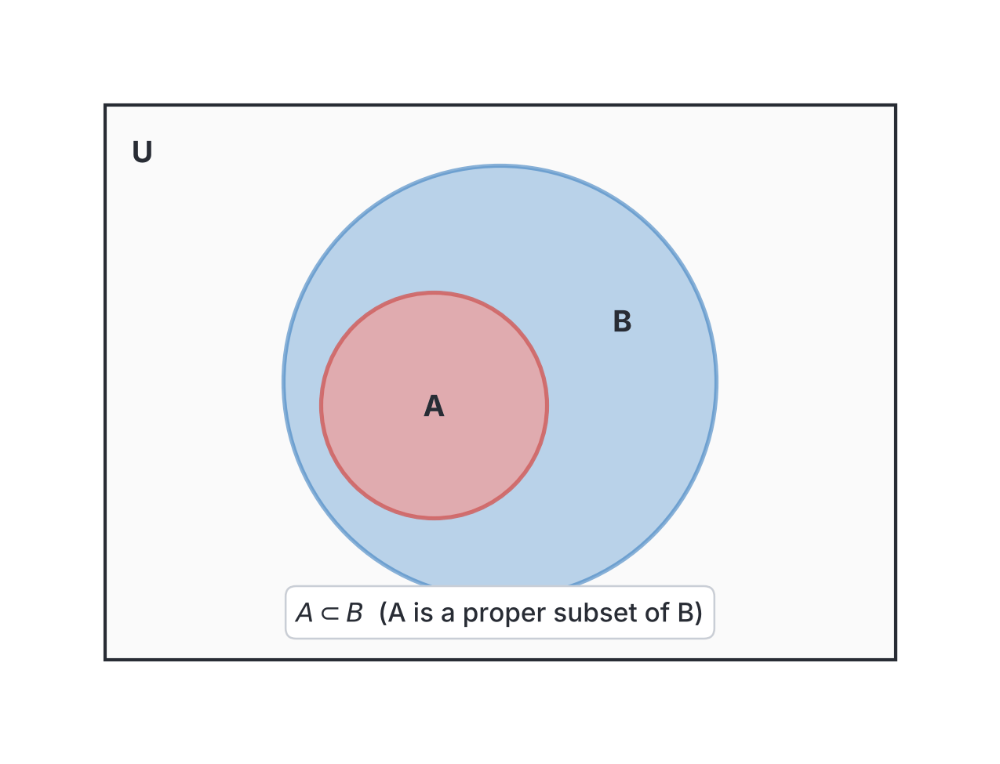
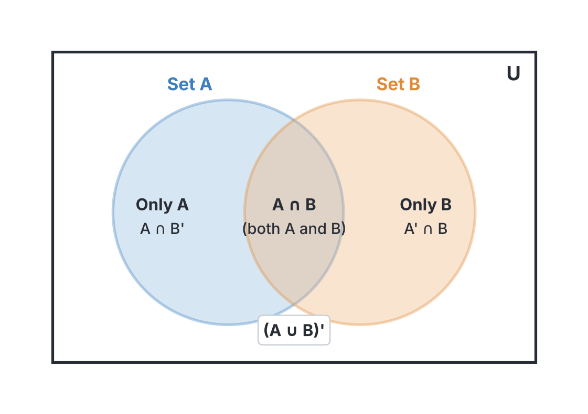
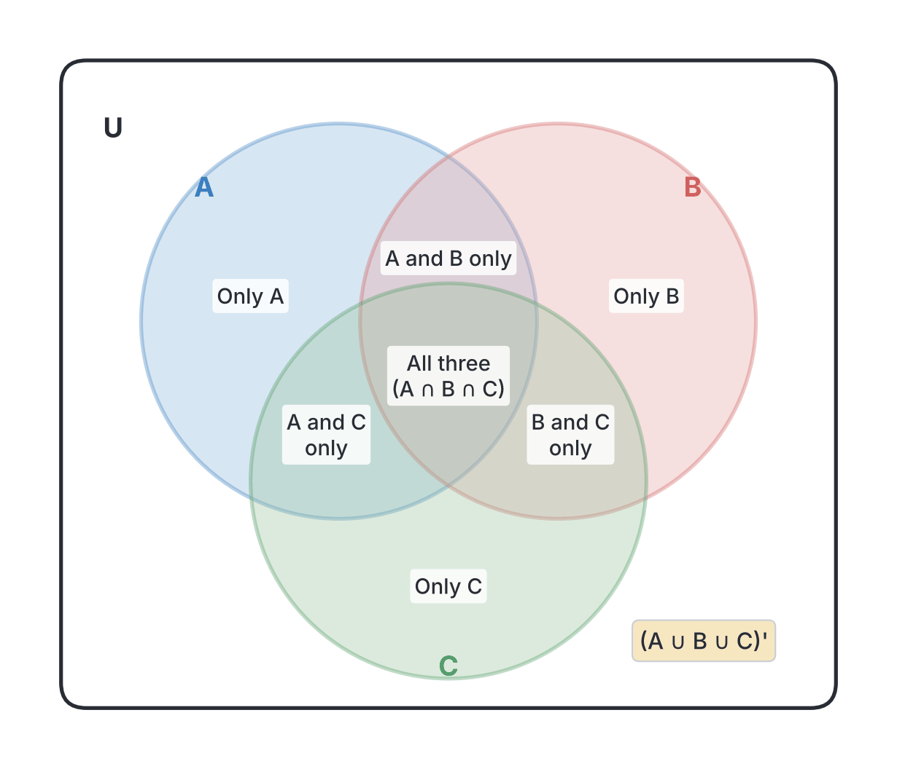

# JAMB Mathematics Notes: Sets

## What JAMB expects

This topic is Section I (Number and Numeration), Topic 4 of the JAMB UTME Mathematics syllabus: Sets. It covers the following content items:

* a. types of sets;
* b. algebra of sets;
* c. Venn diagrams and their applications.

By the end of these notes, you should be able to:

1. identify types of sets, i.e. empty, universal, complements, subsets, finite, infinite and disjoint sets;
2. solve problems involving cardinality of sets;
3. solve set problems using symbols;
4. use Venn diagrams to solve problems involving not more than $3$ sets.

**Note on the syllabus wording:** The JAMB syllabus numbering for this topic contains a typing error, listing the objectives as "i", "ii", "iv. iii", and "v. iv". We have treated these as four straightforward objectives labeled i to iv: identifying types of sets (i), calculating cardinality (ii), using set symbols (iii), and using Venn diagrams (iv).

## Identifying types of sets

**Objective i: identify types of sets, i.e. empty, universal, complements, subsets, finite, infinite and disjoint sets.**

A **set** is a well-defined collection of distinct objects. The objects inside a set are called its **elements** or **members**. 

We usually name a set with a capital letter (like $A$, $B$, or $C$) and write its elements inside curly braces $\{ \}$. If an object $x$ is in set $A$, we write $x \in A$ (read as "$x$ is an element of $A$"). If it is not in the set, we write $x \notin A$.

Sets can be described in two main ways:
1. **Roster (Listing) method:** We list every element explicitly. For example, $V = \{a, e, i, o, u\}$.
2. **Set-builder notation:** We state the rule that elements must follow. For example, $V = \{x : x \text{ is a vowel in the English alphabet}\}$. The symbol "$:$" or "$|$" is read as "such that".

### Finite and infinite sets

* **Finite set:** A set where you can count the elements and eventually finish. It has a definite number of members. 
  *Example:* $A = \{2, 4, 6, 8, 10\}$.
* **Infinite set:** A set whose elements go on forever. You cannot count all of them.
  *Example:* $B = \{x : x \text{ is a multiple of } 3\} = \{3, 6, 9, 12, \dots\}$.

### The empty (null) set

An **empty set** contains no elements at all. It is written using the symbol $\emptyset$ or a pair of empty braces $\{ \}$. 
*Example:* The set of humans who are $500$ years old is an empty set.

### The universal set

The **universal set** is the "parent" set that contains all the elements being considered in a particular problem or discussion. All other sets in that problem are drawn from it. It is usually denoted by the symbol $U$, $\mu$ (mu), or $\xi$ (xi).
*Example:* If we are discussing sets of odd and even digits, our universal set might be all single digits: $U = \{0, 1, 2, 3, 4, 5, 6, 7, 8, 9\}$.

### Complements

The **complement** of a set $A$ contains everything in the universal set $U$ that is **not** in $A$. It is written as $A'$ or $A^c$.
*Example:* If $U = \{1, 2, 3, 4, 5\}$ and $A = \{2, 4\}$, then $A' = \{1, 3, 5\}$.

### Subsets and proper subsets

If every element in set $A$ is also found in set $B$, then $A$ is a **subset** of $B$. We write this as $A \subseteq B$.
* A **proper subset** means $A$ is a subset of $B$, but $A$ is not exactly equal to $B$ (there is at least one element in $B$ that is not in $A$). We write this as $A \subset B$.
* The empty set $\emptyset$ is considered a subset of every set.

**JAMB Shortcut: Number of subsets**
* If a set has $n$ elements, the total number of subsets it can form is given by the formula $2^n$.
* The number of **proper subsets** is $2^n - 1$. 
*(Note: A few older textbooks define proper subsets as $2^n - 2$ by also excluding the empty set, but for JAMB, standard modern mathematics applies: a proper subset is simply any subset that is not the set itself, leaving $2^n - 1$)*.

### Disjoint sets

Two sets are **disjoint** if they have absolutely no elements in common.
*Example:* If $A = \{1, 3, 5\}$ and $B = \{2, 4, 6\}$, they share nothing. Therefore, $A$ and $B$ are disjoint sets.

### Equal vs Equivalent sets

* **Equal sets:** Two sets are equal ($A = B$) if they have exactly the same elements, regardless of order. Example: $\{1, 2, 3\} = \{3, 1, 2\}$.
* **Equivalent sets:** Two sets are equivalent if they have the same *number* of elements (the same cardinality), even if the elements are completely different. Example: $\{a, b, c\}$ and $\{7, 8, 9\}$ are equivalent because they both have $3$ elements.

**Common mistakes:**
Students often confuse the empty set symbols.
*   **Wrong working:** Writing the empty set as $A = \{\emptyset\}$ or $A = \{0\}$.
*   **Corrected version:** Write the empty set as $A = \emptyset$ or $A = \{ \}$. The set $\{0\}$ has one element (the number zero), and $\{\emptyset\}$ is a set containing another set (a set within a set).

**Worked Example 1: Finding the number of subsets**
How many proper subsets does the set $M = \{a, b, c, d\}$ have?

1. Count the number of elements in the set: $n = 4$.
2. State the proper subsets formula: $2^n - 1$.
3. Substitute the value: $2^4 - 1$.
4. Calculate the exponent: $16 - 1 = 15$.
5. The set has $15$ proper subsets.

**Worked Example 2: Identifying sets**
Which of the following is a finite set? $A = \{ \text{multiples of } 3 \}$, $B = \{ \text{factors of } 24 \}$, $C = \{ \text{odd numbers} \}$.

1. Analyze set $A$: Multiples of $3$ are $\{3, 6, 9, 12, \dots\}$. This sequence goes on forever, making it an infinite set.
2. Analyze set $B$: Factors of $24$ are numbers that divide $24$ without a remainder: $\{1, 2, 3, 4, 6, 8, 12, 24\}$. You can count them (there are exactly $8$), so it is a finite set.
3. Analyze set $C$: Odd numbers are $\{1, 3, 5, 7, \dots\}$. This goes on forever, so it is an infinite set.
4. Therefore, the finite set is $B$.

**Worked Example 3: Universal sets and complements**
Let the universal set $U = \{1, 2, 3, 4, 5, 6, 7, 8\}$ and $A = \{x : x \text{ is an even number}\}$. Find $A'$.

1. First, list out the elements of the universal set: $U = \{1, 2, 3, 4, 5, 6, 7, 8\}$.
2. Next, identify the elements of $A$ by selecting the even numbers from the universal set. The even numbers in $U$ are $\{2, 4, 6, 8\}$.
3. The complement $A'$ consists of all elements in $U$ that are NOT in $A$.
4. Removing $\{2, 4, 6, 8\}$ from $U$ leaves $\{1, 3, 5, 7\}$.
5. Therefore, $A' = \{1, 3, 5, 7\}$.

## Algebra of sets and solving problems using symbols

**Objective iii: solve set problems using symbols.**

The algebra of sets involves combining or modifying sets using specific operations, rules, and symbols. JAMB frequently tests your ability to translate word problems into set notation or simplify symbolic expressions.

### Basic set operations

1. **Union ($\cup$):** The union of sets $A$ and $B$, written $A \cup B$, is a new set containing **all** the elements from $A$ and all the elements from $B$, without repeating any duplicates. 
2. **Intersection ($\cap$):** The intersection of sets $A$ and $B$, written $A \cap B$, is a set containing only the elements that are **common to both** sets.
3. **Difference ($A - B$ or $A \setminus B$):** This means "elements in $A$ but not in $B$". Another way to write this using symbols is $A \cap B'$.

### Laws of the algebra of sets

Just as we have rules for adding and multiplying numbers in regular algebra, sets have laws that govern how their symbols interact. 

| Law Name | What it means in symbols |
| --- | --- |
| **Commutative Laws** | Order does not matter. $A \cup B = B \cup A$ $A \cap B = B \cap A$ |
| **Associative Laws** | Grouping does not matter. $A \cup (B \cup C) = (A \cup B) \cup C$ $A \cap (B \cap C) = (A \cap B) \cap C$ |
| **Distributive Laws** | Expanding brackets. (Crucial for JAMB!) $A \cup (B \cap C) = (A \cup B) \cap (A \cup C)$ $A \cap (B \cup C) = (A \cap B) \cup (A \cap C)$ |
| **De Morgan's Laws** | How complements affect brackets. $(A \cup B)' = A' \cap B'$ (Union flips to intersection) $(A \cap B)' = A' \cup B'$ (Intersection flips to union) |

**Common mistakes:**
When applying De Morgan's laws, students often forget to flip the intersection or union sign.
*   **Wrong working:** $(A \cup B)' = A' \cup B'$ (leaving the union symbol unchanged).
*   **Corrected version:** $(A \cup B)' = A' \cap B'$ (the union must flip to an intersection).

**Worked Example 4: Finding elements from symbols**
Given the universal set $U = \{1, 2, 3, 4, 5, 6, 7, 8, 9, 10\}$, $P = \{x : x \text{ is an even number}\}$ and $Q = \{x : x \text{ is a multiple of } 3\}$. Find $(P \cup Q)'$.

1. First, list the elements of each set based on the universal set $U$.
2. The set $P$ (even numbers) is $P = \{2, 4, 6, 8, 10\}$.
3. The set $Q$ (multiples of $3$) is $Q = \{3, 6, 9\}$.
4. Find the union $P \cup Q$, which is everything in both sets combined: $P \cup Q = \{2, 3, 4, 6, 8, 9, 10\}$.
5. Find the complement $(P \cup Q)'$, which is everything in $U$ that is NOT in the union. Looking at $U$, the missing numbers are $1$, $5$, and $7$.
6. Therefore, $(P \cup Q)' = \{1, 5, 7\}$.

**Worked Example 5: Simplifying set expressions using laws**
Simplify the expression: $X \cup (X' \cap Y)$.

1. Use the Distributive Law to expand the bracket: $(X \cup X') \cap (X \cup Y)$.
2. Recognise that a set united with its own complement forms the entire universal set: $X \cup X' = U$.
3. Substitute this back into the expression: $U \cap (X \cup Y)$.
4. The intersection of the universal set with any set is simply that set itself (because the smaller set is fully contained within the universal set).
5. The simplified answer is $X \cup Y$.

**Worked Example 6: Identifying regions with symbols**
How would you write the symbolic expression for "the region of elements that belong to set $A$ and set $B$, but do not belong to set $C$"?

1. "Belong to set $A$ and set $B$" translates to an intersection: $A \cap B$.
2. "But do not belong to set $C$" means we need the complement of $C$, which is $C'$.
3. Combine them with an intersection symbol, because both conditions must be true at the same time: $A \cap B \cap C'$.

## Cardinality of sets

**Objective ii: solve problems involving cardinality of sets.**

The **cardinality** of a set is the number of elements it contains. It is written as $n(A)$ or sometimes $|A|$. For example, if $A = \{2, 4, 6, 8\}$, then $n(A) = 4$.

When calculating the total number of people or items across different overlapping sets, we cannot just add the totals of each set together, because we would be counting the overlapping parts (the intersection) twice. To fix this, we use cardinality formulas.

### The 2-set cardinality formula

For any two sets $A$ and $B$:
$$n(A \cup B) = n(A) + n(B) - n(A \cap B)$$

Where:
* $n(A \cup B)$ is the number of elements in either $A$, $B$, or both (the total inside the sets).
* $n(A)$ is the number of elements in set $A$.
* $n(B)$ is the number of elements in set $B$.
* $n(A \cap B)$ is the number of elements in the intersection (those belonging to both $A$ and $B$).

If you are given a total population (the universal set) and some elements belong to **neither** set, use this relationship:
$$n(U) = n(A \cup B) + n(\text{neither})$$

### The 3-set cardinality formula

For three sets $A$, $B$, and $C$, the formula expands to prevent over-counting and under-counting across multiple overlaps:
$$n(A \cup B \cup C) = n(A) + n(B) + n(C) - n(A \cap B) - n(A \cap C) - n(B \cap C) + n(A \cap B \cap C)$$

While you can memorise and use this long formula, JAMB problems involving three sets are usually much easier and safer to solve by drawing a **Venn diagram**. We will explore this in the next section.

**Common mistakes:**
Forgetting to include the "neither" group when calculating the total universal set in word problems.
*   **Wrong working:** $n(U) = n(A \cup B) = 35$ (assuming the union is everyone in the survey).
*   **Corrected version:** $n(U) = n(A \cup B) + n(\text{neither}) = 35 + 5 = 40$.

**Worked Example 7: Using the 2-set formula**
In a class of $40$ students in Abuja, $25$ offer Biology and $18$ offer Chemistry. If $5$ students offer neither Biology nor Chemistry, how many students offer both subjects?

1. Identify the total universal set: $n(U) = 40$.
2. Identify the "neither" group: $n(\text{neither}) = 5$.
3. Find the union (those who offer at least one subject) by subtracting the "neither" group from the total: $n(B \cup C) = 40 - 5 = 35$.
4. State the cardinality formula: $n(B \cup C) = n(B) + n(C) - n(B \cap C)$.
5. Substitute the known values: $35 = 25 + 18 - x$ (letting $x$ be the intersection).
6. Simplify the right side: $35 = 43 - x$.
7. Solve for $x$: $x = 43 - 35 = 8$. 
8. Therefore, $8$ students offer both subjects.

**Worked Example 8: Using the 3-set formula**
Given $n(P) = 15$, $n(Q) = 12$, and $n(R) = 10$. If $n(P \cap Q) = 5$, $n(P \cap R) = 4$, $n(Q \cap R) = 3$, and $n(P \cap Q \cap R) = 2$, find the total number of elements in the union of all three sets, $n(P \cup Q \cup R)$.

1. State the 3-set formula: $n(P \cup Q \cup R) = n(P) + n(Q) + n(R) - n(P \cap Q) - n(P \cap R) - n(Q \cap R) + n(P \cap Q \cap R)$.
2. Substitute the given values: $15 + 12 + 10 - 5 - 4 - 3 + 2$.
3. Add the single sets together: $15 + 12 + 10 = 37$.
4. Subtract the 2-set intersections: $37 - 5 - 4 - 3 = 25$.
5. Add back the 3-set intersection (the very center): $25 + 2 = 27$.
6. The union has $27$ elements.

**Worked Example 9: Finding the "neither" region**
In a group of $50$ people, $30$ speak Hausa and $25$ speak Igbo. If $12$ people speak both languages, how many speak neither language?

1. State the given values: $n(U) = 50$, $n(H) = 30$, $n(I) = 25$, $n(H \cap I) = 12$.
2. Calculate the union (those who speak at least one language) using the 2-set formula: $n(H \cup I) = n(H) + n(I) - n(H \cap I)$.
3. Substitute the values: $n(H \cup I) = 30 + 25 - 12$.
4. Simplify: $n(H \cup I) = 55 - 12 = 43$. So, $43$ people speak at least one language.
5. Find the "neither" group by subtracting the union from the universal set: $n(\text{neither}) = n(U) - n(H \cup I)$.
6. Calculate: $50 - 43 = 7$.
7. Therefore, $7$ people speak neither language.

## Venn diagrams and their applications

**Objective iv: use Venn diagrams to solve problems involving not more than 3 sets.**

A **Venn diagram** is a visual representation of sets. The universal set $U$ is drawn as a rectangle, and the sets inside it are drawn as overlapping circles. 

### Steps for solving word problems with Venn diagrams

1. **Draw the outline:** Draw a rectangle for the universal set and the correct number of overlapping circles (usually $2$ or $3$).
2. **Start from the center:** ALWAYS fill in the innermost intersection first (elements that belong to ALL the sets). If this number is unknown, label it $x$.
3. **Work your way outwards:** Fill in the regions where two sets overlap. **Crucial rule:** If the problem says "$10$ people like A and B", you must subtract the center value from $10$ to find the "A and B *only*" region. However, if the problem explicitly says "$10$ people like A and B *only*", write $10$ directly in that region without subtracting.
4. **Fill the single sets:** Subtract all the inner parts of a circle from the circle's total to find the "only one set" region.
5. **Form an equation:** Add up every single distinct region inside the rectangle (including the "neither" group outside the circles) and set it equal to the universal total to solve for any unknown.

**Common mistakes:**
Ignoring the word "only" in word problems, or failing to subtract the center intersection when filling the 2-set overlapping regions.
*   **Wrong working:** If $25$ people like Yam, and $10$ like Yam and Rice, putting $25$ in the "Only Yam" region and $10$ in the "Yam and Rice only" region.
*   **Corrected version:** The entire Yam circle must sum to $25$. The "Only Yam" region is calculated by subtracting the other overlapping parts of the Yam circle: $25 - 10 = 15$ (assuming no third set is involved).

**Worked Example 10: 2-set Venn diagram problem**
In a class of $40$ students, $20$ like Mathematics and $25$ like English. If $5$ students like neither, use a Venn diagram approach to find how many like only Mathematics.

1. Draw a rectangle for the universal set ($n(U) = 40$) and two overlapping circles for Mathematics ($M$) and English ($E$). Place $5$ outside the circles.
2. The total number of students inside the circles (the union) is $40 - 5 = 35$.
3. Let the center overlap (students who like both) be $x$.
4. The region for "Only Mathematics" is $20 - x$. The region for "Only English" is $25 - x$.
5. The sum of all regions in the circles equals the union: $(20 - x) + x + (25 - x) = 35$.
6. Simplify the equation: $45 - x = 35$.
7. Solve for $x$: $x = 45 - 35 = 10$. So, $10$ students like both subjects.
8. Substitute $x = 10$ back into the "Only Mathematics" region: $20 - 10 = 10$.
9. Therefore, $10$ students like only Mathematics.

**Worked Example 11: 3-set Venn diagram (Finding the center)**
A survey of $60$ market women in Lagos showed that $30$ sell Yam ($Y$), $25$ sell Rice ($R$), and $20$ sell Beans ($B$). $10$ sell both Yam and Rice, $8$ sell Yam and Beans, and $7$ sell Rice and Beans. $7$ women sell none of the three items. How many women sell all three items?

1. Draw three overlapping circles ($Y$, $R$, $B$) in a rectangle. The total $n(U) = 60$. The "neither" group outside the circles is $7$.
2. Let the number of women who sell all three items be $x$ and place it in the very center.
3. Fill the 2-set overlapping regions (subtracting $x$ because the problem did not use the word "only"):
   * Yam and Rice only = $10 - x$
   * Yam and Beans only = $8 - x$
   * Rice and Beans only = $7 - x$
4. Fill the 1-set regions (subtracting everything else in that circle):
   * Only Yam = $30 - (10 - x) - (8 - x) - x = 30 - 18 + x = 12 + x$
   * Only Rice = $25 - (10 - x) - (7 - x) - x = 25 - 17 + x = 8 + x$
   * Only Beans = $20 - (8 - x) - (7 - x) - x = 20 - 15 + x = 5 + x$
5. Add all the disjoint regions (including "neither") and equate to $60$:
   $(12 + x) + (8 + x) + (5 + x) + (10 - x) + (8 - x) + (7 - x) + x + 7 = 60$
6. Simplify by grouping the numbers and the $x$'s:
   Numbers: $12 + 8 + 5 + 10 + 8 + 7 + 7 = 57$
   $x$'s: $x + x + x - x - x - x + x = x$
   So, $57 + x = 60$.
7. Solve for $x$: $x = 60 - 57 = 3$. 
8. Therefore, $3$ women sell all three items.

**Worked Example 12: 3-set Venn diagram (The "Only" Trap)**
A class has $50$ students. $25$ offer Economics ($E$), $22$ offer Government ($G$), and $18$ offer History ($H$). $5$ offer $E$ and $G$ *only*, $4$ offer $E$ and $H$ *only*, and $3$ offer $G$ and $H$ *only*. $2$ students offer all three subjects. How many students offer none of the subjects?

1. Draw three circles for $E$, $G$, and $H$.
2. Put $2$ in the center (all three).
3. The problem says "$5$ offer $E$ and $G$ *only*". Because of the word **only**, place $5$ directly in that region. Do not subtract the center $2$!
4. Put $4$ in "$E$ and $H$ only" and $3$ in "$G$ and $H$ only".
5. Calculate the remaining "only one subject" regions by subtracting the known parts of each circle from its total:
   * Only $E$ = Total for $E$ ($25$) - $(5 + 4 + 2) = 25 - 11 = 14$
   * Only $G$ = Total for $G$ ($22$) - $(5 + 3 + 2) = 22 - 10 = 12$
   * Only $H$ = Total for $H$ ($18$) - $(4 + 3 + 2) = 18 - 9 = 9$
6. Sum all the regions inside the circles to find the union: 
   $14 + 12 + 9 + 5 + 4 + 3 + 2 = 49$.
7. Find those who offer none: Total ($50$) - Union ($49$) = $1$.
8. Therefore, $1$ student offers none of the subjects.

## Key terms

| Term | Meaning |
| --- | --- |
| Set | A well-defined collection of distinct objects or elements. |
| Element ($\in$) | An object that belongs to a set. |
| Universal set ($U$, $\mu$, $\xi$) | The main set containing all elements under consideration for a particular problem. |
| Empty set ($\emptyset$) | A set that contains no elements. |
| Subset ($\subseteq$) | A set whose elements are all completely contained within another set. |
| Disjoint sets | Sets that have no elements in common (their intersection is empty). |
| Cardinality ($n(A)$) | The number of elements in a set. |
| Intersection ($\cap$) | A set containing only the elements that are common to the interacting sets. |
| Union ($\cup$) | A set containing all elements from the interacting sets, combined without duplicates. |
| Complement ($A'$) | A set containing all elements in the universal set that are NOT in set $A$. |

## Exam tips and common mistakes

* **Confusing $\subset$ and $\in$:** The symbol $\in$ links a single element to a set (e.g., $2 \in \{1, 2\}$). The symbol $\subset$ links a subset to a set (e.g., $\{2\} \subset \{1, 2\}$).
* **The "Only" trap in Venn diagrams:** If a question says "$15$ students study Biology and Chemistry", that is the entire intersection region. You must subtract the center to find the "only" part. But if the question says "$15$ students study Biology and Chemistry ONLY", you write $15$ directly into that specific region.
* **Confusing $\emptyset$ and $\{0\}$:** The empty set $\emptyset$ has zero elements. The set $\{0\}$ is NOT empty; it has one element (the number zero).
* **Forgetting the "Neither" group:** When using the formula $n(A \cup B) = n(A) + n(B) - n(A \cap B)$, remember that the universal total $n(U)$ includes those outside the sets. So, $n(U) = n(A \cup B) + n(\text{neither})$.
* **Venn Diagram filling order:** Always start from the very center (intersection of all sets) and work your way outwards. Attempting to fill the outside "single subject" regions first will lead to wrong answers.
* **De Morgan's trap:** Remember that when you apply a complement to a bracket, the union symbol flips to intersection, and vice versa: $(A \cup B)' = A' \cap B'$.

## Quick summary

1. A set is a well-defined collection of objects. Its members can be listed out or described using set-builder notation.
2. The empty set ($\emptyset$) has no elements, while the universal set ($U$) contains all elements under discussion in a specific problem.
3. If all elements of $A$ are in $B$, $A$ is a subset of $B$. A set with $n$ elements has $2^n$ total subsets and $2^n - 1$ proper subsets.
4. Set operations include union ($\cup$, combined elements), intersection ($\cap$, common elements), and complement ($A'$, elements outside the set).
5. De Morgan's Laws state that $(A \cup B)' = A' \cap B'$ and $(A \cap B)' = A' \cup B'$.
6. The cardinality formula for two sets is $n(A \cup B) = n(A) + n(B) - n(A \cap B)$.
7. For word problems, the total population equals the union of the sets plus those who belong to neither set.
8. Venn diagrams visually represent sets. Always fill a Venn diagram starting from the innermost intersection and work outwards.

## Practice questions

**1. Which of the following is an example of an infinite set?**

- A. The set of factors of $100$
- B. The set of prime numbers less than $1,000,000,000$
- C. The set of multiples of $5$
- D. The set of days in a leap year

**Answer: C.** Here is the step-by-step evaluation of the sets.

1. Option A is $\{1, 2, 4, 5, 10, 20, 25, 50, 100\}$, which is a finite set of $9$ elements.
2. Option B evaluates to prime numbers less than $1,000,000,000$, which eventually stop. It is finite. Option B is a distractor for students who confuse a very large set with an infinite one.
3. Option D evaluates to exactly $366$ days, making it finite.
4. Option C represents the set $\{5, 10, 15, 20, \dots\}$. It continues forever, so its cardinality is $n(S) = \infty$, meaning it is an infinite set.

**2. If $X = \{a, b, c, d, e\}$, how many proper subsets does $X$ have?**

- A. $25$
- B. $31$
- C. $32$
- D. $10$

**Answer: B.** Here is the step-by-step working.

1. Count the number of elements in set $X$: $n = 5$.
2. State the formula for the number of proper subsets: $2^n - 1$.
3. Substitute the value of $n = 5$ into the formula: $2^5 - 1$.
4. Evaluate the exponent: $32 - 1 = 31$.
5. Option C ($32$) is the most tempting wrong option; it represents a common mistake where students calculate the total subsets $2^n$ but forget to subtract $1$ for the proper subsets.

**3. Given the universal set $U = \{1, 2, 3, 4, 5, 6, 7, 8, 9, 10\}$, $P = \{x : x \text{ is a prime number}\}$ and $Q = \{x : x \text{ is an odd number}\}$. Find $(P \cap Q)'$.**

- A. $\{1, 2, 4, 6, 8, 9, 10\}$
- B. $\{1, 2, 3, 4, 6, 8, 9, 10\}$
- C. $\{2, 4, 6, 8, 10\}$
- D. $\{2, 4, 6, 8, 9, 10\}$

**Answer: A.** Here is the step-by-step solution.

1. List the elements of $P$ (prime numbers in $U$): $P = \{2, 3, 5, 7\}$.
2. List the elements of $Q$ (odd numbers in $U$): $Q = \{1, 3, 5, 7, 9\}$.
3. Find the intersection $P \cap Q$ (elements in both $P$ and $Q$): $\{3, 5, 7\}$.
4. Find the complement $(P \cap Q)'$, which is everything in $U$ except $\{3, 5, 7\}$. The result is $\{1, 2, 4, 6, 8, 9, 10\}$.
5. Option D is a distractor based on a common mistake: assuming $1$ is a prime number, so $1$ is wrongly included in $P \cap Q$ and removed from the final complement, giving $\{2, 4, 6, 8, 9, 10\}$.

**4. If $A$ and $B$ are disjoint sets, which of the following is true regarding their cardinality?**

- A. $n(A \cup B) = n(A) + n(B)$
- B. $n(A \cup B) = n(A \cap B)$
- C. $n(A \cup B) = n(A) - n(B)$
- D. $n(A \cup B) = 0$

**Answer: A.** Here is the step-by-step reasoning.

1. By definition, disjoint sets have no common elements, meaning $A \cap B = \emptyset$.
2. Therefore, the cardinality of their intersection is zero: $n(A \cap B) = 0$.
3. The general $2$-set cardinality formula is $n(A \cup B) = n(A) + n(B) - n(A \cap B)$.
4. Substituting $0$ gives $n(A \cup B) = n(A) + n(B)$.
5. Option B is a common mistake for students who confuse the rule for identical sets with disjoint sets, incorrectly writing $n(A \cup B) = n(A \cap B)$.

**5. In a school of $120$ students, $75$ study French and $60$ study Arabic. If $20$ study neither of the two languages, how many study both?**

- A. $15$
- B. $20$
- C. $35$
- D. $55$

**Answer: C.** Here is the step-by-step calculation.

1. Identify the given values: total students $n(U) = 120$, neither $n(F \cup A)' = 20$.
2. Calculate the union (students studying at least one language): $n(F \cup A) = 120 - 20 = 100$.
3. State the formula: $n(F \cup A) = n(F) + n(A) - n(F \cap A)$.
4. Substitute the known values: $100 = 75 + 60 - x$, where $x$ is the intersection.
5. Simplify the right side: $100 = 135 - x$.
6. Solve for $x$: $x = 135 - 100 = 35$.
7. Option A ($15$) is a distractor for the mistake of forgetting the "neither" group and incorrectly setting the union to $120$, which would yield $135 - 120 = 15$.

**6. Given that $P \cup Q = \{1, 2, 3, 4, 5, 6\}$ and $P \cap Q = \{3, 4\}$. Which of the following could be sets $P$ and $Q$?**

- A. $P = \{1, 2, 3, 4\}$, $Q = \{3, 4, 5, 6\}$
- B. $P = \{1, 2, 3\}$, $Q = \{4, 5, 6\}$
- C. $P = \{1, 2, 3, 4, 5, 6\}$, $Q = \emptyset$
- D. $P = \{1, 2, 3, 4\}$, $Q = \{4, 5, 6\}$

**Answer: A.** Here is the step-by-step verification.

1. Test Option A: The intersection is $\{1, 2, 3, 4\} \cap \{3, 4, 5, 6\} = \{3, 4\}$. The union is $\{1, 2, 3, 4\} \cup \{3, 4, 5, 6\} = \{1, 2, 3, 4, 5, 6\}$. This matches the problem perfectly.
2. Test Option B: The sets $\{1, 2, 3\}$ and $\{4, 5, 6\}$ have no common elements, so $P \cap Q = \emptyset$. This is incorrect.
3. Test Option D: The intersection is $\{1, 2, 3, 4\} \cap \{4, 5, 6\} = \{4\}$. This is incorrect.
4. Option D is a distractor for students who make the mistake of reading the intersection incorrectly or confusing elements in the union.

**7. Which of the following set expressions represents the region in a Venn diagram of three sets $A$, $B$, and $C$, where elements belong to $A$ and $B$, but NOT to $C$?**

- A. $A \cap B \cap C$
- B. $(A \cap B) \cup C'$
- C. $A \cap B \cap C'$
- D. $(A \cup B) \cap C'$

**Answer: C.** Here is the step-by-step translation.

1. The phrase "belong to $A$ and $B$" translates to the intersection of the two sets: $A \cap B$.
2. The phrase "do NOT belong to $C$" translates to the complement of $C$, which is $C'$.
3. Because these conditions must all be true at the same time, we link them with another intersection symbol $\cap$.
4. Combining these gives $A \cap B \cap C'$.
5. Option D is a typical mistake where a student uses a union symbol $\cup$ for the word "and", incorrectly writing $(A \cup B) \cap C'$.

**8. In a class, $30$ students play Football and $20$ play Volleyball. $10$ students play both and $5$ play neither. What is the total number of students in the class?**

- A. $40$
- B. $45$
- C. $55$
- D. $60$

**Answer: B.** Here is the step-by-step working.

1. State the cardinality formula to find the union: $n(F \cup V) = n(F) + n(V) - n(F \cap V)$.
2. Substitute the given values: $n(F \cup V) = 30 + 20 - 10 = 40$.
3. The union represents students who play at least one sport ($40$ students).
4. Add the students who play neither sport to find the total: $n(U) = 40 + 5 = 45$.
5. Option C ($55$) is the most tempting wrong option. It comes from the mistake of simply adding all numbers ($30 + 20 + 5 = 55$) while forgetting to subtract the overlapping $10$ students.

**9. If $X$ and $Y$ are subsets of the universal set $U$, simplify the expression $(X' \cup Y')'$.**

- A. $X \cup Y$
- B. $X' \cap Y'$
- C. $X \cap Y$
- D. $X' \cup Y'$

**Answer: C.** Here is the step-by-step simplification.

1. Write out the original expression: $(X' \cup Y')'$.
2. Apply De Morgan's Law by distributing the outer complement to each part inside the bracket.
3. The complement of $X'$ becomes $X$ because $(X')' = X$.
4. The union symbol $\cup$ flips to the intersection symbol $\cap$.
5. The complement of $Y'$ becomes $Y$ because $(Y')' = Y$.
6. Bringing it all together yields $X \cap Y$.
7. Option A is a distractor based on the mistake of forgetting to flip the $\cup$ symbol to $\cap$ when removing the outer complement.

**10. If $A = \{2, 4, 6\}$ and $B = \{1, 3, 5\}$, which of the following statements is true?**

- A. $A$ and $B$ are equivalent sets but not disjoint.
- B. $A$ and $B$ are disjoint and equivalent sets.
- C. $A \cap B = \{0\}$
- D. $A \subset B$

**Answer: B.** Here is the step-by-step evaluation.

1. Count the elements in each set: $n(A) = 3$ and $n(B) = 3$. Because they have the same cardinality, they are equivalent sets.
2. Check for common elements: They share no elements, so $A \cap B = \emptyset$. This means they are disjoint sets.
3. Therefore, they are both disjoint and equivalent.
4. Option C is a common mistake where students write $A \cap B = \{0\}$. The set $\{0\}$ has one element (the number zero), whereas the true intersection is empty ($\emptyset$).
