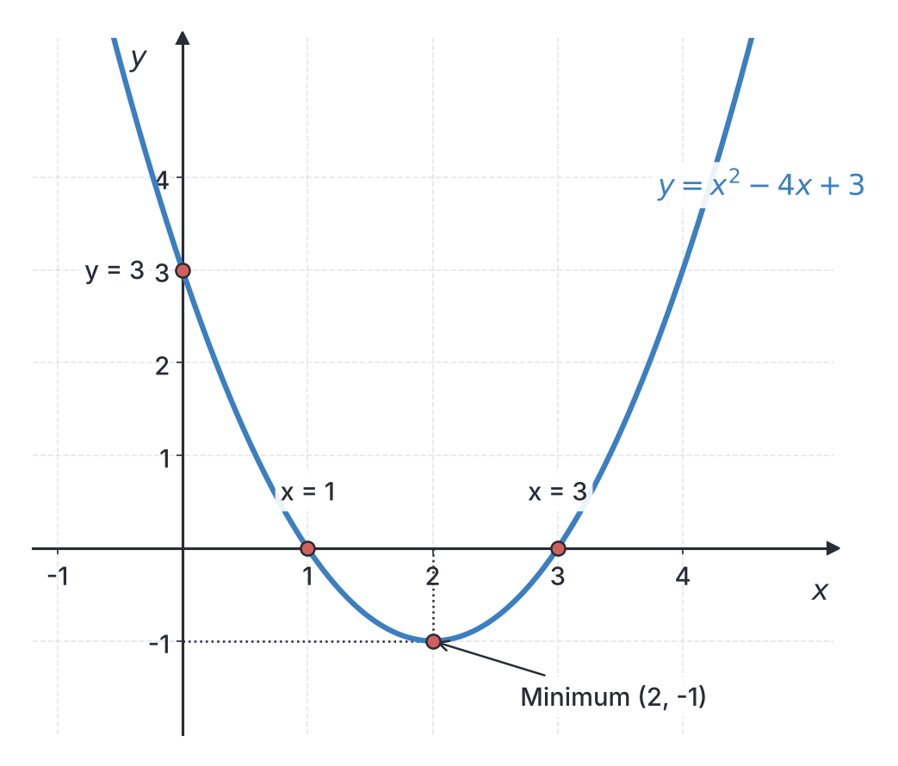
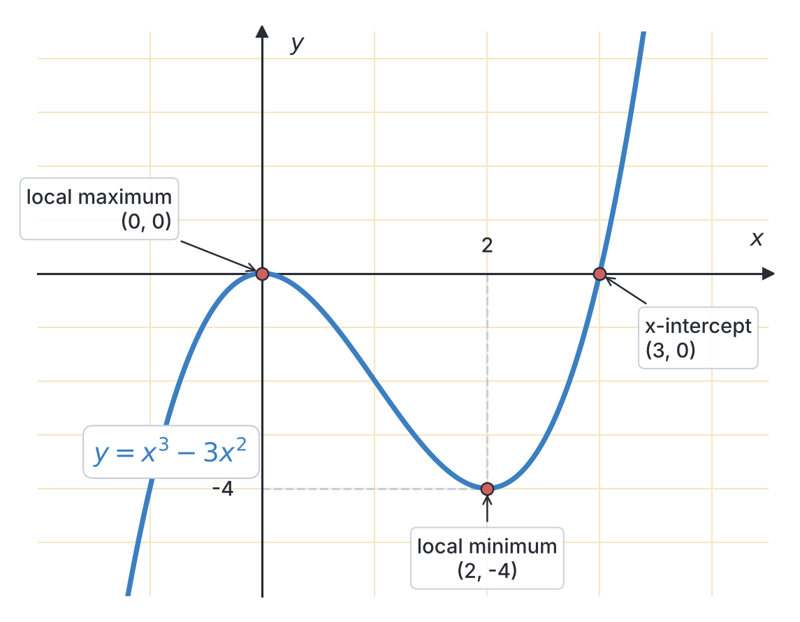

# JAMB Mathematics Notes: Polynomials

## What JAMB expects

This topic is Section II, Topic 1 of the JAMB Mathematics syllabus: Algebra – Polynomials. It covers the following content items:

* (a) change of subject of formula;
* (b) addition, subtraction, multiplication and division of polynomials;
* (c) factorization of polynomials of degree not exceeding $3$;
* (d) roots of polynomials not exceeding degree $3$;
* (e) factor and remainder theorems;
* (f) simultaneous equations including one linear one quadratic;
* (g) graphs of polynomials of degree not greater than $3$.

By the end of these notes, you should be able to:

1. find the subject of the formula of a given equation;
2. apply factor and remainder theorem to factorize a given expression;
3. multiply, divide polynomials of degree not more than $3$ and determine values of defined and undefined expressions;
4. factorize by regrouping, difference of two squares, perfect squares and cubic expressions; etc.
5. solve simultaneous equations – one linear, one quadratic;
6. interpret graphs of polynomials including applications to maximum and minimum values.

**Note on the syllabus wording:** In objective (iv), the syllabus says "factorize by regrouping difference of two squares". This is missing a comma. It means "factorize by regrouping, difference of two squares...". Also, in objective (iii), "expression" should ideally be plural ("expressions"). 

---

## Change of subject of a formula

A formula is a mathematical rule showing the relationship between different quantities. The **subject of a formula** is the variable that stands alone on one side of the equals sign. For example, in the formula for the area of a rectangle, $A = l \times b$, the subject is $A$.

In the UTME, you are often given a formula and asked to rearrange it so that a different variable stands alone.

### Finding the subject of a formula

**Objective i: find the subject of the formula of a given equation.**

To make a variable the subject, you must undo the mathematical operations (addition, subtraction, multiplication, division, squares, or roots) acting on it. 

**Standard Steps:**
1. Clear any fractions by multiplying both sides by the denominator (cross-multiplying).
2. Group all terms containing your target variable on one side of the equation, and move all other terms to the other side.
3. If the target variable appears in more than one term, factorize it out.
4. Divide both sides by whatever is multiplying your target variable.
5. If the target variable is squared, take the square root of both sides. If it is inside a square root, square both sides.

**Example 1: A simple physics formula**
Make $v$ the subject of the formula $E = \frac{1}{2}mv^2$.

**Working:**
1. Multiply both sides by $2$ to clear the fraction: 
   $$2E = mv^2$$
2. Divide both sides by $m$ to isolate $v^2$:
   $$v^2 = \frac{2E}{m}$$
3. Take the square root of both sides:
   $$v = \pm \sqrt{\frac{2E}{m}}$$
*(Note: In physics contexts, speed $v$ is usually taken as positive, so $v = \sqrt{\frac{2E}{m}}$.)*

**Example 2: A formula with square roots**
Make $L$ the subject of the pendulum formula $T = 2\pi\sqrt{\frac{L}{g}}$.

**Working:**
1. Divide both sides by $2\pi$ to isolate the square root:
   $$\frac{T}{2\pi} = \sqrt{\frac{L}{g}}$$
2. Square both sides to remove the square root sign:
   $$\left(\frac{T}{2\pi}\right)^2 = \frac{L}{g}$$
   $$\frac{T^2}{4\pi^2} = \frac{L}{g}$$
3. Multiply both sides by $g$ to leave $L$ alone:
   $$L = \frac{gT^2}{4\pi^2}$$

**Example 3: Target variable in multiple places (JAMB favourite)**
Make $x$ the subject in $y = \frac{ax + b}{cx + d}$.

**Working:**
1. Multiply both sides by $(cx + d)$ to remove the fraction:
   $$y(cx + d) = ax + b$$
2. Expand the bracket:
   $$cyx + dy = ax + b$$
3. Collect all terms containing $x$ on the left side, and move everything else to the right side:
   $$cyx - ax = b - dy$$
4. Factorize $x$ out on the left side:
   $$x(cy - a) = b - dy$$
5. Divide both sides by $(cy - a)$:
   $$x = \frac{b - dy}{cy - a}$$

**Common mistake:** Forgetting to expand the brackets properly in step 2, or failing to gather *every* term containing $x$ before dividing. 

---

## Operations on polynomials

A **polynomial** is an algebraic expression made up of terms where a variable (like $x$) is raised to a whole-number power. For example, $3x^3 - 4x^2 + 5x - 7$ is a polynomial. 
- The highest power of $x$ is called the **degree**. JAMB tests polynomials up to degree $3$ (cubic polynomials).
- A degree $1$ polynomial is **linear** (e.g., $2x + 1$).
- A degree $2$ polynomial is **quadratic** (e.g., $x^2 - 5x + 6$).
- A degree $3$ polynomial is **cubic** (e.g., $x^3 - 2x^2 + x - 5$).

### Multiplying, dividing polynomials and finding undefined expressions

**Objective iii: multiply, divide polynomials of degree not more than $3$ and determine values of defined and undefined expressions.**

#### Addition and Subtraction
To add or subtract polynomials, simply collect and combine the **like terms** (terms with the exact same power of $x$).

**Example 1:** Subtract $(2x^3 - 3x^2 + 5x - 7)$ from $(4x^3 + 2x^2 - x + 3)$.
**Working:**
1. Write out the subtraction, keeping the second polynomial in brackets so you do not mess up the signs:
   $$(4x^3 + 2x^2 - x + 3) - (2x^3 - 3x^2 + 5x - 7)$$
2. Distribute the negative sign:
   $$4x^3 + 2x^2 - x + 3 - 2x^3 + 3x^2 - 5x + 7$$
3. Group the like terms together:
   $$(4x^3 - 2x^3) + (2x^2 + 3x^2) + (-x - 5x) + (3 + 7)$$
4. Simplify:
   $$2x^3 + 5x^2 - 6x + 10$$

#### Multiplication
To multiply polynomials, multiply every term in the first bracket by every term in the second bracket, then simplify.

**Example 2:** Multiply $(2x - 3)$ and $(x^2 + 4x - 5)$.
**Working:**
1. Distribute $2x$ to all terms in the second bracket, then distribute $-3$:
   $$2x(x^2 + 4x - 5) - 3(x^2 + 4x - 5)$$
2. Expand:
   $$(2x^3 + 8x^2 - 10x) - (3x^2 + 12x - 15)$$
3. Collect like terms:
   $$2x^3 + (8x^2 - 3x^2) + (-10x - 12x) + 15$$
4. Final answer:
   $$2x^3 + 5x^2 - 22x + 15$$

#### Division
To divide polynomials, we use **long division** (similar to dividing normal numbers).

**Example 3:** Divide $(x^3 - 4x^2 + 5x - 2)$ by $(x - 1)$.
**Working:**
1. Divide the leading term $x^3$ by the leading term $x$ to get $x^2$. 
2. Multiply $x^2$ by $(x - 1)$ to get $x^3 - x^2$. Subtract this from the main polynomial:
   $$(x^3 - 4x^2) - (x^3 - x^2) = -3x^2$$
3. Bring down the next term, $+ 5x$. Now we have $-3x^2 + 5x$.
4. Divide $-3x^2$ by $x$ to get $-3x$.
5. Multiply $-3x$ by $(x - 1)$ to get $-3x^2 + 3x$. Subtract:
   $$(-3x^2 + 5x) - (-3x^2 + 3x) = 2x$$
6. Bring down the last term, $- 2$. Now we have $2x - 2$.
7. Divide $2x$ by $x$ to get $2$.
8. Multiply $2$ by $(x - 1)$ to get $2x - 2$. Subtracting leaves $0$.
9. The quotient is $x^2 - 3x + 2$.

#### Undefined Expressions
A rational expression (an algebraic fraction like $\frac{P(x)}{Q(x)}$) becomes **undefined** when its denominator is exactly zero, because dividing by zero is mathematically impossible.

**Example 4:** Find the values of $x$ for which $\frac{2x + 1}{x^2 - 5x + 6}$ is undefined.
**Working:**
1. Ignore the numerator (the top). Set the denominator (the bottom) to zero:
   $$x^2 - 5x + 6 = 0$$
2. Factorize the quadratic equation. We need two numbers that multiply to $+6$ and add to $-5$. These are $-2$ and $-3$.
   $$(x - 2)(x - 3) = 0$$
3. Therefore, $x = 2$ or $x = 3$. The expression is undefined at these values.

---

## The Remainder and Factor Theorems

When dividing polynomials, setting up long division every time is slow. The Remainder and Factor theorems give us powerful shortcuts.

### Applying the factor and remainder theorems

**Objective ii: apply factor and remainder theorem to factorize a given expression.**

#### The Remainder Theorem
The theorem states: **If a polynomial $P(x)$ is divided by $(x - a)$, the remainder is simply $P(a)$.**
(To find what to substitute, set the divisor $x - a = 0 \Rightarrow x = a$).

**Example 1:** Find the remainder when $2x^3 - 5x^2 + x + 3$ is divided by $x - 2$.
**Working:**
1. Set the divisor to zero: $x - 2 = 0 \Rightarrow x = 2$.
2. Substitute $x = 2$ into the polynomial:
   $$P(2) = 2(2)^3 - 5(2)^2 + (2) + 3$$
3. Calculate step by step:
   $$P(2) = 2(8) - 5(4) + 2 + 3$$
   $$P(2) = 16 - 20 + 2 + 3 = 1$$
4. The remainder is $1$.

#### The Factor Theorem
The factor theorem is a special case of the remainder theorem. **If $P(a) = 0$, then there is no remainder, which means $(x - a)$ is a factor of $P(x)$.**

**Example 2:** Show that $(x + 1)$ is a factor of $x^3 + 3x^2 - x - 3$.
**Working:**
1. Set $x + 1 = 0 \Rightarrow x = -1$.
2. Substitute $x = -1$ into the polynomial:
   $$P(-1) = (-1)^3 + 3(-1)^2 - (-1) - 3$$
3. Simplify:
   $$P(-1) = -1 + 3(1) + 1 - 3$$
   $$P(-1) = -1 + 3 + 1 - 3 = 0$$
4. Since the remainder is $0$, $(x + 1)$ is a factor.

**Example 3:** Find the value of $k$ if $x - 2$ is a factor of $2x^3 - x^2 + kx - 10$.
**Working:**
1. Since $x - 2$ is a factor, substituting $x = 2$ must give $0$.
   $$P(2) = 0$$
2. Substitute $x = 2$:
   $$2(2)^3 - (2)^2 + k(2) - 10 = 0$$
   $$2(8) - 4 + 2k - 10 = 0$$
   $$16 - 4 + 2k - 10 = 0$$
3. Simplify and solve for $k$:
   $$2 + 2k = 0$$
   $$2k = -2 \Rightarrow k = -1$$

---

## Factorization of polynomials

Factorization means writing a polynomial as a product of its simplest brackets (factors).

### Factorizing by regrouping, squares and cubic expressions

**Objective iv: factorize by regrouping, difference of two squares, perfect squares and cubic expressions; etc.**

#### 1. Factorization by regrouping
When an expression has four terms with no single common factor, group them in pairs.

**Example 1:** Factorize $ax - ay + bx - by$.
**Working:**
1. Group the first two terms and the last two terms:
   $$(ax - ay) + (bx - by)$$
2. Factor out the common term in each pair:
   $$a(x - y) + b(x - y)$$
3. Notice that the bracket $(x - y)$ is now common. Factor it out:
   $$(a + b)(x - y)$$

#### 2. Difference of two squares
A very important JAMB rule: **$a^2 - b^2 = (a - b)(a + b)$**.

**Example 2:** Factorize $4x^2 - 25$.
**Working:**
1. Write both terms as perfect squares:
   $$(2x)^2 - (5)^2$$
2. Apply the rule:
   $$(2x - 5)(2x + 5)$$

#### 3. Perfect squares
Expressions that factorize into identical brackets, such as **$a^2 + 2ab + b^2 = (a + b)^2$** or **$a^2 - 2ab + b^2 = (a - b)^2$**.

**Example 3:** Factorize $9x^2 - 12x + 4$.
**Working:**
1. Notice that the first term is $(3x)^2$ and the last is $(2)^2$.
2. Check the middle term: $2 \times (3x) \times (2) = 12x$.
3. Because the middle sign is minus, it collapses to:
   $$(3x - 2)^2$$

#### 4. Factorization of cubic expressions
To factorize a polynomial of degree $3$ completely, combine the Factor Theorem and long division.

**Example 4:** Factorize $x^3 - x^2 - 4x + 4$ completely.
**Working:**
1. Use the Factor Theorem to guess one root. Try $x = 1$:
   $$P(1) = (1)^3 - (1)^2 - 4(1) + 4 = 1 - 1 - 4 + 4 = 0$$
   So, $(x - 1)$ is a factor.
2. Divide the cubic by $(x - 1)$ using long division (as taught earlier). The quotient will be $x^2 - 4$.
3. You now have: $(x - 1)(x^2 - 4)$.
4. Notice that $x^2 - 4$ is a difference of two squares. Factorize it:
   $$x^2 - 4 = (x - 2)(x + 2)$$
5. The completely factorized expression is:
   $$(x - 1)(x - 2)(x + 2)$$

---

## Roots of polynomials

A **root** of a polynomial is a value of $x$ that makes the polynomial equal to zero. If you plot the polynomial on a graph, the roots are exactly where the curve crosses the $x$-axis.

Finding the roots of a polynomial of degree up to $3$ simply means putting $P(x) = 0$ and factorizing it as shown above. 

**Example:** Find the roots of $x^3 - 4x = 0$.
**Working:**
1. Factor out the common $x$:
   $$x(x^2 - 4) = 0$$
2. Factorize the difference of two squares:
   $$x(x - 2)(x + 2) = 0$$
3. Set each factor to zero to find the roots:
   $$x = 0, \quad x = 2, \quad x = -2$$

---

## Simultaneous equations

JAMB frequently asks you to solve two equations where one is linear (no squares) and one is quadratic (contains squares).

### Solving one linear and one quadratic equation

**Objective v: solve simultaneous equations – one linear, one quadratic.**

**Always use the Substitution Method.** Never try the elimination method for this mix.

**Example 1:** Solve $y - x = 2$ and $y = x^2 - 4$.
**Working:**
1. From the linear equation $y - x = 2$, make $y$ the subject:
   $$y = x + 2$$
2. Substitute this $y$ into the quadratic equation:
   $$x + 2 = x^2 - 4$$
3. Move everything to one side to form a standard quadratic equation:
   $$0 = x^2 - x - 6$$
4. Factorize:
   $$(x - 3)(x + 2) = 0$$
5. So, $x = 3$ or $x = -2$.
6. Substitute these $x$ values back into the linear equation $y = x + 2$ to find the matching $y$ values:
   - When $x = 3, y = 3 + 2 = 5$. Coordinate pair: $(3, 5)$.
   - When $x = -2, y = -2 + 2 = 0$. Coordinate pair: $(-2, 0)$.

**Example 2:** Solve $x + y = 7$ and $x^2 + y^2 = 25$.
**Working:**
1. From $x + y = 7$, make $y$ the subject: $y = 7 - x$.
2. Substitute into the quadratic equation:
   $$x^2 + (7 - x)^2 = 25$$
3. Expand the square $(7 - x)(7 - x) = 49 - 14x + x^2$:
   $$x^2 + 49 - 14x + x^2 = 25$$
4. Combine terms:
   $$2x^2 - 14x + 49 - 25 = 0$$
   $$2x^2 - 14x + 24 = 0$$
5. Divide the entire equation by $2$ to make it simpler:
   $$x^2 - 7x + 12 = 0$$
6. Factorize (numbers multiplying to $12$ and adding to $-7$ are $-3$ and $-4$):
   $$(x - 3)(x - 4) = 0 \Rightarrow x = 3 \text{ or } x = 4$$
7. Find matching $y$ values using $y = 7 - x$:
   - When $x = 3, y = 7 - 3 = 4$. Pair: $(3, 4)$.
   - When $x = 4, y = 7 - 4 = 3$. Pair: $(4, 3)$.

---

## Graphs of polynomials

### Interpreting graphs and finding maximum or minimum values

**Objective vi: interpret graphs of polynomials including applications to maximum and minimum values.**

#### 1. Quadratic Graphs
The graph of a quadratic polynomial $y = ax^2 + bx + c$ is a curve called a **parabola**.
- If $a$ (the coefficient of $x^2$) is **positive**, the curve is a U-shape. It has a lowest point called a **minimum**.
- If $a$ is **negative**, the curve is an n-shape (like a hill). It has a highest point called a **maximum**.

#### Finding the maximum or minimum value
The turning point (vertex) of a quadratic graph occurs at the $x$-coordinate given by the formula:
$$x = \frac{-b}{2a}$$

**JAMB Shortcut (Calculus method):** Since the turning point is stationary, its derivative is zero. Differentiate the polynomial and equate to zero: $\frac{dy}{dx} = 0$. Solve for $x$. (Both methods give exactly the same answer).

**Crucial Step:** Finding $x$ only tells you *where* the peak or valley is. To find the actual **maximum or minimum value**, you must substitute that $x$ back into the original equation to calculate $y$.

**Example 1:** Find the minimum value of $y = x^2 - 4x + 3$.
**Working:**
1. Using the formula method: $a = 1, b = -4, c = 3$.
   $$x = \frac{-(-4)}{2(1)} = \frac{4}{2} = 2$$
   *(Or by calculus: $\frac{dy}{dx} = 2x - 4 = 0 \Rightarrow 2x = 4 \Rightarrow x = 2$).*
2. Substitute $x = 2$ back into the equation to find $y$:
   $$y = (2)^2 - 4(2) + 3$$
   $$y = 4 - 8 + 3 = -1$$
3. The minimum value is **$-1$**.

**Example 2:** A trader's profit in naira is modelled by $P = -2x^2 + 4x + 6$. Find the maximum profit.
**Working:**
1. Here, $a = -2, b = 4$.
   $$x = \frac{-4}{2(-2)} = \frac{-4}{-4} = 1$$
2. Substitute $x = 1$ back into the profit equation:
   $$P = -2(1)^2 + 4(1) + 6$$
   $$P = -2 + 4 + 6 = 8$$
3. The maximum profit is **₦8**.

#### 2. Cubic Graphs
A cubic graph $y = ax^3 + bx^2 + cx + d$ is wavy. It can cross the $x$-axis up to three times (meaning it has up to three roots) and usually has two turning points (a local maximum and a local minimum). 
If a graph is given and it crosses the $x$-axis at $-1$, $1$, and $2$, then its roots are $x=-1$, $x=1$, and $x=2$. The factors are $(x+1)$, $(x-1)$, and $(x-2)$. Multiply these out to find the equation of the polynomial.

---

## Key terms

| Term | Meaning |
| --- | --- |
| **Polynomial** | An algebraic expression with variables raised to whole-number powers. |
| **Subject of a formula** | The variable isolated on one side of the equals sign. |
| **Undefined expression** | An algebraic fraction where the denominator evaluates to zero. |
| **Remainder Theorem** | If a polynomial $P(x)$ is divided by $x - a$, the remainder is $P(a)$. |
| **Factor Theorem** | If $P(a) = 0$, then $(x - a)$ is a factor of $P(x)$. |
| **Root** | A value of $x$ that makes a polynomial equation equal zero (an $x$-intercept). |
| **Maximum value** | The highest point on an n-shaped graph ($a < 0$). |
| **Minimum value** | The lowest point on a U-shaped graph ($a > 0$). |

## Exam tips and common mistakes

- **Sign errors:** Be very careful with signs when subtracting polynomials or doing long division. Always use brackets.
- **Forgetting the $\pm$:** When you take the square root of both sides to change a subject (e.g., $x^2 = y \Rightarrow x = \pm\sqrt{y}$), remember both positive and negative roots exist, though some physical contexts only take the positive.
- **Undefined values:** Do not waste time solving the numerator. Only set the **denominator** to zero.
- **Simultaneous equations mixed pairs:** After solving a quadratic and getting two values for $x$ (e.g., $x_1, x_2$), substitute them carefully to get $y_1$ and $y_2$. Do not mix the coordinates up!
- **Maximum/Minimum traps:** JAMB will often put the value of $x$ as Option A. Remember, $x$ is just the position. The actual maximum or minimum **value** is the $y$ result! Always plug $x$ back into the original equation.

## Quick summary

1. To change the subject of a formula, use inverse operations to group the target variable on one side, factorize if necessary, and divide.
2. Polynomials are added by collecting like terms, and multiplied by distributing brackets. Division uses the long division method.
3. A fraction like $\frac{P(x)}{Q(x)}$ is undefined wherever the denominator $Q(x)$ equals zero.
4. The Remainder Theorem says dividing $P(x)$ by $x-a$ leaves a remainder of $P(a)$. If $P(a) = 0$, then $x-a$ is a perfect factor (Factor Theorem).
5. Difference of two squares is factorized as $a^2 - b^2 = (a-b)(a+b)$.
6. Always solve simultaneous equations containing one linear and one quadratic equation using the substitution method.
7. A quadratic curve $y = ax^2 + bx + c$ has a minimum when $a > 0$ and a maximum when $a < 0$. This turning point is found at $x = \frac{-b}{2a}$. 

## Practice questions

**1. Make $r$ the subject of the formula $V = \frac{1}{3}\pi r^2 h$.**
- A. $r = \frac{3V}{\pi h}$
- B. $r = \sqrt{\frac{3V}{\pi h}}$
- C. $r = \frac{\sqrt{3V}}{\pi h}$
- D. $r = \sqrt{\frac{V}{3\pi h}}$

**Answer: B.**
1. Multiply both sides by $3$ to remove the fraction: $3V = \pi r^2 h$.
2. Divide both sides by $\pi h$ to isolate $r^2$: $r^2 = \frac{3V}{\pi h}$.
3. Take the square root of both sides to get $r = \sqrt{\frac{3V}{\pi h}}$.
(The mistake behind Option A is forgetting to take the square root at the end).

**2. Find the remainder when $3x^3 - 4x^2 + 5x - 6$ is divided by $x + 1$.**
- A. -18
- B. 18
- C. 0
- D. -6

**Answer: A.**
1. By the remainder theorem, set $x + 1 = 0 \Rightarrow x = -1$.
2. Substitute $x = -1$ into the polynomial: $P(-1) = 3(-1)^3 - 4(-1)^2 + 5(-1) - 6$.
3. $P(-1) = 3(-1) - 4(1) - 5 - 6$.
4. $P(-1) = -3 - 4 - 5 - 6 = -18$.

**3. Multiply $(x - 2)$ by $(x^2 + 2x + 4)$.**
- A. $x^3 + 8$
- B. $x^3 - 8x + 8$
- C. $x^3 - 8$
- D. $x^3 - 4x^2 + 8$

**Answer: C.**
1. Expand the brackets: $x(x^2 + 2x + 4) - 2(x^2 + 2x + 4)$.
2. $x^3 + 2x^2 + 4x - 2x^2 - 4x - 8$.
3. The terms $2x^2$ and $-2x^2$ cancel out. The terms $4x$ and $-4x$ cancel out.
4. You are left with $x^3 - 8$. This is a classic difference of two cubes.

**4. Find the values of $x$ for which the expression $\frac{x + 1}{x^2 - x - 12}$ is undefined.**
- A. 3, -4
- B. -3, 4
- C. -1, 12
- D. 3, 4

**Answer: B.**
1. An expression is undefined when the denominator is zero. Set $x^2 - x - 12 = 0$.
2. Factorize the quadratic equation. Numbers that multiply to $-12$ and add to $-1$ are $-4$ and $+3$.
3. $(x - 4)(x + 3) = 0$.
4. Therefore, $x = 4$ or $x = -3$.
(The mistake behind Option A is getting the signs flipped when solving the brackets).

**5. Factorize completely $2x^3 - 18x$.**
- A. $2x(x - 9)(x + 9)$
- B. $2x(x^2 - 9)$
- C. $2(x^3 - 9x)$
- D. $2x(x - 3)(x + 3)$

**Answer: D.**
1. Find the highest common factor in both terms, which is $2x$.
2. Factor it out: $2x(x^2 - 9)$.
3. Recognize that $x^2 - 9$ is a difference of two squares: $x^2 - 3^2$.
4. Factorize the difference of squares: $(x - 3)(x + 3)$.
5. Combine for the final answer: $2x(x - 3)(x + 3)$.
(Option B is incorrect because it is not factorized *completely*. Option A incorrectly takes $\sqrt{9}$ as $9$).

**6. Find the roots of $2x^3 + x^2 - 13x + 6 = 0$.**
- A. $2, 3, \frac{1}{2}$
- B. $-3, 2, \frac{1}{2}$
- C. $-2, -3, -\frac{1}{2}$
- D. $1, 2, 3$

**Answer: B.**
1. Use the factor theorem to test the options (since this is a multiple choice exam, plugging in is faster). Try $x = 2$.
2. $P(2) = 2(8) + 4 - 13(2) + 6 = 16 + 4 - 26 + 6 = 0$. So $2$ is a root.
3. Try $x = -3$: $P(-3) = 2(-27) + 9 - 13(-3) + 6 = -54 + 9 + 39 + 6 = 0$. So $-3$ is a root.
4. Try $x = \frac{1}{2}$: $P(\frac{1}{2}) = 2(\frac{1}{8}) + \frac{1}{4} - \frac{13}{2} + 6 = \frac{1}{4} + \frac{1}{4} - 6.5 + 6 = 0.5 - 6.5 + 6 = 0$. So $\frac{1}{2}$ is a root.

**7. Solve the simultaneous equations $x + y = 3$ and $x^2 + y^2 = 5$.**
- A. $(1, 2)$ and $(2, 1)$
- B. $(-1, -2)$ and $(-2, -1)$
- C. $(0, 3)$ and $(3, 0)$
- D. $(1, -2)$ and $(-1, 2)$

**Answer: A.**
1. Make $y$ the subject of the linear equation: $y = 3 - x$.
2. Substitute this into the quadratic equation: $x^2 + (3 - x)^2 = 5$.
3. Expand: $x^2 + 9 - 6x + x^2 = 5 \Rightarrow 2x^2 - 6x + 4 = 0$.
4. Divide by 2: $x^2 - 3x + 2 = 0$.
5. Factorize: $(x - 1)(x - 2) = 0 \Rightarrow x = 1$ or $x = 2$.
6. Substitute back: when $x = 1, y = 3 - 1 = 2$. When $x = 2, y = 3 - 2 = 1$. The points are $(1, 2)$ and $(2, 1)$.

**8. Find the maximum value of $y = -x^2 + 6x - 5$.**
- A. 3
- B. 4
- C. 5
- D. -4

**Answer: B.**
1. Use the formula for the turning point $x = \frac{-b}{2a}$, where $a = -1$ and $b = 6$.
2. $x = \frac{-6}{2(-1)} = \frac{-6}{-2} = 3$.
3. This gives the $x$-position. To find the maximum value, substitute $x = 3$ back into the original equation.
4. $y = -(3)^2 + 6(3) - 5$.
5. $y = -9 + 18 - 5 = 4$.
(Option A is a trap; $3$ is the $x$-coordinate, not the maximum value).

**9. Evaluate $k$ if $x - 3$ is a factor of $x^3 - kx^2 + 2x - 6$.**
- A. -3
- B. 2
- C. 3
- D. 9

**Answer: C.**
1. By the Factor Theorem, if $x - 3$ is a factor, then $P(3) = 0$.
2. Substitute $x = 3$ into the polynomial: $(3)^3 - k(3)^2 + 2(3) - 6 = 0$.
3. $27 - 9k + 6 - 6 = 0$.
4. $27 - 9k = 0 \Rightarrow 9k = 27$.
5. $k = 3$.

**10. Make $x$ the subject of the formula $y = \frac{x + 1}{x - 1}$.**
- A. $x = \frac{y - 1}{y + 1}$
- B. $x = \frac{y + 1}{y - 1}$
- C. $x = \frac{1 + y}{1 - y}$
- D. $x = \frac{y}{y - 1}$

**Answer: B.**
1. Multiply both sides by $(x - 1)$ to clear the fraction: $y(x - 1) = x + 1$.
2. Expand the brackets: $yx - y = x + 1$.
3. Collect terms with $x$ on one side: $yx - x = y + 1$.
4. Factor out $x$: $x(y - 1) = y + 1$.
5. Divide to leave $x$ alone: $x = \frac{y + 1}{y - 1}$.
