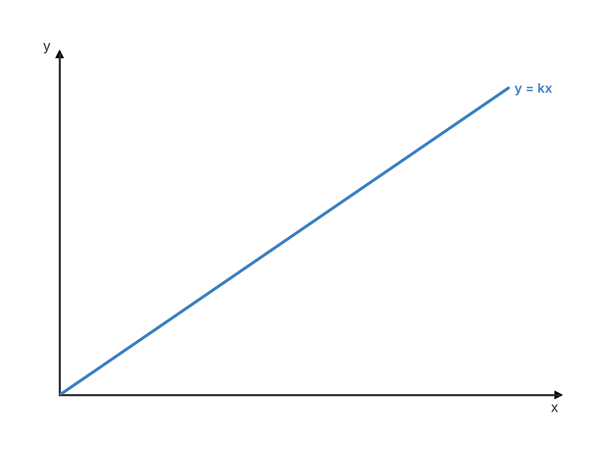
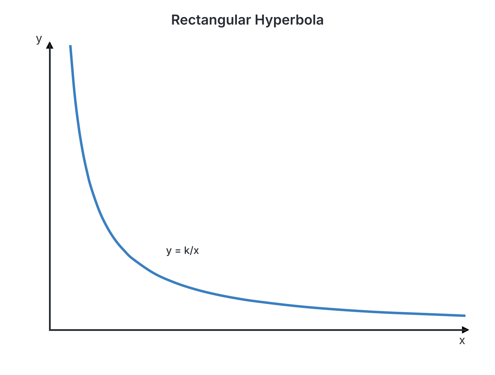
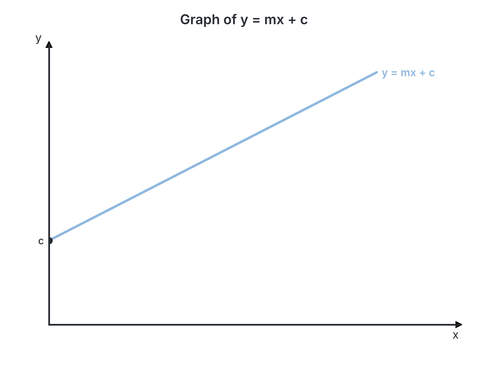

# JAMB Mathematics Notes: Variation

## What JAMB expects

This topic is Section II (Algebra), Topic 2 of the JAMB Mathematics syllabus: Variation. It covers the following content items:

- (a) direct;
- (b) inverse;
- (c) joint;
- (d) partial;
- (e) percentage increase and decrease.

By the end of these notes, you should be able to:

1. solve problems involving direct, inverse, joint and partial variations;
2. solve problems on percentage increase and decrease in variation.

## Solving problems involving direct, inverse, joint and partial variations

**Objective i: solve problems involving direct, inverse, joint and partial variations**

**Variation** is a way to describe how one mathematical quantity changes in relation to another. The relationship is often represented by the variation symbol $\propto$ (which means "varies as" or "is proportional to"). 

To solve any standard variation problem, we always follow these general steps:
1. Write the relationship using the variation symbol ($\propto$).
2. Change the variation symbol to an equals sign ($=$) by introducing a **constant of proportionality**, usually written as $k$.
3. Substitute the given initial values into the equation to find the value of $k$.
4. Rewrite the equation with the known value of $k$. This is the exact formula connecting the variables.
5. Use this exact formula to find any unknown value.

### Direct variation

**Content a: direct**

Two quantities vary directly if an increase in one causes a proportional increase in the other, and a decrease in one causes a proportional decrease in the other. Their ratio remains constant.

If a quantity $y$ varies directly as $x$, we write:
$$y \propto x$$
$$y = kx$$
where $k$ is the constant of proportionality. 

Direct variation can also involve powers and roots. For example, if $y$ varies directly as the square of $x$, the equation is $y = kx^2$. 

**Worked Example 1: Basic direct variation**
The cost of tubers of yam varies directly as the number of tubers bought. If 5 tubers of yam cost ₦6,000, find the cost of 12 tubers.

1. Let the cost be $C$ and the number of tubers be $N$. The relationship is $C \propto N$.
2. Introduce the constant $k$: $C = kN$.
3. Substitute the known values ($C = 6000$ and $N = 5$) to find $k$: $6000 = k(5)$.
4. Solve for $k$: $k = \frac{6000}{5} = 1200$.
5. The exact formula is $C = 1200N$.
6. Substitute $N = 12$ to find the new cost: $C = 1200(12)$.
7. Final answer: $C = 14400$. The cost is ₦14,400.

**Worked Example 2: Direct variation with a power**
The volume $V$ of a solid sphere varies directly as the cube of its radius $r$. When $r = 3\text{ cm}$, $V = 108\text{ cm}^3$. Find $V$ when $r = 5\text{ cm}$.

1. Write the relationship: $V \propto r^3$.
2. Introduce the constant $k$: $V = k r^3$.
3. Substitute the known values to find $k$: $108 = k(3^3)$.
4. Simplify and solve for $k$: $108 = 27k \implies k = \frac{108}{27} = 4$.
5. Write the exact equation: $V = 4r^3$.
6. Substitute the new value of $r = 5$: $V = 4(5^3)$.
7. Calculate the final answer: $V = 4(125) = 500\text{ cm}^3$.

**JAMB Shortcut for Direct Variation:** 
Because $k = \frac{y}{x}$, the ratio is constant. You can skip finding $k$ by using the formula $\frac{y_1}{x_1} = \frac{y_2}{x_2}$. This shortcut is perfectly safe for pure direct variation, but remember to include any powers or roots (e.g., $\frac{y_1}{x_1^2} = \frac{y_2}{x_2^2}$).

**Common mistake:** Forgetting to apply the power to the variable before multiplying by the constant. For example, writing $k(3 \times 3) = 9k$ instead of $k(3^3) = 27k$. Always apply exponents before multiplying.

### Inverse variation

**Content b: inverse**

Two quantities vary inversely if an increase in one causes a proportional decrease in the other. Their product remains constant. 

If a quantity $y$ varies inversely as $x$, we write:
$$y \propto \frac{1}{x}$$
$$y = \frac{k}{x}$$

**Worked Example 3: Basic inverse variation**
The time $t$ taken to travel from Lagos to Ibadan varies inversely as the average speed $v$ of the vehicle. If it takes 2 hours at an average speed of $60\text{ km/h}$, how long will it take at an average speed of $80\text{ km/h}$?

1. Write the relationship: $t \propto \frac{1}{v}$.
2. Introduce the constant: $t = \frac{k}{v}$.
3. Substitute the first set of values ($t = 2$, $v = 60$): $2 = \frac{k}{60}$.
4. Solve for $k$: $k = 2 \times 60 = 120$.
5. Write the exact formula: $t = \frac{120}{v}$.
6. Substitute the new speed $v = 80$: $t = \frac{120}{80}$.
7. Simplify: $t = 1.5$. It will take $1.5\text{ hours}$ (or 1 hour 30 minutes).

**Worked Example 4: Inverse variation with a root**
The frequency $f$ of a radio wave varies inversely as the square root of its wavelength $w$. If $f = 30\text{ kHz}$ when $w = 16\text{ m}$, find $f$ when $w = 25\text{ m}$.

1. Write the relationship: $f \propto \frac{1}{\sqrt{w}}$.
2. Introduce the constant: $f = \frac{k}{\sqrt{w}}$.
3. Substitute the known values: $30 = \frac{k}{\sqrt{16}}$.
4. Evaluate the square root: $30 = \frac{k}{4}$.
5. Solve for $k$: $k = 30 \times 4 = 120$.
6. The exact formula is $f = \frac{120}{\sqrt{w}}$.
7. Find the new frequency when $w = 25$: $f = \frac{120}{\sqrt{25}} = \frac{120}{5} = 24\text{ kHz}$.

**JAMB Shortcut for Inverse Variation:**
Since $y = \frac{k}{x}$ means $k = xy$, the product is constant. You can use $x_1 y_1 = x_2 y_2$ directly.

### Joint variation

**Content c: joint**

Joint variation involves three or more variables. One quantity varies directly or inversely with multiple other quantities at the same time. You combine all relationships into a single equation using one constant $k$.

- If $y$ varies directly as $x$ and directly as $z$, then $y \propto xz \implies y = kxz$.
- If $y$ varies directly as $x$ and inversely as $z$, then $y \propto \frac{x}{z} \implies y = \frac{kx}{z}$.

**Worked Example 5: Pure joint variation**
The volume $V$ of a cylinder varies jointly as the square of its base radius $r$ and its height $h$. When $r = 7\text{ cm}$ and $h = 10\text{ cm}$, $V = 1540\text{ cm}^3$. Find the volume when $r = 14\text{ cm}$ and $h = 5\text{ cm}$.

1. Write the relationship: $V \propto r^2h$.
2. Introduce the constant $k$: $V = kr^2h$.
3. Substitute the first set of values: $1540 = k(7^2)(10)$.
4. Simplify: $1540 = k(49)(10) = 490k$.
5. Solve for $k$: $k = \frac{1540}{490} = \frac{154}{49} = \frac{22}{7}$.
6. Write the exact formula: $V = \frac{22}{7}r^2h$ (this is the standard geometric formula where $k = \pi$).
7. Substitute the new values: $V = \frac{22}{7}(14^2)(5) = \frac{22}{7}(196)(5)$.
8. Calculate the answer: $V = 22 \times 28 \times 5 = 3080\text{ cm}^3$.

**Worked Example 6: Combined direct and inverse variation**
Quantity $A$ varies directly as the square of $B$ and inversely as $C$. $A = 12$ when $B = 2$ and $C = 3$. Find $A$ when $B = 3$ and $C = 9$.

1. Write the relationship: $A \propto \frac{B^2}{C}$.
2. Introduce the constant $k$: $A = \frac{kB^2}{C}$.
3. Substitute the values: $12 = \frac{k(2^2)}{3} = \frac{4k}{3}$.
4. Solve for $k$: $36 = 4k \implies k = 9$.
5. Write the exact formula: $A = \frac{9B^2}{C}$.
6. Substitute the new values: $A = \frac{9(3^2)}{9}$.
7. Calculate the result: $A = \frac{9(9)}{9} = 9$.

### Partial variation

**Content d: partial**

In partial variation, a quantity is made up of two (or more) separate parts added together. The word "partly" is the key indicator. 
- Usually, one part is a constant and the other varies, leading to an equation like $y = a + bx$. 
- Sometimes, both parts vary (e.g., partly as $x$ and partly as $x^2$), leading to $y = ax + bx^2$.
- **Important:** Partial variation always requires **two constants** (usually written as $a$ and $b$ or $k_1$ and $k_2$). Because there are two unknowns, you will be given two sets of data and must solve **simultaneous equations**.

**Worked Example 7: Linear partial variation**
The monthly salary of a salesman is partly constant (his basic salary) and partly varies directly as his sales for the month. In a month where he sold ₦500,000 worth of goods, his salary was ₦70,000. When he sold ₦800,000 worth of goods, his salary was ₦100,000. Find his salary if he makes sales of ₦1,200,000.

1. Let Salary be $S$ and sales be $x$. Write the relationship: $S = a + bx$.
2. Form the first equation using the first set of values: $70,000 = a + 500,000b$ (Equation 1).
3. Form the second equation using the second set of values: $100,000 = a + 800,000b$ (Equation 2).
4. Solve simultaneously by subtracting Equation 1 from Equation 2: 
   $100,000 - 70,000 = (a + 800,000b) - (a + 500,000b)$
   $30,000 = 300,000b$
5. Find $b$: $b = \frac{30,000}{300,000} = 0.1$.
6. Substitute $b = 0.1$ into Equation 1 to find $a$:
   $70,000 = a + 500,000(0.1)$
   $70,000 = a + 50,000 \implies a = 20,000$.
7. The exact formula is $S = 20,000 + 0.1x$.
8. Find the salary for sales of ₦1,200,000: $S = 20,000 + 0.1(1,200,000)$.
9. Calculate the final answer: $S = 20,000 + 120,000 = 140,000$. The salary is ₦140,000.

**Worked Example 8: Partial variation with inverse elements**
The quantity $P$ is partly constant and partly varies inversely as the square of $Q$. When $Q = 2$, $P = 15$. When $Q = 4$, $P = 6$. Find $P$ when $Q = 8$.

1. Write the general equation: $P = a + \frac{b}{Q^2}$.
2. Substitute the first set of values to get Equation 1:
   $15 = a + \frac{b}{2^2} \implies 15 = a + \frac{b}{4}$.
   Multiply through by 4 to remove the fraction: $60 = 4a + b$ (Equation 1).
3. Substitute the second set of values to get Equation 2:
   $6 = a + \frac{b}{4^2} \implies 6 = a + \frac{b}{16}$.
   Multiply through by 16: $96 = 16a + b$ (Equation 2).
4. Subtract Equation 1 from Equation 2 to eliminate $b$:
   $96 - 60 = (16a + b) - (4a + b) \implies 36 = 12a$.
5. Find $a$: $a = \frac{36}{12} = 3$.
6. Substitute $a = 3$ into Equation 1 to find $b$:
   $60 = 4(3) + b \implies 60 = 12 + b \implies b = 48$.
7. The exact formula is $P = 3 + \frac{48}{Q^2}$.
8. Find $P$ when $Q = 8$:
   $P = 3 + \frac{48}{8^2} = 3 + \frac{48}{64}$.
9. Simplify the fraction and calculate the final answer: $\frac{48}{64} = \frac{3}{4}$, so $P = 3\frac{3}{4}$ (or $3.75$).

**Common mistake in partial variation:** Setting up the equation as a product (e.g., $y = abx$) instead of a sum ($y = a + bx$). The word "partly" strictly implies addition. 

## Solving problems on percentage increase and decrease in variation

**Objective ii: solve problems on percentage increase and decrease in variation**

### Percentage increase and decrease

**Content e: percentage increase and decrease**

JAMB frequently asks how a percentage change in one variable affects the other variables in a variation. You do not need the initial numbers or the value of $k$ to solve these; instead, you use **multiplying factors**.

**How multiplying factors work:**
- A **$20\%$ increase** means the new value is $100\% + 20\% = 120\%$ of the old value. The multiplying factor is $1.2$.
- A **$10\%$ decrease** means the new value is $100\% - 10\% = 90\%$ of the old value. The multiplying factor is $0.9$.
- A **$50\%$ increase** means a factor of $1.5$.
- A **$36\%$ decrease** means a factor of $0.64$.

To solve, you substitute these factors directly into the variation relationship to see what factor emerges for the target variable.

**Worked Example 9: Direct percentage variation**
If $y$ varies directly as the square of $x$, and $x$ is increased by $50\%$, find the percentage increase in $y$.

1. Write the relationship: $y_1 = kx_1^2$.
2. An increase of $50\%$ in $x$ means the new $x$ is $1.5$ times the old $x$. We write $x_2 = 1.5x_1$.
3. Substitute $x_2$ into the variation equation to find the new $y$:
   $y_2 = k(1.5x_1)^2$.
4. Square the factor: $1.5^2 = 2.25$. So, $y_2 = 2.25(kx_1^2)$.
5. Since $kx_1^2 = y_1$, we have $y_2 = 2.25y_1$.
6. A multiplying factor of $2.25$ means the new value is $225\%$ of the original.
7. The percentage increase is $225\% - 100\% = 125\%$.

**Worked Example 10: Inverse percentage variation**
If $y$ varies inversely as the square root of $x$, and $x$ is decreased by $36\%$, what is the percentage change in $y$?

1. Write the relationship: $y_1 = \frac{k}{\sqrt{x_1}}$.
2. A decrease of $36\%$ in $x$ means the new $x$ is $100\% - 36\% = 64\%$ of the original. The factor is $0.64$, so $x_2 = 0.64x_1$.
3. Substitute this into the formula:
   $y_2 = \frac{k}{\sqrt{0.64x_1}}$.
4. Extract the square root of the factor: $\sqrt{0.64} = 0.8$.
   $y_2 = \frac{k}{0.8\sqrt{x_1}}$.
5. Group the original terms: $y_2 = \frac{1}{0.8} \times \frac{k}{\sqrt{x_1}} = \frac{1}{0.8}y_1$.
6. Calculate the new factor: $\frac{1}{0.8} = \frac{1}{8/10} = \frac{10}{8} = 1.25$. 
7. $y_2 = 1.25y_1$. A factor of $1.25$ represents an increase of $25\%$.

**Worked Example 11: Joint percentage variation**
$Z$ varies directly as the square of $X$ and inversely as $Y$. If $X$ is decreased by $10\%$ and $Y$ is increased by $20\%$, what is the percentage change in $Z$?

1. Write the original relationship: $Z_1 = \frac{kX_1^2}{Y_1}$.
2. Determine the new factors: $X$ decreases by $10\% \implies 0.9X_1$. $Y$ increases by $20\% \implies 1.2Y_1$.
3. Substitute these factors into the formula for $Z_2$:
   $Z_2 = \frac{k(0.9X_1)^2}{1.2Y_1}$.
4. Square the $0.9$: $0.9^2 = 0.81$.
   $Z_2 = \frac{0.81}{1.2} \times \frac{kX_1^2}{Y_1}$.
5. Calculate the combined factor: $\frac{0.81}{1.2} = \frac{8.1}{12} = \frac{81}{120} = 0.675$.
6. $Z_2 = 0.675 Z_1$. A factor of $0.675$ represents $67.5\%$ of the original.
7. To find the decrease, subtract from $1$: $1 - 0.675 = 0.325$. The percentage decrease is $32.5\%$.

**Common mistake in percentage variation:** Thinking that a $+20\%$ change and a $-20\%$ change in variables will simply cancel out to a $0\%$ change. You must always multiply the factors mathematically. Addition and subtraction do not work for percentage variations.

## Key terms

| Term | Meaning |
| --- | --- |
| Direct variation | A relationship where two quantities increase or decrease proportionally at the same rate. |
| Inverse variation | A relationship where a proportional increase in one quantity causes a proportional decrease in another. |
| Joint variation | A relationship that links three or more variables together in a single formula. |
| Partial variation | A relationship where a quantity is the sum of two or more independent parts, requiring multiple constants. |
| Constant of proportionality ($k$) | A fixed numerical value that connects the variables in a variation equation. |
| Simultaneous equations | Two or more equations solved together; required to find the two unknown constants in partial variation problems. |
| Multiplying factor | A decimal used to easily calculate percentage changes (e.g., $1.25$ for a $25\%$ increase). |

## Exam tips and common mistakes

- **Always start by introducing $k$.** Do not skip the step of finding the constant of proportionality unless you are absolutely sure it is safe to use the ratio shortcuts ($\frac{y_1}{x_1} = \frac{y_2}{x_2}$ or $x_1 y_1 = x_2 y_2$).
- **Watch out for roots and powers.** JAMB frequently tests direct or inverse variation of a *square*, *cube*, or *square root*. A common mistake is writing $y = kx$ instead of $y = kx^2$. Read the question twice.
- **Partial variation uses addition.** The word "partly" means you must use a plus sign ($+$), giving you $y = a + bx$. It never means multiplication.
- **Keep constants as fractions.** If $k$ works out to be $\frac{22}{7}$, leave it as a fraction. Converting it to a decimal (like $3.14$) early in your working can cause rounding errors and lead you to the wrong option.
- **Percentages are multiplied, not added.** If a variable is squared in the formula, you must square its multiplying factor. A $50\%$ increase in $x$ leads to a factor of $1.5^2 = 2.25$, meaning a $125\%$ increase in $y$, not $100\%$.

## Quick summary

1. Variation shows how mathematical quantities relate and change together.
2. In direct variation ($y = kx$), variables move proportionally in the same direction.
3. In inverse variation ($y = \frac{k}{x}$), an increase in one variable results in a proportional decrease in the other.
4. Joint variation combines two or more relationships into a single product and quotient using one constant.
5. Partial variation involves adding two or more parts (e.g., $y = a + bx$). It requires solving simultaneous equations because there are two constants to find.
6. To find the percentage change in variation problems, apply decimal multiplying factors directly to the variables in the variation formula and evaluate the overall factor change.

## Practice questions

**1. If $y$ varies directly as the cube of $x$, and $y = 24$ when $x = 2$. Find $y$ when $x = 3$.**

- A. $36$
- B. $54$
- C. $81$
- D. $108$

**Answer: C.**
1. Write the relationship: $y \propto x^3 \implies y = kx^3$.
2. Substitute the given values to find $k$: $24 = k(2^3)$.
3. Solve for $k$: $24 = 8k \implies k = 3$.
4. The exact equation is $y = 3x^3$.
5. Substitute $x = 3$: $y = 3(3^3) = 3(27) = 81$.
The most tempting wrong option is A ($36$), chosen if a student forgets the cube and treats it as a linear direct variation ($24 = 2k \implies k=12$, then $y=12(3)=36$).

**2. The time $t$ taken to do a piece of work varies inversely as the number of men $m$ employed. If it takes 15 men 4 days to do a piece of work, how many days will 10 men take?**

- A. $2\frac{2}{3}$
- B. $6$
- C. $10$
- D. $24$

**Answer: B.**
1. Write the relationship: $t \propto \frac{1}{m} \implies t = \frac{k}{m}$.
2. Substitute the initial values to find $k$: $4 = \frac{k}{15}$.
3. Solve for $k$: $k = 4 \times 15 = 60$.
4. The exact equation is $t = \frac{60}{m}$.
5. Substitute the new number of men $m = 10$: $t = \frac{60}{10}$.
6. Calculate the final time: $t = 6\text{ days}$.
Mistake behind option A ($2\frac{2}{3}$): Solving the problem as if it were direct variation instead of inverse variation ($\frac{4}{15} = \frac{t}{10} \implies t = \frac{40}{15} = 2\frac{2}{3}$).

**3. $x$ varies directly as $y$ and inversely as the square of $z$. When $y = 8$ and $z = 2$, $x = 10$. Find $x$ when $y = 12$ and $z = 3$.**

- A. $4\frac{1}{2}$
- B. $6\frac{2}{3}$
- C. $15$
- D. $22\frac{1}{2}$

**Answer: B.**
1. Write the relationship: $x \propto \frac{y}{z^2} \implies x = \frac{ky}{z^2}$.
2. Substitute the values: $10 = \frac{k(8)}{2^2} \implies 10 = \frac{8k}{4}$.
3. Solve for $k$: $10 = 2k \implies k = 5$.
4. Write the exact equation: $x = \frac{5y}{z^2}$.
5. Substitute the new values: $x = \frac{5(12)}{3^2}$.
6. Calculate the answer: $x = \frac{60}{9} = \frac{20}{3} = 6\frac{2}{3}$.
Mistake behind option C ($15$): Swapping the direct and inverse parts, calculating as if $x$ varies directly as $z^2$ and inversely as $y$.

**4. The cost $C$ of a school banquet is partly constant and partly varies as the number of students $N$ attending. When 40 students attend, the cost is ₦12,000. When 60 students attend, the cost is ₦17,000. Find the cost when 90 students attend.**

- A. ₦21,500
- B. ₦24,500
- C. ₦25,500
- D. ₦27,000

**Answer: B.**
1. Write the relationship: $C = a + bN$.
2. First equation: $12000 = a + 40b$.
3. Second equation: $17000 = a + 60b$.
4. Subtract the first from the second: $5000 = 20b \implies b = 250$.
5. Find $a$: $12000 = a + 40(250) \implies 12000 = a + 10000 \implies a = 2000$.
6. The formula is $C = 2000 + 250N$.
7. Find $C$ for $N = 90$: $C = 2000 + 250(90) = 2000 + 22500 = 24500$.
Mistake behind option D (₦27,000): Treating it as purely direct variation from the first data point ($12000 \div 40 = 300$, then $300 \times 90 = 27000$).

**5. $y$ varies directly as the square of $x$. If $x$ is increased by $40\%$, find the percentage increase in $y$.**

- A. $40\%$
- B. $80\%$
- C. $96\%$
- D. $196\%$

**Answer: C.**
1. Equation: $y_1 = kx_1^2$.
2. Factor for a $40\%$ increase in $x$: $x_2 = 1.4x_1$.
3. Substitute: $y_2 = k(1.4x_1)^2$.
4. Square the factor: $1.4^2 = 1.96$.
5. The new $y_2 = 1.96\,y_1$.
6. A factor of $1.96$ means the new value is $196\%$ of the original.
7. The increase is $196\% - 100\% = 96\%$.
Mistakes behind the other options: A ($40\%$) assumes $y$ changes by the same percentage as $x$; B ($80\%$) doubles $40\%$ instead of squaring $1.4$; D ($196\%$) gives the final percentage of $y$ instead of the percentage *increase*.

**6. If $F$ varies inversely as the square of $d$. If $d$ is increased by $25\%$, find the percentage decrease in $F$.**

- A. $25\%$
- B. $36\%$
- C. $50\%$
- D. $64\%$

**Answer: B.**
1. Equation: $F_1 = \frac{k}{d_1^2}$.
2. Factor for a $25\%$ increase in $d$: $d_2 = 1.25d_1 = \frac{5}{4}d_1$.
3. Substitute: $F_2 = \frac{k}{(\frac{5}{4}d_1)^2} = \frac{k}{\frac{25}{16}d_1^2}$.
4. Simplify: $F_2 = \frac{16}{25} \times \frac{k}{d_1^2} = 0.64 F_1$.
5. A factor of $0.64$ means $64\%$ of the original is remaining.
6. The decrease is $100\% - 64\% = 36\%$.
Mistake behind option D ($64\%$): Gives the remaining percentage of $F$ instead of the percentage decrease.

**7. $P$ varies directly as $T$ and inversely as $V$. If $T$ is increased by $20\%$ and $V$ is decreased by $20\%$, find the percentage change in $P$.**

- A. $4\%$ decrease
- B. $0\%$ (no change)
- C. $25\%$ increase
- D. $50\%$ increase

**Answer: D.**
1. Equation: $P_1 = \frac{kT_1}{V_1}$.
2. Factors: $T_2 = 1.2T_1$ and $V_2 = 0.8V_1$.
3. Substitute: $P_2 = \frac{k(1.2T_1)}{0.8V_1}$.
4. Calculate the combined factor: $\frac{1.2}{0.8} = 1.5$.
5. $P_2 = 1.5 P_1$.
6. A factor of $1.5$ means a $50\%$ increase.
Mistake behind option B ($0\%$): Incorrectly assuming that adding $20\%$ and subtracting $20\%$ mathematically cancels out.

**8. $y$ is partly constant and partly varies inversely as the square of $x$. When $x = 1$, $y = 14$; when $x = 2$, $y = 5$. Find $y$ when $x = 3$.**

- A. $2$
- B. $3\frac{1}{3}$
- C. $4$
- D. $6$

**Answer: B.**
1. Write the relationship: $y = a + \frac{b}{x^2}$.
2. Substitute the first pair ($x=1, y=14$): $14 = a + \frac{b}{1^2} \implies 14 = a + b$. (Eq. 1)
3. Substitute the second pair ($x=2, y=5$): $5 = a + \frac{b}{2^2} \implies 5 = a + \frac{b}{4}$. (Eq. 2)
4. Subtract Eq. 2 from Eq. 1: $14 - 5 = (a + b) - (a + \frac{b}{4}) \implies 9 = \frac{3b}{4}$.
5. Solve for $b$: $b = 9 \times \frac{4}{3} = 12$.
6. Substitute $b = 12$ into Eq. 1: $14 = a + 12 \implies a = 2$.
7. The exact formula is $y = 2 + \frac{12}{x^2}$.
8. Find $y$ when $x = 3$: $y = 2 + \frac{12}{3^2} = 2 + \frac{12}{9} = 2 + \frac{4}{3} = \frac{10}{3} = 3\frac{1}{3}$.
Mistake behind option A ($2$): Forgetting the square on $x$ when setting up the initial equations.

**9. The extension $E$ of a spring varies directly as the force $F$ applied. An extension of $4\text{ cm}$ is produced by a force of $20\text{ N}$. Find the force required to produce an extension of $10\text{ cm}$.**

- A. $16\text{ N}$
- B. $40\text{ N}$
- C. $50\text{ N}$
- D. $80\text{ N}$

**Answer: C.**
1. Write the relationship: $E \propto F \implies E = kF$.
2. Substitute to find $k$: $4 = k(20)$.
3. Solve for $k$: $k = \frac{4}{20} = \frac{1}{5}$.
4. The exact equation is $E = \frac{1}{5}F$.
5. Substitute the new extension $E = 10$: $10 = \frac{1}{5}F$.
6. Solve for $F$: $F = 10 \times 5 = 50\text{ N}$.
Mistake behind option A ($16\text{ N}$): Accidentally interpreting the problem as inverse variation ($E = \frac{k}{F} \implies k = 80$, then $10 = \frac{80}{F} \implies F=8$, which is not an option either). Option A ($16\text{ N}$) comes from just subtracting the given numbers ($20 - 4 = 16$) instead of setting up a variation equation.

**10. $Z$ varies directly as the square of $X$ and inversely as $Y$. If $X$ is increased by $20\%$ and $Y$ is decreased by $20\%$, what is the percentage change in $Z$?**

- A. No change ($0\%$)
- B. $44\%$ increase
- C. $80\%$ increase
- D. $180\%$ increase

**Answer: C.**
1. Equation: $Z_1 = \frac{kX_1^2}{Y_1}$.
2. Factors: $X_2 = 1.2X_1$ and $Y_2 = 0.8Y_1$.
3. Substitute: $Z_2 = \frac{k(1.2X_1)^2}{0.8Y_1}$.
4. Evaluate the square: $1.2^2 = 1.44$.
5. Find the combined factor: $\frac{1.44}{0.8} = 1.8$.
6. $Z_2 = 1.8\,Z_1$, which is $180\%$ of the original.
7. The increase is $180\% - 100\% = 80\%$.
Mistakes behind the other options: A assumes $+20\%$ and $-20\%$ cancel out; B ($44\%$) forgets the effect of $Y$ ($1.44 - 1$); D ($180\%$) gives the final percentage of $Z$ instead of the percentage *increase*.
