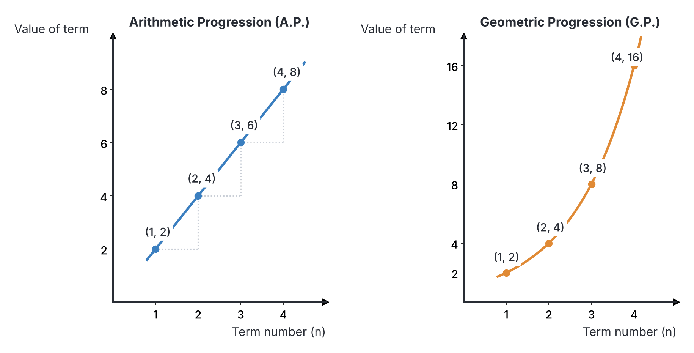
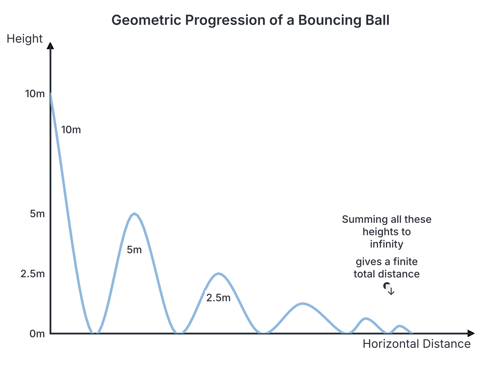

# JAMB Mathematics Notes: Progression

## What JAMB expects

This topic is Section II, Topic 4 of the JAMB Mathematics syllabus: Progression. It covers the following content items:

- **(a) nth term of a progression**
- **(b) sum of A. P. and G. P.**

By the end of these notes, you should be able to:

1. determine the nth term of a progression;
2. compute the sum of A. P. and G.P;
3. sum to infinity of a given G.P.

**Note on the syllabus wording:** The syllabus refers to "A. P. and G. P.", which stand for Arithmetic Progression and Geometric Progression. An earlier objective is written as "iii.sum to infinity" (missing a space), which simply means finding the sum to infinity of a geometric series.

## The nth term of a progression

A **sequence** is an ordered list of numbers that follow a specific mathematical rule. Each number in the sequence is called a **term**. When a sequence follows a strict mathematical rule for moving from one term to the next, it is called a **progression**. 

The two most common types of progressions tested in the JAMB exam are the **Arithmetic Progression (A.P.)** and the **Geometric Progression (G.P.)**. 

### Determining the nth term

**Objective i: determine the nth term of a progression.**

#### 1. Arithmetic Progression (A.P.)

An Arithmetic Progression (also called a linear sequence) is a sequence in which the difference between any term and the term immediately before it is a constant value. This constant value is known as the **common difference**, usually represented by the letter $d$. 

If the first term of the A.P. is denoted by $a$, the terms of the sequence will look like this:
$$a, \quad a + d, \quad a + 2d, \quad a + 3d, \quad \dots$$

To find any term in the sequence (the $n$th term, denoted as $T_n$), we use the formula:
$$T_n = a + (n - 1)d$$

Where:
- $T_n$ is the $n$th term.
- $a$ is the first term.
- $n$ is the position of the term in the sequence (e.g., for the 5th term, $n=5$).
- $d$ is the common difference ($d = T_2 - T_1 = T_3 - T_2$).

**Worked Example 1 (Standard)**
Find the 15th term of the A.P. $3, 7, 11, \dots$

1. Identify the given values: the first term $a = 3$.
2. Find the common difference $d$ by subtracting the first term from the second term: $d = 7 - 3 = 4$.
3. We are looking for the 15th term, so $n = 15$.
4. Substitute these into the formula $T_n = a + (n - 1)d$:
   $$T_{15} = 3 + (15 - 1)4$$
   $$T_{15} = 3 + (14 \times 4)$$
   $$T_{15} = 3 + 56 = 59$$
The 15th term is 59.

**Worked Example 2 (JAMB style: finding a and d)**
If the 4th term of an A.P. is 14 and the 9th term is 29, find the first term and the common difference, then find the 20th term.

1. Write out the equations for the given terms using $T_n = a + (n - 1)d$:
   $T_4 = a + 3d = 14$  (Equation 1)
   $T_9 = a + 8d = 29$  (Equation 2)
2. Solve the simultaneous equations by subtracting Equation 1 from Equation 2:
   $$(a + 8d) - (a + 3d) = 29 - 14$$
   $$5d = 15$$
   $$d = 3$$
3. Substitute $d = 3$ back into Equation 1 to find $a$:
   $$a + 3(3) = 14$$
   $$a + 9 = 14 \implies a = 5$$
4. Now, find the 20th term ($T_{20}$):
   $$T_{20} = a + 19d$$
   $$T_{20} = 5 + 19(3)$$
   $$T_{20} = 5 + 57 = 62$$

> **JAMB Shortcut:** You can find $d$ instantly if you are given two terms $T_p$ and $T_q$. Use the formula: $d = \frac{T_p - T_q}{p - q}$. From the example above: $d = \frac{29 - 14}{9 - 4} = \frac{15}{5} = 3$.

**Worked Example 3 (Finding the number of terms)**
How many terms are in the A.P. $5, 2, -1, \dots, -67$?

1. Identify the given values: $a = 5$, and the last term $T_n = -67$.
2. Find the common difference: $d = 2 - 5 = -3$.
3. Substitute into the formula $T_n = a + (n - 1)d$:
   $$-67 = 5 + (n - 1)(-3)$$
4. Solve for $n$:
   $$-67 - 5 = -3(n - 1)$$
   $$-72 = -3(n - 1)$$
   $$n - 1 = \frac{-72}{-3} = 24$$
   $$n = 24 + 1 = 25$$
There are 25 terms in the sequence.

#### 2. Geometric Progression (G.P.)

A Geometric Progression (also called an exponential sequence) is a sequence in which the ratio of any term to the term immediately before it is a constant value. This constant is called the **common ratio**, usually represented by the letter $r$.

If the first term is $a$, the terms of the G.P. look like this:
$$a, \quad ar, \quad ar^2, \quad ar^3, \quad \dots$$

To find the $n$th term of a G.P., we use the formula:
$$T_n = a r^{n-1}$$

Where:
- $T_n$ is the $n$th term.
- $a$ is the first term.
- $r$ is the common ratio ($r = \frac{T_2}{T_1} = \frac{T_3}{T_2}$).
- $n$ is the position of the term.

**Common Mistake Note:** The power $(n - 1)$ applies **only** to the common ratio $r$, not to $a$. Do not calculate $(ar)^{n-1}$. Always compute $r^{n-1}$ first, then multiply the result by $a$. 

**Worked Example 4 (Standard)**
Find the 7th term of the G.P. $2, 6, 18, \dots$

1. Identify the given values: $a = 2$.
2. Find the common ratio $r$: $r = \frac{6}{2} = 3$.
3. Use the formula $T_n = a r^{n-1}$ for $n = 7$:
   $$T_7 = 2 \times 3^{7 - 1}$$
   $$T_7 = 2 \times 3^6$$
4. Calculate $3^6$ (which is $3 \times 3 \times 3 \times 3 \times 3 \times 3 = 729$) and multiply by 2:
   $$T_7 = 2 \times 729 = 1458$$

**Worked Example 5 (Finding a and r)**
The 3rd term of a G.P. is 20 and the 6th term is $-160$. Find the first term and the common ratio.

1. Write out the equations for the given terms:
   $T_3 = ar^2 = 20$  (Equation 1)
   $T_6 = ar^5 = -160$  (Equation 2)
2. Divide Equation 2 by Equation 1 to eliminate $a$:
   $$\frac{ar^5}{ar^2} = \frac{-160}{20}$$
   $$r^3 = -8$$
3. Find the cube root of $-8$ to get $r$:
   $$r = -2$$
4. Substitute $r = -2$ back into Equation 1 to find $a$:
   $$a(-2)^2 = 20$$
   $$4a = 20 \implies a = 5$$
The first term is $5$ and the common ratio is $-2$.

**Worked Example 6 (Multiple possible first terms)**
In a G.P., the 2nd term is 9 and the 4th term is 81. Find the possible values of the first term.

1. Set up the equations:
   $ar = 9$  (Equation 1)
   $ar^3 = 81$  (Equation 2)
2. Divide Equation 2 by Equation 1:
   $$\frac{ar^3}{ar} = \frac{81}{9}$$
   $$r^2 = 9$$
3. Take the square root of both sides. Remember that a square root gives a positive and a negative answer:
   $$r = 3 \quad \text{or} \quad r = -3$$
4. Find $a$ for both possible values of $r$:
   If $r = 3$: $a(3) = 9 \implies a = 3$.
   If $r = -3$: $a(-3) = 9 \implies a = -3$.
The possible values of the first term are $3$ and $-3$.

---

## Sum of A.P. and G.P.

When we add the terms of a sequence together, the result is called a **series**. Finding the sum of an A.P. or G.P. requires specific formulas.

### Computing the sum of an A.P. and G.P.

**Objective ii: compute the sum of A. P. and G.P.**

#### 1. Sum of an Arithmetic Progression

There are two main formulas to find the sum of the first $n$ terms ($S_n$) of an A.P.:

**Formula 1 (When the common difference $d$ is known):**
$$S_n = \frac{n}{2} [2a + (n - 1)d]$$

**Formula 2 (When the last term $l$ is known):**
$$S_n = \frac{n}{2} (a + l)$$
(Note: The last term $l$ is the same as the $n$th term, $T_n$).

**Worked Example 7**
Find the sum of the first 20 terms of the A.P. $4, 10, 16, \dots$

1. Identify the values: $a = 4$, $d = 10 - 4 = 6$, $n = 20$.
2. Substitute into Formula 1:
   $$S_{20} = \frac{20}{2} [2(4) + (20 - 1)6]$$
   $$S_{20} = 10 [8 + 19(6)]$$
3. Evaluate the brackets:
   $$S_{20} = 10 [8 + 114]$$
   $$S_{20} = 10 [122] = 1220$$

**Worked Example 8**
The sum of the first 10 terms of an A.P. is 130. If the first term is 4, find the common difference.

1. Identify the given values: $S_{10} = 130$, $n = 10$, $a = 4$.
2. Substitute into the sum formula:
   $$130 = \frac{10}{2} [2(4) + (10 - 1)d]$$
   $$130 = 5 [8 + 9d]$$
3. Divide both sides by 5:
   $$26 = 8 + 9d$$
4. Solve for $d$:
   $$18 = 9d \implies d = 2$$

**Worked Example 9 (Forming a quadratic equation)**
The sum of the A.P. $2, 5, 8, \dots$ is 155. Find the number of terms.

1. Identify the values: $a = 2$, $d = 3$, $S_n = 155$.
2. Substitute into the sum formula:
   $$155 = \frac{n}{2} [2(2) + (n - 1)3]$$
3. Multiply both sides by 2 to clear the fraction:
   $$310 = n [4 + 3n - 3]$$
   $$310 = n(3n + 1)$$
4. Expand and rearrange into a quadratic equation:
   $$3n^2 + n - 310 = 0$$
5. Solve by factoring. We need two numbers that multiply to $3 \times -310 = -930$ and add up to $1$. Those numbers are $31$ and $-30$.
   $$3n^2 - 30n + 31n - 310 = 0$$
   $$3n(n - 10) + 31(n - 10) = 0$$
   $$(3n + 31)(n - 10) = 0$$
6. $n = 10$ or $n = -\frac{31}{3}$. Since the number of terms must be a positive whole number, $n = 10$.

#### 2. Sum of a Geometric Progression

To find the sum of the first $n$ terms of a G.P., we use one of these two formulas, depending on the value of $r$:

**Formula 1 (Use when $r < 1$):**
$$S_n = \frac{a(1 - r^n)}{1 - r}$$

**Formula 2 (Use when $r > 1$):**
$$S_n = \frac{a(r^n - 1)}{r - 1}$$

*(Note: Both formulas mathematically give the exact same answer. We just switch them to avoid dealing with negative signs in the denominator).*

**Worked Example 10**
Find the sum of the first 8 terms of the G.P. $1, 2, 4, 8, \dots$

1. Identify the values: $a = 1$, $r = \frac{2}{1} = 2$, $n = 8$.
2. Since $r > 1$, we use Formula 2:
   $$S_8 = \frac{1(2^8 - 1)}{2 - 1}$$
3. Calculate $2^8 = 256$:
   $$S_8 = \frac{1(256 - 1)}{1} = 255$$

**Worked Example 11**
Find the sum of the first 6 terms of the G.P. $243, 81, 27, \dots$

1. Identify the values: $a = 243$, $r = \frac{81}{243} = \frac{1}{3}$, $n = 6$.
2. Since $r < 1$, we use Formula 1:
   $$S_6 = \frac{243(1 - (\frac{1}{3})^6)}{1 - \frac{1}{3}}$$
3. Evaluate the powers and the denominator:
   $$S_6 = \frac{243(1 - \frac{1}{729})}{\frac{2}{3}}$$
   $$S_6 = \frac{243(\frac{728}{729})}{\frac{2}{3}}$$
4. Simplify the numerator. $243$ goes into $729$ three times:
   $$S_6 = \frac{\frac{728}{3}}{\frac{2}{3}}$$
   $$S_6 = \frac{728}{3} \times \frac{3}{2} = \frac{728}{2} = 364$$

---

## Sum to infinity of a given G.P.

**Objective iii: sum to infinity of a given G.P.**

If a Geometric Progression has a common ratio that is a proper fraction (that is, strictly between $-1$ and $1$, or $|r| < 1$), the terms get smaller and smaller as the sequence progresses. Because the terms approach zero, adding an infinite number of them will not give an infinitely large result. Instead, the sum converges (settles) to a fixed, finite value. This is called the **sum to infinity** ($S_{\infty}$).

The formula for the sum to infinity is:
$$S_{\infty} = \frac{a}{1 - r}$$
Where $-1 < r < 1$. 

*(Note: If $r \ge 1$ or $r \le -1$, the sum to infinity does not exist because the series diverges).*

**Worked Example 12**
Find the sum to infinity of the G.P. $18, 6, 2, \dots$

1. Identify the values: $a = 18$, $r = \frac{6}{18} = \frac{1}{3}$.
2. Check that $|r| < 1$. Yes, $\frac{1}{3} < 1$.
3. Substitute into the sum to infinity formula:
   $$S_{\infty} = \frac{18}{1 - \frac{1}{3}}$$
   $$S_{\infty} = \frac{18}{\frac{2}{3}}$$
   $$S_{\infty} = 18 \times \frac{3}{2} = 9 \times 3 = 27$$

**Worked Example 13**
A G.P. has a sum to infinity of 25 and a first term of 15. Find the common ratio.

1. Set up the equation using $S_{\infty} = 25$ and $a = 15$:
   $$25 = \frac{15}{1 - r}$$
2. Cross-multiply:
   $$25(1 - r) = 15$$
   $$1 - r = \frac{15}{25} = \frac{3}{5}$$
3. Solve for $r$:
   $$r = 1 - \frac{3}{5} = \frac{2}{5}$$

**Worked Example 14 (Solving a quadratic to find r)**
The 2nd term of a G.P. is 8 and the sum to infinity is 36. Find the possible values of the common ratio.

1. Write out the equations:
   $ar = 8 \implies a = \frac{8}{r}$ (Equation 1)
   $\frac{a}{1 - r} = 36 \implies a = 36(1 - r)$ (Equation 2)
2. Equate the two expressions for $a$:
   $$36(1 - r) = \frac{8}{r}$$
3. Multiply by $r$ and expand:
   $$36r(1 - r) = 8$$
   $$36r - 36r^2 = 8$$
4. Rearrange into a quadratic equation by bringing everything to one side:
   $$36r^2 - 36r + 8 = 0$$
5. Divide by 4 to simplify:
   $$9r^2 - 9r + 2 = 0$$
6. Factorise the quadratic equation (multiply to $18$, add to $-9$. The numbers are $-6$ and $-3$):
   $$9r^2 - 6r - 3r + 2 = 0$$
   $$3r(3r - 2) - 1(3r - 2) = 0$$
   $$(3r - 1)(3r - 2) = 0$$
7. The solutions are $r = \frac{1}{3}$ and $r = \frac{2}{3}$.
Because both values are between $-1$ and $1$, both are valid possible common ratios.

## Key terms

| Term | Meaning |
| --- | --- |
| **Sequence** | An ordered list of numbers following a mathematical rule. |
| **Progression** | A sequence where the rule between terms is strictly linear or exponential. |
| **Arithmetic Progression (A.P.)** | A sequence where each term increases or decreases by adding a constant difference. |
| **Geometric Progression (G.P.)** | A sequence where each term is found by multiplying the previous term by a constant ratio. |
| **Common difference ($d$)** | The constant value added to each term in an A.P. |
| **Common ratio ($r$)** | The constant multiplier between terms in a G.P. |
| **Series** | The sum of the terms of a sequence. |
| **Sum to infinity** | The finite total sum of an infinite geometric series when $|r| < 1$. |

## Exam tips and common mistakes

- **Using $n$ instead of $n-1$:** A very common mistake in the $n$th term formula is multiplying $d$ (or raising $r$) by $n$ instead of $n-1$. Remember, the 10th term has a factor of 9, not 10. (e.g., $T_{10} = a + 9d$).
- **Power applies only to $r$:** For a G.P., $T_n = a r^{n-1}$. Do **not** multiply $a$ and $r$ first and then raise the result to a power. Exponents must be done before multiplication.
- **Finding any term from the sum:** If JAMB gives you a formula for the sum of an A.P. (like $S_n = n^2 + 2n$) and asks for a specific term (e.g., the 5th term), you can always find it by subtracting the sum of the previous terms from the sum of the current terms. **Formula: $T_n = S_n - S_{n-1}$**.
- **Signs on common ratios:** If a sequence alternates between positive and negative numbers (e.g., $3, -6, 12, -24 \dots$), the common ratio $r$ is **negative**. Do not ignore the minus sign.
- **Sums to infinity requirements:** You cannot calculate a sum to infinity if $r \ge 1$ or $r \le -1$. The sequence must shrink towards zero. 
- **Arithmetic and Geometric Means:** If three terms $a, b, c$ form an A.P., the middle term is the arithmetic mean: $b = \frac{a+c}{2}$. If they form a G.P., the middle term is the geometric mean: $b = \sqrt{ac}$.

## Quick summary

1. In an Arithmetic Progression (A.P.), the difference between consecutive terms is constant ($d$). The $n$th term is $T_n = a + (n - 1)d$.
2. In a Geometric Progression (G.P.), the ratio between consecutive terms is constant ($r$). The $n$th term is $T_n = ar^{n-1}$.
3. The sum of the first $n$ terms of an A.P. is $S_n = \frac{n}{2}[2a + (n-1)d]$, or $S_n = \frac{n}{2}(a+l)$ if the last term $l$ is known.
4. The sum of the first $n$ terms of a G.P. is $S_n = \frac{a(1 - r^n)}{1 - r}$ (best for $r<1$) or $S_n = \frac{a(r^n - 1)}{r - 1}$ (best for $r>1$).
5. A geometric series converges to a finite total if its ratio strictly falls between $-1$ and $1$.
6. The formula for the sum to infinity of a G.P. is $S_{\infty} = \frac{a}{1 - r}$.

## Practice questions

**1. Find the 10th term of the A.P. $5, 12, 19, \dots$**

- A. $61$
- B. $68$
- C. $75$
- D. $54$

**Answer: B.** 
1. Identify $a = 5$ and $d = 12 - 5 = 7$.
2. Apply the formula $T_n = a + (n - 1)d$.
3. $T_{10} = 5 + 9(7)$.
4. $T_{10} = 5 + 63 = 68$.
*(A common mistake is calculating $a + 10d$ to get 75).*

**2. The 5th term of an A.P. is 17 and the 3rd term is 9. Find the sum of the first 12 terms.**

- A. $276$
- B. $240$
- C. $312$
- D. $138$

**Answer: A.** 
1. $T_5 = a + 4d = 17$ and $T_3 = a + 2d = 9$.
2. Subtracting the two equations gives $2d = 8 \implies d = 4$.
3. Substitute $d = 4$ into $a + 2d = 9$ to get $a + 8 = 9 \implies a = 1$.
4. Use the sum formula: $S_{12} = \frac{12}{2}[2(1) + 11(4)]$.
5. $S_{12} = 6[2 + 44] = 6 \times 46 = 276$.

**3. The sum of the first $n$ terms of an A.P. is $n^2 + 2n$. Find the 5th term.**

- A. $35$
- B. $24$
- C. $11$
- D. $13$

**Answer: C.** 
1. Use the rule $T_n = S_n - S_{n-1}$. For the 5th term, $T_5 = S_5 - S_4$.
2. Calculate $S_5 = (5)^2 + 2(5) = 25 + 10 = 35$.
3. Calculate $S_4 = (4)^2 + 2(4) = 16 + 8 = 24$.
4. $T_5 = 35 - 24 = 11$.

**4. Find the number of terms in the G.P. $3, 6, 12, \dots, 768$.**

- A. $7$
- B. $8$
- C. $9$
- D. $10$

**Answer: C.** 
1. Identify $a = 3$ and $r = \frac{6}{3} = 2$.
2. Use $T_n = ar^{n-1} \implies 768 = 3(2^{n-1})$.
3. Divide by 3: $256 = 2^{n-1}$.
4. Express 256 as a power of 2: $2^8 = 2^{n-1}$.
5. Equate powers: $8 = n - 1 \implies n = 9$.

**5. In a G.P., the second term is 6 and the fourth term is 54. If the terms are all positive, find the 5th term.**

- A. $162$
- B. $486$
- C. $-162$
- D. $54$

**Answer: A.** 
1. $T_4 = ar^3 = 54$ and $T_2 = ar = 6$.
2. Divide the equations: $\frac{ar^3}{ar} = \frac{54}{6} \implies r^2 = 9$.
3. Since terms are positive, $r = 3$.
4. Substitute $r = 3$ into $ar = 6 \implies 3a = 6 \implies a = 2$.
5. Find the 5th term: $T_5 = ar^4 = 2(3^4) = 2(81) = 162$.

**6. The sum of the first three terms of a G.P. is 26 and the common ratio is 3. Find the first term.**

- A. $1$
- B. $2$
- C. $3$
- D. $4$

**Answer: B.** 
1. The first three terms are $a$, $ar$, and $ar^2$.
2. Substitute $r = 3$: the terms are $a$, $3a$, and $9a$.
3. Sum them up: $a + 3a + 9a = 13a$.
4. Equate to the given sum: $13a = 26 \implies a = 2$.
*(Alternatively, apply the sum formula $S_3 = \frac{a(3^3 - 1)}{3 - 1}$).*

**7. Find the sum to infinity of the series $1 + \frac{1}{3} + \frac{1}{9} + \dots$**

- A. $2$
- B. $\frac{3}{2}$
- C. $\frac{4}{3}$
- D. $1$

**Answer: B.** 
1. Identify $a = 1$ and $r = \frac{1}{3}$.
2. Check $|r| < 1$.
3. Use the formula $S_{\infty} = \frac{a}{1 - r}$.
4. $S_{\infty} = \frac{1}{1 - \frac{1}{3}} = \frac{1}{\frac{2}{3}}$.
5. $S_{\infty} = 1 \times \frac{3}{2} = \frac{3}{2}$.

**8. The first term of an A.P. is 3 and the 8th term is 31. Find the sum of the first 8 terms.**

- A. $124$
- B. $136$
- C. $272$
- D. $140$

**Answer: B.** 
1. Identify $a = 3$, $n = 8$, and the last term $l = 31$.
2. Use the simplified sum formula since the last term is known: $S_n = \frac{n}{2}(a + l)$.
3. $S_8 = \frac{8}{2}(3 + 31)$.
4. $S_8 = 4(34) = 136$.
*(A common mistake is forgetting to divide $n$ by 2, leading to 272).*

**9. A geometric progression has a sum to infinity of 32. If the first term is 8, find the common ratio.**

- A. $\frac{1}{4}$
- B. $\frac{1}{2}$
- C. $\frac{3}{4}$
- D. $\frac{3}{2}$

**Answer: C.** 
1. Apply the formula $S_{\infty} = \frac{a}{1 - r}$.
2. Substitute the values: $32 = \frac{8}{1 - r}$.
3. Cross multiply: $32(1 - r) = 8$.
4. Divide by 32: $1 - r = \frac{8}{32} = \frac{1}{4}$.
5. Solve for $r$: $r = 1 - \frac{1}{4} = \frac{3}{4}$.

**10. The sum of the first 4 terms of an A.P. is 36 and the 6th term is 23. Find the first term.**

- A. $1$
- B. $2$
- C. $3$
- D. $4$

**Answer: C.** 
1. Form Equation 1 using the sum formula: $S_4 = \frac{4}{2}[2a + 3d] = 36 \implies 2(2a + 3d) = 36 \implies 2a + 3d = 18$.
2. Form Equation 2 using the $n$th term formula: $T_6 = a + 5d = 23 \implies 2a + 10d = 46$ (multiplied by 2 to align with Eq 1).
3. Subtract Eq 1 from Eq 2: $(2a + 10d) - (2a + 3d) = 46 - 18$.
4. $7d = 28 \implies d = 4$.
5. Substitute $d = 4$ into $2a + 3d = 18$: $2a + 3(4) = 18 \implies 2a + 12 = 18 \implies 2a = 6 \implies a = 3$.
