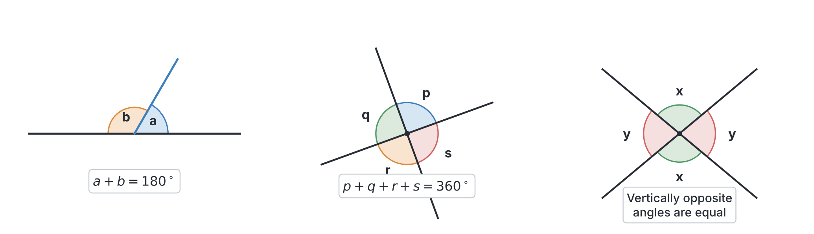
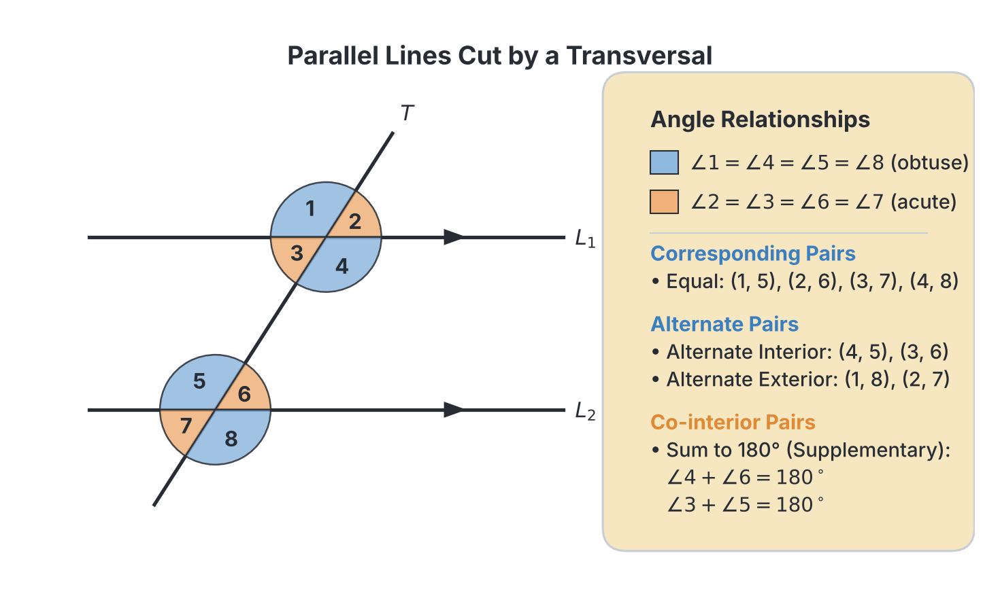
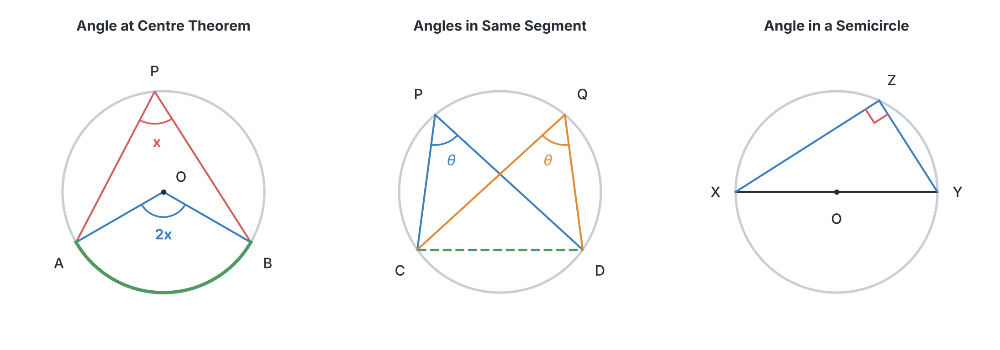
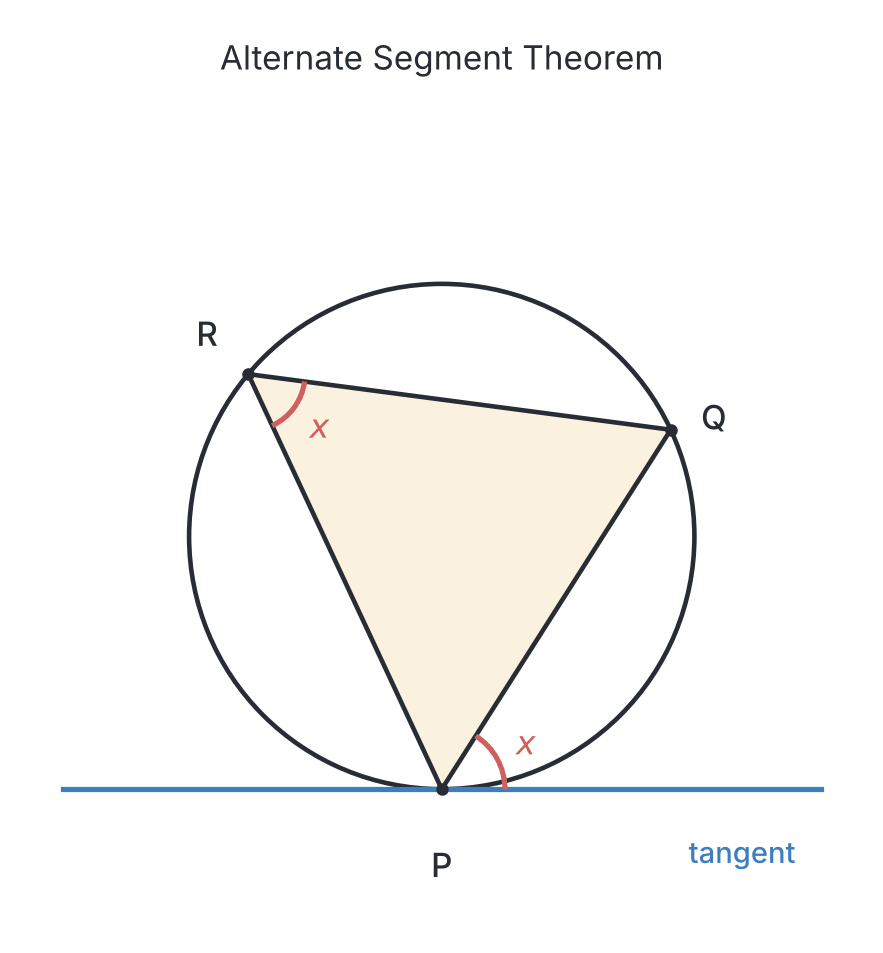
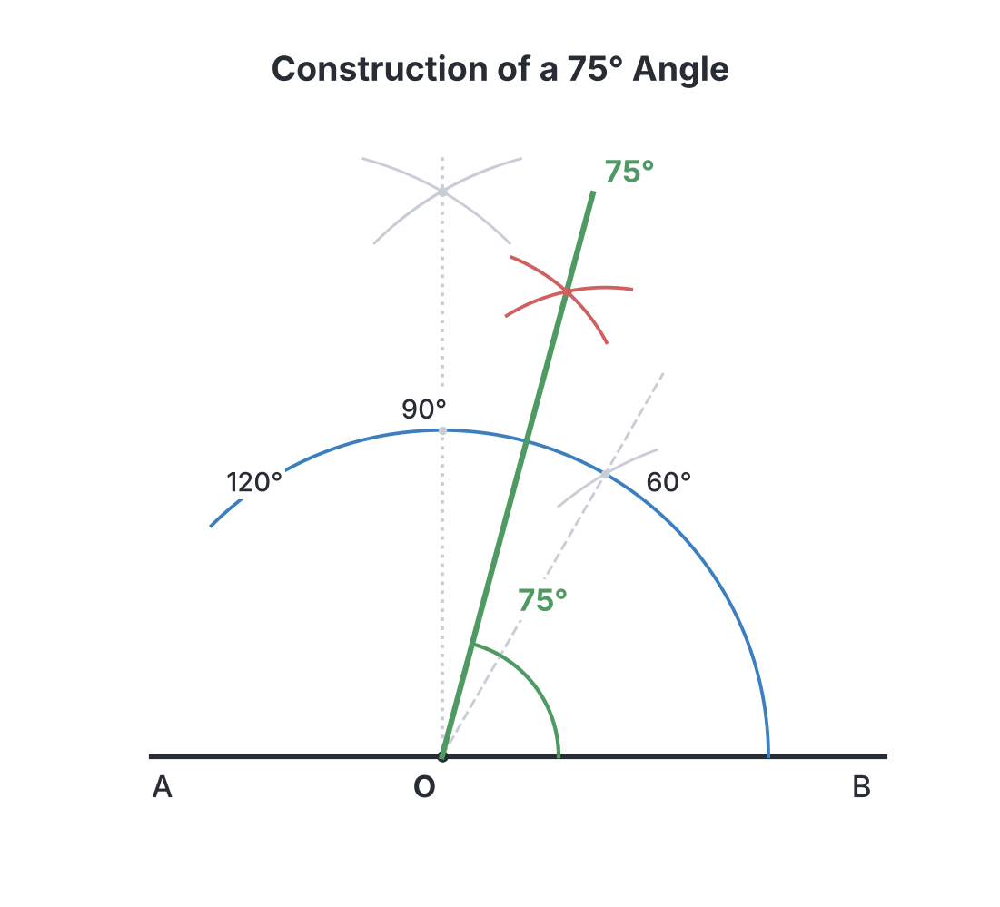

# JAMB Mathematics Notes: Euclidean Geometry

## What JAMB expects

This topic is Section III, Topic 1 of the JAMB Mathematics syllabus: Euclidean Geometry. It covers the fundamental principles of shapes, lines, and angles on a flat plane. It has four content items:

*   (a) Properties of angles and lines
*   (b) Polygons: triangles, quadrilaterals and general polygons;
*   (c) Circles: angle properties, cyclic quadrilaterals and intersecting chords;
*   (d) construction.

By the end of these notes, you should be able to:

1.  identify various types of lines and angles;
2.  solve problems involving polygons;
3.  calculate angles using circle theorems;
4.  identify construction procedures of special angles, e.g. $30^\circ$, $45^\circ$, $60^\circ$, $75^\circ$, $90^\circ$ etc.

**Note on the syllabus wording:** The syllabus contains a typographical error in item (c): "Circles: angle properties, cyclic; quadrilaterals and intersecting chords". The semicolon is misplaced. It should read "Circles: angle properties, cyclic quadrilaterals and intersecting chords". These notes cover the intended meaning.

## Properties of angles and lines

**Objective i: identify various types of lines and angles;**
**Content a: Properties of angles and lines**

Geometry begins with lines and the angles they form when they meet. 

### Types of lines

*   **Point:** A position in space with no size.
*   **Line:** A straight path that extends forever in both directions.
*   **Line segment:** A part of a line with two endpoints.
*   **Ray:** A part of a line that starts at one endpoint and goes on forever in one direction.
*   **Parallel lines:** Lines on the same plane that never meet, no matter how far they are extended. We often mark them with matching arrows (e.g. $>$ and $>$).
*   **Intersecting lines:** Lines that cross each other at a point.
*   **Perpendicular lines:** Lines that intersect at a right angle ($90^\circ$).
*   **Transversal:** A line that cuts across two or more other lines (usually parallel lines).

### Types of angles

An angle is formed when two lines meet at a point. Angles are measured in degrees ($^\circ$).

*   **Acute angle:** Greater than $0^\circ$ but less than $90^\circ$.
*   **Right angle:** Exactly $90^\circ$.
*   **Obtuse angle:** Greater than $90^\circ$ but less than $180^\circ$.
*   **Straight angle:** Exactly $180^\circ$ (a straight line).
*   **Reflex angle:** Greater than $180^\circ$ but less than $360^\circ$.
*   **Full rotation (angle at a point):** Exactly $360^\circ$.

### Angle rules on a straight line and at a point

1.  **Angles on a straight line:** Angles that lie on a straight line add up to $180^\circ$.
2.  **Angles at a point:** Angles around a single point add up to $360^\circ$.
3.  **Vertically opposite angles:** When two straight lines intersect, the angles opposite each other are equal.

### Angles formed by parallel lines and a transversal

When a transversal cuts through two parallel lines, several special pairs of angles are formed. 

1.  **Corresponding angles (F-angles):** These are in the same relative position at each intersection. **Corresponding angles are equal.**
2.  **Alternate angles (Z-angles):** These are on opposite sides of the transversal and between the parallel lines. **Alternate angles are equal.**
3.  **Co-interior angles (C-angles or Allied angles):** These are on the same side of the transversal and between the parallel lines. **Co-interior angles add up to $180^\circ$.**

### Worked Examples

**Example 1 (Angles at a point):**
The angles around a point are $x^\circ$, $2x^\circ$, and $3x^\circ$. Find the value of $x$.

**Working:**

1.  Angles at a point sum to $360^\circ$.
2.  Set up the equation: $x + 2x + 3x = 360^\circ$
3.  Simplify: $6x = 360^\circ$
4.  Solve for $x$: $x = \frac{360}{6} = 60^\circ$.

**Example 2 (Co-interior angles):**
Two parallel lines are cut by a transversal. Two co-interior angles are $(3y - 10)^\circ$ and $(2y + 40)^\circ$. Find $y$.

**Working:**

1.  Co-interior angles sum to $180^\circ$.
2.  Set up the equation: $(3y - 10) + (2y + 40) = 180$
3.  Simplify: $5y + 30 = 180$
4.  Subtract $30$: $5y = 150$
5.  Solve for $y$: $y = \frac{150}{5} = 30$.

**Example 3 (The Zigzag parallel line problem):**
Line $AB$ is parallel to line $CD$. A transversal from $AB$ ends at a point $P$ between the parallel lines, and another transversal from $CD$ ends at the same point $P$. Angle $BAP$ is $45^\circ$ and angle $DCP$ is $35^\circ$. Find angle $APC$.

**Working:**

1.  Draw a construction line through point $P$ that is parallel to both $AB$ and $CD$.
2.  This new line splits angle $APC$ into two smaller angles.
3.  The top part of angle $APC$ is alternate to angle $BAP$, so it is $45^\circ$.
4.  The bottom part of angle $APC$ is alternate to angle $DCP$, so it is $35^\circ$.
5.  Angle $APC = 45^\circ + 35^\circ = 80^\circ$.

> **Common mistake:** In parallel lines problems, students often assume that *all* special angle pairs are equal. Remember that while alternate and corresponding angles are equal, **co-interior angles add up to $180^\circ$**. Do not set them equal to each other unless you know they are both exactly $90^\circ$.

---

## Polygons: triangles, quadrilaterals and general polygons

**Objective ii: solve problems involving polygons;**
**Content b: Polygons: triangles, quadrilaterals and general polygons;**

A polygon is a closed 2D shape with straight sides.

### Triangles

A triangle is a polygon with 3 sides. 
*   **Sum of interior angles:** The angles inside a triangle always add up to $180^\circ$.
*   **Exterior angle property:** The exterior angle of a triangle is equal to the sum of the two opposite interior angles.

**Types of triangles:**
*   **Scalene:** All three sides are different; all three angles are different.
*   **Isosceles:** Two sides are equal; the two base angles opposite those sides are equal.
*   **Equilateral:** All three sides are equal; all three angles are equal ($60^\circ$ each).
*   **Right-angled:** One angle is exactly $90^\circ$.

### Quadrilaterals

A quadrilateral is a polygon with 4 sides. The sum of the interior angles of any quadrilateral is **$360^\circ$**.

Special quadrilaterals have specific properties that JAMB often tests:
*   **Parallelogram:** Opposite sides are parallel and equal. Opposite angles are equal. Diagonals bisect each other (cut each other in half).
*   **Rectangle:** A parallelogram with four right angles ($90^\circ$). Diagonals are equal in length and bisect each other.
*   **Rhombus:** A parallelogram with all four sides equal. Diagonals bisect each other at right angles ($90^\circ$) and bisect the interior angles.
*   **Square:** A rectangle with all four sides equal (has all the properties of a rectangle and a rhombus).
*   **Trapezium:** Has exactly one pair of parallel sides.
*   **Kite:** Has two pairs of adjacent (next to each other) equal sides. One pair of opposite angles is equal. The diagonals intersect at right angles ($90^\circ$).

### General Polygons

For polygons with $n$ sides (e.g., pentagon $n=5$, hexagon $n=6$, octagon $n=8$):

**1. Sum of interior angles:**
$$S = (n - 2) \times 180^\circ$$
where:
*   $S$ is the sum of the interior angles.
*   $n$ is the number of sides.

**2. Sum of exterior angles:**
The sum of the exterior angles of *any* convex polygon is always **$360^\circ$**. (An exterior angle is formed by extending one side of the polygon outwards).

**3. Regular Polygons:**
A regular polygon has all sides equal and all interior angles equal.
*   Each exterior angle = $\frac{360^\circ}{n}$
*   Each interior angle = $180^\circ - \text{Exterior angle}$ (because interior and exterior angles sit on a straight line).
*   Alternatively, each interior angle = $\frac{(n - 2) \times 180^\circ}{n}$.

### Worked Examples

**Example 1 (Quadrilateral angles):**
The angles of a quadrilateral are $x$, $2x$, $3x$, and $4x$. Find the largest angle.

**Working:**

1.  The sum of interior angles of a quadrilateral is $360^\circ$.
2.  $x + 2x + 3x + 4x = 360^\circ$
3.  $10x = 360^\circ$
4.  $x = 36^\circ$
5.  The largest angle is $4x = 4 \times 36^\circ = 144^\circ$.

**Example 2 (Regular polygon exterior angle):**
Find the number of sides of a regular polygon whose interior angle is twice its exterior angle.

**Working:**

1.  Let the exterior angle be $e$ and the interior angle be $i$.
2.  We are told $i = 2e$.
3.  We know that an interior angle and an exterior angle sit on a straight line: $i + e = 180^\circ$.
4.  Substitute $2e$ for $i$: $2e + e = 180^\circ$
5.  $3e = 180^\circ$
6.  $e = 60^\circ$.
7.  The number of sides $n = \frac{360^\circ}{\text{Exterior angle}} = \frac{360^\circ}{60^\circ} = 6$. The polygon is a hexagon.

**Example 3 (Triangle exterior angle):**
In a triangle, the exterior angle is $110^\circ$, and the two opposite interior angles are $(2x)^\circ$ and $(3x - 10)^\circ$. Find $x$.

**Working:**

1.  The exterior angle of a triangle equals the sum of the opposite interior angles.
2.  $110^\circ = 2x + (3x - 10)$
3.  $110 = 5x - 10$
4.  $120 = 5x$
5.  $x = \frac{120}{5} = 24$.

> **Common mistake:** When using the formula for the sum of interior angles $S = (n - 2) \times 180^\circ$, some students forget the $(n - 2)$ and just use $n \times 180^\circ$. Always subtract 2 from the number of sides before multiplying by 180. Also, confusing the sum of exterior angles (always $360^\circ$) with the interior angles is a frequent error.

---

## Circles: angle properties, cyclic quadrilaterals and intersecting chords

**Objective iii: calculate angles using circle theorems;**
**Content c: Circles: angle properties, cyclic quadrilaterals and intersecting chords;**

### Parts of a circle
*   **Chord:** A straight line connecting two points on the circumference.
*   **Arc:** A part of the circumference.
*   **Segment:** The area enclosed by a chord and an arc. (A chord splits the circle into a major segment and a minor segment).
*   **Tangent:** A straight line that touches the circle at exactly one point.
*   **Secant:** A straight line that cuts across the circle through two points.

### Circle Theorems

JAMB heavily tests these theorems. You must learn to spot them in complex diagrams.

**Theorem 1: Angle at the centre is twice the angle at the circumference.**
The angle subtended (formed) by an arc at the centre is double the angle subtended by the same arc at any point on the remaining part of the circumference.

**Theorem 2: Angles in the same segment are equal.**
Angles subtended by the same chord (or arc) at the circumference in the same segment are equal. (They look like a 'bow-tie' inside the circle).

**Theorem 3: Angle in a semicircle is a right angle.**
If a triangle is inscribed in a circle and one of its sides is the diameter, the angle opposite the diameter is always $90^\circ$.

**Theorem 4: Cyclic quadrilaterals.**
A cyclic quadrilateral is a four-sided shape whose four vertices (corners) all touch the circumference of a single circle.
*   **Opposite interior angles add up to $180^\circ$.**
*   **The exterior angle is equal to the interior opposite angle.** (If you extend one side, the angle formed outside equals the angle on the opposite inside corner).

**Theorem 5: Tangents from an external point.**
If two tangents are drawn to a circle from a single point outside the circle, the lengths of the tangents from the point to where they touch the circle are equal.

**Theorem 6: Tangent and radius.**
A tangent is always perpendicular ($90^\circ$) to the radius at the point of contact.

**Theorem 7: Alternate Segment Theorem.**
The angle between a tangent and a chord through the point of contact is equal to the angle in the alternate segment. (If you draw a triangle starting from the point where the tangent touches, the angle between the tangent and one side of the triangle equals the angle inside the opposite corner of the triangle).

**Theorem 8: Intersecting Chords Theorem.**
When two chords intersect *inside* a circle, the product of the segments of one chord equals the product of the segments of the other.
If chords $AB$ and $CD$ intersect internally at point $X$:
$$AX \times XB = CX \times XD$$
where:
*   $AX$ and $XB$ are the lengths of the two parts of chord $AB$.
*   $CX$ and $XD$ are the lengths of the two parts of chord $CD$.

*(Note: JAMB usually focuses on internal intersection for chords. If secants intersect externally at a point $P$ outside the circle, the formula is $PA \times PB = PC \times PD$, where $PA$ is the whole secant line length and $PB$ is the external part. However, "intersecting chords" primarily refers to internal intersection).*

### Worked Examples

**Example 1 (Angle at centre):**
Points $A$, $B$, and $C$ lie on a circle with centre $O$. Angle $AOB = 140^\circ$. Find angle $ACB$, if $C$ lies on the major arc $AB$.

**Working:**

1.  The angle at the centre ($AOB$) is $140^\circ$.
2.  The angle at the circumference ($ACB$) on the major arc is half of the angle at the centre.
3.  Angle $ACB = \frac{140^\circ}{2} = 70^\circ$.

**Example 2 (Alternate Segment Theorem):**
A straight line $ST$ is a tangent to a circle at point $P$. A chord $PQ$ is drawn such that angle $TPQ = 65^\circ$. $R$ is a point on the major arc $PQ$. Find the angle $PRQ$.

**Working:**

1.  The alternate segment theorem states that the angle between a tangent and a chord equals the angle subtended by that chord in the alternate segment.
2.  The angle between tangent $ST$ and chord $PQ$ is $65^\circ$.
3.  Therefore, the angle inside the triangle opposite this chord (angle $PRQ$) is also $65^\circ$.

**Example 3 (Intersecting chords):**
Two chords $PQ$ and $RS$ of a circle intersect at a point $M$ inside the circle. If $PM = 5 \text{ cm}$, $MQ = 4 \text{ cm}$, and $RM = 2 \text{ cm}$, find the length of $MS$.

**Working:**

1.  Use the intersecting chords theorem: $PM \times MQ = RM \times MS$.
2.  Substitute the values: $5 \times 4 = 2 \times MS$.
3.  $20 = 2 \times MS$.
4.  $MS = \frac{20}{2} = 10 \text{ cm}$.

> **Common mistake:** Students often confuse the "angles in the same segment" theorem (where the angles are equal) with the "cyclic quadrilateral" theorem (where opposite angles sum to $180^\circ$). If the angles are formed on the circumference by the same arc, they are equal. If the angles are on opposite corners of a 4-sided shape touching the circle, they add to $180^\circ$.

---

## Construction procedures of special angles

**Objective iv: identify construction procedures of special angles, e.g. $30^\circ$, $45^\circ$, $60^\circ$, $75^\circ$, $90^\circ$ etc.**
**Content d: construction.**

In geometry, "construction" means drawing accurate shapes, lines, and angles using only a **ruler** (straightedge) and a **pair of compasses**. Protractor measurements are not allowed. JAMB often tests your knowledge of the *steps* involved.

### Key techniques

**1. Bisecting an angle (cutting it exactly in half):**
To bisect angle $ABC$:
1.  Place the compass point on the vertex $B$.
2.  Draw an arc that cuts both lines $BA$ and $BC$. Mark the intersection points.
3.  Place the compass on the first intersection point and draw an arc inside the angle.
4.  Keep the compass radius the same, place it on the second intersection point, and draw another arc to cross the first one.
5.  Draw a straight line from $B$ through the point where the arcs cross. This line is the bisector.

### Constructing Base Angles ($60^\circ$ and $90^\circ$)

**Constructing $60^\circ$:**
1.  Draw a straight horizontal line. Mark a point $A$ on it.
2.  Place the compass point on $A$, open it to any radius, and draw a large arc that cuts the line at point $B$.
3.  **Without changing the compass radius**, move the compass point to $B$.
4.  Draw another arc to intersect the first arc at point $C$.
5.  Draw a line from $A$ through $C$. Angle $CAB$ is $60^\circ$. (This forms an equilateral triangle).

**Constructing $90^\circ$ (perpendicular):**
1.  Draw a straight line and mark a point $P$ on it.
2.  Place the compass point on $P$ and draw a semicircle that cuts the line on both sides (at $X$ and $Y$).
3.  Open the compass a little wider. Place the point on $X$ and draw an arc above $P$.
4.  Keep the same radius, place the point on $Y$, and draw an arc to intersect the one you just made.
5.  Draw a line straight down from the intersection through $P$. The angle is $90^\circ$.
*(Alternatively, you can construct $60^\circ$ and $120^\circ$ on the same line, and bisect the $60^\circ$ gap between them to get $90^\circ$.)*

### Constructing Derived Special Angles

You can create other special angles by bisecting or combining the base angles.

*   **To construct $30^\circ$:** Construct $60^\circ$ and bisect it.
*   **To construct $15^\circ$:** Construct $30^\circ$ and bisect it.
*   **To construct $45^\circ$:** Construct $90^\circ$ and bisect it.
*   **To construct $120^\circ$:** When constructing $60^\circ$, make the first long arc even longer. After marking point $C$ (for $60^\circ$), put the compass on $C$ and make another mark on the long arc at point $D$. The angle to $D$ is $120^\circ$.
*   **To construct $75^\circ$:** 
    1. Construct $60^\circ$.
    2. Construct $90^\circ$ from the same point.
    3. The gap between the $60^\circ$ line and the $90^\circ$ line is $30^\circ$.
    4. **Bisect the angle between the $60^\circ$ line and the $90^\circ$ line.**
    5. $60^\circ + 15^\circ = 75^\circ$.
*   **To construct $105^\circ$:** Construct $90^\circ$ and $120^\circ$, then bisect the angle between them ($90^\circ + 15^\circ = 105^\circ$).

### Worked Examples

**Example 1 (Identifying a construction):**
A student uses a pair of compasses and a ruler to draw an arc from a point $A$ cutting a line at $B$. Without changing the radius, she places the compass point on $B$ and draws an arc cutting the first arc at $C$. What is the measure of the angle $CAB$?

**Working:**

This is the standard procedure for constructing an equilateral triangle. The angle created by joining the original point to the intersection of the two arcs made with the same radius is always $60^\circ$.

**Example 2 (Procedure for $75^\circ$):**
Which two previously constructed angles must a student bisect the space between in order to construct an angle of $75^\circ$?

**Working:**

$75^\circ$ is exactly halfway between $60^\circ$ and $90^\circ$. Therefore, the student must construct $60^\circ$ and $90^\circ$ first, and then bisect the angle between them.

> **Common mistake:** When bisecting an angle, students sometimes change the radius of the compass between drawing the two intersecting arcs. You must keep the compass radius exactly the same for both arcs, otherwise the bisector will not be in the centre.

---

## Key terms

| Term | Meaning |
| --- | --- |
| **Transversal** | A line that cuts across two or more other lines. |
| **Alternate angles** | Angles on opposite sides of a transversal and between parallel lines. They are equal. (Z-shape). |
| **Corresponding angles** | Angles in the same relative position at intersection points. They are equal. (F-shape). |
| **Co-interior angles** | Angles on the same side of a transversal and between parallel lines. They sum to $180^\circ$. (C-shape). |
| **Polygon** | A closed 2D shape with straight sides. |
| **Regular polygon** | A polygon with all sides equal and all interior angles equal. |
| **Cyclic quadrilateral** | A four-sided shape whose four corners touch the circumference of a single circle. |
| **Tangent** | A straight line that touches a circle at exactly one point. |
| **Chord** | A straight line connecting two points on the circumference of a circle. |
| **Alternate segment** | The segment of a circle on the opposite side of a chord from a given tangent. |

## Exam tips and common mistakes

*   **Co-interior angles are NOT equal.** Students often memorize that alternate and corresponding angles are equal, and mistakenly apply that to co-interior angles. Co-interior angles **add up to $180^\circ$**.
*   **Cyclic quadrilaterals vs. Angles in same segment:** Opposite angles of a cyclic quadrilateral sum to $180^\circ$. Angles in the same segment (the "bow-tie" shape) are *equal*. Do not mix them up.
*   **Cyclic quadrilateral exterior angles:** The exterior angle of a cyclic quad is equal to the **interior opposite** angle, not the interior adjacent angle. (The interior adjacent angle adds up to $180^\circ$ with the exterior one, because they sit on a straight line).
*   **Interior vs. Exterior Polygon Angles:** When a question gives you the sum of angles, make sure you know if it is interior or exterior. The sum of exterior angles is always $360^\circ$ regardless of the number of sides. 
*   **Do not rely on sight.** In JAMB, diagrams are rarely drawn to scale. Never assume an angle is $90^\circ$ just because it looks like a right angle, unless it has the square symbol or is in a semicircle. Calculate it.
*   **Intersecting chords theorem.** Remember it is $AX \times XB = CX \times XD$. A common mistake is to add them ($AX + XB$) or multiply the entire chord length by the segment.

## Quick summary

1.  Angles on a straight line add up to $180^\circ$; angles around a point add up to $360^\circ$.
2.  When a transversal cuts parallel lines, alternate angles are equal, corresponding angles are equal, and co-interior angles sum to $180^\circ$.
3.  The sum of interior angles of an $n$-sided polygon is $(n-2) \times 180^\circ$. The sum of the exterior angles is always $360^\circ$.
4.  The angle at the centre of a circle is twice the angle at the circumference.
5.  The angle in a semicircle is $90^\circ$, and angles in the same segment are equal.
6.  Opposite angles of a cyclic quadrilateral sum to $180^\circ$. The exterior angle equals the opposite interior angle.
7.  The alternate segment theorem states that the angle between a tangent and a chord is equal to the angle in the alternate segment.
8.  Special angles like $30^\circ$, $45^\circ$, and $75^\circ$ are constructed by bisecting or combining base constructions of $60^\circ$ and $90^\circ$.

## Practice questions

**1. Two parallel lines are intersected by a transversal. If the co-interior angles on the same side are $(4x - 20)^\circ$ and $(2x + 50)^\circ$, find the value of $x$.**

- A. $25$
- B. $30$
- C. $35$
- D. $45$

**Answer: A.**

1. Co-interior angles add up to $180^\circ$.
2. $(4x - 20) + (2x + 50) = 180$
3. $6x + 30 = 180$
4. $6x = 150$
5. $x = 25$. (If you incorrectly set them equal, you get $35$).

**2. The sum of the interior angles of a regular polygon is $1080^\circ$. Find the size of one of its exterior angles.**

- A. $36^\circ$
- B. $45^\circ$
- C. $60^\circ$
- D. $135^\circ$

**Answer: B.**

1. Formula for interior angle sum: $(n-2) \times 180 = 1080$
2. $n - 2 = \frac{1080}{180} = 6$
3. $n = 8$ (it is an octagon).
4. Exterior angle = $\frac{360^\circ}{n} = \frac{360^\circ}{8} = 45^\circ$. ($135^\circ$ is the interior angle).

**3. In triangle PQR, the angles are $x^\circ$, $(2x - 15)^\circ$, and $(x + 35)^\circ$. Find the size of the largest angle.**

- A. $40^\circ$
- B. $65^\circ$
- C. $75^\circ$
- D. $85^\circ$

**Answer: C.**

1. Sum of angles in a triangle is $180^\circ$.
2. $x + 2x - 15 + x + 35 = 180$
3. $4x + 20 = 180$
4. $4x = 160$, so $x = 40$.
5. The angles are $40^\circ$, $(2(40) - 15) = 65^\circ$, and $(40 + 35) = 75^\circ$. The largest is $75^\circ$.

**4. Points A, B, and C lie on the circumference of a circle with centre O. If the angle AOB is $130^\circ$, find the angle ACB assuming C lies on the major arc AB.**

- A. $65^\circ$
- B. $115^\circ$
- C. $130^\circ$
- D. $260^\circ$

**Answer: A.**

1. The angle at the centre is twice the angle at the circumference on the same arc.
2. Angle ACB = $\frac{130^\circ}{2} = 65^\circ$.

**5. A polygon has its interior angle equal to 3 times its exterior angle. How many sides does the polygon have?**

- A. $6$
- B. $8$
- C. $10$
- D. $12$

**Answer: B.**

1. Let the exterior angle be $e$ and the interior angle be $i$. We know $i = 3e$.
2. An interior and exterior angle on a polygon sum to $180^\circ$: $i + e = 180^\circ$.
3. Substitute $3e$ for $i$: $3e + e = 180^\circ \Rightarrow 4e = 180^\circ \Rightarrow e = 45^\circ$.
4. Number of sides $n = \frac{360^\circ}{e} = \frac{360^\circ}{45^\circ} = 8$.

**6. A tangent from an external point P touches a circle of radius 5 cm at T. If the distance from P to the centre of the circle is 13 cm, calculate the length of the tangent PT.**

- A. $8 \text{ cm}$
- B. $12 \text{ cm}$
- C. $14 \text{ cm}$
- D. $18 \text{ cm}$

**Answer: B.**

1. The radius meets the tangent at a right angle ($90^\circ$), creating a right-angled triangle where the hypotenuse is the distance from P to the centre (13 cm).
2. Using Pythagoras' theorem: $\text{Tangent}^2 + \text{Radius}^2 = \text{Hypotenuse}^2$
3. $PT^2 + 5^2 = 13^2$
4. $PT^2 + 25 = 169 \Rightarrow PT^2 = 144 \Rightarrow PT = 12 \text{ cm}$.

**7. Two chords AB and CD of a circle intersect internally at X. If $AX = 4 \text{ cm}$, $XB = 6 \text{ cm}$, and $CX = 3 \text{ cm}$, find the length of $XD$.**

- A. $4.5 \text{ cm}$
- B. $5 \text{ cm}$
- C. $8 \text{ cm}$
- D. $12 \text{ cm}$

**Answer: C.**

1. By the intersecting chords theorem: $AX \times XB = CX \times XD$.
2. Substitute the given values: $4 \times 6 = 3 \times XD$.
3. $24 = 3 \times XD$.
4. $XD = \frac{24}{3} = 8 \text{ cm}$.

**8. To construct an angle of $75^\circ$ using only a ruler and a pair of compasses, a student must bisect the angle between which two previously constructed angles?**

- A. $45^\circ$ and $90^\circ$
- B. $60^\circ$ and $90^\circ$
- C. $60^\circ$ and $120^\circ$
- D. $30^\circ$ and $90^\circ$

**Answer: B.**

1. $75^\circ$ lies exactly halfway between $60^\circ$ and $90^\circ$.
2. To find the midpoint between them geometrically, the student must bisect the $30^\circ$ gap between the $60^\circ$ line and the $90^\circ$ line.

**9. A straight line PQ is a tangent to a circle at point R. A chord RS is drawn such that the angle PRS is $55^\circ$. Calculate the angle subtended by the chord RS in the alternate segment.**

- A. $35^\circ$
- B. $55^\circ$
- C. $110^\circ$
- D. $125^\circ$

**Answer: B.**

1. The alternate segment theorem states that the angle between a tangent and a chord equals the angle subtended by the chord in the alternate segment.
2. Therefore, the angle is exactly the same: $55^\circ$.

**10. The angles of a quadrilateral are $(x+10)^\circ$, $2x^\circ$, $(2x-30)^\circ$, and $(x+20)^\circ$. Find the value of $x$.**

- A. $30$
- B. $45$
- C. $50$
- D. $60$

**Answer: D.**

1. The sum of the interior angles of a quadrilateral is $360^\circ$.
2. $(x + 10) + 2x + (2x - 30) + (x + 20) = 360$
3. Group the $x$ terms and number terms: $6x + 0 = 360$
4. $6x = 360 \Rightarrow x = 60$. (If you incorrectly used $180^\circ$ for a triangle, you'd get $30$).
