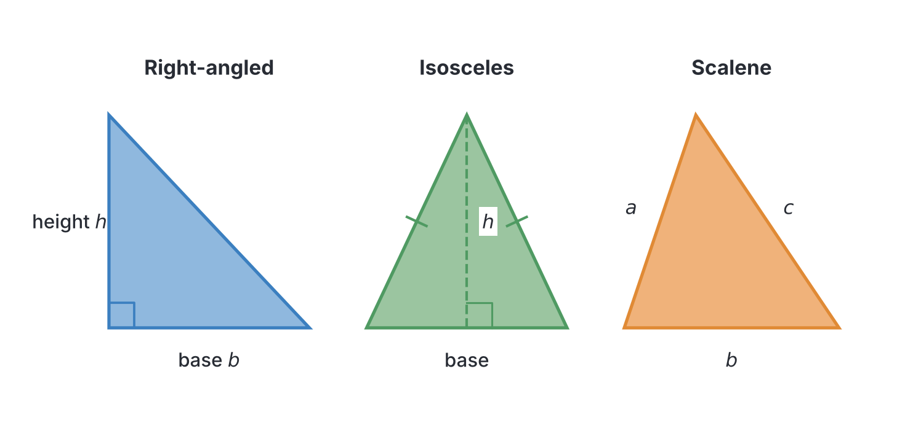
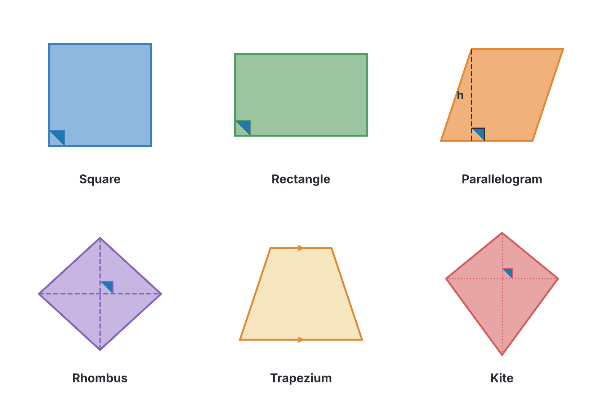
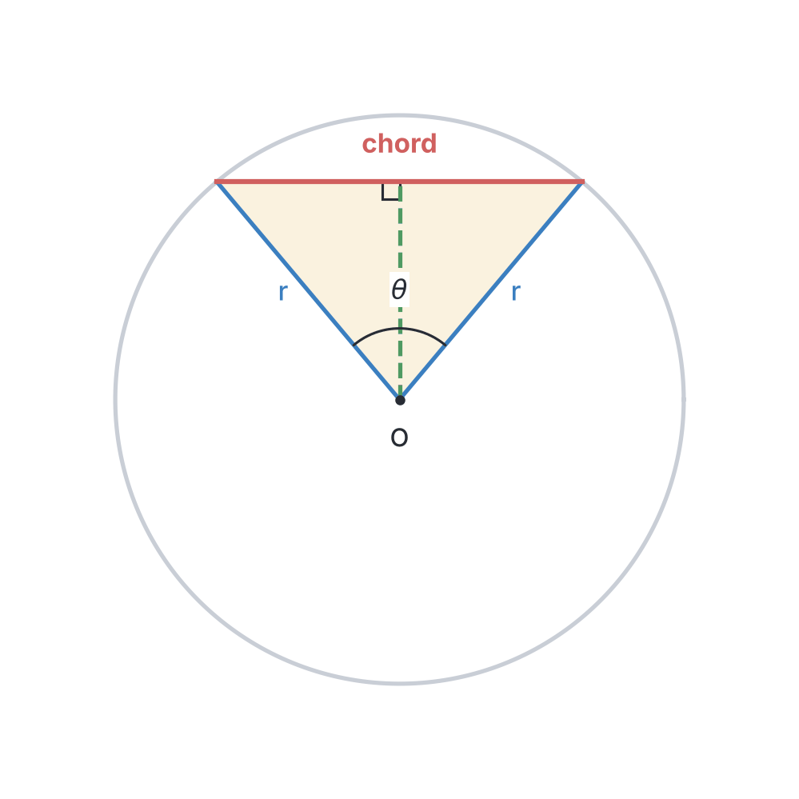
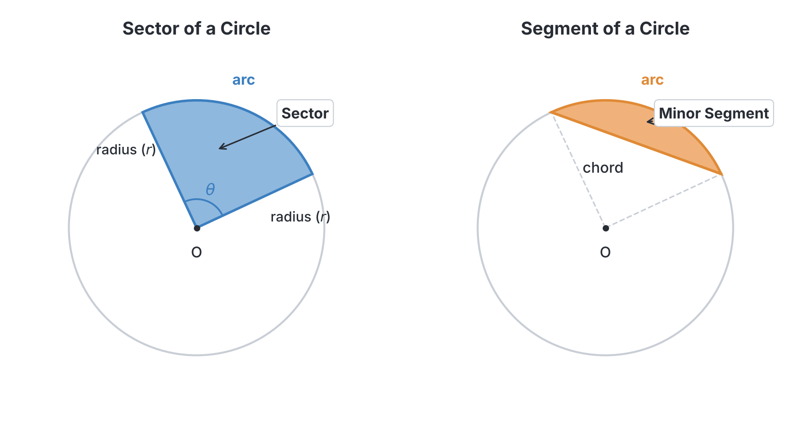
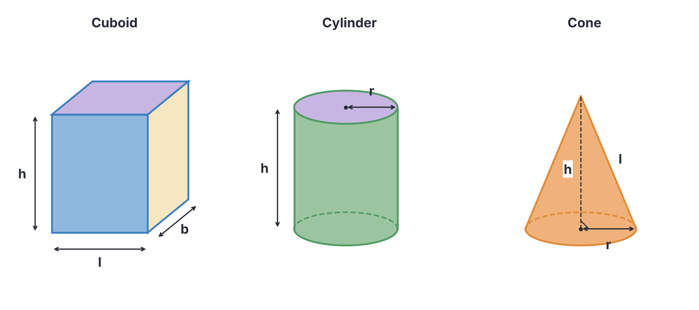
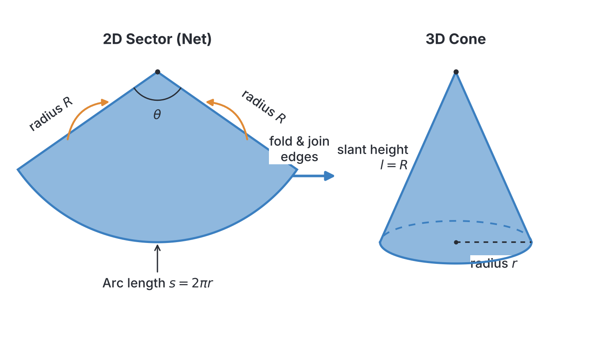
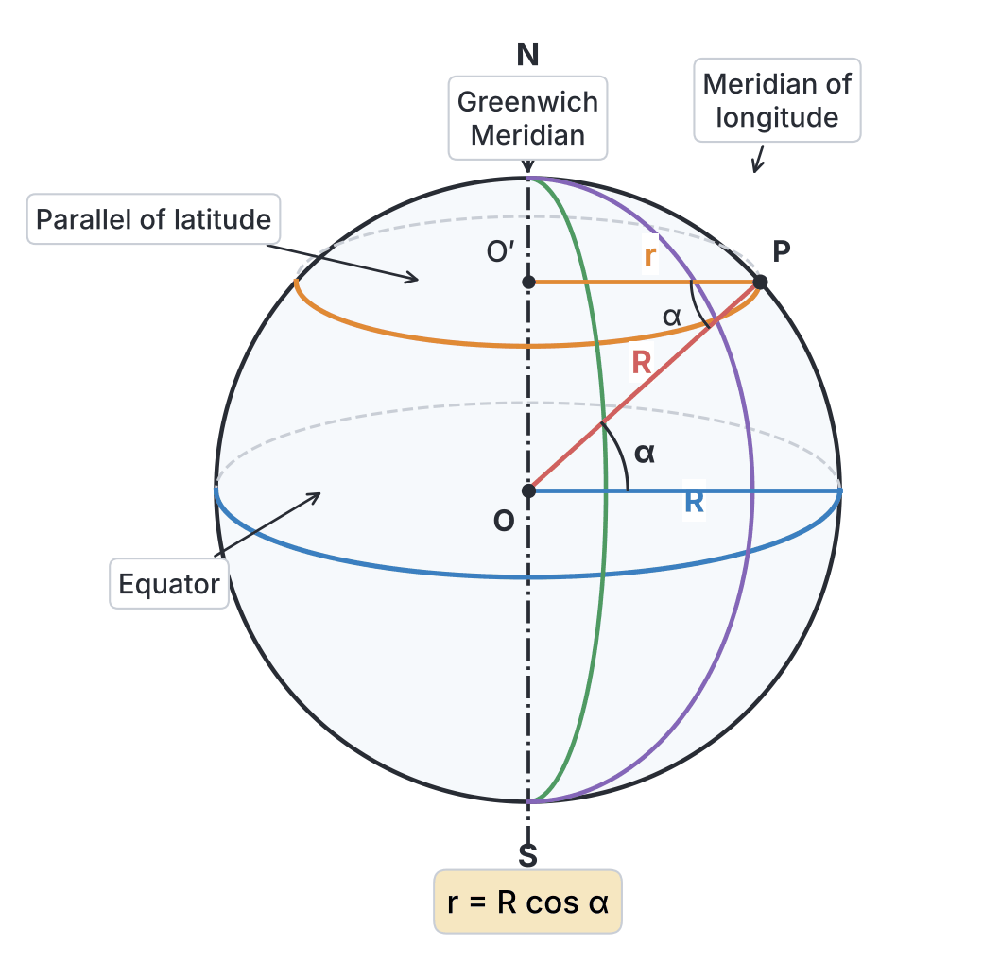

# JAMB Mathematics Notes: Mensuration

## What JAMB expects

This topic is Section III, Topic 2 of the JAMB Mathematics syllabus: Geometry and Trigonometry – Mensuration. It covers the measurement of lengths, areas and volumes of different shapes.

It has five content items:
- **a.** lengths and areas of plane geometrical figures;
- **b.** lengths of arcs and chords of a circle;
- **c.** Perimeters and areas of sectors and segments of circles;
- **d.** surface areas and volumes of simple solids and composite figures;
- **e.** the earth as a sphere: longitudes and latitudes.

By the end of these notes, you should be able to:
1. calculate the perimeters and areas of triangles, quadrilaterals, circles and composite figures;
2. find the length of an arc, a chord, perimeters and areas of sectors and segments of circles;
3. calculate total surface areas and volumes of cuboids, cylinders, cones, pyramids, prisms, spheres and composite figures;
4. determine the distance between two points on the earth’s surface.

**Note on the syllabus wording:** In the original syllabus text, the phrase "cylinders. cones" appears under objective iii. This is a typing error and is read as "cylinders, cones".

---

## Calculating perimeters and areas of plane and composite figures

**Objective i: calculate the perimeters and areas of triangles, quadrilaterals, circles and composite figures.**

### Lengths and areas of plane geometrical figures

**Content a: lengths and areas of plane geometrical figures.**

A **plane figure** is a flat, two-dimensional shape. Its **perimeter** is the total distance around its outside boundary, while its **area** is the amount of flat space it covers. 

#### 1. Triangles
A triangle is a three-sided polygon. The formula you use for its area depends on the information you are given.

* **General formula:** When you know the base and the perpendicular height.
  $$A = \frac{1}{2}bh$$
  where $A$ is the area, $b$ is the base length, and $h$ is the perpendicular height.

* **Heron's formula:** When you know the lengths of all three sides ($a$, $b$, and $c$), but not the height.
  $$A = \sqrt{s(s-a)(s-b)(s-c)}$$
  where $s$ is the **semi-perimeter** (half of the perimeter), calculated as $s = \frac{a + b + c}{2}$.

* **Trigonometric formula:** When you know two sides ($a$ and $b$) and the included angle ($\theta$) between them.
  $$A = \frac{1}{2}ab\sin\theta$$
  *(Note: In the JAMB exam, trigonometric tables or an on-screen calculator will be provided for you to find sine values).*

#### 2. Quadrilaterals
A quadrilateral is a four-sided polygon. The common ones tested by JAMB include:

| Shape | Perimeter Formula | Area Formula | Variables Explained |
| --- | --- | --- | --- |
| **Rectangle** | $P = 2(l + b)$ | $A = l \times b$ | $l$ = length, $b$ = breadth (width) |
| **Square** | $P = 4l$ | $A = l^2$ | $l$ = length of one side |
| **Parallelogram** | $P = 2(a + b)$ | $A = b \times h$ | $a$, $b$ = adjacent sides, $h$ = perpendicular height |
| **Rhombus** | $P = 4l$ | $A = \frac{1}{2}d_1d_2$ | $l$ = side length, $d_1$, $d_2$ = lengths of the diagonals |
| **Trapezium** | $P = a+b+c+d$ | $A = \frac{1}{2}(a+b)h$ | $a$, $b$ = parallel sides, $c$, $d$ = non-parallel sides, $h$ = height |
| **Kite** | $P = 2(a + b)$ | $A = \frac{1}{2}d_1d_2$ | $a$, $b$ = pairs of equal sides, $d_1$, $d_2$ = diagonals |

#### 3. Circles
A circle is a shape where all boundary points are at an equal distance (the **radius**, $r$) from the centre.
- **Diameter:** $d = 2r$
- **Circumference (Perimeter):** $C = 2\pi r \quad \text{or} \quad C = \pi d$
- **Area:** $A = \pi r^2$
where $\pi$ (pi) is a mathematical constant. 
**Textbook variation / Exam rule:** Unless a JAMB question tells you otherwise, always take $\pi = \frac{22}{7}$. Sometimes, questions may instruct you to take $\pi = 3.14$ or $3.142$.

#### 4. Composite Figures
A composite figure is made up of two or more basic shapes joined together. 
- To find the **area**, you split the figure into its basic shapes, calculate their individual areas, and add them together (or subtract if a piece is missing).
- To find the **perimeter**, you add only the lengths of the *outer boundary lines*. Never include lines inside the shape.

---

#### Worked Examples for Objective i

**Example 1: The Area of a Triangle (Heron's Formula)**
A triangular plot of land in Abuja has sides $13\text{ m}$, $14\text{ m}$, and $15\text{ m}$. Calculate its area.
**Working:**
1. Find the semi-perimeter, $s$:
   $$s = \frac{13 + 14 + 15}{2} = \frac{42}{2} = 21$$
2. Apply Heron's formula:
   $$A = \sqrt{21(21-13)(21-14)(21-15)}$$
   $$A = \sqrt{21 \times 8 \times 7 \times 6}$$
3. Simplify the multiplication to find the square root (you can break them down into factors to do this without a calculator):
   $21 = 7 \times 3$; $8 = 4 \times 2$; $7 = 7$; $6 = 3 \times 2$.
   $$A = \sqrt{(7 \times 7) \times (3 \times 3) \times (4) \times (2 \times 2)}$$
   $$A = 7 \times 3 \times 2 \times 2 = 84\text{ m}^2$$

**Example 2: The Area of a Trapezium**
The lengths of the parallel sides of a trapezium are $12\text{ cm}$ and $18\text{ cm}$. If the area is $105\text{ cm}^2$, find the perpendicular height.
**Working:**
1. Write the formula for the area of a trapezium:
   $$A = \frac{1}{2}(a+b)h$$
2. Substitute the given values:
   $$105 = \frac{1}{2}(12+18)h$$
   $$105 = \frac{1}{2}(30)h$$
   $$105 = 15h$$
3. Divide by 15:
   $$h = \frac{105}{15} = 7\text{ cm}$$

**Example 3: Area and Cost of a Composite Figure**
A plot of land in Lagos consists of a rectangle measuring $20\text{ m}$ by $14\text{ m}$, with a semi-circle of diameter $14\text{ m}$ attached outwardly to one of its $14\text{ m}$ sides. If land costs ₦10,000 per square metre, calculate the total cost of the plot. (Take $\pi = \frac{22}{7}$)
**Working:**
1. Split the figure into a rectangle and a semi-circle.
2. Find the area of the rectangle:
   $$\text{Area} = l \times b = 20 \times 14 = 280\text{ m}^2$$
3. Find the area of the semi-circle. Since diameter $d = 14\text{ m}$, the radius $r = 7\text{ m}$.
   $$\text{Area} = \frac{1}{2}\pi r^2 = \frac{1}{2} \times \frac{22}{7} \times 7^2 = \frac{1}{2} \times \frac{22}{7} \times 49$$
   $$\text{Area} = 11 \times 7 = 77\text{ m}^2$$
4. Add the areas together:
   $$\text{Total Area} = 280 + 77 = 357\text{ m}^2$$
5. Multiply by the cost per square metre:
   $$\text{Total Cost} = 357 \times 10,000 = ₦3,570,000$$

> **Common Mistake:** When asked for the *perimeter* of a composite figure, students often wrongly include the inner line where the two shapes meet (in the example above, the $14\text{ m}$ line joining the rectangle and semi-circle). Remember, perimeter is only the outside boundary!

---

## Finding lengths of arcs, chords, perimeters and areas of sectors and segments

**Objective ii: find the length of an arc, a chord, perimeters and areas of sectors and segments of circles.**

### Lengths of arcs and chords of a circle

**Content b: lengths of arcs and chords of a circle.**

When you cut a slice out of a circle, or draw lines across it, you create specific parts:

#### 1. Length of an Arc
An **arc** is a portion of the circumference of a circle. The length of an arc depends on the radius ($r$) and the angle ($\theta$) the arc subtends (creates) at the centre of the circle.
$$L = \frac{\theta}{360^\circ} \times 2\pi r$$
where $L$ is the arc length, and $\theta$ is the central angle in degrees.

#### 2. Length of a Chord
A **chord** is a straight line joining any two points on the circumference of a circle. The longest chord passes through the centre and is called the diameter.
If a chord subtends an angle $\theta$ at the centre of a circle of radius $r$, its length is:
$$L = 2r\sin\left(\frac{\theta}{2}\right)$$
**Why this works:** If you draw a triangle using the two radii and the chord, dropping a perpendicular line from the centre to the chord bisects both the angle (making it $\frac{\theta}{2}$) and the chord. Using basic trigonometry (SOH), the half-chord length is $r\sin(\frac{\theta}{2})$, so the full chord is twice that.

### Perimeters and areas of sectors and segments of circles

**Content c: Perimeters and areas of sectors and segments of circles.**

#### 3. Sector of a Circle
A **sector** is the region bounded by two radii and an arc (it looks like a slice of pizza).
- **Area of a sector:** The sector covers a fraction of the circle's full area.
  $$A = \frac{\theta}{360^\circ} \times \pi r^2$$
- **Perimeter of a sector:** The boundary consists of the arc and two straight radii.
  $$P = L + 2r \quad \text{or} \quad P = \left( \frac{\theta}{360^\circ} \times 2\pi r \right) + 2r$$

#### 4. Segment of a Circle
A **segment** is the region bounded by a chord and an arc. 
- **Area of a segment:** You find this by calculating the area of the entire sector and subtracting the area of the triangle formed by the radii and the chord.
  $$\text{Area of Segment} = \text{Area of Sector} - \text{Area of Triangle}$$
  $$\text{Area} = \left(\frac{\theta}{360^\circ} \times \pi r^2\right) - \left(\frac{1}{2}r^2\sin\theta\right)$$
- **Perimeter of a segment:** The boundary consists of the arc and the straight chord.
  $$P = \text{Arc length} + \text{Chord length}$$
  $$P = \left(\frac{\theta}{360^\circ} \times 2\pi r\right) + 2r\sin\left(\frac{\theta}{2}\right)$$

---

#### Worked Examples for Objective ii

**Example 4: Length of an Arc**
Find the length of an arc of a circle of radius $7\text{ cm}$ if it subtends an angle of $72^\circ$ at the centre. (Take $\pi = \frac{22}{7}$)
**Working:**
1. Write the formula:
   $$L = \frac{\theta}{360^\circ} \times 2\pi r$$
2. Substitute the values:
   $$L = \frac{72}{360} \times 2 \times \frac{22}{7} \times 7$$
3. Simplify the fraction ($\frac{72}{360} = \frac{1}{5}$) and cancel the $7$s:
   $$L = \frac{1}{5} \times 2 \times 22 = \frac{44}{5}$$
   $$L = 8.8\text{ cm}$$

**Example 5: Length of a Chord**
A chord of a circle of radius $10\text{ cm}$ subtends an angle of $120^\circ$ at the centre. Find the length of the chord. (Leave your answer in surd form).
**Working:**
1. Write the formula:
   $$L = 2r\sin\left(\frac{\theta}{2}\right)$$
2. Substitute the values:
   $$L = 2(10)\sin\left(\frac{120^\circ}{2}\right) = 20\sin(60^\circ)$$
3. JAMB requires you to know standard trigonometric surds ($\sin 60^\circ = \frac{\sqrt{3}}{2}$):
   $$L = 20 \times \frac{\sqrt{3}}{2} = 10\sqrt{3}\text{ cm}$$

**Example 6: Area of a Segment**
Calculate the area of a minor segment of a circle of radius $14\text{ cm}$ if the angle subtended at the centre is $90^\circ$. (Take $\pi = \frac{22}{7}$)
**Working:**
1. First, find the area of the sector:
   $$\text{Area of Sector} = \frac{90}{360} \times \frac{22}{7} \times 14^2 = \frac{1}{4} \times \frac{22}{7} \times 196$$
   $$\text{Area of Sector} = \frac{1}{4} \times 22 \times 28 = \frac{616}{4} = 154\text{ cm}^2$$
2. Second, find the area of the triangle:
   $$\text{Area of Triangle} = \frac{1}{2}r^2\sin\theta = \frac{1}{2} \times 14^2 \times \sin(90^\circ)$$
   Since $\sin(90^\circ) = 1$:
   $$\text{Area of Triangle} = \frac{1}{2} \times 196 \times 1 = 98\text{ cm}^2$$
3. Subtract to find the segment area:
   $$\text{Area of Segment} = 154 - 98 = 56\text{ cm}^2$$

---

## Calculating surface areas and volumes of solids

**Objective iii: calculate total surface areas and volumes of cuboids, cylinders, cones, pyramids, prisms, spheres and composite figures.**

### Surface areas and volumes of simple solids and composite figures

**Content d: surface areas and volumes of simple solids and composite figures.**

A **solid** is a three-dimensional shape. 
- **Volume ($V$)** is the amount of 3D space the solid occupies (measured in $\text{cm}^3$, $\text{m}^3$, or litres).
- **Total Surface Area (TSA)** is the total area of all the outside surfaces of the solid added together (measured in $\text{cm}^2$, $\text{m}^2$).
- **Curved Surface Area (CSA)** is the area of the rounded parts of shapes like cylinders, cones, and spheres, excluding the flat bases.

#### 1. Prisms, Cuboids, and Cylinders
A prism is a solid that has the same cross-section all the way through. A cuboid is a rectangular prism, and a cylinder is a circular prism.
- **Volume of any prism:** $V = \text{Area of base} \times \text{length (or height)}$
- **Cuboid:** 
  - $V = l \times b \times h$
  - $TSA = 2(lb + lh + bh)$
- **Cylinder:**
  - $V = \pi r^2 h$
  - $CSA = 2\pi r h$
  - $TSA = 2\pi r h + 2\pi r^2 = 2\pi r(r + h)$ *(Note: If the cylinder is open at one end, like a cup, $TSA = 2\pi r h + \pi r^2$)*.

#### 2. Pyramids and Cones
A pyramid has a polygon base and flat triangular faces that meet at a point (apex). A cone is like a pyramid but with a circular base.
- **Volume of any pyramid:** $V = \frac{1}{3} \times \text{Area of base} \times \text{vertical height}$
- **Pyramid (square/rectangular base):** 
  - Height ($h$) is the straight line from the apex to the centre of the base.
  - Slant height ($l$) is the height measured down the middle of a triangular face. (Do not confuse this with the slant edge along the corner).
- **Cone:**
  - $V = \frac{1}{3}\pi r^2 h$
  - $CSA = \pi r l$
  - $TSA = \pi r l + \pi r^2 = \pi r(r + l)$
  - *Relationship between $r$, $h$, and $l$:* They form a right-angled triangle, so by Pythagoras' theorem, $l = \sqrt{r^2 + h^2}$.

#### 3. Spheres and Hemispheres
A sphere is a perfectly round ball. A hemisphere is exactly half of a sphere.
- **Sphere:**
  - $V = \frac{4}{3}\pi r^3$
  - $TSA = 4\pi r^2$
- **Hemisphere (solid):**
  - $V = \frac{2}{3}\pi r^3$
  - $CSA = 2\pi r^2$ (Just the curved dome part).
  - $TSA = 3\pi r^2$ (The curved dome plus the flat circular base).

#### 4. Composite Solids
Just like 2D composite figures, you can glue solids together. For volume, simply add the volumes. For surface area, add only the exposed outer surfaces (do not include the surfaces hidden where the shapes touch).

---

#### The JAMB Favourite: Folding a Sector into a Cone
A very common UTME question involves folding a flat 2D sector of a circle into a 3D hollow cone. Here is exactly what happens when you fold it:
1. The **radius of the sector ($R$)** becomes the **slant height of the cone ($l$)**. So, $l = R$.
2. The **arc length of the sector** curls around to become the **circumference of the cone's base**. 
   Because of this, you can quickly find the base radius ($r$) of the cone using a simple fraction:
   $$r = \frac{\theta}{360^\circ} \times R$$
   where $\theta$ is the angle of the sector, $R$ is the sector's radius, and $r$ is the cone's radius.
3. Once you have $l$ and $r$, you find the cone's vertical height using Pythagoras: $h = \sqrt{l^2 - r^2}$.

---

#### Worked Examples for Objective iii

**Example 7: Folding a Sector into a Cone**
A sector of a circle of radius $14\text{ cm}$ subtends an angle of $216^\circ$ at the centre. It is folded to form a hollow cone. Find the volume of the cone. (Take $\pi = \frac{22}{7}$)
**Working:**
1. Identify the slant height: 
   The radius of the sector is $14\text{ cm}$, so the slant height of the cone $l = 14\text{ cm}$.
2. Find the base radius ($r$) of the cone using the JAMB shortcut:
   $$r = \frac{216}{360} \times 14$$
   Simplify the fraction ($\frac{216}{360} = \frac{3}{5}$):
   $$r = \frac{3}{5} \times 14 = 8.4\text{ cm}$$
3. Find the vertical height ($h$) using Pythagoras:
   $$h = \sqrt{l^2 - r^2} = \sqrt{14^2 - 8.4^2}$$
   $$h = \sqrt{196 - 70.56} = \sqrt{125.44} = 11.2\text{ cm}$$
4. Calculate the volume:
   $$V = \frac{1}{3}\pi r^2 h = \frac{1}{3} \times \frac{22}{7} \times (8.4)^2 \times 11.2$$
   $$V \approx 827.9\text{ cm}^3$$

**Example 8: Volume of a Pyramid**
Calculate the volume of a square-based pyramid if the side of the square base is $6\text{ cm}$ and the slant height of the triangular faces is $5\text{ cm}$.
**Working:**
1. The volume requires the vertical height ($h$), not the slant height. 
2. Draw a right-angled triangle from the apex to the centre of the base, and out to the middle of a base edge.
   - The hypotenuse is the slant height ($5\text{ cm}$).
   - The base of this triangle is half of the square's side length: $\frac{6}{2} = 3\text{ cm}$.
3. Find $h$ using Pythagoras:
   $$h = \sqrt{5^2 - 3^2} = \sqrt{25 - 9} = \sqrt{16} = 4\text{ cm}$$
4. Find the volume:
   $$V = \frac{1}{3} \times \text{Base Area} \times h = \frac{1}{3} \times (6 \times 6) \times 4$$
   $$V = \frac{1}{3} \times 36 \times 4 = 12 \times 4 = 48\text{ cm}^3$$

**Example 9: Composite Solid (Hemisphere on a Cylinder)**
A solid silo for storing grain in Kano consists of a cylinder of radius $7\text{ m}$ and height $10\text{ m}$, surmounted exactly by a solid hemisphere of radius $7\text{ m}$. Calculate its total surface area. (Take $\pi = \frac{22}{7}$)
**Working:**
1. Identify the exposed outer surfaces: the curved surface of the hemisphere, the curved surface of the cylinder, and the flat bottom base of the cylinder. (Do not include the flat top of the cylinder because it is hidden inside the solid).
2. Curved surface area of hemisphere $= 2\pi r^2$:
   $$2 \times \frac{22}{7} \times 7^2 = 2 \times 22 \times 7 = 308\text{ m}^2$$
3. Curved surface area of cylinder $= 2\pi rh$:
   $$2 \times \frac{22}{7} \times 7 \times 10 = 44 \times 10 = 440\text{ m}^2$$
4. Base area of cylinder $= \pi r^2$:
   $$\frac{22}{7} \times 7^2 = 154\text{ m}^2$$
5. Add them together:
   $$\text{TSA} = 308 + 440 + 154 = 902\text{ m}^2$$

---

## Determining the distance between two points on the earth's surface

**Objective iv: determine the distance between two points on the earth’s surface.**

### The earth as a sphere: longitudes and latitudes

**Content e: the earth as a sphere: longitudes and latitudes.**

In mathematics, we model the Earth as a perfect sphere. Unless stated otherwise, UTME questions expect you to use the Earth's radius as **$R = 6400\text{ km}$**.

Lines drawn on the globe to help locate places are:
- **Latitudes (Parallels):** Imaginary circles running East-West. The **Equator** is Latitude $0^\circ$. Places are measured North ($^\circ\text{N}$) or South ($^\circ\text{S}$) of the Equator.
- **Longitudes (Meridians):** Imaginary semi-circles running North-South from pole to pole. The **Greenwich Meridian** is Longitude $0^\circ$. Places are measured East ($^\circ\text{E}$) or West ($^\circ\text{W}$) of Greenwich.

Every point on Earth is given as a coordinate, e.g., $P(40^\circ\text{N}, 15^\circ\text{E})$, which means $40^\circ$ North latitude and $15^\circ$ East longitude.

#### Great Circles vs Small Circles
To find distances, you must know if you are travelling on a Great Circle or a Small Circle.
1. **Great Circles:** These are circles that have the same centre and radius ($R$) as the Earth itself. The **Equator** is a Great Circle. **All Longitudes (meridians)** are Great Circles.
2. **Small Circles:** These are all the other parallels of latitude (except the Equator). Because they are closer to the poles, they are smaller than the Earth's full size. The radius $r$ of a Small Circle at latitude $\alpha$ is:
   $$r = R \cos \alpha$$

#### Calculating the angle difference ($\theta$)
Whether you are moving along a latitude or a longitude, you must first find the angle difference between the two locations:
- If they are in **different hemispheres** (e.g., North and South, or East and West), **add** the angles.
- If they are in the **same hemisphere** (e.g., North and North, or East and East), **subtract** the smaller angle from the larger one.

#### Calculating Distance
1. **Distance along a Great Circle** (moving North/South along the same longitude, or East/West along the Equator):
   Since the radius is $R$, you are just finding an arc length on the main sphere:
   $$\text{Distance} = \frac{\theta}{360^\circ} \times 2\pi R$$

2. **Distance along a Small Circle** (moving East/West along the same latitude $\alpha$):
   Since the radius of this path is $r = R \cos \alpha$, the arc length formula becomes:
   $$\text{Distance} = \frac{\theta}{360^\circ} \times 2\pi R \cos \alpha$$

---

#### Worked Examples for Objective iv

**Example 10: Distance along a Great Circle (Longitude)**
Two towns $A(40^\circ\text{N}, 10^\circ\text{W})$ and $B(23^\circ\text{S}, 10^\circ\text{W})$ lie on the Earth's surface. Calculate the distance between them along the line of longitude. (Take $R = 6400\text{ km}$, $\pi = \frac{22}{7}$)
**Working:**
1. Check the coordinates: They are on the same longitude ($10^\circ\text{W}$), so they are travelling North-South along a Great Circle.
2. Find the angle difference ($\theta$). Since one is North and one is South, we **add**:
   $$\theta = 40^\circ + 23^\circ = 63^\circ$$
3. Use the Great Circle formula:
   $$\text{Distance} = \frac{\theta}{360^\circ} \times 2\pi R$$
   $$\text{Distance} = \frac{63}{360} \times 2 \times \frac{22}{7} \times 6400$$
4. Simplify the fractions (divide 63 and 360 by 9, to get $\frac{7}{40}$):
   $$\text{Distance} = \frac{7}{40} \times 2 \times \frac{22}{7} \times 6400$$
   The $7$s cancel out:
   $$\text{Distance} = \frac{1}{40} \times 44 \times 6400 = 44 \times 160 = 7040\text{ km}$$

**Example 11: Distance along a Small Circle (Latitude)**
An aeroplane flies due West from town $X(60^\circ\text{N}, 50^\circ\text{E})$ to town $Y(60^\circ\text{N}, 76^\circ\text{W})$. Find the distance covered along the parallel of latitude. (Take $R = 6400\text{ km}$, $\pi = \frac{22}{7}$)
**Working:**
1. Check the coordinates: They are on the same latitude ($60^\circ\text{N}$), which is a Small Circle. The latitude angle $\alpha = 60^\circ$.
2. Find the longitude angle difference ($\theta$). Since one is East and one is West, we **add**:
   $$\theta = 50^\circ + 76^\circ = 126^\circ$$
3. Use the Small Circle formula:
   $$\text{Distance} = \frac{\theta}{360^\circ} \times 2\pi R \cos \alpha$$
   $$\text{Distance} = \frac{126}{360} \times 2 \times \frac{22}{7} \times 6400 \times \cos(60^\circ)$$
4. We know $\cos(60^\circ) = 0.5$ or $\frac{1}{2}$. Simplify $\frac{126}{360}$ by dividing by $18$ to get $\frac{7}{20}$:
   $$\text{Distance} = \frac{7}{20} \times 2 \times \frac{22}{7} \times 6400 \times \frac{1}{2}$$
   The $7$s cancel, and $2 \times \frac{1}{2} = 1$:
   $$\text{Distance} = \frac{1}{20} \times 22 \times 6400 = 22 \times 320 = 7040\text{ km}$$

---

## Key terms

| Term | Meaning |
| --- | --- |
| **Perimeter** | The total distance around the outside boundary of a 2D shape. |
| **Area** | The amount of flat space covered by a 2D shape. |
| **Volume** | The amount of 3D space occupied by a solid shape. |
| **Chord** | A straight line connecting two points on the circumference of a circle. |
| **Sector** | A region of a circle bounded by two radii and an arc (like a pizza slice). |
| **Segment** | A region of a circle bounded by a chord and an arc. |
| **Slant height** | The diagonal height running down the triangular face of a cone or pyramid. |
| **Great Circle** | A circle on a sphere that has the same radius as the sphere (e.g., the Equator, Longitudes). |
| **Small Circle** | A circle on a sphere whose radius is smaller than the sphere's radius (e.g., Parallels of Latitude). |
| **Latitude ($\alpha$)** | Angle showing how far North or South a place is from the Equator. |
| **Longitude** | Angle showing how far East or West a place is from the Greenwich Meridian. |

## Exam tips and common mistakes

- **Check your boundaries in composites:** When calculating the perimeter of composite shapes, do not add inner joining lines. 
- **Identify the height correctly:** For pyramids and cones, pay strict attention to whether the question gives you the *vertical height* ($h$) or the *slant height* ($l$). Use Pythagoras' theorem to find the one you are missing.
- **Sector folded to cone shortcut:** Remember the JAMB lifesaver: $r = \frac{\theta}{360} \times R$.
- **Know when to add or subtract angles in Earth geometry:** East and West? Add. North and South? Add. North and North? Subtract. East and East? Subtract.
- **Do not forget $\cos \alpha$ for small circles:** A very common mistake is using the Great Circle formula for places on the same latitude. Unless the latitude is $0^\circ$ (Equator), you must multiply by $\cos \alpha$.
- **Watch out for units:** JAMB may give dimensions in cm and ask for the volume in litres. Remember that $1000\text{ cm}^3 = 1\text{ litre}$ and $1\text{ m}^3 = 1000\text{ litres}$.
- **Use the provided values:** Always use $\pi = \frac{22}{7}$ and $R = 6400\text{ km}$ unless the question explicitly gives you a different value (like $\pi = 3.142$).

## Quick summary

1. The area of a triangle can be found using $\frac{1}{2}bh$, $\frac{1}{2}ab\sin\theta$, or Heron's formula $\sqrt{s(s-a)(s-b)(s-c)}$.
2. A circle's arc length is $\frac{\theta}{360} \times 2\pi r$, and a chord's length is $2r\sin(\frac{\theta}{2})$.
3. A sector is bounded by radii (area = $\frac{\theta}{360}\pi r^2$), while a segment is bounded by a chord (area = sector area minus triangle area).
4. The volume of prisms and cylinders is $\text{Base Area} \times \text{height}$, while for pyramids and cones it is $\frac{1}{3} \times \text{Base Area} \times \text{height}$.
5. A sphere has volume $\frac{4}{3}\pi r^3$ and surface area $4\pi r^2$. A solid hemisphere has a total surface area of $3\pi r^2$.
6. For Earth geometry, distances along Great Circles (meridians and the equator) use $2\pi R$.
7. Distances along Small Circles (parallels of latitude) require finding the smaller radius first, so the formula uses $2\pi R \cos \alpha$.

## Practice questions

**1. Calculate the perimeter of a sector of a circle of radius 14 cm and angle 90°. (Take $\pi = \frac{22}{7}$)**

- A. 22 cm
- B. 50 cm
- C. 36 cm
- D. 154 cm

**Answer: B.**
1. Find the arc length: $L = \frac{90}{360} \times 2 \times \frac{22}{7} \times 14 = \frac{1}{4} \times 88 = 22\text{ cm}$.
2. The perimeter of a sector includes the arc and the two straight radii. 
3. $P = L + 2r = 22 + 2(14) = 22 + 28 = 50\text{ cm}$.
*(Mistake A is finding only the arc length; Mistake C is adding only one radius).*

**2. Find the area of a rhombus whose diagonals are 10 cm and 24 cm.**

- A. 240 cm²
- B. 120 cm²
- C. 60 cm²
- D. 52 cm²

**Answer: B.**
1. The formula for the area of a rhombus is $A = \frac{1}{2}d_1 d_2$.
2. Substitute the diagonals: $A = \frac{1}{2} \times 10 \times 24 = 5 \times 24 = 120\text{ cm}^2$.
*(Mistake A happens if you forget to multiply by $\frac{1}{2}$; Mistake D is calculating the perimeter).*

**3. A chord of a circle of radius 13 cm is 5 cm from the centre. Find the length of the chord.**

- A. 12 cm
- B. 24 cm
- C. 18 cm
- D. 10 cm

**Answer: B.**
1. Draw a right-angled triangle using the radius (hypotenuse = 13), distance from centre (height = 5), and half the chord (base = $x$).
2. Use Pythagoras: $x^2 + 5^2 = 13^2 \implies x^2 = 169 - 25 = 144 \implies x = 12$.
3. Since $x$ is only half the chord, total length = $12 \times 2 = 24\text{ cm}$.
*(Mistake A is stopping at the half-chord length).*

**4. A sector of a circle of radius 6 cm has an angle of 120°. It is folded to form a cone. Find the base radius of the cone.**

- A. 2 cm
- B. 3 cm
- C. 4 cm
- D. 1 cm

**Answer: A.**
1. Use the JAMB shortcut for folding sectors: $r = \frac{\theta}{360} \times R$.
2. Substitute the values: $r = \frac{120}{360} \times 6$.
3. Simplify: $r = \frac{1}{3} \times 6 = 2\text{ cm}$.

**5. A solid metal cylinder of radius 3 cm and height 4 cm is melted and recast into a solid sphere. Find the radius of the sphere.**

- A. 2 cm
- B. 3 cm
- C. 4 cm
- D. 6 cm

**Answer: B.**
1. Find the volume of the cylinder: $V = \pi r^2 h = \pi \times 3^2 \times 4 = 36\pi\text{ cm}^3$.
2. The volume of the new sphere must equal this: $\frac{4}{3}\pi r^3 = 36\pi$.
3. Cancel $\pi$ on both sides: $\frac{4}{3}r^3 = 36$.
4. Multiply by $\frac{3}{4}$: $r^3 = 36 \times \frac{3}{4} = 27$.
5. Cube root both sides: $r = \sqrt[3]{27} = 3\text{ cm}$.

**6. Two towns X and Y are on the same longitude. Their latitudes are 45°N and 18°S. Calculate the distance between them along the line of longitude. (Take $R = 6400\text{ km}$ and $\pi = \frac{22}{7}$)**

- A. 3,520 km
- B. 7,040 km
- C. 14,080 km
- D. 2,520 km

**Answer: B.**
1. They are on a longitude, which is a Great Circle.
2. Since one is North and one is South, add the latitudes to find the angle: $\theta = 45 + 18 = 63^\circ$.
3. Distance = $\frac{63}{360} \times 2 \times \frac{22}{7} \times 6400$.
4. Simplify: $\frac{7}{40} \times \frac{44}{7} \times 6400 = \frac{1}{40} \times 44 \times 6400 = 44 \times 160 = 7,040\text{ km}$.

**7. Calculate the total surface area of a solid hemisphere of radius 7 cm. (Take $\pi = \frac{22}{7}$)**

- A. 308 cm²
- B. 154 cm²
- C. 462 cm²
- D. 616 cm²

**Answer: C.**
1. The formula for the total surface area of a *solid* hemisphere is $TSA = 3\pi r^2$.
2. Substitute the values: $TSA = 3 \times \frac{22}{7} \times 7^2 = 3 \times \frac{22}{7} \times 49$.
3. Simplify: $3 \times 22 \times 7 = 66 \times 7 = 462\text{ cm}^2$.
*(Mistake A is finding only the curved surface area, $2\pi r^2$; Mistake D is finding the area of a full sphere, $4\pi r^2$).*

**8. Find the area of a regular hexagon inscribed in a circle of radius 8 cm.**

- A. $96\sqrt{3}\text{ cm}^2$
- B. $192\sqrt{3}\text{ cm}^2$
- C. $64\sqrt{3}\text{ cm}^2$
- D. $48\sqrt{3}\text{ cm}^2$

**Answer: A.**
1. A regular hexagon inscribed in a circle is made up of 6 equilateral triangles.
2. The side length of each triangle is equal to the radius of the circle ($8\text{ cm}$).
3. Area of one equilateral triangle using $\frac{1}{2}ab\sin\theta$: $\frac{1}{2} \times 8 \times 8 \times \sin(60^\circ) = 32 \times \frac{\sqrt{3}}{2} = 16\sqrt{3}$.
4. Area of hexagon = $6 \times 16\sqrt{3} = 96\sqrt{3}\text{ cm}^2$.

**9. A rectangular tank has a base measuring 5 m by 4 m. If it contains water to a depth of 2.5 m, calculate the volume of water in litres.**

- A. 5,000 litres
- B. 50,000 litres
- C. 500 litres
- D. 50 litres

**Answer: B.**
1. Find the volume of the water in cubic metres: $V = l \times b \times h = 5 \times 4 \times 2.5 = 50\text{ m}^3$.
2. Convert cubic metres to litres. Remember that $1\text{ m}^3 = 1000\text{ litres}$.
3. Volume in litres = $50 \times 1000 = 50,000\text{ litres}$.
*(Mistake D is failing to convert from cubic metres).*

**10. The lengths of the parallel sides of a trapezium are 9 cm and 15 cm. If its area is 48 cm², find the perpendicular distance between the parallel sides.**

- A. 4 cm
- B. 8 cm
- C. 6 cm
- D. 2 cm

**Answer: A.**
1. Write the formula: $A = \frac{1}{2}(a+b)h$.
2. Substitute the knowns: $48 = \frac{1}{2}(9+15)h$.
3. Simplify the brackets: $48 = \frac{1}{2}(24)h \implies 48 = 12h$.
4. Divide by 12: $h = \frac{48}{12} = 4\text{ cm}$.
