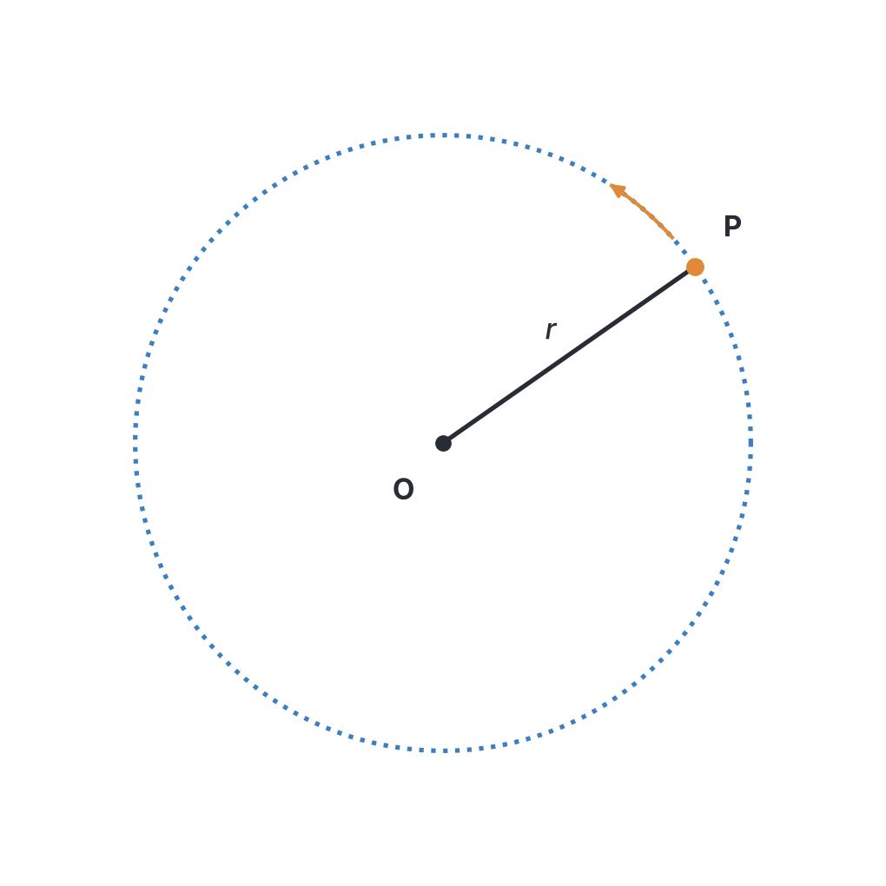
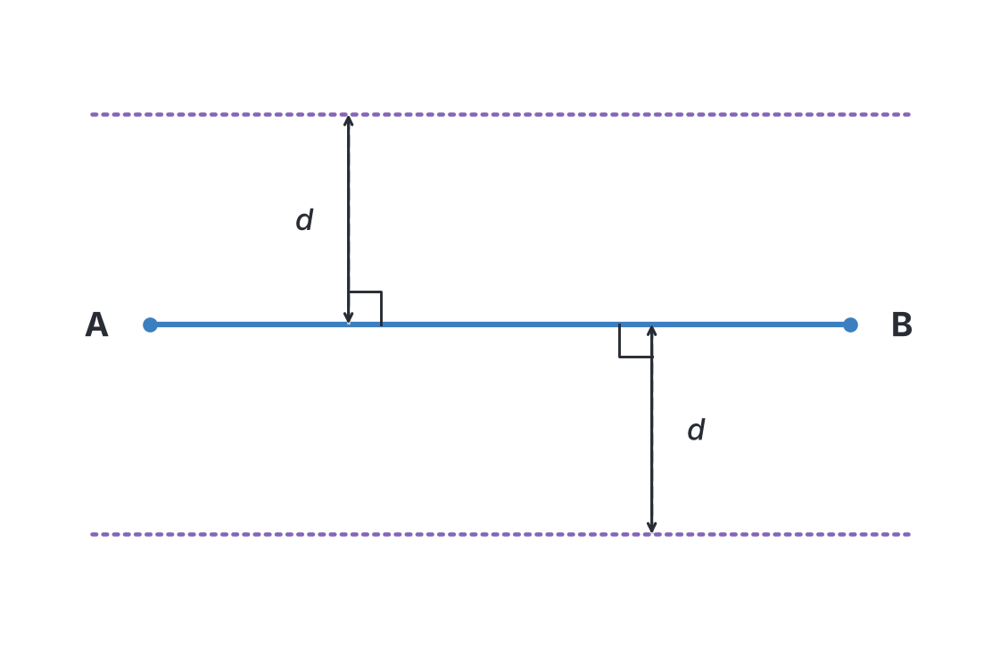
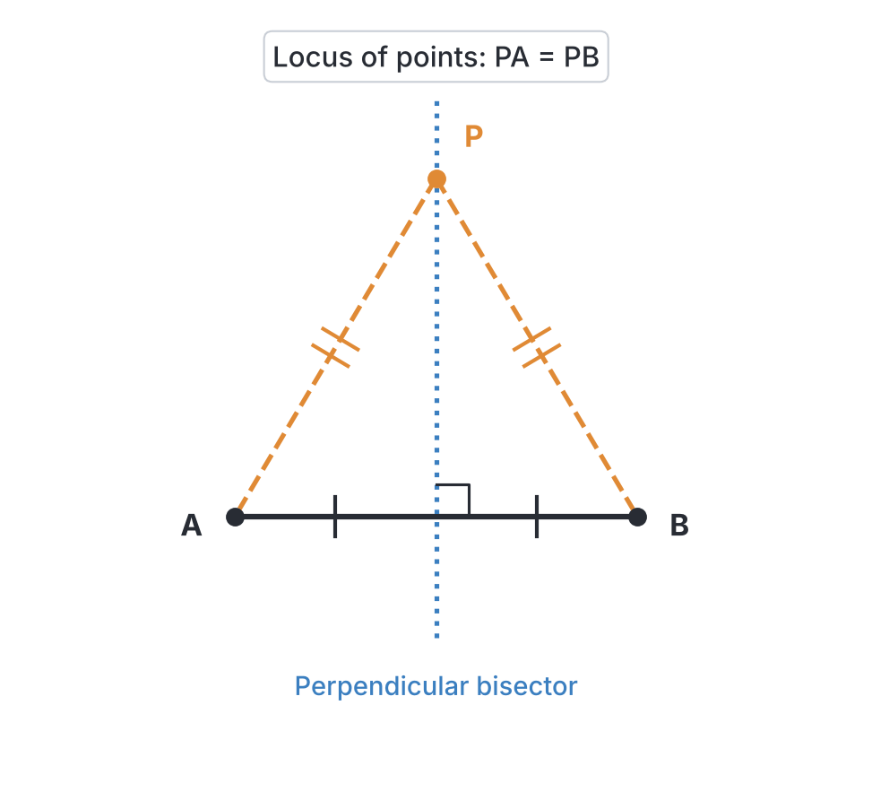
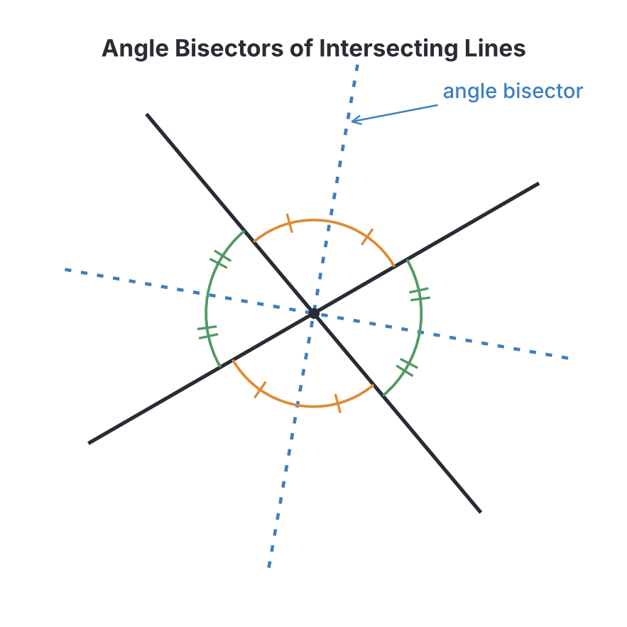

# JAMB Mathematics Notes: Loci

## What JAMB expects

This topic is Section III, Topic 3 of the JAMB Mathematics syllabus: Loci.

**Scope:** Covers the identification and interpretation of loci in two dimensions involving parallel lines, perpendicular bisectors, angle bisectors, and circles.

This file covers the following content and objectives:
- **Content:** Locus in 2 dimensions based on geometric principles relating to lines and curves.
- **Objective:** By the end of these notes, you should be able to identify and interpret loci relating to parallel lines, perpendicular bisectors, angle bisectors and circles.

*(Note on the syllabus wording: The syllabus gives this topic a single, unnumbered objective and a single, unnumbered content item, so they are treated here as the main focus of the notes.)*

## Locus in 2 dimensions based on geometric principles

A **locus** (plural: **loci**) is the path traced out by a moving point that obeys a specific geometrical rule or set of conditions. You can think of it as the footprint left behind by a point as it moves according to a strict mathematical law. 

In two dimensions, this point is restricted to moving on a flat surface (a plane). The path it creates is usually a straight line, a pair of straight lines, or a curve (most commonly a circle).

The study of loci bridges pure geometry (drawing shapes and paths) and coordinate geometry (finding the algebraic equation of the path). In the JAMB UTME, you will be expected to read a rule in English and determine what shape the path forms, or find its algebraic equation using coordinates $(x, y)$.

## Identify and interpret loci relating to parallel lines, perpendicular bisectors, angle bisectors and circles

This section covers the four foundational rules of loci tested by JAMB, along with how to find their equations using coordinate geometry. 

### 1. Loci relating to circles (Constant distance from a fixed point)

**The Rule:** The locus of a point $P$ that moves so that its distance from a fixed point $O$ is always a constant $r$.

**The Path:** A **circle** with its centre at the fixed point $O$ and a radius equal to the constant distance $r$.

**Worked Example 1 (Pure Geometry):**
A goat is tethered to a peg in the middle of a grassy field by a rope $4$ m long. Describe the locus of the farthest points the goat can reach when the rope is fully stretched.
**Solution:**
1. The peg acts as a fixed point. 
2. The fully stretched rope acts as a constant distance of $4$ m. 
3. Therefore, the locus is a **circle of radius 4 m** centered at the peg.

**Worked Example 2 (Coordinate Geometry):**
Find the equation of the locus of a point $P(x,y)$ which is always $5$ units away from the origin.
**Solution:**
1. The origin is the fixed point $O(0,0)$. The constant distance is $r = 5$.
2. Let the moving point be $P(x,y)$. The rule is $PO = 5$.
3. Square both sides to remove the square root later:
   $$PO^2 = 25$$
4. Apply the coordinate distance formula $d^2 = (x_2 - x_1)^2 + (y_2 - y_1)^2$:
   $$(x - 0)^2 + (y - 0)^2 = 25$$
5. Simplify the equation:
   $$x^2 + y^2 = 25$$

**Worked Example 3 (Different fixed point):**
Describe the locus given by the equation $(x - 3)^2 + (y + 2)^2 = 16$.
**Solution:**
1. This matches the standard circle equation $(x - a)^2 + (y - b)^2 = r^2$, where $(a, b)$ is the centre.
2. The fixed point (centre) is $(3, -2)$.
3. The constant distance (radius) squared is $16$, so the radius is $\sqrt{16} = 4$.
4. The locus is a **circle with centre $(3, -2)$ and radius $4$**.

> **Common Mistake:** Forgetting to take the square root of the constant when finding the radius.
> **Wrong Working:** From $x^2 + y^2 = 25$, stating that the radius is $25$.
> **Correct Working:** The radius is $r = \sqrt{25} = 5$.

---

### 2. Loci relating to parallel lines (Constant distance from a straight line)

**The Rule:** The locus of a point $P$ that moves so that it is always at a constant perpendicular distance $d$ from a given straight line $L$.

**The Path:** A **pair of parallel lines**, one on each side of the given line $L$, both at a distance $d$ from it.

**Worked Example 1 (Pure Geometry):**
What is the locus of a point which is always $3$ cm away from a fixed straight line $XY$?
**Solution:**
1. The point can be $3$ cm "above" or "below" the line $XY$.
2. The locus is **two straight lines parallel to $XY$**, one on either side of $XY$, and each at a distance of $3$ cm from $XY$.

**Worked Example 2 (Coordinate Geometry):**
Find the equation of the locus of a point $P(x,y)$ that is always $6$ units away from the $x$-axis.
**Solution:**
1. The $x$-axis is the horizontal line where $y = 0$.
2. To be $6$ units away, the point can either be $6$ units above the axis or $6$ units below it.
3. Therefore, the locus consists of the two horizontal lines **$y = 6$** and **$y = -6$**.

**Worked Example 3 (Equidistant from two parallel lines):**
Find the equation of the locus of a point equidistant from the parallel lines $x = -2$ and $x = 8$.
**Solution:**
1. If a point is equidistant from two parallel lines, its locus is a third line running exactly in the middle of them, parallel to both.
2. Find the midpoint between the $x$-values:
   $$x = \frac{-2 + 8}{2} = \frac{6}{2} = 3$$
3. The locus is the vertical line **$x = 3$**.

> **Common Mistake:** Finding the locus of a point at a constant distance from a line, and only giving one answer.
> **Wrong Working:** The locus of a point $3$ units away from the line $y = 0$ is just the parallel line $y = 3$.
> **Correct Working:** A point can be above or below the line. The locus is the pair of parallel lines $y = 3$ and $y = -3$.

---

### 3. Loci relating to perpendicular bisectors (Equidistant from two fixed points)

**The Rule:** The locus of a point $P$ that moves so that its distance from a fixed point $A$ is always equal to its distance from another fixed point $B$.

**The Path:** The **perpendicular bisector** of the straight line segment joining $A$ and $B$. This means the locus is a straight line that cuts the line $AB$ exactly in half at a $90^\circ$ angle.

**Worked Example 1 (Pure Geometry):**
Two towns, Aba and Owerri, are $60$ km apart. A new telecommunication mast is to be built such that it is exactly the same distance from both towns. Describe the locus of all possible positions for the mast.
**Solution:**
1. The towns act as two fixed points. 
2. The rule asks for points equidistant from these two fixed points.
3. The locus is the **perpendicular bisector of the line joining Aba and Owerri**.

**Worked Example 2 (Coordinate Geometry - Standard Method):**
Find the equation of the locus of a point $P(x, y)$ which is equidistant from the points $A(1, 2)$ and $B(3, 4)$.
**Solution:**
1. State the condition mathematically:
   $$PA = PB$$
2. Square both sides to remove square roots from the distance formula:
   $$PA^2 = PB^2$$
3. Apply the coordinate distance formula:
   $$(x - 1)^2 + (y - 2)^2 = (x - 3)^2 + (y - 4)^2$$
4. Expand the brackets carefully:
   $$x^2 - 2x + 1 + y^2 - 4y + 4 = x^2 - 6x + 9 + y^2 - 8y + 16$$
5. Cancel out $x^2$ and $y^2$ from both sides, and group like terms:
   $$-2x - 4y + 5 = -6x - 8y + 25$$
6. Move all terms to the left side:
   $$(-2x + 6x) + (-4y + 8y) + (5 - 25) = 0$$
7. Simplify:
   $$4x + 4y - 20 = 0$$
8. Divide through by $4$:
   **$x + y - 5 = 0$** (or $x + y = 5$)

**Worked Example 3 (Coordinate Geometry - Shortcut Method):**
We can solve the exact same problem as Example 2 using gradients, because we know the locus is the perpendicular bisector of $AB$.
**Solution:**
1. Find the midpoint of $AB$:
   $$\text{Midpoint} = \left( \frac{1+3}{2}, \frac{2+4}{2} \right) = (2, 3)$$
2. Find the gradient of the line segment $AB$:
   $$m_1 = \frac{4 - 2}{3 - 1} = \frac{2}{2} = 1$$
3. The gradient of the perpendicular bisector ($m_2$) must satisfy $m_1 \times m_2 = -1$:
   $$m_2 = \frac{-1}{1} = -1$$
4. Use the point-gradient equation of a line $y - y_1 = m(x - x_1)$ with the midpoint $(2, 3)$:
   $$y - 3 = -1(x - 2)$$
   $$y - 3 = -x + 2$$
   **$x + y = 5$** (This shortcut is faster if you are confident with coordinate geometry).

> **Common Mistake:** Forgetting how to expand binomials correctly when finding the locus equidistant from two points.
> **Wrong Working:** $(x - 1)^2 = x^2 - 1^2 = x^2 - 1$.
> **Correct Working:** $(x - 1)^2 = (x - 1)(x - 1) = x^2 - 2x + 1$. Always use the pattern $(a - b)^2 = a^2 - 2ab + b^2$.

---

### 4. Loci relating to angle bisectors (Equidistant from two intersecting lines)

**The Rule:** The locus of a point $P$ that moves so that its perpendicular distance from two intersecting straight lines is always equal.

**The Path:** A **pair of angle bisectors**. When two straight lines cross, they form four angles. The locus consists of two lines that cut exactly through the middle of these angles, forming a cross.

**Worked Example 1 (Pure Geometry):**
A gardener wants to lay a water pipe so that it is always equidistant from two straight intersecting boundary walls. Describe the locus of the pipe.
**Solution:**
1. The two walls form an angle.
2. The pipe must run exactly through the middle of this angle to be equidistant from both.
3. The locus is the **bisector of the angle** between the two boundary walls. *(Note: Since the pipe runs inside the garden, we refer to the interior angle bisector in real-life problems, even though the full mathematical locus extends outside to form two lines).*

**Worked Example 2 (Triangles):**
In a triangle $PQR$, what is the locus of a point inside the triangle that is equidistant from the sides $PQ$ and $PR$?
**Solution:**
1. The sides $PQ$ and $PR$ are intersecting lines (meeting at corner $P$).
2. A point equidistant from two intersecting lines lies on their angle bisector.
3. Therefore, the locus inside the triangle is the **bisector of the angle at $P$** (angle $QPR$).

**Worked Example 3 (Coordinate axes):**
What is the locus of points equidistant from the $x$-axis and the $y$-axis?
**Solution:**
1. The axes are two lines intersecting at $90^\circ$ at the origin.
2. The locus is the pair of lines bisecting the angles between them.
3. These lines pass through the origin exactly halfway between the axes (at $45^\circ$ and $135^\circ$).
4. Their equations are **$y = x$** and **$y = -x$**.

> **Common Mistake:** Assuming the locus equidistant from two intersecting lines is just a single line.
> **Wrong Working:** The locus of points equidistant from the $x$-axis and $y$-axis is just the line $y = x$.
> **Correct Working:** Two intersecting lines form four angles. The locus must bisect all of them, resulting in the **pair** of perpendicular lines $y = x$ and $y = -x$.

---

### 5. Combining loci (Intersection)

Often, JAMB will ask you to find points that satisfy **two** conditions at the same time. The solution is to figure out the locus for the first condition, then the locus for the second condition, and find where they **intersect** (cross each other).

**Worked Example 1 (Intersecting Geometry):**
A point $P$ moves such that it is always $5$ cm from a fixed point $O$. Another point $Q$ moves such that it is always $3$ cm from a fixed straight line passing through $O$. How many points satisfy both conditions simultaneously?
**Solution:**
1. The locus of $P$ (constant distance $5$ cm from point $O$) is a **circle of radius $5$ cm** centered at $O$.
2. The locus of $Q$ (constant distance $3$ cm from a line) is a **pair of parallel lines**, $3$ cm away from the fixed line.
3. Since $3$ cm is less than the circle's radius of $5$ cm, the two parallel lines will pass right through the inside of the circle (as secants).
4. Each parallel line will cut the circle in $2$ places.
5. Therefore, there are $2 \times 2 =$ **$4$ points** that satisfy both conditions.

**Worked Example 2 (Finding the exact points):**
Find the coordinates of the points that are equidistant from the $x$-axis and the $y$-axis, and also lie on the circle $x^2 + y^2 = 8$.
**Solution:**
1. From our earlier rule, the locus of points equidistant from the axes is the pair of lines $y = x$ and $y = -x$.
2. We substitute these lines into the circle's equation to find the points of intersection.
3. **If $y = x$:**
   $$x^2 + (x)^2 = 8$$
   $$2x^2 = 8 \implies x^2 = 4 \implies x = 2 \text{ or } -2$$
   If $x = 2$, $y = 2$. If $x = -2$, $y = -2$. The intersection points are $(2,2)$ and $(-2,-2)$.
4. **If $y = -x$:**
   $$x^2 + (-x)^2 = 8$$
   $$2x^2 = 8 \implies x^2 = 4 \implies x = 2 \text{ or } -2$$
   If $x = 2$, $y = -(2) = -2$. If $x = -2$, $y = -(-2) = 2$. The intersection points are $(2,-2)$ and $(-2,2)$.
5. There are **$4$ points** in total: $(2,2)$, $(-2,-2)$, $(2,-2)$, and $(-2,2)$.

**Worked Example 3 (The Ratio Locus - Apollonius Circle):**
*Note: This is a harder, classic JAMB algebraic locus question. If the distances to two fixed points are not equal, but are locked in a specific ratio (like 2:1), the locus forms a circle, not a straight line.*
Find the equation of the locus of a point $P(x,y)$ such that its distance from $A(-2, 0)$ is twice its distance from $B(4, 0)$.
**Solution:**
1. State the condition:
   $$PA = 2 \times PB$$
2. Square both sides (remembering to square the $2$ into a $4$):
   $$PA^2 = 4 \times PB^2$$
3. Apply the distance formula to substitute $PA^2$ and $PB^2$:
   $$(x - (-2))^2 + (y - 0)^2 = 4 [ (x - 4)^2 + (y - 0)^2 ]$$
4. Expand inside the brackets carefully:
   $$x^2 + 4x + 4 + y^2 = 4 [ x^2 - 8x + 16 + y^2 ]$$
5. Multiply the $4$ into the right side:
   $$x^2 + 4x + 4 + y^2 = 4x^2 - 32x + 64 + 4y^2$$
6. Move all terms to the right side so that the $x^2$ term stays positive:
   $$0 = (4x^2 - x^2) + (-32x - 4x) + (64 - 4) + (4y^2 - y^2)$$
   $$0 = 3x^2 - 36x + 60 + 3y^2$$
7. Divide through by the common factor of $3$ and rearrange:
   **$x^2 + y^2 - 12x + 20 = 0$** (which is the algebraic equation of a circle).

> **Common Mistake:** Forgetting to square the ratio multiplier in equations like $PA = 2PB$.
> **Wrong Working:** $PA^2 = 2PB^2 \implies (x - x_1)^2 + (y - y_1)^2 = 2[(x - x_2)^2 + (y - y_2)^2]$.
> **Correct Working:** You must square the $2$ as well. $PA^2 = 4PB^2 \implies (x - x_1)^2 + (y - y_1)^2 = 4[(x - x_2)^2 + (y - y_2)^2]$.

## Key terms

| Term | Meaning |
| --- | --- |
| **Locus** | The path traced by a moving point that obeys a specific mathematical rule. |
| **Loci** | The plural of locus. |
| **Equidistant** | Being at exactly the same distance from two or more points or lines. |
| **Perpendicular bisector** | A straight line that cuts a line segment exactly in half at an angle of $90^\circ$. |
| **Angle bisector** | A straight line that divides an angle into two exactly equal smaller angles. |
| **Intersecting loci** | The specific points where two different loci cross; these points satisfy multiple geometric conditions at the same time. |

## Exam tips and common mistakes

- **Common mistake (Parallel lines):** Forgetting that the locus of a point at a constant distance from a straight line is **two** parallel lines (one on each side), not just one.
- **Common mistake (Angle bisectors):** When lines intersect, they form four angles. The locus of a point equidistant from two intersecting lines is a **pair** of bisecting lines, not just one line.
- **Common mistake (Squaring ratios):** In problems where $PA = 2PB$, students often write $PA^2 = 2PB^2$. You must square the ratio number too: $PA^2 = 4PB^2$.
- **Exam tip:** When asked "how many points" satisfy two conditions simultaneously, draw a quick mental sketch. A circle and a straight line can intersect at $0$, $1$, or $2$ points. Two parallel lines and a circle can intersect at $0$, $2$, $3$, or $4$ points depending on their distances.
- **Exam tip (Coordinate Geometry):** To find the algebraic equation of a locus, always set the moving point as $P(x, y)$ and use the distance formula $d^2 = (x_2 - x_1)^2 + (y_2 - y_1)^2$ to translate the English sentence directly into algebra.

## Quick summary

1. A locus is the footprint or path of a point moving according to a specific geometric rule.
2. The locus of a point at a constant distance from a fixed point is a **circle**.
3. The locus of a point at a constant distance from a given straight line is a **pair of parallel lines**.
4. The locus of a point equidistant from two fixed points is the **perpendicular bisector** of the line segment joining them.
5. The locus of a point equidistant from two intersecting straight lines is the **pair of angle bisectors** of the angles between them.
6. The locus of a point equidistant from two parallel lines is a third line running exactly midway between them, parallel to both.
7. To find points satisfying two conditions simultaneously, find the locus for each condition and identify their points of intersection.
8. The distance formula $d^2 = (x_2 - x_1)^2 + (y_2 - y_1)^2$ is your main algebraic tool for converting loci rules into coordinate geometry equations.

## Practice questions

**1. The locus of a point $P$ which moves so that it is always equidistant from two fixed points $A$ and $B$ is:**

- A. The perpendicular bisector of the line segment $AB$
- B. The angle bisector of $\angle APB$
- C. A circle with diameter $AB$
- D. A line parallel to $AB$

**Answer: A.**
1. Let the two fixed points be $A$ and $B$, and the moving point be $P$.
2. The geometric condition given is that the distance $PA = PB$.
3. Any point $P(x, y)$ that satisfies $PA = PB$ lies on a straight line passing between them.
4. This line passes exactly through the midpoint of the segment $AB$ and is at a $90^\circ$ angle to it, which defines the perpendicular bisector.

**2. The locus of a point moving in a plane such that it is always equidistant from two intersecting straight lines is:**

- A. The perpendicular bisector of the angle between them
- B. A circle passing through their intersection
- C. A pair of lines bisecting the angles between them
- D. A line parallel to both of them

**Answer: C.**
1. Let the two intersecting lines be $L_1$ and $L_2$, intersecting at an angle $\theta$.
2. They form four angles at their intersection (two pairs of vertically opposite angles).
3. The condition is that the perpendicular distance $d_1$ from point $P$ to $L_1$ equals the distance $d_2$ from $P$ to $L_2$, meaning $d_1 = d_2$.
4. The set of points satisfying this forms two perpendicular lines that cut the angles between $L_1$ and $L_2$ exactly in half (the angle bisectors).

**3. What is the locus of a point which is at a constant distance $d$ from a given straight line $L$?**

- A. A single line parallel to $L$ at distance $d$
- B. Two parallel lines, one on each side of $L$, at distance $d$ from $L$
- C. A circle of radius $d$
- D. A perpendicular line to $L$

**Answer: B.**
1. Let the given straight line be $L$.
2. The moving point $P$ must maintain a perpendicular distance of $d$ from $L$.
3. The point $P$ can lie either on one side of $L$ at distance $d$, or on the opposite side at distance $d$.
4. This results in two distinct lines, both parallel to $L$, each given by the equation $y = c \pm d$ (if $L$ is a horizontal line $y = c$). Choosing option A is a common mistake.

**4. A cow is tethered to a stake in the middle of a large field by a rope 8 m long. The locus of the cow when the rope is fully stretched is:**

- A. A circle of diameter 8 m
- B. A circle of radius 8 m
- C. A square of side 8 m
- D. A straight line of length 8 m

**Answer: B.**
1. The stake represents a fixed point $O(x_1, y_1)$.
2. The fully stretched rope acts as a constant maximum distance of $r = 8$ m.
3. The locus condition is that the distance $d$ from the cow to $O$ is strictly $d = 8$.
4. The path of a point maintaining a constant distance $r = 8$ from a fixed point $O$ is geometrically defined as a circle of radius $8$ m.

**5. A point $P$ moves such that it is always 5 cm from a fixed point $O$. Another point $Q$ moves such that it is always 3 cm from a fixed straight line passing through $O$. How many points satisfy both conditions simultaneously?**

- A. 1
- B. 2
- C. 3
- D. 4

**Answer: D.**
1. The locus of $P$ (constant distance $5$ cm from $O$) is a circle of radius $r = 5$ cm centered at $O$.
2. The locus of $Q$ (constant distance $3$ cm from a line through $O$) is two parallel lines, each $3$ cm away from the centre $O$.
3. The perpendicular distance from the centre to each parallel line is $3$ cm, which is less than the radius $r = 5$ cm.
4. Because $3 < 5$, both parallel lines will slice entirely through the circle as secants.
5. Each secant line intersects the circle at $2$ points, giving a total of $2 \times 2 = 4$ intersection points.

**6. Find the equation of the locus of a point equidistant from $P(1, 2)$ and $Q(3, 4)$.**

- A. $x + y = 3$
- B. $x + y = 5$
- C. $x - y = 5$
- D. $y - x = 3$

**Answer: B.**
1. Let the moving point be $(x, y)$. The rule is that the distance squared from $P$ equals the distance squared from $Q$.
2. Substitute into the distance formula: $(x - 1)^2 + (y - 2)^2 = (x - 3)^2 + (y - 4)^2$.
3. Expand both sides: $x^2 - 2x + 1 + y^2 - 4y + 4 = x^2 - 6x + 9 + y^2 - 8y + 16$.
4. Cancel $x^2$ and $y^2$, and group terms: $-2x - 4y + 5 = -6x - 8y + 25$.
5. Bring $x$ and $y$ to the left side: $4x + 4y = 20$.
6. Divide everything by $4$ to simplify: $x + y = 5$.

**7. The locus of a point equidistant from the parallel lines $y = 3$ and $y = -5$ is:**

- A. $x = -1$
- B. $y = -1$
- C. $y = 2$
- D. $x = 2$

**Answer: B.**
1. The locus equidistant from two parallel lines $y = a$ and $y = b$ is a third parallel line running strictly midway between them.
2. The $y$-coordinate of this midway line is the average of the two given lines.
3. Calculate the midpoint: $y = \frac{3 + (-5)}{2} = \frac{-2}{2} = -1$.
4. The equation of the locus is therefore $y = -1$.

**8. Find the equation of the locus of a point $P(x,y)$ such that its distance from the origin is always 6 units.**

- A. $x^2 + y^2 = 6$
- B. $x^2 + y^2 = 12$
- C. $x^2 + y^2 = 36$
- D. $x^2 - y^2 = 36$

**Answer: C.**
1. The origin is the fixed point $(0,0)$. The constant distance is $r = 6$.
2. The required distance squared is $r^2 = 6^2 = 36$.
3. Apply the distance formula for $P(x,y)$ and $(0,0)$: $(x - 0)^2 + (y - 0)^2 = 36$.
4. Simplify to get the standard equation of the circle: $x^2 + y^2 = 36$.

**9. Find the equation of the locus of a point $P(x,y)$ such that its distance from $A(-2, 0)$ is twice its distance from $B(4, 0)$.**

- A. $x^2 + y^2 - 12x + 20 = 0$
- B. $x^2 + y^2 + 12x - 20 = 0$
- C. $3x^2 + 3y^2 - 12x + 20 = 0$
- D. $x^2 + y^2 - 6x + 10 = 0$

**Answer: A.**
1. The mathematical condition is $PA = 2PB$.
2. Square both sides to eliminate square roots: $PA^2 = 4PB^2$. (Failing to square the $2$ is a common mistake).
3. Substitute the distance formula: $(x - (-2))^2 + (y - 0)^2 = 4 [ (x - 4)^2 + (y - 0)^2 ]$.
4. Expand the squared brackets: $x^2 + 4x + 4 + y^2 = 4 [ x^2 - 8x + 16 + y^2 ]$.
5. Multiply the right side by $4$: $x^2 + 4x + 4 + y^2 = 4x^2 - 32x + 64 + 4y^2$.
6. Subtract the left side from the right side to keep $x^2$ positive: $3x^2 - 36x + 60 + 3y^2 = 0$.
7. Divide all terms by $3$ to simplify: $x^2 - 12x + 20 + y^2 = 0$, which is conventionally written as $x^2 + y^2 - 12x + 20 = 0$.

**10. The locus of points equidistant from the lines $y = x$ and $y = -x$ is:**

- A. The $x$-axis only
- B. The $y$-axis only
- C. The $x$-axis and the $y$-axis
- D. The line $y = 2x$

**Answer: C.**
1. The lines $y = x$ and $y = -x$ are two intersecting straight lines passing through the origin.
2. The locus must be the pair of lines bisecting the angles between them.
3. Since $y = x$ and $y = -x$ intersect at the origin at exactly $90^\circ$ and $45^\circ$ relative to the axes, their angle bisectors are exactly horizontal and vertical.
4. The horizontal line passing through the origin is the $x$-axis (where $y = 0$), and the vertical line is the $y$-axis (where $x = 0$).
