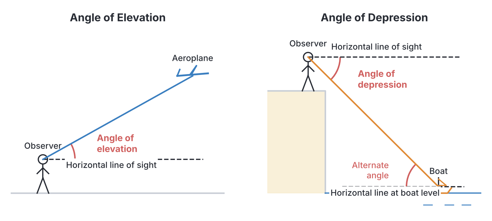
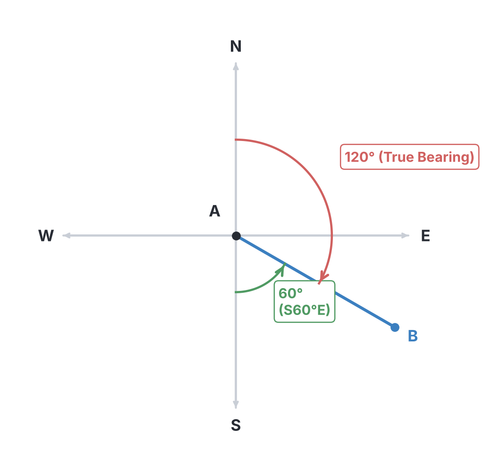
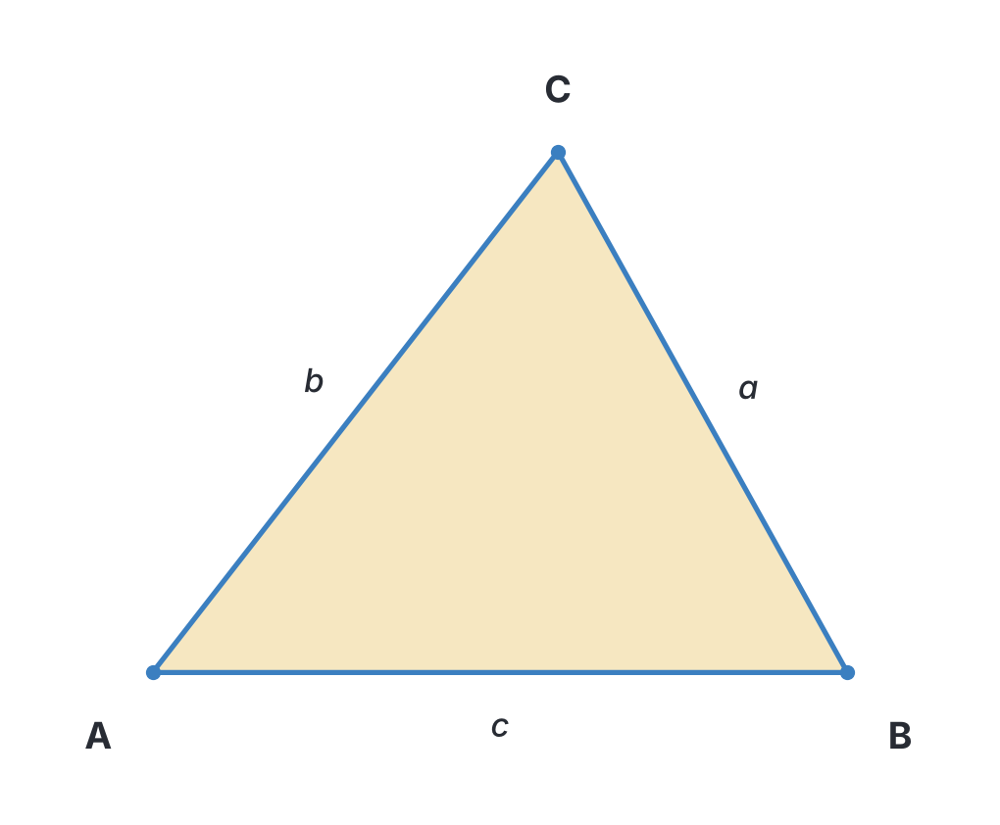
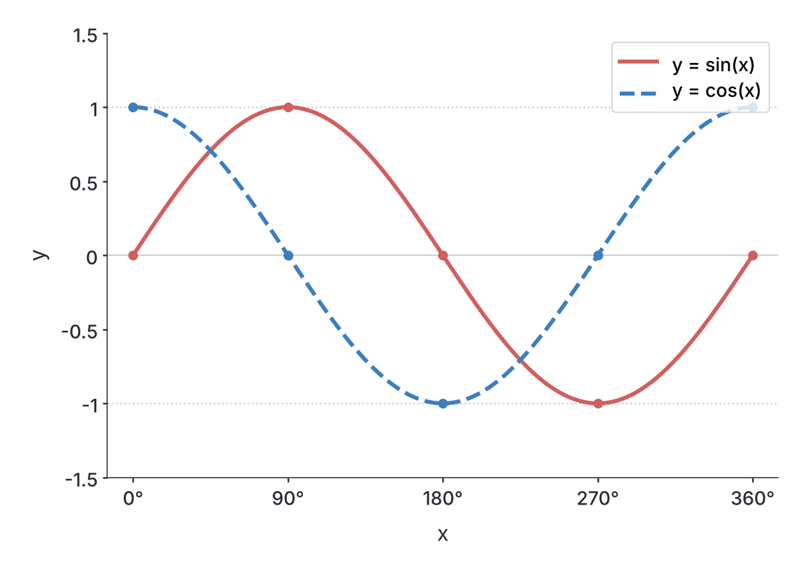

# JAMB Mathematics Notes: Trigonometry

## What JAMB expects

This topic is Topic 5 of Section III: Geometry and Trigonometry in the JAMB Mathematics syllabus. It is one of the most frequently tested topics in the exam.

The syllabus covers the following content items:
- (a) trigonometrical ratios of angles;
- (b) angles of elevation and depression;
- (c) bearings;
- (d) areas and solutions of triangle;
- (e) graphs of sine and cosine;
- (f) sine and cosine formulae.

By the end of these notes, you should be able to:
1. Calculate the sine, cosine and tangent of angles between $-360^\circ \le \theta \le 360^\circ$. (Objective i)
2. Apply special angles (e.g., $30^\circ$, $45^\circ$, $60^\circ$, $75^\circ$, $90^\circ$, $105^\circ$, $135^\circ$) to solve simple problems in trigonometry. (Objective ii)
3. Solve problems involving angles of elevation and depression. (Objective iii)
4. Solve problems involving bearings. (Objective iv)
5. Apply trigonometric formulae to find areas of triangles. (Objective v)
6. Solve problems involving sine and cosine graphs. (Objective vi)

**Note on the syllabus wording:** In the JAMB syllabus, the angle range for Objective i is often printed with a typo (using an 'O' with a tilde instead of the Greek letter theta $\theta$). The correct intended meaning is $-360^\circ \le \theta \le 360^\circ$, which is what we cover here.

---

## Trigonometrical ratios of angles

To understand trigonometry, we start with a right-angled triangle. The three sides of the triangle are named relative to an angle $\theta$:
- **Hypotenuse:** The longest side, directly opposite the $90^\circ$ angle.
- **Opposite:** The side directly facing the angle $\theta$.
- **Adjacent:** The side next to the angle $\theta$ (forming the angle along with the hypotenuse).

The three basic trigonometric ratios are remembered using the acronym **SOH CAH TOA**:

$$ \sin \theta = \frac{\text{Opposite}}{\text{Hypotenuse}} $$
$$ \cos \theta = \frac{\text{Adjacent}}{\text{Hypotenuse}} $$
$$ \tan \theta = \frac{\text{Opposite}}{\text{Adjacent}} $$

### The Four Quadrants and the CAST Rule

While SOH CAH TOA works for acute angles ($0^\circ$ to $90^\circ$), JAMB expects you to evaluate angles up to $360^\circ$ and even negative angles. To do this, we place the angle on a Cartesian coordinate system (an $x$-$y$ graph). Angles are measured **anti-clockwise** starting from the positive $x$-axis.

The plane is divided into four quadrants. The **CAST rule** tells us which trigonometric ratios are positive in each quadrant:
- **1st Quadrant ($0^\circ$ to $90^\circ$):** **A**ll ratios are positive.
- **2nd Quadrant ($90^\circ$ to $180^\circ$):** Only **S**ine is positive.
- **3rd Quadrant ($180^\circ$ to $270^\circ$):** Only **T**angent is positive.
- **4th Quadrant ($270^\circ$ to $360^\circ$):** Only **C**osine is positive.

To find the value of a large angle, we first find its **reference angle** (the acute angle it makes with the $x$-axis) and then apply the correct sign (+ or -) based on the CAST rule:
- In the 2nd quadrant: Reference angle = $180^\circ - \theta$
- In the 3rd quadrant: Reference angle = $\theta - 180^\circ$
- In the 4th quadrant: Reference angle = $360^\circ - \theta$

### Angles outside $0^\circ$ to $360^\circ$ and Negative Angles

- **Angles greater than $360^\circ$:** Subtract $360^\circ$ repeatedly until the angle falls between $0^\circ$ and $360^\circ$.
- **Negative angles:** A negative angle means it is measured **clockwise**. You can either add $360^\circ$ to turn it into a positive angle, or use these rules:
  - $\sin(-\theta) = -\sin \theta$
  - $\cos(-\theta) = \cos \theta$
  - $\tan(-\theta) = -\tan \theta$

**Common mistake:** Assuming $\cos(-\theta)$ is negative. Because a negative angle falls into the 4th quadrant (where cosine is positive), $\cos(-\theta)$ is exactly the same as $\cos \theta$.

### Worked Examples

**1. Evaluate $\sin 300^\circ$.**
1. Identify the quadrant: $300^\circ$ is between $270^\circ$ and $360^\circ$, so it is in the 4th quadrant.
2. In the 4th quadrant, Sine is negative (only Cosine is positive).
3. Find the reference angle: $360^\circ - 300^\circ = 60^\circ$.
4. Therefore, $\sin 300^\circ = -\sin 60^\circ = -\frac{\sqrt{3}}{2}$.

**2. Evaluate $\cos(-240^\circ)$.**
1. A negative angle means we can add $360^\circ$ to find its equivalent positive angle: $-240^\circ + 360^\circ = 120^\circ$.
2. Identify the quadrant: $120^\circ$ is in the 2nd quadrant.
3. In the 2nd quadrant, Cosine is negative.
4. Find the reference angle: $180^\circ - 120^\circ = 60^\circ$.
5. Therefore, $\cos(-240^\circ) = \cos 120^\circ = -\cos 60^\circ = -\frac{1}{2}$.

**3. Given that $\sin \theta = \frac{4}{5}$ and $\theta$ is an obtuse angle, find the value of $\tan \theta$.**
1. "Obtuse" means the angle is between $90^\circ$ and $180^\circ$ (2nd quadrant).
2. In the 2nd quadrant, Tangent is negative.
3. Using a right-angled triangle, if $\sin \theta = \frac{\text{Opp}}{\text{Hyp}} = \frac{4}{5}$, then the Opposite side is $4$ and the Hypotenuse is $5$.
4. Use Pythagoras' theorem to find the Adjacent side: $\text{Adj} = \sqrt{5^2 - 4^2} = \sqrt{25 - 16} = \sqrt{9} = 3$.
5. Now, find the tangent: $\tan \theta = \frac{\text{Opp}}{\text{Adj}} = \frac{4}{3}$.
6. Apply the negative sign for the 2nd quadrant: $\tan \theta = -\frac{4}{3}$.

---

## Special angles and their applications

JAMB expects you to know the exact values (in surd or fraction form) of the special angles $30^\circ$, $45^\circ$, and $60^\circ$ by heart. You will not have a calculator, so memorising these is essential.

| Angle | $\sin \theta$ | $\cos \theta$ | $\tan \theta$ |
| --- | --- | --- | --- |
| **$0^\circ$** | $0$ | $1$ | $0$ |
| **$30^\circ$** | $\frac{1}{2}$ | $\frac{\sqrt{3}}{2}$ | $\frac{1}{\sqrt{3}}$ (or $\frac{\sqrt{3}}{3}$) |
| **$45^\circ$** | $\frac{\sqrt{2}}{2}$ | $\frac{\sqrt{2}}{2}$ | $1$ |
| **$60^\circ$** | $\frac{\sqrt{3}}{2}$ | $\frac{1}{2}$ | $\sqrt{3}$ |
| **$90^\circ$** | $1$ | $0$ | Undefined |

### Finding $75^\circ$, $105^\circ$, and $135^\circ$
The syllabus also lists $75^\circ$, $105^\circ$, and $135^\circ$. 
- **For $135^\circ$:** This is just $180^\circ - 45^\circ$ (a 2nd quadrant angle with a reference angle of $45^\circ$). So, $\sin 135^\circ = \sin 45^\circ$, and $\cos 135^\circ = -\cos 45^\circ$.
- **For $75^\circ$ and $105^\circ$:** Since $75^\circ = 45^\circ + 30^\circ$ and $105^\circ = 60^\circ + 45^\circ$, we use the **compound angle formulae**:
  - $\sin(A \pm B) = \sin A \cos B \pm \cos A \sin B$
  - $\cos(A \pm B) = \cos A \cos B \mp \sin A \sin B$

*(Notice that for cosine, the sign in the middle flips: a plus becomes a minus, and a minus becomes a plus).*

### Worked Examples

**1. Evaluate $\sin 135^\circ \times \cos 60^\circ$.**
1. Evaluate $\sin 135^\circ$. It is in the 2nd quadrant where sine is positive. Reference angle $= 180^\circ - 135^\circ = 45^\circ$. Thus, $\sin 135^\circ = \sin 45^\circ = \frac{\sqrt{2}}{2}$.
2. Recall from the table that $\cos 60^\circ = \frac{1}{2}$.
3. Multiply them together: $\frac{\sqrt{2}}{2} \times \frac{1}{2} = \frac{\sqrt{2}}{4}$.

**2. Find the exact value of $\cos 105^\circ$ without using tables.**
1. Express $105^\circ$ as a sum of special angles: $105^\circ = 60^\circ + 45^\circ$.
2. Apply the compound angle formula: $\cos(A + B) = \cos A \cos B - \sin A \sin B$.
3. Substitute the angles: $\cos(60^\circ + 45^\circ) = \cos 60^\circ \cos 45^\circ - \sin 60^\circ \sin 45^\circ$.
4. Put in the known values: $(\frac{1}{2} \times \frac{\sqrt{2}}{2}) - (\frac{\sqrt{3}}{2} \times \frac{\sqrt{2}}{2})$.
5. Multiply the fractions: $\frac{\sqrt{2}}{4} - \frac{\sqrt{6}}{4}$.
6. Combine into one fraction: $\frac{\sqrt{2} - \sqrt{6}}{4}$.

**3. Simplify $\frac{\sin 60^\circ + \cos 30^\circ}{\tan 45^\circ}$.**
1. Write down the values: $\sin 60^\circ = \frac{\sqrt{3}}{2}$, $\cos 30^\circ = \frac{\sqrt{3}}{2}$, and $\tan 45^\circ = 1$.
2. Substitute them into the expression: $\frac{\frac{\sqrt{3}}{2} + \frac{\sqrt{3}}{2}}{1}$.
3. Add the numerator: $\frac{\sqrt{3}}{2} + \frac{\sqrt{3}}{2} = \frac{2\sqrt{3}}{2} = \sqrt{3}$.
4. Divide by 1: The final answer is $\sqrt{3}$.

---

## Angles of elevation and depression

Trigonometry is very useful for finding the heights of objects (like trees or towers) or distances without measuring them directly.

- **Angle of elevation:** The angle formed by looking **up** at an object from a horizontal line.
- **Angle of depression:** The angle formed by looking **down** at an object from a horizontal line.

Because the horizontal lines at the top and bottom are parallel, the **angle of elevation is always equal to the angle of depression** (they form alternate interior angles, or Z-angles).

**Common mistake:** Students often measure the angle of depression from the vertical wall or cliff instead of drawing a horizontal line first. Always draw a dashed horizontal line from the observer's eye before marking the angle.

### Worked Examples

**1. From a point 20 m away from the base of a tower, the angle of elevation of the top is $45^\circ$. Find the height of the tower.**
1. Draw a right-angled triangle. The base (Adjacent) is $20 \text{ m}$, the angle is $45^\circ$, and the height (Opposite) is $h$.
2. Choose the correct ratio: SOH CAH **TOA**. We need $\tan$.
3. Write the equation: $\tan 45^\circ = \frac{h}{20}$.
4. We know $\tan 45^\circ = 1$. So, $1 = \frac{h}{20}$.
5. Multiply both sides by 20: $h = 20 \text{ m}$.

**2. A man 1.8 m tall observes a bird at the top of a tree 15 m away. The angle of elevation from his eyes to the bird is $30^\circ$. Find the total height of the tree.**
1. The triangle starts from the man's eye level. Base (Adjacent) = $15 \text{ m}$, angle = $30^\circ$. Let the height from eye level to the bird be $x$.
2. Use tangent: $\tan 30^\circ = \frac{x}{15}$.
3. Substitute the value: $\frac{\sqrt{3}}{3} = \frac{x}{15}$.
4. Solve for $x$: $x = 15 \times \frac{\sqrt{3}}{3} = 5\sqrt{3} \text{ m}$.
5. Add the man's height to get the total height of the tree: Total height = $1.8 + 5\sqrt{3} \text{ m}$.

**3. The angle of depression of a boat from the top of a 50 m cliff is $60^\circ$. How far is the boat from the base of the cliff?**
1. If the angle of depression from the top is $60^\circ$, then the angle of elevation from the boat to the top of the cliff is also $60^\circ$.
2. In our triangle, the height (Opposite) is $50 \text{ m}$, the angle is $60^\circ$, and the distance (Adjacent) is $d$.
3. Use tangent: $\tan 60^\circ = \frac{50}{d}$.
4. Substitute the value: $\sqrt{3} = \frac{50}{d}$.
5. Solve for $d$: $d = \frac{50}{\sqrt{3}}$.
6. Rationalise the denominator (multiply top and bottom by $\sqrt{3}$): $d = \frac{50\sqrt{3}}{3} \text{ m}$.

---

## Bearings

A bearing is an angle used to describe direction in navigation. There are two main ways to express bearings:

1. **True Bearings (Three-Figure Bearings):** Always measured from the North line, in a **clockwise** direction. It must always be written with three digits. For example, $045^\circ$, $090^\circ$, $315^\circ$.
2. **Compass Bearings:** Starts with North (N) or South (S), followed by an acute angle, and ends with East (E) or West (W). For example, N40°E means "start at North and turn $40^\circ$ towards East." S30°W means "start at South and turn $30^\circ$ towards West."

**Back Bearings (Reverse Bearings):**
If town B is on a certain bearing from town A, the direction from B back to A is called the back bearing.
- If the original bearing is less than $180^\circ$, **add $180^\circ$**.
- If the original bearing is greater than or equal to $180^\circ$, **subtract $180^\circ$**.

### Worked Examples

**1. Convert S40°W to a true bearing.**
1. Draw a quick compass cross. Start at South and turn $40^\circ$ towards West.
2. A true bearing starts from North and goes clockwise.
3. From North to South is $180^\circ$. Continuing $40^\circ$ past South gives $180^\circ + 40^\circ = 220^\circ$.
4. The true bearing is $220^\circ$.

**2. Town B is on a bearing of $150^\circ$ from Town A. What is the bearing of Town A from Town B?**
1. The initial bearing ($150^\circ$) is less than $180^\circ$.
2. To find the back bearing, simply add $180^\circ$.
3. $150^\circ + 180^\circ = 330^\circ$.

**3. A girl walks 8 km due North from point P, then turns and walks 6 km due East to reach point Q. Find her distance and bearing from the starting point P.**
1. **Draw the diagram:** The path goes North then East, forming a right-angled triangle where the legs are 8 km and 6 km.
2. **Find the distance (PQ):** Use Pythagoras' theorem. $PQ^2 = 8^2 + 6^2 = 64 + 36 = 100$. So, $PQ = \sqrt{100} = 10 \text{ km}$.
3. **Find the bearing:** Let $\theta$ be the angle inside the triangle at point P (between the North line and her direct path).
4. $\tan \theta = \frac{\text{Opp}}{\text{Adj}} = \frac{6}{8} = 0.75$.
5. Because this angle is measured directly from North towards East, the bearing is the angle whose tangent is 0.75 (written as $\tan^{-1}(0.75)$). If you had tables, it would be approximately $037^\circ$. In a non-calculator JAMB question, the options will often leave it in the inverse tangent form or give angles that result in standard values.

---

## Sine and cosine formulae and solutions of triangles

For triangles that do not have a $90^\circ$ angle, we cannot use SOH CAH TOA or standard Pythagoras directly. Instead, we use the Sine Rule and the Cosine Rule.

By convention, angles are labelled with capital letters ($A$, $B$, $C$) and the sides directly opposite them are labelled with the corresponding lowercase letters ($a$, $b$, $c$).

### The Sine Rule
The Sine Rule states that the ratio of a side to the sine of its opposite angle is constant for all three sides:

$$ \frac{a}{\sin A} = \frac{b}{\sin B} = \frac{c}{\sin C} $$

**When to use it:** 
- When you are given **two angles and one side**, and you need to find another side.
- When you are given **two sides and a non-included angle**, and you need to find another angle.

### The Cosine Rule
The Cosine Rule is an extension of Pythagoras' theorem:

$$ c^2 = a^2 + b^2 - 2ab \cos C $$

*(This formula can be rewritten for any side, e.g., $a^2 = b^2 + c^2 - 2bc \cos A$)*.

**When to use it:**
- When you are given **two sides and the included angle** (the angle between them), and you need to find the third side.
- When you are given **all three sides**, and you need to find an angle.

### Worked Examples

**1. In $\Delta ABC$, $A = 45^\circ$, $B = 60^\circ$, and side $a = 10 \text{ cm}$. Find the length of side $b$.**
1. We have two angles and a side. We use the Sine Rule: $\frac{a}{\sin A} = \frac{b}{\sin B}$.
2. Substitute the values: $\frac{10}{\sin 45^\circ} = \frac{b}{\sin 60^\circ}$.
3. Rearrange to make $b$ the subject: $b = \frac{10 \times \sin 60^\circ}{\sin 45^\circ}$.
4. Insert the special angle values: $b = \frac{10 \times (\frac{\sqrt{3}}{2})}{\frac{\sqrt{2}}{2}}$.
5. The denominators (2) cancel out: $b = 10 \frac{\sqrt{3}}{\sqrt{2}}$.
6. Rationalise the denominator: $b = \frac{10\sqrt{6}}{2} = 5\sqrt{6} \text{ cm}$.

**2. In $\Delta PQR$, $p = 5 \text{ cm}$, $q = 7 \text{ cm}$, and $\angle R = 60^\circ$. Find the length of $r$.**
1. We have two sides and the included angle. We use the Cosine Rule: $r^2 = p^2 + q^2 - 2pq \cos R$.
2. Substitute the values: $r^2 = 5^2 + 7^2 - 2(5)(7)\cos 60^\circ$.
3. Compute the squares and insert the cosine value: $r^2 = 25 + 49 - 70(\frac{1}{2})$.
4. Simplify: $r^2 = 74 - 35 = 39$.
5. Take the square root: $r = \sqrt{39} \text{ cm}$.

**3. Two ships leave a port at the same time. Ship A travels at 10 km/h on a bearing of $030^\circ$, and Ship B travels at 15 km/h on a bearing of $150^\circ$. Find the distance between them after 2 hours.**
1. First, find the distance each ship has travelled: 
   Ship A distance = $10 \text{ km/h} \times 2 \text{ h} = 20 \text{ km}$.
   Ship B distance = $15 \text{ km/h} \times 2 \text{ h} = 30 \text{ km}$.
2. Draw the diagram from the port (P). The angle between their paths is the difference in their bearings: $150^\circ - 30^\circ = 120^\circ$.
3. You now have a triangle with two sides (20 and 30) and the included angle ($120^\circ$). We want the opposite side $d$. Use the Cosine Rule.
4. $d^2 = 20^2 + 30^2 - 2(20)(30)\cos 120^\circ$.
5. Remember that $\cos 120^\circ$ is in the 2nd quadrant, so it is negative: $-\cos 60^\circ = -0.5$.
6. $d^2 = 400 + 900 - 1200(-0.5) = 1300 + 600 = 1900$.
7. $d = \sqrt{1900} = 10\sqrt{19} \text{ km}$.

---

## Area of a triangle

You are familiar with the basic formula for the area of a right-angled triangle: Area = $\frac{1}{2} \times \text{base} \times \text{height}$.
However, if you do not have the vertical height but you have **two sides and the included angle**, you use the trigonometric formula:

$$ \text{Area} = \frac{1}{2}ab \sin C $$

*(Equally, you can use $\frac{1}{2}bc \sin A$ or $\frac{1}{2}ac \sin B$, depending on which angle and sides you are given).*

### Worked Examples

**1. Find the area of a triangle with sides 8 cm and 12 cm, and an included angle of $30^\circ$.**
1. Identify the given values: $a = 8$, $b = 12$, $C = 30^\circ$.
2. Use the formula: Area = $\frac{1}{2}ab \sin C$.
3. Substitute: Area = $\frac{1}{2} \times 8 \times 12 \times \sin 30^\circ$.
4. Insert the value of $\sin 30^\circ$: Area = $48 \times 0.5$.
5. Area = $24 \text{ cm}^2$.

**2. The area of $\Delta XYZ$ is $24 \text{ cm}^2$. If $x = 8 \text{ cm}$ and $y = 12 \text{ cm}$, find the acute angle $Z$.**
1. Write the formula using the given letters: Area = $\frac{1}{2}xy \sin Z$.
2. Substitute known values: $24 = \frac{1}{2} \times 8 \times 12 \times \sin Z$.
3. Simplify: $24 = 48 \sin Z$.
4. Divide both sides by 48: $\sin Z = \frac{24}{48} = 0.5$.
5. Since we need an acute angle, $Z = 30^\circ$.

**3. A parallelogram ABCD has adjacent sides 5 cm and 10 cm, with an angle of $150^\circ$ between them. Find its area.**
1. A parallelogram is made up of two identical triangles. The area of one triangle is $\frac{1}{2}ab \sin C$.
2. Therefore, the total area of the parallelogram is simply $ab \sin C$.
3. Area = $5 \times 10 \times \sin 150^\circ$.
4. The angle $150^\circ$ is in the 2nd quadrant where sine is positive. Reference angle is $180^\circ - 150^\circ = 30^\circ$. So, $\sin 150^\circ = \sin 30^\circ = 0.5$.
5. Area = $50 \times 0.5 = 25 \text{ cm}^2$.

---

## Graphs of sine and cosine

JAMB occasionally sets questions based on the visual properties of trigonometric graphs. 

Let us look at the standard equations $y = \sin x$ and $y = \cos x$ for $0^\circ \le x \le 360^\circ$:
- **Amplitude:** The maximum distance the wave rises above or drops below the centre line. For basic sine and cosine graphs, the amplitude is **1**. (The max value is 1, the min value is -1).
- **Period:** The length of one complete cycle of the wave before it starts repeating. For basic sine and cosine, the period is **$360^\circ$**.
- **Intercepts:** 
  - $y = \sin x$ crosses the x-axis ($y=0$) at $0^\circ$, $180^\circ$, and $360^\circ$.
  - $y = \cos x$ crosses the x-axis ($y=0$) at $90^\circ$ and $270^\circ$.

**Transformations (Simple cases only):**
If the equation is written as $y = A \sin(Bx)$:
- The **Amplitude** becomes $|A|$.
- The **Period** becomes $\frac{360^\circ}{B}$.

### Worked Examples

**1. Find the amplitude and period of the function $y = 4 \cos(3x)$.**
1. The number multiplying the cosine function represents the amplitude. Amplitude = $|4| = 4$.
2. The number multiplying $x$ determines the period. Period = $\frac{360^\circ}{3} = 120^\circ$.

**2. What is the maximum value of $y = 5 - 2\sin x$?**
1. The sine function, $\sin x$, fluctuates between $-1$ and $1$.
2. To make $y$ as large as possible, we need to subtract the smallest possible number (or rather, subtract a negative number). This happens when $\sin x = -1$.
3. Substitute $-1$ into the equation: $y = 5 - 2(-1) = 5 + 2 = 7$.
4. The maximum value is $7$.

**3. At what points in $0^\circ \le x \le 360^\circ$ do the graphs of $y = \sin x$ and $y = \cos x$ intersect?**
1. They intersect where $\sin x = \cos x$.
2. Divide both sides by $\cos x$: $\frac{\sin x}{\cos x} = 1$, which gives $\tan x = 1$.
3. Tangent is positive in the 1st and 3rd quadrants.
4. In the 1st quadrant: $x = 45^\circ$.
5. In the 3rd quadrant (reference angle $45^\circ$): $x = 180^\circ + 45^\circ = 225^\circ$.
6. The points of intersection are at $x = 45^\circ$ and $x = 225^\circ$.

---

## Key terms

| Term | Meaning |
| --- | --- |
| Hypotenuse | The longest side of a right-angled triangle, opposite the $90^\circ$ angle |
| Reference angle | The acute angle a given angle makes with the $x$-axis on a Cartesian plane |
| Angle of elevation | The angle measured looking upwards from the horizontal |
| Angle of depression | The angle measured looking downwards from the horizontal |
| True Bearing | A direction measured clockwise from North, written with three digits |
| Compass Bearing | A direction measured from North or South towards East or West |
| Sine Rule | $\frac{a}{\sin A} = \frac{b}{\sin B} = \frac{c}{\sin C}$ |
| Cosine Rule | $c^2 = a^2 + b^2 - 2ab \cos C$ |
| Amplitude | The maximum vertical displacement from the centre line of a wave graph |
| Period | The angle required for a trigonometric graph to complete one full cycle |

## Exam tips and common mistakes

- **Ratios and quadrants:** Always double-check the CAST rule before writing down an answer for an angle greater than $90^\circ$. A common mistake is to write $\cos 120^\circ = 0.5$ instead of $-0.5$.
- **Elevation and depression:** Never draw an angle of elevation or depression from a vertical line (like a tree trunk or a cliff face). It must always be attached to a horizontal line.
- **Cosine rule trap:** After calculating the entire right side of the Cosine Rule ($a^2 + b^2 - 2ab \cos C$), many students forget to take the square root to find $c$. Don't stop at $c^2$!
- **Bearings:** When converting between towns (e.g., A from B), draw a fresh North-South cross at every single location. Never reuse the cross from the first town.
- **Formulas:** You will not be given the Sine Rule or Cosine Rule on a formula sheet in the JAMB exam. You must commit them to memory.

## Quick summary

1. SOH CAH TOA is used for right-angled triangles. For larger angles, use the Cartesian plane and the CAST rule to find the correct sign.
2. Special angles ($30^\circ$, $45^\circ$, $60^\circ$) must be memorised. Values for $75^\circ$ and $105^\circ$ can be found using compound angle identities without a calculator.
3. Angles of elevation (looking up) and depression (looking down) are equal because they form alternate angles between parallel horizontal lines.
4. True bearings are measured clockwise from North using three digits. The back bearing is found by adding or subtracting $180^\circ$.
5. For non-right-angled triangles, use the Sine Rule if you know an angle and its opposite side. Use the Cosine Rule if you know all three sides, or two sides and the angle between them.
6. The area of a triangle can be found using the formula $\frac{1}{2}ab \sin C$.
7. The basic sine and cosine graphs have an amplitude of 1 and a period of $360^\circ$. For $y = A \sin(Bx)$, amplitude is $|A|$ and period is $360^\circ/B$.

## Practice questions

**1. What is the value of $\sin 150^\circ + \cos(-60^\circ)$?**

- A. 0
- B. $\frac{1}{2}$
- C. 1
- D. $\sqrt{3}$

**Answer: C.**
1. Evaluate $\sin 150^\circ$: It is in the 2nd quadrant, reference angle is $180^\circ - 150^\circ = 30^\circ$. Sine is positive in the 2nd quadrant, so $\sin 150^\circ = \sin 30^\circ = \frac{1}{2}$.
2. Evaluate $\cos(-60^\circ)$: Cosine of a negative angle is the same as the cosine of the positive angle, $\cos 60^\circ$. $\cos 60^\circ = \frac{1}{2}$. (The common mistake is making it negative).
3. Add them together: $\frac{1}{2} + \frac{1}{2} = 1$.

**2. Find the exact value of $\cos 105^\circ$.**

- A. $\frac{\sqrt{2} - \sqrt{6}}{4}$
- B. $\frac{\sqrt{6} - \sqrt{2}}{4}$
- C. $\frac{\sqrt{2} + \sqrt{6}}{4}$
- D. $\frac{\sqrt{3} - 1}{2}$

**Answer: A.**
1. Express $105^\circ$ as $60^\circ + 45^\circ$.
2. Use the compound angle formula: $\cos(A+B) = \cos A \cos B - \sin A \sin B$.
3. Substitute: $\cos 60^\circ \cos 45^\circ - \sin 60^\circ \sin 45^\circ$.
4. Insert values: $(\frac{1}{2} \times \frac{\sqrt{2}}{2}) - (\frac{\sqrt{3}}{2} \times \frac{\sqrt{2}}{2})$.
5. Simplify: $\frac{\sqrt{2}}{4} - \frac{\sqrt{6}}{4} = \frac{\sqrt{2} - \sqrt{6}}{4}$.

**3. If $\sin \theta = \frac{3}{5}$ and $90^\circ < \theta < 180^\circ$, find the value of $\tan \theta$.**

- A. $\frac{3}{4}$
- B. $-\frac{3}{4}$
- C. $-\frac{4}{3}$
- D. $\frac{4}{5}$

**Answer: B.**
1. The angle is in the 2nd quadrant, so tangent will be negative.
2. In a right-angled triangle, Opposite = 3, Hypotenuse = 5.
3. Find Adjacent using Pythagoras: $\text{Adj} = \sqrt{5^2 - 3^2} = \sqrt{16} = 4$.
4. Tangent is $\frac{\text{Opp}}{\text{Adj}} = \frac{3}{4}$.
5. Apply the negative sign for the 2nd quadrant: $-\frac{3}{4}$.

**4. A ladder 10 m long leans against a vertical wall, making an angle of $60^\circ$ with the horizontal ground. How high up the wall does the ladder reach?**

- A. $5 \text{ m}$
- B. $5\sqrt{2} \text{ m}$
- C. $5\sqrt{3} \text{ m}$
- D. $10\sqrt{3} \text{ m}$

**Answer: C.**
1. Let the height up the wall be $h$.
2. The ladder is the hypotenuse ($10 \text{ m}$), and the height is opposite the $60^\circ$ angle.
3. Use Sine: $\sin 60^\circ = \frac{h}{10}$.
4. $h = 10 \sin 60^\circ = 10 \times \frac{\sqrt{3}}{2}$.
5. $h = 5\sqrt{3} \text{ m}$.

**5. The bearing of a point $X$ from $Y$ is $074^\circ$. What is the true bearing of $Y$ from $X$?**

- A. $106^\circ$
- B. $164^\circ$
- C. $254^\circ$
- D. $286^\circ$

**Answer: C.**
1. We need to find the back bearing.
2. The initial bearing ($074^\circ$) is less than $180^\circ$.
3. Add $180^\circ$ to find the back bearing: $074^\circ + 180^\circ = 254^\circ$.

**6. Two towns A and B are situated such that B is 50 km away from A on a bearing of $120^\circ$. A third town C is 50 km away from B on a bearing of $210^\circ$. Find the distance AC.**

- A. $50\sqrt{2} \text{ km}$
- B. $50\sqrt{3} \text{ km}$
- C. $100 \text{ km}$
- D. $25\sqrt{2} \text{ km}$

**Answer: A.**
1. At town B, the bearing of A is $120^\circ + 180^\circ = 300^\circ$.
2. The bearing of C from B is $210^\circ$.
3. The angle formed inside the triangle at B is the difference between these bearings: $300^\circ - 210^\circ = 90^\circ$.
4. Because it is a right-angled triangle, we use Pythagoras' theorem directly.
5. $AC^2 = 50^2 + 50^2 = 2500 + 2500 = 5000$.
6. $AC = \sqrt{5000} = \sqrt{2500 \times 2} = 50\sqrt{2} \text{ km}$.

**7. In $\Delta PQR$, $p = 8 \text{ cm}$, $q = 5 \text{ cm}$ and $\angle R = 120^\circ$. Find the length of $r$.**

- A. $7 \text{ cm}$
- B. $9 \text{ cm}$
- C. $\sqrt{89} \text{ cm}$
- D. $\sqrt{129} \text{ cm}$

**Answer: D.**
1. Use the Cosine Rule because you have two sides and the included angle: $r^2 = p^2 + q^2 - 2pq \cos R$.
2. Substitute: $r^2 = 8^2 + 5^2 - 2(8)(5)\cos 120^\circ$.
3. Note that $\cos 120^\circ = -\cos 60^\circ = -0.5$. (Forgetting this negative sign is a very common mistake: it gives $r^2 = 89 - 40 = 49$, so $r = 7$, which is option A. Option C comes from ignoring the cosine term completely and using $r^2 = 8^2 + 5^2 = 89$.)
4. $r^2 = 64 + 25 - 80(-0.5) = 89 + 40 = 129$.
5. $r = \sqrt{129} \text{ cm}$.

**8. Find the area of a triangle having sides 6 cm and 10 cm, with an included angle of $150^\circ$.**

- A. $15 \text{ cm}^2$
- B. $15\sqrt{3} \text{ cm}^2$
- C. $30 \text{ cm}^2$
- D. $30\sqrt{3} \text{ cm}^2$

**Answer: A.**
1. Use the area formula: Area = $\frac{1}{2}ab \sin C$.
2. Substitute the values: Area = $\frac{1}{2} \times 6 \times 10 \times \sin 150^\circ$.
3. Note that $\sin 150^\circ = \sin 30^\circ = 0.5$.
4. Area = $30 \times 0.5 = 15 \text{ cm}^2$.

**9. What are the amplitude and period of the function $y = -3 \cos(2x)$?**

- A. Amplitude 3, Period $180^\circ$
- B. Amplitude -3, Period $360^\circ$
- C. Amplitude 3, Period $360^\circ$
- D. Amplitude -3, Period $180^\circ$

**Answer: A.**
1. Amplitude is the absolute value of the coefficient in front of the cosine term. $|-3| = 3$. (Amplitude is a distance, so it is never negative).
2. The period is found by dividing the standard period ($360^\circ$) by the coefficient of $x$.
3. Period = $\frac{360^\circ}{2} = 180^\circ$.

**10. At what values of $x$ in the range $0^\circ \le x \le 360^\circ$ is $\sin x = \cos x$?**

- A. $45^\circ$ only
- B. $45^\circ$ and $135^\circ$
- C. $45^\circ$ and $225^\circ$
- D. $135^\circ$ and $315^\circ$

**Answer: C.**
1. Start with $\sin x = \cos x$.
2. Divide both sides by $\cos x$ to get $\frac{\sin x}{\cos x} = 1$.
3. We know that $\frac{\sin x}{\cos x} = \tan x$, so $\tan x = 1$.
4. Tangent is positive in the 1st and 3rd quadrants.
5. 1st quadrant angle is $45^\circ$.
6. 3rd quadrant angle is $180^\circ + 45^\circ = 225^\circ$.
