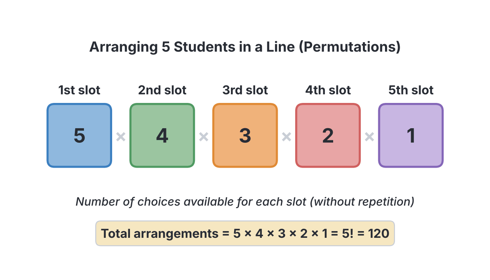
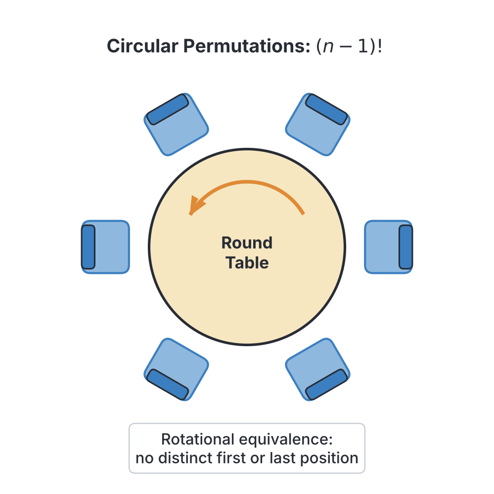

# JAMB Mathematics Notes: Permutation and Combination

## What JAMB expects

This topic is Section V, Topic 4 of the JAMB Mathematics syllabus: Statistics – Permutation and Combination. It has two content items:

- **a.** Linear and circular arrangements;
- **b.** Arrangements involving repeated objects.

By the end of these notes, you should be able to:

1. solve simple problems involving permutation and combination.

*(Note on the syllabus wording: The single objective is unnumbered in the syllabus, so it is treated as the only objective for this topic.)*

## Introduction to the Fundamental Principles of Counting

Before diving into permutations and combinations, it is crucial to understand the two basic rules of counting: the Multiplication Principle and the Addition Principle. These principles govern how we count possibilities without having to list them all out.

### 1. The Multiplication Principle (The "AND" Rule)
If one event can happen in $x$ ways, **AND** a second event can happen in $y$ ways, then both events can happen one after the other in $x \times y$ ways. We multiply when we need to make continuous, successive choices.

**Worked Example 1:**
Emeka has 4 shirts, 3 pairs of trousers, and 2 pairs of shoes. In how many ways can he dress up in a shirt, a pair of trousers, **and** a pair of shoes?
1. Choices of shirts = 4.
2. Choices of trousers = 3.
3. Choices of shoes = 2.
4. Total ways = $4 \times 3 \times 2 = 24$ ways.

### 2. The Addition Principle (The "OR" Rule)
If one event can happen in $x$ ways, **OR** a separate event can happen in $y$ ways (but they cannot happen together), then there are $x + y$ ways for either event to happen. We add when we are choosing between mutually exclusive options.

**Worked Example 2:**
A student wants to travel from Lagos to Abuja. She can go by air (using any of 3 airlines) **or** by road (using any of 4 bus companies). In how many ways can she make the journey?
1. Choices by air = 3.
2. Choices by road = 4.
3. Total ways = $3 + 4 = 7$ ways.

## Factorial notation

In counting problems, we frequently multiply descending whole numbers. To make this easier, we use **factorial notation**, represented by an exclamation mark ($!$). 

The factorial of a positive integer $n$ (written as $n!$) is the product of all positive integers from $n$ down to 1:
$$n! = n \times (n - 1) \times (n - 2) \times \dots \times 3 \times 2 \times 1$$

For example:
- $5! = 5 \times 4 \times 3 \times 2 \times 1 = 120$
- $4! = 4 \times 3 \times 2 \times 1 = 24$
- $3! = 3 \times 2 \times 1 = 6$
- $2! = 2 \times 1 = 2$
- $1! = 1$

**Important Rule:** By mathematical definition and convention, **$0! = 1$**. This is essential to make the formulas for permutations and combinations work when we choose all or none of the items.

### Simplifying fractions with factorials
When dividing factorials, you do not need a calculator. Expand the larger factorial until it matches the smaller one, then cancel them out.

**Worked Example 3:**
Evaluate $\frac{8!}{5!}$.

1. Expand $8!$ until you reach $5!$: 
   $$8! = 8 \times 7 \times 6 \times 5!$$
2. Divide by $5!$:
   $$\frac{8 \times 7 \times 6 \times 5!}{5!}$$
3. The $5!$ on the top and bottom cancel out:
   $$8 \times 7 \times 6 = 336$$

**Common mistakes with Factorials**
- **Wrong working:** Calculating $\frac{6!}{2!}$ as $3! = 6$. (You cannot divide the numbers inside the factorial signs directly).
- **Corrected version:** $\frac{6!}{2!} = \frac{6 \times 5 \times 4 \times 3 \times 2!}{2!} = 6 \times 5 \times 4 \times 3 = 360$.

## Linear and circular arrangements

**Content a: Linear and circular arrangements**

An arrangement is a way of placing objects in a specific order. When the order matters (for example, forming passwords, ranking positions like 1st, 2nd, 3rd, or arranging letters in a word), it is called a **Permutation**.

### Linear arrangements (Permutations)

A linear arrangement is when objects are placed in a straight line or sequence.

**Case 1: Arranging ALL $n$ distinct objects**
If you have $n$ distinct objects and want to arrange all of them in a line, the number of ways is simply $n!$.

**Worked Example 4:**
In how many ways can 5 students stand in a straight line for morning assembly?
1. The total number of students is 5.
2. The number of arrangements is $5!$.
3. $5! = 5 \times 4 \times 3 \times 2 \times 1 = 120 \text{ ways}$.

**Case 2: Arranging $r$ objects chosen from $n$ distinct objects**
If you have $n$ objects but you only want to choose and arrange $r$ of them, you use the Permutation formula, denoted as $^n P_r$ or $P(n, r)$:
$$^n P_r = \frac{n!}{(n - r)!}$$
where:
- $n$ is the total number of distinct objects available.
- $r$ is the number of objects to be arranged.
- $!$ is the factorial symbol.

**Worked Example 5:**
In how many ways can a Chairman, a Secretary, and a Treasurer be chosen from a committee of 7 people?
1. Identify $n$ and $r$: Total people $n = 7$, positions to fill $r = 3$. Order matters because the positions are distinct (Chairman is different from Secretary).
2. Apply the permutation formula:
   $$^7 P_3 = \frac{7!}{(7 - 3)!} = \frac{7!}{4!}$$
3. Expand and simplify:
   $$\frac{7 \times 6 \times 5 \times 4!}{4!} = 7 \times 6 \times 5 = 210 \text{ ways}$$

**Worked Example 6:**
How many 4-digit codes can be formed from the digits 1, 2, 3, 4, 5, 6, 7 if no digit is repeated?
1. Identify $n$ and $r$: There are 7 digits available, so $n = 7$. We need a 4-digit code, so $r = 4$. Order matters in codes (1234 is different from 4321).
2. Apply the formula:
   $$^7 P_4 = \frac{7!}{(7 - 4)!} = \frac{7!}{3!}$$
3. Expand and calculate:
   $$\frac{7 \times 6 \times 5 \times 4 \times 3!}{3!} = 7 \times 6 \times 5 \times 4 = 840 \text{ ways}$$

**Common mistakes in Permutations**
- **Wrong working:** Calculating $^5 P_2$ as $5 \times 2 = 10$. (Mistaking $P$ for simple multiplication).
- **Corrected version:** $^5 P_2 = \frac{5!}{(5-2)!} = \frac{5!}{3!} = 5 \times 4 = 20$.

### Circular arrangements

A circular arrangement is when objects are placed in a circle, like sitting around a round table or forming a ring. 

In a straight line, there is a distinct starting point and ending point. In a circle, there is no start or end. If everyone moves one seat to the left, their absolute positions change, but their **relative** positions to each other remain exactly the same. 

To account for this lack of a fixed starting point, we must "lock" one person in place to create an artificial start. This leaves the remaining $(n - 1)$ people to be arranged.
The formula for arranging $n$ distinct objects in a circle is:
$$(n - 1)!$$

**Worked Example 7:**
In how many ways can 5 people be seated around a circular dining table?
1. Identify $n$: The number of people is $n = 5$.
2. Apply the circular arrangement formula:
   $$(5 - 1)! = 4!$$
3. Calculate the factorial:
   $$4! = 4 \times 3 \times 2 \times 1 = 24 \text{ ways}$$

**Worked Example 8:**
A family of 6 is to be seated around a round table. In how many ways can they be seated if the father and mother must sit together?
1. Since the father and mother must sit together, treat them as a single unit or "block".
2. The total units to arrange around the table is now 4 children + 1 parent block = 5 units.
3. The number of ways to arrange these 5 units in a circle is $(5 - 1)! = 4! = 24$ ways.
4. However, inside their block, the father and mother can swap seats with each other in $2! = 2$ ways.
5. Multiply the arrangements: $24 \times 2 = 48 \text{ ways}$.

**Note on Textbook variations:** If the circular object can be flipped over in the air (like beads on a necklace or keys on a ring), clockwise and anti-clockwise arrangements look identical. In that specific case, you divide the formula by 2: $\frac{(n-1)!}{2}$. However, JAMB questions generally involve people sitting at tables or objects that cannot be flipped over, so you just use $(n-1)!$. Always read the context carefully.

**Common mistakes in Circular Arrangements**
- **Wrong working:** Assuming 6 people around a table is $6! = 720$. (Forgetting it is a circle).
- **Corrected version:** 6 people in a circle is $(6 - 1)! = 5! = 120$.

## Arrangements involving repeated objects

**Content b: Arrangements involving repeated objects**

Sometimes, the objects you are arranging are not all distinct; some are identical. For example, in the word "BOOK", the two 'O's are identical. If you swap them, the word still looks exactly like "BOOK". If we simply used $4!$ to arrange the letters, we would be double-counting identical arrangements. 

To find the true number of unique arrangements, you must divide the total factorial of all objects by the factorials of the repeated items.

The formula for arranging $n$ objects where some objects repeat $p$ times, $q$ times, $r$ times, etc., is:
$$\frac{n!}{p! \times q! \times r! \dots}$$
where:
- $n$ is the total number of objects.
- $p$, $q$, $r$, etc., are the frequencies of each repeated object.

**Worked Example 9:**
In how many ways can the letters of the word "NIGERIA" be arranged?
1. Count the total number of letters: $n = 7$.
2. Count the frequencies of each letter: N=1, I=2, G=1, E=1, R=1, A=1. The letter 'I' repeats twice ($p = 2$).
3. Apply the formula:
   $$\text{Arrangements} = \frac{7!}{2!}$$
4. Calculate:
   $$7! = 7 \times 6 \times 5 \times 4 \times 3 \times 2 \times 1 = 5040$$
   $$\frac{5040}{2} = 2520 \text{ ways}$$

**Worked Example 10:**
How many different arrangements can be made from the letters of the word "MATHEMATICS"?
1. Count the total number of letters: $n = 11$.
2. Identify the repeated letters: 
   - M repeats 2 times.
   - A repeats 2 times.
   - T repeats 2 times.
3. Apply the formula:
   $$\text{Arrangements} = \frac{11!}{2! \times 2! \times 2!}$$
4. Calculate the factorials:
   $$11! = 39,916,800$$
   $$2! \times 2! \times 2! = 2 \times 2 \times 2 = 8$$
5. Divide:
   $$\frac{39,916,800}{8} = 4,989,600 \text{ ways}$$
*(Note: In JAMB, large numbers like this are usually left in factorial form in the options, such as $\frac{11!}{8}$ or $\frac{11!}{2! 2! 2!}$, so you may not need to multiply them out completely).*

**Worked Example 11:**
In how many ways can 3 red balls, 4 blue balls, and 2 green balls be arranged in a row if balls of the same colour are identical?
1. Total balls $n = 3 + 4 + 2 = 9$.
2. The repetitions are 3 (red), 4 (blue), and 2 (green).
3. Apply the formula:
   $$\frac{9!}{3! \times 4! \times 2!}$$
4. Expand $9!$ down to $4!$:
   $$\frac{9 \times 8 \times 7 \times 6 \times 5 \times 4!}{3 \times 2 \times 1 \times 4! \times 2 \times 1}$$
5. Cancel out $4!$ and simplify the denominator ($3 \times 2 \times 1 \times 2 \times 1 = 12$):
   $$\frac{9 \times 8 \times 7 \times 6 \times 5}{12} = \frac{15120}{12} = 1260 \text{ ways}$$

**Common mistakes with Repeated Objects**
- **Wrong working:** Arranging "SUCCESS" (7 letters) as $7! = 5040$. (Ignoring the repeated letters).
- **Corrected version:** "SUCCESS" has 3 'S's and 2 'C's. The correct arrangement is $\frac{7!}{3! \times 2!} = \frac{5040}{6 \times 2} = 420$.

## Solving simple problems involving permutation and combination

**Objective: solve simple problems involving permutation and combination.**

To solve word problems effectively in JAMB, the most critical skill is deciding whether the problem requires a **Permutation** or a **Combination**.

### What is a Combination?
A **Combination** is a selection of objects where **order does not matter**. 
For example, if you are selecting a team of 3 students from a class of 10, picking Aisha, Bola, and Chidi is exactly the same team as picking Chidi, Aisha, and Bola. 

The formula for selecting $r$ objects from $n$ distinct objects is denoted as $^n C_r$ or $\binom{n}{r}$:
$$^n C_r = \frac{n!}{(n - r)! \times r!}$$

Notice that the Combination formula divides the Permutation formula by $r!$. This removes the duplicate arrangements, leaving only the unique selections.

### Differentiating between Permutations and Combinations

| Situation | Type | Keyword / Clue | Formula |
| --- | --- | --- | --- |
| Forming passwords, phone numbers, or 3-digit numbers | Permutation | Arrangement, order matters | $^n P_r$ |
| Electing specific posts (President, Secretary, PRO) | Permutation | Specific distinct roles | $^n P_r$ |
| Arranging people on seats or letters in a word | Permutation | Line, row, seating | $^n P_r$ or $n!$ |
| Selecting a team or a committee | Combination | Selection, choose, committee | $^n C_r$ |
| Drawing objects (like balls from a bag) at random | Combination | Draw, pick | $^n C_r$ |
| Shaking hands at a party or drawing lines between points | Combination | Pairs (selecting 2 at a time) | $^n C_2$ |

### Simple Combination problems

**Worked Example 12:**
Out of 8 subjects, a student must choose 3. In how many ways can the selection be made?
1. The keyword is "choose" and the order of subjects does not matter. This is a Combination.
2. $n = 8$, $r = 3$.
3. Apply the formula:
   $$^8 C_3 = \frac{8!}{(8 - 3)! \times 3!} = \frac{8!}{5! \times 3!}$$
4. Expand $8!$ to $5!$:
   $$\frac{8 \times 7 \times 6 \times 5!}{5! \times 3 \times 2 \times 1}$$
5. Cancel out $5!$ and $3 \times 2 \times 1$ (which is 6):
   $$8 \times 7 = 56 \text{ ways}$$

**Worked Example 13:**
At a meeting of 10 people, everyone shakes hands with everyone else exactly once. How many handshakes take place?
1. A handshake requires exactly 2 people. The order of the two people doesn't matter (Person A shaking Person B is the same as B shaking A).
2. We need to choose 2 people from 10, so $n = 10$, $r = 2$.
3. Apply the formula:
   $$^{10} C_2 = \frac{10!}{(10 - 2)! \times 2!} = \frac{10!}{8! \times 2!}$$
4. Expand and solve:
   $$\frac{10 \times 9 \times 8!}{8! \times 2 \times 1} = \frac{90}{2} = 45 \text{ handshakes}$$

### Multi-step problems and conditions

Many JAMB questions combine combinations with the Multiplication Principle or the Addition Principle.

**Worked Example 14:**
A committee of 4 people is to be chosen from 5 men and 6 women. In how many ways can this be done if the committee must consist of exactly 2 men and 2 women?
1. Break the problem into parts. We must choose 2 men from 5 men, **AND** 2 women from 6 women.
2. Calculate the ways to choose the men (Combination, because specific roles are not mentioned):
   $$^5 C_2 = \frac{5!}{(5-2)! \times 2!} = \frac{5!}{3! \times 2!} = \frac{5 \times 4 \times 3!}{3! \times 2 \times 1} = \frac{20}{2} = 10 \text{ ways}$$
3. Calculate the ways to choose the women:
   $$^6 C_2 = \frac{6!}{(6-2)! \times 2!} = \frac{6!}{4! \times 2!} = \frac{6 \times 5 \times 4!}{4! \times 2 \times 1} = \frac{30}{2} = 15 \text{ ways}$$
4. Apply the Multiplication Principle ("AND" rule):
   $$10 \text{ (men)} \times 15 \text{ (women)} = 150 \text{ ways}$$

**Worked Example 15:**
A box contains 4 red balls and 5 white balls. In how many ways can 3 balls be selected so that they are all the same colour?
1. To have all balls of the same colour, we must pick either 3 red balls **OR** 3 white balls.
2. Selecting 3 red balls from 4 red balls:
   $$^4 C_3 = \frac{4!}{1! \times 3!} = 4 \text{ ways}$$
3. Selecting 3 white balls from 5 white balls:
   $$^5 C_3 = \frac{5!}{2! \times 3!} = \frac{5 \times 4}{2} = 10 \text{ ways}$$
4. Since it is an "OR" situation (you cannot simultaneously pick 3 red and 3 white if you are only picking 3 balls total), apply the Addition Principle:
   $$4 + 10 = 14 \text{ ways}$$

### Equations involving combinations

Sometimes JAMB provides the answer and asks you to find $n$.

**Worked Example 16:**
If $^n C_2 = 15$, find the value of $n$.
1. Write the combination formula for $^n C_2$:
   $$^n C_2 = \frac{n!}{(n-2)! \times 2!} = 15$$
2. Expand $n!$ down to $(n-2)!$:
   $$n! = n \times (n-1) \times (n-2)!$$
3. Substitute this into the equation:
   $$\frac{n \times (n-1) \times (n-2)!}{(n-2)! \times 2!} = 15$$
4. The $(n-2)!$ terms cancel out:
   $$\frac{n(n-1)}{2} = 15$$
5. Multiply both sides by 2:
   $$n(n-1) = 30$$
6. We need two consecutive positive integers that multiply to 30. We know that $6 \times 5 = 30$.
   Therefore, $n = 6$.
*(Alternatively, you could expand to the quadratic equation $n^2 - n - 30 = 0$ and solve to get $n = 6$ or $n = -5$, but since $n$ must be a positive integer, $n = 6$ is the only valid answer).*

**Common mistakes in Combinations**
- **Wrong working:** Using the Addition Principle when it should be Multiplication. E.g., choosing 2 men and 2 women as $^5 C_2 + ^6 C_2 = 10 + 15 = 25$. 
- **Corrected version:** The word "and" implies successive choices that combine together, so you must multiply them: $^5 C_2 \times ^6 C_2 = 10 \times 15 = 150$.

## Key terms

| Term | Meaning |
| --- | --- |
| **Factorial ($n!$)** | The product of an integer and all positive integers below it, down to 1 (e.g. $4! = 4 \times 3 \times 2 \times 1$). |
| **Permutation** | An arrangement of objects where the **order matters** (e.g., passwords, specific roles). |
| **Combination** | A selection of objects where the **order does not matter** (e.g., committees, teams). |
| **Linear Arrangement** | Arranging objects in a straight line (formula is $n!$). |
| **Circular Arrangement** | Arranging objects around a circle where there is no starting point (formula is $(n-1)!$). |
| **Multiplication Principle** | Multiplying the number of ways when events happen one after the other (the "AND" rule). |
| **Addition Principle** | Adding the number of ways when events are mutually exclusive choices (the "OR" rule). |

## Exam tips and common mistakes

- Check the wording of the question carefully to decide between permutation and combination. "Arrange", "line up", "codes", or specific titles (President, Secretary) = Permutation. "Select", "choose", or "committee" = Combination.
- Remember that $0! = 1$, not $0$.
- In linear arrangements involving repeated letters (like "MISSISSIPPI" or "EXCELLENCE"), do not forget to divide the total factorial by the factorial of **every** repeated letter.
- Always remember the $-1$ in circular arrangements. 5 people around a table is $(5 - 1)! = 4! = 24$, not $5! = 120$.
- Factorials do not behave like standard algebraic terms: $3! + 4!$ is NOT $7!$, and $\frac{6!}{2!}$ is NOT $3!$. You must expand them or use the formulas properly.
- Whenever a problem gives constraints like "must sit together", treat the grouped items as a single unit, calculate the overall arrangement, and then multiply by the internal arrangement of the group.

## Quick summary

1. The Multiplication Principle ("AND") requires you to multiply the number of ways of doing separate tasks; the Addition Principle ("OR") requires you to add them.
2. The factorial $n!$ is the product of all positive integers from $n$ down to 1, and by definition, $0! = 1$.
3. The number of ways to arrange $n$ distinct objects in a straight line is $n!$.
4. The permutation formula, $^n P_r = \frac{n!}{(n-r)!}$, is used when choosing and arranging $r$ objects out of $n$ available items where the order matters.
5. For circular arrangements (like sitting around a table), the formula is $(n - 1)!$.
6. For linear arrangements with repeating objects, divide the total factorial $n!$ by the factorials of the repetitions: $\frac{n!}{p! \times q! \times \dots}$.
7. The combination formula, $^n C_r = \frac{n!}{(n-r)! \times r!}$, is used when selecting $r$ objects out of $n$ available items where the order does not matter.

## Practice questions

**1. Evaluate $^8 P_3$.**

- A. 336
- B. 56
- C. 120
- D. 40320

**Answer: A.**
1. The formula for permutation is $^n P_r = \frac{n!}{(n-r)!}$.
2. Substitute $n = 8$ and $r = 3$: $^8 P_3 = \frac{8!}{(8-3)!} = \frac{8!}{5!}$.
3. Expand $8!$ to cancel out the denominator: $\frac{8 \times 7 \times 6 \times 5!}{5!}$.
4. The $5!$ cancels, leaving $8 \times 7 \times 6 = 336$. (Option B is incorrect because it uses the combination formula).

**2. How many different arrangements can be made from the letters of the word "EXCELLENCE"?**

- A. 3,628,800
- B. 37,800
- C. 151,200
- D. 75,600

**Answer: B.**
1. Count the total letters in "EXCELLENCE": $n = 10$.
2. Identify repeated letters: E appears 4 times, C appears 2 times, L appears 2 times. (X and N appear once).
3. The formula for repeated objects is $\frac{n!}{p! \times q! \dots}$.
4. Substitute the values: $\frac{10!}{4! \times 2! \times 2!}$.
5. Calculate: $10! = 3,628,800$. The denominator is $24 \times 2 \times 2 = 96$.
6. Divide: $\frac{3,628,800}{96} = 37,800$. (Option A is incorrect because it ignores the repeated letters entirely).

**3. In how many ways can 6 people be seated around a circular table?**

- A. 720
- B. 120
- C. 36
- D. 6

**Answer: B.**
1. The formula for arranging $n$ distinct objects in a circle is $(n - 1)!$.
2. Substitute $n = 6$: $(6 - 1)! = 5!$.
3. Evaluate $5! = 5 \times 4 \times 3 \times 2 \times 1 = 120$. (Option A is incorrect because it uses the linear arrangement formula $6!$).

**4. A committee of 4 is to be chosen from 6 men and 5 women. In how many ways can this be done if it must contain exactly 2 men and 2 women?**

- A. 330
- B. 150
- C. 25
- D. 50

**Answer: B.**
1. Choosing 2 men from 6 men is $^6 C_2 = \frac{6!}{4! \times 2!} = 15$ ways.
2. Choosing 2 women from 5 women is $^5 C_2 = \frac{5!}{3! \times 2!} = 10$ ways.
3. The committee must contain both men AND women, so we use the Multiplication Principle.
4. Total ways = $15 \times 10 = 150$. (Option C is incorrect because it mistakenly adds $15 + 10$ instead of multiplying).

**5. How many 3-digit numbers can be formed from the digits 1, 2, 3, 4, 5 if repetition of digits is not allowed?**

- A. 125
- B. 60
- C. 15
- D. 120

**Answer: B.**
1. Forming numbers means the order matters (e.g., 123 is different from 321), making this a Permutation.
2. We are arranging $r=3$ digits from a total of $n=5$ digits.
3. Apply the formula: $^5 P_3 = \frac{5!}{(5-3)!} = \frac{5!}{2!}$.
4. Expand and evaluate: $\frac{5 \times 4 \times 3 \times 2!}{2!} = 5 \times 4 \times 3 = 60$. (Option C ($15$) comes from multiplying $5 \times 3$. Option D ($120$) is $5!$, which forgets to stop after $3$ digits. Option A ($125$) is $5^3$, which wrongly allows repetition.)

**6. Out of 7 subjects, a student must select 4 subjects. In how many ways can the student make the selection?**

- A. 840
- B. 35
- C. 210
- D. 24

**Answer: B.**
1. Selecting subjects means order does not matter, making this a Combination.
2. Apply the formula: $^7 C_4 = \frac{7!}{(7-4)! \times 4!} = \frac{7!}{3! \times 4!}$.
3. Expand $7!$ down to $4!$: $\frac{7 \times 6 \times 5 \times 4!}{3 \times 2 \times 1 \times 4!}$.
4. Cancel out $4!$ and simplify: $\frac{210}{6} = 35$. (Option A is incorrect because it uses the permutation formula).

**7. If $^n C_2 = 15$, find the value of $n$.**

- A. 5
- B. 6
- C. 7
- D. 8

**Answer: B.**
1. The combination formula is $^n C_2 = \frac{n!}{(n-2)! \times 2!} = 15$.
2. Expand $n!$: $\frac{n(n-1)(n-2)!}{(n-2)! \times 2} = 15$.
3. Cancel $(n-2)!$ to get $\frac{n(n-1)}{2} = 15$.
4. Multiply by 2: $n(n-1) = 30$.
5. The two consecutive positive numbers that multiply to 30 are 6 and 5 (i.e., $6 \times 5 = 30$), so $n = 6$. (Option C is incorrect because $^7 C_2 = 21$).

**8. In how many ways can the letters of the word "BANANA" be arranged?**

- A. 720
- B. 120
- C. 60
- D. 30

**Answer: C.**
1. Total letters in "BANANA" is $n = 6$.
2. Frequencies of repeating letters: A appears 3 times, N appears 2 times.
3. Apply the repeated items formula: $\frac{6!}{3! \times 2!}$.
4. Evaluate: $6! = 720$. The denominator is $6 \times 2 = 12$.
5. Divide: $\frac{720}{12} = 60$. (Option A is incorrect because it ignores the repeating letters and calculates $6!$).

**9. In how many ways can 5 boys and 4 girls sit in a row if all the girls must sit together?**

- A. 362,880
- B. 17,280
- C. 2,880
- D. 120

**Answer: B.**
1. Since the 4 girls must sit together, treat them as a single group or block.
2. The total units to arrange is now 5 boys + 1 block of girls = 6 units.
3. These 6 units can be arranged in a line in $6! = 720$ ways.
4. Inside their block, the 4 girls can swap seats with each other in $4! = 24$ ways.
5. Multiply the arrangements: $720 \times 24 = 17,280$ ways. (Option A is incorrect because it blindly calculates $9!$, ignoring the condition entirely).

**10. A school has 3 gates. In how many ways can a student enter the school through one gate and leave through a different gate?**

- A. 9
- B. 6
- C. 5
- D. 3

**Answer: B.**
1. Entering the school: The student has 3 gates to choose from.
2. Leaving the school: Since they must leave through a *different* gate, there are only 2 gates left to choose from.
3. Use the Multiplication Principle: $3 \times 2 = 6$ ways. (Option A is incorrect because it calculates $3 \times 3 = 9$, assuming the student could leave through the exact same gate they entered, which violates the condition).
