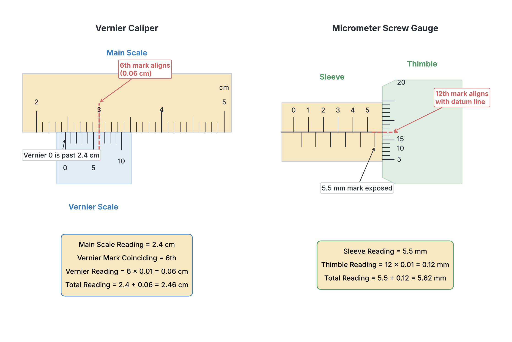

# JAMB Physics Notes: Measurements and Units

## What JAMB expects

This topic is Section A, Topic 1 of the JAMB Physics syllabus. It covers the foundational concepts of how we measure physical quantities, the units we use, and the accuracy of our measurements. It covers the following content items:
- (ai) Fundamental Units
- (aii) Derived Units
- (b) Measuring Instruments
- (c) Fundamental physical quantities
- (d) Derived physical quantities and their units
- (e) Dimensions
- (f) Limitations of experimental measurements

By the end of these notes, you should be able to:
1. Identify the units of length, area and volume.
2. Use different measuring instruments.
3. Determine the lengths, surface areas and volume of regular and irregular bodies.
4. Identify the unit of mass.
5. Use simple beam balance, e.g. Buchart’s balance and chemical balance.
6. Identify the unit of time.
7. Use different time-measuring devices.
8. Relate the fundamental physical quantities to their units.
9. Deduce the units of derived physical quantities.
10. Determine the dimensions of physical quantities.
11. Use the dimensions to determine the units of physical quantities.
12. Test the homogeneity of an equation.
13. Determine the accuracy of measuring instruments.
14. Estimate simple errors.
15. Express measurements in standard form.

**Note on the syllabus wording:** The syllabus lists "electric charge" as a fundamental unit in item (ai). In the standard International System of Units (SI), *Electric Current* (measured in Amperes) is the fundamental quantity, while electric charge is derived from it. You must know standard SI rules, but be aware of JAMB's specific wording for the exam. Also, the syllabus mentions "venier caliper" (a typo for vernier caliper) and "Buchart's balance" (likely a typo for Bunge's balance or a generic beam balance). These notes use the correct spellings while pointing out the variations.

---

## 1. Fundamental Physical Quantities and Units

### Fundamental physical quantities

In physics, a physical quantity is any property of an object or system that can be measured—such as the length of a table, the mass of a bag of rice, or the time it takes to travel from Lagos to Ibadan. **Fundamental physical quantities** are the basic, independent quantities that cannot be defined in terms of any other physical quantities. They are the building blocks of all other measurements in physics.

### Fundamental Units

The units used to measure fundamental quantities are called **fundamental units**. The SI (Système International) system defines seven base units. Based on the JAMB syllabus, the seven fundamental quantities are length, mass, time, electric charge (note the syllabus variation discussed above), temperature, luminous intensity, and amount of substance. 

### Identify the unit of mass

Mass is the quantity of matter contained in a body. The SI unit of mass is the **kilogram ($\text{kg}$)**. 
- Even though the word has the prefix "kilo" (meaning $1000$), the kilogram is the fundamental base unit, not the gram. 
- For smaller measurements, you must often convert grams to kilograms ($1000\ \text{g} = 1\ \text{kg}$) before using them in physics formulas.

### Identify the unit of time

Time is the duration of an event. The SI unit of time is the **second ($\text{s}$)**. 
- When a question gives time in minutes or hours, always convert it to seconds for standard calculations.
- $1\ \text{minute} = 60\ \text{s}$
- $1\ \text{hour} = 3600\ \text{s}$

### Relate the fundamental physical quantities to their units

Every fundamental physical quantity has a corresponding SI unit and symbol. You must memorize these relationships:

| Fundamental Quantity | SI Unit | Unit Symbol |
| --- | --- | --- |
| Length | metre | $\text{m}$ |
| Mass | kilogram | $\text{kg}$ |
| Time | second | $\text{s}$ |
| Temperature | kelvin | $\text{K}$ |
| Electric Current *(JAMB lists Charge)* | ampere *(Charge = coulomb)* | $\text{A}$ *(Charge = C)* |
| Luminous Intensity | candela | $\text{cd}$ |
| Amount of Substance | mole | $\text{mol}$ |

---

## 2. Derived Physical Quantities and Units

### Derived physical quantities and their units

**Derived physical quantities** are quantities obtained by combining two or more fundamental quantities through multiplication or division. They cannot exist without the fundamental quantities. The units of these quantities are called **derived units**.

### Derived Units

When you combine fundamental units, you get derived units. Some derived units have special names (like the Newton or the Joule), while others are just left as combinations of base units. Common derived quantities include:
- **Speed / Velocity:** metre per second ($\text{m s}^{-1}$)
- **Acceleration:** metre per second squared ($\text{m s}^{-2}$)
- **Force / Weight:** newton ($\text{N}$), which is $\text{kg m s}^{-2}$
- **Pressure:** pascal ($\text{Pa}$), which is $\text{N m}^{-2}$
- **Density:** kilogram per cubic metre ($\text{kg m}^{-3}$)

### Identify the units of length, area and volume

- **Length** is a fundamental quantity. Its SI unit is the **metre ($\text{m}$)**.
- **Area** is a derived quantity (Length $\times$ Breadth). Its SI unit is the **square metre ($\text{m}^2$)**. 
- **Volume** is a derived quantity (Length $\times$ Breadth $\times$ Height). Its SI unit is the **cubic metre ($\text{m}^3$)**.

*Common Mistake:* Students often forget to convert area from $\text{cm}^2$ to $\text{m}^2$. Remember that $1\ \text{m} = 100\ \text{cm}$, so $1\ \text{m}^2 = 100 \times 100\ \text{cm}^2 = 10,000\ \text{cm}^2$. 

### Deduce the units of derived physical quantities

You can find the unit of any derived quantity by writing down its mathematical formula and substituting the fundamental units into it.

**Worked Example 1: Deduce the SI unit of Force.**
1. **Write the formula:** $\text{Force} = \text{Mass} \times \text{Acceleration}$.
2. **Substitute fundamental units:** The unit of mass is $\text{kg}$. The unit of acceleration is $\text{m s}^{-2}$ (since acceleration is velocity divided by time).
3. **Multiply them:** $\text{kg} \times \text{m s}^{-2} = \text{kg m s}^{-2}$.
4. **State the answer:** The derived unit is $\text{kg m s}^{-2}$. This combination is universally named the Newton ($\text{N}$).

**Worked Example 2: Deduce the SI unit of Pressure.**
1. **Write the formula:** $\text{Pressure} = \frac{\text{Force}}{\text{Area}}$.
2. **Substitute known units:** From Example 1, Force is $\text{kg m s}^{-2}$. Area is $\text{m}^2$.
3. **Divide:** $\frac{\text{kg m s}^{-2}}{\text{m}^2} = \text{kg m}^{-1} \text{s}^{-2}$.
4. **State the answer:** The SI unit is $\text{kg m}^{-1}\text{s}^{-2}$, also known as the Pascal ($\text{Pa}$).

**Worked Example 3: Deduce the SI unit of Kinetic Energy.**
1. **Write the formula:** $\text{K.E.} = \frac{1}{2} m v^2$.
2. **Substitute fundamental units:** Ignore the fraction $\frac{1}{2}$ because numbers do not have units. Mass $m$ is $\text{kg}$. Velocity $v$ is $\text{m s}^{-1}$. 
3. **Square the velocity unit:** $(\text{m s}^{-1})^2 = \text{m}^2 \text{s}^{-2}$.
4. **Multiply by mass:** $\text{kg} \times \text{m}^2 \text{s}^{-2} = \text{kg m}^2 \text{s}^{-2}$.
5. **State the answer:** The SI unit is $\text{kg m}^2 \text{s}^{-2}$, which is known as the Joule ($\text{J}$).

---

## 3. Measuring Instruments

### Measuring Instruments

To measure physical quantities in the laboratory, we use specific instruments. 
- For **length**: Metre rule, vernier caliper, micrometer screw gauge.
- For **volume**: Measuring cylinder, Eureka can.
- For **mass**: Beam balance.
- For **time**: Stopwatch, ticker-tape timer.

### Use different measuring instruments

Different length instruments are used depending on the size of the object and the required precision.

1. **Metre Rule:** Used to measure straight distances (e.g., the length of a wire). It measures accurately up to $0.1\ \text{cm}$ ($1\ \text{mm}$).
2. **Vernier Caliper:** Used to measure the internal and external diameters of objects (like a PVC plumbing pipe) and the depth of small holes. It measures accurately up to $0.01\ \text{cm}$ ($0.1\ \text{mm}$).
   - **Reading a vernier caliper:** First, read the Main Scale just before the zero mark of the Vernier Scale. Then, find the line on the Vernier Scale that perfectly aligns with any line on the Main Scale. Multiply this aligning number by $0.01\ \text{cm}$ and add it to the Main Scale reading.
3. **Micrometer Screw Gauge:** Used to measure very small lengths, such as the thickness of a piece of paper or the diameter of a thin copper wire. It is very precise, measuring accurately to $0.001\ \text{cm}$ ($0.01\ \text{mm}$).
   - **Reading a micrometer:** Read the highest visible mark on the Sleeve (main scale in mm). Then, look at the Thimble (circular scale). Find the line on the thimble that aligns with the central line of the sleeve. Multiply this by $0.01\ \text{mm}$ and add it to the sleeve reading.

### Use simple beam balance

Mass is measured using a **beam balance** (such as a chemical balance or Bunge's balance).
- A chemical balance compares the unknown mass of an object on one pan with known standard masses on the other pan until they balance horizontally.
- Because it compares masses directly, a beam balance measures **mass** (which is constant everywhere). Do not confuse it with a spring balance, which measures **weight** (the pull of gravity, which changes depending on location).

### Use different time-measuring devices

- **Stopwatch / Stopclock:** Used to time laboratory events, such as measuring the period of a swinging pendulum. They typically measure accurately to $0.1\ \text{s}$ or $0.01\ \text{s}$.
- **Ticker-tape timer:** An electrical device used in mechanics experiments to study motion. It punches dots on a moving paper tape at a steady rate. In Nigeria, the mains electricity frequency is $50\ \text{Hz}$, meaning the timer makes 50 dots every second. The time interval between two consecutive dots is $\frac{1}{50}\ \text{s} = 0.02\ \text{s}$.

### Determine the lengths, surface areas and volume of regular and irregular bodies

**Regular Bodies:** 
If an object has a regular geometric shape, you use a ruler or caliper to measure its dimensions (length, breadth, radius) and then apply a mathematical formula.
- **Rectangular block:** $\text{Volume} = l \times b \times h$. $\text{Surface Area} = 2(lb + lh + bh)$.
- **Solid cylinder:** $\text{Volume} = \pi r^2 h$. $\text{Surface Area} = 2\pi r^2 + 2\pi rh$.
*(where $l = \text{length}$, $b = \text{breadth}$, $h = \text{height}$, $r = \text{radius}$; all measured in metres).*

**Irregular Bodies:**
You cannot use a simple formula for an irregular object like a stone or a yam tuber. You must use the **displacement method** to find its volume:
1. Pour a known volume of water ($V_1$) into a measuring cylinder.
2. Tie the irregular object with a light string and lower it completely into the water.
3. The water level will rise. Record the new volume ($V_2$).
4. The volume of the irregular body is the difference: $V = V_2 - V_1$.
*(Alternatively, you can use a Eureka can, where the displaced water overflows directly into a smaller measuring cylinder, giving the volume immediately).*

---

## 4. Dimensions of Physical Quantities

### Dimensions

In physics, the **dimension** of a physical quantity shows how it is built up from the fundamental quantities, regardless of the specific units (like feet or metres) used. We represent dimensions using square brackets around capital letters:
- Mass $= [M]$
- Length $= [L]$
- Time $= [T]$

### Determine the dimensions of physical quantities

To find the dimension of a derived quantity, replace the fundamental units in its formula with $M$, $L$, and $T$.

**Worked Example 4: Determine the dimension of Velocity.**
1. **Write the formula:** $\text{Velocity} = \frac{\text{Displacement}}{\text{Time}}$.
2. **Substitute dimensions:** Displacement is a length $[L]$. Time is $[T]$.
3. **Calculate:** $\frac{L}{T} = L T^{-1}$.
4. **State the answer:** The dimension of velocity is $L T^{-1}$.

**Worked Example 5: Determine the dimension of Work.**
1. **Write the formula:** $\text{Work} = \text{Force} \times \text{Distance}$.
2. **Find Force first:** $\text{Force} = \text{Mass} \times \text{Acceleration} = M \times L T^{-2} = M L T^{-2}$.
3. **Substitute into Work formula:** $\text{Work} = (M L T^{-2}) \times L$.
4. **Calculate:** $M \times L^2 \times T^{-2} = M L^2 T^{-2}$.
5. **State the answer:** The dimension of work is $M L^2 T^{-2}$.

**Worked Example 6: Determine the dimension of Density.**
1. **Write the formula:** $\text{Density} = \frac{\text{Mass}}{\text{Volume}}$.
2. **Substitute dimensions:** Mass is $M$. Volume (Length $\times$ Breadth $\times$ Height) is $L \times L \times L = L^3$.
3. **Calculate:** $\frac{M}{L^3} = M L^{-3}$.
4. **State the answer:** The dimension of density is $M L^{-3}$.

### Use the dimensions to determine the units of physical quantities

You can work backward. If you know the dimension of a quantity, you can easily determine its SI unit by replacing $M$, $L$, and $T$ with $\text{kg}$, $\text{m}$, and $\text{s}$.

**Worked Example 7: Find the SI unit of a quantity with dimension $M L^{-1} T^{-2}$.**
1. **Given dimension:** $M L^{-1} T^{-2}$.
2. **Substitute base units:** Replace $M$ with $\text{kg}$, $L^{-1}$ with $\text{m}^{-1}$, and $T^{-2}$ with $\text{s}^{-2}$.
3. **Combine:** $\text{kg m}^{-1}\text{s}^{-2}$.
4. **State the answer:** The SI unit is $\text{kg m}^{-1}\text{s}^{-2}$. (This is the unit of pressure, the Pascal).

**Worked Example 8: Find the SI unit of a quantity with dimension $M L^2 T^{-3}$.**
1. **Given dimension:** $M L^2 T^{-3}$.
2. **Substitute base units:** Replace $M$ with $\text{kg}$, $L^2$ with $\text{m}^2$, and $T^{-3}$ with $\text{s}^{-3}$.
3. **Combine:** $\text{kg m}^2 \text{s}^{-3}$.
4. **State the answer:** The SI unit is $\text{kg m}^2 \text{s}^{-3}$, which is the Watt ($\text{W}$), the unit of power.

**Worked Example 9: Find the SI unit of a quantity with dimension $L T^{-2}$.**
1. **Given dimension:** $L T^{-2}$.
2. **Substitute base units:** Replace $L$ with $\text{m}$ and $T^{-2}$ with $\text{s}^{-2}$.
3. **Combine:** $\text{m s}^{-2}$.
4. **State the answer:** The unit is metre per second squared ($\text{m s}^{-2}$), which is acceleration.

### Test the homogeneity of an equation

An equation in physics is **dimensionally homogeneous** (correct) if the dimensions of every independent term on the left-hand side are identical to the dimensions of every independent term on the right-hand side. Note that pure numbers (like $2$, $\frac{1}{2}$, or $\pi$) have no dimensions and are ignored.

**Worked Example 10: Test the homogeneity of $s = u t + \frac{1}{2} a t^2$.**
*(Where $s$ = displacement, $u$ = initial velocity, $a$ = acceleration, $t$ = time).*
1. **Find dimension of LHS ($s$):** Displacement is a length, so $[L]$.
2. **Find dimension of first RHS term ($u t$):** $u$ is velocity ($L T^{-1}$), $t$ is time ($T$). Multiplying gives $(L T^{-1}) \times T = L$.
3. **Find dimension of second RHS term ($\frac{1}{2} a t^2$):** Ignore $\frac{1}{2}$. $a$ is acceleration ($L T^{-2}$), $t^2$ is $T^2$. Multiplying gives $(L T^{-2}) \times T^2 = L$.
4. **Compare:** Since every single term in the equation simplifies to the dimension $L$, the equation is dimensionally homogeneous.

**Worked Example 11: Test the homogeneity of $v^2 = u^2 + 2 a s$.**
*(Where $v$ = final velocity).*
1. **Find dimension of LHS ($v^2$):** $(L T^{-1})^2 = L^2 T^{-2}$.
2. **Find dimension of first RHS term ($u^2$):** $(L T^{-1})^2 = L^2 T^{-2}$.
3. **Find dimension of second RHS term ($2 a s$):** Ignore $2$. $a$ is $L T^{-2}$, $s$ is $L$. $(L T^{-2}) \times L = L^2 T^{-2}$.
4. **Compare:** Every term has the dimension $L^2 T^{-2}$. The equation is homogeneous.

**Worked Example 12: Test the homogeneity of the pendulum period equation $T = 2\pi\sqrt{\frac{L}{g}}$.**
*(Where $T$ = period, $L$ = length, $g$ = acceleration due to gravity).*
1. **Find dimension of LHS ($T$):** The period is a time, so $[T]$.
2. **Find dimension of RHS inside the root ($\frac{L}{g}$):** Length is $L$. Gravity $g$ is an acceleration ($L T^{-2}$). Dividing gives $\frac{L}{L T^{-2}} = \frac{1}{T^{-2}} = T^2$.
3. **Apply the square root:** $\sqrt{T^2} = T$. (Ignore $2\pi$ as it is a dimensionless constant).
4. **Compare:** The LHS is $T$ and the RHS is $T$. The equation is homogeneous.

---

## 5. Limitations of Experimental Measurements

### Limitations of experimental measurements

No physical measurement is perfectly exact. Limitations arise because measuring instruments have a limit to how small they can read (their accuracy), and human experimenters can make reading errors (like parallax errors). Because of this, measurements must be recorded appropriately, taking into account errors and significant figures.

### Determine the accuracy of measuring instruments

The accuracy (or least count) of an instrument is the smallest measurement it can read reliably. When you record a measurement, you must write it to the number of decimal places allowed by the instrument's accuracy.
- **Metre rule:** Accuracy is $0.1\ \text{cm}$ ($1\ \text{mm}$). E.g., record as $5.1\ \text{cm}$.
- **Vernier caliper:** Accuracy is $0.01\ \text{cm}$ ($0.1\ \text{mm}$). E.g., record as $5.10\ \text{cm}$.
- **Micrometer screw gauge:** Accuracy is $0.001\ \text{cm}$ ($0.01\ \text{mm}$). E.g., record as $5.100\ \text{cm}$.

### Estimate simple errors

When a measured value differs from the true (or accepted) value, an error has occurred.
- **Absolute Error:** $| \text{Measured Value} - \text{True Value} |$.
- **Percentage Error:** $\left( \frac{\text{Absolute Error}}{\text{True Value}} \right) \times 100\%$.

**Worked Example 13: Percentage error of a textbook's length.**
A student measures the length of a textbook as $25.2\ \text{cm}$. If the true length is $25.0\ \text{cm}$, calculate the percentage error.
1. **Write the formula:** $\%\text{ Error} = \frac{\text{Absolute Error}}{\text{True Value}} \times 100$.
2. **Calculate Absolute Error:** $25.2\ \text{cm} - 25.0\ \text{cm} = 0.2\ \text{cm}$.
3. **Substitute into formula:** $\frac{0.2}{25.0} \times 100$.
4. **Calculate:** $\frac{20}{25} = 0.8\%$.
5. **State the answer:** The percentage error is $0.8\%$.

**Worked Example 14: Percentage error in mass.**
A market seller weighs a bag of garri as $48.0\ \text{kg}$, but a standardized scale shows its true mass is $50.0\ \text{kg}$. What is the percentage error?
1. **Write the formula:** $\%\text{ Error} = \frac{\text{Absolute Error}}{\text{True Value}} \times 100$.
2. **Calculate Absolute Error:** $50.0\ \text{kg} - 48.0\ \text{kg} = 2.0\ \text{kg}$.
3. **Substitute:** $\frac{2.0}{50.0} \times 100$.
4. **Calculate:** $\frac{200}{50} = 4\%$.
5. **State the answer:** The percentage error is $4\%$.

**Worked Example 15: Percentage error in time.**
During a school race, a teacher clicks a stopwatch at $12.5\ \text{s}$. The electronic timer (true value) shows $12.0\ \text{s}$. Find the percentage error.
1. **Write the formula:** $\%\text{ Error} = \frac{\text{Absolute Error}}{\text{True Value}} \times 100$.
2. **Calculate Absolute Error:** $12.5\ \text{s} - 12.0\ \text{s} = 0.5\ \text{s}$.
3. **Substitute:** $\frac{0.5}{12.0} \times 100$.
4. **Calculate:** $\frac{50}{12} \approx 4.167\%$.
5. **State the answer:** The percentage error is approximately $4.17\%$.

### Express measurements in standard form

In physics, very large or very small numbers are often written in **standard form** (also called scientific notation). It takes the form $A \times 10^n$, where $A$ is a number between $1$ and $9.999...$ and $n$ is an integer. Measurements are also often rounded to a required number of **significant figures (sig figs)**.
- All non-zero digits are significant.
- Zeros between non-zero digits are significant (e.g., $105$ has 3 sig figs).
- Leading zeros are **not** significant (e.g., $0.004$ has 1 sig fig).

**Worked Example 16: Standard form of a small number.**
Express the length $0.004502\ \text{m}$ in standard form to 3 significant figures.
1. **Identify sig figs:** The first non-zero digit is $4$. The first three sig figs are $4, 5, 0$. The next digit is $2$, which is less than $5$, so we do not round up. The value to 3 sig figs is $0.00450$.
2. **Convert to standard form:** Move the decimal point 3 places to the right to get a number between 1 and 10. This gives $4.50$.
3. **Write the power of 10:** Since we moved the decimal right by 3 places, the power is negative: $10^{-3}$.
4. **State the answer:** $4.50 \times 10^{-3}\ \text{m}$.

**Worked Example 17: Standard form of a large distance.**
A student records the distance from Lagos to Kano precisely as $998,500\ \text{m}$. Express this in standard form to 2 significant figures.
1. **Identify sig figs:** The first two digits are $9$ and $9$. The third digit is $8$, so we round up the second $9$. This makes it $10$, which cascades to turn the number into $1,000,000$ (when rounded to 2 sig figs).
2. **Convert to standard form:** Move the decimal point 6 places left to get $1.0$.
3. **Write the power of 10:** Since we moved left, the power is positive: $10^6$.
4. **State the answer:** $1.0 \times 10^6\ \text{m}$.

**Worked Example 18: Another small number conversion.**
Express $0.07062\ \text{kg}$ to 2 significant figures in standard form.
1. **Identify sig figs:** The first non-zero is $7$. The second is $0$. The next digit is $6$, so round up the $0$ to $1$. The rounded value is $0.071$.
2. **Convert to standard form:** Move the decimal point 2 places right to get $7.1$.
3. **Write the power of 10:** $10^{-2}$.
4. **State the answer:** $7.1 \times 10^{-2}\ \text{kg}$.

---

## Key terms

| Term | Meaning |
| --- | --- |
| Fundamental quantity | A basic physical quantity that is independent of other quantities (e.g., mass, length, time). |
| Derived quantity | A physical quantity obtained by multiplying or dividing fundamental quantities (e.g., force, speed). |
| Vernier caliper | An instrument for measuring lengths, internal and external diameters, with an accuracy of $0.01\ \text{cm}$. |
| Micrometer screw gauge | An instrument for measuring very small thicknesses or diameters, with an accuracy of $0.001\ \text{cm}$. |
| Displacement method | A method to find the volume of an irregular solid by measuring the volume of fluid it displaces. |
| Dimension | The representation of a physical quantity in terms of the fundamental quantities Mass ($M$), Length ($L$), and Time ($T$). |
| Dimensional homogeneity | The principle that every independent term in a correct physical equation must have the same dimension. |
| Percentage error | The absolute error of a measurement divided by the true value, multiplied by $100$. |
| Standard form | Writing a number as $A \times 10^n$, where $1 \le A < 10$. |
| Significant figures | The digits in a number that carry meaningful contribution to its measurement resolution. |

---

## Exam tips and common mistakes

- **Wrong unit conversion:** A very common mistake is calculating area or volume using centimetres and forgetting to convert to metres properly. Remember: $1\ \text{m}^2 = 10,000\ \text{cm}^2$, not $100\ \text{cm}^2$.
- **Mass vs Weight:** A beam balance measures **mass** (in $\text{kg}$). A spring balance measures **weight** (in $\text{N}$). Do not confuse the two.
- **Percentage error formulas:** Always divide by the **true (actual) value**, not the measured value. $\%\text{ Error} = (\text{Error} / \text{True Value}) \times 100$.
- **Dimensions of pure numbers:** Constants like $2$, $\pi$, and $\frac{1}{2}$ have no dimension. Leave them out completely when testing equations for dimensional homogeneity.
- **Least counts:** Know the accuracies perfectly. Metre rule = $0.1\ \text{cm}$. Vernier caliper = $0.01\ \text{cm}$. Micrometer = $0.001\ \text{cm}$.

---

## Quick summary

1. Fundamental physical quantities (like mass, length, time) are independent and cannot be defined by other quantities. Their standard units are the kilogram ($\text{kg}$), metre ($\text{m}$), and second ($\text{s}$).
2. Derived physical quantities (like force, velocity, pressure) are formed by multiplying or dividing fundamental quantities.
3. The vernier caliper ($0.01\ \text{cm}$ accuracy) and the micrometer screw gauge ($0.001\ \text{cm}$ accuracy) are used to measure small lengths and diameters accurately.
4. A beam balance (such as a chemical balance) measures mass, while a stopwatch or ticker-tape timer measures time.
5. The volume of an irregular object is determined using the displacement method in a measuring cylinder.
6. Dimensions show how derived quantities relate to Mass ($M$), Length ($L$), and Time ($T$). For example, Force is $M L T^{-2}$.
7. An equation is valid only if it is dimensionally homogeneous (all terms have the identical dimension).
8. Percentage error shows the inaccuracy of a measurement compared to the true value, and standard form is used to write very large or very small measurements neatly.

---

## Practice questions

**1. Which of the following lists contains only fundamental units?**
- A. Kilogram, Metre, Kelvin
- B. Newton, Second, Metre
- C. Kilogram, Metre, Joule
- D. Candela, Pascal, Second

**Answer: A.** Kilogram (mass), Metre (length), and Kelvin (temperature) are all fundamental base units. Newtons, Joules, and Pascals are derived units.

**2. A micrometer screw gauge is commonly used because it has an accuracy of:**
- A. $0.1\ \text{mm}$
- B. $0.01\ \text{mm}$
- C. $1.0\ \text{mm}$
- D. $0.001\ \text{mm}$

**Answer: B.** A standard micrometer screw gauge measures accurately to $0.01\ \text{mm}$ (which is equal to $0.001\ \text{cm}$). Option A ($0.1\ \text{mm}$) is the accuracy of a vernier caliper.

**3. Determine the dimension of Power.**
- A. $M L^2 T^{-3}$
- B. $M L^2 T^{-2}$
- C. $M L T^{-2}$
- D. $M^2 L T^{-1}$

**Answer: A.** Power is Work divided by Time. The dimension of Work is $M L^2 T^{-2}$. Dividing by Time ($T$) gives $(M L^2 T^{-2}) / T = M L^2 T^{-3}$.

**4. A student measures the diameter of a wire as $1.05\ \text{mm}$. If the actual diameter is $1.00\ \text{mm}$, what is the percentage error in the measurement?**
- A. $0.05\%$
- B. $5.0\%$
- C. $4.76\%$
- D. $0.5\%$

**Answer: B.** 
1. Absolute error = $1.05 - 1.00 = 0.05\ \text{mm}$.
2. Percentage error = $(\frac{0.05}{1.00}) \times 100 = 5.0\%$.
*(A common mistake is dividing by the measured value $1.05$, which gives the incorrect $4.76\%$ in option C).*

**5. Which of the following equations is NOT dimensionally homogeneous?** *(Where $v$ = final velocity, $u$ = initial velocity, $a$ = acceleration, $s$ = displacement, $t$ = time, $F$ = force, $m$ = mass).*
- A. $v = u + a t$
- B. $v^2 = u^2 + 2 a s$
- C. $F = \frac{m(v - u)}{t}$
- D. $s = u t + a t$

**Answer: D.** Let us check Option D: The LHS $s$ has dimension $L$. On the RHS, the term $u t$ is $(L T^{-1})(T) = L$. However, the term $a t$ is $(L T^{-2})(T) = L T^{-1}$. Since $[L] \neq [L] + [L T^{-1}]$, the equation is not homogeneous.

**6. Express $0.0003056\ \text{kg}$ in standard form to two significant figures.**
- A. $3.0 \times 10^{-4}\ \text{kg}$
- B. $3.1 \times 10^{-4}\ \text{kg}$
- C. $3.1 \times 10^{-3}\ \text{kg}$
- D. $3.06 \times 10^{-4}\ \text{kg}$

**Answer: B.** The first two significant figures are $3$ and $0$. The next digit is $5$, so we round the $0$ up to $1$, yielding $0.00031$. Moving the decimal point 4 places right gives $3.1 \times 10^{-4}\ \text{kg}$.

**7. What is the SI unit of a physical quantity whose dimension is $M L^{-1} T^{-2}$?**
- A. Newton ($\text{N}$)
- B. Joule ($\text{J}$)
- C. Pascal ($\text{Pa}$)
- D. Watt ($\text{W}$)

**Answer: C.** Replacing the dimensions with units gives $\text{kg m}^{-1}\text{s}^{-2}$. This is Force ($M L T^{-2}$) divided by Area ($L^2$), which is Pressure. The SI unit for pressure is the Pascal ($\text{Pa}$).

**8. A chemical balance is primarily used in the laboratory to measure:**
- A. Volume
- B. Weight
- C. Density
- D. Mass

**Answer: D.** A chemical balance (or any beam balance) compares an unknown mass directly against standard masses. Therefore, it measures mass, which is constant regardless of gravity.

**9. The volume of a small irregular stone can be best determined by using a:**
- A. Metre rule and a mathematical formula
- B. Micrometer screw gauge
- C. Measuring cylinder and water
- D. Chemical balance

**Answer: C.** Since the stone has an irregular shape, you cannot use a mathematical formula (ruling out A and B). The displacement method using a measuring cylinder (and water) is the standard technique to find its volume.

**10. Which derived unit below matches the combination of fundamental units $\text{kg m}^2 \text{s}^{-2}$?**
- A. Joule
- B. Pascal
- C. Watt
- D. Newton

**Answer: A.** The combination $\text{kg m}^2 \text{s}^{-2}$ is the dimension for Work or Energy ($M L^2 T^{-2}$), which is measured in Joules. The Newton is $\text{kg m s}^{-2}$, the Pascal is $\text{kg m}^{-1}\text{s}^{-2}$, and the Watt is $\text{kg m}^2\text{s}^{-3}$.
