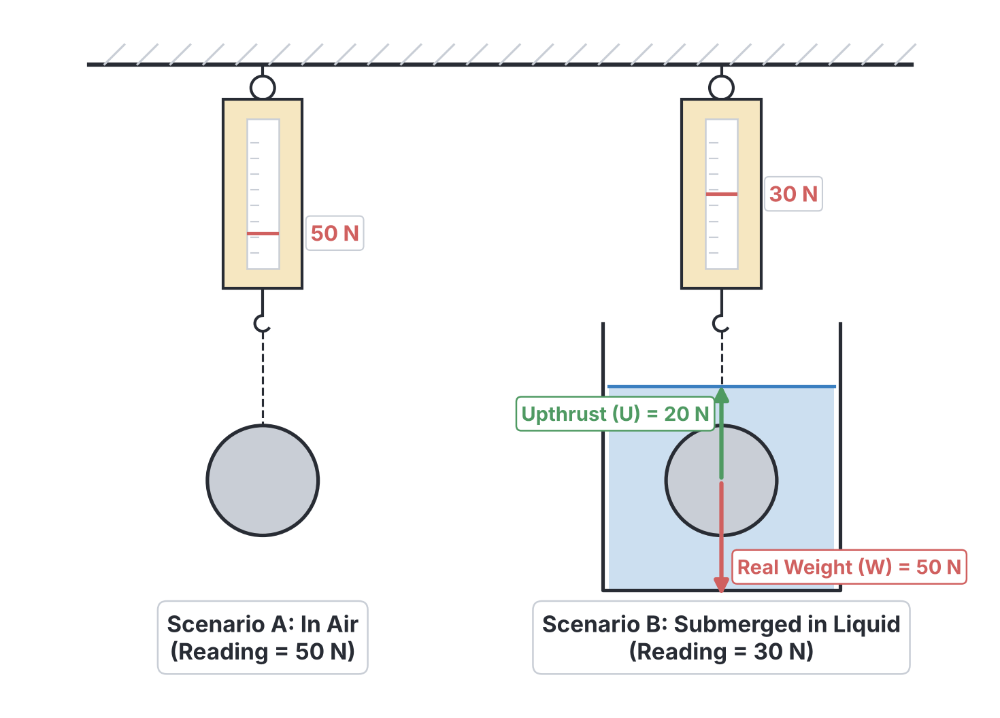
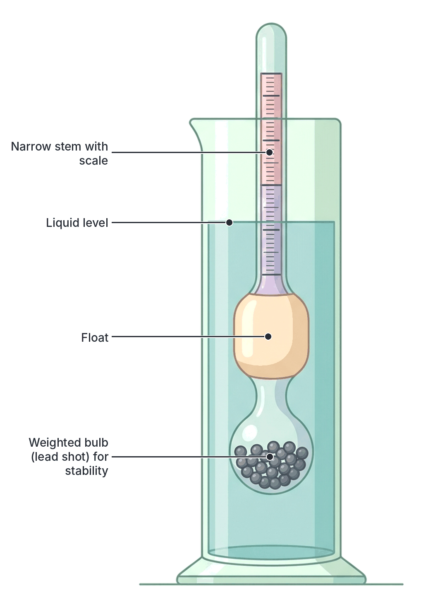

# JAMB Physics Notes: Liquids At Rest

## What JAMB expects

This file covers Section A, Topic 11 of the JAMB Physics syllabus: Liquids At Rest. It focuses on the behaviour of solids when they are placed in fluids (liquids and gases), covering fundamental concepts like density, upthrust, and floatation.

This file covers the following content items:
- (i) determination of density of solids and liquids
- (ii) definition of relative density
- (iii) upthrust on a body immersed in a liquid
- (iv) Archimedes’ principle and law of floatation and applications, e.g., ships and hydrometers.

By the end of these notes, you should be able to:
1. distinguish between density and relative density of substances;
2. determine the upthrust on a body immersed in a liquid;
3. apply Archimedes’ principle and law of floatation to solve problems.

## Determination of density of solids and liquids

To understand why some objects sink in water (like a stone) while others float (like a piece of dry wood or a ship), we must first look at how tightly packed their matter is. This property is measured by density.

**Density** ($\rho$) is defined as the mass of a substance per unit of its volume. 

The formula for density is:
$$\rho = \frac{m}{V}$$

where:
- $\rho$ (the Greek letter rho) is the density, measured in kilogram per cubic metre ($\text{kg m}^{-3}$).
- $m$ is the mass, measured in kilograms ($\text{kg}$).
- $V$ is the volume, measured in cubic metres ($\text{m}^{3}$).

Density can also be measured in gram per cubic centimetre ($\text{g cm}^{-3}$). To convert a density value from $\text{g cm}^{-3}$ to $\text{kg m}^{-3}$, you multiply it by $1000$. For example, the density of pure water is exactly $1\ \text{g cm}^{-3}$, which is equal to $1000\ \text{kg m}^{-3}$. 

### How to determine the density of a solid

The method used depends on whether the solid has a regular or irregular shape.
1. **Regular solids (e.g., a rectangular metal block or a wooden cylinder):** 
   - Measure the mass ($m$) using a chemical balance or an electronic top-pan balance.
   - Measure the physical dimensions (length, width, height, or radius) with a ruler, Vernier caliper, or micrometer screw gauge.
   - Calculate the volume using the appropriate geometric formula (for a rectangular block, $V = \text{length} \times \text{width} \times \text{height}$). 
   - Apply the density formula: $\rho = \frac{m}{V}$.
2. **Irregular solids (e.g., a rough stone or a piece of yam):**
   - Measure the mass of the solid in air using a balance.
   - To find the volume, use the **water displacement method**. Fill a measuring cylinder partially with a known volume of water. Tie a thin thread to the solid and gently lower it into the water until it is fully submerged. Note the new volume. The difference in volume is the volume of the solid. 
   - Alternatively, you can use a **Eureka can** (displacement can). Fill the can with water until it just begins to overflow from the spout. Place an empty measuring cylinder under the spout. When the irregular solid is gently lowered into the can, the volume of water that spills out into the measuring cylinder exactly equals the volume of the solid.

[IMAGE: A regular rectangular block being measured with a ruler and weighed on a top-pan balance, alongside an irregularly shaped stone being weighed on a spring balance, then lowered into a Eureka can (displacement can). Water from the spout flows into a measuring cylinder. Labels: "Regular solid: volume = length × width × height", "Irregular solid: displaced water volume = stone volume", "Eureka can", "Measuring cylinder". Clean flat textbook illustration, white background.]

### How to determine the density of a liquid

To find the density of a liquid (like palm oil, kerosene, or engine oil):
1. Weigh a clean, dry, empty beaker or a special **density bottle** (sometimes called a specific gravity bottle). Let this mass be $m_1$.
2. Fill the bottle completely with the liquid, insert the stopper (which has a tiny hole to let excess liquid escape, ensuring the volume is exact), wipe the outside dry, and weigh it again. Let this mass be $m_2$.
3. Calculate the mass of the liquid: $m = m_2 - m_1$.
4. The volume $V$ of the liquid is the exact capacity of the bottle, which is often printed on it (for example, $50\ \text{cm}^{3}$).
5. Apply the density formula: $\rho = \frac{m}{V}$.

**Worked Example 1: Density of a rectangular block**
A rectangular iron block used by an Okada mechanic has dimensions $5\ \text{cm} \times 4\ \text{cm} \times 2\ \text{cm}$. Its mass is $312\ \text{g}$. Calculate its density in $\text{kg m}^{-3}$.
1. **Calculate the volume in $\text{cm}^{3}$:** $V = 5\ \text{cm} \times 4\ \text{cm} \times 2\ \text{cm} = 40\ \text{cm}^{3}$.
2. **Calculate the density in $\text{g cm}^{-3}$:** $\rho = \frac{m}{V} = \frac{312\ \text{g}}{40\ \text{cm}^{3}} = 7.8\ \text{g cm}^{-3}$.
3. **Convert the density to $\text{kg m}^{-3}$:** Multiply by $1000$. $\rho = 7.8 \times 1000 = 7800\ \text{kg m}^{-3}$.
4. **State the final answer:** The density of the iron block is $7800\ \text{kg m}^{-3}$.

**Worked Example 2: Density of a mixture**
In a laboratory experiment, $2\ \text{m}^{3}$ of water (density $1000\ \text{kg m}^{-3}$) is mixed with $3\ \text{m}^{3}$ of a certain alcohol (density $500\ \text{kg m}^{-3}$). Assuming there is no change in total volume on mixing, calculate the density of the mixture.
1. **Identify the formula for the mixture:** Density of a mixture = $\frac{\text{Total Mass}}{\text{Total Volume}}$.
2. **Calculate the mass of the water:** $\text{Mass} = \text{Volume} \times \text{Density} = 2\ \text{m}^{3} \times 1000\ \text{kg m}^{-3} = 2000\ \text{kg}$.
3. **Calculate the mass of the alcohol:** $\text{Mass} = 3\ \text{m}^{3} \times 500\ \text{kg m}^{-3} = 1500\ \text{kg}$.
4. **Find total mass and total volume:** $\text{Total mass} = 2000\ \text{kg} + 1500\ \text{kg} = 3500\ \text{kg}$. $\text{Total volume} = 2\ \text{m}^{3} + 3\ \text{m}^{3} = 5\ \text{m}^{3}$.
5. **Calculate the mixture's density:** $\rho_{\text{mix}} = \frac{3500\ \text{kg}}{5\ \text{m}^{3}} = 700\ \text{kg m}^{-3}$.
6. **State the final answer:** The density of the mixture is $700\ \text{kg m}^{-3}$. *(Note: It is wrong to simply average the densities!)*

## Definition of relative density

**Relative Density (RD)** of a substance is the ratio of its density to the density of water. It tells us how many times denser a substance is compared to water. Water is used as the standard reference substance for solids and liquids.

$$RD = \frac{\text{Density of the substance}}{\text{Density of water}}$$

Because the volume of a given substance can be made exactly equal to the volume of water (for example, by using the same density bottle for both), relative density can also be defined as the ratio of masses (or weights):
$$RD = \frac{\text{Mass of any volume of the substance}}{\text{Mass of an equal volume of water}}$$

Because relative density is a ratio of two identical physical quantities (density divided by density, or mass divided by mass), the units cancel out. Therefore, relative density has **no units**. 

## Distinguish between density and relative density of substances

JAMB frequently tests your ability to tell these two quantities apart, both conceptually and in calculations. The table below summarises their key differences:

| Feature | Density ($\rho$) | Relative Density ($RD$) |
| --- | --- | --- |
| **Meaning** | The absolute mass of a substance per unit of its volume. | The ratio of the density of a substance to the density of water. |
| **Formula** | $\rho = \frac{m}{V}$ | $RD = \frac{\rho_{\text{substance}}}{\rho_{\text{water}}}$ |
| **SI Unit** | $\text{kg m}^{-3}$ (or $\text{g cm}^{-3}$) | **None** (it is a dimensionless quantity). |
| **Dependence on standards** | It is an absolute measurement; it does not depend on water. | It depends entirely on water as the reference standard. |
| **Example for iron** | $7800\ \text{kg m}^{-3}$ | $7.8$ |

**Common mistake:** Adding units to relative density. A student might write "The relative density of oil is $0.8\ \text{g cm}^{-3}$". This is strictly incorrect and will lead you to pick the wrong option in an exam. The density is $0.8\ \text{g cm}^{-3}$, but the relative density is simply $0.8$. Note that the numerical value of relative density is always exactly the same as the numerical value of density measured in $\text{g cm}^{-3}$.

## Upthrust on a body immersed in a liquid

When you try to push a sealed empty plastic bottle down into a bucket of water, you will feel a strong upward force pushing against your hand. If you let go, the bottle shoots up to the surface. This upward force exerted by a fluid on an object wholly or partially immersed in it is called **upthrust** (or buoyancy).

**Why does upthrust occur?**
Upthrust is caused by the difference in fluid pressure at different depths. We know that pressure in a liquid increases with depth ($P = \rho g h$). When an object is placed in a liquid, the bottom of the object is deeper than the top of the object. Therefore, the liquid pressure pushing upwards on the bottom of the object is greater than the liquid pressure pushing downwards on the top. The resultant (net) upward force is the upthrust.

Because of this upward force, objects feel lighter when they are placed in water than they do in air. The weight of the object measured when it is immersed in a fluid is called its **apparent weight**. The relationship is:

$$\text{Apparent Weight} = \text{Real Weight in air} - \text{Upthrust}$$

Therefore, we can easily calculate upthrust if we know the object's weight in air and its weight in the liquid:
$$U = W_{\text{air}} - W_{\text{liquid}}$$

## Determine the upthrust on a body immersed in a liquid

Depending on the information given in a JAMB question, upthrust can be determined in a few different ways. 

**Worked Example 3: Upthrust from apparent weight**
A metal sphere weighs $40\ \text{N}$ in air. When completely immersed in a beaker of water, a spring balance records its weight as $32\ \text{N}$. Determine the upthrust on the sphere.
1. **Identify the formula:** $U = W_{\text{air}} - W_{\text{liquid}}$.
2. **Substitute the values:** $U = 40\ \text{N} - 32\ \text{N}$.
3. **Calculate the result:** $U = 8\ \text{N}$.
4. **State the final answer:** The upthrust on the sphere is $8\ \text{N}$.

**Worked Example 4: Upthrust from volume (fully immersed)**
A solid object of volume $0.003\ \text{m}^{3}$ is completely immersed in water (density $= 1000\ \text{kg m}^{-3}$). Calculate the upthrust on the object. (Take $g = 10\ \text{m s}^{-2}$)
1. **Recall the formula for upthrust based on fluid displaced:** $U = V \rho_{\text{fluid}} g$ (where $V$ is the volume of fluid displaced, which equals the object's volume since it is fully immersed).
2. **Check units:** Volume is in $\text{m}^{3}$, density in $\text{kg m}^{-3}$. Units are consistent.
3. **Substitute the values:** $U = 0.003\ \text{m}^{3} \times 1000\ \text{kg m}^{-3} \times 10\ \text{m s}^{-2}$.
4. **Calculate the result:** $U = 30\ \text{N}$.
5. **State the final answer:** The upthrust on the object is $30\ \text{N}$.
*(Note: Always use the density of the **fluid**, never the density of the object, when calculating upthrust this way!)*

**Worked Example 5: Upthrust on a floating body**
A piece of dry wood of mass $0.4\ \text{kg}$ floats peacefully on a pond. What is the upthrust exerted by the water on the wood? (Take $g = 10\ \text{m s}^{-2}$)
1. **Identify the condition:** Since the wood is floating and stationary, it is in equilibrium. The upward force (upthrust) must exactly balance the downward force (weight). So, $U = \text{Weight}$.
2. **Calculate the weight of the wood:** $W = m g = 0.4\ \text{kg} \times 10\ \text{m s}^{-2} = 4\ \text{N}$.
3. **Equate upthrust to weight:** $U = 4\ \text{N}$.
4. **State the final answer:** The upthrust on the wood is $4\ \text{N}$.

## Archimedes’ principle and law of floatation and applications

The scientific laws governing upthrust and floatation were discovered by the ancient Greek mathematician Archimedes. According to legend, he discovered this while taking a bath and shouted "Eureka!" (meaning "I have found it!").

**Archimedes' Principle** states that:
> *When a body is wholly or partially immersed in a fluid, it experiences an upward force (upthrust) which is equal to the weight of the fluid it displaces.*

Mathematically:
$$U = \text{Weight of fluid displaced}$$
$$U = m_{\text{fluid}} g = \rho_{\text{fluid}} V_{\text{submerged}} g$$

Where:
- $\rho_{\text{fluid}}$ is the density of the fluid.
- $V_{\text{submerged}}$ is the volume of the object that is underwater (which is exactly equal to the volume of the displaced fluid).

**The Law of Floatation** is a special case of Archimedes' principle. It states that:
> *A floating body displaces its own weight of the fluid in which it floats.*

If a body is floating, it means it is in vertical equilibrium; the upthrust is perfectly balancing its total downward weight. 
$$U = W_{\text{body}}$$
$$\text{Weight of fluid displaced} = \text{Weight of the body}$$
$$\rho_{\text{fluid}} V_{\text{submerged}} g = \rho_{\text{body}} V_{\text{total}} g$$

From this equilibrium equation, we can find the fraction of the body's volume that is submerged:
$$\text{Fraction submerged} = \frac{V_{\text{submerged}}}{V_{\text{total}}} = \frac{\rho_{\text{body}}}{\rho_{\text{fluid}}}$$

**Applications of Archimedes' Principle and the Law of Floatation**

1. **Ships:** A ship is made of steel, which is much denser than water (and a solid block of steel would sink instantly). However, the hull of the ship is built hollow and contains a large volume of air, making its *average* density less than that of water. The ship floats because it displaces a massive volume of water, whose weight equals the weight of the entire ship. Ships have **Plimsoll lines** painted on their sides to show the maximum safe depth they can be loaded to in different types of water. Because seawater is denser than fresh water, it provides more upthrust per unit volume, so a ship floats higher in the sea than in a freshwater river.
2. **Hydrometers:** A hydrometer is an instrument used to measure the relative density of liquids directly (such as checking the density of acid in a car battery or testing milk). It works strictly on the law of floatation. It consists of a glass tube with a **weighted bulb** at the bottom (usually containing lead shot) to make it float upright, and a **narrow stem** to make it sensitive to small changes in density. A hydrometer sinks deeper in liquids with lower density (because it needs to displace a larger volume of fluid to equal its weight) and floats higher in liquids with higher density.
3. **Submarines:** Submarines can float or sink by deliberately altering their average density. They do this by pumping seawater into their **ballast tanks** to increase their weight and sink, or blowing the water out with compressed air to decrease their weight and float back to the surface.
4. **Hot-air and Helium Balloons:** Archimedes' principle applies to gases just as it does to liquids. A balloon floats in the sky because it is filled with a gas (like helium or heated air) that is less dense than the surrounding cold air. The balloon displaces a weight of air greater than its own total weight, resulting in a net upward force.

## Apply Archimedes’ principle and law of floatation to solve problems

We can use Archimedes' principle as a very clever way to calculate the relative density of solids and liquids easily, simply by weighing objects in air and in different fluids.

**Formula for Relative Density of a Solid:**
Since $RD = \frac{\text{Weight of substance}}{\text{Weight of equal volume of water}}$, and Archimedes' principle tells us that the upthrust in water equals the weight of the equal volume of water displaced, we can write:
$$RD_{\text{solid}} = \frac{\text{Weight of solid in air}}{\text{Upthrust on solid in water}} = \frac{W_{\text{air}}}{W_{\text{air}} - W_{\text{water}}}$$

**Formula for Relative Density of a Liquid:**
To find the RD of a liquid (like kerosene or salt solution), we take a solid object, weigh it in air, then in water, and then in the liquid.
$$RD_{\text{liquid}} = \frac{\text{Upthrust on solid in the liquid}}{\text{Upthrust on solid in water}} = \frac{W_{\text{air}} - W_{\text{liquid}}}{W_{\text{air}} - W_{\text{water}}}$$

**Worked Example 6: Relative density of a solid using Archimedes' principle**
A piece of stone weighs $1.5\ \text{N}$ in air and $1.0\ \text{N}$ when completely immersed in water. Calculate the relative density of the stone.
1. **Identify the formula:** $RD_{\text{solid}} = \frac{\text{Weight in air}}{\text{Upthrust in water}}$.
2. **Calculate upthrust in water:** $U = 1.5\ \text{N} - 1.0\ \text{N} = 0.5\ \text{N}$.
3. **Calculate relative density:** $RD = \frac{1.5\ \text{N}}{0.5\ \text{N}} = 3.0$.
4. **State the final answer:** The relative density of the stone is $3.0$ (no units).

**Worked Example 7: Relative density of a liquid using Archimedes' principle**
A metallic block weighs $5.0\ \text{N}$ in air. It weighs $3.5\ \text{N}$ when completely immersed in water, and $3.8\ \text{N}$ when completely immersed in a salt solution. Calculate the relative density of the salt solution.
1. **Calculate upthrust in water:** $U_{\text{water}} = 5.0\ \text{N} - 3.5\ \text{N} = 1.5\ \text{N}$.
2. **Calculate upthrust in the salt solution:** $U_{\text{liquid}} = 5.0\ \text{N} - 3.8\ \text{N} = 1.2\ \text{N}$.
3. **Apply the formula for RD of a liquid:** $RD_{\text{liquid}} = \frac{U_{\text{liquid}}}{U_{\text{water}}} = \frac{1.2\ \text{N}}{1.5\ \text{N}}$.
4. **Perform the division:** $1.2 / 1.5 = 12 / 15 = 4 / 5 = 0.8$.
5. **State the final answer:** The relative density of the salt solution is $0.8$.

**Worked Example 8: Floatation and fraction submerged**
A rectangular block of wood of density $600\ \text{kg m}^{-3}$ floats in a pool of water (density $1000\ \text{kg m}^{-3}$). What fraction of the volume of the wood is submerged?
1. **Identify the law of floatation formula:** $\text{Fraction submerged} = \frac{\rho_{\text{body}}}{\rho_{\text{fluid}}}$.
2. **Substitute the densities:** $\text{Fraction submerged} = \frac{600\ \text{kg m}^{-3}}{1000\ \text{kg m}^{-3}}$.
3. **Simplify the fraction:** $\frac{600}{1000} = \frac{3}{5}$.
4. **State the final answer:** $\frac{3}{5}$ (or $0.6$, or $60\%$) of the wood is submerged in the water.

**Worked Example 9: Force required to submerge a floating object**
A wooden block has a volume of $0.05\ \text{m}^{3}$ and a density of $400\ \text{kg m}^{-3}$. Calculate the minimum downward force that must be applied to hold it completely submerged in water of density $1000\ \text{kg m}^{-3}$. (Take $g = 10\ \text{m s}^{-2}$).
1. **Analyse the forces:** When fully submerged, the block experiences a downward weight ($W$), a downward applied force ($F$), and an upward upthrust ($U$). For the block to be in equilibrium under the water: $F + W = U$, meaning the applied force is $F = U - W$.
2. **Calculate the real weight ($W$) of the block:** $W = m g = (\rho_{\text{wood}} \times V) \times g = 400\ \text{kg m}^{-3} \times 0.05\ \text{m}^{3} \times 10\ \text{m s}^{-2} = 200\ \text{N}$.
3. **Calculate the upthrust ($U$) when fully submerged:** $U = \rho_{\text{water}} \times V \times g = 1000\ \text{kg m}^{-3} \times 0.05\ \text{m}^{3} \times 10\ \text{m s}^{-2} = 500\ \text{N}$.
4. **Calculate the required force ($F$):** $F = 500\ \text{N} - 200\ \text{N} = 300\ \text{N}$.
5. **State the final answer:** A downward force of $300\ \text{N}$ is required.

## Key terms

| Term | Meaning |
| --- | --- |
| **Density** | The mass of a substance per unit of its volume ($\rho = m/V$). Measured in $\text{kg m}^{-3}$. |
| **Relative Density** | The ratio of the density of a substance to the density of water. It has no units. |
| **Upthrust (Buoyancy)** | The upward force exerted by a fluid on an object wholly or partially immersed in it. |
| **Apparent Weight** | The measured weight of an object when it is immersed in a fluid. It is less than the real weight because of upthrust. |
| **Archimedes' Principle** | States that an object wholly or partially immersed in a fluid experiences an upthrust equal to the weight of the fluid it displaces. |
| **Law of Floatation** | States that a floating body displaces its own weight of the fluid in which it floats. |
| **Hydrometer** | An instrument used to measure the relative density of liquids directly, working on the principle of floatation. |
| **Eureka Can** | A displacement can used to find the volume of irregular solids. |

## Exam tips and common mistakes

- **Wrong Density in Upthrust Formula:** When calculating upthrust using $U = \rho V g$, the most common mistake is using the density of the *object*. Always use the density of the **fluid** that is being displaced!
- **Mixing Up Units:** Be careful with $\text{cm}^{3}$ and $\text{m}^{3}$. $1\ \text{m}^{3} = 1,000,000\ \text{cm}^{3}$ (or $10^{6}\ \text{cm}^{3}$). If a volume is given as $500\ \text{cm}^{3}$, it is $500 \times 10^{-6}\ \text{m}^{3}$.
- **Average Density Trap:** If asked for the density of a mixture of two liquids, DO NOT just add their densities and divide by two. You must find the total mass and divide by the total volume.
- **Hydrometer Sensitivity:** Remember that a hydrometer sinks deeper in *less* dense liquids (like petrol) and floats higher in *denser* liquids (like salt water). The scale on a hydrometer increases downwards.
- **Units for Relative Density:** Relative density has NO UNITS. If an option says "Relative density is $0.8\ \text{kg m}^{-3}$", that option is false. 

## Quick summary

1. Density is mass per unit volume ($\rho = m/V$), measured in $\text{kg m}^{-3}$. Relative density is the ratio of a substance's density to water's density and has no units.
2. The density of an irregular solid is found by water displacement using a measuring cylinder or a Eureka can. A density bottle is used for liquids.
3. An object wholly or partially immersed in a fluid experiences an upward force called upthrust, which arises from the pressure difference between the top and bottom of the object.
4. Apparent weight = Real weight in air - Upthrust.
5. Archimedes' principle states that the upthrust on a body equals the weight of the fluid it displaces.
6. The law of floatation states that a floating body displaces its own weight in fluid. The fraction of a floating body that is submerged equals the ratio of the body's density to the fluid's density.
7. Important applications of these principles include the design of ships (which use hollow steel hulls), submarines (which use ballast tanks), hot-air balloons, and the hydrometer.

## Practice questions

**1. A solid weighs $40\ \text{N}$ in air and $30\ \text{N}$ when completely immersed in water. What is the upthrust on the solid?**
- A. $70\ \text{N}$
- B. $30\ \text{N}$
- C. $10\ \text{N}$
- D. $0.75\ \text{N}$

**Answer: C.** 
1. Upthrust ($U$) = Real weight - Apparent weight.
2. $U = 40\ \text{N} - 30\ \text{N} = 10\ \text{N}$. 
Mistake behind A: Adding the weights instead of subtracting them.

**2. $3\ \text{kg}$ of liquid A with a density of $600\ \text{kg m}^{-3}$ is mixed with $2\ \text{kg}$ of liquid B with a density of $800\ \text{kg m}^{-3}$. Assuming there is no change in volume on mixing, calculate the density of the mixture.**
- A. $700\ \text{kg m}^{-3}$
- B. $667\ \text{kg m}^{-3}$
- C. $600\ \text{kg m}^{-3}$
- D. $1400\ \text{kg m}^{-3}$

**Answer: B.** 
1. Volume of A = $m / \rho = 3 / 600 = 0.005\ \text{m}^{3}$.
2. Volume of B = $m / \rho = 2 / 800 = 0.0025\ \text{m}^{3}$.
3. Total Volume = $0.005 + 0.0025 = 0.0075\ \text{m}^{3}$.
4. Total Mass = $3 + 2 = 5\ \text{kg}$.
5. Density of mixture = Total Mass / Total Volume = $5 / 0.0075 \approx 667\ \text{kg m}^{-3}$. 
Mistake behind A: Taking the simple average of the densities $((600+800)/2 = 700)$, which is incorrect because the volumes are different.

**3. An empty density bottle has a mass of $20\ \text{g}$. When completely filled with water, its mass is $70\ \text{g}$. When completely filled with an unknown liquid, its mass is $60\ \text{g}$. What is the relative density of the liquid?**
- A. $0.8$
- B. $0.85$
- C. $1.25$
- D. $1.2$

**Answer: A.** 
1. Mass of water = $70\ \text{g} - 20\ \text{g} = 50\ \text{g}$.
2. Mass of liquid = $60\ \text{g} - 20\ \text{g} = 40\ \text{g}$.
3. Relative Density = Mass of liquid / Mass of equal volume of water = $40 / 50 = 0.8$.
Mistake behind D: Dividing the total masses including the bottle ($60 / 50 = 1.2$), forgetting to subtract the mass of the empty bottle first.

**4. A wooden block floats in water with two-thirds of its volume submerged. If the density of water is $1000\ \text{kg m}^{-3}$, what is the density of the wood?**
- A. $333\ \text{kg m}^{-3}$
- B. $667\ \text{kg m}^{-3}$
- C. $1500\ \text{kg m}^{-3}$
- D. $1000\ \text{kg m}^{-3}$

**Answer: B.** 
1. Fraction submerged = $\rho_{\text{wood}} / \rho_{\text{water}}$.
2. $2/3 = \rho_{\text{wood}} / 1000$.
3. $\rho_{\text{wood}} = 1000 \times (2/3) \approx 667\ \text{kg m}^{-3}$.
Mistake behind C: Assuming the density of wood is greater than water, but objects denser than water sink; they do not float.

**5. A metal object weighs $15\ \text{N}$ in air and $10\ \text{N}$ when completely immersed in water. What is the volume of the object? (Density of water = $1000\ \text{kg m}^{-3}$, $g = 10\ \text{m s}^{-2}$)**
- A. $5.0 \times 10^{-4}\ \text{m}^{3}$
- B. $1.0 \times 10^{-3}\ \text{m}^{3}$
- C. $1.5 \times 10^{-3}\ \text{m}^{3}$
- D. $5.0 \times 10^{-3}\ \text{m}^{3}$

**Answer: A.** 
1. Upthrust = $15\ \text{N} - 10\ \text{N} = 5\ \text{N}$.
2. $U = V \rho_{\text{water}} g$.
3. $5 = V \times 1000 \times 10$.
4. $V = 5 / 10000 = 5 \times 10^{-4}\ \text{m}^{3}$.
Mistake behind C: Using the real weight ($15\ \text{N}$) instead of the upthrust to find the volume.

**6. A ship of mass $2000\ \text{kg}$ floats securely in a harbour of fresh water. What volume of water does it displace? (Density of fresh water = $1000\ \text{kg m}^{-3}$)**
- A. $0.5\ \text{m}^{3}$
- B. $2.0\ \text{m}^{3}$
- C. $20.0\ \text{m}^{3}$
- D. $2000\ \text{m}^{3}$

**Answer: B.** 
1. By the law of floatation, the weight of water displaced = the weight of the ship. Therefore, the mass of water displaced = the mass of the ship = $2000\ \text{kg}$.
2. Volume = Mass / Density = $2000\ \text{kg} / 1000\ \text{kg m}^{-3} = 2.0\ \text{m}^{3}$.
Mistake behind A: Doing Density / Mass ($1000 / 2000$) instead of Mass / Density.

**7. A piece of cork of mass $0.05\ \text{kg}$ and density $250\ \text{kg m}^{-3}$ is forcefully held completely under water. Calculate the upthrust on the cork. (Density of water = $1000\ \text{kg m}^{-3}$, $g = 10\ \text{m s}^{-2}$)**
- A. $0.5\ \text{N}$
- B. $2.0\ \text{N}$
- C. $4.0\ \text{N}$
- D. $20.0\ \text{N}$

**Answer: B.** 
1. Find the volume of the cork: $V = \text{Mass} / \text{Density} = 0.05 / 250 = 0.0002\ \text{m}^{3}$.
2. Calculate upthrust using the fluid's density: $U = V \rho_{\text{water}} g = 0.0002 \times 1000 \times 10 = 2.0\ \text{N}$.
Mistake behind A: Calculating the weight of the cork ($mg = 0.05 \times 10 = 0.5\ \text{N}$) and calling it upthrust. The cork is forcibly fully submerged, so it is displacing water equivalent to its total volume, not floating.

**8. An object has a volume of $0.002\ \text{m}^{3}$ and a density of $3000\ \text{kg m}^{-3}$. It is fully immersed in oil of density $800\ \text{kg m}^{-3}$. Find its apparent weight in the oil. ($g = 10\ \text{m s}^{-2}$)**
- A. $60\ \text{N}$
- B. $44\ \text{N}$
- C. $16\ \text{N}$
- D. $76\ \text{N}$

**Answer: B.** 
1. Real weight in air ($W$) = $V \rho_{\text{object}} g = 0.002 \times 3000 \times 10 = 60\ \text{N}$.
2. Upthrust in oil ($U$) = $V \rho_{\text{oil}} g = 0.002 \times 800 \times 10 = 16\ \text{N}$.
3. Apparent weight = $W - U = 60 - 16 = 44\ \text{N}$.
Mistake behind C: This is the upthrust, not the apparent weight.

**9. Which of the following statements about a hydrometer is correct?**
- A. It sinks deeper in liquids with higher densities.
- B. It relies on Archimedes' principle and the law of floatation.
- C. Its narrow stem makes it less sensitive to small changes in density.
- D. It is loaded with lead shot at the top to keep it stable.

**Answer: B.** 
A hydrometer works based on the law of floatation. 
Mistake behind A: It actually sinks deeper in *lower* density liquids, because it needs to displace a larger volume of that lighter liquid to equal its own weight. The lead shot is placed at the *bottom* for stability (D), and a narrow stem makes it *more* sensitive (C).

**10. A wooden block has a volume of $0.1\ \text{m}^{3}$ and a density of $600\ \text{kg m}^{-3}$. What downward force must be applied to keep it completely submerged in water? (Density of water = $1000\ \text{kg m}^{-3}$, $g = 10\ \text{m s}^{-2}$)**
- A. $400\ \text{N}$
- B. $600\ \text{N}$
- C. $1000\ \text{N}$
- D. $1600\ \text{N}$

**Answer: A.** 
1. Weight of block ($W$) acting downwards = $V \rho_{\text{wood}} g = 0.1 \times 600 \times 10 = 600\ \text{N}$.
2. Upthrust ($U$) when fully submerged acting upwards = $V \rho_{\text{water}} g = 0.1 \times 1000 \times 10 = 1000\ \text{N}$.
3. Resultant upward force = $U - W = 1000 - 600 = 400\ \text{N}$.
4. To hold it in equilibrium (not moving upwards), an equal downward applied force of $400\ \text{N}$ is required.
Mistake behind C: This is just the upthrust, completely ignoring the block's own downward weight which helps to submerge it.
