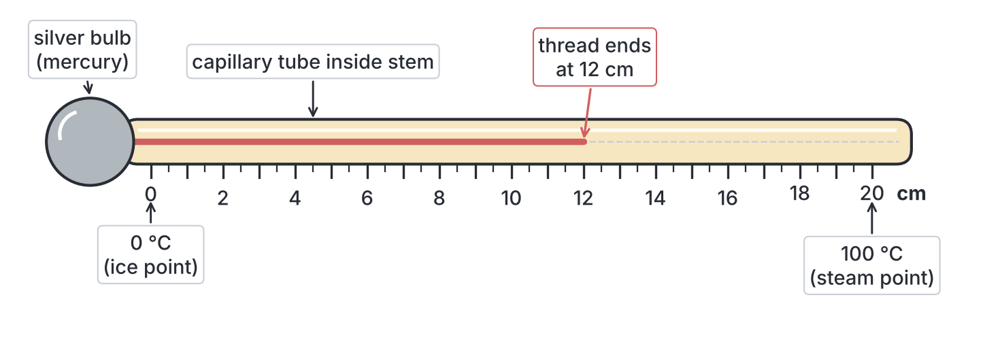
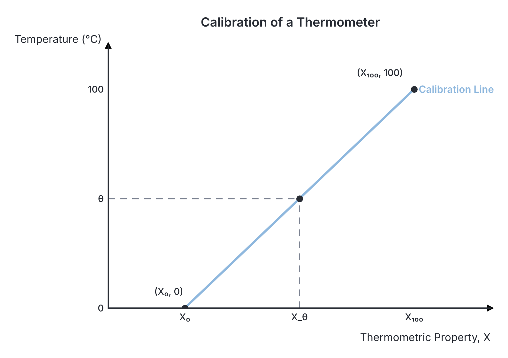
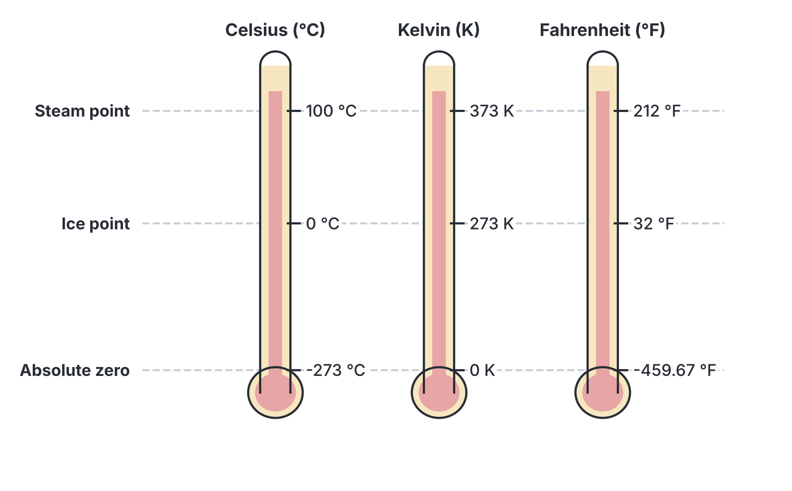

# JAMB Physics Notes: Temperature and Its Measurement

## What JAMB expects

This topic is Section A, Topic 12 of the JAMB Physics syllabus. It covers the following content items:
* (i) concept of temperature
* (ii) thermometric properties
* (iii) calibration of thermometers
* (iv) temperature scales – Celsius and Kelvin.
* (v) types of thermometers
* (vi) conversion from one scale of temperature to another

By the end of these notes, you should be able to:
1. identify thermometric properties of materials that are used for different thermometers;
2. calibrate thermometers;
3. differentiate between temperature scales e.g. Celsius, Fahrenheit and Kelvin;
4. compare the types of thermometers;
5. convert from one scale of temperature to another.

**Note on the syllabus wording:** The JAMB syllabus numbering for the objectives skips (v) and goes directly from (iv) to (vi). For clarity and continuous numbering, the final objective (conversion of scales) is listed as objective (v) in these notes. The notes cover all listed objectives and contents comprehensively.

## Concept of temperature

**Temperature** is defined as the measure of the degree of hotness or coldness of a body. In physics, it is closely related to the average kinetic energy of the molecules in a substance; the faster the molecules move, the higher the temperature. 

It is crucial not to confuse temperature with **heat**. 
* **Heat** is a form of energy (thermal energy) that flows from a body at a higher temperature to a body at a lower temperature. Its SI unit is the Joule ($\text{J}$). It depends on the total number of particles (mass) and their energy.
* **Temperature** is a property that determines the *direction* of heat flow between two bodies in contact. Heat always flows from a higher temperature to a lower temperature. Its SI unit is the Kelvin ($\text{K}$). Two bodies are in **thermal equilibrium** when they are at the exact same temperature, meaning no net heat flows between them.

For a deeper look into heat energy and its measurement, see `A13-quantity-of-heat.md`, and for the kinetic theory of molecules, see `A18-structure-of-matter-kinetic-theory.md`.

## Thermometric properties

To measure temperature accurately, we cannot simply rely on our sense of touch. We must use a substance that changes in a measurable, continuous, and predictable way as it gets hotter or colder.

A **thermometric property** is a physical property of a substance that varies continuously and linearly with temperature. By measuring this physical property, we can determine the temperature of the body it is in contact with.

Whenever a JAMB question asks you for the working principle behind a thermometer, you are identifying its thermometric property. For example, a constant-volume gas thermometer relies strictly on the change in *pressure* of the gas as temperature changes.

Here is a table showing common types of thermometers and their specific thermometric properties:

| Type of Thermometer | Thermometric Property |
| --- | --- |
| Liquid-in-glass thermometer (Mercury or Alcohol) | Change in **volume** (usually measured as the **length** of the liquid column in a narrow tube) |
| Constant-volume gas thermometer | Change in **pressure** of a fixed mass of gas kept at a constant volume |
| Constant-pressure gas thermometer | Change in **volume** of a fixed mass of gas kept at a constant pressure |
| Resistance thermometer | Change in **electrical resistance** of a metal wire (e.g., platinum) |
| Thermocouple | Change in **electromotive force (e.m.f.)** or voltage generated between two junctions of dissimilar metals kept at different temperatures |
| Optical/Radiation pyrometer | Change in the **colour** or **intensity of radiation** (light) emitted by a very hot body |

## Types of thermometers

Different situations require different thermometers. You wouldn't use a mercury thermometer to measure the temperature of a melting iron furnace, nor would you use a pyrometer to measure a student's body temperature during a malaria fever. 

### Comparing the types of thermometers

The table below compares the main types of thermometers, highlighting their ranges, advantages, and disadvantages.

| Thermometer Type | Useful Range | Advantages | Disadvantages | Applications |
| --- | --- | --- | --- | --- |
| **Mercury-in-glass** | $-39^\circ\text{C}$ to $357^\circ\text{C}$ | Portable, cheap, opaque (easy to read), does not wet glass, good conductor of heat. | Fragile, mercury is poisonous, cannot measure very low temperatures (freezes at $-39^\circ\text{C}$). | General laboratory use, clinical thermometers. |
| **Alcohol-in-glass** | $-115^\circ\text{C}$ to $78^\circ\text{C}$ | Expands much more than mercury (very sensitive), excellent for very cold regions. | Wets glass (clings to the tube), boils at a low temperature ($78^\circ\text{C}$), transparent (needs dye to be seen). | Weather stations in cold climates. |
| **Constant-volume gas** | $-270^\circ\text{C}$ to $1500^\circ\text{C}$ | Highly accurate, wide temperature range. | Very bulky, not portable, very slow to respond to changes. | Used as a standard to calibrate other thermometers in precision labs. |
| **Platinum Resistance** | $-200^\circ\text{C}$ to $1200^\circ\text{C}$ | Extremely accurate and sensitive over a very wide range. | Bulky, slow to reach thermal equilibrium (slow response). | Scientific research and precision industrial measurements. |
| **Thermocouple** | $-200^\circ\text{C}$ to $1700^\circ\text{C}$ | **Very fast response** (due to small heat capacity of the wire junction), can measure temperature at a single point and rapidly changing temperatures. | Requires a sensitive voltmeter, non-linear reading at extremes. | Measuring rapid temperature changes, industrial ovens. |
| **Optical Pyrometer** | Above $1000^\circ\text{C}$ | Does not require physical contact with the hot body, measures extremely high temperatures. | Cannot be used for objects that are not glowing red-hot. | Measuring the temperature of furnaces (e.g., at Ajaokuta steel mill) and molten metals. |

**Clinical Thermometers:** A special type of mercury-in-glass thermometer used to measure human body temperature. It has a narrow range (usually from $35^\circ\text{C}$ to $43^\circ\text{C}$) because human body temperature does not fluctuate far from $37^\circ\text{C}$. It features a **constriction (kink)** just above the bulb. This prevents the mercury thread from falling back immediately when removed from the patient's mouth or armpit, giving the doctor time to read it.

## Calibration of thermometers

Calibrating a thermometer means setting up a scale on an unmarked thermometer so it can be used to read temperature accurately. This is done using **fixed points**—temperatures at which a specific physical change of state occurs under standard atmospheric pressure ($760\ \text{mm Hg}$). 

To calibrate a basic Celsius thermometer, we use two standard fixed points:
1.  **Lower Fixed Point (Ice Point):** The temperature of pure melting ice at standard atmospheric pressure. On the Celsius scale, this is defined as **$0^\circ\text{C}$**.
    *   *Precaution:* The ice must be pure, because impurities lower the melting point.
2.  **Upper Fixed Point (Steam Point):** The temperature of steam coming from pure boiling water at standard atmospheric pressure. On the Celsius scale, this is defined as **$100^\circ\text{C}$**.
    *   *Precaution:* The thermometer bulb must be placed in the steam, not inside the boiling water itself. Impurities raise the boiling point of water, but the steam immediately above it remains at exactly $100^\circ\text{C}$.

The distance between the lower fixed point and the upper fixed point on the thermometer is called the **fundamental interval**. For the Celsius scale, this interval is divided into 100 equal parts (degrees).

### The Interpolation Formula

If you have an uncalibrated thermometer (or a faulty one), you can find the true temperature $\theta$ by using proportional ratios. Assuming the thermometric property changes linearly, we use this formula:

$$\theta = \frac{X_\theta - X_0}{X_{100} - X_0} \times 100^\circ\text{C}$$

Where:
*   $\theta$ is the unknown temperature you want to find, in $^\circ\text{C}$.
*   $X_\theta$ is the value of the thermometric property at temperature $\theta$.
*   $X_0$ is the value of the thermometric property at the ice point ($0^\circ\text{C}$).
*   $X_{100}$ is the value of the thermometric property at the steam point ($100^\circ\text{C}$).
*   $(X_{100} - X_0)$ represents the fundamental interval.

### Common mistakes in calibration
*   **Forgetting to subtract the lower fixed point:** When using the formula, students frequently forget to subtract $X_0$ from $X_\theta$ in the numerator. Always subtract the ice-point value before dividing. For example, if $X_{100}=22.0$, $X_0=2.0$, and $X_\theta=10.0$, the true answer is $\frac{8.0}{20.0}\times 100 = 40^\circ\text{C}$. The wrong calculation $\frac{10.0}{20.0}\times 100$ incorrectly yields $50^\circ\text{C}$.

### Worked Examples on Calibration

**Worked Example 1: Calculating temperature from liquid column length**
An uncalibrated mercury-in-glass thermometer has a mercury thread length of $5.0\ \text{cm}$ in pure melting ice and $25.0\ \text{cm}$ in steam above boiling water. What is the temperature of a warm cup of tea if the mercury thread length is $12.0\ \text{cm}$?

**Solution:**
1. **Identify the given values:**
   - Length at lower fixed point, $X_0 = 5.0\ \text{cm}$.
   - Length at upper fixed point, $X_{100} = 25.0\ \text{cm}$.
   - Length at unknown temperature $\theta$, $X_\theta = 12.0\ \text{cm}$.
2. **State the fundamental formula:** $\theta = \frac{X_\theta - X_0}{X_{100} - X_0} \times 100^\circ\text{C}$.
3. **Substitute the values into the formula:** $\theta = \frac{12.0 - 5.0}{25.0 - 5.0} \times 100^\circ\text{C}$.
4. **Calculate the temperature:**
   - Numerator (change from ice point): $12.0 - 5.0 = 7.0\ \text{cm}$.
   - Denominator (fundamental interval): $25.0 - 5.0 = 20.0\ \text{cm}$.
   - $\theta = \frac{7.0}{20.0} \times 100^\circ\text{C} = 0.35 \times 100 = 35^\circ\text{C}$.
5. **State the final answer:** The temperature of the tea is $35^\circ\text{C}$.

**Worked Example 2: Finding resistance at a given temperature**
A platinum resistance thermometer has a resistance of $10\ \Omega$ at $0^\circ\text{C}$ and $30\ \Omega$ at $100^\circ\text{C}$. What is the resistance of the wire when placed in an oven at $75^\circ\text{C}$?

**Solution:**
1. **Identify the given values:**
   - Resistance at ice point, $R_0 = 10\ \Omega$.
   - Resistance at steam point, $R_{100} = 30\ \Omega$.
   - Known temperature, $\theta = 75^\circ\text{C}$.
2. **State the fundamental formula:** $\theta = \frac{R_\theta - R_0}{R_{100} - R_0} \times 100^\circ\text{C}$.
3. **Substitute the values into the formula:**
   - $75 = \frac{R_\theta - 10}{30 - 10} \times 100$.
4. **Calculate the unknown resistance $R_\theta$:**
   - Simplify the denominator: $30 - 10 = 20\ \Omega$.
   - $75 = \frac{R_\theta - 10}{20} \times 100$.
   - Divide 100 by 20: $75 = (R_\theta - 10) \times 5$.
   - Divide both sides by 5: $15 = R_\theta - 10$.
   - Add 10 to both sides: $R_\theta = 15 + 10 = 25\ \Omega$.
5. **State the final answer:** The resistance at $75^\circ\text{C}$ is $25\ \Omega$.

**Worked Example 3: Finding true temperature from a faulty thermometer**
A student in the laboratory uses a faulty thermometer. It reads $5^\circ\text{C}$ in pure melting ice and $85^\circ\text{C}$ in steam at standard atmospheric pressure. What is the true temperature when this faulty thermometer reads $37^\circ\text{C}$?

**Solution:**
1. **Identify the given values:**
   - Faulty lower fixed point reading, $X_0 = 5^\circ\text{C}$.
   - Faulty upper fixed point reading, $X_{100} = 85^\circ\text{C}$.
   - Faulty reading at unknown true temperature, $X_\theta = 37^\circ\text{C}$.
2. **State the fundamental interpolation formula:** True temperature, $\theta = \frac{X_\theta - X_0}{X_{100} - X_0} \times 100^\circ\text{C}$.
3. **Substitute the faulty values into the formula:** $\theta = \frac{37 - 5}{85 - 5} \times 100^\circ\text{C}$.
4. **Calculate the true temperature:**
   - Numerator: $37 - 5 = 32$.
   - Denominator (faulty fundamental interval): $85 - 5 = 80$.
   - $\theta = \frac{32}{80} \times 100^\circ\text{C}$.
   - Simplify the fraction: $\frac{32}{80} = 0.4$.
   - $\theta = 0.4 \times 100^\circ\text{C} = 40^\circ\text{C}$.
5. **State the final answer:** The true temperature is $40^\circ\text{C}$.

## Temperature scales: Celsius and Kelvin

The two primary scales required by the syllabus are the **Celsius ($^\circ\text{C}$)** and **Kelvin ($\text{K}$)** scales, though Fahrenheit is also commonly referenced when discussing conversions. The Celsius scale is practically defined by the freezing and boiling points of water. The Kelvin scale is the absolute thermodynamic scale and is the SI unit of temperature. 

### Differentiating between temperature scales

We distinguish these scales based on their fixed points, fundamental intervals, and origins.

| Feature | Celsius ($^\circ\text{C}$) | Kelvin ($\text{K}$) | Fahrenheit ($^\circ\text{F}$) |
| --- | --- | --- | --- |
| **Lower Fixed Point** (Ice point) | $0^\circ\text{C}$ | $273\ \text{K}$ | $32^\circ\text{F}$ |
| **Upper Fixed Point** (Steam point) | $100^\circ\text{C}$ | $373\ \text{K}$ | $212^\circ\text{F}$ |
| **Fundamental Interval** | 100 degrees | 100 divisions | 180 degrees |
| **Absolute Zero** | $-273^\circ\text{C}$ | $0\ \text{K}$ | $-459.67^\circ\text{F}$ |

*   **Absolute Zero** is the lowest theoretically possible temperature. At this point, particles possess their minimum possible kinetic energy, and the volume of an ideal gas drops to zero.
*   Notice that the fundamental interval for both Celsius and Kelvin is 100. This means a *change* of $1^\circ\text{C}$ is exactly equal to a *change* of $1\ \text{K}$. 
*   However, the Fahrenheit scale has 180 divisions between the same two points. Therefore, 1 degree on the Celsius scale is physically larger than 1 degree on the Fahrenheit scale.

### Conversion between temperature scales

To convert correctly between scales, we use standard formulas derived from the ratios of their fundamental intervals.

**1. Celsius to Kelvin:**
To convert from Celsius to Kelvin, simply add 273. (Note: The exact scientific value is 273.15, but for JAMB and UTME purposes, you should always use 273 unless the question specifies otherwise).
$$T = \theta + 273$$
Where $T$ is the temperature in Kelvin ($\text{K}$) and $\theta$ is the temperature in Celsius ($^\circ\text{C}$).

**2. Celsius to Fahrenheit:**
We compare the ratios of their scales. The distance from the ice point divided by the fundamental interval must be the same for both scales:
$$\frac{C - 0}{100} = \frac{F - 32}{180}$$
Where $C$ is the temperature in Celsius and $F$ is the temperature in Fahrenheit. By simplifying the denominators (dividing both by 20), we get the standard conversion formula:
$$\frac{C}{5} = \frac{F - 32}{9}$$

### Common mistakes in temperature conversions
*   **Applying the conversion fraction backwards:** When converting Fahrenheit to Celsius using $C = \frac{5}{9}(F - 32)$, a common mistake is to multiply by $\frac{9}{5}$ or to add $32$ instead of subtracting it. Always perform the subtraction $(F - 32)$ first before multiplying by $\frac{5}{9}$.
*   **Sign errors with negative temperatures:** When calculating the temperature where Celsius and Fahrenheit are equal, sign errors easily lead to incorrect answers like $+40^\circ$ instead of the correct $-40^\circ$. Ensure brackets are expanded correctly during algebraic steps.

**Worked Example 4: Converting human body temperature**
During a mild malaria fever in Lagos, a student's body temperature is measured as $39^\circ\text{C}$. Convert this temperature to Fahrenheit and Kelvin.

**Solution:**
1. **Identify the given values:** Temperature in Celsius, $C = 39^\circ\text{C}$.
2. **State the formula for Celsius to Fahrenheit:** $\frac{C}{5} = \frac{F - 32}{9}$.
3. **Substitute the given value into the formula:** $\frac{39}{5} = \frac{F - 32}{9}$.
4. **Calculate the Fahrenheit value:**
   - $7.8 = \frac{F - 32}{9}$
   - Cross multiply: $F - 32 = 7.8 \times 9 = 70.2$
   - $F = 70.2 + 32 = 102.2^\circ\text{F}$.
5. **State the formula for Celsius to Kelvin:** $T = \theta + 273$.
6. **Substitute and calculate the Kelvin value:** $T = 39 + 273 = 312\ \text{K}$.
7. **State the final answers:** The temperature is $102.2^\circ\text{F}$ and $312\ \text{K}$.

**Worked Example 5: Equal readings on Celsius and Fahrenheit**
At what temperature do the Celsius and Fahrenheit scales read the exact same numerical value?

**Solution:**
1. **Set up the condition:** Let the temperature be $\theta$. So, $C = \theta$ and $F = \theta$.
2. **State the formula:** $\frac{C}{5} = \frac{F - 32}{9}$.
3. **Substitute $\theta$ into the formula:** $\frac{\theta}{5} = \frac{\theta - 32}{9}$.
4. **Solve for $\theta$:**
   - Cross multiply: $9\theta = 5(\theta - 32)$.
   - Expand the bracket: $9\theta = 5\theta - 160$.
   - Subtract $5\theta$ from both sides: $9\theta - 5\theta = -160$.
   - $4\theta = -160$.
   - $\theta = \frac{-160}{4} = -40$.
5. **State the final answer:** The scales read the same value at $-40^\circ$ (i.e., $-40^\circ\text{C} = -40^\circ\text{F}$).

## Key terms

| Term | Meaning |
| --- | --- |
| **Temperature** | The degree of hotness or coldness of a body, related to the average kinetic energy of its molecules. |
| **Thermometric property** | A physical property that varies continuously and linearly with temperature changes (e.g., volume, resistance). |
| **Ice Point** | The lower fixed point ($0^\circ\text{C}$); the temperature of pure melting ice at standard atmospheric pressure. |
| **Steam Point** | The upper fixed point ($100^\circ\text{C}$); the temperature of steam from pure boiling water at standard atmospheric pressure. |
| **Fundamental interval** | The range between the upper and lower fixed points on a temperature scale. |
| **Absolute Zero** | The lowest theoretically possible temperature ($0\ \text{K}$ or $-273^\circ\text{C}$) where particles have minimum kinetic energy. |
| **Thermal Equilibrium** | A state where two bodies in contact are at the exact same temperature and no net heat flows between them. |

## Exam tips and common mistakes

* **Mistaking Heat for Temperature:** Remember, heat is measured in Joules (energy), and temperature is measured in Kelvin or Celsius. Heat depends on mass; temperature does not.
* **Faulty Thermometers:** When dealing with faulty thermometers, treat them exactly like an uncalibrated thermometer. The faulty readings are your $X_0$ and $X_{100}$. 
* **Steam point precaution:** The upper fixed point is defined by the temperature of the *steam*, not the boiling water itself. This is because impurities alter the water's boiling point but not the temperature of the pure steam above it.
* **Temperature Change rule:** A temperature change of $1^\circ\text{C}$ is identical to a temperature change of $1\ \text{K}$. Do not add 273 when converting a temperature *difference* (e.g., a rise of $10^\circ\text{C}$ is a rise of $10\ \text{K}$).

## Quick summary

1. Temperature measures the degree of hotness, indicating the direction of heat flow, while heat is the actual thermal energy transferred.
2. A thermometric property is a physical characteristic (like volume, pressure, or resistance) that changes linearly with temperature and is used to design thermometers.
3. Different thermometers are chosen based on the task: thermocouples for rapidly changing temperatures, resistance thermometers for precision, and pyrometers for extremely high temperatures.
4. Thermometers are calibrated using two standard fixed points: the pure melting ice point ($0^\circ\text{C}$) and the pure boiling water steam point ($100^\circ\text{C}$).
5. For an uncalibrated or faulty thermometer, the true temperature $\theta$ is found using the ratio of the change from the ice point to the fundamental interval: $\theta = \frac{X_\theta - X_0}{X_{100} - X_0} \times 100^\circ\text{C}$.
6. The three main scales are Celsius, Fahrenheit, and Kelvin. Absolute zero occurs at $0\ \text{K}$, which is equivalent to $-273^\circ\text{C}$.
7. Conversions between scales follow strict formulas: $T = \theta + 273$ and $\frac{C}{5} = \frac{F - 32}{9}$.

## Practice questions

**1. A patient's temperature is measured as $35^\circ\text{C}$. What is this temperature in Kelvin?**
- A. $-238\ \text{K}$
- B. $35\ \text{K}$
- C. $308\ \text{K}$
- D. $63\ \text{K}$

**Answer: C.** 
1. State the formula for converting Celsius to Kelvin: $T = \theta + 273$.
2. Substitute the given Celsius temperature: $T = 35 + 273$.
3. Calculate the final value: $T = 308\ \text{K}$.
*Mistake A comes from incorrectly subtracting 273 instead of adding it ($35 - 273 = -238\ \text{K}$).*

**2. Which of the following is the thermometric property of a constant-volume gas thermometer?**
- A. Change in volume of the gas
- B. Change in pressure of the gas
- C. Change in electrical resistance
- D. Change in electromotive force

**Answer: B.** A constant-volume gas thermometer relies on the change in pressure of the gas at a fixed volume as temperature changes. 

**3. At what temperature do the Celsius and Fahrenheit scales read the exact same numerical value?**
- A. $0^\circ$
- B. $-40^\circ$
- C. $40^\circ$
- D. $100^\circ$

**Answer: B.** 
1. State the conversion formula: $\frac{C}{5} = \frac{F - 32}{9}$.
2. Set $C = F = \theta$: $\frac{\theta}{5} = \frac{\theta - 32}{9}$.
3. Cross-multiply: $9\theta = 5(\theta - 32)$.
4. Expand the bracket: $9\theta = 5\theta - 160$.
5. Solve for $\theta$: $4\theta = -160$, therefore $\theta = -40^\circ$.
*Mistake C comes from a sign error when moving terms across the equals sign, resulting in $4\theta = 160$ and $\theta = 40^\circ$.*

**4. The resistance of a platinum wire is $2.5\ \Omega$ at the ice point and $3.5\ \Omega$ at the steam point. What is the resistance of the wire at $80^\circ\text{C}$?**
- A. $0.8\ \Omega$
- B. $2.8\ \Omega$
- C. $3.3\ \Omega$
- D. $4.5\ \Omega$

**Answer: C.** 
1. State the interpolation formula: $\theta = \frac{R_\theta - R_0}{R_{100} - R_0} \times 100^\circ\text{C}$.
2. Substitute the known values: $80 = \frac{R_\theta - 2.5}{3.5 - 2.5} \times 100$.
3. Simplify the denominator: $80 = \frac{R_\theta - 2.5}{1.0} \times 100$.
4. Divide by 100: $0.8 = R_\theta - 2.5$.
5. Add 2.5 to both sides: $R_\theta = 2.5 + 0.8 = 3.3\ \Omega$.
*Mistake B comes from ignoring the lower fixed point completely in the numerator and simply calculating $\frac{80}{100} \times 3.5 = 2.8\ \Omega$.*

**5. An uncalibrated liquid-in-glass thermometer has a liquid column length of $2.0\ \text{cm}$ at $0^\circ\text{C}$ and $22.0\ \text{cm}$ at $100^\circ\text{C}$. What is the temperature of a water bath if the liquid column length is $10.0\ \text{cm}$?**
- A. $40^\circ\text{C}$
- B. $45^\circ\text{C}$
- C. $50^\circ\text{C}$
- D. $60^\circ\text{C}$

**Answer: A.** 
1. State the interpolation formula: $\theta = \frac{X_\theta - X_0}{X_{100} - X_0} \times 100^\circ\text{C}$.
2. Substitute the given lengths: $\theta = \frac{10.0 - 2.0}{22.0 - 2.0} \times 100^\circ\text{C}$.
3. Calculate the differences: $\theta = \frac{8.0}{20.0} \times 100^\circ\text{C}$.
4. Solve for the final temperature: $\theta = 0.4 \times 100 = 40^\circ\text{C}$.
*Mistake C comes from failing to subtract the lower fixed point ($2.0\ \text{cm}$) in the numerator, incorrectly calculating $\frac{10.0}{20.0} \times 100 = 50^\circ\text{C}$.*

**6. A faulty thermometer reads $5^\circ\text{C}$ in melting ice and $85^\circ\text{C}$ in steam at standard atmospheric pressure. What is the true temperature when this thermometer reads $37^\circ\text{C}$?**
- A. $32^\circ\text{C}$
- B. $37^\circ\text{C}$
- C. $40^\circ\text{C}$
- D. $46^\circ\text{C}$

**Answer: C.** 
1. State the interpolation formula for a faulty thermometer: $\theta = \frac{X_\theta - X_0}{X_{100} - X_0} \times 100^\circ\text{C}$.
2. Substitute the faulty readings: $\theta = \frac{37 - 5}{85 - 5} \times 100^\circ\text{C}$.
3. Calculate the differences: $\theta = \frac{32}{80} \times 100^\circ\text{C}$.
4. Solve for the true temperature: $\theta = 0.4 \times 100 = 40^\circ\text{C}$.
*Mistake A comes from simply subtracting the lower fixed point error ($37 - 5 = 32^\circ\text{C}$) but forgetting to divide by the faulty fundamental interval and multiply by 100.*

**7. Which of the following thermometers is most suitable for measuring a rapidly changing temperature?**
- A. Mercury-in-glass thermometer
- B. Platinum resistance thermometer
- C. Thermocouple
- D. Constant-volume gas thermometer

**Answer: C.** A thermocouple is the most suitable for rapidly changing temperatures because its metal junction is very small and has a very low heat capacity, allowing it to respond to changes almost instantly.

**8. A constant-volume gas thermometer has a pressure of $70\ \text{mm Hg}$ at the ice point and $110\ \text{mm Hg}$ at the steam point. What is the pressure at $45^\circ\text{C}$?**
- A. $18\ \text{mm Hg}$
- B. $45\ \text{mm Hg}$
- C. $88\ \text{mm Hg}$
- D. $119\ \text{mm Hg}$

**Answer: C.** 
1. State the interpolation formula: $\theta = \frac{P_\theta - P_0}{P_{100} - P_0} \times 100^\circ\text{C}$.
2. Substitute the known values: $45 = \frac{P_\theta - 70}{110 - 70} \times 100$.
3. Simplify the denominator: $45 = \frac{P_\theta - 70}{40} \times 100$.
4. Divide by 100 and multiply by 40: $0.45 \times 40 = P_\theta - 70$, giving $18 = P_\theta - 70$.
5. Solve for $P_\theta$: $P_\theta = 18 + 70 = 88\ \text{mm Hg}$.
*Mistake A comes from calculating the change in pressure ($18\ \text{mm Hg}$) but failing to add the initial ice-point pressure of $70\ \text{mm Hg}$ to it.*

**9. Convert a temperature of $14^\circ\text{F}$ to the Celsius scale.**
- A. $-10^\circ\text{C}$
- B. $10^\circ\text{C}$
- C. $-32^\circ\text{C}$
- D. $57^\circ\text{C}$

**Answer: A.** 
1. State the Fahrenheit to Celsius conversion formula: $C = \frac{5}{9}(F - 32)$.
2. Substitute the Fahrenheit value: $C = \frac{5}{9}(14 - 32)$.
3. Simplify the bracket: $C = \frac{5}{9}(-18)$.
4. Calculate the final Celsius temperature: $C = 5 \times (-2) = -10^\circ\text{C}$.
*Mistake D comes from mistakenly applying the formula backwards (multiplying by $9/5$ and adding $32$), which incorrectly gives $14 \times 1.8 + 32 \approx 57^\circ\text{C}$.*

**10. What is absolute zero on the Celsius scale?**
- A. $0^\circ\text{C}$
- B. $-100^\circ\text{C}$
- C. $-273^\circ\text{C}$
- D. $273^\circ\text{C}$

**Answer: C.** 
1. State the Kelvin to Celsius conversion formula: $\theta = T - 273$.
2. Note that absolute zero is $0\ \text{K}$, so substitute $T = 0$.
3. Calculate the Celsius value: $\theta = 0 - 273 = -273^\circ\text{C}$.
*Mistake A is the freezing point of water, not absolute zero.*
