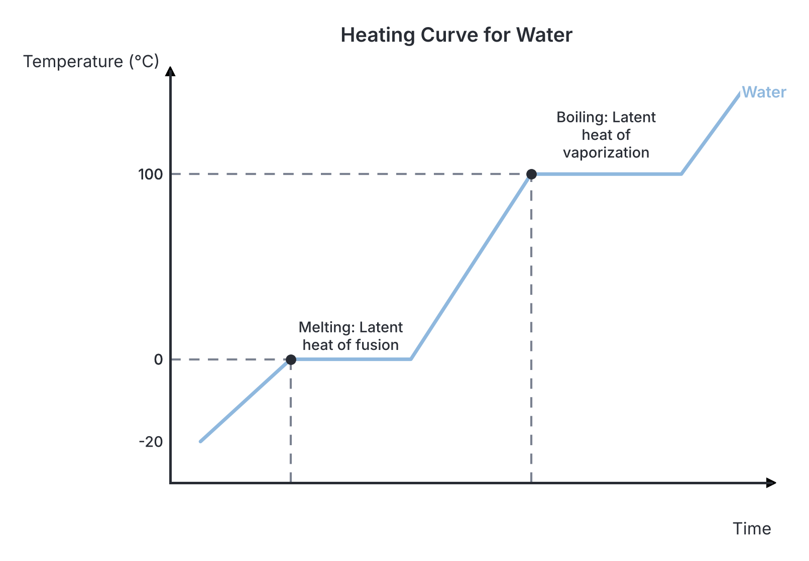
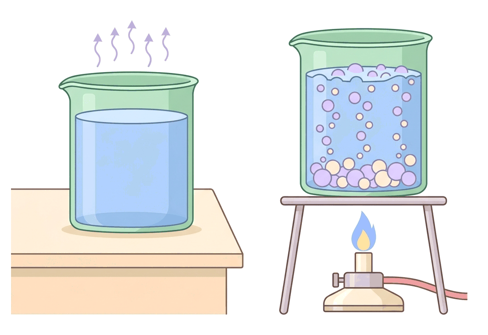

# JAMB Physics Notes: Change of State

## What JAMB expects

This topic is a major part of the Thermal Physics section of the JAMB syllabus. It covers the physics of how substances change from solid to liquid and from liquid to gas.

**Content items covered:**
- (i) latent heat;
- (ii) specific latent heats of fusion and vaporization;
- (iii) melting, evaporation and boiling;
- (iv) the influence of pressure and of dissolved substances on boiling and melting points;
- (v) application in appliances.

**By the end of these notes, you should be able to:**
1. differentiate between latent heat and specific latent heats of fusion and vaporization;
2. differentiate between melting, evaporation and boiling;
3. examine the effects of pressure and of dissolved substance on boiling and melting points;
4. solve numerical problems.

## Latent heat

When you heat a block of ice at $0\ ^\circ\text{C}$, it melts into water, but a thermometer placed in it will still read $0\ ^\circ\text{C}$ until all the ice has completely melted. The heat being supplied is not increasing the temperature; instead, it is doing the hidden work of breaking the intermolecular bonds holding the water molecules together in a rigid solid structure. This "hidden" heat is called **latent heat**. Latent heat is defined as the total heat energy required to change the state of a given mass of a substance without any change in temperature.

### Differentiating latent heat and specific latent heat

**Objective i: differentiate between latent heat and specific latent heats of fusion and vaporization.**

While latent heat depends on the total mass of the substance you are heating, **specific latent heat** normalises this value to exactly $1\ \text{kg}$ of the substance.

| Feature | Latent Heat ($Q$) | Specific Latent Heat ($L$) |
| :--- | :--- | :--- |
| **Definition** | The total heat energy required to change the state of a *given mass* of a substance without a change in temperature. | The heat energy required to change the state of a *unit mass ($1\ \text{kg}$)* of a substance without a change in temperature. |
| **Depends on Mass?** | Yes. Melting a large block of ice takes more latent heat than a small ice cube. | No. It is a constant value for a specific material (e.g., $1\ \text{kg}$ of ice always requires the same amount of heat). |
| **Formula** | $Q = m \times L$ | $L = \frac{Q}{m}$ |
| **SI Unit** | Joules ($\text{J}$) | Joules per kilogram ($\text{J kg}^{-1}$) |

### Specific latent heats of fusion and vaporization

**Content ii: specific latent heats of fusion and vaporization.**

There are two main types of specific latent heat, depending on the phase change occurring:

**1. Specific latent heat of fusion ($L_f$)**
This is the heat required to change $1\ \text{kg}$ of a solid into a liquid at its melting point without any change in temperature. 
- **Formula:** $Q = m L_f$
- **Where:** $Q$ is the heat energy ($\text{J}$), $m$ is the mass ($\text{kg}$), and $L_f$ is the specific latent heat of fusion ($\text{J kg}^{-1}$).
- For water (ice), the specific latent heat of fusion is a standard constant: $L_f = 3.36 \times 10^5\ \text{J kg}^{-1}$ (or $336\ \text{kJ kg}^{-1}$).

**2. Specific latent heat of vaporization ($L_v$)**
This is the heat required to change $1\ \text{kg}$ of a liquid into a gas (vapour) at its boiling point without any change in temperature.
- **Formula:** $Q = m L_v$
- **Where:** $Q$ is the heat energy ($\text{J}$), $m$ is the mass ($\text{kg}$), and $L_v$ is the specific latent heat of vaporization ($\text{J kg}^{-1}$).
- For water, the specific latent heat of vaporization is extremely large: $L_v = 2.26 \times 10^6\ \text{J kg}^{-1}$ (or $2260\ \text{kJ kg}^{-1}$). This massive energy release is the reason why steam burns are much more severe than burns from boiling water at the same temperature.

## Melting, evaporation and boiling processes

**Content iii: melting, evaporation and boiling.**

Substances transition between solid, liquid, and gas phases when thermal energy is added or removed. The three key processes are:

1.  **Melting (Fusion):** The process where a solid absorbs heat and changes into a liquid at a constant temperature known as the *melting point*.
2.  **Evaporation:** The process where a liquid changes into a gas (vapour) at *any temperature below its boiling point*. It occurs exclusively at the exposed surface of the liquid. Evaporation causes cooling because the most energetic, fastest-moving molecules escape the surface, leaving behind slower-moving molecules. This lowers the average kinetic energy and thus the temperature of the remaining liquid (this is why sweat evaporating from your skin during the harmattan season makes you feel cool).
3.  **Boiling:** The rapid process where a liquid changes into a gas at a specific, constant temperature known as the *boiling point*. It occurs throughout the entire volume of the liquid, forming bubbles of vapour that rise to the surface.

### Differentiating between melting, evaporation and boiling

**Objective ii: differentiate between melting, evaporation and boiling.**

JAMB frequently tests candidates on the subtle differences between these three phase changes, particularly evaporation versus boiling.

**Comparing Evaporation and Boiling**

| Feature | Evaporation | Boiling |
| :--- | :--- | :--- |
| **Temperature** | Occurs at *all temperatures* below the boiling point. | Occurs only at a *specific temperature* (the boiling point). |
| **Location** | Takes place *only at the surface* of the liquid. | Takes place *throughout* the entire volume of the liquid. |
| **Speed** | A slow, gradual process. | A rapid, vigorous process. |
| **Visual evidence** | No bubbles are formed. | Bubbles of vapour form inside the liquid and rise. |
| **Temperature change** | Causes the remaining liquid to cool down. | Temperature remains constant until all the liquid boils away. |

**Comparing Melting and Boiling**

| Feature | Melting | Boiling |
| :--- | :--- | :--- |
| **Phase Change** | Solid $\rightarrow$ Liquid | Liquid $\rightarrow$ Gas |
| **Energy involved** | Requires specific latent heat of fusion. | Requires specific latent heat of vaporization. |
| **Volume change (Water)** | Volume *decreases* (ice takes up more space than water). | Volume *increases massively* (steam expands to fill the space). |

## The influence of pressure and dissolved substances

**Content iv: the influence of pressure and of dissolved substances on boiling and melting points.**

The temperatures at which substances melt or boil are not rigidly fixed; they are heavily influenced by the external atmospheric pressure and the chemical purity of the substance. 

### Effects of pressure and dissolved substances on phase changes

**Objective iii: examine the effects of pressure and of dissolved substance on boiling and melting points.**

**Effects on Boiling Point**
1.  **Effect of Pressure:** **Increasing pressure increases the boiling point.** When pressure on a liquid is increased, it pushes down on the liquid surface, making it harder for the molecules to escape as vapour. Therefore, more heat (a higher temperature) is required to give them enough energy to boil. Conversely, decreasing pressure decreases the boiling point (for example, water boils at less than $100\ ^\circ\text{C}$ on high mountains like the Jos Plateau because atmospheric pressure is lower there).
2.  **Effect of Dissolved Substances (Impurities):** **Adding impurities increases the boiling point.** If you add table salt to pure water, the mixture will boil at a temperature higher than $100\ ^\circ\text{C}$. This is known as boiling point elevation.

**Effects on Melting/Freezing Point**
1.  **Effect of Pressure:** The effect depends on the material. For anomalous substances that *expand* when they freeze (like water), **increasing pressure lowers the melting point**. This explains the phenomenon of **regelation**. If you hang a heavy wire with weights over a block of ice, the extreme pressure directly under the wire lowers the melting point, causing the ice to melt even if the room is at $0\ ^\circ\text{C}$. The wire cuts through the liquid water, and as the wire passes, the pressure above it returns to normal, causing the water to refreeze. For normal substances that *contract* on freezing (like wax), increasing pressure *raises* the melting point.
2.  **Effect of Dissolved Substances (Impurities):** **Adding impurities lowers the melting point.** If you mix salt with ice, the mixture can drop to temperatures well below $0\ ^\circ\text{C}$ without completely freezing. This is known as freezing point depression. It is the reason local ice-cream vendors in Nigeria mix heavy salt with their ice blocks—it creates a super-chilled brine that keeps the cooler very cold without freezing solid.

## Applications in appliances

**Content v: application in appliances.**

The principles of latent heat and the effects of pressure on phase changes are applied in common household appliances.

### 1. The Refrigerator
A refrigerator functions entirely on the principle of the specific latent heat of vaporization. 
- A volatile liquid (a refrigerant like Freon or tetrafluoroethane) is pumped into the **evaporator coils** inside the freezer compartment. 
- As the liquid passes through an expansion valve, its pressure drops, causing it to rapidly evaporate into a gas. To undergo this phase change, it must absorb its latent heat of vaporization from the surrounding environment—which is the food inside the fridge. This cools the food.
- A **compressor** motor then pumps the warm gas into the **condenser coils** (the hot, dark grid at the back of the fridge). Here, the gas is compressed back into a liquid, releasing the latent heat it absorbed inside the fridge out into the room air.

### 2. The Pressure Cooker
A pressure cooker is a strong, tightly sealed pot that traps steam inside as water boils. 
- Because the steam cannot escape, the **pressure inside the cooker increases** significantly above standard atmospheric pressure.
- According to the laws of phase changes, this increased pressure **raises the boiling point** of the water inside from $100\ ^\circ\text{C}$ to about $120\ ^\circ\text{C}$. 
- At this much higher boiling temperature, tough foods like beans or meat absorb heat faster and cook in a fraction of the normal time, saving cooking gas and time.

## Solving numerical problems

**Objective iv: solve numerical problems.**

Calculations in this topic frequently combine the formula for sensible heat ($Q = mc\Delta\theta$) with the formula for latent heat ($Q = mL$). 

**The Key Rule for Calculations:** 
- Whenever a substance is changing temperature *without* changing state, use $Q = mc\Delta\theta$. 
- Whenever a substance is changing state *without* changing temperature, use $Q = mL$.

### Worked Example 1: Simple Latent Heat
**Question:** Calculate the heat energy required to completely melt $2.0\ \text{kg}$ of ice at $0\ ^\circ\text{C}$ to water at $0\ ^\circ\text{C}$. *(Specific latent heat of fusion of ice = $3.36 \times 10^5\ \text{J kg}^{-1}$)*.

**Working:**
1.  **Identify the phase change:** The temperature is constant at $0\ ^\circ\text{C}$. The ice is only changing state from solid to liquid. Therefore, we use the latent heat formula: $Q = m L_f$.
2.  **Substitute the values with units:** 
    $Q = 2.0\ \text{kg} \times 3.36 \times 10^5\ \text{J kg}^{-1}$
3.  **Calculate:**
    $Q = 672000\ \text{J}$
4.  **State the final answer:** The heat required is $672000\ \text{J}$ (or $672\ \text{kJ}$).

### Worked Example 2: Heating + Phase Change
**Question:** An electric heater rated $2000\ \text{W}$ takes $t$ seconds to completely boil away $0.3\ \text{kg}$ of boiling water at $100\ ^\circ\text{C}$. If the specific latent heat of vaporization of water is $2.26 \times 10^6\ \text{J kg}^{-1}$, calculate the time $t$. (Assume no heat is lost to the surroundings).

**Working:**
1.  **Equate electrical energy to heat energy:** The water is already at its boiling point of $100\ ^\circ\text{C}$, so all the energy goes into changing its state from liquid to gas.
    Electrical energy supplied = Latent heat gained
    $P \times t = m \times L_v$
2.  **Substitute the values:**
    $2000\ \text{W} \times t = 0.3\ \text{kg} \times (2.26 \times 10^6\ \text{J kg}^{-1})$
3.  **Calculate the right side:**
    $2000 \times t = 678000\ \text{J}$
4.  **Solve for $t$:**
    $t = \frac{678000}{2000}$
    $t = 339\ \text{s}$
5.  **State the final answer:** The time taken is $339\ \text{s}$ (which is 5 minutes and 39 seconds).

### Worked Example 3: Method of Mixtures (JAMB Level)
**Question:** $0.02\ \text{kg}$ of steam at $100\ ^\circ\text{C}$ is passed into $0.4\ \text{kg}$ of water at $10\ ^\circ\text{C}$. If the final temperature of the mixture is $40\ ^\circ\text{C}$, calculate the specific latent heat of vaporization of water, $L_v$. 
*(Specific heat capacity of water, $c = 4200\ \text{J kg}^{-1}\text{ K}^{-1}$).*

**Working:**
1.  **Identify heat lost and heat gained:** 
    - The steam *loses* heat in two stages: first by condensing into liquid water at $100\ ^\circ\text{C}$ ($Q_1 = m_s L_v$), and then that resulting hot water cools down from $100\ ^\circ\text{C}$ to $40\ ^\circ\text{C}$ ($Q_2 = m_s c \Delta\theta_s$).
    - The cold water *gains* heat, warming up from $10\ ^\circ\text{C}$ to $40\ ^\circ\text{C}$ ($Q_3 = m_w c \Delta\theta_w$).
2.  **Calculate heat gained by the cold water:**
    $m_w = 0.4\ \text{kg}$, $c = 4200\ \text{J kg}^{-1}\text{ K}^{-1}$, $\Delta\theta_w = (40 - 10) = 30\ ^\circ\text{C}$.
    $Q_{\text{gained}} = 0.4 \times 4200 \times 30 = 50400\ \text{J}$.
3.  **Set up the expression for heat lost by the steam:**
    $m_s = 0.02\ \text{kg}$, cooling from $100$ to $40$ means $\Delta\theta_s = (100 - 40) = 60\ ^\circ\text{C}$.
    $Q_{\text{lost}} = (0.02 \times L_v) + (0.02 \times 4200 \times 60)$
    $Q_{\text{lost}} = (0.02 L_v) + 5040\ \text{J}$.
4.  **Apply the Principle of Conservation of Heat:**
    Total Heat Lost = Total Heat Gained
    $0.02 L_v + 5040 = 50400$
5.  **Solve for $L_v$:**
    $0.02 L_v = 50400 - 5040$
    $0.02 L_v = 45360$
    $L_v = \frac{45360}{0.02} = 2268000\ \text{J kg}^{-1}$
6.  **State the final answer:** The specific latent heat of vaporization of water is $2.268 \times 10^6\ \text{J kg}^{-1}$.

## Key terms

| Term | Meaning |
| :--- | :--- |
| **Phase Change** | The transition of matter from one physical state (solid, liquid, or gas) to another. |
| **Latent Heat** | The total heat energy required to change the state of a substance without a change in temperature. |
| **Specific Latent Heat** | The heat energy required to change the state of exactly $1\ \text{kg}$ of a substance at a constant temperature. |
| **Melting Point** | The constant temperature at which a solid absorbs heat and turns into a liquid. |
| **Boiling Point** | The constant temperature at which a liquid turns into a gas rapidly, with bubbles forming throughout the volume. |
| **Evaporation** | The gradual change of a liquid to a gas taking place exclusively at the exposed surface, occurring at any temperature below the boiling point. |
| **Regelation** | The process where ice melts under applied pressure and refreezes when the pressure is removed. |
| **Refrigerant** | A highly volatile fluid used in refrigerators that readily absorbs latent heat when expanding and evaporating. |

## Exam tips and common mistakes

- **Wrong Formula for Phase Change:** A very common mistake is using $Q = mc\Delta\theta$ when ice is melting or water is boiling. If the temperature is constant (meaning the substance is changing state), you **must** use $Q = mL$.
- **Unit Conversions:** $L$ is often given in Joules per gram ($\text{J g}^{-1}$). If so, leave your mass in grams ($\text{g}$). If $L$ is in $\text{J kg}^{-1}$ as is standard, you **must** convert your mass to kilograms ($\text{kg}$) before calculating. Also, remember to convert time given in minutes to seconds ($\text{s}$).
- **Forgetting the second step in condensing steam:** When steam hits cold water, it doesn't just condense; the *hot water* formed by the condensed steam also cools down to the final mixture temperature. Always remember to add the sensible heat $mc\Delta\theta$ for the condensed steam cooling down.
- **Confusing Boiling and Evaporation:** If a JAMB theory question asks which process occurs at "all temperatures," the answer is always evaporation. Boiling only occurs at the specific boiling point.
- **Impurity and Pressure signs:** Remember the opposite effects on water: Pressure *raises* boiling point but *lowers* melting point. Impurities *raise* boiling point and *lower* melting point.

## Quick summary

1. Latent heat changes the state of a substance without altering its temperature. Specific latent heat ($L$) measures this exact energy requirement per $1\ \text{kg}$ of mass ($Q = mL$).
2. Specific latent heat of fusion ($L_f$) applies to solid-liquid phase changes, while specific latent heat of vaporization ($L_v$) applies to liquid-gas phase changes.
3. Evaporation occurs only at the surface and at all temperatures, causing cooling of the remaining liquid. Boiling happens rapidly throughout the liquid volume but only at a fixed temperature.
4. Increasing atmospheric pressure raises the boiling point (utilized in pressure cookers) but lowers the melting point of ice (leading to regelation).
5. Adding impurities (like salt) raises the boiling point and lowers the freezing/melting point of water, expanding its liquid range.
6. A household refrigerator cools by evaporating a volatile liquid in its inner coils, thereby absorbing latent heat from the food compartment.
7. In calculation problems involving the mixing of substances, the total heat lost by hotter substances (including latent heat if they condense) equals the total heat gained by colder substances.

## Practice questions

**1. Which of the following statements is mathematically and physically true about evaporation?**
- A. It takes place throughout the entire volume of a liquid.
- B. It occurs only at a specific temperature known as the boiling point.
- C. It occurs at any temperature and only at the exposed surface of the liquid.
- D. It does not involve the transfer of heat from its surroundings.

**Answer: C.**
1. Understand the definition of evaporation: it is the phase change from liquid to gas that occurs at temperatures below the boiling point.
2. Recall its location: it only happens at the exposed surface of the liquid.
3. Compare with boiling, which happens throughout the entire volume at a fixed temperature $T_b$.
Mistake for Option B: Confusing evaporation with boiling, which occurs only at a specific temperature.

**2. The principle of the pressure cooker is based on the scientific fact that:**
- A. increased pressure lowers the boiling point of water.
- B. increased pressure raises the boiling point of water.
- C. dissolved impurities increase the boiling point of water.
- D. the trapped air prevents heat from escaping by radiation.

**Answer: B.**
1. Note that the closed system of a pressure cooker traps steam, increasing the internal pressure $P$.
2. Recall the effect of pressure on boiling: increasing pressure raises the boiling point of water significantly above $100\ ^\circ\text{C}$.
3. Conclude that food cooks faster because it is subjected to water boiling at a higher temperature.
Mistake for Option A: Incorrectly assuming pressure lowers boiling point, which is a rule that only applies to the melting point of water (regelation).

**3. What happens to the melting point of ice and the boiling point of water when salt is added to it?**
- A. Melting point increases, boiling point increases.
- B. Melting point decreases, boiling point decreases.
- C. Melting point increases, boiling point decreases.
- D. Melting point decreases, boiling point increases.

**Answer: D.**
1. Identify the substance added: salt is an impurity dissolved in water.
2. Recall the effect of impurities on freezing/melting point: they lower the melting point (e.g., from $0\ ^\circ\text{C}$ to a negative value).
3. Recall the effect of impurities on boiling point: they elevate the boiling point (e.g., from $100\ ^\circ\text{C}$ to $> 100\ ^\circ\text{C}$).
Mistake for Option B: Assuming impurities lower both phase change temperatures, whereas they actually widen the liquid range in both directions.

**4. A $50\ \text{W}$ electric heater is used to melt $0.1\ \text{kg}$ of ice at $0\ ^\circ\text{C}$. If the specific latent heat of fusion of ice is $3.3 \times 10^5\ \text{J kg}^{-1}$, how long will it take to completely melt the ice?**
- A. $66\ \text{s}$
- B. $330\ \text{s}$
- C. $660\ \text{s}$
- D. $6600\ \text{s}$

**Answer: C.**
1. Identify the electrical energy supplied: $E = P \times t$.
2. Identify the heat required to melt the ice: $Q = m \times L_f$.
3. Equate the two energies (assuming no heat loss): $P \times t = m \times L_f \implies 50\ \text{W} \times t = 0.1\ \text{kg} \times 3.3 \times 10^5\ \text{J kg}^{-1}$.
4. Calculate the time: $t = \frac{33000\ \text{J}}{50\ \text{W}} = 660\ \text{s}$.
Mistake for Option D: Forgetting to multiply the specific latent heat by the mass of the ice $m = 0.1\ \text{kg}$, incorrectly calculating $t = \frac{3.3 \times 10^5}{50} = 6600\ \text{s}$.

**5. The specific latent heat of vaporization of a substance is strictly defined as the heat required to:**
- A. change $1\ \text{kg}$ of the liquid to gas at a constant temperature.
- B. raise the temperature of $1\ \text{kg}$ of the liquid by $1\ \text{K}$.
- C. change $1\ \text{kg}$ of solid to liquid at a constant temperature.
- D. change the mass of the liquid to gas with a $1\ \text{K}$ rise in temperature.

**Answer: A.**
1. Define specific latent heat: the word "specific" dictates it applies exactly to a unit mass, $m = 1\ \text{kg}$.
2. Define vaporization: the phase change from liquid to gas.
3. Identify the condition for latent heat: it happens at a constant temperature, meaning no temperature change ($\Delta\theta = 0$).
Mistake for Option B: This is the definition of specific heat capacity, not specific latent heat, because it involves a $1\ \text{K}$ temperature change.

**6. What mass of ice at $0\ ^\circ\text{C}$ is required to cool $0.5\ \text{kg}$ of water from $20\ ^\circ\text{C}$ down to $0\ ^\circ\text{C}$?**
*(Specific heat capacity of water = $4200\ \text{J kg}^{-1}\text{ K}^{-1}$, Specific latent heat of fusion of ice = $3.36 \times 10^5\ \text{J kg}^{-1}$)*
- A. $0.05\ \text{kg}$
- B. $0.125\ \text{kg}$
- C. $0.25\ \text{kg}$
- D. $0.50\ \text{kg}$

**Answer: B.**
1. Calculate the heat lost by the water cooling: $Q_{\text{lost}} = m_w c_w \Delta\theta = 0.5\ \text{kg} \times 4200\ \text{J kg}^{-1}\text{ K}^{-1} \times (20 - 0)\ ^\circ\text{C} = 42000\ \text{J}$.
2. State the formula for the heat gained by the ice melting: $Q_{\text{gained}} = m_{\text{ice}} L_f = m_{\text{ice}} \times 3.36 \times 10^5\ \text{J kg}^{-1}$.
3. Equate heat lost to heat gained: $m_{\text{ice}} \times 336000\ \text{J kg}^{-1} = 42000\ \text{J}$.
4. Solve for the mass of ice: $m_{\text{ice}} = \frac{42000}{336000} = 0.125\ \text{kg}$.
Mistake for Option C: Incorrectly using a temperature change of $40\ ^\circ\text{C}$ instead of $20\ ^\circ\text{C}$ for the water, resulting in a doubled mass $m = 0.25\ \text{kg}$.

**7. Regelation is a physical phenomenon caused directly by the effect of:**
- A. impurities on boiling point.
- B. impurities on melting point.
- C. pressure on boiling point.
- D. pressure on melting point.

**Answer: D.**
1. Define regelation: the phenomenon where ice melts under applied pressure and refreezes when the pressure is removed.
2. Relate it to phase changes: it involves the solid-to-liquid transition, which concerns the melting point.
3. State the governing principle: increasing the pressure $P$ on an anomalous substance like ice lowers its melting point below $0\ ^\circ\text{C}$.
Mistake for Option C: Confusing the effect of pressure on melting point with its effect on boiling point (which pressure increases rather than decreases).

**8. An electric kettle rated $1000\ \text{W}$ is used to boil water. Once the water is boiling, how much mass is vaporized in $226\ \text{seconds}$?**
*(Specific latent heat of vaporization of water = $2.26 \times 10^6\ \text{J kg}^{-1}$)*
- A. $0.01\ \text{kg}$
- B. $0.1\ \text{kg}$
- C. $1.0\ \text{kg}$
- D. $10\ \text{kg}$

**Answer: B.**
1. Calculate the electrical energy supplied: $E = P \times t = 1000\ \text{W} \times 226\ \text{s} = 226000\ \text{J}$.
2. State the latent heat formula for vaporization: $Q = m \times L_v$.
3. Equate the energies: $m \times 2.26 \times 10^6\ \text{J kg}^{-1} = 226000\ \text{J}$.
4. Solve for the mass vaporized: $m = \frac{226000}{2260000} = 0.1\ \text{kg}$.
Mistake for Option A: Making a decimal error during division by missing a power of 10, incorrectly arriving at $0.01\ \text{kg}$.

**9. In a standard household refrigerator, the cooling effect is produced by:**
- A. the expansion of a compressed gas without changing state.
- B. the evaporation of a volatile liquid.
- C. the condensation of a volatile liquid inside the freezer.
- D. the conduction of heat through the metal walls to the outside.

**Answer: B.**
1. Identify the working fluid in a refrigerator: it is a volatile liquid refrigerant.
2. Trace its path to the evaporator coils located inside the fridge or freezer compartment.
3. Conclude that as the liquid evaporates into a gas, it absorbs its latent heat of vaporization $L_v$ from the food, thereby cooling the interior.
Mistake for Option A: Confusing the refrigeration cycle with simple gas expansion; the primary cooling comes from the phase change (evaporation) of the liquid absorbing latent heat.

**10. An immersion heater takes $5\ \text{minutes}$ to completely boil away $0.15\ \text{kg}$ of water at $100\ ^\circ\text{C}$. Calculate the power of the heater.**
*(Specific latent heat of vaporization of water = $2.26 \times 10^6\ \text{J kg}^{-1}$)*.
- A. $1130\ \text{W}$
- B. $3390\ \text{W}$
- C. $67800\ \text{W}$
- D. $339000\ \text{W}$

**Answer: A.**
1. Convert the time to standard SI units (seconds): $t = 5 \times 60 = 300\ \text{s}$.
2. Calculate the total heat energy required to vaporize the water: $Q = m \times L_v = 0.15\ \text{kg} \times 2.26 \times 10^6\ \text{J kg}^{-1} = 339000\ \text{J}$.
3. State the formula for electrical power: $P = \frac{Q}{t}$.
4. Substitute the values: $P = \frac{339000\ \text{J}}{300\ \text{s}} = 1130\ \text{W}$.
Mistake for Option C: Forgetting to convert the time from minutes to seconds, calculating power with $5\ \text{seconds}$ instead: $P = \frac{339000}{5} = 67800\ \text{W}$.
