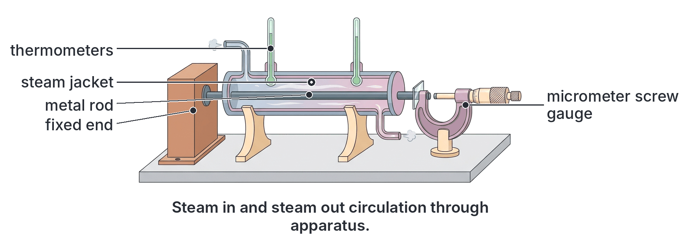
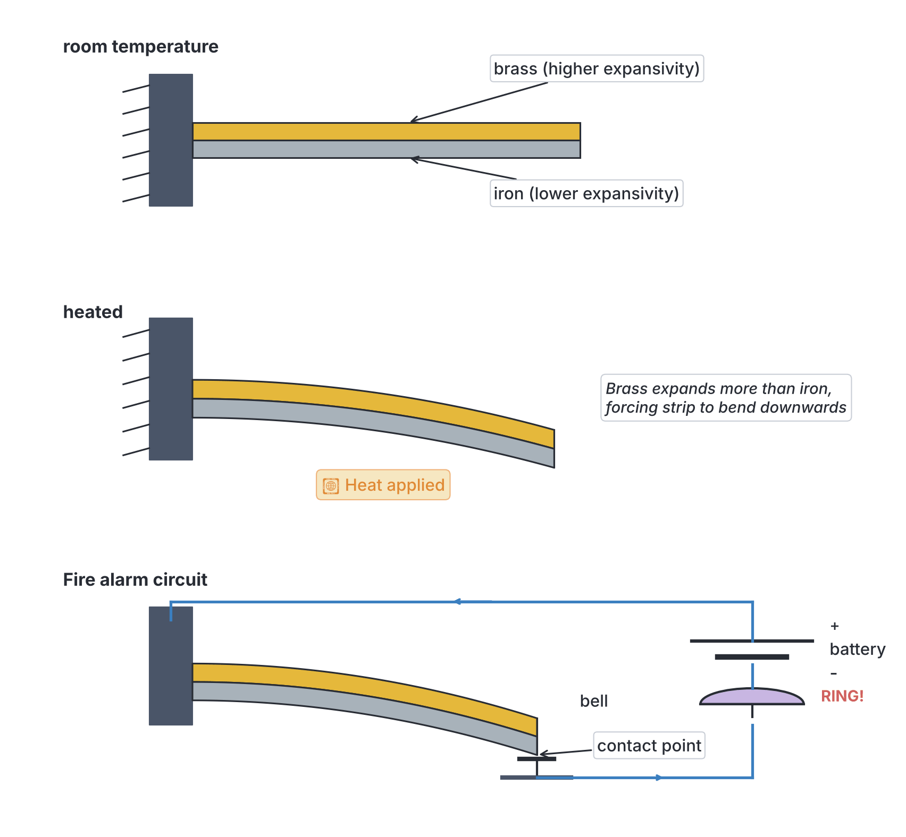
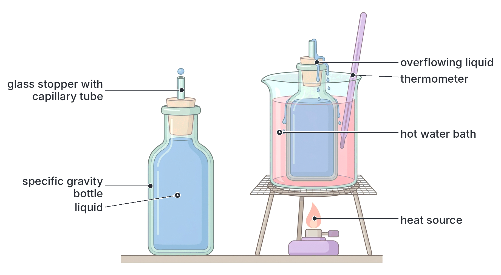
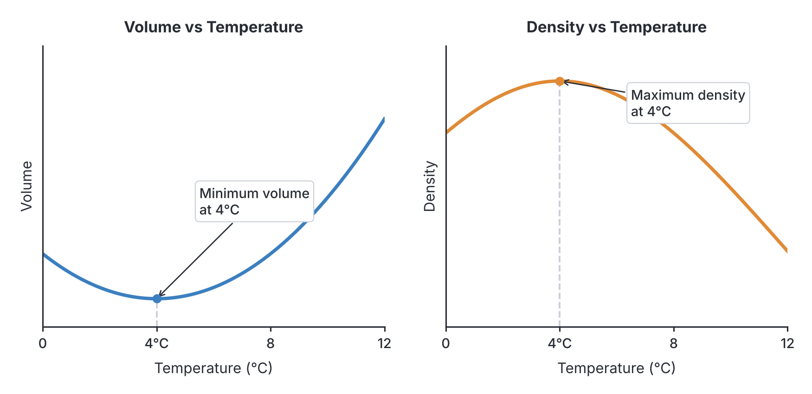

# JAMB Physics Notes: Thermal Expansion

## What JAMB expects

This topic is Section A, Topic 15 of the JAMB Physics syllabus: Thermal Expansion. It covers the physics of how and why substances change in size when their temperature changes.

By the end of these notes, you should be able to:
1. determine linear and volume expansivities;
2. assess the effects and applications of thermal expansivities;
3. determine the relationship between different expansivities;
4. determine volume, apparent, and real expansivities of liquids;
5. analyse the anomalous expansion of water.

This file covers the entirety of the Thermal Expansion topic for both solids and liquids. For the expansion of gases, refer to `A16-gas-laws.md`. For a deeper look into the nature of molecules and temperature, refer to `A12-temperature-and-measurement.md` and `A18-structure-of-matter-kinetic-theory.md`.

## What is thermal expansion?

All matter—solids, liquids, and gases—is made up of tiny particles (atoms and molecules) that are constantly in motion. In a solid, these particles vibrate around fixed positions, held together by strong intermolecular forces. 

When a substance is heated, its temperature increases. This means the kinetic energy of its particles increases, causing them to vibrate more vigorously. As they vibrate with a greater amplitude, they push against each other. Because the intermolecular forces are slightly asymmetrical (it is easier to pull atoms apart than to push them closer together), the atoms spend more time further apart. 

As a result, the average distance between the molecules increases, causing the entire substance to increase in size. This fundamental process is called **thermal expansion**. 

- **Solids** have the strongest intermolecular forces, so they expand the least.
- **Liquids** have weaker forces and expand more than solids.
- **Gases** have almost no intermolecular forces and expand the most.

## Thermal expansion of solids

When a solid is heated, it expands in all directions (length, width, and height). The degree to which a specific material expands is a property of that material, known as its **expansivity**.

### Determining linear and volume expansivities

**Objective i: determine linear and volume expansivities.**

Because solids hold a definite shape, we can measure their expansion in one, two, or three dimensions.

#### 1. Linear Expansivity ($\alpha$)
If a solid is in the form of a long rod, wire, or cable, the most noticeable expansion is in its length. 
The **linear expansivity** ($\alpha$) of a solid is defined as the fractional increase in length per kelvin (or per degree Celsius) rise in temperature. In simple terms, it is the increase in length per unit original length per unit degree rise in temperature.

The formula is:
$$\alpha = \frac{L_2 - L_1}{L_1 (T_2 - T_1)} = \frac{\Delta L}{L_1 \Delta T}$$

Where:
- $\alpha$ (alpha) is the linear expansivity, measured in per Kelvin ($\text{K}^{-1}$) or per degree Celsius ($^\circ\text{C}^{-1}$).
- $L_1$ is the original length at the initial temperature $T_1$.
- $L_2$ is the new length at the final temperature $T_2$.
- $\Delta L$ is the change in length ($L_2 - L_1$).
- $\Delta T$ is the change in temperature ($T_2 - T_1$).

*Note on units:* A temperature difference of $1^\circ\text{C}$ is exactly equal to a temperature difference of $1\ \text{K}$. Therefore, you **must not** add 273 when calculating the change in temperature ($\Delta T$). 

**Experiment to determine the linear expansivity of a metal rod:**
1. **Apparatus:** A long metal rod (e.g., brass or iron), a steam jacket (a tube that surrounds the rod), two thermometers, a micrometer screw gauge, a steam boiler, and a metre rule.
2. **Procedure:** Measure the initial length of the rod ($L_1$) at room temperature ($T_1$) using the metre rule. Place the rod inside the steam jacket. Fix one end of the rod firmly so it cannot move. Let the other free end touch the spindle of the micrometer screw gauge, and record the initial micrometer reading.
3. Pass steam from the boiling water through the jacket for several minutes until the thermometers show a steady maximum temperature ($T_2$, usually close to $100^\circ\text{C}$).
4. As the rod heats up, it expands and pushes against the micrometer screw gauge. Adjust the micrometer to gently touch the rod again, and take the new reading.
5. **Calculation:** The difference between the two micrometer readings gives the extension ($\Delta L$). Calculate the linear expansivity using $\alpha = \frac{\Delta L}{L_1 \Delta T}$.

#### 2. Area Expansivity ($\beta$)
If the solid is a flat sheet (like a metal roof), it expands in both length and width. 
The **area expansivity** (or superficial expansivity), $\beta$ (beta), is the fractional increase in area per kelvin rise in temperature.

$$\beta = \frac{A_2 - A_1}{A_1 (T_2 - T_1)} = \frac{\Delta A}{A_1 \Delta T}$$

Where $A_1$ is the initial area, $A_2$ is the final area, and $\Delta A$ is the change in area.

#### 3. Volume Expansivity ($\gamma$)
If the solid is a 3D object (like a sphere, block, or cube), it expands in all three dimensions.
The **volume expansivity** (or cubic expansivity), $\gamma$ (gamma), of a solid is the fractional increase in volume per kelvin rise in temperature.

$$\gamma = \frac{V_2 - V_1}{V_1 (T_2 - T_1)} = \frac{\Delta V}{V_1 \Delta T}$$

Where $V_1$ is the initial volume, $V_2$ is the final volume, and $\Delta V$ is the change in volume.

**Worked Example 1: Calculating new length (Linear)**
A brass rod is $50.0\ \text{m}$ long at $20^\circ\text{C}$. It is heated to $100^\circ\text{C}$. If the linear expansivity of brass is $2.0 \times 10^{-5}\ \text{K}^{-1}$, calculate its new length.

**Working:**
1. **Identify the given values:** $L_1 = 50.0\ \text{m}$, $T_1 = 20^\circ\text{C}$, $T_2 = 100^\circ\text{C}$, $\alpha = 2.0 \times 10^{-5}\ \text{K}^{-1}$.
2. **Calculate the temperature change ($\Delta T$):** $\Delta T = 100^\circ\text{C} - 20^\circ\text{C} = 80\ \text{K}$.
3. **State the formula:** $\Delta L = \alpha L_1 \Delta T$.
4. **Substitute and calculate $\Delta L$:** $\Delta L = (2.0 \times 10^{-5}\ \text{K}^{-1}) \times (50.0\ \text{m}) \times (80\ \text{K}) = 8000 \times 10^{-5}\ \text{m} = 0.08\ \text{m}$.
5. **State the final answer with its unit:** The new length $L_2 = L_1 + \Delta L = 50.0\ \text{m} + 0.08\ \text{m} = 50.08\ \text{m}$.

**Worked Example 2: Calculating temperature change (Linear)**
A steel bridge is $100.0\ \text{m}$ long at $15^\circ\text{C}$. At what temperature will its length increase by $0.036\ \text{m}$? (Linear expansivity of steel $= 1.2 \times 10^{-5}\ \text{K}^{-1}$)

**Working:**
1. **Identify the given values:** $L_1 = 100.0\ \text{m}$, initial temperature $T_1 = 15^\circ\text{C}$, expansion $\Delta L = 0.036\ \text{m}$, $\alpha = 1.2 \times 10^{-5}\ \text{K}^{-1}$.
2. **Rearrange the formula for $\Delta T$:** From $\Delta L = \alpha L_1 \Delta T$, we get $\Delta T = \frac{\Delta L}{\alpha L_1}$.
3. **Substitute and calculate $\Delta T$:** $\Delta T = \frac{0.036}{(1.2 \times 10^{-5}) \times 100.0} = \frac{0.036}{0.0012} = 30\ \text{K}$.
4. **State the final answer with its unit:** The new temperature $T_2 = T_1 + \Delta T = 15^\circ\text{C} + 30^\circ\text{C} = 45^\circ\text{C}$.

**Worked Example 3: Calculating new volume (Volume)**
A solid copper sphere used as a pendulum bob has a volume of $200\ \text{cm}^3$ at $10^\circ\text{C}$. It is heated to $110^\circ\text{C}$. If the volume expansivity of copper is $5.1 \times 10^{-5}\ \text{K}^{-1}$, find its new volume.

**Working:**
1. **Identify the given values:** $V_1 = 200\ \text{cm}^3$, $T_1 = 10^\circ\text{C}$, $T_2 = 110^\circ\text{C}$, $\gamma = 5.1 \times 10^{-5}\ \text{K}^{-1}$.
2. **Calculate the temperature change ($\Delta T$):** $\Delta T = 110^\circ\text{C} - 10^\circ\text{C} = 100\ \text{K}$.
3. **State the formula:** $\Delta V = \gamma V_1 \Delta T$.
4. **Substitute and calculate $\Delta V$:** $\Delta V = (5.1 \times 10^{-5}\ \text{K}^{-1}) \times (200\ \text{cm}^3) \times (100\ \text{K}) = 102000 \times 10^{-5}\ \text{cm}^3 = 1.02\ \text{cm}^3$.
5. **State the final answer with its unit:** The new volume $V_2 = V_1 + \Delta V = 200\ \text{cm}^3 + 1.02\ \text{cm}^3 = 201.02\ \text{cm}^3$.

### Relationship between different expansivities

**Objective iii: determine the relationship between different expansivities.**

For an *isotropic* solid (a solid that expands equally in all directions, like most common metals), the area expansivity ($\beta$) and volume expansivity ($\gamma$) are directly related to the linear expansivity ($\alpha$).

Imagine a cube of side length $L$. Its area is $L^2$ and its volume is $L^3$. Using the binomial expansion for small changes, it can be proven that:
- The area expansivity is exactly twice the linear expansivity: **$\beta = 2\alpha$**
- The volume expansivity is exactly three times the linear expansivity: **$\gamma = 3\alpha$**

Therefore, the relationship between the three expansivities is a simple ratio:
**$\alpha : \beta : \gamma = 1 : 2 : 3$**

**Textbook variation:** Some textbooks use different symbols, such as using $c$ or $\gamma$ for cubic expansivity, or sometimes failing to standardise the symbol for area expansivity. However, JAMB standardises these as $\alpha$ for linear, $\beta$ for area, and $\gamma$ for volume.

### Assessing the effects and applications of thermal expansivities

**Objective ii: assess the effects and applications of thermal expansivities.**

The expansion and contraction of solids exert immense forces. If a solid is heated but prevented from expanding, it will experience **thermal stress** (an inward force trying to compress it). If cooled and prevented from contracting, it experiences tension that can break it. Engineers must account for this in everyday life.

| Area | Phenomenon / Effect | How it is managed or applied |
| --- | --- | --- |
| **Railway lines** | Rails expand on hot days. If fixed solidly, they will buckle and bend, causing train derailments. | **Gaps** are deliberately left between sections of rail. They are joined by **fishplates** with oval-shaped holes, allowing the bolts to slide as the rails expand into the gaps. |
| **Bridges** | Long steel bridges expand and contract significantly between the hot dry season and the cool harmattan. | One end of the bridge is firmly fixed to a pillar, while the other end rests on **metal rollers**. This allows the bridge to expand freely without destroying the concrete pillars. |
| **Building strips** | Concrete slabs in long walls, floors, or highways crack when they expand against each other in the heat. | **Expansion joints (building strips)** made of soft, compressible materials (like bitumen, rubber, or soft pitch) are placed between the concrete slabs to absorb the expansion. |
| **Electrical cables** | Overhead power lines (like NEPA/PHCN high-tension cables) expand in the heat and contract in the cold. | Cables are deliberately hung loosely (sagging) between poles. If strung tightly, they would contract on cold nights and snap under the high tension. |
| **Glassware** | Thick glass (like a tea seller's cup) cracks when boiling water is poured in. The inside heats and expands suddenly while the outside is still cold. This unequal expansion causes stress that shatters the glass. | Laboratories and kitchens use **Pyrex glass**, which has a very low linear expansivity, meaning it barely expands when heated and resists cracking. |
| **Metal tyres** | Fitting a steel rim tightly onto the wooden wheel of a cart or train wheel. | **Shrink-fitting:** The iron rim is made slightly smaller than the wheel. It is heated until it expands enough to slip over the wheel. When it cools, it contracts and grips the wheel with enormous force. |
| **Riveting** | Joining two steel plates permanently. | A red-hot rivet is pushed through holes in the plates and hammered flat. As the rivet cools, it contracts, pulling the plates together tightly. |

#### The Bimetallic Strip
A **bimetallic strip** is a highly useful application of unequal thermal expansion. It consists of two strips of different metals (usually brass and iron, or brass and invar) welded or riveted together along their length. 
- Brass has a higher linear expansivity ($\alpha = 2.0 \times 10^{-5}\ \text{K}^{-1}$) than iron ($\alpha = 1.2 \times 10^{-5}\ \text{K}^{-1}$).
- At room temperature, the strip is completely straight.
- **When heated:** Both metals expand, but the brass expands *more* than the iron. Because they are joined, the strip is forced to bend. It bends into a curve with the brass on the **outside** (the convex, longer side) and the iron on the inside. In other words, it bends *towards* the metal with the lower expansivity.
- **When cooled (below room temperature):** The brass contracts more than the iron, so it bends the other way, with the brass on the inside of the curve.

**Uses of bimetallic strips:**
1. **Thermostats:** Used to regulate temperature in electric irons, ovens, and refrigerators. When the iron gets too hot, the strip bends away from an electrical contact, breaking the circuit and turning off the heater. As it cools, it straightens, remaking the contact.
2. **Fire alarms:** The heat from a fire causes the strip to bend towards an electrical contact. When they touch, the circuit is completed, and the warning bell rings.

## Thermal expansion of liquids

Liquids do not have a fixed length or surface area; they take the shape of their container. Therefore, liquids only experience **volume expansion** when heated. Furthermore, liquids generally expand much more than solids for the same rise in temperature.

### Real and apparent expansivities of liquids

When you heat a liquid in a container, you must consider that the solid container itself also expands. 
As heat is applied, the solid container heats up first and expands, causing the liquid level to initially drop slightly. Then the heat reaches the liquid. The liquid expands much more than the solid, causing the liquid level to rise past its original mark. 

Because the container expanded, the expansion of the liquid that we actually observe with our eyes is less than the true expansion of the liquid. This gives rise to two different expansivities:

1. **Apparent cubic expansivity ($\gamma_a$):** The fractional increase in the observed (apparent) volume of a liquid per kelvin rise in temperature, disregarding the expansion of the container.
2. **Real cubic expansivity ($\gamma_r$):** The actual, total fractional increase in volume of the liquid per kelvin rise in temperature.

The real expansivity of the liquid is the sum of its apparent expansivity and the volume expansivity of the container:
$$\gamma_r = \gamma_a + \gamma_c$$
Where $\gamma_c$ is the cubic expansivity of the solid container. Since $\gamma = 3\alpha$ for a solid, this is often written as $\gamma_r = \gamma_a + 3\alpha_{\text{container}}$.

### Determination of volume expansivity in liquids

**Determining apparent expansivity using a Specific Gravity Bottle**
In the laboratory, the apparent expansivity of a liquid is accurately determined using a specific gravity bottle (also known as a density bottle). 

**Procedure:**
1. Clean and thoroughly dry the specific gravity bottle, and weigh it empty ($m_0$).
2. Fill the bottle completely to the brim with the liquid at a known initial temperature, $T_1$ (e.g., room temperature). Insert the glass stopper. The stopper has a fine capillary tube in it, so excess liquid is pushed out, ensuring the volume is exactly the capacity of the bottle. Wipe the outside dry and weigh it to find the total mass. The mass of the liquid inside is $m_1$.
3. Place the bottle in a water bath and heat it to a steady higher temperature, $T_2$. As it heats up, the liquid expands more than the glass bottle. The excess liquid overflows through the capillary tube in the stopper.
4. Carefully wipe the overflowed liquid from the outside of the bottle.
5. Remove the bottle, let it cool down to room temperature, and weigh it again. The mass of the liquid remaining inside the bottle is $m_2$.
6. The mass of the liquid expelled (overflowed) is $m_1 - m_2$.

The apparent expansivity, $\gamma_a$, is calculated using the formula:
$$\gamma_a = \frac{\text{Mass of liquid expelled}}{\text{Mass of liquid remaining} \times \text{Temperature rise}}$$
$$\gamma_a = \frac{m_1 - m_2}{m_2 \times (T_2 - T_1)}$$

### Determining volume, apparent, and real expansivities of liquids

**Objective iv: determine volume, apparent, and real expansivities of liquids.**

The volume of liquid that overflows when heated can be calculated directly. 
When the system is heated, the liquid volume increases by $\Delta V_{\text{liquid}} = V_1 \gamma_r \Delta T$. 
The container capacity increases by $\Delta V_{\text{container}} = V_1 \gamma_c \Delta T$. 
The overflow is the difference: 
$V_{\text{overflow}} = \Delta V_{\text{liquid}} - \Delta V_{\text{container}} = V_1 (\gamma_r - \gamma_c) \Delta T$. 
Since $\gamma_a = \gamma_r - \gamma_c$, this simplifies to:
**$V_{\text{overflow}} = V_1 \gamma_a \Delta T$**

**Relationship between expansivity and density:**
When a liquid expands, its mass remains constant, but its volume increases. Because Density = Mass / Volume, the density of the liquid decreases as it gets hotter.
The relationship between density at initial temperature ($\rho_1$) and density at final temperature ($\rho_2$) is:
$$\rho_1 = \rho_2 (1 + \gamma_r \Delta T)$$
This is a very common formula used in JAMB to solve density-temperature problems.

**Worked Example 4: Real and apparent expansivity**
The apparent cubic expansivity of a liquid in a glass container is $1.52 \times 10^{-4}\ \text{K}^{-1}$. If the linear expansivity of the glass is $9.0 \times 10^{-6}\ \text{K}^{-1}$, what is the real cubic expansivity of the liquid?

**Working:**
1. **Identify the given values:** $\gamma_a = 1.52 \times 10^{-4}\ \text{K}^{-1}$, $\alpha_{\text{glass}} = 9.0 \times 10^{-6}\ \text{K}^{-1}$.
2. **Calculate the volume expansivity of the container ($\gamma_c$):** $\gamma_c = 3 \times \alpha_{\text{glass}} = 3 \times (9.0 \times 10^{-6}\ \text{K}^{-1}) = 27.0 \times 10^{-6}\ \text{K}^{-1} = 0.27 \times 10^{-4}\ \text{K}^{-1}$.
3. **State the formula:** $\gamma_r = \gamma_a + \gamma_c$.
4. **Substitute and calculate:** $\gamma_r = (1.52 \times 10^{-4}) + (0.27 \times 10^{-4}) = 1.79 \times 10^{-4}\ \text{K}^{-1}$.
5. **State the final answer:** The real cubic expansivity is $1.79 \times 10^{-4}\ \text{K}^{-1}$.

**Worked Example 5: Specific gravity bottle calculation**
A specific gravity bottle contains a liquid. At $25^\circ\text{C}$, the mass of the liquid in the bottle is $50.45\ \text{g}$. When heated to $75^\circ\text{C}$, some liquid overflows. After wiping the outside and cooling, the mass of the liquid remaining inside the bottle is $50.00\ \text{g}$. Calculate the apparent cubic expansivity of the liquid.

**Working:**
1. **Identify values:** Mass expelled $m_{\text{exp}} = 50.45\ \text{g} - 50.00\ \text{g} = 0.45\ \text{g}$, mass remaining $m_{\text{rem}} = 50.00\ \text{g}$, $\Delta T = 75^\circ\text{C} - 25^\circ\text{C} = 50\ \text{K}$.
2. **State the formula:** $\gamma_a = \frac{m_{\text{exp}}}{m_{\text{rem}} \times \Delta T}$.
3. **Substitute and calculate:** $\gamma_a = \frac{0.45\ \text{g}}{50.00\ \text{g} \times 50\ \text{K}} = \frac{0.45}{2500}\ \text{K}^{-1} = 1.80 \times 10^{-4}\ \text{K}^{-1}$.
4. **State the final answer:** The apparent expansivity is $1.80 \times 10^{-4}\ \text{K}^{-1}$.

**Worked Example 6: Expansivity and Density**
The density of oil is $1010\ \text{kg m}^{-3}$ at $10^\circ\text{C}$. If the real expansivity of the oil is $2.0 \times 10^{-4}\ \text{K}^{-1}$, what is its density at $60^\circ\text{C}$?

**Working:**
1. **Identify the given values:** Initial density $\rho_1 = 1010\ \text{kg m}^{-3}$, initial temperature $T_1 = 10^\circ\text{C}$, final temperature $T_2 = 60^\circ\text{C}$, $\gamma_r = 2.0 \times 10^{-4}\ \text{K}^{-1}$.
2. **Calculate the temperature change ($\Delta T$):** $\Delta T = 60^\circ\text{C} - 10^\circ\text{C} = 50\ \text{K}$.
3. **State the density formula:** $\rho_1 = \rho_2 (1 + \gamma_r \Delta T)$.
4. **Substitute the values:** $1010 = \rho_2 [1 + (2.0 \times 10^{-4}) \times 50]$.
5. **Calculate the bracket:** $(2.0 \times 10^{-4}) \times 50 = 100 \times 10^{-4} = 0.01$. The bracket becomes $1 + 0.01 = 1.01$.
6. **Solve for $\rho_2$:** $1010 = \rho_2 \times 1.01 \implies \rho_2 = \frac{1010}{1.01} = 1000\ \text{kg m}^{-3}$.
7. **State the final answer:** The new density is $1000\ \text{kg m}^{-3}$.

### Analysing the anomalous expansion of water

**Objective v: analyse the anomalous expansion of water.**

The general rule for all substances is that they expand when heated and contract when cooled. Water follows this rule for most temperatures, but it behaves very strangely near its freezing point.

When water at room temperature is cooled, it contracts and its volume decreases steadily. However, when it reaches $4^\circ\text{C}$, it stops contracting. If you continue to cool the water from $4^\circ\text{C}$ down to $0^\circ\text{C}$, **it expands instead of contracting**. 
This unusual behaviour is called the **anomalous expansion of water**.

Because water expands as it cools from $4^\circ\text{C}$ to $0^\circ\text{C}$, its volume reaches a **minimum** at $4^\circ\text{C}$.
Since Density = Mass / Volume, a minimum volume means a maximum density. Therefore, **water reaches its maximum density at $4^\circ\text{C}$** (approximately $1000\ \text{kg m}^{-3}$). As it cools below $4^\circ\text{C}$, it becomes less dense.

**Hope's Apparatus:**
In the laboratory, the anomalous expansion of water is demonstrated using **Hope's apparatus**. It consists of a tall metal cylinder filled with water, with one thermometer near the top and another near the bottom. A trough of freezing mixture (ice and salt) is wrapped around the middle of the cylinder. 
As the water in the middle cools, it becomes denser and sinks, so the bottom thermometer drops to $4^\circ\text{C}$ and stays there. As the water cools further (below $4^\circ\text{C}$), it becomes less dense and floats upward, causing the top thermometer to drop to $0^\circ\text{C}$ while the bottom remains at $4^\circ\text{C}$.

**Biological Importance (Positive effect):**
The anomalous expansion of water is essential for the survival of aquatic life in cold climates. During winter, as the air temperature drops below zero, the surface water of a lake cools. When it reaches $4^\circ\text{C}$, it is at its densest, so it sinks to the bottom. The colder water (from $3^\circ\text{C}$ to $0^\circ\text{C}$) is less dense, so it floats at the top and eventually freezes into ice.
Because ice is less dense than water, it stays on the surface. The layer of ice acts as an insulator, preventing the extreme cold from reaching the water below. Therefore, lakes freeze from the top down, leaving liquid water at a stable $4^\circ\text{C}$ at the bottom where fish, plants, and other marine life can safely survive the winter.

**Disadvantages (Negative effects):**
- **Bursting of pipes:** In cold climates, water freezing inside metal pipes expands with enormous force, causing the pipes to burst.
- **Cracking engine radiators:** Water in car radiators will expand and crack the engine block if it freezes; therefore, "antifreeze" chemicals are added to lower the freezing point.
- **Breaking glass bottles:** If a glass bottle is completely filled with water, sealed tightly, and placed in a freezer, the water will expand as it turns to ice and shatter the glass.

## Key terms

| Term | Meaning |
| --- | --- |
| **Thermal expansion** | The increase in the dimensions of a substance when it is heated, caused by the increased amplitude of vibration of its particles. |
| **Linear expansivity ($\alpha$)** | The fractional increase in length of a solid per kelvin rise in temperature. Unit: $\text{K}^{-1}$. |
| **Area expansivity ($\beta$)** | The fractional increase in area of a solid per kelvin rise in temperature. Equal to $2\alpha$. |
| **Volume expansivity ($\gamma$)** | The fractional increase in volume per kelvin rise in temperature. Equal to $3\alpha$ for solids. |
| **Apparent expansivity ($\gamma_a$)** | The observed fractional increase in volume of a liquid per kelvin, ignoring the expansion of the container. |
| **Real expansivity ($\gamma_r$)** | The actual, total fractional increase in volume of a liquid per kelvin. $\gamma_r = \gamma_a + \gamma_c$. |
| **Bimetallic strip** | A strip made of two different metals joined together. It bends when heated because one metal expands more than the other. |
| **Building strips** | Compressible materials placed between concrete sections (expansion joints) to allow them to expand without cracking. |
| **Anomalous expansion** | The unusual behaviour of water, which expands (instead of contracting) when cooled from $4^\circ\text{C}$ to $0^\circ\text{C}$. |
| **Thermal stress** | The internal force created in a material when it is heated or cooled but physically prevented from expanding or contracting. |

## Exam tips and common mistakes

- **Wrong temperature conversion:** When calculating expansivity, $\Delta T$ is a *difference* in temperature. A temperature difference of $80^\circ\text{C}$ is exactly a difference of $80\ \text{K}$. **Do not add 273** to the difference! (Wrong: $\Delta T = 80 + 273 = 353\ \text{K}$. Correct: $\Delta T = 80\ \text{K}$).
- **Forgetting to multiply the container's expansivity:** When finding the real expansivity of a liquid from its apparent expansivity and the *linear* expansivity of the glass container ($\alpha$), remember that the container expands in volume. You must multiply $\alpha$ by 3. ($\gamma_r = \gamma_a + 3\alpha_{\text{glass}}$).
- **Using the wrong formula for volume or area:** For the volume expansion of solids, ensure you use $\gamma$ ($3\alpha$) and not $\alpha$. For area expansion, use $\beta$ ($2\alpha$). Read the question carefully to see if it gives linear expansivity or volume expansivity.
- **Bimetallic strip direction:** Remember that the metal with the *higher* expansivity expands more when heated, forming the *outside* of the curve. The strip bends *towards* the metal with the lower expansivity.
- **Anomalous water density:** Water's maximum density (and minimum volume) is at exactly $4^\circ\text{C}$.

## Quick summary

1. Thermal expansion occurs because molecules vibrate with greater amplitude at higher temperatures, increasing their average separation.
2. Linear expansivity ($\alpha$) is the fractional increase in length per kelvin rise in temperature ($\alpha = \frac{\Delta L}{L_1 \Delta T}$).
3. For isotropic solids, area expansivity is twice the linear expansivity ($\beta = 2\alpha$), and volume expansivity is three times the linear expansivity ($\gamma = 3\alpha$).
4. Everyday applications of solid expansion include bimetallic strips in thermostats, shrink-fitting, and leaving gaps in railway tracks and building strips to prevent buckling and cracking.
5. Liquids have only volume expansivity. The real expansivity of a liquid equals its apparent expansivity plus the volume expansivity of the container ($\gamma_r = \gamma_a + \gamma_c$).
6. The apparent expansivity of a liquid can be determined using a specific gravity bottle: $\gamma_a = \frac{\text{Mass expelled}}{\text{Mass remaining} \times \Delta T}$.
7. Water exhibits anomalous expansion: it expands (rather than contracts) when cooled from $4^\circ\text{C}$ to $0^\circ\text{C}$, reaching its maximum density at $4^\circ\text{C}$. This preserves aquatic life in winter by freezing lakes from the top down.

## Practice questions

**1. A metal rod of length $50.0\ \text{m}$ is heated from $20^\circ\text{C}$ to $70^\circ\text{C}$. If the linear expansivity of the metal is $1.2 \times 10^{-5}\ \text{K}^{-1}$, what is the new length of the rod?**
- A. $50.003\ \text{m}$
- B. $50.03\ \text{m}$
- C. $50.3\ \text{m}$
- D. $53.0\ \text{m}$

**Answer: B.**
1. $L_1 = 50.0\ \text{m}$, $\Delta T = 70 - 20 = 50\ \text{K}$.
2. $\Delta L = \alpha L_1 \Delta T = (1.2 \times 10^{-5}\ \text{K}^{-1}) \times (50.0\ \text{m}) \times (50\ \text{K}) = 0.03\ \text{m}$.
3. $L_2 = L_1 + \Delta L = 50.0\ \text{m} + 0.03\ \text{m} = 50.03\ \text{m}$.
*Mistake behind option A: An error in decimal place value during calculation ($0.003\ \text{m}$ instead of $0.03\ \text{m}$).*

**2. The relationship between the linear expansivity ($\alpha$), area expansivity ($\beta$), and volume expansivity ($\gamma$) of an isotropic solid is:**
- A. $\alpha = \beta = \gamma$
- B. $\alpha : \beta : \gamma = 3 : 2 : 1$
- C. $\alpha = 2\beta = 3\gamma$
- D. $\alpha : \beta : \gamma = 1 : 2 : 3$

**Answer: D.** Area expansivity is twice the linear expansivity ($\beta = 2\alpha$), and volume expansivity is three times the linear expansivity ($\gamma = 3\alpha$). Thus, the ratio $\alpha : \beta : \gamma$ is $1 : 2 : 3$.

**3. A glass flask is completely filled with $250\ \text{cm}^3$ of a liquid at $20^\circ\text{C}$. It is heated to $100^\circ\text{C}$. If the real expansivity of the liquid is $1.77 \times 10^{-4}\ \text{K}^{-1}$ and the linear expansivity of glass is $9.0 \times 10^{-6}\ \text{K}^{-1}$, what volume of liquid overflows?**
- A. $3.00\ \text{cm}^3$
- B. $3.36\ \text{cm}^3$
- C. $3.54\ \text{cm}^3$
- D. $4.08\ \text{cm}^3$

**Answer: A.**
1. Real expansivity $\gamma_r = 1.77 \times 10^{-4}\ \text{K}^{-1}$.
2. Volume expansivity of glass $\gamma_c = 3 \times \alpha_{\text{glass}} = 3 \times 9.0 \times 10^{-6} = 27 \times 10^{-6} = 0.27 \times 10^{-4}\ \text{K}^{-1}$.
3. Apparent expansivity $\gamma_a = \gamma_r - \gamma_c = (1.77 - 0.27) \times 10^{-4} = 1.50 \times 10^{-4}\ \text{K}^{-1}$.
4. $\Delta T = 100 - 20 = 80\ \text{K}$.
5. $V_{\text{overflow}} = V_1 \gamma_a \Delta T = 250\ \text{cm}^3 \times (1.50 \times 10^{-4}\ \text{K}^{-1}) \times 80\ \text{K} = 3.00\ \text{cm}^3$.
*Mistake behind option C: Calculating the expansion using the real expansivity without subtracting the expansion of the container ($250 \times 1.77 \times 10^{-4} \times 80 = 3.54\ \text{cm}^3$).*

**4. A metal cube of side $10.0\ \text{cm}$ is heated from $30^\circ\text{C}$ to $80^\circ\text{C}$. If the linear expansivity of the metal is $2.0 \times 10^{-5}\ \text{K}^{-1}$, what is the increase in its volume?**
- A. $1.0\ \text{cm}^3$
- B. $2.0\ \text{cm}^3$
- C. $3.0\ \text{cm}^3$
- D. $6.0\ \text{cm}^3$

**Answer: C.**
1. Initial volume $V_1 = 10.0\ \text{cm} \times 10.0\ \text{cm} \times 10.0\ \text{cm} = 1000\ \text{cm}^3$.
2. $\Delta T = 80 - 30 = 50\ \text{K}$.
3. Volume expansivity $\gamma = 3\alpha = 3 \times (2.0 \times 10^{-5}) = 6.0 \times 10^{-5}\ \text{K}^{-1}$.
4. $\Delta V = \gamma V_1 \Delta T = (6.0 \times 10^{-5}) \times 1000 \times 50 = 3.0\ \text{cm}^3$.
*Mistake behind option A: Mistakenly using the linear expansivity ($\alpha$) instead of the volume expansivity ($\gamma$) in the volume formula ($2.0 \times 10^{-5} \times 1000 \times 50 = 1.0\ \text{cm}^3$).*

**5. As water is heated from $0^\circ\text{C}$ to $10^\circ\text{C}$, its density will:**
- A. increase continuously
- B. decrease continuously
- C. increase up to $4^\circ\text{C}$ and then decrease
- D. decrease up to $4^\circ\text{C}$ and then increase

**Answer: C.** Water undergoes anomalous expansion between $0^\circ\text{C}$ and $4^\circ\text{C}$. In this range, as it is heated, its volume decreases, meaning its density increases, reaching a maximum at $4^\circ\text{C}$. Above $4^\circ\text{C}$, it behaves normally, expanding in volume so that its density decreases.

**6. Gaps are deliberately left between the rails of a railway track in order to:**
- A. save the amount of steel required during construction
- B. allow for the thermal expansion of the rails on hot days
- C. provide a space for trains to change tracks easily
- D. prevent electrical conductivity between the rails

**Answer: B.** Metals expand when heated. If gaps were not left, the thermal expansion of the solid steel on hot days would cause the rails to bend and buckle under thermal stress, which could derail trains.

**7. A bimetallic strip made of brass and iron bends when heated because:**
- A. brass and iron have the same heat capacity
- B. brass conducts heat better than iron
- C. brass has a higher linear expansivity than iron
- D. iron is stronger and more rigid than brass

**Answer: C.** Brass has a higher linear expansivity than iron. When heated, brass expands more, causing the strip to bend into a curve with the brass on the outside (convex side), pulling towards the iron.

**8. A rectangular metal plate has dimensions $5.0\ \text{m}$ by $4.0\ \text{m}$. It is heated from $10^\circ\text{C}$ to $110^\circ\text{C}$. If the linear expansivity of the metal is $1.5 \times 10^{-5}\ \text{K}^{-1}$, what is the new area of the plate?**
- A. $20.03\ \text{m}^2$
- B. $20.06\ \text{m}^2$
- C. $20.09\ \text{m}^2$
- D. $20.60\ \text{m}^2$

**Answer: B.**
1. Initial area $A_1 = 5.0\ \text{m} \times 4.0\ \text{m} = 20.0\ \text{m}^2$.
2. $\Delta T = 110 - 10 = 100\ \text{K}$.
3. Area expansivity $\beta = 2\alpha = 2 \times (1.5 \times 10^{-5}) = 3.0 \times 10^{-5}\ \text{K}^{-1}$.
4. $\Delta A = \beta A_1 \Delta T = (3.0 \times 10^{-5}) \times 20.0 \times 100 = 0.06\ \text{m}^2$.
5. New area $A_2 = 20.0 + 0.06 = 20.06\ \text{m}^2$.
*Mistake behind option A: Using the linear expansivity $\alpha$ instead of the area expansivity $\beta$ in the area expansion calculation ($1.5 \times 10^{-5} \times 20 \times 100 = 0.03\ \text{m}^2$).*

**9. When a specific gravity bottle is filled with a liquid and heated from $25^\circ\text{C}$ to $75^\circ\text{C}$, the mass of the liquid remaining in the bottle is $50.0\ \text{g}$. If $0.45\ \text{g}$ of the liquid was expelled during the heating, calculate the apparent cubic expansivity of the liquid.**
- A. $1.20 \times 10^{-4}\ \text{K}^{-1}$
- B. $1.50 \times 10^{-4}\ \text{K}^{-1}$
- C. $1.80 \times 10^{-4}\ \text{K}^{-1}$
- D. $2.25 \times 10^{-4}\ \text{K}^{-1}$

**Answer: C.**
1. Mass expelled $m_{\text{exp}} = 0.45\ \text{g}$.
2. Mass remaining $m_{\text{rem}} = 50.0\ \text{g}$.
3. $\Delta T = 75 - 25 = 50\ \text{K}$.
4. $\gamma_a = \frac{m_{\text{exp}}}{m_{\text{rem}} \times \Delta T} = \frac{0.45}{50.0 \times 50} = \frac{0.45}{2500}\ \text{K}^{-1} = 1.80 \times 10^{-4}\ \text{K}^{-1}$.
*Mistake behind option D: Dividing by a smaller, incorrect mass value or a general calculation error during division.*

**10. Why is the anomalous expansion of water biologically important in cold climates?**
- A. It makes water expand when boiled, driving turbines.
- B. It causes lakes to freeze from the top down, preserving aquatic life underneath.
- C. It allows ice blocks to melt faster when exposed to the sun.
- D. It increases the volume of blood in marine animals at low temperatures.

**Answer: B.** Because water is densest at $4^\circ\text{C}$, this dense water sinks to the bottom. Water below $4^\circ\text{C}$, including ice at $0^\circ\text{C}$, is less dense and floats on top. This surface ice acts as a thermal insulator, preventing the water below from freezing completely and allowing aquatic organisms to survive the winter.
