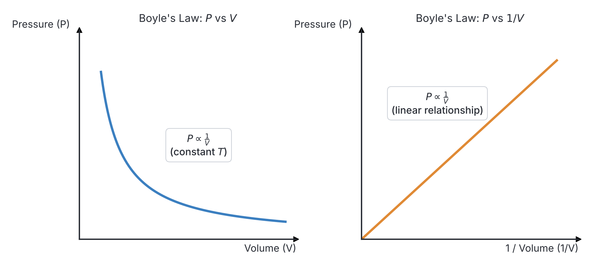
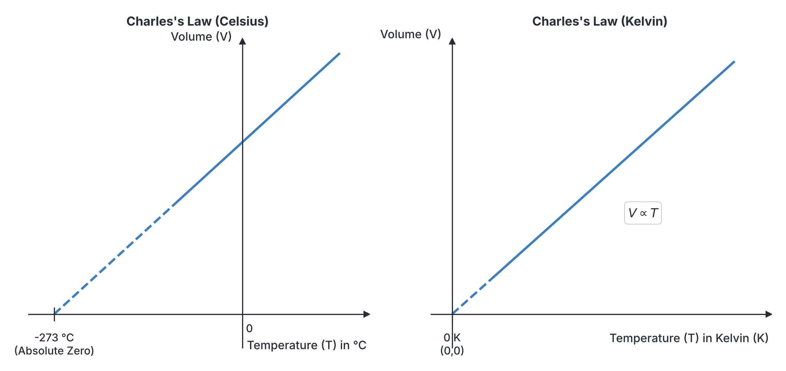
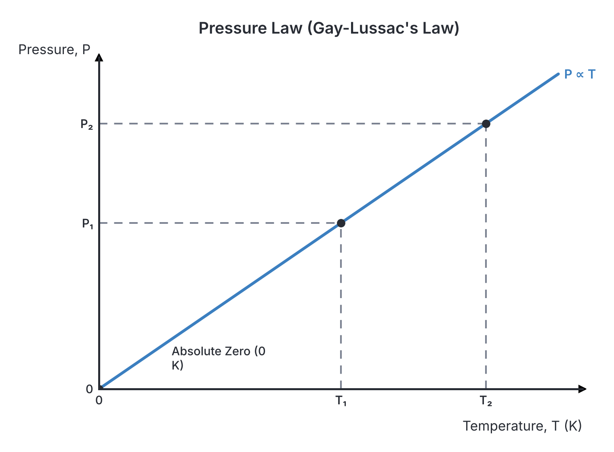

# JAMB Physics Notes: Gas Laws

## What JAMB expects

This topic is Topic 16 of the JAMB Physics syllabus: Gas Laws. It covers the fundamental laws governing the behaviour of gases and the equations derived from them.

**Topics / Contents / Notes:**
- (i) Boyle's law (isothermal process)
- (ii) Charle's law (isobaric process)
- (iii) Pressure law (volumetric process)
- (iv) absolute zero of temperature
- (v) general gas equation: ($\frac{PV}{T} = \text{constant}$)
- (vi) ideal gas equation e.g., $Pv = nRT$
- (vii) Van der waal gas

**By the end of these notes, you should be able to:**
1. interpret the gas laws;
2. use expression of these laws to solve numerical problems;
3. interpret Van der waal equation for one mole of a real gas.

**Note on the syllabus wording:** The syllabus spells "Charles's law" as "Charle's law", uses a lowercase $v$ in "$Pv = nRT$" (we will use the standard uppercase $V$), and writes "Van der waal gas". The correct scientific spelling is **Van der Waals**, and we will use that in these notes. The syllabus also repeats the Roman numeral (iv) for Van der Waals gas, which we treat as item (vii). Finally, the syllabus calls the constant-volume process a "volumetric process", though many textbooks also call it an "isochoric process".

## Interpreting the gas laws

**Objective i: interpret the gas laws.**

The physical state of any gas is determined by three main properties (variables):
1. **Pressure ($P$):** The force the gas exerts per unit area on the walls of its container. Measured in Pascals ($\text{Pa}$) or Newtons per square metre ($\text{N m}^{-2}$).
2. **Volume ($V$):** The space the gas occupies. Measured in cubic metres ($\text{m}^3$), cubic decimetres ($\text{dm}^3$), or cubic centimetres ($\text{cm}^3$).
3. **Temperature ($T$):** The degree of hotness or coldness of the gas. For all gas laws, this **must** be the absolute (thermodynamic) temperature measured in Kelvin ($\text{K}$).

The gas laws are simple mathematical relationships that describe what happens to a fixed mass of gas when one of these variables is kept constant while the other two are changed. 

## Boyle's law (isothermal process)

**Content i: Boyle's law (isothermal process)**

An **isothermal process** is one in which the temperature remains constant. 

**Boyle's law** states that the volume of a fixed mass of gas is inversely proportional to its pressure, provided the temperature remains constant.

Mathematically:
$$V \propto \frac{1}{P}$$
$$PV = \text{constant}$$

If a gas at an initial pressure $P_1$ and volume $V_1$ is compressed or expanded at constant temperature to a new pressure $P_2$ and volume $V_2$, the equation becomes:
$$P_1 V_1 = P_2 V_2$$

where:
- $P_1$ is the initial pressure (e.g., in $\text{Pa}$ or $\text{atm}$)
- $V_1$ is the initial volume (e.g., in $\text{cm}^3$ or $\text{m}^3$)
- $P_2$ is the final pressure (in the same unit as $P_1$)
- $V_2$ is the final volume (in the same unit as $V_1$)

**Nigerian context:** When you use a hand pump to inflate a bicycle tyre, as you push the handle down, you are reducing the volume of the air inside the cylinder. As the volume decreases, the pressure increases sharply, pushing the air into the tyre. 

### Graphs of Boyle's Law
If we plot Pressure ($P$) against Volume ($V$), we get a curve that slopes downwards (a hyperbola). However, if we plot Pressure ($P$) against the inverse of volume ($\frac{1}{V}$), we get a straight line passing through the origin.

**Worked Example 1: Boyle's Law Calculation**
A fixed mass of gas occupies a volume of $2.0\ \text{dm}^3$ at a pressure of $3.0 \times 10^5\ \text{Pa}$. If the volume is reduced to $1.5\ \text{dm}^3$ at constant temperature, calculate the new pressure.

**Solution:**
1. Identify the given values and ensure units match:
   $V_1 = 2.0\ \text{dm}^3$
   $P_1 = 3.0 \times 10^5\ \text{Pa}$
   $V_2 = 1.5\ \text{dm}^3$
   $P_2 = ?$
2. State the appropriate formula (temperature is constant, so use Boyle's law):
   $$P_1 V_1 = P_2 V_2$$
3. Substitute the values:
   $$3.0 \times 10^5\ \text{Pa} \times 2.0\ \text{dm}^3 = P_2 \times 1.5\ \text{dm}^3$$
4. Rearrange and calculate the answer:
   $$P_2 = \frac{3.0 \times 10^5 \times 2.0}{1.5} = \frac{6.0 \times 10^5}{1.5} = 4.0 \times 10^5\ \text{Pa}$$
   The new pressure is $4.0 \times 10^5\ \text{Pa}$.

## Charles's law (isobaric process)

**Content ii: Charles's law (isobaric process)**

An **isobaric process** is one in which the pressure remains constant.

**Charles's law** states that the volume of a fixed mass of gas is directly proportional to its absolute temperature, provided the pressure remains constant.

Mathematically:
$$V \propto T$$
$$\frac{V}{T} = \text{constant}$$

For a gas undergoing a change from an initial state to a final state at constant pressure:
$$\frac{V_1}{T_1} = \frac{V_2}{T_2}$$

where:
- $V_1$ and $V_2$ are the initial and final volumes.
- $T_1$ and $T_2$ are the initial and final temperatures **in Kelvin ($\text{K}$)**.

**Nigerian context:** If you leave a tightly inflated leather football out in the hot afternoon sun, it can swell up and feel tighter. The air inside heats up, and because pressure tends to equalise, the volume expands to stretch the leather.

### Graphs of Charles's Law
If we plot Volume ($V$) against Temperature in degree Celsius ($^\circ\text{C}$), the graph is a straight line that intersects the temperature axis at exactly $-273\ ^\circ\text{C}$. If we plot Volume ($V$) against the absolute temperature in Kelvin ($\text{K}$), the graph is a straight line passing directly through the origin ($0, 0$).

**Worked Example 2: Charles's Law Calculation**
The volume of a given mass of gas is $400\ \text{cm}^3$ at $27\ ^\circ\text{C}$. Find its volume at $87\ ^\circ\text{C}$, assuming the pressure remains constant.

**Solution:**
1. Identify the given values and **convert temperatures to Kelvin** ($T = \theta + 273$):
   $V_1 = 400\ \text{cm}^3$
   $T_1 = 27\ ^\circ\text{C} + 273 = 300\ \text{K}$
   $T_2 = 87\ ^\circ\text{C} + 273 = 360\ \text{K}$
   $V_2 = ?$
2. State Charles's law formula:
   $$\frac{V_1}{T_1} = \frac{V_2}{T_2}$$
3. Substitute the values:
   $$\frac{400\ \text{cm}^3}{300\ \text{K}} = \frac{V_2}{360\ \text{K}}$$
4. Rearrange and calculate the answer:
   $$V_2 = \frac{400 \times 360}{300} = 400 \times 1.2 = 480\ \text{cm}^3$$
   The new volume is $480\ \text{cm}^3$.

## Pressure law (volumetric process)

**Content iii: Pressure law (volumetric process)**

A **volumetric process** (often called an **isochoric process** in many textbooks) is one in which the volume of the gas remains constant.

The **Pressure law** (sometimes called Gay-Lussac's law) states that the pressure of a fixed mass of gas is directly proportional to its absolute temperature, provided the volume remains constant.

Mathematically:
$$P \propto T$$
$$\frac{P}{T} = \text{constant}$$

For a change of state at constant volume:
$$\frac{P_1}{T_1} = \frac{P_2}{T_2}$$

**Nigerian context:** The tyres of an *okada* (motorcycle) or a car have a roughly constant volume. If you check the tyre pressure early in the cool morning, it is lower. After riding for hours on a hot tarred road, the temperature of the air inside the tyre increases, and the pressure rises sharply. This is why tyres sometimes burst on hot days.

### Graph of the Pressure Law
A graph of Pressure ($P$) against absolute temperature ($T$ in Kelvin) is a straight line passing through the origin.

**Worked Example 3: Pressure Law Calculation**
A car tyre contains air at a pressure of $2.0 \times 10^5\ \text{Pa}$ at a temperature of $27\ ^\circ\text{C}$. After a long journey, the temperature of the air in the tyre rises to $57\ ^\circ\text{C}$. Calculate the new pressure, assuming the volume of the tyre is constant.

**Solution:**
1. Identify values and convert temperatures to Kelvin:
   $P_1 = 2.0 \times 10^5\ \text{Pa}$
   $T_1 = 27\ ^\circ\text{C} + 273 = 300\ \text{K}$
   $T_2 = 57\ ^\circ\text{C} + 273 = 330\ \text{K}$
   $P_2 = ?$
2. State the Pressure law formula:
   $$\frac{P_1}{T_1} = \frac{P_2}{T_2}$$
3. Substitute the values:
   $$\frac{2.0 \times 10^5\ \text{Pa}}{300\ \text{K}} = \frac{P_2}{330\ \text{K}}$$
4. Rearrange and calculate:
   $$P_2 = \frac{2.0 \times 10^5 \times 330}{300} = 2.0 \times 10^5 \times 1.1 = 2.2 \times 10^5\ \text{Pa}$$
   The new pressure is $2.2 \times 10^5\ \text{Pa}$.

## Absolute zero of temperature

**Content iv: absolute zero of temperature**

If you trace the Charles's law graph (Volume vs Temperature in $^\circ\text{C}$) backwards, the volume theoretically shrinks to zero at a temperature of **$-273.15\ ^\circ\text{C}$**. 

Because a gas cannot have a negative volume, scientists concluded that this temperature is the lowest possible temperature in the universe. This point is called the **absolute zero of temperature**.

- Absolute zero is $0\ \text{K}$ on the Kelvin scale, which equals roughly $-273\ ^\circ\text{C}$.
- According to the kinetic theory of matter, at absolute zero, all translational motion of gas molecules stops. The kinetic energy of the molecules becomes zero.
- In reality, gases liquefy and then freeze into solids long before they reach absolute zero, so the "zero volume" is purely theoretical for an ideal gas.

## Solving numerical problems using gas laws

**Objective ii: use expression of these laws to solve numerical problems.**

JAMB tests your ability to choose the correct gas law and avoid unit traps. To solve numerical problems successfully:
1. **Identify the constant variable:** If Temperature is constant, use Boyle's law. If Pressure is constant, use Charles's law. If Volume is constant, use the Pressure law. If nothing is constant, use the General Gas Equation.
2. **Convert Temperature:** ALWAYS convert temperatures from Celsius ($^\circ\text{C}$) to Kelvin ($\text{K}$) by adding $273$. Using Celsius directly will guarantee a wrong answer!
3. **Match units:** Ensure $P_1$ and $P_2$ have the same units (e.g., both in $\text{Pa}$ or both in $\text{atm}$). Ensure $V_1$ and $V_2$ have the same units (e.g., both in $\text{cm}^3$ or both in $\text{m}^3$).
4. **Standard Temperature and Pressure (s.t.p.):** If a question mentions s.t.p., it means standard temperature ($0\ ^\circ\text{C} = 273\ \text{K}$) and standard pressure ($1.01 \times 10^5\ \text{Pa}$ or $760\ \text{mmHg}$).

## General gas equation

**Content v: general gas equation: ($\frac{PV}{T} = \text{constant}$)**

When a fixed mass of gas undergoes a change where pressure, volume, and temperature **all** vary simultaneously, we combine Boyle's law and Charles's law into a single formula called the **general gas equation**:

$$\frac{P_1 V_1}{T_1} = \frac{P_2 V_2}{T_2}$$

**Worked Example 4: General Gas Equation Calculation**
A given mass of gas occupies a volume of $500\ \text{cm}^3$ at a pressure of $1.2 \times 10^5\ \text{Pa}$ and a temperature of $27\ ^\circ\text{C}$. Calculate its volume when the pressure falls to $1.0 \times 10^5\ \text{Pa}$ and the temperature falls to $-73\ ^\circ\text{C}$.

**Solution:**
1. Identify values and convert temperatures to Kelvin:
   $P_1 = 1.2 \times 10^5\ \text{Pa}$
   $V_1 = 500\ \text{cm}^3$
   $T_1 = 27\ ^\circ\text{C} + 273 = 300\ \text{K}$
   $P_2 = 1.0 \times 10^5\ \text{Pa}$
   $T_2 = -73\ ^\circ\text{C} + 273 = 200\ \text{K}$
   $V_2 = ?$
2. State the general gas equation:
   $$\frac{P_1 V_1}{T_1} = \frac{P_2 V_2}{T_2}$$
3. Substitute the values:
   $$\frac{1.2 \times 10^5 \times 500}{300} = \frac{1.0 \times 10^5 \times V_2}{200}$$
4. Rearrange to make $V_2$ the subject and solve:
   $$V_2 = \frac{1.2 \times 10^5 \times 500 \times 200}{1.0 \times 10^5 \times 300}$$
   $$V_2 = \frac{1.2 \times 100,000}{300} = \frac{120,000}{300} = 400\ \text{cm}^3$$
   The final volume is $400\ \text{cm}^3$.

## Ideal gas equation

**Content vi: ideal gas equation e.g., $Pv = nRT$**

The general gas equation works for a *fixed mass* of gas. If we want to relate the properties of a gas to the exact *amount* (number of moles) of the gas present, we use the **ideal gas equation** (also called the equation of state for an ideal gas).

$$PV = nRT$$

where:
- $P$ is the absolute pressure in Pascals ($\text{Pa}$ or $\text{N m}^{-2}$).
- $V$ is the volume in cubic metres ($\text{m}^3$).
- $n$ is the number of moles of the gas ($\text{mol}$).
- $R$ is the universal (molar) gas constant. Its value is usually given as $8.31\ \text{J K}^{-1}\text{mol}^{-1}$ (JAMB will provide this constant if needed).
- $T$ is the absolute temperature in Kelvin ($\text{K}$).

**Important rule for $PV = nRT$:** Because the constant $R$ is strictly in SI units, you **must** convert your volume to $\text{m}^3$ and your pressure to $\text{Pa}$. (Recall that $1\ \text{m}^3 = 1,000,000\ \text{cm}^3 = 1000\ \text{dm}^3$).

**Worked Example 5: Ideal Gas Equation Calculation**
Find the volume occupied by $2.0\ \text{moles}$ of an ideal gas at a pressure of $8.31 \times 10^4\ \text{Pa}$ and a temperature of $300\ \text{K}$. (Take $R = 8.31\ \text{J K}^{-1}\text{mol}^{-1}$).

**Solution:**
1. Identify the given values in standard SI units:
   $n = 2.0\ \text{moles}$
   $P = 8.31 \times 10^4\ \text{Pa}$
   $T = 300\ \text{K}$
   $R = 8.31\ \text{J K}^{-1}\text{mol}^{-1}$
   $V = ?$
2. State the ideal gas equation:
   $$PV = nRT$$
3. Rearrange to find Volume:
   $$V = \frac{nRT}{P}$$
4. Substitute and calculate:
   $$V = \frac{2.0 \times 8.31 \times 300}{8.31 \times 10^4} = \frac{600 \times 8.31}{83100} = \frac{600}{10000} = 0.06\ \text{m}^3$$
   The volume is $0.06\ \text{m}^3$.

## Van der Waals gas

**Content vii: Van der waal gas**

All the equations above assume the gas is an **ideal gas**. An ideal gas is a theoretical gas based on the kinetic theory of matter, which makes two major assumptions:
1. The gas molecules have **zero volume** (they are mere points).
2. There are **no intermolecular forces** of attraction between the molecules.

In reality, an ideal gas does not exist. **Real gases** (like oxygen, nitrogen, and the liquefied petroleum gas used for cooking in Nigerian homes) are composed of molecules that *do* take up space and *do* attract each other slightly. 

Real gases behave somewhat like ideal gases only at **high temperatures** (where particles move too fast for attractive forces to hold them) and **low pressures** (where particles are spread far apart, so their own volume is negligible). At **low temperatures** and **high pressures**, real gases deviate significantly from the ideal gas laws and will eventually turn into liquids.

## Interpreting the Van der Waals equation for one mole of a real gas

**Objective iii: interpret Van der waal equation for one mole of a real gas.**

To make the ideal gas equation ($PV = RT$ for one mole) work for real gases, the Dutch physicist Johannes Diderik van der Waals modified it by adding corrections for the two false assumptions.

The **Van der Waals equation of state** for one mole ($n = 1$) of a real gas is:

$$\left(P + \frac{a}{V^2}\right)(V - b) = RT$$

Let us interpret the two correction terms in this equation:
- **$\frac{a}{V^2}$ (The pressure correction):** This term accounts for the **intermolecular forces of attraction**. In a real gas, molecules attract each other, which reduces the force with which they hit the walls of the container. Therefore, the measured pressure ($P$) is slightly less than the ideal pressure, and the term $\frac{a}{V^2}$ must be added to correct it. Here, $a$ is a constant specific to the gas.
- **$b$ (The volume correction):** This term accounts for the **finite volume of the gas molecules**. The actual empty space available for molecules to move around in is the total container volume ($V$) minus the volume taken up by the molecules themselves ($b$).

| Feature | Ideal Gas | Real Gas (Van der Waals Gas) |
| --- | --- | --- |
| **Gas laws** | perfectly obeys gas laws under all conditions | Only obeys gas laws at high temperature and low pressure |
| **Volume of molecules** | Assumed to be completely zero (negligible) | Molecules have a finite volume (accounted for by $b$) |
| **Intermolecular forces** | Assumed to be completely zero | Significant attractive forces exist (accounted for by $a/V^2$) |
| **Equation of state** | $PV = RT$ (for one mole) | $\left(P + \frac{a}{V^2}\right)(V - b) = RT$ (for one mole) |

## Key terms

| Term | Meaning |
| --- | --- |
| **Isothermal process** | A thermodynamic process in which the temperature remains constant. |
| **Isobaric process** | A thermodynamic process in which the pressure remains constant. |
| **Volumetric (Isochoric) process** | A thermodynamic process in which the volume remains constant. |
| **Absolute zero** | The lowest possible theoretical temperature ($0\ \text{K}$ or $-273\ ^\circ\text{C}$), where a gas's volume and kinetic energy would theoretically be zero. |
| **Ideal gas** | A hypothetical gas that perfectly obeys the gas laws under all conditions of temperature and pressure. |
| **Real gas** | An actual gas that deviates from ideal behaviour due to intermolecular forces and the finite volume of its molecules. |
| **Standard Temperature and Pressure (s.t.p.)** | A standard reference condition: Temperature $= 273\ \text{K}$ ($0\ ^\circ\text{C}$) and Pressure $= 1.01 \times 10^5\ \text{Pa}$ (or $760\ \text{mmHg}$). |

## Exam tips and common mistakes

- **Common mistake:** Using degree Celsius ($^\circ\text{C}$) directly in calculations. **ALWAYS add 273** to convert to Kelvin before plugging temperatures into gas equations. $T(\text{K}) = \theta(^\circ\text{C}) + 273$.
- **Exam tip:** Memorise the constants to identify the laws easily: 
  - Constant **T**emperature = **B**oyle's Law ("TB").
  - Constant **P**ressure = **C**harles's Law ("PC").
- **Common mistake:** Mixing up units. If $V_1$ is in $\text{cm}^3$, $V_2$ will also be in $\text{cm}^3$. For proportional laws ($P_1 V_1 = P_2 V_2$), you do not need to convert to $\text{m}^3$ as long as you are consistent on both sides.
- **Common mistake:** Failing to use standard SI units in the Ideal Gas Equation. For $PV = nRT$, you **must** convert Volume to $\text{m}^3$ and Pressure to $\text{Pa}$ because the constant $R$ demands it.
- **Exam tip:** In the Van der Waals equation, remember that $a$ is for **a**ttraction (intermolecular forces) and $b$ is for the **b**ulk (volume) of the molecules.

## Quick summary

1. Boyle's law ($PV = \text{constant}$): At constant temperature, the volume of a gas is inversely proportional to its pressure.
2. Charles's law ($\frac{V}{T} = \text{constant}$): At constant pressure, the volume of a gas is directly proportional to its absolute temperature.
3. Pressure law ($\frac{P}{T} = \text{constant}$): At constant volume, the pressure of a gas is directly proportional to its absolute temperature.
4. The absolute zero of temperature is $0\ \text{K}$ or $-273\ ^\circ\text{C}$, the point where a gas theoretically has zero volume and zero kinetic energy.
5. The general gas equation $\frac{P_1 V_1}{T_1} = \frac{P_2 V_2}{T_2}$ is used when a fixed mass of gas undergoes changes in pressure, volume, and temperature.
6. The ideal gas equation is $PV = nRT$, which relates pressure, volume, temperature, and the number of moles of a gas.
7. Real gases behave ideally only at high temperatures and low pressures. The Van der Waals equation $\left(P + \frac{a}{V^2}\right)(V - b) = RT$ corrects for the finite volume of real gas molecules and the intermolecular forces between them.

## Practice questions

**1. In an isothermal process for a fixed mass of an ideal gas, which of the following physical quantities remains constant?**
- A. Pressure
- B. Volume
- C. Temperature
- D. Heat energy

**Answer: C.** An isothermal process is one that occurs at a constant temperature. This is the condition for Boyle's law.

**2. A fixed mass of gas occupies $2.0\ \text{dm}^3$ at a pressure of $3.0 \times 10^5\ \text{Pa}$. If the volume is reduced to $1.5\ \text{dm}^3$ at constant temperature, what is the new pressure?**
- A. $4.5 \times 10^5\ \text{Pa}$
- B. $4.0 \times 10^5\ \text{Pa}$
- C. $2.25 \times 10^5\ \text{Pa}$
- D. $1.0 \times 10^5\ \text{Pa}$

**Answer: B.** 
1. Use Boyle's law: $P_1 V_1 = P_2 V_2$
2. Substitute: $3.0 \times 10^5 \times 2.0 = P_2 \times 1.5$
3. $6.0 \times 10^5 = 1.5 \times P_2$
4. $P_2 = 4.0 \times 10^5\ \text{Pa}$. 
*Trap: Option C comes from wrongly assuming $P$ is directly proportional to $V$ ($\frac{3 \times 10^5}{2} \times 1.5$).*

**3. The volume of a given mass of gas is $400\ \text{cm}^3$ at $27\ ^\circ\text{C}$. At what temperature will its volume be $600\ \text{cm}^3$, assuming pressure is constant?**
- A. $177\ ^\circ\text{C}$
- B. $450\ ^\circ\text{C}$
- C. $40.5\ ^\circ\text{C}$
- D. $200\ ^\circ\text{C}$

**Answer: A.**
1. Convert initial temperature to Kelvin: $T_1 = 27 + 273 = 300\ \text{K}$.
2. Use Charles's law: $\frac{V_1}{T_1} = \frac{V_2}{T_2} \implies \frac{400}{300} = \frac{600}{T_2}$
3. $T_2 = \frac{600 \times 300}{400} = 450\ \text{K}$.
4. Convert back to Celsius: $450 - 273 = 177\ ^\circ\text{C}$.
*Trap: Option C comes from wrongly using Celsius directly ($27 \times \frac{600}{400} = 40.5\ ^\circ\text{C}$). Option B forgets to convert the final answer back to Celsius.*

**4. The absolute zero of temperature is best defined as the temperature at which:**
- A. water freezes into solid ice.
- B. the volume and kinetic energy of an ideal gas are theoretically zero.
- C. a real gas liquefies.
- D. the pressure of the atmosphere is exactly zero.

**Answer: B.** Absolute zero ($-273\ ^\circ\text{C}$ or $0\ \text{K}$) is the theoretical temperature where gas particles would stop translating, meaning kinetic energy and gas volume drop to zero.

**5. A car tyre contains air at a pressure of $2.0 \times 10^5\ \text{Pa}$ at $300\ \text{K}$. After a long journey, the temperature of the air rises to $330\ \text{K}$. Calculate the new pressure, assuming the volume of the tyre is constant.**
- A. $2.2 \times 10^5\ \text{Pa}$
- B. $1.8 \times 10^5\ \text{Pa}$
- C. $2.5 \times 10^5\ \text{Pa}$
- D. $3.0 \times 10^5\ \text{Pa}$

**Answer: A.**
1. Use the Pressure law: $\frac{P_1}{T_1} = \frac{P_2}{T_2}$
2. Substitute: $\frac{2.0 \times 10^5}{300} = \frac{P_2}{330}$
3. $P_2 = \frac{2.0 \times 10^5 \times 330}{300} = 2.2 \times 10^5\ \text{Pa}$.
*Trap: Option B is obtained by wrongly inverting the temperature ratio ($2.0 \times 10^5 \times \frac{300}{330} \approx 1.8 \times 10^5\ \text{Pa}$).*

**6. A gas occupies a volume of $3.0\ \text{m}^3$ at a pressure of $2.0 \times 10^5\ \text{Pa}$ and a temperature of $27\ ^\circ\text{C}$. What volume will it occupy at a pressure of $4.0 \times 10^5\ \text{Pa}$ and a temperature of $127\ ^\circ\text{C}$?**
- A. $1.5\ \text{m}^3$
- B. $2.0\ \text{m}^3$
- C. $4.5\ \text{m}^3$
- D. $7.1\ \text{m}^3$

**Answer: B.**
1. Convert temperatures: $T_1 = 27 + 273 = 300\ \text{K}$; $T_2 = 127 + 273 = 400\ \text{K}$.
2. General gas equation: $\frac{P_1 V_1}{T_1} = \frac{P_2 V_2}{T_2}$
3. Substitute: $\frac{2.0 \times 10^5 \times 3.0}{300} = \frac{4.0 \times 10^5 \times V_2}{400}$
4. $V_2 = \frac{2.0 \times 10^5 \times 3.0 \times 400}{4.0 \times 10^5 \times 300} = \frac{24 \times 10^7}{12 \times 10^7} = 2.0\ \text{m}^3$.
*Trap: Option D comes from failing to convert Celsius to Kelvin ($\frac{2 \times 10^5 \times 3 \times 127}{4 \times 10^5 \times 27} = 7.05\ \text{m}^3$).*

**7. How many moles of an ideal gas occupy a volume of $0.05\ \text{m}^3$ at a pressure of $8.31 \times 10^4\ \text{Pa}$ and a temperature of $200\ \text{K}$? (Take $R = 8.31\ \text{J K}^{-1}\text{mol}^{-1}$)**
- A. $0.4\ \text{moles}$
- B. $1.5\ \text{moles}$
- C. $2.5\ \text{moles}$
- D. $5.0\ \text{moles}$

**Answer: C.**
1. Formula: $PV = nRT$
2. Rearrange for moles: $n = \frac{PV}{RT}$
3. Substitute: $n = \frac{8.31 \times 10^4 \times 0.05}{8.31 \times 200}$
4. $n = \frac{4155}{1662} = 2.5\ \text{moles}$.
*Trap: Option A comes from improperly rearranging the formula as $n = \frac{RT}{PV}$.*

**8. In the Van der Waals equation for one mole of a real gas, $\left(P + \frac{a}{V^2}\right)(V - b) = RT$, the term $\frac{a}{V^2}$ accounts for the:**
- A. intermolecular forces of attraction between gas molecules.
- B. finite volume occupied by the gas molecules.
- C. kinetic energy of the molecules.
- D. rate of collisions with the container walls.

**Answer: A.** The constant $a$ corrects the pressure term by accounting for the attractive forces between molecules, which reduce the effective pressure. The constant $b$ accounts for the finite volume of the molecules.

**9. Which of the following graphs correctly represents Charles's law for an ideal gas?**
- A. A straight line passing through the origin for a graph of Pressure versus Volume.
- B. A curve sloping downwards for a graph of Volume versus Temperature in Kelvin.
- C. A straight line passing through the origin for a graph of Volume versus Temperature in Kelvin.
- D. A straight line passing through the origin for a graph of Volume versus Temperature in Celsius.

**Answer: C.** Charles's law states that volume is directly proportional to absolute temperature. A graph of $V$ against $T$ (in Kelvin) is a straight line through the origin ($0,0$).

**10. Real gases behave most like ideal gases at:**
- A. high temperatures and low pressures.
- B. high temperatures and high pressures.
- C. low temperatures and low pressures.
- D. low temperatures and high pressures.

**Answer: A.** At high temperatures, molecules move fast enough to overcome intermolecular forces. At low pressures, the molecules are spread far apart, making their individual volumes negligible compared to the total container volume.
