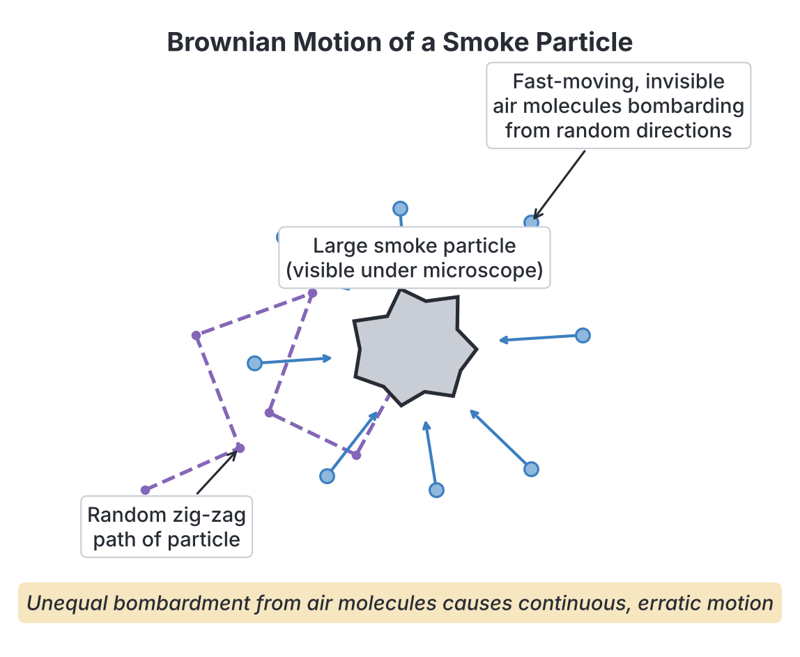
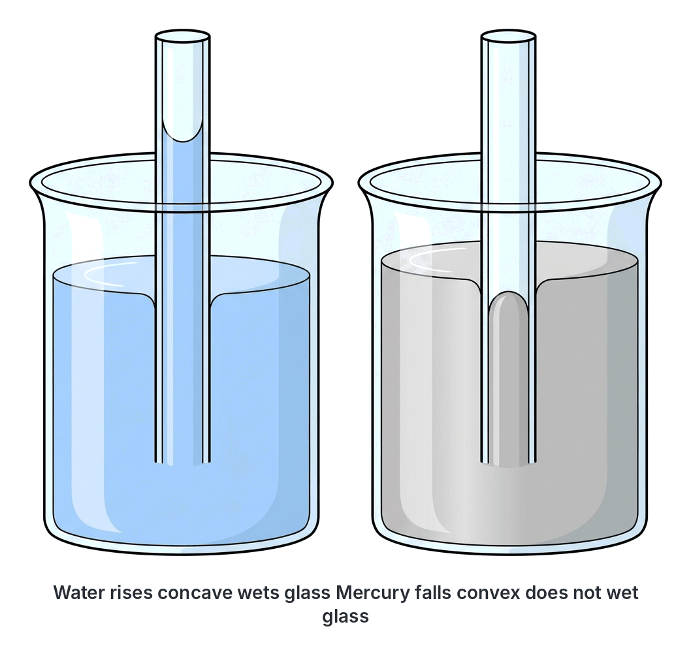
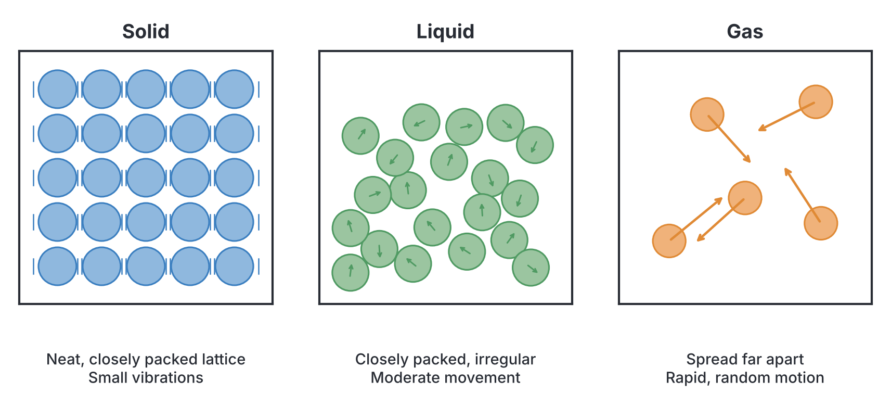

# JAMB Physics Notes: Structure of Matter and Kinetic Theory

## What JAMB expects

This topic is Topic 18 of the JAMB Physics syllabus: Structure of Matter and Kinetic Theory. It covers the microscopic nature of matter and how the motion of tiny particles explains what we observe in the real world. 

The topic is divided into two main parts:
*   **(a) Molecular nature of matter:** atoms and molecules; molecular theory (explaining Brownian motion, diffusion, surface tension, capillarity, adhesion, cohesion, angles of contact, and the law of definite proportion); examples and applications.
*   **(b) Kinetic Theory:** assumptions of the kinetic theory; using the theory to explain gas pressure, Boyle’s law, Charles’ law, melting, boiling, vaporization, temperature change, and evaporation.

By the end of these notes, you should be able to:
1. differentiate between atoms and molecules;
2. use molecular theory to explain Brownian motion, diffusion, surface tension, capillarity, adhesion, cohesion and angle of contact;
3. examine the assumptions of kinetic theory;
4. interpret using kinetic theory: the pressure exerted by gases, Boyle’s law, Charles’s law, melting, boiling, vaporization, change in temperature, evaporation, etc.

*Note on the syllabus wording:* The syllabus mentions "surface, tension" with a comma in the objectives; this is a typo for "surface tension". Topics like Boyle's Law and Charles's Law are calculated macroscopically in `A16-gas-laws.md`; this file focuses purely on *why* they happen at the molecular level. Similarly, macroscopic heat changes are in `A14-change-of-state.md` and surface tension formulas in `A11-liquids-at-rest.md`.

## Atoms and Molecules

**Objective i: differentiate between atoms and molecules.**
**Content a: Molecular nature of matter**

All matter is made up of tiny, invisible particles. The idea that matter is not continuous but made of discrete, microscopic building blocks goes back to the ancient Greeks, but it was scientifically established by John Dalton and others. The two most fundamental particles in the classical study of matter's structure are **atoms** and **molecules**.

*   **Atom:** An atom is the smallest particle of an element that can take part in a chemical reaction. Atoms of the same element are identical in their chemical properties. In nature, most atoms are highly reactive and usually cannot exist independently on their own (with the exception of noble gases like Helium, Neon, and Argon). 
*   **Molecule:** A molecule is the smallest particle of a substance (which could be an element or a compound) that can exist freely on its own and still retain all the chemical properties of that substance. Molecules are formed when two or more atoms bond together chemically. 

### Differences between Atoms and Molecules

| Feature | Atom | Molecule |
| :--- | :--- | :--- |
| **Definition** | Smallest particle of an element that takes part in a chemical reaction. | Smallest particle of a substance that can exist freely and independently. |
| **Composition** | Made up of subatomic particles (protons, neutrons, electrons). | Made up of two or more atoms chemically bonded together. |
| **Independent existence** | Most highly reactive atoms cannot exist freely (e.g., a single Oxygen atom, $\text{O}$). | Can exist freely in nature (e.g., an Oxygen gas molecule, $\text{O}_2$). |
| **Types** | Specific to elements (e.g., Hydrogen, Carbon, Iron). | Can belong to elements (e.g., $\text{O}_2$) or compounds (e.g., $\text{H}_2\text{O}$). |
| **Divisibility** | Cannot be broken down further by ordinary chemical means. | Can be broken down into individual atoms during chemical reactions. |

## Molecular Theory of Matter and its Applications

**Objective ii: use molecular theory to explain Brownian motion, diffusion, surface tension, capillarity, adhesion, cohesion and angle of contact.**

The **molecular theory of matter** states that all matter is made of molecules, and these molecules are in a continuous state of random motion. There are spaces between the molecules, and forces of attraction exist between them. We use this theory to explain several physical phenomena. 

### 1. Brownian Motion

**Brownian motion** is the continuous, random, zig-zag movement of tiny visible particles suspended in a fluid (a liquid or gas). It was named after the Scottish botanist Robert Brown, who in 1827 observed pollen grains darting around randomly in water under a microscope. 

*   **Molecular explanation:** Why do the visible particles (like pollen in water or smoke in air) dance around? According to molecular theory, the fluid molecules (like water or air) are invisible, moving very fast, and colliding randomly with the larger, visible particle. Because the collisions are unequal on different sides of the particle at any given moment, the visible particle is pushed randomly in continuously changing directions. This was mathematically proven by Albert Einstein in 1905, confirming the existence of atoms.
*   **Example (Smoke Cell Experiment):** If you trap smoke in a small glass cell and look at it under a microscope illuminated by a strong light, you will see bright specks of smoke darting about. This proves that the invisible air molecules are in constant motion, constantly striking the smoke particles. Another everyday Nigerian example is watching tiny dust particles "dancing" in a beam of sunlight shining through a hole in the roof of a dark room.

### 2. Diffusion

**Diffusion** is the process by which molecules of different substances mix completely due to their random kinetic motion, spreading from a region of higher concentration to a region of lower concentration, until they are evenly distributed.

*   **Molecular explanation:** Because molecules are constantly moving and colliding, they naturally spread out to fill any available space. 
*   **Examples:** When someone sprays perfume in one corner of a room, the scent soon reaches the other end. A drop of blue ink gently dropped into a beaker of water eventually colours the entire water blue even without stirring. In a Nigerian kitchen, the smell of frying onions or jollof rice quickly spreads throughout the house because the scent molecules diffuse through the air molecules.
*   **Differences in states:** Diffusion is fastest in gases because the molecules are far apart and move very quickly. It is slower in liquids because molecules are closer and experience more attractive forces, and extremely slow (almost unnoticeable) in solids. Increasing the temperature speeds up diffusion because the molecules gain more kinetic energy and move faster.

### 3. Cohesion, Adhesion, and the Meniscus

Intermolecular forces (forces between molecules) determine how liquids behave when they touch solids.
*   **Cohesion:** The force of attraction between molecules of the **same** substance (e.g., a water molecule attracting another water molecule, or mercury atoms attracting each other).
*   **Adhesion:** The force of attraction between molecules of **different** substances (e.g., a water molecule attracting a glass molecule).

When a liquid is contained in a tube or vessel, the curved surface of the liquid is called the **meniscus**. 
*   If **adhesion is greater than cohesion**, the liquid clings to the container walls and "wets" it. The liquid creeps slightly up the sides, meaning the meniscus curves upwards (concave). Example: Water in a clean glass tube.
*   If **cohesion is greater than adhesion**, the liquid molecules pull tightly together and away from the container. The liquid bulges at the centre, meaning the meniscus curves downwards (convex). Example: Mercury in a glass tube.

### 4. Angle of Contact

The **angle of contact ($\theta$)** is the angle formed between the surface of the solid and the tangent to the liquid surface at the point of contact, measured *inside* the liquid.
*   For liquids that wet glass (like water, where adhesion > cohesion), the angle of contact is **acute** (less than $90^\circ$). For pure water on clean glass, it is approximately $0^\circ$.
*   For liquids that do not wet glass (like mercury, where cohesion > adhesion), the angle of contact is **obtuse** (greater than $90^\circ$). For mercury on glass, it is about $140^\circ$.

### 5. Capillarity

**Capillarity** is the tendency of a liquid to rise or fall in a narrow tube (a capillary tube). This is the same principle that allows kerosene to rise up the wick of a local lantern.
*   **Molecular explanation:** In a fine glass tube containing water, strong adhesive forces pull the water molecules up the glass walls. Surface tension then pulls the rest of the surface molecules up to minimize the surface area, drawing the liquid column upwards until the upward pull balances the downward weight of the water column. Therefore, **water rises** in a capillary tube. 
*   For mercury, strong cohesive forces pull the molecules away from the glass and towards each other, pushing the liquid down. Therefore, **mercury gets depressed (falls)** in a capillary tube. The narrower the tube, the higher the rise (or deeper the fall).

### 6. Surface Tension

**Surface tension** is the property of a liquid that makes its surface behave like a stretched elastic skin. It is why certain small insects (like water striders) can walk on water without sinking, why water droplets are spherical, and why a dry needle can float on water.
*   **Molecular explanation:** A molecule deep inside the body of a liquid is surrounded by other molecules on all sides, so it is pulled equally in all directions by cohesive forces (the net force on it is zero). However, a molecule exactly on the surface has liquid molecules beside and below it, but none above it. It experiences a net inward pull towards the body of the liquid. This unbalanced inward force makes the surface contract, minimize its area, and act like a tight skin.
*   **Effects of impurities and temperature:** Adding soap or detergent to water drastically reduces its surface tension (which is why soapy water easily wets clothes for washing). Heating a liquid also reduces its surface tension.

### 7. The Law of Definite Proportion

The syllabus requires knowing how molecular theory explains the **Law of Definite Proportion** (also called the Law of Constant Composition). This fundamental chemical law states that a given chemical compound always contains its component elements in a fixed ratio by mass.
*   **Molecular explanation:** A specific compound is made of identical molecules. Each molecule is formed by a fixed, whole number of atoms of its constituent elements. Since the mass of an atom of a specific element is constant, the ratio of the masses of the elements in every single molecule is always exactly the same. Thus, the overall mass ratio in the bulk compound is constant. For example, water ($\text{H}_2\text{O}$) is always composed of two hydrogen atoms and one oxygen atom; because of their fixed atomic masses, water is always 11% hydrogen and 89% oxygen by mass, regardless of whether it is from a borehole in Kano, a river in Lagos, or rain falling from the sky.

## Assumptions of the Kinetic Theory

**Objective iii: examine the assumptions of kinetic theory.**
**Content b: Kinetic Theory**

The Kinetic Theory of Gases is a model that treats a gas as a large collection of rapidly moving particles. To make the mathematics of gases simple (leading to what physicists call an "Ideal Gas"), we rely on a set of fundamental assumptions. 

**The standard assumptions of the ideal gas kinetic theory are:**
1.  A gas consists of a very large number of tiny particles (molecules) that are identical for any particular gas.
2.  The molecules are in a state of continuous, random, rapid, straight-line motion, colliding with each other and with the walls of the container.
3.  The collisions of the molecules are **perfectly elastic**. This means no kinetic energy is lost when they bounce off each other or the walls; they simply change direction without slowing down the overall system.
4.  The volume of the molecules themselves is **negligible** compared to the total volume of the container. (The gas is mostly empty space).
5.  There are **no intermolecular forces of attraction or repulsion** between the molecules, except during the brief moment of collision. They do not pull on each other as they fly by.
6.  The time spent during a collision is completely negligible compared to the time spent traveling between collisions.
7.  The average kinetic energy of the gas molecules is directly proportional to the **absolute (Kelvin) temperature** of the gas.

*Note on deviations:* Real gases (like oxygen, nitrogen, and carbon (IV) oxide) behave ideally like this only at **high temperatures and low pressures**. At low temperatures or high pressures, molecules get pushed very close together and move slower, making assumptions 4 and 5 invalid (real molecules *do* take up space and *do* attract each other, which is why real gases can condense into liquids).

## Interpreting Phenomena Using Kinetic Theory

**Objective iv: interpret kinetic theory, the pressure exerted by gases, Boyle’s law, Charles’s law, melting, boiling, vaporization, change in temperature, evaporation, etc.**

The beauty of the kinetic theory is how perfectly it explains real-world macroscopic observations using microscopic motions.

### 1. Pressure Exerted by Gases

Why does a gas exert pressure on a balloon or a car tyre? 
*   **Interpretation:** As gas molecules zip around, they constantly strike the inner walls of the container and bounce back. Each time a molecule bounces off the wall, its velocity changes direction, meaning it undergoes a **change in momentum**. According to Newton's Second Law of Motion, a rate of change of momentum creates a **force**. Millions of these tiny forces pushing on the container wall at any given second add up to a steady total macroscopic force. Pressure is simply this total Force divided by the Area of the walls ($P = F/A$). 
*   **Formula:** In physics, the kinetic theory derives gas pressure mathematically as:
    $$P = \frac{1}{3}\rho c^2$$
    where $P$ is the pressure (in $\text{N m}^{-2}$ or $\text{Pa}$), $\rho$ is the density of the gas (in $\text{kg m}^{-3}$), and $c$ (sometimes written as $v_{\text{rms}}$) is the root-mean-square speed of the molecules (in $\text{m s}^{-1}$).

**Worked Example 1**
The density of a gas in a cylinder is $1.2\ \text{kg m}^{-3}$ and it exerts a pressure of $1.0 \times 10^5\ \text{N m}^{-2}$. Calculate the root-mean-square speed of its molecules.
1.  **Write the formula:** $P = \frac{1}{3}\rho c^2$
2.  **Rearrange for $c^2$:** $c^2 = \frac{3P}{\rho}$
3.  **Substitute values with units:** $c^2 = \frac{3 \times 1.0 \times 10^5\ \text{N m}^{-2}}{1.2\ \text{kg m}^{-3}}$
4.  **Calculate:** $c^2 = \frac{300,000}{1.2} = 250,000\ \text{m}^2\text{s}^{-2}$
5.  **Find the square root:** $c = \sqrt{250,000} = 500\ \text{m s}^{-1}$.
The root-mean-square speed of the gas molecules is $500\ \text{m s}^{-1}$.

### 2. Boyle's Law

Boyle's Law states that the pressure of a fixed mass of gas is inversely proportional to its volume, provided the temperature remains constant ($P \propto 1/V$).
*   **Kinetic Interpretation:** "Constant temperature" means the average kinetic energy and speed of the molecules remain the same. If you compress the gas into a **smaller volume** (decrease $V$), the molecules have less distance to travel before hitting a wall. Therefore, they hit the walls more frequently. More frequent collisions per unit area mean a greater rate of change of momentum, which results in a **greater pressure** (increase $P$).

### 3. Charles's Law

Charles's Law states that the volume of a fixed mass of gas is directly proportional to its absolute temperature, provided the pressure remains constant ($V \propto T$).
*   **Kinetic Interpretation:** If you **increase the temperature** of a gas, the molecules gain kinetic energy and move much faster. Because they are faster, they hit the container walls harder and more frequently, which would naturally increase the pressure. However, Charles's Law requires the pressure to remain *constant*. The only way to stop the pressure from rising is to give the molecules more room to fly around. Therefore, the container must expand (an **increase in volume**) so that the rate of collisions per unit area on the walls drops back down, keeping the pressure steady.

### 4. Change in Temperature

*   **Interpretation:** Temperature is simply a macroscopic measure of the microscopic kinetic energy. When you heat a substance, the thermal energy supplied is converted into mechanical kinetic energy. The molecules move or vibrate faster. Mathematically, absolute temperature is directly proportional to the average kinetic energy of the molecules: $T \propto \frac{1}{2}m\overline{c}^2$. When you cool a substance, the molecules slow down. At Absolute Zero ($0\ \text{K}$ or $-273^\circ\text{C}$), theoretical molecular motion ceases completely.

### 5. Phase Changes: Melting, Boiling, and Vaporization

Matter exists mostly as solids, liquids, or gases. Kinetic theory explains changes of state purely through the battle between **kinetic energy** (which tries to pull molecules apart and scatter them) and **intermolecular forces** (which try to hold them together in rigid structures).

*   **Solid to Liquid (Melting):** In a solid, molecules are locked in a rigid lattice by strong intermolecular forces and can only vibrate about fixed positions. When heated, they vibrate more vigorously. At a specific temperature (the melting point), they gain enough kinetic energy to break the rigid bonds holding them together. The lattice structure collapses, and the molecules can now slide past one another. The substance becomes a liquid.
*   **Liquid to Gas (Boiling/Vaporization):** In a liquid, molecules move freely and can slide past each other, but they are still held close together by attractive forces. As heating continues, they move faster. At the boiling point, the kinetic energy is high enough to completely overcome all intermolecular forces of attraction. The molecules break totally free and fly far apart, becoming a gas (vapour). 

### 6. Evaporation and its Cooling Effect

Evaporation is the process where a liquid turns into a gas at temperatures *below* its boiling point. It happens quietly and only at the surface of the liquid.
*   **Kinetic Interpretation:** In any liquid, the molecules do not all travel at the same uniform speed. Some move exceptionally fast, some move slowly. Occasionally, a molecule near the surface gets bumped by its neighbours and gains a higher-than-average kinetic energy. If this energy is enough to overcome the inward pull of surface tension (cohesion), the molecule escapes into the air as a vapour. 
*   **Why evaporation causes cooling:** Because only the fastest, most energetic molecules manage to escape, they take a lot of kinetic energy away with them. The molecules left behind in the liquid have a lower *average* kinetic energy. Since temperature is directly dependent on average kinetic energy, the temperature of the remaining liquid drops. This is why sweating cools the human body down on a hot day, and why water stored in a porous clay pot becomes cool (as water seeps to the outside and evaporates, it draws heat from the pot).

---

## Key terms

| Term | Meaning |
| :--- | :--- |
| **Atom** | The smallest part of an element that takes part in a chemical reaction. |
| **Molecule** | The smallest part of a substance that can exist freely and independently, retaining chemical properties. |
| **Brownian motion** | The random, continuous, zig-zag motion of visible particles suspended in a fluid. |
| **Diffusion** | The spreading out and mixing of molecules from a region of higher concentration to lower concentration. |
| **Cohesion** | Intermolecular attraction between molecules of the same substance. |
| **Adhesion** | Intermolecular attraction between molecules of different substances. |
| **Capillarity** | The rise or fall of liquids in narrow (capillary) tubes. |
| **Surface tension** | The property of a liquid surface that causes it to behave like a stretched elastic skin due to unbalanced inward cohesive forces. |
| **Angle of contact** | The angle formed inside the liquid between the solid surface and the tangent to the liquid meniscus. |
| **Kinetic theory** | A model explaining the macroscopic properties of matter through the microscopic motion of its molecules. |
| **Perfectly elastic collision** | A collision where no kinetic energy is lost. |
| **Evaporation** | The escape of high-energy molecules from the surface of a liquid below its boiling point, causing a cooling effect. |

## Exam tips and common mistakes

*   **Common Mistake in Boyle's/Charles's Law:** Do not say the molecules themselves "expand" or "swell" when heated. Molecules do not change size; the *space between them* expands because they move faster.
*   **Evaporation vs Boiling:** Remember that evaporation happens *only at the surface* and at *any temperature*, whereas boiling happens *throughout the entire liquid volume* and only at a specific fixed temperature.
*   **Gas Pressure Source:** Gas pressure is caused by molecules colliding with the **walls** of the container, not by molecules colliding with each other or by the static weight of the gas. The collisions create a rate of change of momentum, generating Force.
*   **Angle of Contact:** Water wets glass, has a concave meniscus, and an acute contact angle (less than 90°). Mercury does not wet glass, has a convex meniscus, and an obtuse contact angle (greater than 90°). This is a frequent JAMB question.
*   **Volume of Molecules:** In the ideal gas kinetic theory, the volume of the gas *molecules themselves* is negligible. It is the volume of the *container* that is measurable. Do not mix these up in true/false questions.
*   **Real vs Ideal Gases:** The kinetic theory assumes ideal behavior. Real gases behave like ideal gases only at high temperatures and low pressures. 

## Quick summary

1. Atoms are the smallest particles involved in chemical reactions; molecules are the smallest particles that can exist independently.
2. Brownian motion (random, zig-zag movement) provides visual evidence for the kinetic theory; visible particles dart around randomly because they are bombarded by invisible, fast-moving fluid molecules.
3. If adhesion is greater than cohesion, liquids wet glass, rise in capillary tubes, and have an acute angle of contact (e.g., water). If cohesion is greater, liquids fall in capillary tubes, do not wet glass, and have an obtuse angle of contact (e.g., mercury).
4. Surface tension is caused by unbalanced inward cohesive forces acting on the surface molecules of a liquid, making the surface behave like an elastic skin.
5. The Kinetic Theory assumes gas molecules are in constant random motion, have negligible volume, exert no intermolecular forces, and undergo perfectly elastic collisions.
6. Gas pressure is the result of continuous collisions of molecules with the container walls, producing a continuous rate of change of momentum.
7. Evaporation causes cooling because the most energetic molecules escape the liquid surface, leaving behind slower molecules, which lowers the average kinetic energy and thus lowers the temperature.

## Practice questions

**1. Which of the following statements correctly differentiates an atom from a molecule?**
- A. Atoms only exist in solids, while molecules only exist in gases.
- B. An atom is the smallest particle of an element that takes part in a chemical reaction, while a molecule is the smallest particle of a substance that can exist independently.
- C. Molecules are electrically charged, whereas atoms are always neutral.
- D. Atoms can be broken down into molecules during chemical reactions.

**Answer: B.** By definition, atoms are the fundamental units for chemical reactions, whereas molecules are the smallest units of substances (elements or compounds) that can survive and exist on their own.

**2. The continuous, zig-zag movement of smoke particles observed in a smoke cell experiment is evidence of:**
- A. Convection currents in the air.
- B. The gravitational pull on the smoke particles.
- C. The random motion of invisible air molecules colliding with the smoke particles.
- D. The repulsion between similarly charged smoke particles.

**Answer: C.** This describes Brownian motion. The visible smoke particles are knocked about randomly by the much smaller, fast-moving, invisible air molecules. Option A is a common mistake; convection is a bulk flow, not microscopic random motion.

**3. Water rises in a capillary glass tube because:**
- A. The cohesion of water molecules is greater than their adhesion to the glass.
- B. The adhesion of water molecules to the glass is greater than the cohesion between water molecules.
- C. Water has a very high surface tension.
- D. The atmospheric pressure pushes the water upwards.

**Answer: B.** When adhesive forces (attraction of water to glass) exceed cohesive forces (attraction of water to water), the liquid is pulled up the sides of the tube, wetting it and causing the liquid level to rise. 

**4. According to the kinetic theory of ideal gases, which of the following statements is FALSE?**
- A. The collisions between molecules are perfectly elastic.
- B. The molecules are in constant, random, straight-line motion.
- C. Intermolecular forces of attraction are negligible.
- D. The volume of the molecules themselves is large compared to the volume of the container.

**Answer: D.** Assumption 4 of the kinetic theory states that the volume of the molecules is *negligible* (extremely small, almost zero) compared to the empty space (the volume of the container).

**5. How does the kinetic theory explain the pressure exerted by a gas?**
- A. Gas molecules vibrate in fixed positions against the container walls.
- B. Gas molecules continuously collide with each other, generating friction.
- C. The weight of the gas molecules pushes downward on the container.
- D. Gas molecules undergo a change in momentum when they bounce off the container walls, exerting a force.

**Answer: D.** Pressure ($P = F/A$) arises from the force created by the continuous rate of change of momentum of molecules striking and bouncing off the container walls.

**6. When a fixed mass of gas is heated at constant pressure, its volume expands. This happens because the molecules:**
- A. Expand in size as they get hotter.
- B. Multiply in number, requiring more space.
- C. Gain kinetic energy and hit the walls harder, requiring a larger volume to keep the collision rate and pressure constant.
- D. Move slower, causing the container walls to relax and expand.

**Answer: C.** This is the microscopic interpretation of Charles's Law. Molecules do not expand in size (Option A is a common misconception). The extra kinetic energy means they strike the walls harder, so the volume must increase to lower the collision frequency and prevent the pressure from rising.

**7. Which of the following is responsible for the cooling effect of evaporation?**
- A. The surrounding air absorbs heat from the liquid.
- B. The slower molecules escape, leaving the faster ones behind.
- C. The fastest molecules escape from the surface, lowering the average kinetic energy of the remaining liquid.
- D. The evaporating liquid absorbs cold air from the atmosphere.

**Answer: C.** Evaporation selects the most energetic (fastest) molecules. When they leave, the average kinetic energy of the remaining molecules drops, which translates directly to a drop in temperature.

**8. When a solid melts into a liquid, what happens on a molecular level?**
- A. The solid molecules are completely destroyed and replaced by liquid molecules.
- B. The molecules gain enough kinetic energy to break the rigid lattice bonds and move past each other.
- C. The atoms expand dramatically until they turn into a liquid.
- D. The kinetic energy of the molecules decreases until they flow.

**Answer: B.** Melting occurs when the kinetic energy (vibration from heat) overcomes the intermolecular forces holding the molecules in a rigid lattice, allowing them to flow out of structure while still being held close together.

**9. The angle of contact between mercury and clean glass is:**
- A. exactly $90^\circ$.
- B. acute, because cohesion is greater than adhesion.
- C. obtuse, because adhesion is greater than cohesion.
- D. obtuse, because cohesion is greater than adhesion.

**Answer: D.** Mercury does not wet glass because the cohesive forces (mercury-mercury) are stronger than the adhesive forces (mercury-glass). This creates a convex meniscus and an obtuse angle of contact (greater than $90^\circ$).

**10. A gas has a density of $1.2\ \text{kg m}^{-3}$ and exerts a pressure of $1.0 \times 10^5\ \text{N m}^{-2}$. What is the root-mean-square speed of its molecules?**
- A. $250,000\ \text{m s}^{-1}$
- B. $289\ \text{m s}^{-1}$
- C. $500\ \text{m s}^{-1}$
- D. $250\ \text{m s}^{-1}$

**Answer: C.** Using the formula $P = \frac{1}{3}\rho c^2$, we rearrange to find $c^2 = \frac{3P}{\rho}$. Substituting the values: $c^2 = \frac{3 \times 100,000}{1.2} = \frac{300,000}{1.2} = 250,000$. Taking the square root, $c = 500\ \text{m s}^{-1}$. Option B is approximately the result if you forget to multiply by 3, and Option A forgets the square root.
