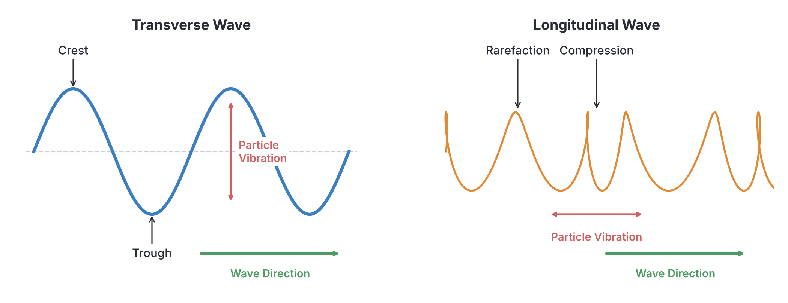

# JAMB Physics Notes: Wave Production and Classification

## What JAMB expects

This topic covers the first part of Topic 20: Waves in the JAMB Physics syllabus. It focuses on the fundamental concepts of how waves are produced, how they travel, how they are classified, and the mathematics used to describe them. 

Because Waves is a very broad topic in physics, we have split it into several files. This file covers:
*   **20(a) Production and Propagation:** Wave motion, vibrating systems, energy transfer, wave versus particle motion, wave parameters, and the progressive wave equation.
*   **20(b) Classification:** Mechanical vs. electromagnetic waves, longitudinal vs. transverse waves, progressive vs. stationary waves, and examples of wave sources.

By the end of these notes, you should be able to:
1. Interpret wave motion.
2. Identify vibrating systems as sources of waves.
3. Use waves as a mode of energy transfer.
4. Distinguish between particle motion and wave motion.
5. Relate frequency and wavelength to wave velocity.
6. Determine phase difference, wave number, and wave vector.
7. Use the progressive wave equation to compute basic wave parameters.
8. Solve examples in wave equations.
9. Differentiate between mechanical and electromagnetic waves.
10. Differentiate between longitudinal and transverse waves.
11. Distinguish between stationary and progressive waves.
12. Indicate examples of waves generated from springs, ropes, stretched strings, and the ripple tank.

*(Note: Advanced wave properties such as reflection, refraction, diffraction, superposition, beats, and the Doppler effect are covered separately in `A20b-wave-characteristics-and-properties.md`.)*

---

## Production and Propagation

### Wave motion

**Wave motion** is the process by which a disturbance travels through a medium or empty space, carrying energy from one point to another without the permanent transfer of matter. 

Think of dropping a pebble into a calm village pond. The water surface gets disturbed, and circular ripples spread outward. The disturbance (the wave) travels across the pond, but the water itself does not flow to the edge of the pond; it simply bobs up and down as the wave passes.

### Vibrating systems as source of waves

Every wave is generated by a **vibrating system** (an oscillator). A vibration is a rapid back-and-forth movement. When an object vibrates, it disturbs its surroundings, and this disturbance spreads outward as a wave. 

Common examples of vibrating systems acting as wave sources include:
*   **Vocal cords:** When you speak, your vocal cords vibrate, disturbing the air in your throat to create sound waves.
*   **Plucked strings:** Plucking a guitar string or the string of a talking drum makes it vibrate back and forth, generating sound and waves on the string.
*   **Oscillating electric charges:** Electrons moving rapidly back and forth in an antenna (a vibrating electric charge) produce radio waves, which are a type of electromagnetic wave.

### Waves as mode of energy transfer

A crucial property of all waves is that they serve as a **mode of energy transfer**. Waves carry energy from the source (where the vibration happens) to a receiver, passing through a medium or space. 

*   **Sunlight (Electromagnetic waves):** The Sun transfers massive amounts of heat and light energy to the Earth across millions of kilometres of empty space.
*   **Ocean waves (Mechanical waves):** Strong ocean waves off the coast of Bar Beach in Lagos carry enough kinetic energy to erode sand and damage seawalls.
*   **Sound waves:** A very loud explosion transfers enough acoustic energy through the air to rattle or even shatter glass windows.

### Distinction between particle motion and wave motion

A common JAMB trap is confusing the movement of the wave with the movement of the particles in the medium. You must clearly distinguish between them:

*   **Particle motion:** The individual particles of the medium (like the water droplets in a pond, or air molecules when someone shouts) **do not travel** with the wave. They only vibrate back and forth, or up and down, around a fixed rest position. 
*   **Wave motion:** The **disturbance itself** (the energy) travels continuously forward through the medium at a constant wave speed. 

For example, if a cork is floating on a lake and a water wave passes by, the wave travels horizontally across the water surface, but the cork merely bobs up and down (particle motion) and stays in roughly the same location.

### Relationship between frequency, wavelength and wave velocity

To describe a wave mathematically, we use several basic parameters.

*   **Amplitude ($A$):** The maximum displacement of a particle from its rest (equilibrium) position. It dictates the energy of the wave (louder sounds and brighter lights have larger amplitudes). Unit: metre ($\text{m}$).
*   **Wavelength ($\lambda$):** The distance between two successive crests, two successive troughs, or any two successive points that are in phase. Unit: metre ($\text{m}$).
*   **Period ($T$):** The time taken to complete one full wave cycle (one wavelength). Unit: second ($\text{s}$).
*   **Frequency ($f$):** The number of complete waves generated per second. Frequency is the inverse of period ($f = \frac{1}{T}$). Unit: Hertz ($\text{Hz}$) or $\text{s}^{-1}$.

Wave velocity (or wave speed), $v$, is the distance the wave profile travels per second. Since a wave covers a distance of one wavelength ($\lambda$) in the time of one period ($T$), the speed is $v = \frac{\lambda}{T}$. 
Substituting $f = \frac{1}{T}$, we get the fundamental wave equation:

$$v = f \lambda$$

Where:
*   $v$ = wave velocity in metres per second ($\text{m s}^{-1}$)
*   $f$ = frequency in Hertz ($\text{Hz}$)
*   $\lambda$ = wavelength in metres ($\text{m}$)

**Worked Example 1:**
A radio station broadcasts electromagnetic waves on a frequency of $100\ \text{MHz}$. If the speed of electromagnetic waves in air is $3.0 \times 10^8\ \text{m s}^{-1}$, calculate the wavelength of the radio waves.

**Working:**
1.  Identify the given values and convert to standard SI units:
    *   Frequency $f = 100\ \text{MHz} = 100 \times 10^6\ \text{Hz} = 1.0 \times 10^8\ \text{Hz}$.
    *   Velocity $v = 3.0 \times 10^8\ \text{m s}^{-1}$.
2.  State the formula relating velocity, frequency, and wavelength: 
    $$v = f \lambda$$
3.  Rearrange the formula to make wavelength the subject: 
    $$\lambda = \frac{v}{f}$$
4.  Substitute the values with their units: 
    $$\lambda = \frac{3.0 \times 10^8\ \text{m s}^{-1}}{1.0 \times 10^8\ \text{Hz}}$$
5.  Calculate the final answer: 
    $$\lambda = 3.0\ \text{m}$$

### Phase difference, wave number and wave vector

JAMB often tests the angular properties of waves. 

**1. Wave Number ($k$):**
The wave number (strictly, the angular wave number) relates to how many wave cycles exist per $2\pi$ metres of space. It is calculated as:
$$k = \frac{2\pi}{\lambda}$$
*   Unit: radians per metre ($\text{rad m}^{-1}$), though sometimes just written as $\text{m}^{-1}$.

**2. Wave Vector ($\vec{k}$):**
The wave vector has the same magnitude as the wave number ($k = \frac{2\pi}{\lambda}$) but also includes a **direction**. It points in the exact direction the wave is travelling. 

**3. Phase Difference ($\Delta \phi$):**
Phase difference measures how much two points on a wave are "out of step" with each other. A full wave cycle is an angle of $360^\circ$ or $2\pi$ radians. 
If two points are separated by a physical distance $\Delta x$, their phase difference in radians is given by:

$$\Delta \phi = \frac{2\pi}{\lambda} \Delta x$$

**Worked Example 2:**
Two points on a progressive sound wave are $0.15\ \text{m}$ apart. If the speed of the wave is $340\ \text{m s}^{-1}$ and its frequency is $3400\ \text{Hz}$, find the phase difference between the two points in radians.

**Working:**
1.  First, find the wavelength. Using $v = f \lambda$:
    $$\lambda = \frac{v}{f} = \frac{340\ \text{m s}^{-1}}{3400\ \text{Hz}} = 0.1\ \text{m}$$
2.  State the phase difference formula:
    $$\Delta \phi = \frac{2\pi}{\lambda} \Delta x$$
3.  Substitute the known values ($\lambda = 0.1\ \text{m}$ and distance $\Delta x = 0.15\ \text{m}$):
    $$\Delta \phi = \frac{2\pi}{0.1\ \text{m}} \times 0.15\ \text{m}$$
4.  Calculate the result:
    $$\Delta \phi = 2\pi \times 1.5 = 3\pi\ \text{rad}$$
*(Note: A phase difference of $3\pi$ radians means the points are perfectly out of phase, as $3\pi$ is equivalent to one and a half full cycles, leaving a remainder of $\pi$ radians or $180^\circ$.)*

### Progressive wave equation

A progressive wave can be represented mathematically by a sine or cosine function. This equation calculates the vertical displacement ($Y$) of any particle in the medium at any horizontal position ($x$) and at any time ($t$).

The general equation for a wave travelling in the **positive x-direction** (to the right) is:

$$Y = A \sin(\omega t - kx)$$

Where:
*   $Y$ = vertical displacement ($\text{m}$)
*   $A$ = amplitude (maximum displacement) ($\text{m}$)
*   $\omega$ = angular frequency ($2\pi f$) in $\text{rad s}^{-1}$
*   $k$ = wave number ($\frac{2\pi}{\lambda}$) in $\text{rad m}^{-1}$
*   $t$ = time ($\text{s}$)
*   $x$ = horizontal position ($\text{m}$)

**Different Forms of the Equation:**
Because $\omega = 2\pi f$ and $k = \frac{2\pi}{\lambda}$, textbooks and JAMB questions write this equation in several mathematically identical ways. You must be able to recognize all of them:

1.  $$Y = A \sin(\omega t \pm kx)$$
2.  $$Y = A \sin 2\pi \left( \frac{t}{T} \pm \frac{x}{\lambda} \right)$$
3.  $$Y = A \sin \frac{2\pi}{\lambda} (vt \pm x)$$
4.  $$Y = A \sin 2\pi \left( ft \pm \frac{x}{\lambda} \right)$$

**The Sign Convention (Crucial for JAMB):**
*   If the bracket has a **negative sign** (e.g., $vt - x$ or $\omega t - kx$), the wave is travelling to the **right** (positive x-direction).
*   If the bracket has a **positive sign** (e.g., $vt + x$ or $\omega t + kx$), the wave is travelling to the **left** (negative x-direction).

### Examples in wave equations

To solve wave equation problems, always write down the given equation and write the standard formula directly underneath it. Then, match the corresponding parts.

**Worked Example 3:**
A plane progressive wave is represented by the equation $Y = 0.5 \sin \left( 100\pi t - \frac{\pi x}{10} \right)$, where $Y$ and $x$ are in metres and $t$ is in seconds. Determine the amplitude, frequency, and wavelength of the wave.

**Working:**
1.  Write down the given equation:
    $$Y = 0.5 \sin \left( 100\pi t - \frac{\pi x}{10} \right)$$
2.  Write the standard form $Y = A \sin(\omega t - kx)$ directly below it:
    $$Y = A \sin (\omega t - kx)$$
3.  Match the terms outside the sine function to find amplitude:
    $$A = 0.5\ \text{m}$$
4.  Match the coefficients of $t$ to find frequency:
    $$\omega = 100\pi$$
    Since $\omega = 2\pi f$, we write:
    $$2\pi f = 100\pi$$
    $$f = \frac{100\pi}{2\pi} = 50\ \text{Hz}$$
5.  Match the coefficients of $x$ to find wavelength:
    $$k = \frac{\pi}{10}$$
    Since $k = \frac{2\pi}{\lambda}$, we write:
    $$\frac{2\pi}{\lambda} = \frac{\pi}{10}$$
    Cross-multiply to get:
    $$\pi \lambda = 20\pi$$
    $$\lambda = 20\ \text{m}$$

**Worked Example 4:**
Using the wave in Example 3, calculate the speed of the wave and state its direction of travel.

**Working:**
1.  Recall the frequency and wavelength calculated in Example 3:
    *   $f = 50\ \text{Hz}$
    *   $\lambda = 20\ \text{m}$
2.  State the wave speed formula:
    $$v = f \lambda$$
3.  Substitute the values:
    $$v = 50\ \text{Hz} \times 20\ \text{m}$$
4.  Calculate the speed:
    $$v = 1000\ \text{m s}^{-1}$$
5.  Determine the direction of travel by looking at the sign between the time and position terms in the original equation $\left( 100\pi t - \frac{\pi x}{10} \right)$. Because it is a **negative sign**, the wave is travelling in the **positive x-direction** (to the right).

---

## Classification

Waves are classified in three main ways: by whether they need a medium, by how their particles vibrate, and by whether they transfer energy forward.

### Mechanical and electromagnetic waves

Waves are classified by their need for a physical material (medium) to travel through.

| Feature | Mechanical Waves | Electromagnetic (EM) Waves |
| :--- | :--- | :--- |
| **Medium Requirement** | **Require** a material medium (solid, liquid, or gas) to travel. | **Do not require** a medium. Can travel through a vacuum (empty space). |
| **Source** | Vibrating physical particles or masses. | Oscillating electric and magnetic fields (accelerating charges). |
| **Speed** | Relatively slow. Varies by medium (e.g., sound is fastest in solids, slowest in gases). | Extremely fast. All EM waves travel at the speed of light in a vacuum ($3 \times 10^8\ \text{m s}^{-1}$). |
| **Examples** | Sound waves, water waves, waves on a string or slinky spring. | Light, X-rays, radio waves, microwaves, gamma rays. |

### Longitudinal and transverse waves

Waves are also classified by comparing the direction of particle vibration to the direction the wave is travelling.

| Feature | Transverse Waves | Longitudinal Waves |
| :--- | :--- | :--- |
| **Direction of Vibration** | Particles vibrate **perpendicular (at right angles)** to the direction of wave travel. | Particles vibrate **parallel** to the direction of wave travel. |
| **Wave Shape** | Made up of **crests** (high points) and **troughs** (low points). | Made up of **compressions** (particles squeezed together) and **rarefactions** (particles spread apart). |
| **Polarization** | Can be polarized. | Cannot be polarized. |
| **Examples** | **All electromagnetic waves** (light, radio), water waves, waves on a plucked string. | **Sound waves** in air, pressure waves, waves from pushing/pulling a slinky. |

### Stationary and progressive waves

Finally, waves are classified by whether their energy moves continuously or is trapped.

| Feature | Progressive (Travelling) Waves | Stationary (Standing) Waves |
| :--- | :--- | :--- |
| **Energy Transfer** | Energy moves outward from the source to surrounding areas continuously. | Energy is **trapped** between boundaries. There is no net transfer of energy. |
| **Wave Profile** | The entire wave shape (crests and troughs) moves forward over time. | The wave profile does not move forward. It just expands and shrinks in place. |
| **Key Features** | All particles have the same amplitude but reach it at different times. | Features **nodes** (points of zero vibration) and **antinodes** (points of maximum vibration). |
| **Examples** | Light travelling from the sun, sound from a loudspeaker. | A vibrating guitar string fixed at both ends, air vibrating inside a wooden flute. |

### Examples of waves from springs, ropes, stretched strings and the ripple tank

JAMB expects you to know what types of waves are generated by common laboratory equipment:

1.  **Springs (Slinky):** A long, coiled spring can demonstrate both types of mechanical waves. If you fix one end and shake the other end side-to-side, it produces a **transverse wave**. If you push and pull the end back-and-forth along the spring's length, it produces a **longitudinal wave**.
2.  **Ropes and Stretched Strings:** When you tie a rope to a wall and flick your wrist up and down, you generate a **progressive transverse wave**. When a guitar string is plucked, the wave reflects off the fixed ends and forms a **stationary transverse wave**.
3.  **The Ripple Tank:** A ripple tank is a shallow glass-bottomed tray filled with water, used to study wave properties. A motor vibrates a dipper on the water's surface to produce waves, and a light shines through the water to project the wave shadows onto a screen below.
    *   A straight vibrating metal bar produces **plane (straight) transverse waves**.
    *   A spherical (point) vibrating dipper produces **circular transverse waves**.

---

## Key terms

| Term | Meaning |
| :--- | :--- |
| **Wave motion** | The transfer of energy through a medium or space by means of a travelling disturbance, without transferring matter. |
| **Amplitude ($A$)** | The maximum displacement of a particle from its rest or equilibrium position. |
| **Wavelength ($\lambda$)** | The distance between two consecutive points on a wave that are in phase (e.g., crest to crest). |
| **Frequency ($f$)** | The number of complete wave cycles produced per second. Measured in Hertz ($\text{Hz}$). |
| **Period ($T$)** | The time taken to complete one full wave cycle. $T = 1/f$. |
| **Transverse wave** | A wave where particles vibrate perpendicular to the direction of wave travel (e.g., light, water waves). |
| **Longitudinal wave** | A wave where particles vibrate parallel to the direction of wave travel (e.g., sound). |
| **Mechanical wave** | A wave that requires a physical medium to travel through. |
| **Electromagnetic wave** | A wave that can travel through a vacuum; consists of oscillating electric and magnetic fields. |
| **Phase difference ($\Delta \phi$)**| The angular difference between two points on a wave, showing how out of step they are. |
| **Wave number ($k$)** | The number of radians per metre of wave length, $k = 2\pi/\lambda$. |

---

## Exam tips and common mistakes

*   **Particle vs Wave Motion:** Remember that particles only vibrate locally. They do NOT travel with the wave. Only the energy and the wave shape move forward.
*   **Sign Conventions in Equations:** If the wave equation has a negative sign (e.g. $vt - x$), the wave travels in the **positive** direction. If it has a positive sign (e.g. $vt + x$), the wave travels in the **negative** direction. Many students get this backwards!
*   **Watch the Units:** JAMB wave equations often specify "where $x$ and $Y$ are in centimetres". If so, the wavelength you calculate will be in centimetres, and you MUST convert it to metres ($100\ \text{cm} = 1\ \text{m}$) before calculating the velocity in $\text{m s}^{-1}$.
*   **All EM waves are Transverse:** Whether it is light, X-rays, or radio waves, all electromagnetic waves are transverse and travel at $3 \times 10^8\ \text{m s}^{-1}$ in a vacuum.
*   **Matching Equations:** Always write the general wave equation directly underneath the equation given in the question to easily match up the variables ($\omega$ matches the number in front of $t$; $k$ matches the number in front of $x$).

---

## Quick summary

1.  Waves transfer energy from a vibrating source to a receiver without permanently moving the particles of the medium.
2.  Mechanical waves (like sound) require a medium, while electromagnetic waves (like light) can travel through a vacuum.
3.  In transverse waves, particles vibrate perpendicular to the wave's path. In longitudinal waves, particles vibrate parallel to the wave's path.
4.  Progressive waves transfer energy away from a source; stationary waves trap energy between boundaries.
5.  Wave velocity is the product of frequency and wavelength: $v = f \lambda$.
6.  Phase difference between two points separated by distance $\Delta x$ is given by $\Delta \phi = \frac{2\pi}{\lambda} \Delta x$.
7.  The progressive wave equation $Y = A \sin(\omega t \pm kx)$ or $Y = A \sin 2\pi(ft \pm \frac{x}{\lambda})$ can be used to extract amplitude, frequency, and wavelength by comparing terms.

---

## Practice questions

**1. Which of the following statements distinguishes wave motion from particle motion?**
- A. Both the wave and the particles travel continuously from the source to the receiver.
- B. The wave travels through the medium, but the particles only vibrate around a fixed position.
- C. The particles travel through the medium while the wave disturbance remains in a fixed position.
- D. Wave motion transfers matter, while particle motion transfers energy.

**Answer: B.** In wave motion, the disturbance (energy) moves continuously forward, but the particles of the medium only oscillate locally around their equilibrium points. They do not travel with the wave.

**2. Which of the following waves requires a material medium for its propagation?**
- A. Radio waves
- B. X-rays
- C. Sound waves
- D. Light waves

**Answer: C.** Sound waves are mechanical waves and require a medium (solid, liquid, or gas) to travel. Options A, B, and D are electromagnetic waves which can travel through a vacuum.

**3. A wave has a wavelength of $5\ \text{m}$ and a period of $0.02\ \text{s}$. Calculate the velocity of the wave.**
- A. $25\ \text{m s}^{-1}$
- B. $100\ \text{m s}^{-1}$
- C. $250\ \text{m s}^{-1}$
- D. $500\ \text{m s}^{-1}$

**Answer: C.** 
1. The frequency $f = \frac{1}{T} = \frac{1}{0.02\ \text{s}} = 50\ \text{Hz}$.
2. Wave velocity $v = f \lambda = 50\ \text{Hz} \times 5\ \text{m} = 250\ \text{m s}^{-1}$.
(A common mistake is misreading the period as $0.2\ \text{s}$, which gives $\frac{5}{0.2} = 25\ \text{m s}^{-1}$, option A.)

**4. The primary difference between a stationary wave and a progressive wave is that a stationary wave:**
- A. does not transfer energy through the medium.
- B. has no amplitude.
- C. is always a longitudinal wave.
- D. requires no material medium.

**Answer: A.** Progressive waves transfer energy continuously from one place to another. Stationary (standing) waves trap energy between boundaries and do not have a net transfer of energy.

**5. A progressive wave is defined by the equation $Y = 2 \sin 2\pi(10t - 0.2x)$, where $Y$ and $x$ are in metres and $t$ is in seconds. Determine the wave velocity.**
- A. $10\ \text{m s}^{-1}$
- B. $25\ \text{m s}^{-1}$
- C. $50\ \text{m s}^{-1}$
- D. $100\ \text{m s}^{-1}$

**Answer: C.** 
1. Compare with standard form $Y = A \sin 2\pi \left(ft - \frac{x}{\lambda}\right)$.
2. The term in front of $t$ is $f$, so $f = 10\ \text{Hz}$.
3. The term in front of $x$ is $\frac{1}{\lambda}$, so $\frac{1}{\lambda} = 0.2\ \text{m}^{-1}$. Therefore, $\lambda = \frac{1}{0.2\ \text{m}^{-1}} = 5\ \text{m}$.
4. Velocity $v = f \lambda = 10\ \text{Hz} \times 5\ \text{m} = 50\ \text{m s}^{-1}$.
(A common mistake is stopping at the frequency: option A ($10\ \text{m s}^{-1}$) is just the value of $f$, with the wavelength forgotten. Note that $0.2$ is $\frac{1}{\lambda}$, not the wavelength itself.)

**6. Which direction is the wave $Y = 5 \sin(30\pi t + 2\pi x)$ travelling?**
- A. The positive x-direction
- B. The negative x-direction
- C. The positive y-direction
- D. The negative y-direction

**Answer: B.** In the progressive wave equation, a positive sign between the time component ($30\pi t$) and the position component ($2\pi x$) indicates that the wave is travelling to the left, which is the negative x-direction.

**7. Two points on a wave are $0.1\ \text{m}$ apart. If the wavelength of the wave is $0.4\ \text{m}$, what is the phase difference between the two points?**
- A. $\frac{\pi}{4}\ \text{rad}$
- B. $\frac{\pi}{2}\ \text{rad}$
- C. $\pi\ \text{rad}$
- D. $2\pi\ \text{rad}$

**Answer: B.** 
1. Formula: $\Delta \phi = \frac{2\pi}{\lambda} \Delta x$.
2. Substitute: $\Delta \phi = \frac{2\pi}{0.4\ \text{m}} \times 0.1\ \text{m}$.
3. Calculate: $\Delta \phi = \frac{0.2\pi}{0.4} = 0.5\pi = \frac{\pi}{2}\ \text{rad}$.

**8. Which of the following setups primarily generates a longitudinal mechanical wave?**
- A. Plucking a stretched guitar string.
- B. Dropping a pebble into a ripple tank.
- C. Pushing and pulling the end of a straight slinky spring.
- D. Vibrating a straight bar on the surface of water.

**Answer: C.** Pushing and pulling a slinky along its length causes the spring to form compressions and rarefactions, which is a longitudinal wave. All other options generate transverse waves.

**9. Calculate the wave number of a wave that travels at $50\ \text{m s}^{-1}$ with a frequency of $25\ \text{Hz}$.**
- A. $0.5\pi\ \text{rad m}^{-1}$
- B. $\pi\ \text{rad m}^{-1}$
- C. $2\pi\ \text{rad m}^{-1}$
- D. $4\pi\ \text{rad m}^{-1}$

**Answer: B.** 
1. Find wavelength: $\lambda = \frac{v}{f} = \frac{50\ \text{m s}^{-1}}{25\ \text{Hz}} = 2\ \text{m}$.
2. State wave number formula: $k = \frac{2\pi}{\lambda}$.
3. Substitute: $k = \frac{2\pi}{2\ \text{m}} = \pi\ \text{rad m}^{-1}$. 
(A common mistake is working out the wavelength as $\frac{f}{v} = \frac{25}{50} = 0.5\ \text{m}$ instead of $\frac{v}{f}$, which gives $k = \frac{2\pi}{0.5} = 4\pi\ \text{rad m}^{-1}$, option D.)

**10. In a ripple tank experiment, a straight vibrating bar repeatedly hits the water surface. What type of wavefronts are produced?**
- A. Circular transverse waves
- B. Plane transverse waves
- C. Plane longitudinal waves
- D. Circular longitudinal waves

**Answer: B.** A straight bar in a ripple tank produces plane (straight, parallel) waves on the water. Water waves are transverse, meaning the water bobs up and down perpendicularly to the forward motion of the wave. Circular waves would be produced by a single point dipper.
