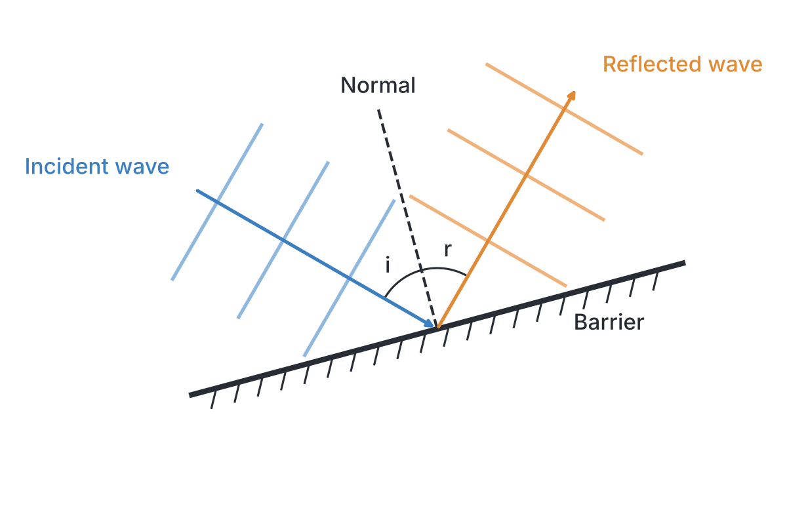
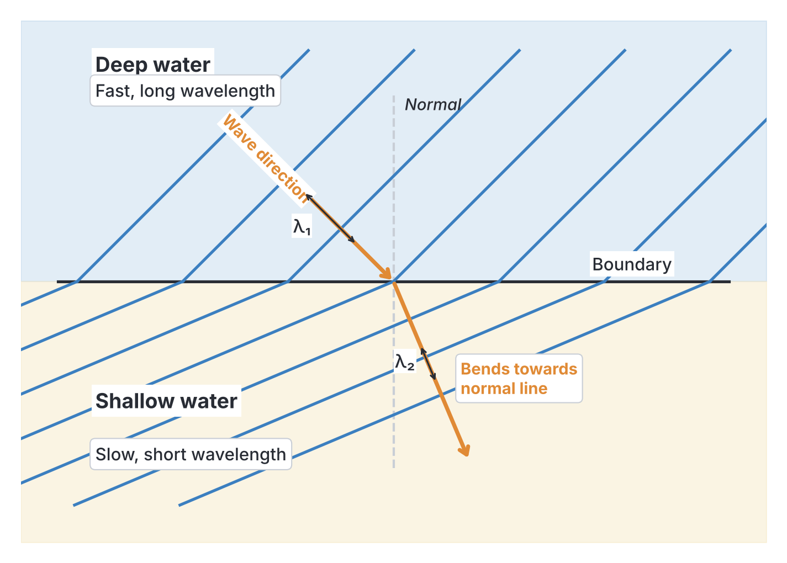
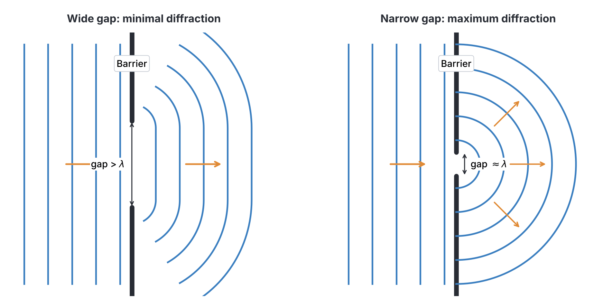
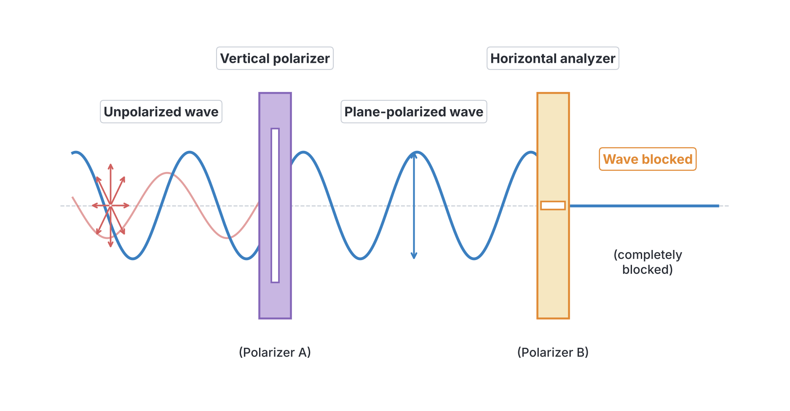
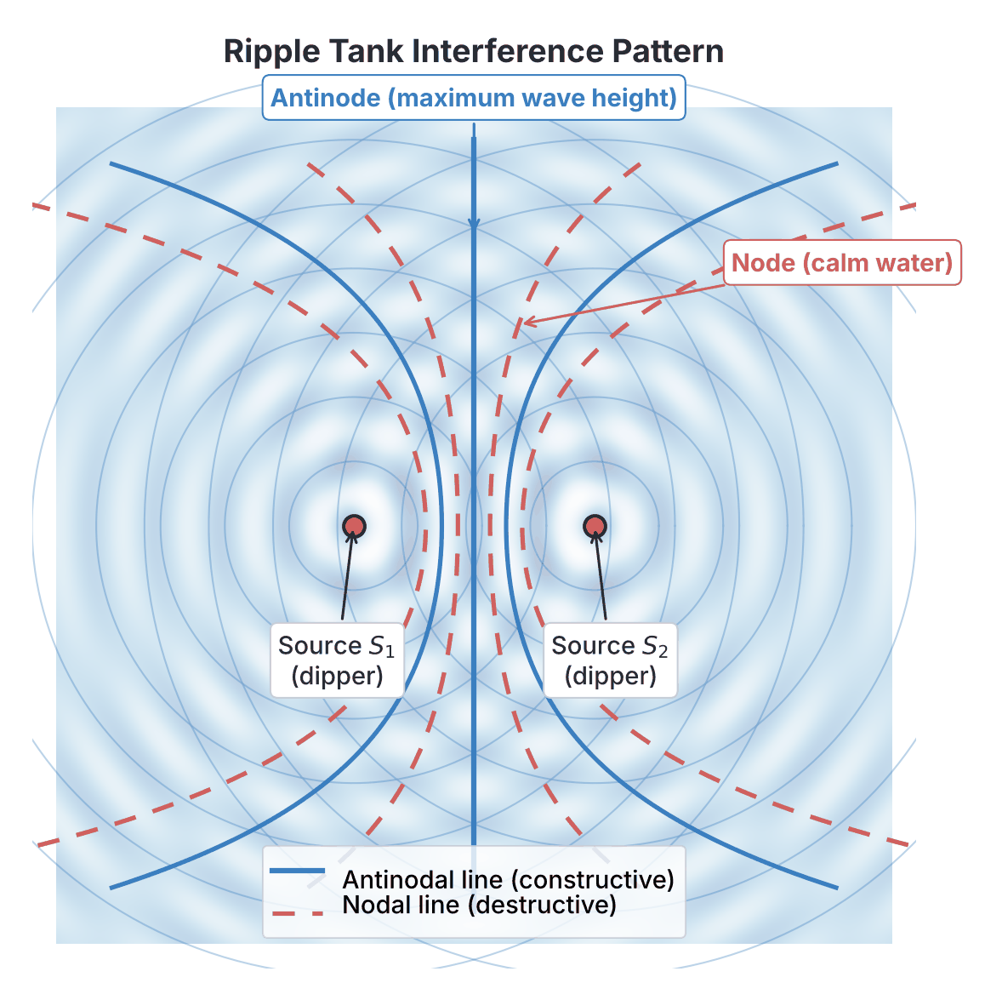

# JAMB Physics Notes: Wave Characteristics and Properties

## What JAMB expects

This topic is part of Section A, Topic 20: Waves. It covers part (c) Characteristics/Properties. (For wave production, classification, and the progressive wave equation, see `A20a-wave-production-and-classification.md`).

By the end of these notes, you should be able to:
- xiii. differentiate between reflection, refraction, diffraction and plane polarization of waves;
- xiv. analyse the principle of superposition of waves;
- xv. solve numerical problems on waves explain the phenomenon of beat, beat frequency and uses;
- xvi. explain Doppler effect of sound and application.

**Note on the syllabus wording:** Objective xv merges solving numerical problems on waves with explaining the phenomenon of beats into a single sentence. These notes cover both parts fully. Objective xvi asks for a "qualitative treatment only" of the Doppler effect, meaning you need to understand the concepts, changes in pitch, and applications without calculating complex Doppler shift formulas.

## Characteristics and Properties of Waves

Waves exhibit specific behaviours when they encounter boundaries, change mediums, pass through gaps, or meet other waves. These properties apply generally to different types of waves (mechanical and electromagnetic), although polarization is strictly limited to transverse waves.

### Differentiating Reflection, Refraction, Diffraction and Plane Polarization

To study how waves behave in two dimensions, physicists often use a **ripple tank**. This is a shallow glass-bottomed tank of water illuminated from above. A vibrating motor on the water surface generates waves, and the light projects the shadows of the wave crests and troughs onto a screen below.

#### 1. Reflection
**Reflection** is the bouncing back of a wave when it strikes a boundary or surface that it cannot pass through.
- **Law of Reflection:** The angle of incidence (the angle the incoming wave's direction makes with the normal) is always equal to the angle of reflection ($i = r$).
- **Phase change on reflection:** If a transverse wave travelling along a string hits a **rigid, fixed boundary** (like a string tied tightly to a wall), it reflects with a phase change of $\pi$ radians ($180^\circ$). This means a crest reflects back inverted as a trough. If the boundary is **loose or free to move** (like a ring on a pole), it reflects with no phase change (a crest returns as a crest).
- **In a ripple tank:** Straight (plane) water waves hitting a flat metal barrier bounce off as straight waves at the same angle to the normal.

#### 2. Refraction
**Refraction** is the change in the speed and direction of a wave as it moves from one medium into another of a different density or depth.
- **The Golden Rule of Refraction:** When a wave enters a new medium, its **speed ($v$)** and **wavelength ($\lambda$)** change, but its **frequency ($f$) remains constant**. Frequency is determined strictly by the vibrating source that produced the wave, not the medium.
- **In a ripple tank:** Refraction is demonstrated by placing a flat glass block underwater to create a "shallow" region next to a "deep" region. Water waves travel **faster in deep water** and **slower in shallow water**.
- As a wave moves from deep to shallow water, its speed decreases. Because $f$ is constant, the equation $v = f\lambda$ means the wavelength must also decrease. The wave crests squash closer together. If they enter the shallow water at an angle, they also bend **towards the normal**.

#### 3. Diffraction
**Diffraction** is the spreading out or bending of waves as they pass through a narrow gap, slit, or go around the edge of an obstacle.
- The amount of diffraction depends on the size of the gap compared to the wave's wavelength ($\lambda$).
- **Maximum diffraction** occurs when the width of the gap is roughly equal to the wavelength of the wave ($a \approx \lambda$). The waves emerge from the gap spreading out as almost perfect semi-circles.
- If the gap is much wider than the wavelength ($a \gg \lambda$), the wave passes straight through with only very slight curving at the extreme edges.
- This is why you can hear someone talking from around a corner (sound has a long wavelength comparable to doorways, so it diffracts easily), but you cannot see them (light has a microscopic wavelength, so it does not noticeably diffract around large everyday objects).

#### 4. Plane Polarization
**Polarization** is the restriction of a wave's vibrations to a single plane.
- An unpolarized wave vibrates in multiple planes perpendicular to its direction of travel. A *polarizer* (like a narrow slit or a special Polaroid filter for light) blocks all vibrations except those parallel to its axis.
- **Crucial JAMB Fact:** **Only transverse waves can be polarized.** Longitudinal waves (like sound) cannot be polarized because their particles vibrate back and forth *parallel* to the direction of travel; a slit would either let the whole wave through or block it entirely.
- Polarization is the definitive test to prove whether a wave is transverse or longitudinal. It proves that light is a transverse wave.

#### Summary Comparison Table

| Property | What happens to the wave? | Does speed ($v$) change? | Does wavelength ($\lambda$) change? | Does frequency ($f$) change? |
| --- | --- | --- | --- | --- |
| **Reflection** | Bounces off a boundary | No | No | No |
| **Refraction** | Bends due to a change in medium | **Yes** | **Yes** | No |
| **Diffraction** | Spreads through gaps / around edges | No | No | No |
| **Polarization** | Vibrations restricted to one plane | No | No | No |

### Principle of Superposition and Interference

When two or more waves travel through the same medium at the same time, they interact. The **principle of superposition** states that the resultant displacement at any point is the algebraic sum of the displacements of the individual waves at that instant.

**Interference** is the physical effect of this superposition. When two continuous waves meet, they create a steady interference pattern:
1.  **Constructive Interference:** When two waves meet **in phase** (a crest meets a crest, or a trough meets a trough), their displacements add up to create a much larger wave. This results in maximum amplitude (a loud sound, or a bright spot of light).
2.  **Destructive Interference:** When two waves meet **out of phase** (a crest meets a trough), their displacements cancel each other out. This results in zero or minimum amplitude (a soft sound, or a dark spot).

For a stable, observable interference pattern (like two vibrating dippers in a ripple tank or Young's double-slit experiment), the two sources must be **coherent**.
- **Coherent sources** are sources that have the same frequency, same wavelength, and maintain a constant phase difference.

**Path Difference and Interference Conditions**
Whether interference is constructive or destructive at a specific point depends on the **path difference**—the difference in the distance the two waves have travelled to reach that point.
- For **constructive** interference: The path difference must be a whole number of wavelengths. 
  $$\text{Path difference} = n\lambda \quad (\text{where } n = 0, 1, 2, \dots)$$
  The phase difference is $0, 2\pi, 4\pi$ radians.
- For **destructive** interference: The path difference must be an odd number of half-wavelengths.
  $$\text{Path difference} = \left(n + \frac{1}{2}\right)\lambda \quad (\text{where } n = 0, 1, 2, \dots)$$
  The phase difference is $\pi, 3\pi, 5\pi$ radians.

### Numerical Problems on Waves and the Phenomenon of Beats

When you play two musical notes that have very slightly different frequencies together, they will interfere. Because their frequencies are not exactly the same, they continuously drift in and out of phase.
- When they are momentarily in phase, they interfere constructively, making a loud sound.
- A split second later, they drift out of phase, interfering destructively and making a soft sound.
This periodic rise and fall in the loudness of the sound is called **beats**.

The **beat frequency** ($f_B$) is the number of beats (loud pulses) heard per second. It is simply the absolute difference between the two frequencies:
$$f_B = |f_1 - f_2|$$
where:
- $f_B$ is the beat frequency in Hertz ($\text{Hz}$)
- $f_1$ and $f_2$ are the frequencies of the two sound sources in Hertz ($\text{Hz}$)

**Uses of Beats:**
Musicians use beats to tune stringed instruments (like a piano or guitar). By plucking a string alongside a standard tuning fork, the musician listens for the pulsing beats. As they adjust the string's tension to match the tuning fork, the beats get slower and slower. When the beats disappear entirely ($0\text{ Hz}$ difference), the frequencies are identical, and the instrument is perfectly in tune.

#### Calculations on Beats (JAMB Level)

When dealing with tuning forks and strings in exams, you must apply these two crucial physical rules:
1.  **Loading with wax:** Adding a small piece of wax to the prongs of a tuning fork increases its mass, making it heavier and slower. This **decreases** its vibrating frequency.
2.  **Filing or Tightening:** Filing the prongs of a tuning fork (reducing its mass) or tightening a guitar string (increasing its tension) **increases** its vibrating frequency.

**1. Worked Example: Basic Beat Frequency**
Two guitar strings are plucked at the same time. One has a frequency of $256\text{ Hz}$ and the other has a frequency of $260\text{ Hz}$. What is the beat frequency?

*Working:*
1. State the beat formula: $f_B = |f_1 - f_2|$
2. Substitute the values: $f_B = |256\text{ Hz} - 260\text{ Hz}|$
3. Calculate the difference: $f_B = 4\text{ Hz}$.
4. The beat frequency is $4\text{ Hz}$ (4 beats heard every second).

**2. Worked Example: Loading with Wax**
A tuning fork P produces 3 beats per second when sounded with a standard tuning fork Q of frequency $512\text{ Hz}$. When a little wax is attached to the prongs of P, the beat frequency becomes 5 beats per second. Find the original frequency of P.

*Working:*
1. Note the standard frequency: $f_Q = 512\text{ Hz}$.
2. Initial beat frequency: $f_B = 3\text{ Hz}$.
3. This means P is exactly $3\text{ Hz}$ away from Q. The two possible original frequencies for P are:
   $f_P = 512 + 3 = 515\text{ Hz}$ OR $f_P = 512 - 3 = 509\text{ Hz}$.
4. Apply the physics rule: Loading with wax **decreases** the frequency of P.
5. Test the first option ($515\text{ Hz}$): If P decreases (e.g., drops to $513\text{ Hz}$), the new beat frequency with the $512\text{ Hz}$ fork would be $|513 - 512| = 1\text{ Hz}$. The question says the beats increased to $5\text{ Hz}$, so this option is wrong.
6. Test the second option ($509\text{ Hz}$): If P decreases (e.g., drops to $507\text{ Hz}$), the new beat frequency with $512\text{ Hz}$ would be $|507 - 512| = 5\text{ Hz}$. This matches the question perfectly.
7. Therefore, the original frequency of P was **$509\text{ Hz}$**.

**3. Worked Example: Tightening a String**
String A is vibrating at $440\text{ Hz}$. When string B is plucked simultaneously, a beat frequency of $4\text{ Hz}$ is heard. The tension in string B is slightly increased, and the beat frequency increases to $6\text{ Hz}$. What was the original frequency of string B?

*Working:*
1. Note the known frequency: $f_A = 440\text{ Hz}$.
2. Find the possible original frequencies for B:
   $f_B = 440 + 4 = 444\text{ Hz}$ OR $f_B = 440 - 4 = 436\text{ Hz}$.
3. Apply the physics rule: Increasing tension **increases** the frequency of string B.
4. Test option $444\text{ Hz}$: If it increases (e.g., rises to $446\text{ Hz}$), the new beats with $440\text{ Hz}$ will be $|446 - 440| = 6\text{ Hz}$. This matches the question.
5. Test option $436\text{ Hz}$: If it increases (e.g., rises to $438\text{ Hz}$), the new beats with $440\text{ Hz}$ would be $|438 - 440| = 2\text{ Hz}$. This does not match.
6. The original frequency of string B was **$444\text{ Hz}$**.

**4. Worked Example: General Wave Numerical Problem involving Refraction**
A water wave travels at $30\text{ cm s}^{-1}$ with a wavelength of $6\text{ cm}$ in a deep region. It moves into a shallow region where its velocity becomes $20\text{ cm s}^{-1}$. Calculate the new wavelength in the shallow region.

*Working:*
1. Remember that **frequency remains constant** across boundaries. First, find the constant frequency in the deep region using $v_1 = f\lambda_1$.
2. Substitute the values: $30\text{ cm s}^{-1} = f \times 6\text{ cm}$.
3. Calculate frequency: $f = \frac{30}{6} = 5\text{ Hz}$.
4. Use this same frequency for the shallow region: $v_2 = f\lambda_2$.
5. Substitute the values: $20\text{ cm s}^{-1} = 5\text{ Hz} \times \lambda_2$.
6. Calculate new wavelength: $\lambda_2 = \frac{20}{5} = 4\text{ cm}$.

### The Doppler Effect and its Applications

Imagine standing by a busy road in Lagos and an ambulance speeds past you with its siren blaring continuously. As the ambulance approaches you, the siren sounds very high-pitched. The exact moment it passes you and speeds away, the pitch drops noticeably to a lower tone.

This apparent change in the frequency (and pitch) of a wave due to the relative motion between the source of the wave and the observer is called the **Doppler Effect**.

- **When the source approaches the observer:** The waves emitted get "squashed" together in front of the moving source. The wavelength reaches the observer shorter than normal, meaning more wave crests hit the observer per second. The **frequency (pitch) appears higher**.
- **When the source moves away from the observer:** The waves are "stretched" out behind the moving source. The wavelength reaches the observer longer than normal, meaning fewer wave crests hit the observer per second. The **frequency (pitch) appears lower**.
- **Crucial Note:** The actual speed of the sound wave in the air does *not* change; it remains constant (e.g., $340\text{ m s}^{-1}$). The source is not actually emitting a different frequency either. Only the *perceived* frequency and wavelength change due to the relative motion.

**Applications of the Doppler Effect:**
1.  **Radar Speed Guns:** Traffic police and safety cameras bounce microwaves off moving cars. If the car is moving towards the radar, the reflected waves have a higher frequency (Doppler shifted). By measuring this shift, the radar precisely calculates the car's speed.
2.  **Doppler Ultrasound in Medicine:** High-frequency sound waves are bounced off red blood cells in the body. The frequency shift of the reflected waves tells doctors the speed and direction of blood flow, helping to detect blockages or blood clots.
3.  **Astronomy (Red-shift):** Light from distant galaxies appears shifted toward the red end of the electromagnetic spectrum (which has a lower frequency and longer wavelength). This Doppler "red-shift" proves that galaxies are moving away from us, providing the primary evidence that the universe is expanding.

## Key terms

| Term | Meaning |
| --- | --- |
| **Reflection** | The bouncing back of a wave when it strikes a boundary or barrier. |
| **Refraction** | The change in speed and direction of a wave crossing into a different medium of different density or depth. |
| **Diffraction** | The spreading of a wave as it passes through a narrow gap or around an obstacle. |
| **Polarization** | Restricting a wave's vibrations to a single plane. Only applies to transverse waves (e.g., light). |
| **Superposition** | The principle stating that when two waves meet, their total resultant displacement is the algebraic sum of their individual displacements. |
| **Interference** | The effect of superposition; can be constructive (waves add up) or destructive (waves cancel out). |
| **Coherent sources** | Two or more wave sources that emit waves of the same frequency and maintain a constant phase difference. |
| **Beats** | A periodic variation (pulsing) in the loudness of sound heard when two close frequencies interfere. |
| **Beat frequency** | The absolute difference between two interfering frequencies ($f_B = \|f_1 - f_2\|$). |
| **Doppler Effect** | The apparent change in frequency and wavelength of a wave due to relative motion between the source and observer. |

## Exam tips and common mistakes

- **Refraction frequency trap:** Remember that **frequency NEVER changes** during refraction. If JAMB asks what happens to frequency when light enters glass or a water wave enters shallow water, the answer is always "remains constant" or "remains the same".
- **Shallow water physics:** In a ripple tank, shallow water behaves like an optically denser medium. The wave slows down, the wavelength gets shorter, and it bends towards the normal.
- **Polarization exclusive:** Only transverse waves can be polarized. Sound waves are longitudinal, so they **cannot** be polarized.
- **Beat direction mistakes:** When doing beat frequency calculations, always explicitly test both possible original values by applying the physical change. Remember: Wax = lower frequency. Tightening/Filing = higher frequency.
- **Phase change on reflection:** If a string wave reflects off a hard/fixed wall, it undergoes a phase change of $180^\circ$ ($\pi$ radians). A crest comes back inverted as a trough.
- **Doppler effect trick:** The Doppler effect changes the *apparent* (perceived) frequency, not the actual speed of the sound wave travelling in the air.
- **Diffraction maximum:** Diffraction is most pronounced when the gap size is roughly equal to the wavelength. A huge gap compared to the wavelength causes almost no diffraction.

## Quick summary

1. Reflection is the bouncing of waves off a boundary; a hard/fixed boundary causes a $180^\circ$ phase shift for transverse waves on a string.
2. Refraction is the bending of waves due to a speed change in a new medium. Wavelength and speed change, but frequency remains absolutely constant.
3. Diffraction is the spreading of waves passing through a gap, yielding maximum effect when the gap width $\approx$ the wavelength.
4. Polarization restricts wave vibrations to one plane and uniquely proves a wave is transverse (longitudinal waves like sound cannot be polarized).
5. The principle of superposition states that crossing waves add their displacements algebraically, causing constructive (amplified) or destructive (cancelled) interference.
6. Beats occur when two slightly different frequencies interfere, causing a pulsing loudness. The beat frequency is $f_B = |f_1 - f_2|$.
7. Adding wax to a tuning fork lowers its frequency; filing a tuning fork or tightening a string raises its frequency.
8. The Doppler effect is the perceived change in frequency when a wave source and observer move relative to each other (e.g., an approaching ambulance siren sounds higher-pitched, and a receding one sounds lower-pitched).

## Practice questions

**1. Which of the following wave properties cannot be exhibited by sound waves travelling in air?**
- A. Reflection
- B. Refraction
- C. Diffraction
- D. Polarization

**Answer: D.** Polarization is the restriction of vibrations to one plane and is exclusive to transverse waves. Since sound in air is a longitudinal wave, it cannot be polarized.

**2. A continuous water wave moves from a deep region to a shallow region in a ripple tank. Which of the following statements is true?**
- A. Its frequency decreases and wavelength decreases.
- B. Its velocity decreases and wavelength decreases.
- C. Its velocity increases and frequency remains constant.
- D. Its wavelength increases and frequency increases.

**Answer: B.** In shallow water, a water wave travels slower (velocity decreases). Because frequency is determined purely by the source and remains constant across boundaries, the wavelength must also decrease according to the equation $v = f\lambda$.

**3. Maximum diffraction occurs when waves pass through a gap if the width of the gap is:**
- A. much larger than the wavelength.
- B. much smaller than the amplitude.
- C. approximately equal to the wavelength.
- D. continuously increasing.

**Answer: C.** Waves spread out the most into full circular patterns when the gap they pass through is comparable in size to their wavelength ($a \approx \lambda$).

**4. Two tuning forks of frequencies $340\text{ Hz}$ and $345\text{ Hz}$ are sounded together. The beat frequency produced is:**
- A. $685\text{ Hz}$
- B. $1.01\text{ Hz}$
- C. $5\text{ Hz}$
- D. $342.5\text{ Hz}$

**Answer: C.** The beat frequency is the absolute difference between the two interfering frequencies: $f_B = |345 - 340| = 5\text{ Hz}$.

**5. Two coherent waves will produce destructive interference at a point when their path difference is:**
- A. $n\lambda$
- B. $(n + \frac{1}{2})\lambda$
- C. $2n\lambda$
- D. $(n - 1)\lambda$

**Answer: B.** For destructive interference, the waves must arrive completely out of phase (a crest exactly meeting a trough). This requires a path difference of an odd number of half-wavelengths, represented by the formula $(n + \frac{1}{2})\lambda$. Option A is the condition for constructive interference.

**6. A tuning fork X produces 4 beats per second when sounded with a standard tuning fork Y of frequency $256\text{ Hz}$. When X is loaded with a small piece of wax, the beat frequency drops to $2\text{ Hz}$. The original frequency of X is:**
- A. $252\text{ Hz}$
- B. $256\text{ Hz}$
- C. $258\text{ Hz}$
- D. $260\text{ Hz}$

**Answer: D.** 
1. The original frequency of X must be $256 - 4 = 252\text{ Hz}$ OR $256 + 4 = 260\text{ Hz}$.
2. Loading with wax decreases the frequency of X.
3. If X was initially $260\text{ Hz}$, adding wax decreases it (e.g., to $258\text{ Hz}$). The new beats with $256\text{ Hz}$ would be $|258 - 256| = 2\text{ Hz}$, which perfectly matches the question.
(If X was originally $252\text{ Hz}$, decreasing it to say $250\text{ Hz}$ would give a beat of $|250 - 256| = 6\text{ Hz}$). The common mistake is guessing Option A without testing the physical rule.

**7. An ambulance with a loud siren rapidly approaches a stationary observer on the sidewalk. The observer hears a sound of:**
- A. lower frequency than the actual siren.
- B. higher frequency than the actual siren.
- C. the same frequency but higher wave speed.
- D. lower frequency and lower wave speed.

**Answer: B.** Due to the Doppler effect, when a sound source approaches an observer, the sound waves are compressed relative to the observer, making the perceived frequency (pitch) higher than the actual frequency emitted.

**8. A transverse wave travelling on a stretched string hits a rigid, immovable wall and is reflected. The phase change upon reflection is:**
- A. $0^\circ$ (No phase change)
- B. $90^\circ$ ($\frac{\pi}{2}$ radians)
- C. $180^\circ$ ($\pi$ radians)
- D. $360^\circ$ ($2\pi$ radians)

**Answer: C.** When a mechanical wave hits a denser or fixed medium (like a rigid wall), it reflects with a phase inversion of $180^\circ$ ($\pi$ radians). This means a wave crest reflects back as a wave trough.

**9. Water waves travelling at $30\text{ cm s}^{-1}$ with a wavelength of $6\text{ cm}$ move into a shallower region where their velocity drops to $20\text{ cm s}^{-1}$. Calculate the new wavelength in the shallow region.**
- A. $9\text{ cm}$
- B. $6\text{ cm}$
- C. $4\text{ cm}$
- D. $2\text{ cm}$

**Answer: C.**
1. Calculate the frequency in the deep region: $f = \frac{v_1}{\lambda_1} = \frac{30\text{ cm s}^{-1}}{6\text{ cm}} = 5\text{ Hz}$.
2. The frequency remains constant in the new region.
3. Calculate the new wavelength: $\lambda_2 = \frac{v_2}{f} = \frac{20\text{ cm s}^{-1}}{5\text{ Hz}} = 4\text{ cm}$.
A common mistake is incorrectly setting up a direct ratio (Option A), giving $9\text{ cm}$.

**10. Which of the following instruments or techniques operates primarily on the principle of the Doppler effect?**
- A. Determining the depth of the ocean using standard sonar.
- B. Measuring the speed of a moving vehicle with a radar gun.
- C. Tuning a piano using a standard vibrating fork.
- D. Using polaroid glasses to reduce glare from the road.

**Answer: B.** Radar speed guns measure the Doppler shift in the frequency of microwaves bouncing off a moving car to calculate its exact relative speed. Tuning a piano uses beats (Option C), and reducing glare uses polarization (Option D).
