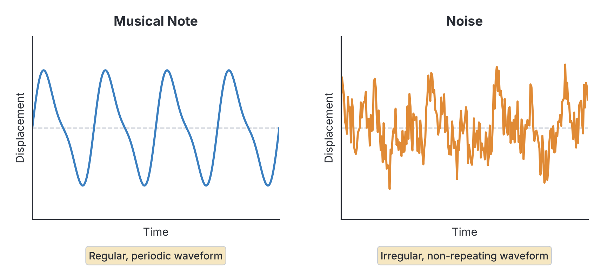
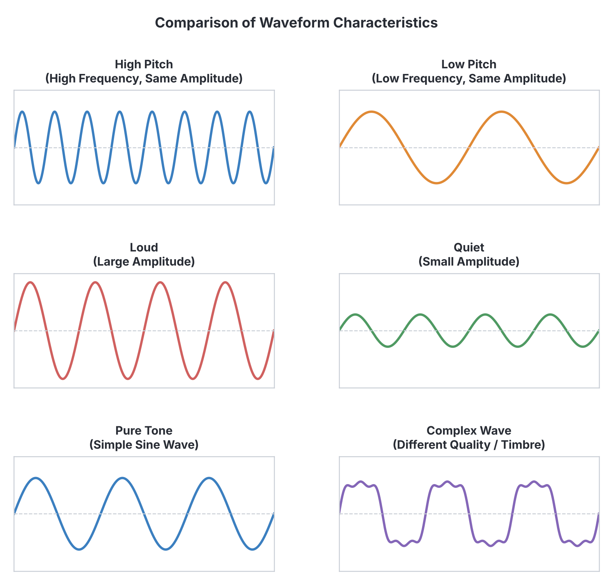
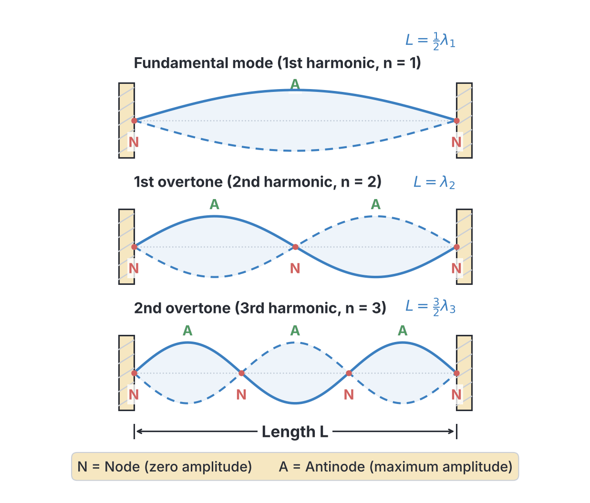
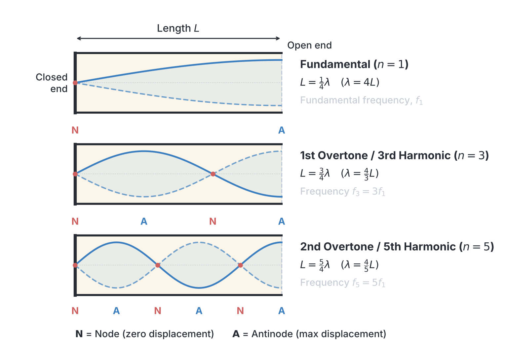
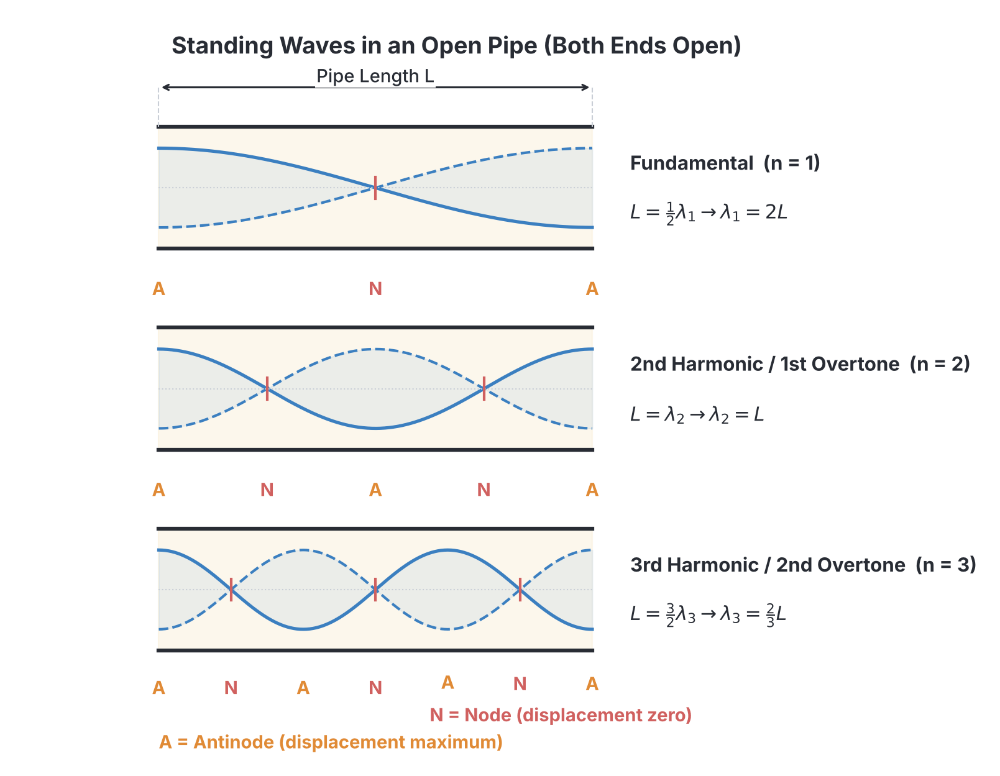

# JAMB Physics Notes: Characteristics of Sound Waves

## What JAMB expects

This topic is Section A, Topic 22 of the JAMB Physics syllabus: Characteristics of Sound Waves. It covers:

* (i) noise and musical notes;
* (ii) quality, pitch, intensity and loudness and their application to musical instruments;
* (iii) simple treatment of harmonics and overtones produced by vibrating strings and their columns $F_o = \frac{1}{2L} \sqrt{\frac{T}{\mu}}$ ($\mu = m/\ell$);
* (iv) acoustic examples of resonance;
* (v) frequency of a note emitted by air columns in closed and open pipes in relation to their lengths.

By the end of these notes, you should be able to:

1. Differentiate between noise and musical notes.
2. Analyse quality, pitch, intensity and loudness of sound notes.
3. Evaluate the application of the above characteristics in the construction of musical instruments.
4. Identify overtones by vibrating strings and air columns.
5. Itemize acoustical examples of resonance.
6. Determine the frequencies of notes emitted by air columns in open and closed pipes in relation to their lengths.

**Note on the syllabus wording:** The JAMB syllabus has a typographical error in its numbering for this topic's objectives, listing numeral (iv) twice ("identify overtones..." and "itemize acoustical examples...") and completely skipping (v). For clarity, we will treat "itemize acoustical examples" as objective (v). Additionally, it mistakenly writes "stings" instead of "strings", which we have corrected here.

---

## Noise and Musical Notes

Sound waves are longitudinal mechanical waves produced by vibrating bodies. However, not all sounds are pleasing to the ear. The human ear broadly divides sounds into two categories: **musical notes** and **noise**.

### Musical Notes
A musical note is a pleasing, continuous sound produced by regular and periodic vibrations. The waveform of a musical note is smooth and repeats itself perfectly over regular time intervals.
*   **Examples:** The sound of a piano, a tuning fork, a violin, or a singer holding a steady pitch.

### Noise
Noise is an unpleasant, jarring sound produced by irregular, non-periodic vibrations. The waveform of noise is jagged, erratic, and does not repeat in a predictable pattern. It consists of a sudden mixture of many frequencies with randomly changing amplitudes.
*   **Examples:** The sound of an exploding firecracker, a generator in a Nigerian market, dropping a metal pan, or the screeching of car brakes.

| Feature | Musical Note | Noise |
| :--- | :--- | :--- |
| **Vibration Type** | Regular and periodic | Irregular and non-periodic |
| **Waveform** | Smooth, repeating | Jagged, random |
| **Effect on Ear** | Pleasant and soothing | Unpleasant and irritating |
| **Changes in Amplitude**| Steady or changes smoothly | Sudden and abrupt changes |

---

## Characteristics of Sound Notes

Every musical note has three main characteristics that distinguish it from others: **pitch**, **loudness (and intensity)**, and **quality (timbre)**. 

### 1. Pitch (Depends on Frequency)
**Pitch** is how high or low a sound seems to the human ear. It is directly determined by the **frequency** of the sound wave. 
*   A **high-frequency** vibration produces a **high-pitched** sound (like the squeak of a mouse or a whistle).
*   A **low-frequency** vibration produces a **low-pitched** sound (like the rumble of thunder or a bass drum).

### 2. Loudness and Intensity (Depends on Amplitude)
**Loudness** is the magnitude of the sensation of sound reaching the ear. It depends primarily on the **amplitude** of the vibrating wave. A larger amplitude displaces more air, carrying more energy and producing a louder sound. 
*   **Intensity** is the objective, measurable physical quantity of energy crossing a unit area per second ($\text{W m}^{-2}$).
*   **Loudness** is subjective; it depends on both the intensity of the sound and the sensitivity of the listener's ear.

### 3. Quality or Timbre (Depends on Overtones)
**Quality (timbre)** is the characteristic that allows us to distinguish between two notes of the **same pitch and loudness** played on different instruments (for example, a middle C played on a piano and a guitar).
*   When an instrument is played, it rarely produces just one pure frequency (like a tuning fork does). Instead, it produces a fundamental frequency mixed with several higher frequencies called **overtones** or **harmonics**.
*   The unique number, types, and relative amplitudes of these overtones give each instrument its unique "voice" or quality. 

---

## Application to Musical Instruments

The principles of pitch, loudness, and quality are used extensively in the design and playing of musical instruments.

### String Instruments (e.g., Guitars, Pianos, Violins)
*   **Pitch:** Varied by changing the length, tension, or thickness of the strings. For example, a guitarist presses a string against the fretboard to shorten its vibrating length, increasing the frequency (pitch). Tuning pegs adjust the tension.
*   **Loudness:** The strings alone move very little air. String instruments use a wooden **sounding box** (like the body of an acoustic guitar). The vibrating string forces the large wooden body to vibrate, moving a large volume of air and creating a louder sound through resonance.
*   **Quality:** The shape of the sounding box and the material of the strings determine which overtones are amplified, giving a violin a different quality from a guitar.

### Wind Instruments (e.g., Flutes, Trumpets, local "Oja")
*   **Pitch:** Varied by opening and closing holes along the side of the tube (or using valves). This changes the effective length of the vibrating air column. A shorter air column produces a higher pitch.
*   **Loudness:** Depends on the force of the air blown into the instrument (amplitude of the pressure wave).
*   **Quality:** Determined by the shape of the pipe (cylindrical vs. conical) and whether the pipe is open at both ends or closed at one end.

### Percussion Instruments (e.g., Talking Drum, Xylophone, Udu)
*   **Pitch:** In a Nigerian talking drum (Gangan), the drummer squeezes the tension cords connecting the drumheads to increase the tension of the skin, which sharply raises the pitch of the note.
*   **Loudness:** Determined by how hard the skin or bar is struck.

---

## Harmonics and Overtones in Vibrating Strings

When a stretched string is plucked, bowed, or struck, it vibrates to produce a sound. The frequency of the note produced is governed by the length, tension, and mass per unit length of the string.

### The Law of Vibrating Strings
The fundamental frequency ($F_0$) of a stretched string is given by the formula:

$$F_0 = \frac{1}{2L} \sqrt{\frac{T}{\mu}}$$

Where:
*   $F_0$ = fundamental frequency in Hertz ($\text{Hz}$)
*   $L$ = length of the vibrating string in meters ($\text{m}$)
*   $T$ = tension in the string in Newtons ($\text{N}$)
*   $\mu$ = mass per unit length of the string in kilograms per meter ($\text{kg m}^{-1}$). Note: $\mu = m / L$, where $m$ is the total mass of the string in $\text{kg}$.

From this formula, we can derive the three laws of vibrating strings:
1.  **Law of Length:** $f \propto \frac{1}{L}$ (Frequency is inversely proportional to length, if tension and mass per unit length are constant).
2.  **Law of Tension:** $f \propto \sqrt{T}$ (Frequency is directly proportional to the square root of tension, if length and mass per unit length are constant).
3.  **Law of Mass:** $f \propto \frac{1}{\sqrt{\mu}}$ (Frequency is inversely proportional to the square root of mass per unit length).

### Worked Examples on Strings

**1. Calculating fundamental frequency:**
A guitar string has a length of $0.5\text{ m}$ and a total mass of $5.0\text{ g}$. If it is kept under a tension of $400\text{ N}$, calculate its fundamental frequency.

*Step 1:* Convert mass to SI units: $m = 5.0\text{ g} = 0.005\text{ kg}$.
*Step 2:* Calculate the mass per unit length ($\mu$): 
$$\mu = \frac{m}{L} = \frac{0.005\text{ kg}}{0.5\text{ m}} = 0.01\text{ kg m}^{-1}$$
*Step 3:* Apply the frequency formula: 
$$F_0 = \frac{1}{2L} \sqrt{\frac{T}{\mu}}$$
*Step 4:* Substitute the values:
$$F_0 = \frac{1}{2(0.5)} \sqrt{\frac{400}{0.01}}$$
*Step 5:* Calculate:
$$F_0 = \frac{1}{1} \sqrt{40000} = 200\text{ Hz}$$

**2. The effect of changing length (Sonometer experiment):**
A sonometer wire has a fundamental frequency of $300\text{ Hz}$ when its vibrating length is $40\text{ cm}$. What will be the new fundamental frequency if the length is reduced to $20\text{ cm}$ while the tension remains constant?

*Step 1:* Note the relationship $f_1 L_1 = f_2 L_2$.
*Step 2:* Substitute the values (units of length will cancel out): 
$$300 \times 40 = f_2 \times 20$$
*Step 3:* Solve for $f_2$:
$$f_2 = \frac{12000}{20} = 600\text{ Hz}$$
*(Halving the length doubles the frequency).*

**3. The effect of changing tension:**
A stretched string emits a note of $200\text{ Hz}$ under a tension of $100\text{ N}$. If the tension is increased to $400\text{ N}$, calculate its new frequency.

*Step 1:* Note the relationship $\frac{f_2}{f_1} = \sqrt{\frac{T_2}{T_1}}$.
*Step 2:* Substitute the values: 
$$\frac{f_2}{200} = \sqrt{\frac{400}{100}}$$
*Step 3:* Simplify the root: 
$$\frac{f_2}{200} = \sqrt{4} = 2$$
*Step 4:* Solve for $f_2$: 
$$f_2 = 200 \times 2 = 400\text{ Hz}$$

---

## Identifying Overtones in Strings and Air Columns

To answer JAMB questions correctly, you must know the exact difference between a **harmonic** and an **overtone**.
*   **Harmonics** are simply integer multiples of the fundamental frequency ($f_0$). So $1f_0, 2f_0, 3f_0, 4f_0$ are the 1st, 2nd, 3rd, and 4th harmonics respectively.
*   **Overtones** are the actual frequencies produced by the instrument *above* the fundamental. The very next frequency produced after the fundamental is the 1st overtone, the next is the 2nd overtone, and so on.

### 1. Overtones in Vibrating Strings
When a string vibrates as a whole, it produces the fundamental frequency ($f_0$). If it vibrates in two segments, there is a node in the middle, and it produces a frequency twice as high ($2f_0$).
*   **Fundamental Mode:** 1 segment. Frequency = $f_0$ (1st harmonic)
*   **1st Overtone:** 2 segments. Frequency = $2f_0$ (2nd harmonic)
*   **2nd Overtone:** 3 segments. Frequency = $3f_0$ (3rd harmonic)
*   *(Strings produce **all** harmonics: odd and even).*

### 2. Overtones in Open Pipes
An open pipe is open at both ends, so it must have an antinode at both ends. It behaves exactly like a string in terms of harmonics.
*   **Fundamental Mode:** Frequency = $f_0$ (1st harmonic)
*   **1st Overtone:** Frequency = $2f_0$ (2nd harmonic)
*   **2nd Overtone:** Frequency = $3f_0$ (3rd harmonic)
*   *(Open pipes produce **all** harmonics: odd and even).*

### 3. Overtones in Closed Pipes
A closed pipe is closed at one end (node) and open at the other (antinode). Because of this boundary condition, **closed pipes cannot produce even harmonics**.
*   **Fundamental Mode:** Frequency = $f_0$ (1st harmonic)
*   **1st Overtone:** Frequency = **$3f_0$ (3rd harmonic)** — *Notice it skipped $2f_0$!*
*   **2nd Overtone:** Frequency = **$5f_0$ (5th harmonic)**
*   *(Closed pipes produce **only odd** harmonics: 1st, 3rd, 5th, etc).*

---

## Acoustical Resonance

**Resonance** is a phenomenon that occurs when a system is forced to vibrate at its own natural frequency by an external periodic force. When this happens, the system vibrates with a very large amplitude.

If you hit a tuning fork, it vibrates at its natural frequency (e.g., $256\text{ Hz}$). This is a **free vibration**. If you press the base of that tuning fork against a table, the table is forced to vibrate at $256\text{ Hz}$ too. This is a **forced vibration**. If the external frequency exactly matches the table's natural frequency, **resonance** occurs, and the sound becomes extremely loud.

### Acoustical Examples of Resonance

1.  **Resonance Tube Experiment:** A vibrating tuning fork is held over a column of air in a glass tube containing water. As the water level is lowered, the air column length increases. At specific lengths, the natural frequency of the air column exactly matches the tuning fork, and a sudden, loud sound is heard.
2.  **Sounding Boxes in Instruments:** The wooden bodies of guitars, violins, and pianos are designed to resonate with the frequencies of the strings, amplifying the sound so an audience can hear it.
3.  **Singing shattering a glass:** If a highly trained soprano singer sings a powerful, sustained note whose pitch exactly matches the natural frequency of a delicate wine glass, the glass will resonate. The large amplitude of vibration can cause the glass to shatter.
4.  **Blowing across a bottle:** When you blow air across the top of a partially filled bottle, the air column inside resonates at its natural frequency, producing a loud musical note.

---

## Frequencies in Open and Closed Pipes

Air columns enclosed in tubes (pipes) can be forced into standing wave patterns. The length of the pipe determines the wavelength ($\lambda$), and therefore the frequency ($f = v/\lambda$) of the sound. Let the velocity of sound in air be $v$.

### Closed Pipes (Closed at one end)
A closed pipe always has a **node** at the closed end and an **antinode** at the open end.
*   **Fundamental ($f_0$):** The pipe holds just a quarter of a wavelength. 
    $L = \frac{\lambda}{4} \implies \lambda = 4L$.
    Formula: $f_0 = \frac{v}{4L}$.
*   **1st Overtone ($f_1$):** The pipe holds three-quarters of a wave.
    $L = \frac{3\lambda}{4} \implies \lambda = \frac{4L}{3}$.
    Formula: $f_1 = \frac{3v}{4L} = 3f_0$ (3rd harmonic).

### Open Pipes (Open at both ends)
An open pipe always has an **antinode** at both ends, and at least one node in the middle.
*   **Fundamental ($f_0$):** The pipe holds half of a wavelength.
    $L = \frac{\lambda}{2} \implies \lambda = 2L$.
    Formula: $f_0 = \frac{v}{2L}$.
*   **1st Overtone ($f_1$):** The pipe holds one full wave.
    $L = \lambda \implies \lambda = L$.
    Formula: $f_1 = \frac{2v}{2L} = 2f_0$ (2nd harmonic).

*(Note that for the same length of pipe, an open pipe produces a fundamental frequency that is twice as high—an octave higher—than a closed pipe).*

### End Correction ($c$)
In reality, the antinode at the open end of a pipe actually forms slightly *outside* the pipe. The extra length added is called the **end correction**, $c$. 
*   For a closed pipe (1 open end): Effective length = $L + c$.
*   For an open pipe (2 open ends): Effective length = $L + 2c$.

### Worked Examples on Pipes

**1. Finding the fundamental of an open pipe:**
Calculate the fundamental frequency of an open pipe of length $0.34\text{ m}$ if the velocity of sound in air is $340\text{ m s}^{-1}$.

*Step 1:* Identify given values: $L = 0.34\text{ m}$, $v = 340\text{ m s}^{-1}$.
*Step 2:* Apply open pipe fundamental formula: $f_0 = \frac{v}{2L}$.
*Step 3:* Substitute: $f_0 = \frac{340}{2 \times 0.34} = \frac{340}{0.68}$.
*Step 4:* Solve: $f_0 = 500\text{ Hz}$.

**2. Overtones in a closed pipe:**
A closed pipe of length $0.34\text{ m}$ is sounded. If the velocity of sound is $340\text{ m s}^{-1}$, calculate the frequency of its **first overtone**.

*Step 1:* First, find the fundamental frequency for a closed pipe ($f_0 = \frac{v}{4L}$).
*Step 2:* $f_0 = \frac{340}{4 \times 0.34} = \frac{340}{1.36} = 250\text{ Hz}$.
*Step 3:* Recall the overtone rule for closed pipes: 1st overtone = 3rd harmonic = $3f_0$.
*Step 4:* Calculate the overtone: $3 \times 250\text{ Hz} = 750\text{ Hz}$.

**3. Resonance tube experiment:**
A resonance tube experiment shows consecutive resonances at air column lengths of $16\text{ cm}$ and $50\text{ cm}$ using a tuning fork of frequency $500\text{ Hz}$. Calculate the velocity of sound in air.

*Step 1:* For successive resonances in a closed tube, the distance between them is exactly half a wavelength. $L_2 - L_1 = \frac{\lambda}{2}$.
*Step 2:* Substitute lengths in meters: $0.50 - 0.16 = 0.34\text{ m}$.
*Step 3:* Solve for wavelength: $\frac{\lambda}{2} = 0.34 \implies \lambda = 0.68\text{ m}$.
*Step 4:* Use the wave equation: $v = f \lambda$.
*Step 5:* Substitute and calculate: $v = 500 \times 0.68 = 340\text{ m s}^{-1}$.

---

## Key terms

| Term | Meaning |
| :--- | :--- |
| **Pitch** | The highness or lowness of a sound; depends on frequency. |
| **Loudness** | The magnitude of sound sensation reaching the ear; depends on amplitude. |
| **Quality (Timbre)** | The characteristic of sound that allows differentiation between instruments; depends on overtones. |
| **Harmonic** | A frequency that is an integer multiple of the fundamental frequency. |
| **Overtone** | Any frequency greater than the fundamental frequency produced by a vibrating body. |
| **Resonance** | A phenomenon where a body vibrates with large amplitude because it is driven by an external force at its natural frequency. |
| **Node** | A point in a standing wave where the displacement is always zero. |
| **Antinode** | A point in a standing wave where the displacement is at maximum amplitude. |

---

## Exam tips and common mistakes

*   **Harmonics vs Overtones:** This is JAMB's favourite trap. For a closed pipe, the 1st overtone is the 3rd harmonic ($3f_0$). If asked for the "first overtone of a closed pipe," do **not** multiply the fundamental by 2. Multiply by 3.
*   **Open vs Closed Formula:** 
    *   Closed pipe: $f_0 = \frac{v}{4L}$.
    *   Open pipe: $f_0 = \frac{v}{2L}$. 
    *   *Memory trick:* A closed pipe has fewer openings, so it vibrates "slower/lower" (you divide by a bigger number, 4).
*   **Unit Conversions:** Always convert string mass to kilograms ($\text{kg}$) and string length to meters ($\text{m}$) before calculating the mass per unit length ($\mu$). Leaving mass in grams will give you a completely wrong answer.
*   **Forgetting to Square Root:** In the string frequency formula $F_0 = \frac{1}{2L} \sqrt{\frac{T}{\mu}}$, students often calculate $\frac{T}{\mu}$ and multiply it by $\frac{1}{2L}$ directly, forgetting to apply the square root first. 

---

## Quick summary

1.  Noise is produced by irregular, non-periodic vibrations, while musical notes come from regular, periodic vibrations.
2.  The pitch of a note depends on its frequency, loudness depends on amplitude, and quality (timbre) depends on the number and type of overtones present.
3.  The fundamental frequency of a vibrating string is $F_0 = \frac{1}{2L} \sqrt{\frac{T}{\mu}}$. It is directly proportional to the square root of tension, and inversely proportional to length and the square root of mass per unit length.
4.  Vibrating strings and open pipes produce all harmonics ($f_0, 2f_0, 3f_0, \dots$). Their 1st overtone is the 2nd harmonic.
5.  Closed pipes produce only odd harmonics ($f_0, 3f_0, 5f_0, \dots$). Their 1st overtone is the 3rd harmonic.
6.  Resonance occurs when an external periodic force drives a system to vibrate at its own natural frequency, resulting in a large amplitude.

---

## Practice questions

**1. Which of the following determines the pitch of a sound note?**
- A. Amplitude
- B. Frequency
- C. Quality
- D. Velocity

**Answer: B.** Pitch is the perceived highness or lowness of a sound, which is directly determined by the frequency of the sound wave.

**2. The fundamental frequency of a closed pipe is $150\text{ Hz}$. What is the frequency of its second overtone?**
- A. $300\text{ Hz}$
- B. $450\text{ Hz}$
- C. $750\text{ Hz}$
- D. $900\text{ Hz}$

**Answer: C.**
1. For a closed pipe, overtones are odd harmonics.
2. Fundamental = $f_0 = 150\text{ Hz}$ (1st harmonic).
3. 1st overtone = $3f_0$ (3rd harmonic).
4. 2nd overtone = $5f_0$ (5th harmonic).
5. $5 \times 150\text{ Hz} = 750\text{ Hz}$.
*(Mistake: Choosing A or B usually means confusing overtones and harmonics or mixing up open and closed pipes).*

**3. A string has a mass of $2.0\text{ g}$ and a length of $0.8\text{ m}$. If it is under a tension of $100\text{ N}$, what is its fundamental frequency?**
- A. $125\text{ Hz}$
- B. $250\text{ Hz}$
- C. $62.5\text{ Hz}$
- D. $100\text{ Hz}$

**Answer: A.**
1. Convert mass to kg: $m = 2.0\text{ g} = 0.002\text{ kg}$.
2. Calculate mass per unit length ($\mu$): $\mu = \frac{0.002}{0.8} = 0.0025\text{ kg m}^{-1}$.
3. Apply formula: $F_0 = \frac{1}{2(0.8)} \sqrt{\frac{100}{0.0025}}$.
4. Evaluate fraction: $\frac{100}{0.0025} = 40000$.
5. Square root: $\sqrt{40000} = 200$.
6. Calculate frequency: $F_0 = \frac{1}{1.6} \times 200 = 125\text{ Hz}$.
*(Mistake: Forgetting to use $2L$ and just using $1/L$ gives $250\text{ Hz}$, which is option B).*

**4. An open pipe sounds a fundamental note of frequency $330\text{ Hz}$. If the speed of sound in air is $330\text{ m s}^{-1}$, the length of the pipe is:**
- A. $0.25\text{ m}$
- B. $0.50\text{ m}$
- C. $1.00\text{ m}$
- D. $2.00\text{ m}$

**Answer: B.**
1. Open pipe fundamental formula: $f_0 = \frac{v}{2L}$.
2. Rearrange for L: $L = \frac{v}{2f_0}$.
3. Substitute: $L = \frac{330}{2 \times 330} = \frac{330}{660}$.
4. Solve: $L = 0.50\text{ m}$.

**5. In musical instruments, the sounding box is primarily designed to:**
- A. Increase the pitch
- B. Amplify the sound through resonance
- C. Change the speed of the sound
- D. Remove overtones

**Answer: B.** A sounding box forces a larger volume of air to vibrate at the same frequency as the string, causing resonance and thereby increasing the loudness (amplifying the sound).

**6. When the tension in a sonometer wire is quadrupled (multiplied by 4), the frequency of the note it emits:**
- A. is halved
- B. remains the same
- C. is doubled
- D. is quadrupled

**Answer: C.** Frequency is directly proportional to the square root of tension ($f \propto \sqrt{T}$). If tension increases by a factor of 4, the frequency increases by a factor of $\sqrt{4}$, which is 2. The frequency is doubled.

**7. Which of the following is true about a pipe open at both ends?**
- A. It produces only odd harmonics.
- B. Its fundamental wavelength is four times its length.
- C. It produces both odd and even harmonics.
- D. Its first overtone is the third harmonic.

**Answer: C.** An open pipe produces all harmonics (1st, 2nd, 3rd, 4th, etc.), which includes both odd and even harmonics. Only closed pipes produce solely odd harmonics.

**8. The difference between a musical note and noise is that noise:**
- A. has a very high frequency.
- B. is produced by regular vibrations.
- C. has a non-periodic and irregular waveform.
- D. travels faster in air.

**Answer: C.** Noise is characterized by a jagged, non-repeating (non-periodic), and irregular waveform due to irregular vibrations.

**9. A tuning fork of frequency $340\text{ Hz}$ is sounded above a resonance tube. The first resonance is heard when the air column is $24\text{ cm}$ long, and the second resonance when it is $74\text{ cm}$ long. The velocity of sound in air is:**
- A. $330\text{ m s}^{-1}$
- B. $340\text{ m s}^{-1}$
- C. $350\text{ m s}^{-1}$
- D. $170\text{ m s}^{-1}$

**Answer: B.**
1. The distance between two consecutive resonances is $\frac{\lambda}{2}$.
2. $\frac{\lambda}{2} = L_2 - L_1 = 74\text{ cm} - 24\text{ cm} = 50\text{ cm} = 0.5\text{ m}$.
3. Therefore, $\lambda = 0.5\text{ m} \times 2 = 1.0\text{ m}$.
4. $v = f \lambda = 340 \times 1.0 = 340\text{ m s}^{-1}$.
*(Mistake: Forgetting to multiply by 2 gives a wavelength of $0.5\text{ m}$ and a velocity of $170\text{ m s}^{-1}$, option D).*

**10. The quality (timbre) of a sound emitted by a musical instrument depends on the:**
- A. Number and amplitude of the overtones present
- B. Intensity of the fundamental note
- C. Frequency of the fundamental note
- D. Amplitude of the vibration

**Answer: A.** The unique "voice" or quality of an instrument is determined by the specific mixture, number, and relative amplitudes of the overtones (harmonics) it produces along with the fundamental note.
