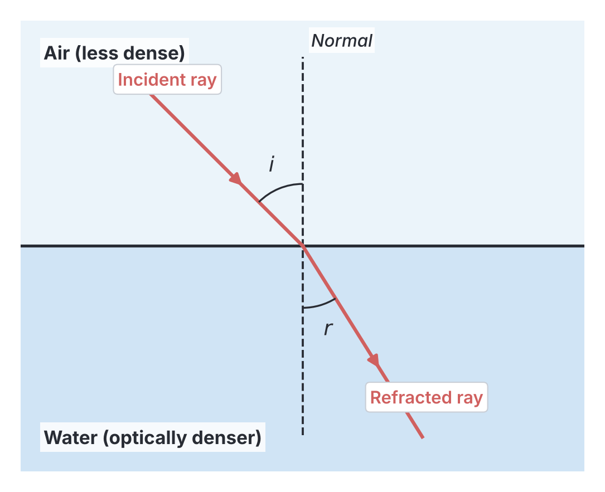
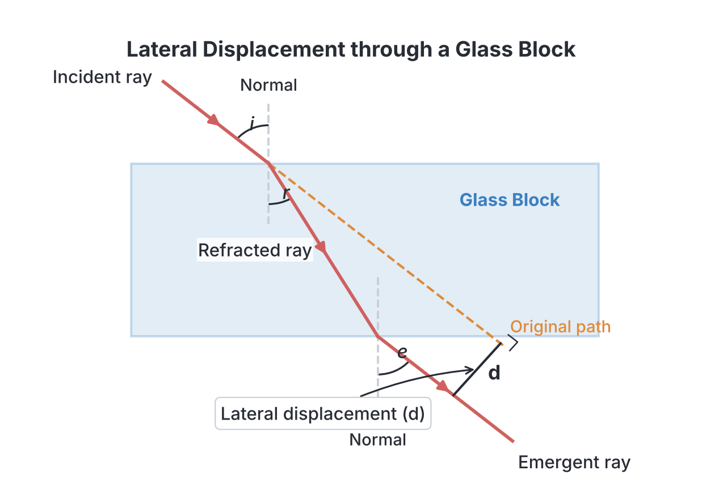

# JAMB Physics Notes: Refraction of Light at Plane Surfaces

## What JAMB expects

This topic is part of Section A, Topic 25 of the JAMB Physics syllabus: Refraction of Light Through at Plane and Curved Surfaces. Because this is a very broad topic, it is split into parts. This file (Part 1) covers refraction at plane (flat) surfaces. Prisms, lenses and optical instruments are covered in `A25b-refraction-glass-prism-lenses.md` and `A26-optical-instruments.md`.

This file covers the following content items:
* (i) laws of refraction;
* (ii) explanation of refraction in terms of velocity of light in the media;
* (iii) definition of refractive index of a medium;
* (iv) determination of refractive index of glass and liquid using Snell’s law;
* (v) real and apparent depth and lateral displacement;
* (vi) critical angle and total internal reflection.

By the end of these notes, you should be able to:
1. interpret the laws of reflection;
2. determine the refractive index of glass and liquid using Snell’s law;
4. determine the refractive index using the principle of real and apparent depth;
5. determine the conditions necessary for total internal reflection;
6. examine the use of periscope, prism, binoculars, optical fibre;
7. apply the principles of total internal reflection to the formation of mirage.

**Note on the syllabus wording:** In the first objective, the syllabus says "interpret the laws of reflection". Since this entire topic is about *refraction*, this is a known typing error by JAMB. However, because total internal reflection (which happens inside a medium during refraction) strictly obeys the laws of reflection, both the laws of refraction and the laws of reflection are covered in these notes. Also, the topic title contains the typo "Through at", which we note but ignore. 

## What is Refraction of Light?

When a ray of light travels through a single uniform medium (like empty space or clear air), it moves in a straight line. But when the light ray crosses the boundary from one transparent medium into another (for example, from air into a bucket of water, or from air into a glass window), it bends. 

**Refraction** is the bending of a light ray as it passes obliquely (at an angle) from one transparent medium to another of different optical density.

If the light strikes the boundary perfectly straight on (along the normal, at a 90° angle to the surface), it does not bend, but its speed still changes. 

## Explanation of refraction in terms of velocity of light

Why does light bend? The fundamental cause of refraction is that **light travels at different speeds in different media**. 

- **In a vacuum (or empty space)**, light travels at its maximum possible speed: $c = 3.0 \times 10^8\ \text{m s}^{-1}$.
- **In air**, the speed of light is only very slightly less than in a vacuum, so for JAMB calculations, we still use $3.0 \times 10^8\ \text{m s}^{-1}$.
- **In water**, light slows down to about $2.25 \times 10^8\ \text{m s}^{-1}$.
- **In glass**, light slows down even more, to about $2.0 \times 10^8\ \text{m s}^{-1}$.

An **optically denser** medium is one in which light travels slower. An **optically less dense** (or rarer) medium is one in which light travels faster. (Note: Optical density is not exactly the same as mass density, though they are often related).

### The rules of bending
1. When light travels from a **less dense to a denser medium** (e.g., from air to glass), it slows down and bends **towards the normal**. The angle of refraction ($r$) is less than the angle of incidence ($i$).
2. When light travels from a **denser to a less dense medium** (e.g., from water to air), it speeds up and bends **away from the normal**. The angle of refraction ($r$) is greater than the angle of incidence ($i$).

### Wavelength and frequency during refraction
When a light wave crosses a boundary and slows down, its properties change according to the wave equation $v = f \lambda$ (where $v$ is velocity, $f$ is frequency, and $\lambda$ is wavelength):
- The **velocity ($v$)** changes.
- The **wavelength ($\lambda$)** changes.
- The **frequency ($f$)** remains **constant**. The frequency depends only on the source of the light, not the medium.

**Worked Example 1: Velocity and Wavelength**
A ray of red light from a laser pointer has a frequency of $4.0 \times 10^{14}\ \text{Hz}$ and travels from air into a block of glass. The speed of light in air is $3.0 \times 10^8\ \text{m s}^{-1}$ and in the glass it is $2.0 \times 10^8\ \text{m s}^{-1}$. Calculate the wavelength of the light in both air and glass.

**Working:**
1. State the formula connecting velocity, frequency, and wavelength:
   $$v = f \lambda \implies \lambda = \frac{v}{f}$$
2. Calculate the wavelength in air:
   $$\lambda_{\text{air}} = \frac{3.0 \times 10^8\ \text{m s}^{-1}}{4.0 \times 10^{14}\ \text{Hz}}$$
   $$\lambda_{\text{air}} = 7.5 \times 10^{-7}\ \text{m}$$
3. Calculate the wavelength in glass (remember, frequency stays the same):
   $$\lambda_{\text{glass}} = \frac{2.0 \times 10^8\ \text{m s}^{-1}}{4.0 \times 10^{14}\ \text{Hz}}$$
   $$\lambda_{\text{glass}} = 5.0 \times 10^{-7}\ \text{m}$$
   The wavelength is shorter in the glass because the light travels slower.

## Definition of refractive index of a medium

The **refractive index** (symbol $n$) of a medium is a number that tells us how much that medium slows down light. It is a ratio, so it has **no units**.

### Absolute Refractive Index
The absolute refractive index of a medium is defined as the ratio of the speed of light in a vacuum (or air) to the speed of light in that medium.

$$n = \frac{\text{Velocity of light in vacuum (or air)}}{\text{Velocity of light in the medium}} = \frac{c}{v}$$

Because light is always fastest in a vacuum, the absolute refractive index of any physical medium is always greater than 1.
- Refractive index of air $\approx 1.0$
- Refractive index of water $\approx 1.33$ (or $\frac{4}{3}$)
- Refractive index of typical glass $\approx 1.5$ (or $\frac{3}{2}$)
- Refractive index of diamond $\approx 2.4$

### Relative Refractive Index
Sometimes light travels from one medium directly into another (for example, from water into glass), rather than from air. The **relative refractive index** from medium 1 to medium 2 (written as $_1n_2$) is the ratio of the speed of light in medium 1 to the speed of light in medium 2:

$$_1n_2 = \frac{v_1}{v_2}$$

Using their absolute refractive indices ($n_1$ and $n_2$), this can also be written as:

$$_1n_2 = \frac{n_2}{n_1}$$

**The Principle of Reversibility of Light:**
If you reverse the direction of a light ray, it will trace the exact same path backward. Therefore, the refractive index from medium 2 to medium 1 is the reciprocal of the refractive index from medium 1 to medium 2:
$$_2n_1 = \frac{1}{_1n_2}$$

## The laws of refraction (and reflection)

In 1621, the Dutch scientist Willebrord Snellius formulated the rules governing how light bends. These are known as the **Laws of Refraction**:

1. **First Law:** The incident ray, the refracted ray, and the normal at the point of incidence all lie in the same plane.
2. **Second Law (Snell's Law):** The ratio of the sine of the angle of incidence ($i$) to the sine of the angle of refraction ($r$) is a constant for a given pair of media. 

This constant is the refractive index. For light moving from air into a medium:
$$n = \frac{\sin i}{\sin r}$$

If light is moving from medium 1 (with index $n_1$) into medium 2 (with index $n_2$), Snell's Law in its most useful general form is:
$$n_1 \sin i = n_2 \sin r$$

**Interpreting the Laws of Reflection**
Because the JAMB syllabus mentions "interpret the laws of reflection" in this topic (likely referring to the boundary effects when total internal reflection occurs), we quickly state them here:
1. The incident ray, the reflected ray, and the normal at the point of incidence all lie in the same plane.
2. The angle of incidence is equal to the angle of reflection ($i = r$).
Whenever light strikes a boundary (like water or glass), a small portion of it is always reflected following these laws, while the rest is refracted. Under certain conditions (explained later), *all* the light is reflected.

## Determining refractive index using Snell’s law

In a school laboratory, you can determine the refractive index of different materials by measuring angles of incidence and refraction and applying Snell's Law.

### 1. The Glass Block Experiment (for solid glass)
**Apparatus:** Rectangular glass block, optical pins, drawing board, white paper, protractor.

**Procedure:**
1. Place the glass block on the paper and draw its outline. Remove the block.
2. Draw a normal line to one side. Draw an incident line at a known angle $i$ (e.g., 30°) to the normal.
3. Stick two optical pins on this incident line.
4. Replace the block. Look through the opposite parallel side of the block.
5. Place two other pins so that they appear to be perfectly in line with the images of the first two pins seen through the glass.
6. Remove the block. Join the positions of the new pins to the boundary—this gives the emergent ray.
7. Connect the point of incidence to the point of emergence. This is the **refracted ray** inside the glass.
8. Measure the angle of refraction $r$ with a protractor.
9. Repeat for different angles of incidence. Plot a graph of $\sin i$ against $\sin r$. The slope of the straight-line graph is the refractive index $n$ of the glass.

### 2. The Liquid Experiment (for water or oil)
You can use a semi-circular glass box filled with a liquid. A ray box shines a thin beam of light at the flat face of the semi-circle. By measuring the angles $i$ in the air and $r$ in the liquid, Snell's law ($n = \frac{\sin i}{\sin r}$) will give the refractive index of the liquid.

### Worked Examples: Snell's Law Calculations

**Worked Example 2: Air to Glass**
A ray of light in air strikes a glass block at an angle of incidence of 60°. If the refractive index of the glass is 1.5, calculate the angle of refraction.

**Working:**
1. State Snell's law for light going from air to a medium:
   $$n = \frac{\sin i}{\sin r}$$
2. Rearrange to make $\sin r$ the subject:
   $$\sin r = \frac{\sin i}{n}$$
3. Substitute the given values ($i = 60^\circ$, $n = 1.5$):
   $$\sin r = \frac{\sin 60^\circ}{1.5}$$
4. Calculate the values (using $\sin 60^\circ = 0.8660$):
   $$\sin r = \frac{0.8660}{1.5} = 0.5773$$
5. Find the inverse sine to get the angle:
   $$r = \arcsin(0.5773) = 35.3^\circ$$
   **Answer:** The angle of refraction is $35.3^\circ$.

**Worked Example 3: Glass to Water**
A ray of light travels from a block of glass ($n_g = 1.5$) into a pool of water ($n_w = \frac{4}{3}$). The angle of incidence at the glass-water boundary is 30°. Find the angle of refraction in the water.

**Working:**
1. Use the general form of Snell's Law, because the light is not coming from air:
   $$n_1 \sin i = n_2 \sin r$$
2. Identify the media. Medium 1 is glass ($n_1 = 1.5$, $i = 30^\circ$). Medium 2 is water ($n_2 = \frac{4}{3}$, $r = ?$).
3. Substitute the values:
   $$1.5 \times \sin 30^\circ = \frac{4}{3} \times \sin r$$
4. Calculate the left side ($\sin 30^\circ = 0.5$):
   $$1.5 \times 0.5 = 0.75$$
5. Solve for $\sin r$:
   $$0.75 = \frac{4}{3} \times \sin r$$
   $$\sin r = \frac{0.75 \times 3}{4} = \frac{2.25}{4} = 0.5625$$
6. Find the inverse sine:
   $$r = \arcsin(0.5625) = 34.2^\circ$$
   **Answer:** The angle of refraction in the water is $34.2^\circ$.

**Worked Example 4: Finding Refractive Index from Angles**
A light ray travels from air into an unknown transparent liquid. The angle of incidence is 45° and the angle of refraction is 30°. What is the refractive index of the liquid?

**Working:**
1. State Snell's law:
   $$n = \frac{\sin i}{\sin r}$$
2. Substitute the values ($i = 45^\circ$, $r = 30^\circ$):
   $$n = \frac{\sin 45^\circ}{\sin 30^\circ}$$
3. Use the mathematical values for these angles:
   $$n = \frac{\frac{1}{\sqrt{2}}}{\frac{1}{2}}$$
4. Simplify the fraction:
   $$n = \frac{1}{\sqrt{2}} \times \frac{2}{1} = \frac{2}{\sqrt{2}} = \sqrt{2}$$
   **Answer:** The refractive index is $\sqrt{2}$ (or $1.414$).

## Real and apparent depth and lateral displacement

### Apparent Depth
When you look straight down into a clear swimming pool in a hotel in Lagos, the bottom of the pool looks closer to the surface than it actually is. If you drop a coin into a bucket of water, the coin appears to be raised up. This optical illusion is caused by refraction.

Light rays reflecting off the coin at the bottom of the bucket travel upward through the water. When they reach the surface and enter the air, they bend **away from the normal** (because air is less dense than water). When these diverging rays enter your eye, your brain traces them straight back. Your brain assumes light travels in a straight line, so it sees an **apparent image** of the coin above its real position.

[IMAGE: A diagram showing apparent depth. A bucket contains water. A coin is at the bottom (real depth). Two light rays from the coin travel upwards to the water surface and bend away from the normal as they enter the air, entering an observer's eye. Dashed lines trace the bent rays straight back downwards to form a "ghost" image of the coin higher up in the water. Vertical lines on the left indicate "Real depth" (surface to actual coin) and "Apparent depth" (surface to ghost image). Clean flat textbook style, white background.]

The distance the object appears to have moved upward is called the **apparent displacement** (or **shift**).
$$\text{Shift} = \text{Real Depth} - \text{Apparent Depth}$$

### Determining refractive index from real and apparent depth

The refractive index of a medium can be calculated using the ratio of real depth to apparent depth:

$$n = \frac{\text{Real Depth}}{\text{Apparent Depth}}$$

Using the formula for refractive index, we can also write the shift as:
$$\text{Shift} = \text{Real Depth} \times \left(1 - \frac{1}{n}\right)$$
Or, if a glass block of thickness $t$ is placed over a mark, the shift is:
$$s = t \left(1 - \frac{1}{n}\right)$$

In the laboratory, you can find the refractive index of a liquid (or a glass block) using the real and apparent depth method.

**Apparatus:** A travelling microscope (a microscope mounted on a vertical scale so its height can be measured accurately), a beaker, lycopodium powder (or chalk dust).

**Procedure for a liquid:**
1. Place an empty beaker under the microscope. Make a small cross mark at the bottom inside.
2. Focus the microscope on the mark. Read the vertical scale ($h_1$).
3. Pour the liquid into the beaker. The mark now appears to be raised.
4. Move the microscope upward until the mark is sharply in focus again. Read the scale ($h_2$).
5. Sprinkle a little powder on the surface of the liquid to make the surface visible.
6. Focus the microscope on the powder on the surface. Read the scale ($h_3$).
7. Calculate the Real Depth = $h_3 - h_1$.
8. Calculate the Apparent Depth = $h_3 - h_2$.
9. Calculate the refractive index: $n = \frac{h_3 - h_1}{h_3 - h_2}$.

### Lateral Displacement
When a light ray passes through a rectangular glass block with parallel sides, the ray that emerges into the air is **parallel** to the original incident ray, but it has been shifted sideways. This perpendicular sideways shift is called **lateral displacement**.

The formula for lateral displacement $d$ for a block of thickness $t$ is:
$$d = t \frac{\sin(i - r)}{\cos r}$$

### Worked Examples: Depth and Displacement

**Worked Example 5: Apparent Depth**
A coin rests at the bottom of a bucket containing water to a depth of $12.0\ \text{cm}$. If the refractive index of water is $\frac{4}{3}$, calculate the apparent depth of the coin.

**Working:**
1. State the formula:
   $$n = \frac{\text{Real Depth}}{\text{Apparent Depth}}$$
2. Rearrange to find apparent depth:
   $$\text{Apparent Depth} = \frac{\text{Real Depth}}{n}$$
3. Substitute the values (Real depth = $12.0\ \text{cm}$, $n = \frac{4}{3}$):
   $$\text{Apparent Depth} = \frac{12.0}{\frac{4}{3}} = 12.0 \times \frac{3}{4}$$
4. Calculate the answer:
   $$\text{Apparent Depth = 9.0\ \text{cm}}$$
   **Answer:** The apparent depth of the coin is $9.0\ \text{cm}$.

**Worked Example 6: Apparent Displacement (Shift)**
A glass block of thickness $5.0\ \text{cm}$ and refractive index $1.5$ is placed over a dot on a piece of paper. By what distance does the dot appear to be raised when viewed vertically from above?

**Working:**
1. State the formula for shift:
   $$s = t \left(1 - \frac{1}{n}\right)$$
2. Substitute the values ($t = 5.0\ \text{cm}$, $n = 1.5$ or $\frac{3}{2}$):
   $$s = 5.0 \times \left(1 - \frac{1}{1.5}\right)$$
3. Simplify the fraction:
   $$s = 5.0 \times \left(1 - \frac{2}{3}\right) = 5.0 \times \left(\frac{1}{3}\right)$$
4. Calculate the answer:
   $$s = \frac{5.0}{3} = 1.67\ \text{cm}$$
   **Answer:** The dot appears to be raised by $1.67\ \text{cm}$.

**Worked Example 7: Lateral Displacement**
A ray of light strikes a $10.0\ \text{cm}$ thick rectangular glass block at an angle of incidence of 60°. The refractive index of the glass is 1.5. Calculate the lateral displacement of the emergent ray.

**Working:**
1. First, find the angle of refraction $r$ using Snell's Law ($n = \frac{\sin i}{\sin r}$):
   $$1.5 = \frac{\sin 60^\circ}{\sin r}$$
   $$\sin r = \frac{0.8660}{1.5} = 0.5773$$
   $$r = \arcsin(0.5773) = 35.26^\circ$$
2. State the formula for lateral displacement:
   $$d = t \frac{\sin(i - r)}{\cos r}$$
3. Calculate $(i - r)$:
   $$i - r = 60^\circ - 35.26^\circ = 24.74^\circ$$
4. Substitute the values into the formula ($t = 10.0\ \text{cm}$):
   $$d = 10.0 \times \frac{\sin(24.74^\circ)}{\cos(35.26^\circ)}$$
5. Calculate the trigonometric values:
   $$d = 10.0 \times \frac{0.4185}{0.8165}$$
6. Calculate final answer:
   $$d = 10.0 \times 0.5125 = 5.13\ \text{cm}$$
   **Answer:** The lateral displacement is $5.13\ \text{cm}$.

## Critical angle and total internal reflection

When light travels from an **optically denser** medium to an **optically less dense** medium (for example, from water to air), it bends **away** from the normal. 

If you slowly increase the angle of incidence inside the denser medium, the refracted ray bends further and further away from the normal. Eventually, you reach a specific angle of incidence where the refracted ray is bent so much that it grazes the boundary between the two media exactly at a 90° angle of refraction. 

This specific angle of incidence is called the **critical angle** ($c$).

**Definition:** The critical angle is the angle of incidence in the optically denser medium for which the angle of refraction in the less dense medium is exactly 90°.

What happens if you increase the angle of incidence so it is *greater* than the critical angle? 
The light cannot refract into the air anymore. Instead, **all** the light bounces back into the denser medium. The boundary acts perfectly like a mirror. This phenomenon is called **Total Internal Reflection (TIR)**.

### Conditions necessary for total internal reflection
For total internal reflection to occur, two strict conditions must be met:
1. The light must be travelling from an **optically denser medium to an optically less dense medium** (e.g., glass to air, or water to air).
2. The **angle of incidence must be greater than the critical angle** of the denser medium ($i > c$).

### Relationship between Critical Angle and Refractive Index
Using Snell's Law ($n_1 \sin i = n_2 \sin r$), let Medium 1 be the dense medium (e.g., glass, index $n$) and Medium 2 be air (index $1$). 
At the critical angle, $i = c$ and $r = 90^\circ$.
$$n \sin c = 1 \times \sin 90^\circ$$
Since $\sin 90^\circ = 1$:
$$n \sin c = 1 \implies \sin c = \frac{1}{n}$$

**JAMB Shortcut / Safe Method:** 
For light passing between *any* two media (not just to air), the critical angle always occurs in the denser medium, and the formula is:
$$\sin c = \frac{n_{\text{less dense}}}{n_{\text{dense}}}$$

### Worked Examples: Critical Angle

**Worked Example 8: Critical Angle of Diamond**
The absolute refractive index of diamond is $2.4$. Calculate its critical angle.

**Working:**
1. State the critical angle formula:
   $$\sin c = \frac{1}{n}$$
2. Substitute the given refractive index:
   $$\sin c = \frac{1}{2.4}$$
3. Simplify the fraction:
   $$\sin c = \frac{10}{24} = 0.4167$$
4. Find the inverse sine:
   $$c = \arcsin(0.4167) = 24.6^\circ$$
   **Answer:** The critical angle of diamond is $24.6^\circ$. (This small critical angle means light easily undergoes TIR inside a diamond, which gives diamond its famous sparkle).

**Worked Example 9: Critical Angle from Velocities**
Light travels in a clear plastic block at a velocity of $2.25 \times 10^8\ \text{m s}^{-1}$. Calculate the critical angle of the plastic when it is in the air. ($c = 3.0 \times 10^8\ \text{m s}^{-1}$).

**Working:**
1. First, find the refractive index $n$ using velocities:
   $$n = \frac{\text{Velocity in air}}{\text{Velocity in plastic}}$$
   $$n = \frac{3.0 \times 10^8}{2.25 \times 10^8} = \frac{3}{2.25} = 1.333 \left(\text{or } \frac{4}{3}\right)$$
2. State the critical angle formula:
   $$\sin c = \frac{1}{n}$$
3. Substitute $n$:
   $$\sin c = \frac{1}{1.333} = 0.75$$
4. Find the inverse sine:
   $$c = \arcsin(0.75) = 48.6^\circ$$
   **Answer:** The critical angle of the plastic is $48.6^\circ$.

**Worked Example 10: Finding Refractive Index from Critical Angle**
An optical fibre has a core with a critical angle of 45° to the air. What is the refractive index of the core material?

**Working:**
1. State the formula:
   $$\sin c = \frac{1}{n} \implies n = \frac{1}{\sin c}$$
2. Substitute $c = 45^\circ$:
   $$n = \frac{1}{\sin 45^\circ}$$
3. Use the exact value of $\sin 45^\circ$ (which is $\frac{1}{\sqrt{2}}$):
   $$n = \frac{1}{\frac{1}{\sqrt{2}}} = \sqrt{2}$$
   **Answer:** The refractive index of the core is $\sqrt{2}$ (or $1.414$).

## Optical instruments using total internal reflection

Total internal reflection is incredibly useful because, unlike regular mirrors which absorb a small percentage of light, TIR reflects 100% of the light.

### 1. Optical Fibres
An optical fibre is a very thin, flexible thread of high-quality glass or plastic used to carry light signals over long distances. It consists of a central **core** (high refractive index) surrounded by an outer **cladding** (slightly lower refractive index). 

When a light ray enters the core, it strikes the core-cladding boundary at an angle greater than the critical angle. It undergoes total internal reflection, bouncing back and forth along the inside of the fibre without leaking out, even if the fibre is bent.
- **Uses:** Telecommunications (companies like MTN and Glo use fibre optic cables under streets and under the ocean to send internet and phone signals very quickly) and in medicine (endoscopes used by doctors to look inside a patient's stomach).

[IMAGE: Cross-section of an optical fibre. A central solid tube (Core, high refractive index) surrounded by an outer layer (Cladding, lower refractive index). A red light ray enters the left end, hits the top boundary between core and cladding, reflects downwards (TIR), hits the bottom boundary, reflects upwards, and continues zigzagging down the tube. Clean flat textbook style, white background.]

### 2. Prisms in Periscopes and Binoculars
A standard right-angled isosceles glass prism (angles 45°, 90°, 45°) is often used in optical instruments to change the direction of light. The critical angle for typical glass is about $42^\circ$.

- **To turn light by 90° (Periscopes):** Light enters the prism perpendicularly through one of the shorter faces, hits the long hypotenuse face at an angle of 45°. Since 45° > 42° (critical angle), it undergoes TIR and emerges from the other short face, turned by 90°. A high-quality periscope uses two of these prisms instead of mirrors, resulting in a clearer, brighter image with no "multiple images" (which thick glass mirrors can cause).
- **To turn light by 180° (Binoculars):** Light enters perpendicularly through the hypotenuse face, hits a short face at 45°, undergoes TIR, hits the second short face at 45°, undergoes TIR again, and emerges back out the hypotenuse face, turned completely around by 180°. Binoculars use combinations of these prisms to fold the light path (making the binoculars shorter than a telescope) and to erect the image so it doesn't appear upside down.

## Formation of mirage

If you drive on a long, straight tarred road (like the Abuja-Kaduna expressway) on a very hot, dry afternoon, you might see what looks like a pool of water on the road far ahead. As you get closer, the "water" disappears. This is a **mirage**, an optical illusion caused by total internal reflection.

**How it works:**
1. The black road absorbs heat and makes the layer of air directly just above it very hot. 
2. Hot air expands and becomes **less dense** (optically rarer). The cooler air higher up is **more dense** (optically denser).
3. Light from the sky travels downward through the cooler air towards the hot road. As it moves from denser to less dense layers of air, it bends gradually away from the normal.
4. Eventually, the angle of incidence at one of the air layers becomes greater than the critical angle.
5. **Total internal reflection** occurs. The light curves back upward into the cooler air and into the driver's eye.
6. The driver's brain traces this light straight back to the ground, creating a "ghost" image of the bright sky on the road. The brain interprets a shimmering blue image on the ground as a pool of water.

## Key terms

| Term | Meaning |
| --- | --- |
| **Refraction** | The bending of light as it passes from one medium to another of different optical density. |
| **Refractive Index ($n$)** | The ratio of the speed of light in a vacuum to the speed of light in a medium (or ratio of $\sin i$ to $\sin r$). |
| **Snell's Law** | The ratio of the sine of the angle of incidence to the sine of the angle of refraction is a constant. |
| **Optically Dense** | A medium in which light travels slower. |
| **Real Depth** | The actual physical distance from the surface of a medium to the object inside it. |
| **Apparent Depth** | The distance from the surface to the virtual image of the object, as seen by an observer above. |
| **Apparent Displacement (Shift)** | The distance the object appears to have moved closer to the surface due to refraction. |
| **Lateral Displacement** | The sideways shift of a light ray emerging from a rectangular glass block, parallel to its original path. |
| **Critical Angle ($c$)** | The angle of incidence in a denser medium that produces an angle of refraction of exactly 90° in the less dense medium. |
| **Total Internal Reflection** | Complete reflection of a light ray back into the denser medium when the angle of incidence exceeds the critical angle. |
| **Mirage** | An optical illusion caused by total internal reflection of light in layers of air of different temperatures. |

## Exam tips and common mistakes

- **Velocity, Frequency, and Wavelength:** Remember that when light is refracted, its velocity and wavelength change, but its **frequency never changes**.
- **Refractive Index Formula Direction:** Snell's law $n = \frac{\sin i}{\sin r}$ assumes light is travelling from air (or vacuum) into the medium. If light is travelling from the medium *out* into the air, the formula is $\frac{\sin r}{\sin i} = n$ or $\sin i = \frac{\sin r}{n}$. To avoid confusion, just use $n_1 \sin i = n_2 \sin r$.
- **Angles are measured to the normal:** Always measure your angles from the ray to the normal (the 90° line), not to the boundary surface. If a question says "a ray strikes the glass surface at an angle of 30° to the surface", the true angle of incidence is $90 - 30 = 60^\circ$.
- **Calculating Shift vs Apparent Depth:** Be careful what the question is asking for. If a block is 5 cm thick and its apparent depth is 3.33 cm, the **shift** (apparent displacement) is $5 - 3.33 = 1.67\ \text{cm}$. Don't just calculate the apparent depth and select it as the answer if the question asked for the shift.
- **Degrees and Radians:** Ensure your scientific calculator (or mental math shortcuts for standard angles like 30, 45, 60) is set to degrees for optics calculations.
- **Conditions for TIR:** A very common JAMB theory question. Light MUST travel from dense to less dense, and angle of incidence MUST be greater than critical angle. Not equal to, *greater* than.

## Quick summary

1. Refraction is the bending of light at a boundary due to a change in the speed of light.
2. The frequency of light remains constant during refraction, while its velocity and wavelength change.
3. Snell's Law states that the ratio of $\sin i$ to $\sin r$ is constant and is called the refractive index ($n$).
4. The refractive index can also be calculated as the ratio of velocities ($c/v$) or the ratio of Real Depth to Apparent Depth.
5. Lateral displacement is the parallel sideways shift of light passing through a rectangular block.
6. The critical angle is the angle of incidence that gives a 90° angle of refraction. The formula is $\sin c = 1/n$.
7. Total internal reflection (TIR) occurs when light travels from dense to less dense media at an angle greater than the critical angle.
8. Optical fibres, prism periscopes, binoculars, and mirages are all applications or phenomena resulting from total internal reflection.

## Practice questions

**1. A ray of light travels from air into a transparent medium. The angle of incidence is 60° and the angle of refraction is 30°. What is the refractive index of the medium?**
- A. $\frac{1}{\sqrt{3}}$
- B. $\sqrt{3}$
- C. $\frac{\sqrt{3}}{2}$
- D. $2$

**Answer: B.**
1. Use Snell's Law: $n = \frac{\sin i}{\sin r}$
2. Substitute angles: $n = \frac{\sin 60^\circ}{\sin 30^\circ}$
3. Substitute standard values: $n = \frac{\frac{\sqrt{3}}{2}}{\frac{1}{2}}$
4. Calculate: $n = \sqrt{3}$. (Option A is a common mistake if you use $\frac{\sin r}{\sin i}$).

**2. The velocity of light in a transparent liquid is $2.25 \times 10^8\ \text{m s}^{-1}$. If the velocity of light in a vacuum is $3.0 \times 10^8\ \text{m s}^{-1}$, what is the critical angle of the liquid?**
- A. 36.9°
- B. 41.8°
- C. 48.6°
- D. 53.1°

**Answer: C.**
1. Find refractive index: $n = \frac{v_{\text{vacuum}}}{v_{\text{liquid}}} = \frac{3.0 \times 10^8}{2.25 \times 10^8} = 1.333$
2. Find critical angle: $\sin c = \frac{1}{n} = \frac{1}{1.333} = 0.75$
3. $c = \arcsin(0.75) = 48.6^\circ$.

**3. When light passes from air into water, which of its properties remains unchanged?**
- A. Velocity
- B. Wavelength
- C. Frequency
- D. Direction

**Answer: C.** Frequency is determined solely by the source of the wave, not by the medium it travels through. Velocity and wavelength change, and direction changes if the light enters at an angle.

**4. A transparent rectangular block 5.0 cm thick is placed over a mark on a piece of paper. If the refractive index of the material is 1.5, calculate the apparent displacement (shift) of the mark.**
- A. 1.7 cm
- B. 2.5 cm
- C. 3.3 cm
- D. 7.5 cm

**Answer: A.**
1. Formula for shift: $s = t \left(1 - \frac{1}{n}\right)$
2. Substitute: $s = 5.0 \times \left(1 - \frac{1}{1.5}\right) = 5.0 \times \left(1 - \frac{2}{3}\right) = 5.0 \times \frac{1}{3}$
3. Calculate: $s = 1.67\ \text{cm}$, which rounds to 1.7 cm. (Option C is the apparent depth, not the shift).

**5. Total internal reflection occurs when light travels from:**
- A. an optically denser to a less dense medium, with the angle of incidence less than the critical angle.
- B. an optically less dense to a denser medium, with the angle of incidence greater than the critical angle.
- C. an optically denser to a less dense medium, with the angle of incidence greater than the critical angle.
- D. an optically denser to a less dense medium, with the angle of incidence equal to the critical angle.

**Answer: C.** The two mandatory conditions for TIR are travelling from dense to less dense, and $i > c$.

**6. Mirages on a hot tarred road are primarily caused by:**
- A. diffraction of light
- B. interference of light
- C. dispersion of light
- D. total internal reflection of light

**Answer: D.** A mirage happens when light rays from the sky bend progressively in hot air layers and undergo total internal reflection.

**7. Which of the following devices does not make use of total internal reflection?**
- A. Optical fibre
- B. Prism periscope
- C. Binoculars
- D. Magnifying glass

**Answer: D.** A magnifying glass is a simple convex lens that operates purely by refraction to magnify an object, not by total internal reflection. Optical fibres, prism periscopes, and binoculars rely heavily on TIR.

**8. A ray of light is incident at an angle of 45° on a rectangular glass block of thickness 10.0 cm. If the ray is refracted at an angle of 30° inside the glass, what is the lateral displacement of the emergent ray?**
- A. 2.59 cm
- B. 2.99 cm
- C. 5.18 cm
- D. 10.0 cm

**Answer: B.**
1. Formula: $d = t \frac{\sin(i - r)}{\cos r}$
2. Identify angles: $i = 45^\circ$, $r = 30^\circ$, so $i - r = 15^\circ$.
3. Substitute: $d = 10.0 \times \frac{\sin(15^\circ)}{\cos(30^\circ)}$
4. Using standard values ($\sin 15^\circ \approx 0.2588$, $\cos 30^\circ \approx 0.8660$):
   $d = 10.0 \times \frac{0.2588}{0.8660} = 2.988\ \text{cm}$. This is 2.99 cm.

**9. A stick appears to be 15 cm deep when viewed from above in a bucket of water. If the real depth of the water is 20 cm, the refractive index of water is:**
- A. 0.75
- B. 1.25
- C. 1.33
- D. 1.50

**Answer: C.**
1. Formula: $n = \frac{\text{Real Depth}}{\text{Apparent Depth}}$
2. Substitute: $n = \frac{20}{15}$
3. Calculate: $n = \frac{4}{3} = 1.33$. 

**10. The refractive index of a certain dense transparent medium is $\sqrt{2}$. What is the critical angle for a light ray trying to escape from this medium into the air?**
- A. 30°
- B. 45°
- C. 60°
- D. 90°

**Answer: B.**
1. Formula: $\sin c = \frac{1}{n}$
2. Substitute: $\sin c = \frac{1}{\sqrt{2}}$
3. The angle whose sine is $\frac{1}{\sqrt{2}}$ is 45°. Therefore, $c = 45^\circ$.
