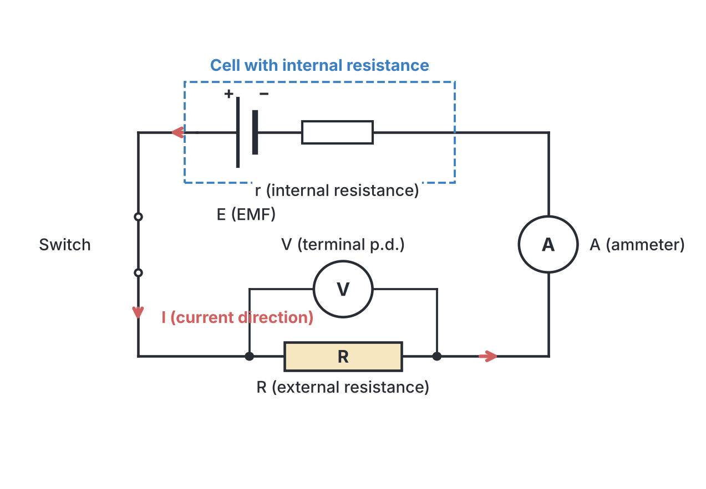
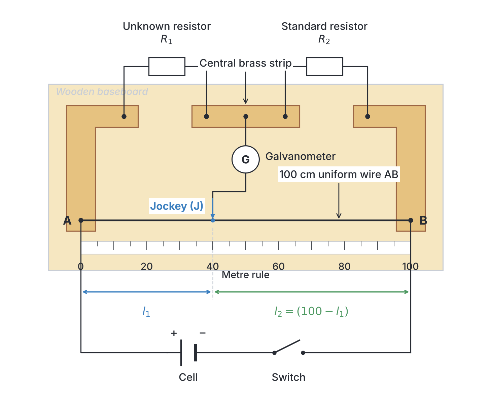
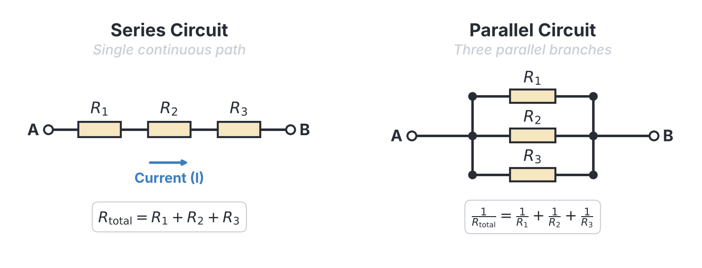
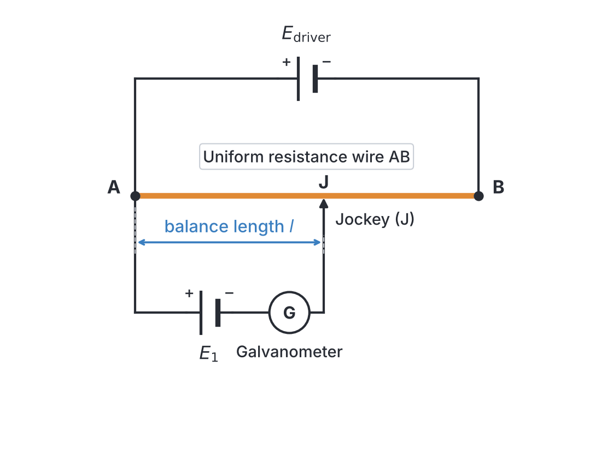
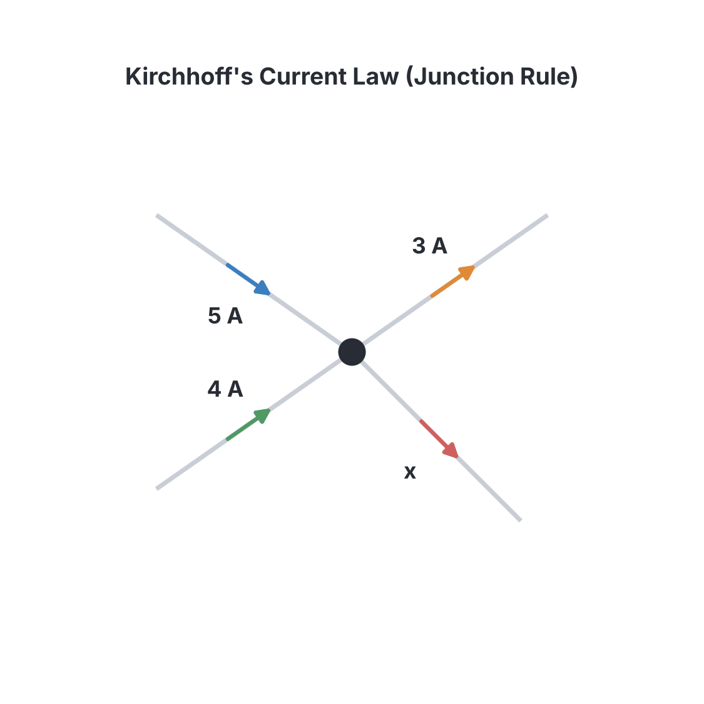

# JAMB Physics Notes: Current Electricity

## What JAMB expects

This topic is Section A, Topic 31 of the JAMB Physics syllabus: Current Electricity. It covers the core principles of electrical circuits.

**THIS FILE COVERS:**
* (i) electromotive force (emf), potential difference (p.d.), current, internal resistance of a cell and lost Volt;
* (ii) Ohm’s law, resistivity and conductivity;
* (iii) measurement of resistance;
* (iv) meter bridge;
* (v) resistance in series and in parallel and their combination;
* (vi) the potentiometer method of measuring emf, current and internal resistance of a cell;
* (vii) electrical networks.

By the end of these notes, you should be able to:
* i. differentiate between emf, p.d., current and internal resistant (resistance) of a cell;
* ii. apply Ohm’s law to solve problems;
* iii. use metre bridge to calculate resistance;
* iv. compute effective total resistance of both parallel and series arrangement of resistors;
* v. determine the resistivity and the conductivity of a conductor;
* vi. measure emf, current and internal resistance of a cell using the potentiometer;
* vii. identify the advantages of the potentiometer;
* viii. apply Kirchoff’s (Kirchhoff's) law in electrical networks.

**Note on the syllabus wording:** The JAMB syllabus contains a few typographical errors in this section. It prints "electromagnetic force (emf)" instead of the correct term **electromotive force**. It also uses "internal resistant" instead of **internal resistance**, and "Kirchoff's" instead of the correct spelling **Kirchhoff's**. These notes use the correct scientific terms. 

## 1. EMF, Potential Difference, Current and Internal Resistance

**Objective i: differentiate between emf, p.d., current and internal resistance of a cell.**

To understand an electrical circuit, imagine water flowing through pipes. The pump provides the push (voltage), the water flowing is the current, and the narrowness of the pipes represents resistance. 

*   **Current ($I$):** This is the rate of flow of electric charge (electrons) through a conductor. The SI unit is the Ampere ($\text{A}$).
*   **Electromotive Force (EMF, $E$):** This is the total work done (or energy supplied) per coulomb of charge by a power source (like a battery or generator) in driving charge around a *complete* circuit. It is the maximum voltage a cell can provide when no current is being drawn from it (an open circuit). Its SI unit is the Volt ($\text{V}$). 
*   **Potential Difference (p.d., $V$):** This is the work done per coulomb of charge in moving charge between *two specific points* in a circuit. When a cell is actively supplying current to a circuit, the voltage across its terminals drops below its EMF. This working voltage is the terminal potential difference. Its SI unit is the Volt ($\text{V}$).
*   **Internal Resistance ($r$):** Every real battery or cell has some built-in resistance to the flow of current due to the chemicals and materials inside it. This opposition inside the cell is called internal resistance. Its SI unit is the Ohm ($\Omega$).
*   **Lost Volt ($v$):** Because of the internal resistance, some of the cell's energy is "wasted" simply pushing the current through the cell itself. The voltage drop across the internal resistance is called the lost volt.

### The fundamental equations
The relationship between EMF, terminal p.d., and internal resistance is given by:

$$E = V + v$$

Where:
*   $E$ is the electromotive force in Volts ($\text{V}$).
*   $V$ is the terminal potential difference in Volts ($\text{V}$).
*   $v$ is the lost volt in Volts ($\text{V}$).

Since voltage is the product of current and resistance, we can substitute $V = IR$ (where $R$ is the external resistance) and $v = Ir$ (the voltage drop across the internal resistance $r$):

$$E = IR + Ir$$
$$E = I(R + r)$$

Where:
*   $I$ is the total current flowing in the circuit in Amperes ($\text{A}$).
*   $R$ is the total external resistance in Ohms ($\Omega$).
*   $r$ is the internal resistance of the cell in Ohms ($\Omega$).

*Nigerian Context:* When you start a car or an "okada" at night, you might notice the headlights dim momentarily. The starter motor draws a very large current ($I$), which creates a large "lost volt" ($Ir$) across the battery's internal resistance. This leaves a smaller terminal potential difference ($V = E - Ir$) available for the headlights, causing them to dim.

**Worked Example 1:**
A cell of electromotive force $12.0\ \text{V}$ and internal resistance $2.0\ \Omega$ is connected to an external resistor of $4.0\ \Omega$. Calculate the current flowing in the circuit, the terminal potential difference, and the lost volt.

**Working:**
1.  Use the formula relating EMF to total resistance: $E = I(R + r)$.
2.  Substitute the given values with their units: $12.0\ \text{V} = I \times (4.0\ \Omega + 2.0\ \Omega)$.
3.  Calculate the current: $12.0\ \text{V} = I \times 6.0\ \Omega \implies I = \frac{12.0\ \text{V}}{6.0\ \Omega} = 2.0\ \text{A}$.
4.  Find the terminal potential difference using $V = IR$: $V = 2.0\ \text{A} \times 4.0\ \Omega = 8.0\ \text{V}$.
5.  Find the lost volt using $v = Ir$: $v = 2.0\ \text{A} \times 2.0\ \Omega = 4.0\ \text{V}$. *(Check: $V + v = 8.0\ \text{V} + 4.0\ \text{V} = 12.0\ \text{V}$, which matches the EMF).*

## 2. Ohm's Law

**Objective ii: apply Ohm’s law to solve problems.**

**Ohm's Law** states that the current flowing through a metallic conductor is directly proportional to the potential difference across its ends, provided that temperature and other physical conditions remain constant.

The mathematical formula is:
$$V = IR$$

Where:
*   $V$ is the potential difference across the conductor in Volts ($\text{V}$).
*   $I$ is the current flowing through the conductor in Amperes ($\text{A}$).
*   $R$ is the resistance of the conductor in Ohms ($\Omega$).

**Ohmic vs Non-Ohmic Conductors:**
Materials that obey Ohm's law (like standard copper wires and metallic resistors) are called **ohmic conductors**. A graph of current against voltage for an ohmic conductor is a straight line through the origin. Materials that do not obey Ohm's law (like diode valves, transistors, and filament bulbs that heat up significantly) are called **non-ohmic conductors**.

**Worked Example 2:**
A heating element draws a current of $0.5\ \text{A}$ when connected to a $24.0\ \text{V}$ supply. Calculate its resistance.

**Working:**
1.  State the formula for Ohm's law: $V = IR$.
2.  Rearrange the formula to solve for resistance: $R = \frac{V}{I}$.
3.  Substitute the values with units: $R = \frac{24.0\ \text{V}}{0.5\ \text{A}}$.
4.  Calculate the final answer: $R = 48.0\ \Omega$.

## 3. Resistivity and Conductivity

**Objective v: determine the resistivity and the conductivity of a conductor.**

The resistance $R$ of a wire depends on three factors:
1.  **Length ($L$):** Resistance is directly proportional to length ($R \propto L$). A longer wire has more resistance.
2.  **Cross-sectional area ($A$):** Resistance is inversely proportional to area ($R \propto \frac{1}{A}$). A thicker wire has less resistance.
3.  **Nature of the material:** This is represented by a constant known as the resistivity.

### Resistivity ($\rho$)
**Resistivity** is defined as the resistance of a wire of a specific material of unit length ($1\ \text{m}$) and unit cross-sectional area ($1\ \text{m}^2$). 

The formula for resistance based on its dimensions is:
$$R = \frac{\rho L}{A}$$

Where:
*   $R$ is the resistance in Ohms ($\Omega$).
*   $\rho$ (the Greek letter rho) is the resistivity of the material in Ohm-metres ($\Omega\text{ m}$).
*   $L$ is the length of the conductor in metres ($\text{m}$).
*   $A$ is the cross-sectional area in square metres ($\text{m}^2$).

### Conductivity ($\sigma$)
**Conductivity** is the exact opposite (the reciprocal) of resistivity. It measures how easily a material allows electric current to flow.

$$ \sigma = \frac{1}{\rho} $$

Where:
*   $\sigma$ (the Greek letter sigma) is the conductivity. 
*   Its SI unit is the reciprocal of the Ohm-metre, written as $\Omega^{-1}\text{ m}^{-1}$ or Siemens per metre ($\text{S m}^{-1}$).

**Worked Example 3:**
A wire of length $5.0\ \text{m}$ and uniform cross-sectional area $2.0 \times 10^{-7}\ \text{m}^2$ has a resistance of $1.5\ \Omega$. Calculate the resistivity and conductivity of the material.

**Working:**
1.  Write the formula for resistivity, rearranged from the resistance formula: $\rho = \frac{RA}{L}$.
2.  Substitute the given values: $\rho = \frac{1.5\ \Omega \times (2.0 \times 10^{-7}\ \text{m}^2)}{5.0\ \text{m}}$.
3.  Calculate the resistivity: $\rho = \frac{3.0 \times 10^{-7}\ \Omega\text{ m}^2}{5.0\ \text{m}} = 6.0 \times 10^{-8}\ \Omega\text{ m}$.
4.  Write the formula for conductivity: $\sigma = \frac{1}{\rho}$.
5.  Substitute the resistivity value: $\sigma = \frac{1}{6.0 \times 10^{-8}\ \Omega\text{ m}}$.
6.  Calculate the conductivity: $\sigma \approx 1.67 \times 10^7\ \Omega^{-1}\text{ m}^{-1}$.

## 4. Measurement of Resistance

Resistance can be measured directly using an ohmmeter, or calculated by measuring the voltage and current (using a voltmeter and ammeter) and applying Ohm's law. However, for highly accurate measurements, bridge circuits are used. The most famous is the **Wheatstone bridge**. 

### The Metre Bridge

**Objective iii: use metre bridge to calculate resistance.**

A **metre bridge** is a practical laboratory version of the Wheatstone bridge. It consists of a uniform resistance wire exactly one metre ($100.0\ \text{cm}$) long, stretched across a wooden board. It is used to find the value of an unknown resistance by comparing it with a known standard resistance.

**How it works:**
1.  An unknown resistor $R_1$ is placed in the left gap.
2.  A known standard resistor $R_2$ is placed in the right gap.
3.  A "jockey" (a sliding metal contact) connected to a galvanometer is slid along the $100\ \text{cm}$ wire until the galvanometer reads zero. This is called the **null point** or balance point.
4.  At this balance point, no current flows through the galvanometer. The bridge is balanced, and the ratio of the resistances equals the ratio of the balance lengths.

**The Metre Bridge Formula:**
$$\frac{R_1}{R_2} = \frac{l_1}{l_2}$$

Because the total length of the wire is $100\ \text{cm}$, if $l_1$ is the balance length from the left end (under $R_1$), then the remaining length $l_2$ is $(100 - l_1)$. The formula is often written as:
$$\frac{R_1}{l_1} = \frac{R_2}{100 - l_1}$$

Where:
*   $R_1$ is the resistor in the left gap ($\Omega$).
*   $R_2$ is the resistor in the right gap ($\Omega$).
*   $l_1$ is the balance length from the left end ($\text{cm}$).
*   $100 - l_1$ is the balance length from the right end ($\text{cm}$).

*(Note: Lengths in the metre bridge formula can be left in cm because they form a ratio and the units cancel out).*

**Worked Example 4:**
In a metre bridge experiment, an unknown resistor $R_1$ is placed in the left gap and a standard $12.0\ \Omega$ resistor is placed in the right gap. If the balance point is found at $40.0\ \text{cm}$ from the left end, calculate the value of $R_1$.

**Working:**
1.  Identify the lengths: $l_1 = 40.0\ \text{cm}$. The remaining length is $l_2 = 100.0\ \text{cm} - 40.0\ \text{cm} = 60.0\ \text{cm}$.
2.  State the metre bridge balance formula: $\frac{R_1}{l_1} = \frac{R_2}{l_2}$.
3.  Substitute the known values: $\frac{R_1}{40.0\ \text{cm}} = \frac{12.0\ \Omega}{60.0\ \text{cm}}$.
4.  Cross-multiply and solve for $R_1$: $R_1 = \frac{12.0\ \Omega \times 40.0\ \text{cm}}{60.0\ \text{cm}}$.
5.  Calculate the final answer: $R_1 = 8.0\ \Omega$.

## 5. Resistors in Series and Parallel

**Objective iv: compute effective total resistance of both parallel and series arrangement of resistors.**

Resistors can be connected together in circuits in two primary ways: series and parallel.

### Resistors in Series
When resistors are connected end-to-end, they are in series.
*   The **same current** flows through all the resistors.
*   The total potential difference is the sum of the potential differences across each resistor.
*   The effective (or equivalent) total resistance $R_{series}$ is the sum of the individual resistances:

$$R_{series} = R_1 + R_2 + R_3 + ...$$

### Resistors in Parallel
When resistors are connected across the same two points, they are in parallel. 
*   The **same potential difference** exists across all the resistors.
*   The total current is the sum of the currents in each parallel branch.
*   The effective total resistance $R_{parallel}$ is found using reciprocal addition:

$$\frac{1}{R_{parallel}} = \frac{1}{R_1} + \frac{1}{R_2} + \frac{1}{R_3} + ...$$

**Shortcut for TWO resistors in parallel:**
If you only have two resistors in parallel, you can use the "product over sum" shortcut:
$$R_{parallel} = \frac{R_1 \times R_2}{R_1 + R_2}$$

**Worked Example 5:**
Two resistors of $3.0\ \Omega$ and $6.0\ \Omega$ are connected in parallel. This combination is then connected in series with a $4.0\ \Omega$ resistor. Calculate the effective total resistance of the circuit.

**Working:**
1.  First, calculate the equivalent resistance of the parallel section ($R_p$) using the shortcut formula: $R_p = \frac{R_1 \times R_2}{R_1 + R_2}$.
2.  Substitute the values: $R_p = \frac{3.0\ \Omega \times 6.0\ \Omega}{3.0\ \Omega + 6.0\ \Omega} = \frac{18.0\ \Omega^2}{9.0\ \Omega} = 2.0\ \Omega$.
3.  Next, add this equivalent resistance to the series resistor to find the total resistance ($R_{total}$).
4.  $R_{total} = R_p + R_{series\_part} = 2.0\ \Omega + 4.0\ \Omega$.
5.  Calculate the final answer: $R_{total} = 6.0\ \Omega$.

## 6. The Potentiometer

**Objective vi: measure emf, current and internal resistance of a cell using the potentiometer.**

A **potentiometer** is an instrument used for measuring electromotive force (EMF) and potential differences very accurately. It consists of a long, uniform resistance wire (often several metres long, folded back and forth) connected to a constant steady voltage supply called a driver cell.

### Principle of the Potentiometer
Because the wire is uniform, the potential difference across any length of the wire is directly proportional to that length. 
$$V \propto l \implies V = kl$$
Where $k$ is the potential gradient (voltage drop per unit length).

### 1. Comparing the EMF of Two Cells
To compare the EMF of two cells ($E_1$ and $E_2$), we find the balance point (null deflection on the galvanometer) for each cell individually.
If cell $E_1$ balances at length $l_1$, and cell $E_2$ balances at length $l_2$, then:
$$\frac{E_1}{E_2} = \frac{l_1}{l_2}$$

### 2. Measuring Internal Resistance of a Cell
To find the internal resistance ($r$) of a cell:
1.  Find the balance length ($l_1$) for the cell on open circuit (no current flowing from it). This length is proportional to its true EMF ($E$).
2.  Connect a known external resistor ($R$) across the cell (shunting the cell). Find the new balance length ($l_2$). Because current is now flowing, this length is proportional to the terminal p.d. ($V$).
3.  The internal resistance $r$ is calculated using:
    $$r = R \left( \frac{l_1}{l_2} - 1 \right) \quad \text{or} \quad r = R \left( \frac{l_1 - l_2}{l_2} \right)$$

### Advantages of the potentiometer

**Objective vii: identify the advantages of the potentiometer.**

Why use a bulky potentiometer instead of a simple portable digital voltmeter?
1.  **Null Method:** At the balance point, **the potentiometer draws absolutely no current** from the cell being tested. Therefore, it measures the true Electromotive Force (EMF) of the cell. 
2.  A standard voltmeter has its own internal resistance and draws a tiny current to make a reading. This causes a small "lost volt" inside the cell, meaning a voltmeter only measures the terminal p.d., which is slightly less than the true EMF.

**Worked Example 6:**
A potentiometer is used to compare the EMF of two cells. A standard cell of EMF $2.0\ \text{V}$ gives a balance length of $50.0\ \text{cm}$. An unknown cell gives a balance length of $75.0\ \text{cm}$. Calculate the EMF of the unknown cell.

**Working:**
1.  State the potentiometer formula for comparing EMFs: $\frac{E_1}{l_1} = \frac{E_2}{l_2}$.
2.  Substitute the values with their units: $\frac{2.0\ \text{V}}{50.0\ \text{cm}} = \frac{E_2}{75.0\ \text{cm}}$.
3.  Rearrange to solve for $E_2$: $E_2 = \frac{2.0\ \text{V} \times 75.0\ \text{cm}}{50.0\ \text{cm}}$.
4.  Calculate the final result: $E_2 = 3.0\ \text{V}$.

## 7. Electrical Networks and Kirchhoff's Laws

**Objective viii: apply Kirchhoff’s law in electrical networks.**

When circuits become complex (networks with multiple batteries and branches), Ohm's law and simple series/parallel rules are not enough. We use the two laws formulated by Gustav Kirchhoff.

### Kirchhoff's First Law (Current Law or KCL)
**Statement:** The algebraic sum of the currents at any node (junction) in an electrical circuit is zero. 
Simply put: **Total current entering a junction = Total current leaving the junction.**
This law is based on the principle of *conservation of electric charge*.

*Example based on the image above:*
Currents entering $= 5\ \text{A} + 4\ \text{A} = 9\ \text{A}$.
Currents leaving $= 3\ \text{A} + x$.
According to KCL: $9\ \text{A} = 3\ \text{A} + x \implies x = 6\ \text{A}$.

### Kirchhoff's Second Law (Voltage Law or KVL)
**Statement:** In any closed loop in a circuit, the algebraic sum of the electromotive forces (EMFs) is equal to the algebraic sum of the potential drops ($IR$ products).
This law is based on the principle of *conservation of energy*.

To apply it:
1.  Choose a closed loop in the network.
2.  Pick a direction (e.g., clockwise) to travel around the loop.
3.  Add up the EMFs (positive if you exit the positive terminal of the battery).
4.  Add up the $IR$ drops (positive if you travel in the same direction as the assumed current).
5.  Set them equal: $\sum E = \sum IR$.

## Key terms

| Term | Meaning |
| --- | --- |
| **Current ($I$)** | The rate of flow of electric charge, measured in Amperes ($\text{A}$). |
| **Electromotive Force ($E$)** | The total energy supplied per coulomb of charge by a cell in an open circuit, measured in Volts ($\text{V}$). |
| **Potential Difference ($V$)** | The work done per coulomb of charge in moving it between two points in a closed circuit, measured in Volts ($\text{V}$). |
| **Internal Resistance ($r$)** | The opposition to the flow of current inside a cell or power source, measured in Ohms ($\Omega$). |
| **Lost Volt ($v$)** | The voltage drop across the internal resistance of a cell ($v = Ir$). |
| **Ohm's Law** | Current is directly proportional to voltage, provided temperature is constant ($V = IR$). |
| **Resistivity ($\rho$)** | The resistance of a wire of unit length and unit cross-sectional area ($\Omega\text{ m}$). |
| **Conductivity ($\sigma$)** | The reciprocal of resistivity, indicating how easily current flows ($\Omega^{-1}\text{ m}^{-1}$). |
| **Metre Bridge** | An instrument based on the Wheatstone bridge principle used to accurately measure unknown resistances. |
| **Potentiometer** | An instrument used to accurately measure and compare EMFs without drawing current from the test cell. |

## Exam tips and common mistakes

*   **Wrong units in resistivity calculations:** Area ($A$) must be in square metres ($\text{m}^2$). If JAMB gives an area in $\text{mm}^2$, you must multiply by $10^{-6}$ to convert it to $\text{m}^2$. Length must be in metres.
*   **Swapping lengths on the metre bridge:** The formula is $\frac{R_{left}}{l_{left}} = \frac{R_{right}}{l_{right}}$. A common mistake is dividing the left resistor by the right length. Always pair a resistor with the length of wire directly underneath it.
*   **Adding parallel resistors incorrectly:** Do not just add parallel resistors like series ones. Remember to take the reciprocal! $R_{parallel}$ is NEVER $\frac{1}{R_1} + \frac{1}{R_2}$; it is the reciprocal of that sum. The safe shortcut for two is $\frac{R_1 R_2}{R_1 + R_2}$.
*   **Confusing internal resistance with lost volt:** Internal resistance ($r$) is measured in Ohms. The lost volt ($Ir$) is measured in Volts. 
*   **Potentiometer vs Voltmeter:** Remember the key advantage: The potentiometer is highly accurate because it draws *zero* current at the null point.

## Quick summary

1.  Electromotive force (EMF) is the open-circuit voltage of a cell. When a cell supplies current, its terminal potential difference drops due to the lost volt across its internal resistance ($E = I(R + r)$).
2.  Ohm's law states that $V = IR$ for metallic conductors at a constant temperature.
3.  The resistance of a wire depends on its length, area, and material (resistivity). $R = \frac{\rho L}{A}$. Conductivity is the inverse of resistivity ($\sigma = \frac{1}{\rho}$).
4.  Resistors in series add up directly ($R_T = R_1 + R_2 + \dots$). Resistors in parallel use the reciprocal sum ($\frac{1}{R_T} = \frac{1}{R_1} + \frac{1}{R_2} + \dots$).
5.  A metre bridge uses a $100\ \text{cm}$ wire to find unknown resistance using the ratio $\frac{R_1}{l_1} = \frac{R_2}{100 - l_1}$.
6.  A potentiometer compares EMFs ($\frac{E_1}{E_2} = \frac{l_1}{l_2}$) and measures internal resistance accurately because it draws no current from the cell being tested.
7.  Kirchhoff's First Law (conservation of charge) states that current entering a node equals current leaving it. The Second Law (conservation of energy) applies to closed loops.

## Practice questions

**1. A cell of electromotive force $3.0\ \text{V}$ has a terminal potential difference of $2.4\ \text{V}$ when delivering a current of $1.2\ \text{A}$. What is the internal resistance of the cell?**
- A. $0.5\ \Omega$
- B. $2.0\ \Omega$
- C. $2.5\ \Omega$
- D. $4.5\ \Omega$

**Answer: A.** 
1. Use the formula $E = V + Ir$. 
2. Substitute the values: $3.0\ \text{V} = 2.4\ \text{V} + 1.2\ \text{A} \times r$. 
3. Rearrange: $0.6\ \text{V} = 1.2\ \text{A} \times r$. 
4. Solve for $r$: $r = \frac{0.6\ \text{V}}{1.2\ \text{A}} = 0.5\ \Omega$. 
*Mistake behind option D:* Adding the voltages instead of subtracting them ($r = \frac{3.0 + 2.4}{1.2} = 4.5\ \Omega$).

**2. In a metre bridge experiment, an unknown resistor $R_1$ is placed in the left gap and a standard $3.0\ \Omega$ resistor is placed in the right gap. The bridge is balanced when the jockey is $75.0\ \text{cm}$ from the left end. What is the value of $R_1$?**
- A. $1.0\ \Omega$
- B. $2.25\ \Omega$
- C. $9.0\ \Omega$
- D. $225.0\ \Omega$

**Answer: C.** 
1. The left length $l_1 = 75.0\ \text{cm}$. The right length $l_2 = 100.0\ \text{cm} - 75.0\ \text{cm} = 25.0\ \text{cm}$. 
2. Use the formula: $\frac{R_1}{l_1} = \frac{R_2}{l_2}$. 
3. Substitute: $\frac{R_1}{75.0} = \frac{3.0}{25.0}$. 
4. Cross-multiply: $R_1 = \frac{3.0 \times 75.0}{25.0} = 9.0\ \Omega$. 
*Mistake behind option A:* Swapping the lengths in the formula, giving $R_1 = \frac{3.0 \times 25.0}{75.0} = 1.0\ \Omega$.

**3. A wire of length $2.0\ \text{m}$ has a resistance of $5.0\ \Omega$. If the resistivity of its material is $2.0 \times 10^{-6}\ \Omega\text{ m}$, calculate the cross-sectional area of the wire.**
- A. $2.0 \times 10^{-7}\ \text{m}^2$
- B. $8.0 \times 10^{-7}\ \text{m}^2$
- C. $4.0 \times 10^{-6}\ \text{m}^2$
- D. $5.0 \times 10^{-6}\ \text{m}^2$

**Answer: B.** 
1. Use the resistance formula: $R = \frac{\rho L}{A}$. 
2. Rearrange for area: $A = \frac{\rho L}{R}$. 
3. Substitute values: $A = \frac{(2.0 \times 10^{-6}\ \Omega\text{ m}) \times 2.0\ \text{m}}{5.0\ \Omega}$. 
4. Calculate: $A = \frac{4.0 \times 10^{-6}}{5.0} = 8.0 \times 10^{-7}\ \text{m}^2$. 
*Mistake behind option C:* Multiplying resistivity and length but forgetting to divide by the resistance $R$.

**4. Three identical $4.0\ \Omega$ resistors are connected in a circuit. Two of them are connected in parallel, and this combination is in series with the third resistor. What is the total equivalent resistance of the circuit?**
- A. $1.33\ \Omega$
- B. $6.0\ \Omega$
- C. $8.0\ \Omega$
- D. $12.0\ \Omega$

**Answer: B.** 
1. Find the equivalent resistance of the two parallel resistors: $R_p = \frac{4.0 \times 4.0}{4.0 + 4.0} = \frac{16.0}{8.0} = 2.0\ \Omega$. 
2. Add the series resistor: $R_{total} = 2.0\ \Omega + 4.0\ \Omega = 6.0\ \Omega$. 
*Mistake behind option D:* Assuming all three resistors are connected in series ($4.0 + 4.0 + 4.0 = 12.0\ \Omega$).

**5. A cell of internal resistance $r$ is connected to a potentiometer. It balances at $100.0\ \text{cm}$ on open circuit. When a $4.0\ \Omega$ resistor is connected in parallel across the cell, the balance length drops to $80.0\ \text{cm}$. What is the internal resistance of the cell?**
- A. $0.8\ \Omega$
- B. $1.0\ \Omega$
- C. $3.2\ \Omega$
- D. $5.0\ \Omega$

**Answer: B.** 
1. Use the internal resistance formula: $r = R \left( \frac{l_1 - l_2}{l_2} \right)$. 
2. Substitute the values: $r = 4.0\ \Omega \times \left( \frac{100.0 - 80.0}{80.0} \right)$. 
3. Calculate: $r = 4.0 \times \frac{20.0}{80.0} = 4.0 \times 0.25 = 1.0\ \Omega$. 
*Mistake behind option A:* Dividing by $l_1$ instead of $l_2$ during the calculation ($4.0 \times \frac{20.0}{100.0} = 0.8\ \Omega$).

**6. Which of the following is the correct SI unit for electrical conductivity?**
- A. $\Omega\text{ m}$
- B. $\Omega\text{ m}^{-2}$
- C. $\Omega^{-1}\text{ m}^{-1}$
- D. $\Omega^{-1}\text{ m}$

**Answer: C.** Electrical conductivity ($\sigma$) is the reciprocal of resistivity ($\rho$). Since the unit of resistivity is the Ohm-metre ($\Omega\text{ m}$), the unit of conductivity is the reciprocal Ohm-metre ($\Omega^{-1}\text{ m}^{-1}$ or Siemens per metre, $\text{S m}^{-1}$). 
*Mistake behind option A:* This is the unit for resistivity, not conductivity.

**7. In an electrical network, four wires meet at a single junction. Currents of $5.0\ \text{A}$ and $4.0\ \text{A}$ are flowing towards the junction, while a current of $3.0\ \text{A}$ and an unknown current $x$ are flowing away from the junction. Using Kirchhoff's First Law, what is the value of $x$?**
- A. $2.0\ \text{A}$
- B. $6.0\ \text{A}$
- C. $8.0\ \text{A}$
- D. $12.0\ \text{A}$

**Answer: B.** 
1. Apply Kirchhoff's Current Law: Total current entering = Total current leaving. 
2. Substitute the values: $5.0\ \text{A} + 4.0\ \text{A} = 3.0\ \text{A} + x$. 
3. Simplify: $9.0\ \text{A} = 3.0\ \text{A} + x$. 
4. Solve for $x$: $x = 6.0\ \text{A}$. 
*Mistake behind option A:* Getting the sides confused and evaluating $5.0 + x = 4.0 + 3.0$ which would give $2.0\ \text{A}$.

**8. A battery of electromotive force $6.0\ \text{V}$ and internal resistance $1.0\ \Omega$ is connected to an $11.0\ \Omega$ resistor. Calculate the lost volt in the circuit.**
- A. $0.5\ \text{V}$
- B. $1.0\ \text{V}$
- C. $5.5\ \text{V}$
- D. $6.0\ \text{V}$

**Answer: A.** 
1. Calculate total resistance: $R + r = 11.0\ \Omega + 1.0\ \Omega = 12.0\ \Omega$. 
2. Calculate current: $I = \frac{E}{R + r} = \frac{6.0\ \text{V}}{12.0\ \Omega} = 0.5\ \text{A}$. 
3. Calculate lost volt ($v$): $v = Ir = 0.5\ \text{A} \times 1.0\ \Omega = 0.5\ \text{V}$. 
*Mistake behind option C:* Calculating the terminal potential difference ($V = IR = 0.5 \times 11.0 = 5.5\ \text{V}$) instead of the lost volt.

**9. A $2.0\ \Omega$ resistor and a $3.0\ \Omega$ resistor are connected in series across a $10.0\ \text{V}$ battery of negligible internal resistance. What is the potential difference across the $3.0\ \Omega$ resistor?**
- A. $4.0\ \text{V}$
- B. $6.0\ \text{V}$
- C. $10.0\ \text{V}$
- D. $15.0\ \text{V}$

**Answer: B.** 
1. Calculate total resistance: $R = 2.0\ \Omega + 3.0\ \Omega = 5.0\ \Omega$. 
2. Calculate the common series current using Ohm's Law: $I = \frac{V}{R} = \frac{10.0\ \text{V}}{5.0\ \Omega} = 2.0\ \text{A}$. 
3. Calculate the potential difference across the $3.0\ \Omega$ resistor: $V_3 = I \times R_3 = 2.0\ \text{A} \times 3.0\ \Omega = 6.0\ \text{V}$. 
*Mistake behind option A:* Calculating the potential difference across the $2.0\ \Omega$ resistor ($2.0\ \text{A} \times 2.0\ \Omega = 4.0\ \text{V}$).

**10. What is the main advantage of using a potentiometer over a standard voltmeter to measure the EMF of a cell?**
- A. It draws a very large current to ensure measurement accuracy.
- B. It has zero internal resistance.
- C. It draws no current from the cell at the balance point.
- D. It is significantly smaller and more portable.

**Answer: C.** The potentiometer operates on a null-deflection method. At the balance point, no current flows from the cell being tested, meaning there is no lost volt inside the cell. It measures the true EMF. 
*Mistake behind option B:* Voltmeters aim for infinite resistance, not zero, to prevent drawing current, but a potentiometer is advantageous specifically because it functionally draws zero current at balance, completely avoiding the internal resistance problem.
