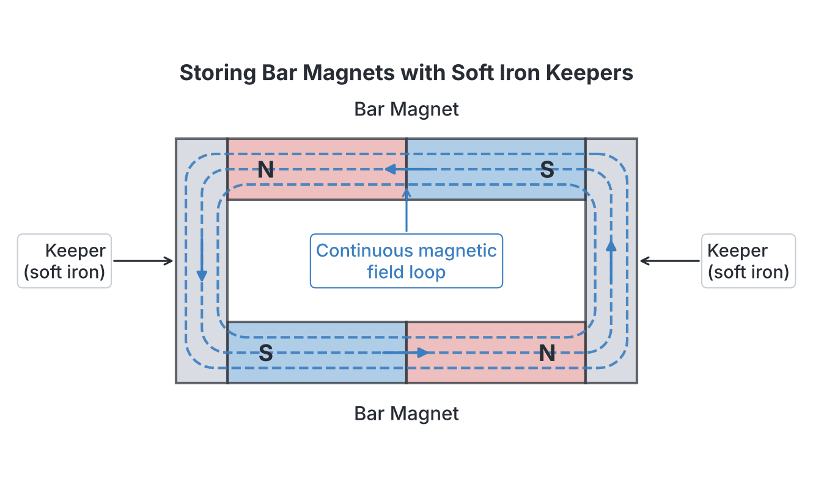
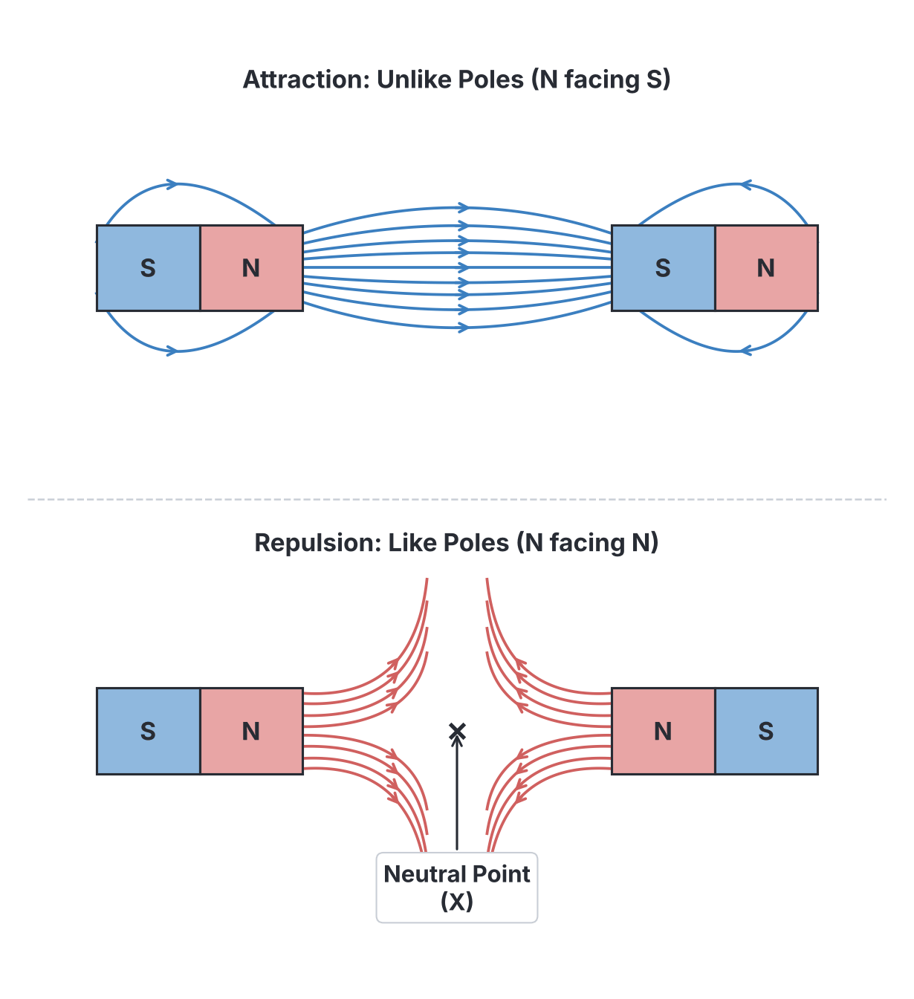
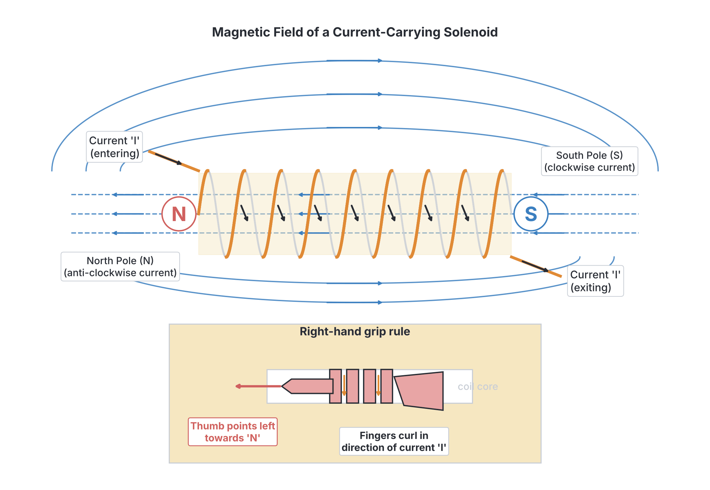

# JAMB Physics Notes: Magnets and Magnetic Fields

## What JAMB expects

This topic covers Section A, Topic 33 of the JAMB Physics syllabus: Magnets and Magnetic Fields.

It covers the following content items:
- (i) natural and artificial magnets;
- (ii) magnetic properties of soft iron and steel;
- (iii) methods of making magnets and demagnetization;
- (iv) concept of magnetic field;
- (v) magnetic field of a permanent magnet;
- (vi) magnetic field round a straight current carrying conductor, circular wire and solenoid;
- (vii) properties of the earth’s magnetic field; north and south poles, magnetic meridian and angle of dip and declination;
- (viii) flux and flux density;
- (ix) variation of magnetic field intensity over the earth’s surface;
- (x) applications: earth’s magnetic field in navigation and mineral exploration.

By the end of these notes, you should be able to:
1. give examples of natural and artificial magnets;
2. differentiate between the magnetic properties of soft iron and steel;
3. identify the various methods of making magnets and demagnetizing magnets;
4. describe how to keep a magnet from losing its magnetism;
5. determine the flux pattern of an isolated magnet;
6. determine the flux pattern exhibited when two magnets are placed together pole to pole;
7. determine the flux of a current carrying conductor, circular wire and solenoid including the polarity of the solenoid;
8. determine the flux pattern of a magnet placed in the earth’s magnetic fields;
9. identify the magnetic elements of the earth’s flux;
10. determine the variation of earth’s magnetic field on the earth’s surface;
11. examine the applications of the earth’s magnetic field.

## Natural and artificial magnets

**Objective i: give examples of natural and artificial magnets.**
**Content i: natural and artificial magnets.**

A **magnet** is any material that has the property of attracting magnetic materials (such as iron, steel, cobalt and nickel) and will point in a North-South direction when freely suspended. Every magnet has two ends called poles: a **North-seeking pole (N)** and a **South-seeking pole (S)**. The fundamental law of magnetism states that **like poles repel** and **unlike poles attract**.

Magnets are classified into two main types based on their origin:

1. **Natural magnets:** These are magnets found in nature. They usually have irregular shapes and their magnetic strength is very weak. 
   - **Examples:** **Lodestone** (a magnetic iron ore called magnetite, $\text{Fe}_3\text{O}_4$) and the **Earth** itself (which acts like a giant natural magnet).
2. **Artificial magnets:** These are man-made magnets created by magnetizing magnetic materials. They are deliberately shaped for specific uses and possess much stronger magnetic fields than natural magnets.
   - **Examples:** Bar magnets, horseshoe magnets, magnetic compass needles, and electromagnets.

## Magnetic properties of soft iron and steel

**Objective ii: differentiate between the magnetic properties of soft iron and steel.**
**Content ii: magnetic properties of soft iron and steel.**

Magnetic materials behave differently when exposed to a magnetic field. In JAMB, you will often need to compare **soft iron** and **steel**, which represent two extremes of magnetic behaviour.

| Feature | Soft Iron | Steel |
| --- | --- | --- |
| **Magnetization** | Very easy to magnetize | Harder to magnetize |
| **Demagnetization** | Loses its magnetism very easily and quickly (low retentivity) | Keeps its magnetism for a long time (high retentivity) |
| **Type of magnet formed** | **Temporary magnets** | **Permanent magnets** |
| **Typical applications** | Cores of electromagnets, transformers, electric bells, telephone receivers | Compasses, bar magnets, horseshoe magnets, loudspeakers |

**Note for exams:** Soft iron is used in devices where the magnetism needs to be turned on and off rapidly (like an electric bell, or a heavy-duty crane electromagnet picking up scrap metal). Steel is used where the magnetic field must remain permanently active.

## Methods of making and demagnetizing magnets

**Objective iii: identify the various methods of making magnets and demagnetizing magnets.**
**Content iii: methods of making magnets and demagnetization.**

According to the **domain theory of magnetism**, magnetic materials consist of microscopic regions called **domains**, in each of which the tiny atomic magnets are lined up. In an unmagnetized material, these domains point in random directions, cancelling each other out. Making a magnet involves forcing these domains to line up in one direction. Demagnetizing a magnet involves scrambling them again.

### Methods of making magnets

1. **Electrical method (The best method):** A steel bar is placed inside a long cylindrical coil of wire (a **solenoid**). A **direct current (d.c.)** from a battery is passed through the coil for a short time. The strong, uniform magnetic field of the direct current aligns the domains in the steel, creating a strong permanent magnet.
2. **Single touch method:** A permanent magnet is stroked along a steel bar from one end to the other, lifting it well above the bar before returning for the next stroke. The stroking must be in **one direction only**. The end of the bar where the stroke finishes will have the **opposite polarity** to the stroking pole.
3. **Double touch method:** Two permanent magnets are used. Their opposite poles (e.g., N and S) are placed at the centre of the steel bar and stroked outwards to the ends simultaneously. This creates a stronger magnet than the single touch method.
4. **Magnetic induction:** When a piece of magnetic material is placed in a strong magnetic field or in physical contact with a permanent magnet, it becomes a magnet itself by induction, without any stroking. 

### Methods of demagnetizing magnets

To destroy a magnet, you must give the magnetic domains enough energy to shake them out of their aligned arrangement.

1. **Electrical method (The best method):** The magnet is placed inside a solenoid pointing in the East-West direction. An **alternating current (a.c.)** is passed through the coil. The a.c. rapidly reverses the magnetic field, throwing the domains into confusion. The magnet is then **slowly withdrawn** far away from the coil while the a.c. is still flowing.
2. **Heating:** Heating a magnet strongly (beyond a certain temperature called the Curie temperature) shakes the atoms violently and destroys the alignment of the domains.
3. **Hammering or dropping:** Repeatedly hitting the magnet with a hammer, or dropping it on a hard floor while it is pointing in the East-West direction, will mechanically knock the domains out of alignment.

## Keeping a magnet from losing its magnetism

**Objective iv: describe how to keep a magnet from losing its magnetism.**

When a permanent magnet is stored, its aligned domains at the North and South poles naturally repel each other. Over time, this internal repulsion (self-demagnetization) can cause the domains to lose their strict alignment, weakening the magnet. 

To prevent this, we use **magnetic keepers**.
- **Keepers** are short pieces of **soft iron** placed across the poles of magnets when they are not in use. 
- For bar magnets, they are stored in pairs with opposite poles facing each other (North facing South), and two soft iron keepers are placed across the ends.
- The keepers become temporary magnets by induction and provide a closed, continuous loop for the magnetic field lines. Because the magnetic loop is closed, there are no "free" poles to cause self-demagnetization, safely preserving the strength of the magnets for years.

## Concept of magnetic field

**Content iv: concept of magnetic field.**

A **magnetic field** is the region or space around a magnet (or a current-carrying conductor) where its magnetic influence (force of attraction or repulsion) can be felt by other magnetic materials or moving charges. The field is invisible but its direction and strength can be mapped using iron filings or a small plotting compass.

## Flux and flux density

**Content viii: flux and flux density.**

- **Magnetic flux ($\Phi$):** This represents the total number of magnetic field lines (or flux lines) passing through a given surface area. The SI unit of magnetic flux is the **Weber ($\text{Wb}$)**.
- **Magnetic flux density ($B$):** This is the magnetic flux passing normally (perpendicularly) through a unit area. It represents the strength or intensity of the magnetic field at a particular point. The SI unit of magnetic flux density is the **Tesla ($\text{T}$)**, which is equivalent to **Weber per square metre ($\text{Wb m}^{-2}$)**.

The relationship between flux and flux density is given by the formula:
$$B = \frac{\Phi}{A}$$

Where:
- $B$ is the magnetic flux density, measured in Tesla ($\text{T}$) or ($\text{Wb m}^{-2}$).
- $\Phi$ is the magnetic flux, measured in Webers ($\text{Wb}$).
- $A$ is the area, measured in square metres ($\text{m}^2$).

**Worked Example 1:**
A magnetic flux of $5.0 \times 10^{-4}\ \text{Wb}$ passes perpendicularly through a flat surface of area $25\ \text{cm}^2$. Calculate the magnetic flux density.

**Working:**
1. Identify given values: $\Phi = 5.0 \times 10^{-4}\ \text{Wb}$, Area $A = 25\ \text{cm}^2$.
2. Convert area to standard SI units ($\text{m}^2$): $A = 25 \times 10^{-4}\ \text{m}^2 = 2.5 \times 10^{-3}\ \text{m}^2$.
3. State the formula: $B = \frac{\Phi}{A}$.
4. Substitute the values: $B = \frac{5.0 \times 10^{-4}}{2.5 \times 10^{-3}}$.
5. Calculate the result: $B = 2.0 \times 10^{-1}\ \text{T} = 0.2\ \text{T}$.

*Common Mistake:* Forgetting to convert $\text{cm}^2$ to $\text{m}^2$. Always multiply $\text{cm}^2$ by $10^{-4}$ to get $\text{m}^2$. Using $25$ directly gives the wrong answer of $2.0 \times 10^{-5}\ \text{T}$.

**Worked Example 2:**
Determine the magnetic flux passing through a surface area of $50\ \text{cm}^2$ if the magnetic flux density in the region is $1.2\ \text{T}$.

**Working:**
1. Identify given values: $B = 1.2\ \text{T}$, Area $A = 50\ \text{cm}^2$.
2. Convert area to $\text{m}^2$: $A = 50 \times 10^{-4}\ \text{m}^2 = 0.005\ \text{m}^2$.
3. State the formula: $B = \frac{\Phi}{A}$. Rearranging for flux gives $\Phi = B \times A$.
4. Substitute the values: $\Phi = 1.2 \times 0.005$.
5. Calculate the result: $\Phi = 0.006\ \text{Wb}$ (or $6.0 \times 10^{-3}\ \text{Wb}$).

**Worked Example 3:**
Find the area of a surface if a uniform magnetic flux of $0.08\ \text{Wb}$ passes perpendicularly through it, and the magnetic flux density is $4.0\ \text{T}$.

**Working:**
1. Identify given values: $\Phi = 0.08\ \text{Wb}$, $B = 4.0\ \text{T}$.
2. State the formula: $B = \frac{\Phi}{A}$. Rearranging for Area gives $A = \frac{\Phi}{B}$.
3. Substitute the values: $A = \frac{0.08}{4.0}$.
4. Calculate the result: $A = 0.02\ \text{m}^2$.

## Flux pattern of an isolated magnet

**Objective v: determine the flux pattern of an isolated magnet.**
**Content v: magnetic field of a permanent magnet.**

Magnetic fields are represented using continuous lines called **magnetic lines of force** or **flux lines**. These lines have three specific rules:
1. They originate from the North pole and end at the South pole *outside* the magnet (and travel from S to N inside, forming closed loops).
2. They never cross or intersect each other.
3. Where the lines are close together, the magnetic field is strong (e.g., near the poles). Where they are far apart, the field is weak.

For a single isolated bar magnet, the flux lines curve outwards from the North pole, sweep through the air, and enter the South pole. 

[IMAGE: A single horizontal bar magnet with 'N' on the left and 'S' on the right. Smooth curved lines with arrows pointing away from N and towards S. The lines are densely packed at the poles and spread out widely in the middle. Clean flat textbook style, white background.]

## Flux pattern of two magnets pole to pole

**Objective vi: determine the flux pattern exhibited when two magnets are placed together pole to pole.**

When two magnets are placed near each other, their magnetic fields interact to form a combined flux pattern.

1. **Unlike poles facing (N and S):** The magnetic lines of force run directly across the gap from the North pole of one magnet to the South pole of the other. The field between them is strong, representing a force of **attraction**.
2. **Like poles facing (N and N, or S and S):** The lines of force from the two identical poles repel each other and bend sharply outwards. In the exact centre between the two poles, the magnetic fields cancel each other out completely. This spot is called a **neutral point** (usually labeled "X"). At a neutral point, the resultant magnetic flux density is exactly zero.

## Magnetic field around current-carrying conductors

**Objective vii: determine the flux of a current carrying conductor, circular wire and solenoid including the polarity of the solenoid.**
**Content vi: magnetic field round a straight current carrying conductor, circular wire and solenoid.**

When an electric current flows through a wire, a magnetic field is generated around it. The shape of the flux pattern depends on the physical shape of the conductor.

### 1. Straight current-carrying conductor
The magnetic lines of force around a long, straight wire are **concentric circles** centred on the wire. The direction of the field is given by Maxwell's **Right-Hand Grip Rule**:
- *If you grip the straight wire with your right hand such that your thumb points in the direction of the conventional current, your curled fingers will point in the direction of the circular magnetic field lines.*

### 2. Circular wire (Coil)
When a wire is bent into a flat circular loop, the field lines pass through the centre of the loop. Near the wire itself, the lines are circular. At the exact centre of the loop, the magnetic field lines become perfectly **straight** and perpendicular to the plane of the coil.

### 3. Solenoid
A solenoid is a long coil of wire with many turns (shaped like a spring). When current flows through it, the magnetic fields from all the individual turns add up. 
- The resulting flux pattern is almost exactly the same as that of a **permanent bar magnet**. 
- The field lines are parallel and uniform inside the solenoid, and they curve around the outside from one end to the other.

**Determining the polarity of a solenoid:**
You can determine which end of the solenoid acts as the North pole and which as the South pole using the **Clock Rule**.
- Look at the face of one end of the solenoid.
- If the current travels in a **clockwise** direction, that end acts as a **South pole (S)**.
- If the current travels in an **anti-clockwise** direction, that end acts as a **North pole (N)**.

## Flux pattern of a magnet in the Earth's field

**Objective viii: determine the flux pattern of a magnet placed in the earth’s magnetic fields.**

When a bar magnet rests on a table, its magnetic field interacts with the horizontal component of the Earth's magnetic field (which flows from Geographic South to Geographic North). Because these are two competing fields, they create **neutral points** where the magnet's field exactly cancels the Earth's field.

1. **Magnet placed with its North pole pointing Geographic North:** The magnet's field lines push against the Earth's field lines on the sides of the magnet. The neutral points (X) are found on the **equatorial line** (the perpendicular line cutting through the middle of the magnet).
2. **Magnet placed with its North pole pointing Geographic South:** The magnet's field lines directly oppose the Earth's field lines in front of the poles. The neutral points (X) are found on the **axial line** (the imaginary line passing straight through the magnet's poles).

## Magnetic elements of the Earth

**Objective ix: identify the magnetic elements of the earth’s flux.**
**Content vii: properties of the earth’s magnetic field; north and south poles, magnetic meridian and angle of dip and declination.**

The Earth acts as if there is a giant, powerful bar magnet buried deep inside it. However, the magnetic poles of the Earth do not perfectly align with the geographic (true) poles.
- The Earth's **Magnetic North Pole** (which attracts the North-seeking pole of a compass) actually acts like the **South pole** of the Earth's internal imaginary magnet.
- The Earth's **Magnetic South Pole** acts like the **North pole** of the imaginary magnet.

To completely describe the Earth's magnetic field at any location on the surface, geophysicists use three quantities known as the **magnetic elements**:

1. **Magnetic Declination (Variation):** This is the angle between the magnetic meridian (the North-South line indicated by a compass) and the geographic meridian (the true North-South line). It tells navigators how much their compass deviates from true North.
2. **Angle of Dip (Inclination, $\theta$):** If a compass needle is mounted so it can swing freely up and down vertically, it will not stay horizontal. The angle the needle makes with the horizontal is the **angle of dip**. 
3. **Horizontal Component ($B_H$):** The total resultant magnetic flux density of the Earth ($B$) strikes the ground at an angle (the dip). The part of this field that acts completely parallel to the ground is the horizontal component. This is the component that turns an ordinary horizontal compass needle.

Mathematically, resolving the total field $B$ using the angle of dip ($\theta$) gives:
- **Horizontal component:** $B_H = B \cos \theta$
- **Vertical component:** $B_V = B \sin \theta$
- Combining them gives: $\tan \theta = \frac{B_V}{B_H}$ and $B = \sqrt{B_H^2 + B_V^2}$

Where:
- $B$ is the total resultant magnetic flux density in Tesla ($\text{T}$).
- $B_H$ and $B_V$ are the horizontal and vertical components in Tesla ($\text{T}$).
- $\theta$ is the angle of dip in degrees ($^\circ$).

**Worked Example 4:**
At a certain location in Lagos, the total magnetic flux density of the earth's magnetic field is $6.0 \times 10^{-5}\ \text{T}$ and the angle of dip is $60^\circ$. Calculate the horizontal component of the earth's magnetic field.

**Working:**
1. Identify given values: Total field $B = 6.0 \times 10^{-5}\ \text{T}$, dip angle $\theta = 60^\circ$.
2. State the formula for the horizontal component: $B_H = B \cos \theta$.
3. Substitute the values: $B_H = 6.0 \times 10^{-5} \times \cos 60^\circ$.
4. Recall trigonometric value: $\cos 60^\circ = 0.5$.
5. Calculate: $B_H = 6.0 \times 10^{-5} \times 0.5 = 3.0 \times 10^{-5}\ \text{T}$.

**Worked Example 5:**
The horizontal component of the earth's magnetic field at a point is $4.0 \times 10^{-5}\ \text{T}$ and the angle of dip is $45^\circ$. What is the vertical component?

**Working:**
1. Identify given values: $B_H = 4.0 \times 10^{-5}\ \text{T}$, dip angle $\theta = 45^\circ$.
2. State the formula linking components: $\tan \theta = \frac{B_V}{B_H}$. Rearranging gives $B_V = B_H \tan \theta$.
3. Substitute the values: $B_V = 4.0 \times 10^{-5} \times \tan 45^\circ$.
4. Recall trigonometric value: $\tan 45^\circ = 1$.
5. Calculate: $B_V = 4.0 \times 10^{-5} \times 1 = 4.0 \times 10^{-5}\ \text{T}$.

**Worked Example 6:**
The horizontal and vertical components of the earth's magnetic field at a certain location are $3.0 \times 10^{-5}\ \text{T}$ and $4.0 \times 10^{-5}\ \text{T}$ respectively. Calculate the total resultant magnetic flux density.

**Working:**
1. Identify given values: $B_H = 3.0 \times 10^{-5}\ \text{T}$, $B_V = 4.0 \times 10^{-5}\ \text{T}$.
2. State the formula: $B = \sqrt{B_H^2 + B_V^2}$.
3. Substitute the values: $B = \sqrt{(3.0 \times 10^{-5})^2 + (4.0 \times 10^{-5})^2}$.
4. Calculate the squares: $B = \sqrt{9.0 \times 10^{-10} + 16.0 \times 10^{-10}}$.
5. Add the terms: $B = \sqrt{25.0 \times 10^{-10}}$.
6. Take the square root: $B = 5.0 \times 10^{-5}\ \text{T}$.

## Variation of magnetic field intensity over the earth’s surface

**Objective x: determine the variation of earth’s magnetic field on the earth’s surface.**
**Content ix: variation of magnetic field intensity over the earth’s surface.**

The Earth's magnetic elements are not constant; they vary from place to place across the globe.
- **Variation of Dip:** At the magnetic equator, the magnetic field is perfectly horizontal, so the angle of dip is **$0^\circ$**. At the magnetic North and South poles, the field points straight down or straight up, so the angle of dip is **$90^\circ$**. In Nigeria, the dip is generally very small (a few degrees) because the country is situated close to the magnetic equator.
- **Variation of Declination:** Declination changes depending on your longitude and latitude, and it also shifts slowly over many years as the Earth's magnetic poles drift.

To map these variations, geophysicists draw imaginary lines on magnetic maps:
- **Isoclinic lines:** Lines joining places with the same angle of dip.
- **Aclinic line:** The line joining places with zero angle of dip (this traces the magnetic equator).
- **Isogonic lines:** Lines joining places with the same magnetic declination.
- **Agonic line:** The line joining places with zero magnetic declination (where true North and magnetic North perfectly align).

## Applications of the earth's magnetic field

**Objective xi: examine the applications of the earth’s magnetic field.**
**Content x: applications: earth’s magnetic field in navigation and mineral exploration.**

1. **Navigation:** For centuries, sailors, pilots, and explorers have used the **magnetic compass** to find their way. The compass aligns itself with the horizontal component of the earth's magnetic field. Navigators must consult charts to find the local **declination** so they can correct their compass reading to find true Geographic North.
2. **Mineral Exploration (Geophysics):** The Earth's magnetic field is naturally smooth, but it becomes slightly distorted by the presence of large underground deposits of magnetic minerals, such as iron ore. By flying aircraft equipped with highly sensitive **magnetometers** over land, geologists can detect these localized changes in flux density (called magnetic anomalies). This technique was crucial in discovering Nigeria's vast iron ore deposits in **Itakpe, Kogi State**.

## Key terms

| Term | Meaning |
| --- | --- |
| **Magnetic pole** | The regions at the ends of a magnet where the magnetic force is strongest. |
| **Magnetic domain** | A microscopic region within a magnetic material where the atomic magnetic moments are all aligned in the same direction. |
| **Magnetic keeper** | A soft iron bar placed across the poles of a permanent magnet to provide a closed magnetic loop and prevent self-demagnetization. |
| **Neutral point** | A point in a magnetic field where the resultant magnetic flux density is zero because opposing fields completely cancel each other out. |
| **Magnetic declination** | The angle between true geographic North and magnetic North indicated by a compass. |
| **Angle of dip (Inclination)** | The angle that the earth's resultant magnetic field makes with the horizontal at any specific location. |
| **Solenoid** | A long cylindrical coil of wire that produces a uniform magnetic field when an electric current passes through it. |
| **Magnetic flux density ($B$)**| The number of magnetic field lines passing perpendicularly through a unit area, measured in Tesla ($\text{T}$). |
| **Magnetic flux ($\Phi$)**| The total number of magnetic field lines passing through a given surface, measured in Webers ($\text{Wb}$). |

## Exam tips and common mistakes

- **Soft iron vs Steel:** Do not mix them up. Soft iron makes *temporary* magnets because it demagnetizes easily (low retentivity). Steel makes *permanent* magnets (high retentivity).
- **Direction of a.c. vs d.c.:** Direct current (d.c.) is used to *make* magnets. Alternating current (a.c.) is used to *demagnetize* magnets (but the magnet must be slowly withdrawn).
- **Keepers do not charge magnets:** A keeper does not make a magnet stronger; it only *retains* the existing strength by preventing self-demagnetization.
- **Dip at Equator vs Poles:** Remember that the angle of dip is $0^\circ$ at the magnetic equator and $90^\circ$ at the magnetic poles. A freely suspended compass needle stands perfectly vertical at the poles.
- **Calculating horizontal component:** The formula is $B_H = B \cos \theta$. A common mistake is using the sine function instead of cosine for the horizontal component. Sine gives the vertical component.
- **Flux density area units:** When calculating $B = \frac{\Phi}{A}$, always ensure $A$ is in $\text{m}^2$. If the area is given in $\text{cm}^2$, you must multiply by $10^{-4}$.

## Quick summary

1. Like magnetic poles repel each other, while unlike poles attract.
2. Steel has high retentivity and is used for permanent magnets, whereas soft iron has low retentivity and is used for temporary magnets and electromagnet cores.
3. Magnets are best made using a d.c. coil and best demagnetized by slowly withdrawing them from an a.c. coil pointing East-West.
4. Magnetic keepers provide a closed continuous loop for magnetic flux, thereby preventing self-demagnetization in stored permanent magnets.
5. A neutral point is a specific location where two opposing magnetic fields exactly cancel each other out, making the resultant flux density zero.
6. The magnetic field pattern of a current-carrying solenoid is identical to that of a permanent bar magnet, and its polarity is found using the clock rule.
7. The magnetic elements of the Earth used to describe its field are the angle of dip, magnetic declination, and the horizontal component ($B_H$).
8. The Earth's magnetic field is heavily relied upon for navigation via compasses and for mineral exploration by detecting magnetic anomalies.

## Practice questions

**1. Which of the following materials is most suitable for the core of an electromagnet?**
- A. Steel
- B. Copper
- C. Soft iron
- D. Brass

**Answer: C.** Soft iron is easily magnetized and quickly loses its magnetism when the current is switched off. This low retentivity is the required property for temporary magnets and electromagnets.

**2. The best method for demagnetizing a permanent bar magnet is to place it in a solenoid and:**
- A. pass a direct current through the solenoid.
- B. pass an alternating current through the solenoid and slowly withdraw the magnet.
- C. heat the solenoid with a Bunsen burner.
- D. stroke the magnet with another permanent magnet in the opposite direction.

**Answer: B.** Passing an alternating current (a.c.) causes the magnetic domains to rapidly flip back and forth. Slowly withdrawing the magnet while the a.c. is flowing removes the domains from the strong field while they are randomized, leaving the bar completely demagnetized.

**3. The primary purpose of magnetic keepers is to:**
- A. increase the overall strength of the magnets.
- B. protect the magnets from rusting.
- C. prevent self-demagnetization by providing a closed magnetic loop.
- D. reverse the polarity of the magnets over time.

**Answer: C.** Keepers are placed across the poles of magnets to provide a continuous, high-permeability path for the magnetic lines of force. This eliminates free poles, thus preventing the internal repulsions that cause self-demagnetization.

**4. A magnetic flux of $4.0 \times 10^{-3}\ \text{Wb}$ passes normally through a surface area of $20\ \text{cm}^2$. The magnetic flux density is:**
- A. $0.0002\ \text{T}$
- B. $0.5\ \text{T}$
- C. $2.0\ \text{T}$
- D. $200.0\ \text{T}$

**Answer: C.** 
1. Identify given values: $\Phi = 4.0 \times 10^{-3}\ \text{Wb}$, $A = 20\ \text{cm}^2$.
2. Convert area to $\text{m}^2$: $A = 20 \times 10^{-4}\ \text{m}^2 = 2.0 \times 10^{-3}\ \text{m}^2$.
3. State the formula: $B = \frac{\Phi}{A}$.
4. Substitute values: $B = \frac{4.0 \times 10^{-3}}{2.0 \times 10^{-3}}$.
5. Calculate: $B = 2.0\ \text{T}$.
*Mistake behind Option A:* Using the area as $20$ without converting $\text{cm}^2$ to $\text{m}^2$, which yields $4.0 \times 10^{-3} / 20 = 0.0002\ \text{T}$.

**5. The horizontal component of the earth's magnetic field at a location is $3.0 \times 10^{-5}\ \text{T}$ and the angle of dip is $45^\circ$. What is the vertical component?**
- A. $1.5 \times 10^{-5}\ \text{T}$
- B. $3.0 \times 10^{-5}\ \text{T}$
- C. $4.5 \times 10^{-5}\ \text{T}$
- D. $6.0 \times 10^{-5}\ \text{T}$

**Answer: B.** 
1. Identify given values: $B_H = 3.0 \times 10^{-5}\ \text{T}$, $\theta = 45^\circ$.
2. State the formula: $\tan \theta = \frac{B_V}{B_H}$, which rearranges to $B_V = B_H \tan \theta$.
3. Substitute values: $B_V = 3.0 \times 10^{-5} \times \tan 45^\circ$.
4. Recall trigonometric value: $\tan 45^\circ = 1$.
5. Calculate: $B_V = 3.0 \times 10^{-5} \times 1 = 3.0 \times 10^{-5}\ \text{T}$.
*Mistake behind Option A:* Confusing $\tan 45^\circ$ with $\cos 60^\circ$ (which is $0.5$) and multiplying $B_H$ by $0.5$ to get $1.5 \times 10^{-5}\ \text{T}$.

**6. When viewing one end of a current-carrying solenoid, the current flows in a clockwise direction. According to the clock rule, this end behaves as a:**
- A. North pole.
- B. South pole.
- C. Neutral point.
- D. Magnetic meridian.

**Answer: B.** According to the clock rule, if the current circulates in a clockwise direction as seen from one end of a coil, that end acts as a South magnetic pole. An anti-clockwise direction indicates a North pole.

**7. The angle between the geographic meridian and the magnetic meridian at a particular location is called the:**
- A. angle of dip.
- B. magnetic declination.
- C. horizontal component.
- D. magnetic latitude.

**Answer: B.** Magnetic declination (also known as variation) is defined as the angle between true (geographic) North and the magnetic North indicated by a compass. Navigators use this to correct their compass bearings.

**8. The total magnetic flux density of the earth at a certain location is $5.0 \times 10^{-5}\ \text{T}$ and the angle of dip is $60^\circ$. Calculate the horizontal component of the earth's magnetic field.**
- A. $2.5 \times 10^{-5}\ \text{T}$
- B. $4.3 \times 10^{-5}\ \text{T}$
- C. $5.0 \times 10^{-5}\ \text{T}$
- D. $1.0 \times 10^{-4}\ \text{T}$

**Answer: A.** 
1. Identify given values: $B = 5.0 \times 10^{-5}\ \text{T}$, $\theta = 60^\circ$.
2. State the formula: $B_H = B \cos \theta$.
3. Substitute values: $B_H = 5.0 \times 10^{-5} \times \cos 60^\circ$.
4. Recall trigonometric value: $\cos 60^\circ = 0.5$.
5. Calculate: $B_H = 5.0 \times 10^{-5} \times 0.5 = 2.5 \times 10^{-5}\ \text{T}$.
*Mistake behind Option B:* Using the sine function ($\sin 60^\circ \approx 0.866$) instead of cosine. This wrongly calculates the vertical component ($B_V$) instead of the horizontal component.

**9. A uniform magnetic field has a flux density of $0.5\ \text{T}$. Calculate the magnetic flux passing normally through a surface of area $100\ \text{cm}^2$.**
- A. $5.0 \times 10^{-3}\ \text{Wb}$
- B. $0.5\ \text{Wb}$
- C. $50.0\ \text{Wb}$
- D. $200.0\ \text{Wb}$

**Answer: A.**
1. Identify given values: $B = 0.5\ \text{T}$, $A = 100\ \text{cm}^2$.
2. Convert area to $\text{m}^2$: $A = 100 \times 10^{-4}\ \text{m}^2 = 0.01\ \text{m}^2$.
3. State the formula: $\Phi = B \times A$.
4. Substitute values: $\Phi = 0.5 \times 0.01$.
5. Calculate: $\Phi = 0.005\ \text{Wb} = 5.0 \times 10^{-3}\ \text{Wb}$.
*Mistake behind Option C:* Forgetting to convert the area from $\text{cm}^2$ to $\text{m}^2$ and directly multiplying $0.5 \times 100 = 50.0\ \text{Wb}$.

**10. When a bar magnet is placed on a table with its North pole pointing towards geographic South, the neutral points are located on its:**
- A. equatorial line.
- B. axial line.
- C. corners.
- D. upper surface.

**Answer: B.** When a magnet's North pole faces geographic South, its field lines directly oppose the earth's horizontal magnetic field along the axis (straight ahead of the poles). Therefore, the fields cancel each other out forming neutral points on the axial line.
